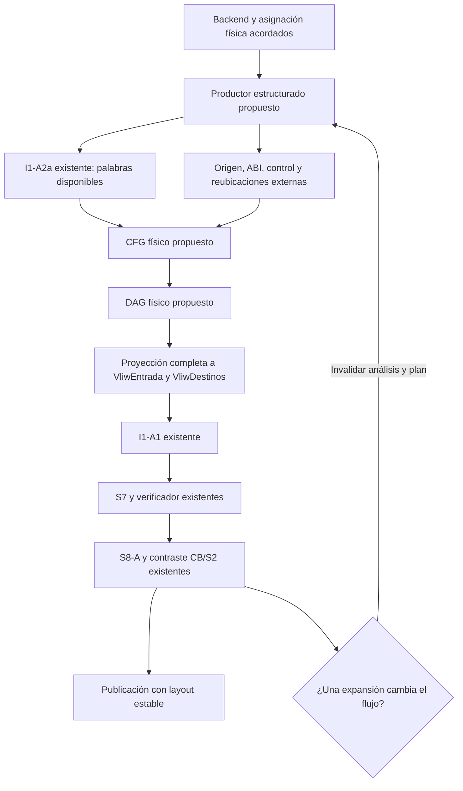

# Contrato propuesto del productor físico VLIW — I1-A2b-0

## 1. Objetivo y estado

Especificar qué información deberá entregar un productor físico antes de construir el CFG y el DAG físicos, validar con I1-A1 y utilizar S7/S8-A. Esta fase no implementa esos constructores ni conecta el compilador con ellos.

Referencia: rama `feat/i1a-integracion-vliw`, HEAD `97a8c1ea02d3b0eb95940b28cf4289b94d234185`, con PR #59 incorporado. Las referencias `origin/*` citadas son las disponibles localmente; no se actualizaron ni integraron en esta fase.

Estados utilizados:

- **IMPLEMENTADO:** comportamiento comprobado en las fuentes de la referencia indicada.
- **PROPUESTO:** diseño de este documento, sin implementación.
- **PENDIENTE DE ACUERDO:** requiere una decisión explícita de sus responsables. No implica aprobación del equipo.
- **BLOQUEADO:** faltan precondiciones para la conexión real indicada; no impide preparar consumidores independientes con fixtures aprobados.

Se mantienen la ISA del Proyecto I, cuatro slots, pipeline IF/ID/EX/WB y lectura desde N+3 sin forwarding. La propuesta de representación es conceptual: no introduce estructuras C, firmas, códigos de error o símbolos públicos nuevos.

## 2. Arquitectura actual y evidencia

**IMPLEMENTADO.** La ruta ordinaria es:

```text
BAL → semántica/AST + símbolos → mapa de memoria → ef_enlazar
 → arranque y funciones mediante ri/gd/gf/gb/gc
 → texto lineal físico con etiquetas
 → rs_resolver_etiquetas: bundles conservadores y relajación
 → cb_ensamblar → fb_escribir BALB + cb_escribir_mem
```

Los generadores reciben AST y resolvedores semánticos, no la IR optimizada. `ef_enlazar` repite generación/layout hasta estabilizar direcciones de funciones materializadas en x13. El IDE reutiliza ese enlace para generar ensamblador. PR #59 permite reescribir BAL usando evidencias DCE y recompilar ese fuente con el backend tradicional. No existe conexión productiva de CLI/IDE a `vliw_planificar` o `vliw_emitir`: en `src` se encuentran sus definiciones.

Fuentes comprobadas en HEAD, además de los informes completos I1-A0, I1-A1, I1-A2a y actualización PR #59:

| Fuente real | Evidencia principal |
|---|---|
| `src/Generacion_Codigo/generacion_basica.c` | Expresiones, constantes y expansiones multiplicar/dividir/potencia |
| `generacion_funciones.c`, `generacion_control.c`, `generacion_adaptador.c`, dentro de esa carpeta | AST, referencias por ámbito, llamadas, retornos y etiquetas de control |
| `src/Generacion_Codigo/funciones_marco.c`, `funciones_llamada.c` | Reservas de pila, homes, ra y protocolo de argumentos |
| `src/Resolucion_y_Enlace/enlace_funciones.c`: `generar`, `ef_enlazar` | Cadena lineal privada e iteraciones de direcciones |
| `src/Resolucion_y_Enlace/resolucion_saltos.c`: `ubicar`, `expandir`, `emitir` | Una operación y dos NOP; condicional largo invertido + SYE |
| `include/resolucion_referencias.h` y su implementación | Direcciones suministradas externamente; offsets relativos al bundle del salto |
| `include/codificacion_binaria.h`, `src/Codificacion_Binaria/` | Alias, codificación, bundles y formatos |
| `include/sim_decode.h`, `src/Simulador_VLIW/sim_decode.c` | 34 operaciones y operandos físicos |
| `include/vliw_*.h`, `src/Calendarizacion_VLIW/` | APIs consumidoras, validaciones y límites reales |
| `src/Representacion_Intermedia/ir.c`, `src/DCE/dce.c`, `src/IDE/ide_dce*.c`, `ide_ensamblador.c` | CFG virtual, DCE, reescritura BAL y recompilación |

Las pruebas de esos informes son antecedentes históricos, no ejecuciones nuevas de esta fase documental. Las afirmaciones actuales se contrastaron con fuentes y referencias Git.

## 3. Arquitectura propuesta

**PROPUESTO / PENDIENTE DE ACUERDO.** Separar la producción de operaciones reales del análisis y de la asignación final de PCs:



El diagrama expresa dependencias. No promete que S8-A tenga un enlazador final capaz de corregir cualquier referencia. La reubicación debe acordarse antes de habilitar llamadas reales. Exportar el backend AST tampoco implementaría generación desde IR optimizada: son fronteras distintas.

## 4. Frontera del productor

**IMPLEMENTADO.** `generar`, función privada de `enlace_funciones.c`, reúne el lineal en un `FILE` temporal y devuelve una cadena a `ef_enlazar`, inmediatamente antes de `rs_resolver_etiquetas`. `ri_generar_funcion` y los generadores escriben operaciones/etiquetas en `FILE *`. En ese punto ya hay xN y accesos sp/gp; expansiones aritméticas y control han creado operaciones y etiquetas propias.

Sin embargo, las direcciones supuestas de funciones ya se entregaron como enteros a la emisión de constantes. La cadena no conserva una reubicación que distinga esa dirección de un dato ordinario. Tampoco publica origen, clobbers o clasificación semántica de llamadas. Hay un punto textual observable, pero no una API pública de flujo físico completo.

**PROPUESTO / REQUIERE COORDINACIÓN.** Capturar las operaciones al emitirlas y conservar simultáneamente origen y referencias simbólicas, especialmente antes de materializar una función en x13. Una salida estructurada paralela al texto podría conservar el camino tradicional; habría que demostrarlo comparando sus salidas de referencia. No existe hoy esa exportación y añadirla afectaría generadores/enlace compartidos.

Después de `rs_resolver` se han insertado NOP, convertido etiquetas en comentarios/offsets y posiblemente expandido saltos. `CbPrograma` conserva palabras, texto limitado para listado y línea de ensamblador, pero no identidad BAL/ámbito, clobbers, reubicaciones o procedencia de expansiones. S2 recupera opcode/operandos, no esa información perdida.

`mov`, `not` y `ret` se reducen en CB a operaciones reales individuales. Las expansiones de producto/división/potencia y de condicionales largos sí crean secuencias/bloques. Deben cerrarse antes del análisis físico definitivo.

## 5. Datos necesarios y representación conceptual

**PROPUESTO / PENDIENTE DE ACUERDO.** Cada fila describe información, no un campo C ya aprobado:

| Dato | Responsable de producirlo | Uso y correspondencia actual |
|---|---|---|
| Versión/generación del flujo | Productor | Vincular operaciones, CFG, DAG, destinos y plan de una misma emisión; dato auxiliar nuevo |
| ID único | Productor | `VliwInstruccion.id`; identidad independiente del PC y de la posición |
| Posición de referencia | Productor | Índice de arreglos/aristas/destinos antes de calendarizar |
| Operación ISA y operandos | Backend físico; contraste S2 | Operación real, no `IrOp` ni pseudoinstrucción pendiente |
| Palabra opcional y validez | Codificación disponible | Entrada I1-A2a; distinguir ausencia, palabra local y codificación final tras reubicación |
| Slot | Backend, comprobado por S2 | ALU=0, LSU=1, BRU=2, CRIPTO=3 |
| Texto ISA | Productor | Una operación no-NOP para S8-A, menos de 160 bytes y sin etiquetas, comentarios ni separadores |
| Registros presentes | Backend/S2 | rd/rd2/rs1/rs2; ausencia distinta de x0 |
| Máscaras explícitas | I1-A2a desde operandos | `lee`/`escribe` exactos para S2, sin x0 |
| Efectos mínimos | I1-A2a desde opcode | Base obligatoria de `efectos`, no resumen completo del programa |
| Efectos adicionales | Productor | Barreras/desconocidos compatibles con las unidades y APIs actuales |
| Resumen ABI y clobbers | Backend/asignador | Información auxiliar separada de las máscaras de una operación ISA |
| Control semántico | Backend con evidencia | `VliwControl`: salto, llamada, retorno; no deducir solo de x1 |
| Función y bloque lógico | Productor/constructor CFG | Identidades; índice de bloque S7 asignado al proyectar la partición |
| Origen | Backend | Archivo, función, ámbito y AST/IR si existen; expansión y operación que la originó |
| Destino y continuación | Backend | Identidad lógica acreditada; proyección a `VliwDestino` |
| Reubicaciones | Backend/enlace | Símbolo real, uso, operaciones afectadas y transformación; tabla auxiliar propuesta |
| Pendientes y evidencias | Productor y responsables | Obligaciones acreditadas externamente antes de declarar completitud |

Un dato ausente se declara pendiente. No se fabrican símbolos, direcciones o destinos indirectos para llenar la representación.

## 6. Datos actualmente disponibles

**IMPLEMENTADO.** I1-A2a publica `operacion`, `familia`, `slot`, `lee`, `escribe`, `efectos_minimos`, `salto`, `requiere_auth`, `requiere_init` y `pendientes`. La API real es:

```c
SimDecodeEstado vliw_metadatos_extraer(uint32_t palabra, unsigned slot,
    VliwMetadatosParciales *salida, VliwMetadatosDiagnostico *diagnostico);
```

Solo OK publica. NOP y errores conservan todos los bytes de salida. La palabra/slot los proporciona el llamador. S2 ofrece registros individuales, inmediatos y campos criptográficos en `SimInstruccion`; I1-A2a no copia todos esos campos.

El backend tiene registros y etiquetas en texto; sus resolvedores conocen temporalmente símbolos con ámbito y referencias base/desplazamiento. `RrTabla` asocia nombres/clases a PCs externos. Esos datos dispersos no constituyen una exportación conjunta estable.

## 7. Datos pendientes y completitud

**BLOQUEADO para BAL real.** Faltan productor público acordado, identidad persistente, mapeo físico de IR/spilling, resumen ABI/efectos, CFG/DAG físicos, destinos y reubicaciones para un layout diferente.

Distinguir flujo **estructuralmente cerrado** (operaciones, registros y obligaciones de enlace identificados) de **imagen final** (direcciones estables). Una palabra con bits por reubicar no es código final. La obtención de palabras locales prelayout para operaciones relocalizables necesita acuerdo; no se inventan inmediatos para llamar I1-A2a. I1-A1 ya utiliza normalización local de directos para consultar CB; eso no acredita el destino final.

Los pendientes I1-A2a permanecen: PRODUCTOR y CFG_DAG siempre, CONTROL_ABI y DESTINOS ante transferencias. No se borran para simular completitud. Un registro externo de obligaciones puede acreditar fases posteriores, pero también requiere acuerdo. `metadatos_completos=true` solo se declara con evidencia suficiente y no certifica por sí mismo equivalencia BAL o capacidad del plan.

## 8. Identidad de instrucciones

**PROPUESTO.** Separar ID, posición y PC. Una operación retenida debe poder rastrearse al cambiar de orden; una expansión crea identidades nuevas con origen común y ordinal; una eliminación deja de pertenecer al nuevo flujo. La relación AST/IR→ISA puede ser uno-a-muchos.

S7 exige IDs únicos no necesariamente consecutivos. Aristas y `VliwDestino.instruccion` usan posiciones, no IDs: al cambiar secuencias se reconstruyen los índices. Los símbolos requieren identidad por módulo/función/ámbito, no solo texto. La generación asociada permite detectar análisis obsoletos; las APIs actuales no hacen ese control de versión automáticamente.

NOP no es una operación funcional de entrada S7; huecos y guardas pertenecen al plan. NOP explícitos y etiquetas finales sin operación requieren una representación acordada que conserve sus obligaciones. No borrarlos ni crear operaciones ficticias para satisfacer una interfaz. Etiquetas consecutivas pueden asociarse a la misma entrada real cuando su semántica lo permita.

## 9. Registros físicos

**IMPLEMENTADO.** S2 reconoce 34 operaciones y distingue reservado, slot incorrecto y campos inválidos. El fallback ADD del RTL ante ciertos identificadores ALU no los convierte en instrucciones válidas de la ISA.

x0 es cero y descarta escrituras: no origina RAW/WAR/WAW, aunque escribir x0 siga siendo una operación no-NOP. Ausente=32 no es x0. Feistel incluye ambos registros fuente/destino; store lee base y dato, load escribe destino.

I1-A1/S8-A contrastan máscaras exactas con S2. S7 admite hasta dos fuentes y un destino, o dos destinos CRIPTO. **No agregar a la máscara SYER todos los clobbers de una función** ni lecturas ABI ficticias: esos resúmenes necesitan información auxiliar y corrección previa a la proyección.

CB acepta t0..t11 para x4..x15 y s0..s15 para x16..x31; los alias no prueban preservación. `$tN`, `$rN` y `$spillN` son virtuales/lógicos, nunca equivalentes automáticamente a xN.

## 10. ABI, clobbers y marcos

**IMPLEMENTADO en el backend tradicional; no suponer un ABI externo.**

| Registro/recurso | Uso comprobado | Límite relevante |
|---|---|---|
| x1 / ra | Enlace de llamada; prólogo guarda en sp+0; epílogo recarga | Clasificación llamada/retorno debe proceder del generador |
| x2 / sp | Pila descendente, reservas/liberaciones | Ajustes grandes del marco en pasos de hasta 1020 bytes |
| x3 / gp | Inicialización de arranque y base de globales | No disponible como temporal por inferencia |
| x4..x7 | Expresiones, resultado intermedio x4, preparación de argumentos | Pool ya usado por generadores |
| x8..x11 | Primeros cuatro argumentos; retorno escalar x8 | También hay usos auxiliares en división/potencia |
| x12 | Auxiliar de direcciones y argumentos extra | No existe preservación general |
| x13 | Dirección de callee antes de `syer x1,x13,0` | También auxiliar aritmético |
| x12..x15 | Producto; división/potencia usan además x8..x11 | Clobbers dependen de cada expansión |
| x16..x31 | Registros y alias aceptados | No se encontró una política general callee-saved implementada |
| sp+0 y homes | ra y parámetros desde sp+4 | Locales, arreglos, temporales y spills no deben solaparse |

`fl_emitir_llamada` admite hasta 255 argumentos y utiliza slots de todos los valores para permutaciones seguras: cuatro pasan a x8..x11 y extras a pila. **La integración AST `llamada` rechaza más de cuatro argumentos y admite llamadas directas escalares.** La capacidad del helper no demuestra soporte completo de CLI. El retorno queda en x8 y puede copiarse a x4. El epílogo termina en `syer x0,x1,0`.

La preservación observada es guardar ra y restaurar sp en esas rutas. No hay evidencia de una lista general de callee-saved. Una barrera impide movimientos; no recupera un valor destruido por el callee.

**IMPLEMENTADO solo en rama separada:** `origin/feature/register-spilling`, `fd367a3476c7698904b9c5285b3523207e039c5d`. `ir_aplicar_spilling` genera otra IR con pool `$rN`, ranuras `$spillN`, nuevas IrOp y CFG reconstruido. Sus helpers alinean a cuatro bytes, parten de reservas completas del marco y limitan accesos directos a offset 1020 y marco a 65536. `ir_spilling_backend_acceso` recibe un registro físico externo; no lo asigna ni acredita todas las reservas ABI.

**PENDIENTE DE ACUERDO con Dylan/equipo:** pool físico por función, mapeo/vigencia de `$rN`, registros reservados, clobbers por expansión/call, preservación de valores vivos, ranuras, offsets y accesos fuera de rango. No basta renombrar cadenas ni copiar el marco anterior.

## 11. Efectos, memoria y excepciones

**IMPLEMENTADO.** Los mínimos son: loads lectura; stores escritura; FSL/FSLI excepción; ELL bóveda+excepción; SETPWD bóveda+estado+excepción; VCR lectura+estado; CAMCON lectura+escritura+bóveda+excepción. Mínimo cero para ALU/BRU no demuestra ausencia de efectos del programa.

S7 aísla CRIPTO, llamadas, retornos y efectos globales/barrera/desconocidos. Llamadas requieren `VLIW_EF_DESCONOCIDOS`. Los efectos adicionales respetan unidades: no añadir `VLIW_EF_LEE_MEMORIA`/`VLIW_EF_ESCRIBE_MEMORIA` a BRU para simular la memoria del callee; I1-A1 lo rechaza. El resumen externo y las restricciones conservadoras deben representar esa obligación.

**PROPUESTO.** Conservar región, ancho, base simbólica, desplazamiento, carácter dinámico y prueba de alias por acceso cuando existan. Sin prueba hay posible alias. La interfaz actual conserva orden entre todos los pares marcados con memoria, incluso load/load o regiones distintas: esta fase no autoriza relajar esa política.

Las excepciones criptográficas no son BRU. AUTH/INIT son requisitos estáticos, no valores dinámicos inferidos. El vector 0x3FF0 queda fuera de los bundles ordinarios S7; instalación/handler requieren contrato compartido, no un bloque ficticio. El CFG normal no representa todos los caminos excepcionales.

División por cero y exponente negativo utilizan bucles estables en las expansiones actuales; no son automáticamente traps criptográficos. Mover efectos antes de esos caminos puede cambiar comportamiento BAL sin producir un riesgo GPR visible.

## 12. CFG físico

**PROPUESTO; constructor no implementado.** Recibir flujo cerrado, etiquetas/símbolos, control ABI, destinos y continuaciones acreditados. Producir partición contigua no vacía, operación→bloque y sucesores compatibles con las estructuras existentes.

Entradas de arranque/función y destinos delimitan bloques. Toda BRU termina bloque; la operación posterior inicia otro. Una expansión puede crear fronteras propias. IR_CALL no necesariamente termina un bloque virtual, mientras que SYER físico sí debe hacerlo.

| Forma | Sucesores y destino |
|---|---|
| Sin control | Caída al bloque siguiente; ninguna si es el último |
| Condicional | Tomado lógico y caída b+1, o VLIW_VACIO al salir; conjunto sin duplicados |
| SYE sin llamada | Destino directo acreditado, sin caída |
| Llamada | Continuación b+1 si existe; directo incluye callee y continuación; indirecto conserva naturaleza dinámica |
| SYER genérico | Destino dinámico; no convertir en función conocida sin evidencia |
| Retorno | RETORNO explícito, tomado=VLIW_VACIO y sin caída de llamada |
| Backedge | Arista CFG válida hacia bloque anterior o el propio bloque |

Cada BRU exige una entrada `VliwDestino`. Indirectos/retornos pueden enumerar destinos posibles suministrados por el productor; la validación local no demuestra su completitud dinámica. Sin esa garantía, una integración real puede seguir bloqueada aunque la estructura sea aceptable.

La caída b+1 obliga a acordar orden de bloques/continuaciones. No permitir que el fin de una función caiga accidentalmente en otra ni agregar un bloque vacío para ocultarlo. Entradas/salidas abstractas se conservan como información auxiliar; S7 exige operaciones reales por bloque. Las etiquetas consecutivas pueden ser alias de entrada; destinos sin entrada representable se rechazan o esperan acuerdo.

No copiar CFG IR después de spills, prólogos o relajación. Comprobar cobertura, destinos existentes, ausencia de entradas al medio de expansiones indivisibles y separación de funciones. CFG estructural y completitud interprocedimental son garantías distintas.

## 13. DAG y dependencias

**PROPUESTO; algoritmo no implementado.** Recibir operaciones físicas acreditadas y CFG vigente. Producir `VliwDependencia` con posiciones antes<después, tipo y distancia mínima en bundles, preservando el orden de referencia.

| Relación | Información | Requisito vigente |
|---|---|---|
| RAW | escribe(i) ∩ lee(j), sin x0 | Camino de distancia ≥3; lectura ID después de disponibilidad WB |
| WAR | lee(i) ∩ escribe(j), sin x0 | Orden y distancia ≥1 |
| WAW | escribe(i) ∩ escribe(j), sin x0 | Orden y distancia ≥1 |
| Memoria | Efectos; alias acreditado para análisis futuro | Orden conservador ≥1 de todos los pares con memoria actuales |
| Control | Clasificación y CFG | Camino ≥1 si una operación del par es control; BRU aislada al final |
| Barrera | CRIPTO/efectos globales/desconocidos, call/ret | Distancia ≥3 y aislamiento; prevalece sobre restricciones débiles |
| Clobbers/efectos de callee | ABI y preservación materializada | No deducibles de SYER; resolver externamente o rechazar |
| Otros errores observables | Semántica y orden de efectos | Tratamiento conservador compatible acordado o rechazo |

I1-A1 exige cobertura por caminos ponderados de riesgos visibles **de todos los pares en orden original**, incluso entre bloques o con escrituras intermedias. Un DAG de última definición solamente puede resultar insuficiente. Se debe demostrar cobertura, no necesariamente crear una arista directa por par. RAW/WAR/WAW requieren intersecciones reales; una barrera ABI no justifica una RAW ficticia.

S7 conserva operaciones dentro de sus bloques y orden de bloques; protege entradas con dos NOP, incluido B0 con predecesor. Su verificador revisa riesgos globales y distancias. No eliminar guardas por inferir independencia.

CFG puede ser cíclico; DAG de emisión debe ser acíclico. Dependencias entre iteraciones y retornos dinámicos requieren CFG/ABI/guardas correctos; no copiar un backedge como arista hacia atrás del DAG. Especular entre bloques o cambiar la política es otro alcance.

Clasificación: **deducible de máscaras**, riesgos explícitos GPR/pares Feistel; **requiere datos adicionales**, control semántico/clobbers/errores/símbolos; **conservador hoy**, memoria/CRIPTO/call/ret/desconocidos; **rechazar**, virtuales sin asignar, efectos omitidos, aristas falsas, índices obsoletos u obligaciones sin tratamiento seguro.

Ejemplo conceptual: `sumai x4,x0,7` y luego `guardap x2,x4,4` requieren RAW3 por x4; el store no escribe GPR. No es una prueba ejecutada. La cota es 1023 bundles ordinarios incluyendo guardas/NOP; 4092 operaciones solo es una condición estructural necesaria.

## 14. Destinos lógicos

**IMPLEMENTADO.** `VliwDestino` contiene posición de BRU, tipo, tomado y caída. Directos/condicionales usan bloques; indirectos/retornos conservan tomado=VLIW_VACIO. I1-A1/S8-A contrastan forma y CFG. S8-A reemplaza el último operando directo por la etiqueta del bloque del plan, situada antes de sus guardas; SYER conserva operandos dinámicos.

`SimSalto` reconoce forma física, no llamada/retorno semántico. Escribir/leer x1 no basta. **PROPUESTO:** registrar esa intención en el backend y conservar destino como identidad simbólica separada del PC. Un entero antiguo no acredita identidad del bloque. Destino indirecto requiere evidencia externa; NO_RESUELTO se rechaza.

## 15. Reubicaciones y enlace

**IMPLEMENTADO.** RR recibe PCs externos. Los offsets parten del bundle que contiene el salto, no PC+16: condicional alineado −1024..1008 bytes, SYE −32768..32752. S2 no impone al inmediato SYER la alineación de un offset directo.

RS coloca operación + dos NOP; relaja condicional simbólico largo con inverso corto + SYE y vuelve a ubicar. EF regenera constantes de función hasta estabilizar direcciones; una constante puede cambiar de una instrucción a una secuencia. Esa convergencia del layout tradicional no se ha demostrado para S7.

**PROPUESTO / PENDIENTE DE ACUERDO.** Cada reubicación conserva símbolo real, clase de uso, operaciones/secuencia afectadas, transformación de bits, adendo si existe, origen y generación. Datos de memoria no se convierten en PCs porque código use bundles de 16 bytes. La tabla auxiliar no es una API RR nueva.

Las ALU que forman x13 podrían seguir siendo ISA válida tras reorganizar y formar una dirección incorrecta. `VliwDestinos` no describe esos fragmentos y S8-A no los reubica. Capturar la función antes de materializar su dirección es obligatorio para ese camino.

No ejecutar `rs_resolver` sobre un plan S7/S8-A: volvería a empaquetarlo. S8-A no relaja ni enlaza módulos; fuera de rango significa rechazo.

Si cambian operaciones, registros, efectos, fronteras, destinos o longitud de materialización, invalidar CFG/DAG/destinos/plan/verificaciones y regenerar. Si solo cambian bits dentro de estructura estable, revalidar igualmente codificación, metadatos y alcance. El protocolo de estabilización, límites de iteración y fallo sin publicación está **BLOQUEADO** hasta acordarlo.

## 16. Propiedad de memoria

**PROPUESTO.** El resultado del productor debe poseer operaciones, textos y tablas auxiliares, publicarse completo y mantenerlos vivos durante consumidores. No retener punteros a AST/IR mutable o liberado sin vida acordada. Identidad persistente no es la dirección de un nodo.

**IMPLEMENTADO:** I1-A2a devuelve valores sin heap; I1-A1 toma prestada entrada y no produce plan. S7 posee arreglos del plan, no textos; se libera con `vliw_liberar`. S8-A publica cadena propia, liberable con `vliw_emisor_liberar`. Las entradas son inmutables durante llamadas. Los nombres del grafo virtual público de Meibel son prestados de IR y requieren vida garantizada o copia antes de mutarla.

Salida vacía, destructor y diagnóstico del futuro productor siguen por acordar; no se supone que exista un liberador nuevo.

## 17. Errores y publicación

**PROPUESTO.** Distinguir argumento/estructura, operación no soportada, información incompleta, registro/mapeo, símbolo/reubicación pendiente, CFG/DAG, rango/capacidad y memoria/E/S. Son categorías conceptuales, no códigos numéricos nuevos.

Conservar diagnóstico original con generación/ID/posición/origen disponibles. Rechazo heurístico no es falta de memoria; éxito local no es equivalencia. Liberar salidas parciales propias y conservar entradas conforme al contrato; no prometer rollback de DCE ajeno que modifica IR in situ.

No publicar salida como optimizada si faltan fases o hubo respaldo silencioso al backend anterior. Las opciones CLI y política de respaldo no se implementan aquí.

## 18. Relación con I1-A2a

**IMPLEMENTADO:** reutilizar solo con palabra/slot acreditados. Ofrece reconocimiento, máscaras y mínimos locales; no codifica ASM, asigna registros ni construye CFG/DAG.

**PROPUESTO:** contrastar sus resultados con identidad/texto/origen/ABI del productor y mantener pendientes externos. Una palabra reubicada se verifica nuevamente. No cambiar el extractor para aceptar NOP/reservados ni activar completitud.

## 19. Relación con I1-A1

**IMPLEMENTADO:** `vliw_integracion_validar(entrada,destinos,diagnostico)` recibe la proyección completa, verifica estructura/ISA/máscaras/efectos y cobertura de dependencias/destinos. Exige declaración externa para no vacío; no construye ni repara datos.

**PROPUESTO:** proyectar solo tras acreditar obligaciones. Origen/ABI/reubicaciones permanecen bajo responsabilidad externa: OK no autentica esas garantías ni elimina la validación de imagen final.

## 20. Relación con S7/S8-A/S8-C

**IMPLEMENTADO:** S7 publica/verifica un plan desde `VliwEntrada`. S8-A consume entrada/plan/destinos, conserva layout y valida con CB/S2 antes de publicar texto. S8-C visualiza métricas estáticas; no mide ciclos ejecutados o IPC dinámico.

Conservar IDs/índices, textos individuales, efectos compatibles y destinos. Información adicional va en soporte auxiliar y protocolo acordado, no en estructuras protegidas modificadas para esconder faltantes. Casos no representables se rechazan o requieren otro bloque autorizado.

## 21. Resultados observables y consecuencias de PR #59

**PENDIENTE DE ACUERDO.** Separar estos juicios:

| Juicio | Qué necesita |
|---|---|
| Equivalencia de comportamiento BAL | Resultados, efectos y errores acordados con entradas iguales; compilar no lo demuestra |
| Igualdad arquitectónica estricta | Contrato B1 existente y sus condiciones de finalización: GPR, DMEM completa y estado criptográfico público/traps |
| Resultados seleccionados iguales | Oráculo independiente sobre objetos lógicos tipados; alcance explícitamente menor |
| Memoria completa igual | Los mismos 65536 bytes en puntos comparables; puede romperse al variar marcos/spills/datos muertos |
| Registros físicos iguales | Misma asignación concreta; no equivale a igualdad de variables BAL |
| Excepciones/errores equivalentes | Clase y efectos previos en punto lógico comparable; no solo ausencia de traps criptográficos |

**PROPUESTO:** por programa acordar fuente/transformaciones, entradas/estado inicial, objetos de salida identificados por función/ámbito/tipo/tamaño, punto de observación y mapa objeto→ubicación de cada versión. El mapa requiere marcos/globales finales, base de la activación correcta, offsets y política de error/finalización; también observaciones criptográficas públicas pertinentes.

El oráculo no depende de qué variable DCE considere viva. Si DCE elimina un objeto declarado como salida, rechazar/revisar con José; no redefinir después el oráculo para obtener igualdad. No ignorar automáticamente GPR/bytes/spills discrepantes ni modificar B1–B5.

PR #59 recalcula las variables no temporales leídas en `main` en cada pasada y permite borrar/unir declaraciones. Puede cambiar identidad práctica de objetos, marcos, offsets, etiquetas generadas, PCs y materialización de direcciones. Recompilar BAL válido no prueba equivalencia ni suministra correspondencias entre versiones. Recalcular CFG/liveness y análisis físicos tras transformaciones materiales.

Su prueba `test_dce_simulador` compara dos enteros esperados tras 2000000 ciclos por versión, con marcos concretos de 24/20 bytes; no verifica el retorno de ejecutar. Acredita resultados seleccionados del fixture, no terminación o equivalencia general. Un salto estable o corte B5 con pipeline ACTIVO no es HALT ni certifica retorno semántico de main. Cada versión necesita su punto comparable: igual presupuesto no garantiza igual progreso. Comparar rendimiento solo después de acreditar resultados bajo el contrato elegido.

## 22. Responsabilidades e independencia

Asignaciones confirmadas en `division_tareas_compiladores_proyecto_2_actualizada.pdf`. El backend/generación/enlace del Proyecto I son base reutilizada; no se reasignan automáticamente a Javier.

| Componente | Responsable | Información disponible | Información pendiente | Acuerdo necesario |
|---|---|---|---|---|
| Consumidor VLIW/metadatos | Javier | S2, I1-A2a/I1-A1, S7/S8-A/S8-C | Proyección y protocolo | Aprobación de esquema y cada fase |
| CFG/DAG físicos futuros | Javier como integrador | Reglas y fixtures | Entrada real, ABI/control acreditados | Frontera del productor y efectos |
| IR/símbolos/spilling | Dylan | IR integrada; spilling en fd367a3 | Tipos/ámbitos, mapeo, clobbers, marcos | Lowering/asignación y nuevas IrOp |
| Unrolling/reordenamiento | Meibel | Rama c2ab49a y grafo virtual | Origen estable, efectos/errores | Forma de salida y reconstrucción de análisis |
| DCE/liveness/BAL/IDE | José | PR #59 y revalidación de fuente | Observables, errores y reutilización | Contrato de resultados y cambios futuros |
| Backend/ABI/codificador/enlace | Equipo/base | Camino tradicional | Exportación, reubicación y estabilización S7 | Responsable concreto y autorización para intervenir |

**INDEPENDIENTE:** esta especificación y, con autorización posterior, consumidores aislados de fixtures físicos explícitos.

**REQUIERE COORDINACIÓN:** exportar generadores/enlace, asignar registros/spills, cambiar IR/DCE/IDE/CLI/Makefile, marcos, símbolos o política de resultados/errores.

**BLOQUEADO:** flujo BAL completo hacia S7/S8-A y comparación optimizada hasta disponer de productor/ABI/reubicaciones/observación suficientes. Las ramas de Dylan y Meibel no son ancestros de HEAD.

La referencia actual disponible de Meibel es `c2ab49abea4432a6208420409d1ba67844a38e78`, posterior a la revisada en I1-A0. Añade `ro_analizar_bloque`, RoNodo/RoArista/RoGrafoBloque, `ro_exportar_json` y visualizador. Es un grafo de nombres IR, ciclos estimados y una instrucción por ciclo; no contiene asignación xN, expansiones ISA o reubicaciones. No sustituye el DAG S7. No se integró ni se ejecutaron sus pruebas en esta especificación; su interfaz no se presenta como acordada.

## 23. Preguntas abiertas

**Dylan — PENDIENTE DE ACUERDO:**

- ¿Quién entrega operaciones físicas: exportación AST, lowering IR o ambos? Hay que distinguir integración tradicional de uso real de IR optimizada.
- ¿Cómo se identifican símbolos/tipos/ámbitos tras las pasadas? Nombres coincidentes no bastan para referencias y observables.
- ¿Qué pool y mapeo/vigencia tiene `$rN` y qué reserva cada expansión? Deben evitarse colisiones con x13, argumentos y temporales.
- ¿Qué clobbers/preservación rigen llamadas y quién emite saves/restores? Una barrera no preserva valores vivos.
- ¿Quién fija marco/offsets spill y expande accesos fuera de rango? El DAG necesita operaciones y registros definitivos.

**Meibel — PENDIENTE DE ACUERDO:**

- ¿Qué versión/forma IR sale de cada pasada y cuándo se reconstruye CFG? Evita reutilizar intervalos invalidados.
- ¿Qué procedencia se conserva tras copias y en `RoResumen.origen`? Posición no equivale a identidad y puede haber expansión uno-a-muchos.
- ¿Qué protege errores de IR_BIN y límites de 32 bits? Ausencia de riesgo virtual no garantiza orden de errores BAL.
- ¿Cómo integrar el nuevo grafo público y la vida de sus nombres prestados? Su trazabilidad puede reutilizarse, pero debe reconstruirse el DAG físico.

**José — PENDIENTE DE ACUERDO:**

- ¿Qué objetos son resultados observables aunque no se lean dentro de `main`? La frontera DCE actual puede borrar resultados esperados externamente.
- ¿Cómo se informa que cambió IR pero la reescritura BAL conservó alguna sentencia? Deben registrarse fases efectivas de generación.
- ¿Puede reutilizarse el núcleo sin GTK con mapa de origen y qué propiedad/errores ofrece? No se supone una API productora adicional.
- ¿Qué garantías hay ante falta de memoria y qué errores deben conservarse? La integración no puede prometer rollback/equivalencia sin evidencia.

**Equipo — PENDIENTE DE ACUERDO:**

- ¿Dónde se capturan símbolos antes de formar x13 y quién posee el flujo? El texto posterior ya perdió esa referencia.
- ¿Qué protocolo reubica, relaja y replanifica al cambiar tamaño? RS tradicional no puede reaplicarse a bundles S7.
- ¿Cómo se acreditan continuaciones, retornos/indirectos y handler? Evitar destinos o bloques ficticios.
- ¿Qué subset inicial, responsables y rechazos se aprueban? Fixtures no equivalen a productor BAL.
- ¿Qué contrato de observación/mapa/finalización se acepta? Sin él no se certifica equivalencia ni speedup general.

Preguntas preparadas para revisión de Javier; no se enviaron mensajes, crearon issues o atribuyeron acuerdos al equipo.

## 24. Criterios para desbloquear I1-A2b-1

**PROPUESTA de alcance: consumidor/constructor de CFG físico aislado. PENDIENTE DE APROBACIÓN; no iniciado.** La numeración no establece una asignación aprobada.

Puede ser **INDEPENDIENTE con fixtures explícitos**, previa aprobación de entrada (operaciones, identidades, etiquetas, control), propiedad de salida y archivos nuevos. No simular un productor BAL.

Aceptación futura: partición completa, alias de entrada válidos, arranque/funciones, BRU terminador, caídas, call/continuación, retorno, indirectos declarados, backedges; rechazos de etiquetas/índices/obligaciones faltantes. Verificar inmutabilidad, errores/recursos y análisis obsoletos, sin bloques vacíos o destinos inventados para pasar pruebas.

La conexión a **BAL real** exige además acuerdo de exportación con el equipo y evidencia ABI/control/reubicaciones. Permanece **BLOQUEADA**. Si el equipo decide que esta fase sea primero el productor y no el consumidor CFG, deberá redefinirse y autorizarse ese alcance compartido.

## 25. Criterios para desbloquear I1-A2b-2

**PROPUESTA de alcance: constructor de DAG físico aislado. PENDIENTE DE APROBACIÓN; no iniciado.** Depende del flujo y CFG aprobados, obtenidos del constructor anterior o de fixtures explícitos equivalentes.

Puede ser **INDEPENDIENTE sobre fixtures** tras autorizar alcance/archivos. Conectar productores de compañeros **REQUIERE COORDINACIÓN**.

Aceptación futura: RAW3, WAR/WAW1, x0/Feistel, loads/stores/memoria conservadora, control/barreras3/call/ret/CRIPTO/desconocidos, cobertura transitiva global I1-A1, CFG cíclico frente a DAG acíclico y rechazo de aristas falsas/índices obsoletos/obligaciones sin acreditar/capacidad. Encadenar I1-A1→S7/verificador→S8-A en fixtures adecuados sin modificar entradas. No agregar aristas ficticias ni certificar equivalencia BAL por obtener un plan válido.

Para ejecución BAL optimizada deben estar disponibles productor físico, asignación/spills, clobbers/efectos, destinos/reubicaciones y observables. **BLOQUEADO** hasta entonces. Esta fase no implementa ni autoriza automáticamente I1-A2b-1 o I1-A2b-2.
