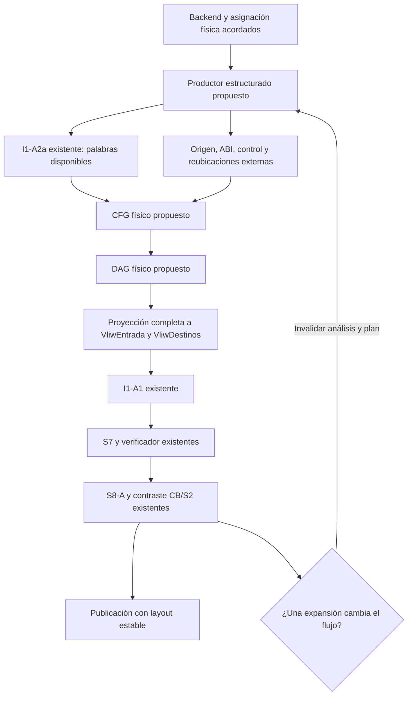

## Archivo: ./docs/ast_json.md
```markdown
# AST en JSON

`--ast-json` construye el AST con el parser existente y escribe únicamente JSON en stdout. Los errores van a stderr; si el fuente tiene un error léxico o sintáctico, no se emite un árbol parcial. No realiza análisis semántico ni genera código.

```sh
make
./balc --ast-json examples/factorial.bal > factorial.ast.json
python3 -m json.tool factorial.ast.json > /dev/null
xdg-open tools/visualizar_ast.html
```

En el navegador, seleccionar `factorial.ast.json`. El árbol se dibuja con la raiz arriba, nodos circulares y lineas entre padres e hijos. Conserva el orden de los hijos. Permite zoom, desplazamiento, ajuste del arbol y expandir o contraer nodos. Al pasar el cursor sobre un nodo se muestran el texto completo y su ubicacion. El visualizador funciona sin conexión ni bibliotecas externas; no sube el archivo a un servidor.

Cada nodo contiene `tipo`, `texto` (cadena o null), `ubicacion` y `hijos` (arreglo). La ubicación conserva línea y columna inicial/final del AST; empiezan en 1 y el extremo final es exclusivo. Los literales conservan su lexema: `0005` aparece como `0005`, aunque su valor decimal sea 5. No se exportan punteros a padres ni la lista privada de reservas.

`-t` imprime el AST en texto y continua la compilacion hasta el binario. Se acepta `-t --ast-json` y en ese caso se emite JSON. `--ast-json` no se combina con `-v`, `-m`, `-s`, `-x`, `-p` ni `-o`: es un modo de exportacion con JSON limpio en stdout. Las opciones normales del compilador siguen generando el binario BALB y la imagen `.mem`.

El exportador recorre los enlaces del AST sin recursión. El visualizador admite hasta 20 000 nodos y archivos de hasta 10 MiB. Estos límites pertenecen al visualizador, no al lenguaje.

```sh
make test-ast-json
make test-ast test-cli test-parser
```

Las pruebas leen la salida con el módulo JSON de Python y comprueban factorial, precedencia, ceros iniciales, escapes, Unicode, combinaciones de opciones y errores sin salida parcial.

La opcion `-s` incorporada en development se conserva: `./balc -s examples/factorial.bal` genera el ensamblador en bundles, el binario BALB y la imagen `.mem`. Las pruebas JSON tambien comprueban esa salida en una carpeta temporal.

```

## Archivo: ./docs/ast.md
```markdown
# Árbol de sintaxis abstracta (AST)

El AST representa la estructura del programa. No ejecuta sus instrucciones ni
verifica los tipos semánticos. La gramática actual construye nodos para todas
las construcciones que reconoce: funciones, parámetros, bloques, declaraciones,
asignaciones, expresiones, condicionales, ciclos, retornos, llamadas, colecciones,
importaciones, constantes y bloques de manejo de errores.

## Archivos y responsabilidades

- `include/ast.h`: tipos `Ast`, `AstNodo`, `AstTipo`, `AstUbicacion` y API.
- `src/Analisis_Sintactico/ast.c`: creación de nodos, hijos, impresión y memoria.
- `src/Analisis_Sintactico/gramatica.y`: acciones que conectan los nodos al reconocer reglas.
- `src/Analisis_Sintactico/puente_lexer.c`: hojas de identificadores, tipos y literales.
- `tests/test_ast.c`: pruebas de la estructura real del árbol.

Bison sigue generando `parser.c` y `parser.h`; no se editan directamente.

## Cómo Bison construye el árbol

`%define api.value.type {AstNodo *}` hace que cada valor semántico sea un puntero
a un nodo. `%locations` y `AstUbicacion` conservan las posiciones. En una acción,
`$$` es el nodo resultante y `$1`, `$2`, etc., los valores de los elementos de
la regla; `@$` es la ubicación de la construcción completa.

Por ejemplo:

```bison
expresion:
    expresion GAUSS expresion
    {
        $$ = ast_crear(ctx->arbol, AST_BINARIO, "gauss", @$);
        if (!$$) YYNOMEM;
        ast_agregar_hijo($$, $1);
        ast_agregar_hijo($$, $3);
    }
;
```

La precedencia de Bison determina qué nodos se unen primero. `2 gauss 3 pitagoras 4`
produce una suma cuyo hijo derecho es una multiplicación. Los paréntesis alteran
la agrupación y devuelven el nodo interior; no crean un nodo de puntuación.
La ubicación de ese nodo interior conserva la de su construcción original.


## Contrato de los nodos

Cada nodo contiene `tipo`, `texto` opcional, `ubicacion`, `primer_hijo`,
`ultimo_hijo`, `siguiente` (hermano) y `padre`. El orden de hijos es significativo:

| Nodo | Hijos en orden |
|---|---|
| Programa | Funciones, importaciones y constantes globales en orden del fuente |
| Funcion | Nombre, tipo de retorno, Parametros, Bloque |
| Parametros / Argumentos | Elementos en orden; pueden estar vacíos |
| Parametro | Nombre, tipo |
| Bloque | Sentencias en orden; puede estar vacío |
| Declaracion | Nombre, tipo simple o compuesto, expresión inicial opcional |
| Asignacion | Referencia de destino (nombre, miembro o índice), expresión |
| Binario | Operando izquierdo, operando derecho; texto = operador |
| Unario | Operando; texto = operador |
| Si | Condición, bloque verdadero, alternativa opcional |
| Mientras | Condición, bloque del cuerpo |
| Retorno | Expresión opcional |
| Llamada | Referencia de destino, Argumentos |
| Declaraciones | Declaraciones o listas agrupadas, en orden |
| Constante | Nombre, tipo, inicializador obligatorio |
| TipoArreglo | Tipo base, Dimensiones |
| TipoLista | Tipo base |
| Dimensiones | Nodos Dimension, en orden |
| Dimension | Expresión; vacía únicamente en parámetros sin tamaño |
| Indice | Referencia base, expresión de índice |
| AccesoMiembro | Referencia base, identificador del miembro |
| LiteralColeccion | Elementos; admite otros LiteralColeccion y lista vacía |
| Lista | Nombre, tipo de elemento, inicializador opcional |
| Agregar / Eliminar | Colección, valor o índice respectivamente |
| Tamano | Colección |
| Recorrido | Variable, inicio, límite exclusivo, paso, bloque |
| Importacion | Nombre de módulo, alias opcional |
| Intentar | Bloque protegido, Capturas |
| Capturas | Nodos Captura en orden |
| Captura | Identificador de tipo de error, identificador de variable, bloque |
| Identificador / Tipo / literales | Sin hijos; texto = lexema original |

`alif` se representa como otro nodo `Si` en la alternativa del anterior; su texto
es `alif`. `also` es el bloque final. Sin alternativa, el nodo solo tiene dos
hijos. Un `Retorno` sin expresión representa `give;`.

Los lexemas mantienen su escritura original, incluidas comillas de cadenas,
`$` de caracteres y enteros arbitrariamente largos. No se convierten a valores
numéricos ni se resuelven símbolos todavía. Las posiciones cuentan líneas y
columnas Unicode desde 1; el final es exclusivo. Las listas vacías toman la
posición final del símbolo anterior, porque no consumen texto.

## Uso y propiedad de memoria

```c
Ast arbol = {0};
int estado = construir_ast(fuente, longitud, nombre, stderr, &arbol);
if (estado == 0) {
    ast_imprimir(&arbol, stdout);
    /* La siguiente fase puede recorrer arbol.raiz. */
}
ast_liberar(&arbol);
```

El argumento de salida debe ser un `Ast` vacío. En éxito el llamador conserva
el árbol hasta llamar a `ast_liberar`. Sus textos son copias propias: el fuente
puede liberarse después del análisis. En error, `construir_ast` libera todos
los nodos y devuelve un árbol vacío. Los códigos siguen siendo 0 éxito, 1 error
de entrada y 2 falta de memoria.

Todos los nodos se registran en una lista de reservas propiedad del `Ast`.
Por eso no se liberan individualmente en destructores de Bison: la lista limpia
también símbolos descartados y nodos que aún no llegaron a la raíz. Las acciones
usan `YYNOMEM` si no pueden crear un nodo. La impresión y liberación son iterativas.
`ast_agregar_hijo` requiere un hijo sin padre ni hermanos; no permite compartir
un nodo entre dos padres. El campo `reservado_siguiente` es de uso interno.

`analizar_sintaxis` sigue disponible: construye y libera el AST internamente
para devolver solo el resultado de validación.

## Ver el árbol y ejecutar pruebas

Desde la raíz del proyecto:

```bash
make
./balc --frontend -t examples/factorial.bal
./balc --frontend -t examples/llamadas.bal
./balc --frontend -t examples/condicionales.bal
make test-ast
make test
```

`-t` muestra sangría por nivel y la posición inicial de cada nodo. Los mensajes
no presentan un árbol parcial ante errores. `-v -t` añade el listado léxico previo.
Las pruebas comprueban precedencia, asociatividad, llamadas y control anidados,
literales, posiciones UTF-8/CRLF, independencia del fuente y limpieza tras errores.
El AST aún no asigna ámbitos, tipos semánticos, direcciones ni instrucciones.

## Contratos de las extensiones

Una declaración sin inicializador tiene dos hijos; no se crea un valor cero.
Los arreglos conservan dimensiones en el tipo y los accesos `m[i][j]` son dos
nodos `Indice` anidados. Una lista usa el nodo `Lista`, diferente de una variable
de tipo arreglo; los parámetros de lista usan `TipoLista`.
`Recorrido` siempre tiene cinco hijos: el paso omitido se convierte en un nodo
entero `1`. Su límite se interpreta como exclusivo en la futura generación de
código. `Importacion` solo registra el módulo: no carga archivos.
`Intentar` y `Captura` no implementan excepciones en ejecución.

Los detalles de sintaxis, precedencia y tareas semánticas pendientes están en
`docs/lenguaje_actual.md`. Las pruebas estructurales cubren también las extensiones.

```

## Archivo: ./docs/backend_binario.md
```markdown
# Backend binario (Fase 6) y opciones de balc

`src/Codificacion_Binaria/codificacion_binaria.c` convierte el ensamblador VLIW en texto a palabras
de 32 bits por slot y escribe los archivos que carga el procesador. Sigue el
contrato de Arquitectura (`docs/arquitectura/isa.md` y `assembler.md` en la
rama `docs/contrato-arquitectura`) y se comporta igual que `tools/assembler.py`.

## Uso

```bash
make
./balc programa.bal               # programa.bin y programa.mem
./balc -o salida.bin programa.bal # salida.bin y salida.mem
./balc -s programa.bal            # además programa.asm (bundles en texto)
./balc -p programa.bal            # además el listado de paquetes
./balc -x programa.asm            # ensamblador -> binario
./balc -v -s -t -m -p programa.bal
```

Con un `.bal`, el flujo es: léxico → sintáctico → semántico y memoria →
generación → enlace de funciones y arranque → bundles con saltos resueltos →
codificación. Con `-x` la entrada es un archivo de ensamblador con la misma
sintaxis que el ensamblador de Arquitectura (etiquetas, alias ABI,
pseudoinstrucciones, cripto) y se codifica directamente; `-x` no se combina
con `-s`, `-t` ni `-m`. Un `.asm` sin `-x` se rechaza.

`-v` muestra cada fase y las decisiones: tokens, mapa de memoria (gp, sp,
marcos), dirección de cada función, saltos reescritos por alcance, vueltas de
enlace y bundles. `-t` y `-m` imprimen y siguen compilando; `-m` se muestra
aunque la generación falle y, si termina bien, incluye la dirección de código
de cada función.

Los archivos se crean solo si todo terminó bien. Errores: 1 si el programa no
se puede compilar o el ensamblador no es válido; 2 por opciones o archivos.
`balc --frontend [-v] [-t]` conserva el modo de pruebas del lexer y el parser,
que no genera archivos.

## Formato de salida

| Archivo | Contenido |
|---|---|
| `.asm` | Un bundle por línea: `ALU \| LSU \| BRU \| CRIPTO` o `nop`. Etiquetas como comentarios. |
| `.bin` | Contenedor BALB v1: encabezado de 48 bytes, codigo y datos globales. |
| `.mem` | 32 dígitos hexadecimales por bundle, CRIPTO en los bits altos, para `$readmemh` de la IMEM. |
| `-p` | Por paquete: PC y ensamblador; la palabra en hexadecimal y el binario de cada slot separado por campos (tipo, id, operandos). |

El formato completo se describe en [formato_binario.md](formato_binario.md).
La seccion de codigo conserva 16 bytes little-endian por bundle, ALU primero.
El `.mem` y el arranque conservan la inicializacion por instrucciones para
que el procesador siga funcionando sin precarga de datos.

Mapa de memoria: código desde 0 (máximo 1024 bundles), globales desde
gp = 0x4000 hasta 0x7FFF, pila desde sp = 0x10000 hacia abajo.

## Codificación

| Tipo | Bits [31:25] | Campos | IDs |
|---|---|---|---|
| Registro | `1101010` | rg [20:16], rf1 [15:11], rf2 [10:6] | suma 1000, resta 1001, cader 1010, cizq 1011, and 1100, or 1101, xor 1110, cder 1111, mrq 0101, myq 0110 |
| Inmediato | `1000000` | rf1 [20:16], rg [15:11], inm [10:0] | sumai 0, restai 1, cizqi 2, cderi 3, caderi 4, xori 5, andi 6, ori 7 |
| Memoria | `1001001` | base [20:16], dato/destino [15:11], offset [10:0] | guardap 0, guardab 1, cargai 8, cargabai 9 |
| Control | `1000001` | rf1 [20:16], rf2 [15:11], offset [10:0] | igualsi 1, igualno 2, menora 4, mayoroigual 8 |
| Salto | `1001011` | `sye`: rg [20:16], offset [15:0]; `syer`: rg, rf1 [15:11], offset [10:0] | sye 0, syer 1 |
| Cripto | `0000010` | según instrucción | fsl 0, fsli 1, ell 2, vcr 3, camcon 4, setpwd 5 |

`nop` es 0x00000000. `mov rd, rs` = `suma rd, rs, x0`; `not rd, rs` =
`xori rd, rs, -1`; `ret` = `syer x0, ra, 0`.

## Validaciones

- Cada instrucción en su slot; registros x0–x31 o alias; rangos de cada campo
  (inmediatos −1024..1023, corrimientos 0..2047, offsets de salto de 11 y 16
  bits alineados a 16, campos cripto).
- Destino de cada salto dentro del programa.
- Conflictos WAW y RAW entre slots del mismo bundle.
- Latencia: un valor escrito en el bundle N se lee desde N+3, por ambas rutas
  de los saltos condicionales y por la ruta de `sye`.
- Programa no vacío y de 1024 bundles como máximo.

## Verificación contra tools/assembler.py

`tests/fixtures/isa_todas.asm` cubre las 34 instrucciones, pseudoinstrucciones,
alias, etiquetas y operandos nombrados. Su `.mem` y su `.bin` se generaron con
`tools/assembler.py` (commit 818e1de de Arquitectura).
`make test-codificacion-binaria` exige los mismos bytes y los mismos rechazos.

Además, la seccion de codigo del `.bin` y el `.mem` que genera `balc` resultaron idénticos a los de
`assembler.py` sobre la salida de `balc -s`:

| Programa | Bundles | Resultado |
|---|---|---|
| `factorial.bal` (Ejercicio 1) | 189 | idéntico |
| `ejercicio2_busqueda_matriz.bal` (Ejercicio 2) | 291 | idéntico |
| `ejercicio3_puntajes.bal` (Ejercicio 3) | 801 | idéntico |
| `whale.bal` | 144 | idéntico |
| `cycle.bal` | 270 | idéntico |

Para repetir la comparación (requiere el repositorio de Arquitectura):

```bash
./balc -s examples/factorial.bal   # factorial.asm, factorial.bin y factorial.mem
python3 ../Proyecto1_Arquitectura1/tools/assembler.py \
  --input examples/factorial.asm --output /tmp/ref.mem --binary /tmp/ref.bin
python3 - <<'PYCODE'
import pathlib, struct
b = pathlib.Path("examples/factorial.bin").read_bytes()
offset, cantidad = struct.unpack_from("<II", b, 20)
assert b[offset:offset + cantidad] == pathlib.Path("/tmp/ref.bin").read_bytes()
PYCODE
cmp examples/factorial.mem /tmp/ref.mem
```

## Pendiente

- Ejecutar los `.mem` en el RTL (`tools/run_program.py`, requiere Icarus Verilog).

```

## Archivo: ./docs/contrato_memoria_spilling.md
```markdown
# Contrato de memoria por funcion: tabla de simbolos -> register spilling

## Responsabilidad de Dylan (productor)

`mem_asignar_proyecto` / `mem_asignar_marco` asignan los offsets de memoria
antes de que se materialicen los accesos a los temporales derramados.
El nuevo adaptador `include/ir_spilling_memoria.h` y `src/ir_spilling_memoria.c`
consumen la **tabla ya asignada**, sin mutarla, y preparan un
`IrSpillingBackend` **por nombre de funcion**. Rechazan tablas incompletas,
locales/parametros con offsets incompatibles con `memory.c`, tamaños distintos
(incluidas matrices estáticas), memoria sin asignar, solapes o ranuras LSU no
representables directamente. En error no publican un marco parcial.

Secuencia reproducible:

```c
/* t validada semanticamente; distribucion global+local ejecutada. */
MemProyectoMapa mapa = {0};
if (mem_asignar_proyecto(&t, 0x4000, 0x10000, 65536, &mapa) != MEM_PROYECTO_OK)
    /* error */;

/* Despues de ir_aplicar_spilling: metricas.ranuras es el numero real de slots
 * que debe reservarse en esta funcion cuando se use una IR de una funcion.
 * La pasada actual cuenta temporales de todo IrPrograma: con multiples
 * funciones hay que reservar ese total en cada marco, salvo que se
 * realice una particion con renumeracion validada de $spillN.
 * No usar mapa.marco_maximo_bytes: es el maximo de todo el proyecto. */
IrSpillingBackend backend = {0};
if (ir_spilling_backend_desde_tabla(&t, "main", metricas.ranuras,
                                     &backend) != 0)
    /* incompatibilidad de ABI/offsets */;
```

La pasada `ir_aplicar_spilling` actual asigna índices `$spillN` globales a
**todo el `IrPrograma`**, no reinicia el inventario en `IR_FUNC`. Para una
IR multifunción la opción segura es reservar `metricas.ranuras` en cada
marco, aunque algunos queden sobreaprovisionados. Reducir las ranuras por
función exige un pase posterior que demuestre máximos índices por función
y/o reenumere todos los `$spillN` con una nueva validación.

La interfaz preexistente `ir_spilling_backend_preparar(bytes_existentes, ... )`
sigue disponible para fixtures físicos que no tengan una tabla semántica.
**No confundirla con un contrato certificado con variables BAL.**

## Disposición de pila

La ABI escalar definida en `memory.h` mantiene `sp` descendente:

| Intervalo tras el prólogo | Contenido | Propietario |
|---|---|---|
| `[sp+0,sp+4)` | Dirección de retorno (x1) | `funciones_marco` |
| `[sp+4,sp+4+4P)` | P home slots de parámetros | `memory.c` |
| `[sp+4+4P,sp+marco_original)` | Locales y arreglos de tamaño conocido, con alineación | `memory.c` |
| `[sp+marco_original,sp+marco_original+4S)` | Ranuras `$spill0..$spill(S-1)` | Dylan |

`marco_original` ya incluye padding final a 4. Los home slots se conservan,
no se reenumeran parámetros ni se desplazan variables locales. Cada función
tiene su marco propio, aunque otra tenga un marco más grande.

Ejemplo real de prueba: función `calcular` con 5 parámetros, `char`, `int`,
arreglo `int[3]` y un `int` de bloque anidado:

- RA: offset 0; parámetros: offsets 4, 8, 12, 16 y 20.
- Locales: `char` 24, `int` 28, arreglo 32..43, anidado 44..47.
- Marco original: 48 bytes; dos spills en offsets 48 y 52.
- **Marco definitivo: 56 bytes**. `mem_abi_argumento(4, 56)` encuentra el
  quinto argumento entrante en `[sp+56]`, no `[sp+48]`.

Todas las cargas y almacenes de spills usan `cargai/guardap` con base `x2`
y desplazamientos de palabra 0..1020, comprobados antes de la emisión. El
prólogo y epílogo usan exactamente `backend.marco.bytes_marco`; el ABI para
argumentos 4+ debe recibir también ese **mismo marco final**. El emisor de
prólogo conserva `x1` y maneja el home de parámetros; el llamador debe
respetar la convención de llamada y los registros reservados de VLIW.

## Punto de entrega para Javier

Dylan entrega: `IrPrograma` reescrito, `IrSpillingMetricas.ranuras`,
`IrSpillingBackend`, desplazamientos validados de `$spillN` y el contrato
`IR_SPILL_LOAD(dst=$rN,a=$spillN)` / `IR_SPILL_STORE(dst=$spillN,a=$rN)`.
En el backend físico: `$r0..$r7` se asignan a `x16..x23`, `x28/x29` son
auxiliares y el LSU está en slot 1. El backend debe respetar aliasing de
memoria, dependencias, barreras de llamadas y sus propias reubicaciones.

**No se declara aquí completo** el lowering de variables locales/globales BAL,
`CALL`, `RET`, parámetros y funciones múltiples ni la ejecución del programa
completo. El CLI `--vliw-ir` continúa siendo una vista previa de fragmentos:
su ruta actual no consume aún este adaptador por función. Cuando se conecte
el lowering de variables se debe sustituir el marco global aproximado
(`mapa.marco_maximo_bytes`) por la API anterior con la función correcta.

## Pruebas

```sh
make test-spilling-memoria
make test-spilling
make test-ir-vliw
```

`test_ir_spilling_memoria.c` usa la tabla de símbolos y `memory.c` reales,
prueba globales, dos funciones con distintos tamaños de marco, cinco
parámetros, locales anidados, arreglos estáticos, acceso LSU, offsets del ABI
y rechazos transaccionales ante offsets/tamaños corruptos o presión excesiva.

**Precaución:** en `memory.c`, `char` y `boolean` pueden ocupar un solo
byte, aunque `cargai`/`guardap` acceden una palabra completa. El adaptador
certifica posiciones, no autoriza al backend a usar stores de 32 bits sobre
variables subpalabra adyacentes: su lowering debe conservar los límites reales
o establecer antes una ABI de padding consistente.

## Extensiones optativas para O2

Las APIs históricas mantienen sus restricciones. `mem_asignar_proyecto_referencias()` y `ir_spilling_backend_desde_tabla_referencias()` acreditan homes de punteros para arreglos 1D. Las variantes `*_expandido` calculan offsets más allá del inmediato LSU, que el consumidor debe expandir antes del DAG. No permiten emitir un inmediato fuera de rango mediante `ir_spilling_emitir_acceso()`. La convención, propiedad y límites se detallan en [el contrato O2](vliw/integracion-productiva-o2.md). Revisión requerida de Dylan.

```

## Archivo: ./docs/dce.md
```markdown
# Eliminación de código muerto (DCE)

Código: [`src/DCE/dce.c`](../src/DCE/dce.c) · Interfaz: [`include/dce.h`](../include/dce.h) ·
Pruebas: [`tests/test_dce.c`](../tests/test_dce.c) y [`examples/dce/`](../examples/dce/)

```
./balc --dce archivo.bal     # IR antes, variables vivas, lo eliminado e IR después
make test-dce                # pruebas
```

Para verlo funcionar con un ejemplo:

```
./balc --dce examples/dce/dce_ciclo.bal
```

La salida tiene cuatro partes: la IR original, las variables vivas de cada
bloque (`use`, `def`, `IN`, `OUT`), lo que se eliminó (`extra` y `base`, en
3 pasadas) y la IR después del DCE. La llamada a `acumular` se conserva.

### En el IDE

`./balc-ide examples/dce/dce_llamadas.bal` y el botón **Código muerto**
([`src/IDE/ide_dce.c`](../src/IDE/ide_dce.c)):

- Corre lo mismo que `balc --dce` sobre el texto del editor, aunque no esté guardado.
- **Tacha** las líneas eliminadas completas (`b * declare_int : a pitagoras 2;`).
- Pone **fondo gris** a las que solo perdieron una parte. Por ejemplo, en
  `c * declare_int : registrar(v, a);` se elimina la copia a `c`, pero
  la llamada se queda.
- La pestaña **Código muerto** lista cada línea con lo eliminado; un clic lleva a la línea.
- **Ver IR y variables vivas** abre la IR antes, la tabla `use`/`def`/`IN`/`OUT`
  de cada bloque y la IR después ([`ide_dce_ventana.c`](../src/IDE/ide_dce_ventana.c)).
- Si se edita el código, las marcas se borran, porque las líneas ya no coinciden.
- Si el archivo tiene errores, o la IR todavía no soporta algo (por ejemplo,
  `cycle` con `step` negativo), lo dice en la pestaña en vez de marcar.

Para mostrar en la defensa que el DCE decide por las variables vivas:

1. Pulsa **Código muerto**: la línea 12 (`b`, dentro de `procesar`) sale tachada.
2. Agrega `registrar(v, b);` antes de `give a;` y pulsa **Código muerto** otra vez.
3. Ahora la línea 12 ya no se tacha, porque `b` está viva.

La prueba sin ventanas es [`tests/test_ide_dce.c`](../tests/test_ide_dce.c) (`make test-ide-dce`).

### El ensamblador y el binario sin el código muerto

El DCE trabaja sobre la IR, pero el backend genera el ensamblador desde el
**código fuente** (su AST). Para que el ensamblador y el binario salgan sin el
código muerto, el IDE arma el **código BAL nuevo**
([`src/IDE/ide_dce_codigo.c`](../src/IDE/ide_dce_codigo.c)) y lo compila con el
compilador normal.

Cada instrucción de la IR guarda la línea BAL de donde salió. Por eso, para
una declaración o asignación que ocupa sus propias líneas, se sabe qué parte
de ella eliminó el DCE:

| Lo que eliminó el DCE | Código nuevo |
|---|---|
| Todas sus instrucciones (`b * declare_int : a pitagoras 2;`) | se borra la línea |
| Solo la copia del resultado de una llamada (`aux * declare_int : cuadrado(n);`) | queda la llamada: `cuadrado(n);` |
| Una declaración cuyo valor se reemplaza antes de leerse (`r * declare_int : 0;` y luego `r : cuadrado(4);`) | se unen: `r * declare_int : cuadrado(4);`, porque el backend necesita declaraciones con valor |
| La copia, pero queda una división que puede fallar | se deja igual: BAL no tiene sentencias que solo evalúen una expresión |

El código nuevo se revisa con el análisis semántico antes de ofrecerlo. En la
pestaña **Código muerto**:

- el resumen dice cuánto cambia el ensamblador, por ejemplo "pasa de 528 a 435 bundles";
- **Aplicar al código** cambia el código del editor por el nuevo. Desde ahí, el
  botón **Ensamblador** (y su pestaña **Binario**) muestra el código nuevo, y si
  esa ventana estaba abierta se actualiza sola. Al guardar, `balc` genera el `.bin` nuevo;
- **Ver IR y variables vivas** tiene una cuarta pestaña, **Código nuevo**.

Con [`examples/dce/dce_ensamblador.bal`](../examples/dce/dce_ensamblador.bal), que
solo usa parámetros `int` (el backend todavía no acepta arreglos como
parámetros), el ensamblador pasa de **528 a 435 bundles** y el binario de 8496
a 7008 bytes.

**Comprobación con el simulador VLIW.** `make test-ide-dce` compila el original y
el código nuevo con `balc`, ejecuta los dos binarios en el simulador
([`tests/test_dce_simulador.c`](../tests/test_dce_simulador.c)) y exige que las
`main` guarde lo mismo en su arreglo `resultados`: `r = 16` y `s = 15` en los dos. Es la regla
de oro (diapositiva 12): el programa optimizado hace lo mismo, con menos código.

## Sobre qué trabaja

El DCE trabaja sobre la **IR de tres direcciones** ([ir.md](ir.md)): recibe el
programa ya dividido en bloques básicos con su grafo de flujo, quita las
instrucciones muertas y vuelve a calcular los bloques con `ir_bloques_basicos()`.
Se basa en la presentación *Optimización de Código* (diapositivas 12, 22, 25, 27 y 28).

## 1. Variables vivas (diapositiva 25)

Una variable está **viva** en un punto si su valor se puede **leer** más
adelante en **algún** camino. Es un análisis:

- **hacia atrás**: lo que pasa después decide qué está vivo antes;
- **may** (diapositiva 22): basta con un camino, así que los sucesores se combinan con **unión**.

Para cada bloque `B`:

| Conjunto | Significado |
|---|---|
| `use_B` | variables que `B` lee **antes** de asignarlas (su valor viene de antes del bloque) |
| `def_B` | variables que `B` asigna |
| `IN[B]` | vivas al entrar a `B` |
| `OUT[B]` | vivas al salir de `B` |

```
IN[B]  = use_B ∪ (OUT[B] − def_B)
OUT[B] = ∪ IN[S]    para cada sucesor S de B
OUT[SALIDA] = ∅                          (final de una función común)
OUT[SALIDA de main] = variables de main que se leen en main  (ver abajo)
```

**¿Por qué `main` es distinto?** La regla de los libros, `OUT[SALIDA] = ∅`,
supone que al terminar nadie mira las variables. Para las funciones comunes es
cierto: sus variables locales desaparecen al hacer `give`, y lo que devuelven
ya cuenta como uso del `return`.

Pero en este proyecto **el resultado de un programa es la memoria final de las
variables de `main`**. BAL no tiene `print`: el simulador y las pruebas del
equipo leen ahí el valor final. Por ejemplo,
[`tests/test_resolucion_saltos.c`](../tests/test_resolucion_saltos.c) ejecuta
`factorial.bal` y revisa que `resultado` valga 120 en memoria.

¿Cuáles variables de `main` son el resultado? **Las que el programa usa**: las
que se leen en algún lugar de `main`. Esas siguen vivas al terminar `main`. Una
variable que solo se escribe y nunca se lee no aporta nada: es código muerto
(el tipo 1 de código muerto: "la variable no será leída en ningún camino futuro").

| En `factorial.bal` con una línea agregada `t * declare_int : 4;` | ¿Código muerto? | Por qué |
|---|---|---|
| `t * declare_int : 4;` | **sí** | `t` nunca se usa después de declararse |
| `resultado : 1;` (rama `n <= 1`) | no | `resultado` se usa (`resultado pitagoras i`): es el resultado del programa |

Más consecuencias:

- Un valor que se **reemplaza antes de leerse** muere, aunque la variable sí se
  use después: en `x : 1; x : 2; v[0] : x;` se elimina `x : 1`.
- Si la única lectura de una variable está en código muerto, tampoco cuenta
  (diapositiva 28: eliminar código muerto puede generar más). En
  `a : 1; b : 2; suma : a gauss b;` con `suma` sin leer, mueren `suma` y después
  `a` y `b`. Por eso los ejemplos guardan su resultado en un arreglo
  (`resultados[0] : r;`): escribir en memoria es un efecto, así que `r` sí se usa.
- Los temporales (`$t1`, `$t2`…) no son variables del programa: nunca cuentan como resultado.

Se resuelve con el **algoritmo iterativo** (diapositiva 27): todos los
conjuntos empiezan vacíos y se recalculan hasta que una vuelta completa no
cambie nada (**punto fijo**). Como el análisis va hacia atrás, los bloques se
recorren del último al primero, y así se llega al punto fijo en menos vueltas.

`use_B` cuenta solo lo que se lee **antes** de asignarse. En `x = x gauss 1`,
`x` está en `use` (se lee el valor de antes) y en `def`. En cambio, en
`a = b + c; d = a - b`, `a` **no** está en `use`: se lee el valor que el mismo
bloque acaba de calcular. Con eso, la ecuación da exactamente el resultado
del **ejercicio 4** (diapositiva 39): con `OUT[B] = {x}`, `IN[B] = {b, c}`.
La prueba `prueba_ejercicio_4` lo comprueba.

## 2. Eliminación (diapositiva 28)

Una asignación `x = ...` es **código muerto** si `x` no está viva justo
después **y** la instrucción no tiene efectos secundarios. Procedimiento:

1. Calcular las variables vivas de todo el grafo de flujo.
2. Recorrer cada bloque **hacia atrás**, empezando con `OUT[B]`:
   - si la instrucción asigna `x`, `x` no está viva y se puede eliminar, se
     elimina, y sus operandos **no** cuentan como usados;
   - si no, `vivas = usos ∪ (vivas − {x})`, como en el ejercicio 4.
3. **Repetir**: eliminar código muerto puede dejar más código muerto.

Así, una cadena `a = ...; b = a; c = b` con `c` muerta cae entera en una
sola pasada dentro de un bloque. Cuando la cadena cruza bloques, hace falta
otra pasada. Ejemplo en [`examples/dce/dce_ciclo.bal`](../examples/dce/dce_ciclo.bal):

```
base * declare_int : 10;      <- 2.ª pasada: ya nadie lee base
...
whale (i < n) {
    extra : base gauss i;     <- 1.ª pasada: nadie lee extra
    acumular(conteo, i);      <- se queda: escribe en conteo
    i : i gauss 1;            <- se queda: la lee la condición
} stop;
```

`balc --dce` dice: `Codigo muerto eliminado: 4 de 48 instrucciones (quedan 44), en 3 pasadas`.
Son dos pasadas que eliminan y una tercera que confirma que ya no queda nada.

## 2b. Tipo 2: código inalcanzable

Lo de arriba es el **tipo 1**: una instrucción que **sí se ejecuta**, pero cuyo
resultado nadie lee. El **tipo 2** son instrucciones que **nunca se ejecutan**,
en ningún camino del grafo de flujo (diapositiva 15):

| Caso | Ejemplo en BAL | Qué se elimina |
|---|---|---|
| Después de un salto incondicional | `give x gauss x;` seguido de `y * declare_int : 5;` | lo que va después del `give` |
| Condición siempre falsa | `whether (declare_false) { ... }` | el cuerpo del `whether` |
| Condición que se calcula al compilar | `whale (1 > 2) { ... } stop;` | el cuerpo del `whale` |
| Condición siempre verdadera | `whether (declare_true) { ... } also { ... }` | la rama `also` |
| Condición con una **variable** | `n * declare_int : 5;` y `whether (n <= 1) { ... }` | **nada**: no es código muerto |

Cómo se hace ([`src/DCE/dce.c`](../src/DCE/dce.c), sección 5):

1. **Plegado de constantes** (diapositiva 20). Una condición **escrita con
   constantes** se calcula al compilar: `declare_false`, `1 > 2`,
   `~declare_true`. **No se propagan valores de variables**: en
   `n * declare_int : 5; whether (n <= 1)`, `n` es un dato del programa (con
   otro valor de `n` la rama sí se ejecuta), así que ese `whether` no es código
   muerto aunque `n` valga 5 en este código.
2. Si la condición de un salto condicional es constante, el salto se vuelve
   **fijo** (si siempre salta) o se **elimina** (si nunca salta).
3. **Bloques inalcanzables:** se recorre el grafo de flujo desde el inicio de
   cada función siguiendo los sucesores. Los bloques que no se visitan nunca se
   ejecutan, y se eliminan (salvo el inicio y el fin de la función).

Los dos tipos se repiten en las mismas pasadas: al quitar una rama, una
variable puede quedar sin leer (tipo 1).

**En `factorial.bal`** no se elimina nada: `whether (n <= 1)` depende de la
variable `n`, así que la rama `resultado : 1;` no es inalcanzable; y
`resultado` se usa, así que tampoco es tipo 1.

En el IDE, las líneas inalcanzables dicen **"inalcanzable: nunca se ejecuta"**,
y en el código nuevo se borra la sentencia completa (todo el `whether` o
`whale`) cuando todo lo de adentro es inalcanzable. Si la sentencia se queda
(por ejemplo, `whether (declare_false) { ... } also { ... }`, donde el `also`
sí se ejecuta), su primera línea **no se tacha**: solo se marca en gris, porque
la sentencia sigue en el código. El backend rechaza
sentencias después del `give` final; en ese caso el IDE avisa que el código
original no compila pero el nuevo sí, y con cuántos bundles.

## 3. Qué NO se elimina nunca (regla de oro, diapositiva 12)

Una transformación solo es válida si el programa hace **lo mismo**: mismos
valores y mismos **errores**. Por eso solo se eliminan instrucciones que
**calculan un valor y nada más**: copia, operación binaria o unaria, `ref`,
`load` y `size`. Siempre se conservan:

| Instrucción | Por qué |
|---|---|
| `call` (y sus `arg`) | La función puede **escribir** en un arreglo o lista que recibe, o llamar a otra que lo haga. Se conserva aunque nadie use lo que devuelve. Lo que sí se elimina es la copia `p = $t12` del resultado. |
| `store`, `add`, `remove` | Escriben en memoria. |
| `euclides` / `euler` con divisor variable | Puede ser **división entre cero**: quitarla haría que el programa deje de fallar. Con un divisor que es un número distinto de 0 (`100 euclides 4`) sí se elimina. |
| `descartes` con exponente variable | El backend no acepta exponentes negativos. Con un número `>= 0` sí se elimina. |
| `array`, `dim`, `list`, `param_decl` | Declaraciones: reservan memoria o reciben los parámetros. |
| saltos, etiquetas, `return`, `func`, `endfunc` | Forman el grafo de flujo. |

Las lecturas (`load`) sí se eliminan: el backend no revisa los límites de
los arreglos, así que leer no puede fallar.

## 4. Las tres pruebas con llamadas con efectos

| Programa | Se elimina | Se conserva |
|---|---|---|
| [`dce_llamadas.bal`](../examples/dce/dce_llamadas.bal) | en `procesar`: `b = a pitagoras 2`, `d = a gauss 1` y la copia a `c`; en `main`: `total : 0`, que se reemplaza antes de leerse | las dos llamadas a `registrar`, que escribe en el arreglo, y el valor final de `total` |
| [`dce_ciclo.bal`](../examples/dce/dce_ciclo.bal) | en `contar`: `extra` (1.ª pasada) y `base` (2.ª pasada) | la llamada a `acumular` dentro del ciclo, `i` y `vueltas` (resultado de `main`) |
| [`dce_division.bal`](../examples/dce/dce_division.bal) | `doble`, `seguro` (`100 euclides 4`) y las copias a `riesgo` y `p` | `100 euclides divisor`, que puede dividir entre 0, la llamada a `promedio` y `r` (resultado de `main`) |

El código muerto está dentro de funciones porque ahí las variables locales sí
mueren al hacer `give`. En `main` solo muere lo que se reemplaza sin leerse.

Además, cada prueba cuenta, antes y después del DCE, las llamadas, los
argumentos, las escrituras en memoria, los retornos y los saltos, y exige que
sean iguales. Así se comprueba que no se tocó nada con efectos.

La prueba se verificó a sí misma: se introdujeron a propósito siete errores en
el DCE, y la prueba detectó cada uno:

- eliminar llamadas;
- ignorar que las divisiones pueden fallar;
- hacer una sola pasada;
- calcular mal `use_B`;
- usar intersección en vez de unión;
- olvidar que `store` usa sus operandos;
- olvidar que las variables de `main` son el resultado.

## 5. Límite conocido

El DCE con variables vivas es **conservador**: una variable que solo se lee
para calcularse a sí misma cuenta como viva. Por ejemplo, en una función:

```
cuenta * declare_int : 0;
whale (i < n) {
    cuenta : cuenta gauss 1;   <- lee cuenta: está viva
    i : i gauss 1;
} stop;
give i;                        <- cuenta nunca sale de la función
```

`cuenta` nunca se devuelve, así que todo su cálculo es inútil. Pero
`cuenta gauss 1` la **lee**, y el análisis la considera viva. Detectarlo
requiere un análisis más fuerte, que la presentación no cubre.

```

## Archivo: ./docs/formato_binario.md
```markdown
# Archivo binario BALB, version 1

La salida `.bin` contiene encabezado, codigo y datos, como pide la seccion
6.1 del enunciado. La imagen `.mem` sigue siendo solo codigo para la IMEM.

## Encabezado

Ocupa 48 bytes. Salvo la firma, todos los campos son enteros sin signo de
32 bits en little-endian. Se escriben byte a byte, sin depender del padding
de estructuras de C.

| Offset | Campo | Valor en esta version |
|---|---|---|
| 0 | Firma | Cuatro bytes ASCII `BALB` |
| 4 | Version | 1 |
| 8 | Bytes de encabezado | 48 |
| 12 | Bytes del archivo completo | Encabezado + codigo + datos |
| 16 | Punto de entrada | Direccion 0, donde comienza el arranque |
| 20 | Offset de codigo en el archivo | 48 |
| 24 | Bytes de codigo | Cantidad de bundles multiplicada por 16 |
| 28 | Direccion de carga del codigo | 0 en IMEM |
| 32 | Offset de datos en el archivo | 48 + bytes de codigo |
| 36 | Bytes de datos | Espacio global asignado por semantica |
| 40 | Direccion de carga de datos | 0x4000 en memoria de datos |
| 44 | Flags | Bit 0: el arranque tambien inicializa los datos |

Los offsets de archivo no son direcciones del procesador. El PC sigue
empezando en 0: agregar el encabezado no desplaza los saltos.

## Codigo y datos

El codigo conserva los 16 bytes por bundle en little-endian, con el slot
ALU primero. Es identico a la salida cruda del ensamblador de Arquitectura.
La funcion `cb_escribir_bin` conserva esa salida cruda para sus usuarios;
la CLI utiliza `fb_escribir` para producir el contenedor completo.

La seccion de datos usa los desplazamientos de la tabla de simbolos. Guarda
las constantes globales enteras admitidas por el generador, con cuatro bytes
little-endian por valor. Se evaluan referencias a constantes anteriores y
operaciones aritmeticas con la misma aritmetica de 32 bits del generador:
desbordamiento modulo 2^32, division hacia cero y residuo con signo del
dividendo. Una constante imposible de evaluar, por ejemplo division entre
cero, detiene la compilacion antes de escribir los archivos.

Las variables locales pertenecen a la pila y no se incluyen en esta seccion.
Si no hay globales, el tamano de datos es cero; el encabezado registra la
seccion vacia. No se agrega soporte para tipos globales que el generador
todavia no admite.

El arranque conserva sus escrituras de inicializacion, indicadas por el flag
1, para mantener la ejecucion mediante `.mem` sin precarga de datos. Un
cargador del contenedor puede copiar los datos antes de ejecutar: el arranque
escribira nuevamente los mismos valores.

Con `-x`, el ensamblador de entrada no tiene directivas de datos ni metadatos
semanticos. Por eso se genera un contenedor con datos vacios y flags=0. Las
instrucciones explicitas de inicializacion presentes en el `.asm` se conservan.

## Compatibilidad con Arquitectura

Para las pruebas actuales del procesador se sigue utilizando `.mem`, sin
cambiar el RTL. No cargar el `.bin` completo directamente en la IMEM: los
primeros 48 bytes son metadatos. Un lector de BALB debe validar firma,
version, tamanos y limites; copiar el codigo a IMEM y los datos a su memoria
respectiva; y comenzar en el punto de entrada del encabezado.

La comparacion con `tools/assembler.py --binary` se hace contra la seccion
de codigo, no contra todo el contenedor. Los fixtures crudos del ensamblador
se mantienen sin modificar.

## Pruebas

```bash
make test-formato-binario test-cli test-codificacion-binaria
make test
./balc -s examples/factorial.bal
```

`test-formato-binario` comprueba offsets, tamanos, firma, valores globales,
errores y los tres ejercicios. Compara el codigo contra el `.mem`, contra
la ruta `-x` y contra el fixture independiente del ensamblador de Arquitectura.
Estas pruebas comprueban el formato; no sustituyen la ejecucion en RTL.

```

## Archivo: ./docs/generacion_basica.md
```markdown
# Generación básica

El módulo recibe un nodo del AST y genera instrucciones de la ISA del equipo.
Admite expresiones escalares, asignaciones y declaraciones con inicializador.

## Operaciones

Se traducen suma, resta, multiplicación, división, residuo, potencia, negación, comparaciones y lógica booleana. Los valores
se cargan con `cargai` y las asignaciones se guardan con `guardap`. Los enteros
son de 32 bits con signo; los booleanos se representan con 0 y 1.

Se evalúa primero el operando izquierdo, después el derecho y finalmente la
operación. Se usan x4–x7; la multiplicación también modifica los temporales x12–x15.
El resultado queda en x4. División, residuo y potencia usan también x8–x15;
el llamador debe guardar cualquier valor vivo en esos temporales. Si hacen falta más registros
o la expresión supera 256 niveles, se informa un error. Las constantes grandes
se construyen con `sumai`, `cizqi` y `ori`, usando inmediatos de 11 bits.

La lógica evalúa ambos operandos. Las llamadas y otras expresiones con efectos
no están admitidas en este módulo.

## Multiplicación

`pitagoras` calcula los 32 bits bajos del producto mediante sumas y
desplazamientos, usando instrucciones existentes del procesador. Los negativos
usan complemento a dos; el desbordamiento conserva el resultado módulo 2^32,
igual que suma y resta. No se agrega un opcode MUL.

El generador emite un bucle de 32 iteraciones: 13 instrucciones estáticas,
además de evaluar los operandos. El registro del operando derecho se reutiliza
como contador después de copiarlo; x8–x11 permanecen intactos. Las etiquetas
usan el prefijo reservado `__gb_mul_`. El backend resuelve los saltos e inserta
los NOP necesarios, incluyendo los destinos del bucle.

Las pruebas incluyen negativos, límites de 32 bits, productos anidados y
128 pares reproducibles. También se comprobó `-7 * 6 = -42` desde fuente BAL
hasta la memoria del procesador, sin precargar las variables.

## División, residuo y potencia

`euclides` divide enteros con signo y trunca hacia cero. `euler` devuelve el
residuo con el signo del dividendo: `-17 / 5 = -3` y `-17 % 5 = -2`.
La división procesa 32 bits de las magnitudes. El caso `INT_MIN / -1` conserva
los 32 bits bajos: `INT_MIN`, con residuo cero.

`descartes` usa exponenciación por cuadrados, con exponentes enteros no
negativos. El resultado conserva los 32 bits bajos; se define `0^0 = 1`.
El número de iteraciones depende de los bits del exponente, no de su valor.

No se agregan opcodes. Estos operadores generan bucles con instrucciones ALU
y saltos del ISA. Las etiquetas usan los prefijos reservados `__gb_mul_`, `__gb_div_` y
`__gb_pow_`, con nombres diferentes en cada invocación. La generación actual
se realiza en un solo hilo. El backend debe resolver sus direcciones después
de calendarizar, e incluir dos NOP en cada destino para proteger las vueltas.
El adaptador `bundle_control.py` de Arquitectura permite probar esos fragmentos.

Un divisor cero literal o un exponente negativo literal se rechazan sin emitir
salida parcial. Si esos valores llegan por variables, el código entra en un
salto estable de detención antes de guardar el resultado. No hay mensaje de
error en el hardware ni retorno normal del programa en esos casos.

Ejemplo reproducible: `examples/division_residuo_potencia.bal`, con q=-3,
r=-2 y p=1024. Para la integración con Arquitectura hay que asignar ciclos de
simulación suficientes para los bucles; el ejemplo usa `--cycles 20000`.

## Interfaz

`gb_generar` recibe el nodo, una función para resolver identificadores, los datos
de esa función, la salida y los diagnósticos. Devuelve 0 en éxito y 1 en error.

La función de resolución entrega el tipo, registro base, desplazamiento en bytes
y permiso de escritura. Las bases admitidas son x0, x2 y x3; el desplazamiento
debe estar alineado a 4 bytes y caber entre -1024 y 1023. El llamador garantiza
que las bases y variables estén inicializadas y que las direcciones sean válidas.

Los temporales se reutilizan en cada invocación. El resultado en x4 debe
consumirse antes de generar otra expresión. Si falla la generación, no se
agregan instrucciones al destino. Si ocurre un fallo de escritura al copiar
el resultado, se debe descartar la salida.

## Pruebas

Desde la raíz del repositorio:

```bash
make test-generacion
./tests/test_generacion --ejemplo
```

El ejemplo traduce `r : (a gauss b) neumann 1;` con referencias de prueba en
x3+0, x3+4 y x3+8:

```text
cargai x4, x3, 0
cargai x5, x3, 4
suma x4, x4, x5
sumai x5, x0, 1
resta x4, x4, x5
guardap x3, x4, 8
```

Las pruebas comprueban resultados y saltos con un modelo secuencial; incluyen
128 productos, 256 divisiones/residuos y 64 potencias reproducibles. La tabla de
referencias usada en ellas sirve únicamente para probar el módulo.

## Pendientes

El adaptador `generacion_adaptador.c` conecta referencias de la tabla real de
símbolos para su subconjunto escalar. Falta completar control de flujo, organizar
las instrucciones en paquetes VLIW y producir el binario. El fragmento anterior
presupone datos y x3 inicializados; todavía no se puede ejecutar directamente.

Tampoco se admiten llamadas, índices, colecciones, cadenas ni caracteres.
El factorial se probó junto con la generación de control de Meibel, mediante
el modo `--functions` del adaptador de Arquitectura. El código inicializa gp,
sp y ra, llama a main, comprueba el retorno y conserva sus variables en la RAM.
Las pruebas de 0!, 1!, 5!, 7! y 12! producen 1, 1, 120, 5040 y 479001600.
Esta validación usa la combinación local de ambas ramas; la integración de las
opciones de la CLI y los demás ejercicios sigue a cargo del equipo.

El contrato actual reserva x4–x15 como temporales y x16–x31 como preservados.
La convención escalar de funciones usa x8–x11 para argumentos y x8 para retorno.
El empaquetador debe respetar que una escritura del bundle N se lea desde N+3.

## Arreglos y matrices

Con `gb_generar_arreglos` (y `gf_generar_funcion_arreglos`), un resolvedor de
arreglos entrega base (sp o gp), desplazamiento del primer elemento y
longitud de cada dimensión. Se admiten arreglos estáticos de `declare_int` de
hasta 4 dimensiones, en orden por filas: `m[i][j]` de una matriz NxM está en
`desplazamiento + 4*(i*M + j)`.

- Lectura `m[i][j]` en cualquier expresión: el índice lineal se calcula en
  xR (multiplicación por la constante M con desplazamientos y sumas, usando
  xR+1), se multiplica por 4 con `cizqi`, se suma la base y se carga con
  `cargai xR, xR, desplazamiento`.
- Asignación `m[i][j] : valor;`: valor en x4, dirección en x5, `guardap x5, x4, desplazamiento`.
- Declaración con literal `[[4, 7, 1], [9, 5, 7]]`: un `guardap` por elemento
  con desplazamiento constante; sin literal no se emite código.

Los índices no se comprueban en ejecución; la semántica rechaza los índices
constantes fuera de rango. Quedan fuera los parámetros de arreglo (por
referencia), las dimensiones dinámicas y los arreglos de booleanos o
caracteres (ocupan 1 byte por elemento).

## Referencias

- Jason Leitón Jiménez. *Introducción*, TEC CE1108, 2026. Diapositivas 16 y 20:
  AST, generación de código, registros y memoria.
- Jason Leitón Jiménez. *Proyecto: Compilador para Código Binario*, II semestre
  2026. Secciones 2.4, 3 y 8.
- [ISA vigente](https://github.com/Izaguirre1g/Proyecto1_Arquitectura1/blob/818e1de/docs/isa.md).
- [Contrato de integración](https://github.com/Izaguirre1g/Proyecto1_Arquitectura1/blob/818e1de/docs/compiler-integration.md).

```

## Archivo: ./docs/generacion_control.md
```markdown
# Generacion de control de flujo — Meibel

Esta entrega traduce `AST_SI` (`whether / alif / also`) y `AST_MIENTRAS` (`whale`) desde
`src/Generacion_Codigo/generacion_control.c`. Reutiliza `gb_generar()` para condiciones sin
llamadas: el resultado booleano queda en `x4`. Requiere analisis semantico previo.

## Organizacion

- `src/Generacion_Codigo/generacion_control.c`: bloques, condicionales y etiquetas. Tambien genera ciclos `whale`.
- `src/Generacion_Codigo/generacion_funciones.c`: expresiones con llamadas, sentencias simples,
  retornos y preparacion de la funcion.
- `src/Generacion_Codigo/generacion_interna.h`: contexto compartido privado y puntos de conexion.
  El contador de etiquetas sigue siendo unico dentro de cada funcion.

## Recorrido

1. Evaluar la condicion.
2. Emitir `igualsi x4, x0, etiqueta_else` para la ruta falsa.
3. Generar el bloque verdadero.
4. Si hay alternativa y la rama verdadera continua, saltar a `etiqueta_fin`.
5. Emitir `etiqueta_else` y generar el bloque alternativo o el siguiente `alif`.
6. Emitir `etiqueta_fin` cuando existe un salto hacia ella.

Las etiquetas tienen el prefijo reservado `__gf_<funcion>_` y un contador local.
Esto separa condicionales anidados y funciones distintas. Cada funcion se genera
una sola vez por unidad de salida. Las etiquetas no contienen direcciones.

Los bloques informan si todos sus caminos retornan. Un `give` genera el valor
en `x8` y emite el epilogo en esa ruta: restaura `ra`, recupera `sp` y retorna.
Un condicional garantiza retorno solo si ambas ramas lo garantizan. Si una rama
continua, puede alcanzar instrucciones posteriores y un retorno posterior.
Las funciones void que llegan al final reciben un epilogo implicito.

Se conserva el ensamblador previo de funciones lineales. Los errores se detectan
en una salida temporal antes de publicar instrucciones al destino.

## Probar y ver el resultado

Desde la raiz del proyecto:

```sh
make test-funciones-backend test-referencias-integracion test-condicional-pipeline
./tests/test_condicional_pipeline --emitir
```

`examples/condicional.bal` usa un `whether`, un `alif` y un `also`.
Para `n = 5`, la rama correspondiente asigna 20 a `resultado`.
El test de pipeline utiliza parser, semantica, tabla de simbolos, memoria y
adaptador reales, y permite inspeccionar la salida lineal con `--emitir`.

`tests/test_generacion_funciones.c` comprueba las rutas verdaderas/falsas,
`alif`, anidamiento, ramas que continuan, ausencia de `also`, retornos y
restauracion de pila mediante un modelo secuencial limitado de instrucciones.
Tambien comprueba rechazo sin publicar salida ante estructuras invalidas y
caminos sin retorno. Este modelo no verifica latencias del procesador.

## Contrato con Dylan y Jose

La salida sigue siendo intermedia: instrucciones individuales y etiquetas.
Necesita empaquetado ALU/LSU/BRU/CRIPTO y separaciones por dependencias antes de
calcular PC y desplazamientos. La guia establece bundles de 16 bytes y consumo
de registros a partir de N+3. Los destinos de llamadas absolutas tambien deben
corresponder al layout final. Una etiqueta no consume bytes por si misma.

`rr_desplazamiento()` puede validar un salto una vez definidas sus direcciones;
esta entrega no calcula esas posiciones ni reemplaza el ensamblador binario.
El assembler y el bundler compartidos se consultaron solo como referencia de
arquitectura; no se incorporan ni se modifican en este repositorio. El assembler
admite etiquetas y BRU, pero el bundler compartido solo admite ALU y LSU.
La integracion externa debera contemplar etiquetas y saltos antes de consumir
la salida de control de flujo. Las llamadas con direcciones absolutas requieren
que el mapa de funciones corresponda al layout final de bundles.

## Limites de esta entrega

- Admite `whale` y `cycle` (`AST_RECORRIDO`).
- No admite llamadas dentro de condiciones.
- Se pueden usar variables de la funcion o globales admitidas por el adaptador.
  Admite declaraciones enteras inicializadas en ramas y ciclos, con resolucion
  de ambitos y respeto del orden de declaracion.
- No agrega opciones al CLI `balc`, empaquetado de bundles ni codificacion binaria.
- Falta el arranque e integracion del programa completo y su ejecucion en el simulador RTL.

## Ciclos whale

`generacion_control.c` traduce `AST_MIENTRAS` con dos etiquetas:
`__gf_<funcion>_while_cond_<n>` y `__gf_<funcion>_while_fin_<n>`.
El contador se comparte con los condicionales.

```text
etiqueta_condicion:
    evaluar condicion en x4
    igualsi x4, x0, etiqueta_fin
    generar cuerpo
    sye x0, etiqueta_condicion
etiqueta_fin:
```

La condicion se evalua antes de cada vuelta, incluida la primera. El `stop;`
del lenguaje cierra la sintaxis del ciclo; no es una instruccion break.
Si todo el cuerpo retorna, no se emite el salto de regreso; el `give` usa el
mismo epilogo que cualquier retorno de funcion. El ciclo no garantiza por si
solo el retorno de una funcion escalar porque puede ejecutarse cero veces.

Se permiten ciclos y condicionales anidados, asignaciones sobre variables del
ambito de la funcion y retornos dentro del cuerpo. Se mantienen los limites:
sin llamadas en condiciones; las declaraciones enteras inicializadas dentro de
bloques ya se admiten mediante el adaptador.

```sh
make test-funciones-backend test-referencias-integracion test-whale-pipeline
./tests/test_condicional_pipeline --whale --emitir
```

`examples/whale.bal` combina tres vueltas con un `whether / also`;
el resultado esperado es 21. La prueba del pipeline procesa ese BAL real hasta
ensamblador lineal. Las pruebas del generador ejecutan en el modelo secuencial
cero, una y cuatro vueltas, ciclos anidados con un condicional y retornos en el
cuerpo. Tambien verifican rechazo sin publicar salida ante ciclos mal formados
y funciones sin retorno fuera del ciclo. No se incorporan assembler ni bundler.

## Ciclos cycle

`cycle i let a until b step p { ... } endgame;` se traduce con
`__gf_<funcion>_cycle_cond_<n>` y `__gf_<funcion>_cycle_fin_<n>`, usando el
mismo contador de etiquetas:

```text
    evaluar a en x4; guardar en i
etiqueta_condicion:
    x4 = i < b   (paso positivo)  o  i > b   (paso negativo)
    igualsi x4, x0, etiqueta_fin
    generar cuerpo
    evaluar p en x4; i = i + x4
    sye x0, etiqueta_condicion
etiqueta_fin:
```

El limite es exclusivo y, como en whale, el limite y el paso se evaluan en
cada vuelta. Si el paso es una constante (`step 2`, `step neumann 1` o el `1`
implicito) el sentido se fija al generar. Si es una expresion, se decide en
ejecucion: `(p > 0 && i < b) || (~(p > 0) && i > b)`; el limite queda en la
pila mientras se evalua el paso. Un paso constante cero se rechaza.
Inicio, limite y paso pueden contener llamadas.

La variable de control vive en el ambito `cycle_N` que crea la semantica,
ligado al cuerpo del ciclo, pero su declaracion esta en la cabecera. El
adaptador la considera visible en todo el cuerpo, y el generador la resuelve
con una copia local de su identificador colgada del cuerpo, sin modificar el
AST. Como whale, un cycle no garantiza el retorno de la funcion.

`examples/cycle.bal` combina un paso 2, un paso `neumann 1` y dos cycle
anidados con un `whether`. `make test-cycle-pipeline` lo procesa hasta
ensamblador lineal; para verlo: `./tests/test_condicional_pipeline --cycle --emitir`.

`make test-ambitos-generacion` ejecuta en el modelo secuencial: paso implicito,
paso 2, paso `neumann 1`, paso variable en ambos sentidos, cero vueltas y dos
cycle anidados con un whether y limite tomado de una variable externa.

## Variables de bloques anidados

La semantica conserva enlaces prestados desde cada `SimAmbito` al bloque AST
que lo origino y desde cada `SimSimbolo` al identificador de su declaracion.
No modifica el AST ni reserva nuevas ubicaciones de memoria: `memory.c` ya
asigna offsets diferentes a los locales de todos los bloques de una funcion.

El adaptador busca el bloque del uso mediante los enlaces `padre` del AST,
consulta ese ambito y asciende hasta funcion/global. Comprueba el orden del
arbol: antes de una declaracion local el mismo nombre sigue refiriendose al
simbolo externo. Desde la declaracion (incluido el inicializador, como hace
semantica), se refiere al local. Al salir del bloque se recupera el externo;
los bloques hermanos no comparten sus variables. No depende de `bloque_N`,
lineas del fuente ni del orden global de insercion de simbolos.

El AST y la tabla deben conservarse juntos hasta terminar la generacion.
Los enlaces son prestados y no se liberan desde la tabla. Las tablas manuales
sin estos enlaces conservan compatibilidad con la generacion simple de funcion.

```sh
make test-ambitos-generacion
```

La prueba utiliza parser, semantica y asignacion de memoria reales. Ejecuta el
ensamblador lineal con el modelo secuencial de pruebas y comprueba sombras,
uso anterior a la declaracion, bloques hermanos y un temporal de ciclo que se
inicializa en cada vuelta. Tambien revisa offsets de parametros/globales,
rechazo de nombres fuera de alcance y preservacion de la salida ante offsets
invalidos. `examples/ambitos.bal` es un modulo de ejemplo cuya funcion
`f` retorna 44; no tiene `main`. No se simulan bundles ni latencias de hardware.

```

## Archivo: ./docs/ir_defuse.md
```markdown
# Issue #7 — API publica de usos, definiciones y efectos de IR

Esta API analiza **una instruccion** `IrInstr` del contrato IR, sin modificarla.
Esta implementada en `src/Representacion_Intermedia/ir_defuse.c`, con interfaz
`include/ir_defuse.h` y pruebas en `tests/test_ir_defuse.c`.

```c
IrDefUse r = {0};
if (ir_consultar_def_usos(&instruccion, &r) != 0) {
    /* instruccion, opcode u operandos invalidos */
}
```

## Resultado

- `r.usos[]` y `r.definiciones[]`: nombres **simbolicos de valores** (no
  registros fisicos); cantidades respectivas `cantidad_usos` y
  `cantidad_definiciones`.
- `lee_memoria`, `escribe_memoria`: acceso abstracto a memoria, no dato
  certificado de aliasing.
- `barrera`: no reordenar a traves de una secuencia con posibles efectos,
  especialmente argumentos y llamadas.
- `control`: etiqueta/salto/retorno o limite de funcion.

`IR_FUNC` y `IR_END_FUNC` son limites de control, **no** barreras de
efectos: el CFG y las posiciones fijas ya impiden cruzarlos. Marcarlos
como barreras crearia dependencias `EFECTO` artificiales en los informes.
El conjunto de usos elimina duplicados: `v gauss v` aporta un solo USE de
`v`, por lo que cada dependencia RAW se cuenta una vez por pareja de
instrucciones y nombre de valor.
- `objeto_memoria`: identificador de ranura `$spillN` para un acceso de
  spilling; `NULL` indica objeto no especificado, no disjuncion.

La llamada devuelve 0 en exito y 1 si la instruccion o sus operandos son
invalidos. En error, el resultado queda a cero. La consulta no reserva memoria.
Todos los punteros devueltos apuntan a los textos de `IrInstr` y se invalidan
si la instruccion se modifica o libera.

La funcion auxiliar `ir_es_nombre_valor()` reconoce variables BAL,
`$tN` y `$rN`, y descarta enteros, booleanos, literales, etiquetas `$LN`,
identificadores de ranuras `$spillN` y cadenas. **No resuelve identidades de
simbolos/ambitos** ni convierte nombres a direcciones o GPR.

## Casos importantes

| Operacion | USE | DEF | Otros efectos |
|---|---|---|---|
| `IR_BIN dst,a,b` | `a`, `b` si son nombres | `dst` | Ninguno inferido |
| `IR_JTRUE` / `IR_JFALSE` | condicion `a` | Ninguna | Control |
| `IR_ARG` | `a` | Ninguna | Barrera |
| `IR_CALL dst,a,b` | Argumentos ya observados en `IR_ARG` | `dst` | Memoria desconocida, barrera y control |
| `IR_LOAD dst,a` | referencia `a` | `dst` | Lectura de memoria |
| `IR_STORE dst,a` | referencia `dst`, valor `a` | Ninguna | Escritura de memoria |
| `IR_SPILL_LOAD dst=$rN,a=$spillN` | Ninguno de registro | `$rN` | Lee `$spillN` |
| `IR_SPILL_STORE dst=$spillN,a=$rN` | `$rN` | Ninguna de registro | Escribe `$spillN` |

El test unitario cubre las **24 variantes** del enumerador `IrOp`, entradas
invalidas, literales, repeticion de usos, llamadas y accesos a spilling.

```sh
make test-ir-defuse
make test-ir
make test-spilling
make test-ir-vliw
```

## Limites de la entrega

La API ya es consumida por **DCE** (`dce_calcular_vivas`, eliminacion y
propagacion de constantes) y **reordenamiento** (DAG RAW/WAR/WAW, memoria y
barreras). Las ranuras de spilling se modelan conservadoramente como
`@memoria` en el DAG: **no se afirma independencia entre direcciones**.
`IR_CALL` se trata como lectura y escritura de memoria desconocida y conserva
su barrera original. Ambas pasadas rechazan una instruccion no admitida en
lugar de inventar dependencias.

La transformacion de registros en `src/ir_spilling.c` mantiene su propio
contrato de campos para reescribir operandos; esta API es una consulta,
no sustituye esa reescritura. Para validar el acoplamiento:

```sh
make test-ir-defuse
make test-dce test-reordenamiento test-ide-dce
make test-spilling test-ir-vliw
```

Las pruebas `test_ir_defuse_consumidores.c` son independientes del parser y
verifican vivacidad, recursos del DAG, llamadas, spills y entradas invalidas.
El resto de pruebas completas requieren las herramientas del entorno BAL.

El analisis simbolico no demuestra El analisis simbolico no demuestra
latencias de ISA ni sustituye CFG/DAG fisico, validacion ABI o tratamiento
de aliasing en el consumidor VLIW. Las reglas RAW N+3 son responsabilidad
separada del backend fisico.

```

## Archivo: ./docs/ir_latencias_efectos.md
```markdown
# Issue #3 — Contrato de latencias, dependencias y efectos

Alcance: **definir y comprobar el contrato entre la IR de tres direcciones y
el calendarizador VLIW**, no sustituir la construcción del CFG/DAG físico ni
integrar el lowering BAL completo. Esta entrega no modifica el scheduler físico.

## Regla arquitectónica N+3

En el backend físico (`include/vliw_scheduler.h`),
`VLIW_RAW_DISTANCIA == 3` bundles. Si la instrucción productora escribe un
registro GPR en el bundle **N**, otra instrucción que *lea ese resultado*
(RAW: read after write) no puede emitirse antes de **N+3**. No hay forwarding.
La regla se comprueba sobre registros físicos x0–x31 (x0 es constante y no
introduce dependencias). Si no hay trabajo independiente, el planificador
puede necesitar NOPs.

| Riesgo | Situación | Separación mínima en el contrato | Motivo |
|---|---|---|---|
| RAW | `A.DEF ∩ B.USE` | 3 bundles | Resultado no disponible antes de N+3 |
| WAR | `A.USE ∩ B.DEF` | 1 bundle | Conservar la lectura anterior |
| WAW | `A.DEF ∩ B.DEF` | 1 bundle | Conservar la última escritura |
| Memoria sin aliasing acreditado | Ambos acceden a memoria | 1 bundle, conservador | Orden de efectos/alias; no promete bypass |
| Barrera física: llamada, retorno, efectos globales desconocidos | No cruzar el límite | 3 bundles en modelo físico | Conserva estado/ABI sin atribuir pureza |
| Control | Salto/retorno/fin de bloque | Orden y límites del CFG | No desplazar por encima del terminador |

**No confundir los planos**: en `reordenamiento/`, `latencia` modela una
estimación de IR (una instrucción por ciclo); el DAG físico de Javier analiza
*operaciones ya codificadas*, máscaras reales, efectos acreditados y el CFG.
La distancia simbólica es una **cota orientativa y conservadora**, no autoriza
`metadatos_completos=true` ni declara ejecutable un `.bin`.

## Efectos de instrucciones de IR

La fuente canónica de operandos USE/DEF y efectos abstractos está en
`include/ir_defuse.h` / `ir_consultar_def_usos()`. El adaptador nuevo
`include/ir_latencias_efectos.h` complementa esa consulta cuando importa si
un nombre BAL puede representar una **variable global**:

| Instrucciones | Efectos identificables |
|---|---|
| `IR_COPY`, `IR_BIN`, `IR_UNARY`, `IR_INDEX_REF` | USE/DEF de valores; si operan sobre nombres globales, lectura/escritura de memoria abstracta |
| `IR_ARG` | Uso del argumento, barrera de orden; **no** es operación física y no recibe N+3 automática |
| `IR_CALL` | Define retorno si existe, memoria global potencialmente leída/escrita, barrera de efectos y control |
| `IR_LOAD`, `IR_SIZE` | Lectura de memoria, más accesos a globales de sus operandos |
| `IR_STORE`, `IR_ARRAY_DIM`, `IR_LIST_ADD`, `IR_LIST_REMOVE` | Escrituras o lecturas/escrituras de memoria según `ir_defuse` |
| `IR_ARRAY_DECL`, `IR_LIST_DECL` | Declaración de colección; escritura abstracta de memoria |
| `IR_SPILL_LOAD` | Lee memoria de ranura `$spillN`, define `$rN` |
| `IR_SPILL_STORE` | Lee `$rN`, escribe memoria de ranura `$spillN` |
| `IR_LABEL`, `IR_JUMP`, `IR_JTRUE`, `IR_JFALSE`, `IR_RETURN`, `IR_FUNC`, `IR_END_FUNC` | Control (no barrera de efectos artificial en límites de función) |
| `IR_PARAM_DECL` | Define el parámetro local; no se infiere que sea global |

Los accesos a colecciones, globals, llamadas y spilling se mantienen
**conservadores**: no se deduce independencia de dos accesos solo por mostrar
`$spill0` y `$spill1` u otros nombres distintos. Las funciones llamadas pueden
modificar globales **sin** que esos nombres aparezcan en `IR_CALL`.

## Resolución de nombres globales

`ir_efectos_consultar(inst, contexto, &salida)` acepta un callback
`IrResolverAmbito`, que informa si un identificador BAL es local, global o
**desconocido**. Las variables internas `$tN` y `$rN` no se consultan; los
spills se representan como memoria. Sin callback, todo identificador BAL
expreso se trata como **posible global** y activa memoria conservadora.

La clasificación es **por nombre**, no por identidad semántica: si hay
homónimos en ámbitos distintos o sombreado de variables, el consumidor debe
normalizar nombres con resolución de símbolos o responder
`IR_AMBITO_DESCONOCIDO`. Nunca declarar local una variable cuya identidad
no esté acreditada. `puede_leer_global`, `puede_escribir_global` indican
posibilidad, no prueba de que el símbolo sea global.

```c
#include "ir_latencias_efectos.h"

IrEfectos efectos = {0};
/* contexto puede ser NULL: comportamiento conservador. */
if (ir_efectos_consultar(&inst, NULL, &efectos) != 0) {
    /* instruccion IR invalida; rechazar antes de optimizar */
}
```

## Consultar riesgos simbólicos

`ir_dependencia_consultar(&anterior, &posterior, contexto, &resultado)`
compara dos instrucciones **en orden dentro del mismo bloque básico**.
Devuelve los bits `IR_DEP_RAW`, `IR_DEP_WAR`, `IR_DEP_WAW`,
`IR_DEP_MEMORIA`, `IR_DEP_BARRERA` y `IR_DEP_CONTROL`; varios pueden
coexistir. Si hay RAW o una llamada, la cota orientativa se eleva a 3.
Para una barrera de `IR_ARG` sola se conserva el orden, sin asignar latencia
de ISA a esa pseudoinstrucción. La consulta no arma CFG, no mapea registros
virtuales a físicos y no determina si una función modifica una región concreta.

El DAG físico (`src/Calendarizacion_VLIW/vliw_dag_fisico.c`) valida los
metadatos S2, el CFG y acreditaciones de efectos antes de construir riesgos.
El calendarizador (`src/Calendarizacion_VLIW/vliw_scheduler.c`) exige
`metadatos_completos` y distancias RAW >=3. **La existencia de esta API IR
no acredita esos metadatos por sí misma**.

## Pruebas y compatibilidad

```sh
make test-ir-latencias
make test-ir-defuse
make test-ir-fisico
make test-ir-vliw
make test-dce
make test-reordenamiento
```

`tests/test_ir_latencias_efectos.c` cubre: RAW/WAR/WAW, N+3 medido en un
`VliwPlan` generado por el scheduler real, rechazo de RAW con distancia 2,
rechazo de metadata incompleta, barrera física de llamada con efectos
`DESCONOCIDOS`, ámbitos local/global/desconocido, alias de memoria, arreglos
indirectos, llamadas, `IR_ARG`, spills y fallos transaccionales.

Esta entrega **no** prueba que los 15 programas BAL `-O0/-O2` sean equivalentes
ni sustituye la generación ejecutable de funciones/calls/returns del backend.
Esos trabajos pertenecen a otros issues.

```

## Archivo: ./docs/ir.md
```markdown
# Proyecto II — Contrato de representacion intermedia (IR)

Este documento describe la **IR de tres direcciones que implementa el repositorio**,
sus bloques basicos y las interfaces con register spilling y VLIW. Es el contrato
que consumen las optimizaciones; no debe confundirse la disponibilidad de una
operacion en la IR con su traduccion a codigo maquina ejecutable.

## 1. Modulos y estructuras publicas

| Archivo | Responsabilidad |
|---|---|
| `include/ir.h` | Tipos `IrOp`, `IrInstr`, `IrBloque`, `IrPrograma` y API de IR. |
| `src/Representacion_Intermedia/ir.c` | Construccion desde AST, CFG e impresion. |
| `include/ir_spilling.h`, `src/ir_spilling.c` | Asignacion limitada de temporales y operaciones de derrame. |
| `include/ir_spilling_marco.h`, `src/ir_spilling_marco.c` | Ranuras logicas, offsets y acceso LSU. |
| `include/ir_spilling_backend.h`, `src/ir_spilling_backend.c` | Preparacion de marco, prologo/epilogo y emision LSU. |
| `include/ir_spilling_memoria.h`, `src/ir_spilling_memoria.c` | Verificacion del marco **por funcion** a partir de la tabla de simbolos ya asignada. |
| `include/ir_vliw.h`, `src/ir_vliw.c` | Puente experimental IR -> instrucciones fisicas -> consumidor VLIW. |

`IrPrograma` contiene `codigo` (arreglo ordenado de `IrInstr`), `cantidad`,
`capacidad`, contadores de `temporales` y `etiquetas`, y `bloques` con
`cantidad_bloques`. Cada `IrInstr` contiene:

- `op`: enumerador `IrOp` que identifica la operacion.
- `dst`: destino de valor, referencia de escritura, etiqueta o nombre declarado,
  **segun `op`**; no siempre es una definicion de registro.
- `a`, `b`: operandos, valores, indices, longitudes, nombres o cantidades,
  segun la instruccion.
- `operador`: operador aritmetico, logico o relacional en `IR_BIN`/`IR_UNARY`.
- `linea`: linea de origen conservada para diagnosticos y visualizacion.

Los campos de texto son copias propias de la IR: no dependen de la vida del
AST. `IrPrograma` se inicializa con `{0}` y se libera con `ir_liberar`.
`ir_desde_ast(ast, &ir, diagnosticos)` devuelve **0** si genero la IR y el
CFG, **1** cuando encuentra un nodo no soportado y **2** ante un problema de
argumentos/memoria; un fallo libera la salida parcial. No modifica el AST.

## 2. Temporales, nombres y registros

- Los nombres de variables y funciones provienen del AST y se conservan como
  nombres **simbolicos**: no son direcciones ni registros fisicos.
- `$t1`, `$t2`, ... son **temporales virtuales** generados para resultados
  intermedios. `$L1`, `$L2`, ... son **etiquetas de control**. Estos prefijos
  no pueden escribirse como identificadores normales del lenguaje BAL.
- Los operandos pueden ser identificadores, temporales, referencias logicas o
  literales (`10`, `declare_true`, etc.). La representacion conserva el texto
  de caracteres/cadenas; la conversion a datos maquina es responsabilidad del
  backend.
- Tras `ir_aplicar_spilling`, los `$tN` pasan a `$rN` (**registros logicos
  de trabajo**), y las ranuras `$spillN` designan almacenamiento en el marco.
  `$rN` **no** equivale por si solo a un numero de registro del procesador.
- El productor VLIW experimental mapea `$r0..$r7` a `x16..x23`, pero solo
  dentro de su subconjunto soportado. La asignacion fisica general y el ABI
  para todas las funciones siguen pendientes.

### Ejemplo de tres direcciones

Fuente BAL (esquematica):

```bal
create_funk #declare_infinite_void# main() {
    x * declare_int : 1;
    x : x gauss 2;
}
```

IR correspondiente (sin mostrar bloques ni numeros de linea):

```text
func main
x = 1
$t1 = x gauss 2
x = $t1
endfunc main
```

La descomposicion evita generar una instruccion ISA directamente por cada nodo
AST: las optimizaciones pueden trabajar primero sobre operaciones simbolicas.

## 3. Catalogo y semantica de operaciones (`IrOp`)

Las columnas emplean los **nombres reales de los campos** de `IrInstr`.
Los campos no mencionados quedan vacios (`NULL`) salvo el `operador` indicado.

| Familia | Operacion | Campos principales y significado |
|---|---|---|
| Funciones | `IR_FUNC` / `IR_END_FUNC` | `dst`: nombre de la funcion; delimitan su IR. |
| Funciones | `IR_PARAM_DECL` | `dst`: nombre del parametro formal. |
| Valores | `IR_COPY` | `dst = a`: asignacion o inicializacion escalar. |
| Valores | `IR_BIN` | `dst = a operador b`: expresion binaria de tres direcciones. |
| Valores | `IR_UNARY` | `dst = operador a`: expresion unaria; `bool` normaliza a 0/1. |
| Saltos | `IR_LABEL` | `dst`: etiqueta definida en la posicion actual. |
| Saltos | `IR_JUMP` | `dst`: etiqueta destino, salto incondicional. |
| Saltos | `IR_JFALSE` / `IR_JTRUE` | `a`: condicion; `dst`: etiqueta a la cual salta si es falsa/verdadera. |
| Llamadas | `IR_ARG` | `a`: argumento evaluado en orden de aparicion. |
| Llamadas | `IR_CALL` | `dst`: resultado temporal; `a`: funcion; `b`: numero de argumentos. |
| Llamadas | `IR_RETURN` | `a`: valor opcional a retornar. |
| Arreglos | `IR_ARRAY_DECL` | `dst`: nombre; `a`: numero de dimensiones. |
| Arreglos | `IR_ARRAY_DIM` | `dst`: arreglo; `a`: indice de dimension; `b`: longitud evaluada. |
| Arreglos | `IR_INDEX_REF` | `dst`: referencia logica; `a`: base; `b`: indice evaluado. |
| Memoria logica | `IR_LOAD` | `dst`: valor leido; `a`: referencia indexada. |
| Memoria logica | `IR_STORE` | `dst`: referencia indexada; `a`: valor que se escribe. |
| Listas | `IR_LIST_DECL` | `dst`: nombre de la lista. |
| Listas | `IR_LIST_ADD` / `IR_LIST_REMOVE` | `dst`: lista/referencia; `a`: elemento u operando. |
| Listas | `IR_SIZE` | `dst`: resultado temporal; `a`: coleccion consultada. |
| Spilling | `IR_SPILL_LOAD` | `dst=$rN`, `a=$spillN`: recarga una ranura al registro logico. |
| Spilling | `IR_SPILL_STORE` | `dst=$spillN`, `a=$rN`: almacena un registro logico en una ranura. |

`IR_INDEX_REF` crea una **referencia abstracta** (tambien para indices
anidados de matrices). `IR_LOAD`/`IR_STORE` de colecciones **no son** las
instrucciones fisicas `cargai`/`guardap`: aun requieren layout, tipos y
lowering de memoria. Las inicializaciones de arreglos producen referencias y
almacenamientos en el orden del literal; las listas producen operaciones
abstractas de modificacion. La presencia de estos `IrOp` no certifica
que el backend VLIW pueda ejecutarlos.

## 4. Saltos, funciones y flujo de control

El generador recorre funciones del AST principal y emite `IR_FUNC`,
`IR_PARAM_DECL` (en el orden formal), sentencias, retornos y `IR_END_FUNC`.
Para llamadas locales evalua argumentos en orden, emite un `IR_ARG` por
argumento y despues `IR_CALL`; conserva el resultado temporal aun si la
llamada aparece como sentencia. Las llamadas a miembros de modulos importados
y el enlace de cuerpos importados **no** estan resueltos por esta ruta IR.

- `whether`/`alif`/`also`: `IR_JFALSE`, etiquetas y saltos hacia la union.
- `whale`: etiqueta de condicion, salto hacia salida, cuerpo y salto de
  retorno hacia el encabezado.
- `cycle`: inicializacion del iterador, comparacion con limite **exclusivo**,
  cuerpo, incremento y salto hacia la condicion. Solo acepta paso constante
  positivo en esta etapa.
- `&&` y `||`: cortocircuito mediante etiquetas y `IR_JFALSE`/`IR_JTRUE`;
  el operando derecho no se evalua si ya se conoce el resultado.

### Bloques basicos y CFG

`ir_bloques_basicos` construye `IrBloque {inicio, fin, sucesores,
cantidad_sucesores}`. El intervalo `[inicio, fin)` incluye `inicio`, pero no
`fin`. Son lideres el inicio del programa, las etiquetas, las funciones y
la instruccion siguiente a un salto, `IR_RETURN` o `IR_END_FUNC`.

Una arista del CFG representa el destino de `IR_JUMP` o del salto condicional;
los condicionales tambien conservan la continuidad hacia el siguiente bloque.
No hay caida implicita hacia la **siguiente funcion** ni sucesores despues de
un retorno o final de funcion. El CFG es **simbolico**, previo al CFG fisico
que usa la calendarizacion VLIW.

## 5. Register spilling y contrato de memoria

`ir_aplicar_spilling(&original, &reescrita, registros, &metricas)` deja la IR
original intacta, recibe un programa con bloques basicos validos y genera
otro `IrPrograma`. El modulo C admite **3 a 32** registros de trabajo;
la opcion experimental de CLI restringe el rango a **3 a 8** porque su
productor fisico mapea ese subconjunto a `x16..x23`.

La pasada inventaria los `$tN`, asigna ranuras logicas `$spillN`, elige
registros de trabajo con una politica de reutilizacion por uso reciente,
inserta `IR_SPILL_LOAD`/`IR_SPILL_STORE` cuando corresponde y reconstruye
el CFG de la salida. Al finalizar un bloque guarda temporales modificados;
al entrar en otro invalida su estado local. Las llamadas fuerzan guardar e
invalidar. `IrSpillingMetricas` comunica `registros`, `ranuras`, `cargas`,
`almacenes` y `desalojos`. No se puede aplicar la pasada por segunda vez a
una IR que ya contenga operaciones de spilling.

Las ranuras son **logicas**, no offsets asignados por el frontend:

1. `ir_spilling_backend_desde_tabla` consulta una tabla de simbolos cuya
   memoria ya fue asignada y valida los espacios de **una funcion**.
2. Los slots se reservan despues de RA, parametros y locales; se conserva el
   marco original y se calculan offsets de palabra. `ir_spilling_offset`
   comprueba que cada acceso directo LSU este dentro de rango.
3. El backend debe usar el **mismo tamaño final de marco** para prologo,
   epilogo y ubicacion de argumentos recibidos por pila.

**Limite multifuncion:** la pasada actual numera `$spillN` globalmente dentro
de `IrPrograma`, no reinicia la numeracion por funcion. Hasta que exista una
particion/renumeracion verificada, se debe reservar el total de ranuras en
cada marco individual, aunque algunas no se utilicen. La ruta `--vliw-ir`
actual todavia **no** consume el adaptador por funcion para traducir variables
BAL. Para ejemplos, reglas de offsets, limites LSU y precauciones sobre
`char`/`boolean`, ver [contrato de memoria](contrato_memoria_spilling.md).

## 6. Integracion con optimizaciones y VLIW

La IR es independiente de la ISA. DCE y otras transformaciones pueden
consumirla; no deben eliminar ni adelantar operaciones con efectos sin un
analisis que lo justifique. En especial, llamadas y argumentos, operaciones
de memoria y modificaciones de colecciones requieren tratamiento conservador.
El análisis de defs/uses de DCE no constituye todavia una **API publica
unificada** de definiciones y usos para todas las instrucciones (issue #7).
Las latencias y la regla RAW N+3 corresponden al contrato del consumidor
**fisico** VLIW, no a una propiedad implícita de esta IR (issue #3).

El productor experimental `ir_vliw_desde_ir` conecta la IR reescrita con
instrucciones fisicas ALU/LSU/BRU, CFG/DAG fisico, calendarizador y bundles.
Actualmente admite **una funcion acotada**, operaciones aritmeticas simples,
saltos y spilling representables; rechaza nombres de variables BAL, llamadas,
retornos, colecciones y operaciones sin lowering acreditado. Su salida
`.vliw.asm`/`.vliw.mem` es un **fragmento**, no un ejecutable BALB completo.
El backend tradicional de `balc` no ha sido reemplazado.

El alcance exacto, el mapeo de registros, las dependencias y los rechazos
se documentan en [integracion IR/VLIW](ir_vliw_integracion.md).

## 7. Comandos y pruebas reproducibles

```sh
make balc
make test-ir
make test-spilling
make test-spilling-memoria
make test-ir-vliw
make test-ir-vliw-cli

./balc --ir examples/factorial.bal
./balc --ir-spilling examples/factorial.bal
./balc --vliw-ir=3 -v -s -p examples/vliw_ir_preview.bal
```

- `--ir`: valida semantica con `sem_visitar_proyecto` y muestra la IR/CFG
  del AST principal. No publica `.asm` ni `.bin`.
- `--ir-spilling`: muestra la IR transformada con **3** registros de trabajo;
  es una inspeccion, no una compilacion con el backend nuevo.
- `--vliw-ir=N`: modo separado para el subconjunto soportado. `-v` muestra
  la IR tras spilling, `-p` los bundles y `-s` guarda fragmentos
  `.vliw.asm` y `.vliw.mem`. Rechaza combinaciones incompatibles y programas
  sin traduccion fisica soportada.

`make balc` y la prueba CLI requieren el entorno normal del proyecto
(GCC, Flex, Bison y `uthash-dev`). Las pruebas C independientes permiten
validar IR/spilling sin ejecutar el compilador completo.

## 8. Limites y responsabilidades

El generador IR cubre funciones locales, parametros, escalares, control,
colecciones y accesos indexados **a nivel de representacion abstracta**.
Rechaza declaraciones globales, enlace IR de funciones importadas,
expresiones no implementadas y `cycle` con paso dinamico o negativo. Las
referencias simbolicas, el layout de memoria, llamadas y retornos productivos,
y la codificacion de strings/caracteres siguen necesitando trabajo conjunto.

Dylan mantiene IR, spilling y su contrato de memoria; Jose consume IR para
DCE; Meibel para unrolling/reordenamiento; Javier integra lowering,
calendarizacion y emision VLIW. El cierre de la documentacion de IR (#2)
**no implica** el cierre de la API compartida defs/uses (#7), del contrato de
latencias/efectos (#3), ni del lowering productivo (#25).

```

## Archivo: ./docs/ir_registros_fisicos.md
```markdown
# Issue #23: contrato de asignacion a registros fisicos VLIW

## Alcance implementado

1. `ir_aplicar_spilling()` asigna temporales virtuales de IR (`$tN`) a un
   banco finito de **registros logicos** (`$rN`). Usa reemplazo local LRU,
   guarda valores modificados en `$spillN` y recupera valores cuando se necesitan.
   Limpia el estado del banco al salir de un bloque basico y preserva los
   temporales frente a llamadas mediante vaciado conservador.
2. `ir_fisico_mapear()` transforma la identidad logica a la ISA:
   `$r0 -> x16`, ..., `$r7 -> x23` con **3 a 8 registros configurables**.
3. `ir_fisico_validar_programa()` verifica una IR **despues del spilling**:
   instrucciones validas bajo `ir_consultar_def_usos()`, ausencia de temporales
   `$tN` por asignar y de registros `$rN` fuera del banco contratado.
4. `ir_vliw_desde_ir()` utiliza exactamente ese mapeo y verifica la IR
   asignada antes del lowering fisico de su subconjunto. La codificacion real
   y el DAG fisico siguen comprobando las dependencias sobre los `xN` emitidos.

Los registros `x0`, `x1` (retorno), `x2` (pila) y los auxiliares `x28/x29`
**no** se asignan a temporales. La funcion de mapeo no cambia las convenciones
ABI del procesador.

## Uso en C

```c
#include "ir_registros_fisicos.h"

/* Primero ir_aplicar_spilling(origen, &ir_asignada, 8, &metricas). */
size_t error_en = SIZE_MAX;
if (ir_fisico_validar_programa(&ir_asignada, 8, &error_en) != 0)
    /* Manejar primera instruccion no valida */;

unsigned reg;
if (ir_fisico_mapear("$r7", 8, &reg) == 0) {
    /* reg == 23; el emisor puede usar x23. */
}
```

`ir_fisico_mapear` retorna 0 o 2 y deja la salida intacta en error. La
validacion de programa devuelve la primera instruccion problematica si se
solicita; ante configuracion invalida el indice vale `SIZE_MAX`.

## Pruebas

```sh
make test-ir-fisico
make test-ir-defuse
make test-spilling
make test-ir-vliw
make balc
```

`tests/test_ir_fisico.c` comprueba configuraciones 3..8, todos los x16..x23,
rechazos de indices y formatos invalidos, no uso de registros reservados,
spilling real con presion para 3 y 8 registros, cargas/almacenamientos LSU y
verificacion de cada campo de la IR reescrita. `tests/test_ir_vliw.py`
continua comprobando conversion fisica, codificacion y VLIW sobre el subconjunto.

## Limitaciones que no oculta este issue

**No** es un lowering completo de BAL. Las variables escalares de BAL permanecen
como simbolos hasta su materializacion en memoria; `ir_fisico_validar_programa`
no certifica offsets, representacion de arreglos, compatibilidad de llamadas,
retornos ejecutables o ejecutabilidad de una aplicacion multifuncion. El
productor `--vliw-ir` sigue rechazando estos casos fuera de su subconjunto.
Las latencias N+3 y el scheduling son responsabilidad del DAG fisico, no de
esta asignacion.

```

## Archivo: ./docs/ir_renombramiento.md
```markdown
# Versionado virtual local

`ir_renombrar_local()` es una pasada independiente de `$rN -> xN`.
Entrada IR inmutable, callback de elegibilidad y salida cero. El caller
acredita identidad semántica, localidad, int32 y ausencia de alias; O2 utiliza
su tabla semántica vinculada. La salida es propia y se libera con `ir_liberar`.

Cada definición elegible recibe un `$tN` nuevo. Las lecturas posteriores en
la región usan la última versión. Antes de memoria, control, llamada,
división/residuo/potencia o fin se copian las últimas versiones a los objetos
originales. No cruzan fronteras: no se necesitan phi, dominancia ni supuestos
sobre rutas. Un parámetro/global/byte no se renombra por ese callback.

RAW se conserva como uso de la versión que realmente produjo el valor.
Una lectura anterior sigue usando su versión anterior aunque haya otra
escritura al mismo nombre. Dos escrituras obtienen destinos distintos.
Las publicaciones finales conservan la memoria observable. Los datos de
pruebas cruzan a=3, b=5, copia=a, a=b, b=copia: el resultado sigue siendo 8.

Las cuentas `war_eliminadas`/`waw_eliminadas` describen definiciones con un
lector/escritor previo en la región original. No cuentan pares físicos ni
prometen que el asignador no reutilice registros; el DAG físico se reconstruye
tras spilling y vuelve a comprobar sus riesgos reales.

Máximo 4092 instrucciones de entrada. Reserva a lo sumo 2*N+1 instrucciones,
N versiones activas y 2*N+1 referencias de lectura. Tiempo O(N²) por búsquedas
lineales; espacio O(N), aparte del CFG que reconstruye la API existente.
La expansión de publicaciones cabe porque cada publicación corresponde a
una definición previa. Se comprueba overflow del contador de temporales.
Se publica únicamente tras construir el CFG; fallos liberan todo parcial.

Pruebas: intérprete COPY/suma independiente, distinción de destinos WAW,
relación productor/consumidor RAW, WAR cruzada, raíces DCE, argumentos inválidos,
entrada/salida ocupada y fallos sucesivos de reservas. M2/RTL validan además
los programas que realmente consumen el resultado de esta pasada.

Revisión requerida de Meibel. No cambia su política de unrolling/reordenamiento
ni la asignación/spilling de Dylan. Los nuevos temporales pueden aumentar la
presión; las métricas deben presentar ese costo en lugar de ocultarlo.

```

## Archivo: ./docs/ir_vliw_integracion.md
```markdown
# Integración incremental de IR, register spilling y VLIW

## Contexto y garantía de alcance

El merge `feature/register-spilling` + `develop` traía IR, spilling, un emisor
LSU y la cadena consumidora VLIW, pero no un *productor físico* desde la IR.
`--ir-spilling` solo imprimía la IR reescrita. Además, los Makefiles de spilling
conservaban rutas anteriores al reordenamiento del árbol de fuentes.

Se corrigieron esas rutas y se agregó `include/ir_vliw.h` /
`src/ir_vliw.c`, con una API independiente y comprobable:

```text
IrPrograma + IrVliwConfiguracion
    -> ir_aplicar_spilling (renombra $tN a $rN, emite $spillN)
    -> ir_spilling_backend_preparar (offsets y tamaño real de frame)
    -> lowering: operaciones ALU/LSU/BRU y símbolos de CFG físicos
    -> cb_ensamblar por operación y sim_decode_palabra por slot
    -> vliw_cadena_construir: metadatos -> CFG -> DAG -> S7
       -> verificación -> S8-A -> codificación CB -> estadísticas/JSON
    -> IrVliwResultado (IR reescrita, métricas, marco, cadena completa)
```

No se crean máscaras de registros ni aristas DAG a mano: el consumidor las
deriva de las palabras ISA codificadas. Las cargas y almacenes reales entran
por **slot LSU**, las aritméticas por **slot ALU** y los saltos por **slot BRU**.
Los inmediatos aritméticos se materializan explícitamente en `x28`/`x29`,
y el DAG descubre también sus dependencias RAW/WAR/WAW. El scheduler preserva
la latencia RAW de tres bundles y los hazards de memoria; no se presume
forwarding.

## API pública

```c
IrPrograma ir = {0};                 /* generada desde AST o construida en C */
IrVliwConfiguracion cfg = {3, 16};  /* 3 registros, 16 bytes preexistentes */
IrVliwResultado out = {0};
if (ir_vliw_desde_ir(&ir, &cfg, &out, stderr) == IR_VLIW_OK) {
    /* out.cadena->asm_texto, out.cadena->codigo, out.cadena->plan */
    ir_vliw_liberar(&out);
}
```

La IR original y los metadatos del resto del compilador no se modifican.
La salida debe empezar vacía y solo se publica si toda la cadena tiene éxito.
En fallo no se entrega ASM/binario, se liberan estructuras intermedias y
se emite un diagnóstico específico cuando es posible.

## Contrato del productor físico **acotado**

| Elemento | Comportamiento verificado |
|---|---|
| `IR_FUNC`, `IR_END_FUNC` | Una única función. Prologo con reserva de SP y guardado de RA; epílogo con restauración de RA y SP. |
| `IR_COPY` | Registros lógicos e inmediatos representables. |
| `IR_BIN` | `gauss` (SUMA) y `neumann` (RESTA) con operandos `$rN` o literales inmediatos. |
| `IR_UNARY` | Negación `neumann`. |
| `IR_SPILL_LOAD`, `IR_SPILL_STORE` | LSU real `cargai`/`guardap`, usando el offset validado por `ir_spilling_offset`. |
| `IR_LABEL`, `IR_JUMP`, `IR_JTRUE`, `IR_JFALSE` | Destinos simbólicos, transferencias CFG completas, reubicación del emisor VLIW. |
| Registros | `$r0..$r7` -> `x16..x23`; `x28`/`x29` auxiliares; `x1=ra`, `x2=sp`, `x0=0`; estos pools no se solapan. |
| Marco | Presupone `bytes_ocupados` completo, incluyendo RA, parámetros y locales existentes; máximo inmediato 1023 para ajuste SP y acceso directo de 0..1020 para spills. |

La función queda como **fragmento** que restaura la pila y luego continúa:
este puente **no añade una terminación inventada** y, por lo tanto, su imagen
`.mem` no es un ejecutable BAL autocontenido. El consumidor VLIW sí produce
bundles codificados, pero el *linker*, arranque, retorno y control de fin BAL
siguen siendo responsabilidad de una integración posterior. Tampoco se
integró una opción nueva de CLI para evitar presentar una compilación parcial
como el backend predeterminado.

## Operaciones no habilitadas

El puente devuelve `IR_VLIW_NO_SOPORTADO`, sin publicar resultados, en caso
de `IR_CALL`, `IR_ARG`, `IR_RETURN`, `IR_PARAM_DECL`, variables BAL por nombre,
accesos a arreglos/listas, divisiones/multiplicaciones/potencias o inmediatos
fuera del rango implementado. No transforma directamente globales, módulos,
referencias compuestas, prólogos/epílogos de múltiples funciones ni controla
clobbers de llamadas. Es intencionado: el backend existente usa `x4..x13`
y guarda RA en `sp+0`, sin política general acreditada de callee-saved.

Antes de reemplazar el `balc` productivo hay que cerrar con el equipo:
identidad de símbolos y funciones, expansión completa de operaciones a ISA,
ABI/call/return con clobbers reales, asignación de memoria local/global,
reubicaciones en ALU, regiones indivisibles y el comparador de resultados
BAL/RTL. No se declara `ABI` completo para código que contenga llamadas.

## Pruebas y reproducibilidad

```sh
make test-spilling
make test-spilling-backend
make test-ir-vliw
```

`test-ir-vliw` no depende de Flex/Bison: compila la IR, spilling, marco, CB,
S2, el CFG/DAG físicos y la cadena VLIW **real** con GCC/C11 en un temporal.
Pruebas incluidas:

1. Presión de siete temporales con tres registros, desalojos, cargas y
   escrituras y contrastes del plan, DAG y palabras decodificadas.
2. Condicional y salto incondicional: etiquetas en CFG y destino reubicado.
3. Backedge condicionado con inmediato: guardas y dirección de retorno de ciclo.
4. Rechazo de llamadas, offsets imposibles e inmediatos fuera de rango sin
   generar binario o dejar resultados parciales.

Estos tests verifican la **frontera física acotada**, no que factorial, matriz
o todo el lenguaje BAL pasen ahora por IR -> VLIW. Se recomienda integrar
el siguiente tramo en un PR distinto con benchmarks RTL/ejecución observables.

## Conexión explícita con `balc` (modo experimental)

El compilador ahora ofrece una ruta **opt-in** `--vliw-ir[=N]`, que pasa por
la misma visita semántica del compilador principal, obtiene el marco de pila
con `mem_asignar_proyecto`, construye la IR desde el AST y llama al productor
físico `ir_vliw_desde_ir`. `N` admite 3 a 8 registros temporales (predeterminado
3). No modifica el camino `balc archivo.bal` ni el encoder/ABI tradicionales.

```sh
make
./balc --vliw-ir=3 -v -s -p examples/vliw_ir_preview.bal
make test-ir-vliw-flags
make test-ir-vliw-cli
```

En éxito, `-s` escribe `ejemplo.vliw.asm` (bundles calendarizados) y
`ejemplo.vliw.mem` (palabras de instrucción para inspección). `-p` muestra
el ensamblador calendarizado y la codificación física; `-v` también muestra
la IR después del spilling; `-t` añade el AST. La CLI informa tamaño del marco,
registros, ranuras, cargas, stores y cantidad de bundles.

**Advertencia:** `.vliw.mem` **no es** un programa ejecutable completo ni un
archivo `.bin` con formato BALB: no contiene arranque, enlazado completo ni
fin/retorno funcional. El modo prohíbe `-o`, `-x`, `-m`, el resto de pasadas IR
y los modos JSON. Tampoco promete soportar factorial o programas generales.
Cuando se encuentra una operación/operando sin lowering acreditado, el comando
falla con estado distinto de cero **sin publicar los fragmentos**.

Las pruebas de CLI que usan `balc` requieren las dependencias normales del
repositorio (Flex, Bison, `uthash-dev`). El test del puente C
`make test-ir-vliw` continúa siendo independiente de Flex/Bison; por tanto,
en entornos sin generadores se puede ejecutar esa prueba y compilar
`cli.c` como unidad de traducción, pero no demostrar la CLI completa.

### Trabajo aún pendiente para el backend productivo

El modo experimental **no reemplaza** el backend por defecto. Para ello se
necesita lowering semántico de variables por alcance y memoria, parámetros,
llamadas, retornos, arrays, opcodes faltantes; asignación ABI y preserves,
arranque y finalización, y validación por simulación/RTL del programa completo.
El productor de una única función se mantiene deliberadamente restrictivo.

## Productor de programas completos

`ir_vliw_programa()` complementa la API de fragmentos anterior. Integra IR optimizada, marcos particulares, funciones y enlace. Véase [contrato productivo](vliw/integracion-productiva-o2.md). Los rechazos del productor de fragmentos se conservan.

```

## Archivo: ./docs/lenguaje_actual.md
```markdown
# Sintaxis acordada e implementada en el parser y AST

Este documento registra las decisiones confirmadas para el proyecto y las
convenciones necesarias para las extensiones. Complementa el PDF del avance:
los ejemplos contradictorios del PDF no cambian estas reglas.

El ejecutable se llama `balc`; sus opciones están en el README. Para ver solo
tokens o el AST sin compilar: `balc --frontend [-v] [-t]`.
`tree`, `trace` y demás opciones antiguas del avance no se implementan.
No se admiten `declare_float`, literales decimales ni `show` por ahora.
`alif` siempre requiere una condición entre paréntesis.

## Alcance

Todo lo siguiente está implementado como **reconocimiento sintáctico y nodos
AST**. El compilador todavía no ejecuta los programas ni genera ensamblador.
Existe además un módulo parcial de generación de expresiones y asignaciones,
todavía sin integrar a la CLI; véase `docs/generacion_basica.md`.
No carga archivos importados, asigna memoria a colecciones, implementa captura
de excepciones en ejecución ni verifica tipos o símbolos. Estas tareas requieren
las fases semánticas y de generación de código del equipo.

## Variables y constantes

```text
n * declare_int;
n : 5;
a * declare_int : 1, b * declare_int;
declare_const LIMITE * declare_int : 5;
```

El valor inicial es opcional para variables. Su ausencia no inserta un cero en
el AST ni garantiza un valor de ejecución. Cada declaración termina con `;`.
Las constantes usan el prefijo `declare_const` y requieren un inicializador.
Esta es la convención adoptada para concretar el token del avance. Se admiten
constantes globales y locales; las variables y listas se declaran en bloques.
Prohibir reasignaciones a constantes corresponde al análisis semántico.

## Operadores

Precedencia adoptada, de menor a mayor:

| Grupo | Asociatividad |
|---|---|
| `\|\|` (OR) | Izquierda |
| `^` (XOR lógico) | Izquierda |
| `&&` (AND) | Izquierda |
| `==`, `=/=`, `<`, `>`, `<=`, `>=` | Sin encadenar |
| `gauss`, `neumann` binario | Izquierda |
| `pitagoras`, `euclides`, `euler` (residuo) | Izquierda |
| `neumann` unario, `~` (NOT) | Prefijos |
| `descartes` (potencia) | Derecha |

Paréntesis, llamadas, acceso a miembros e índices permiten agrupar operandos.
`2 descartes 3 descartes 2` significa `2 descartes (3 descartes 2)`.
`neumann 2 descartes 2` se agrupa como `neumann (2 descartes 2)`.
Para negar una comparación completa, escribir `~(n == 0)`.
Las prioridades se eligieron explícitamente porque el PDF no las formaliza.
Todavía no hay evaluación ni implementación de cortocircuito; los nodos
preservan los operadores para la siguiente fase.

## Cycle

```text
cycle i let 0 until 5 step 2 {
    ultimo : i;
} endgame;
```

No se ponen paréntesis alrededor de la cabecera. El cierre es `endgame;`.
Inicio, límite y paso admiten expresiones. Si `step` se omite, el AST incluye
un entero `1` como paso. El límite final es **exclusivo**: el ejemplo anterior
describe los valores 0, 2 y 4. Para un recorrido descendente puede escribirse
`step neumann 1`; la condición prevista es mayor que el límite final.
La validación de paso cero, tipos y ámbito del índice queda para semántica.

Para visitar todos los elementos de una colección se escribe:

```text
cycle i let 0 until size(numeros) {
    numeros[i] : numeros[i] gauss 1;
} endgame;
```

No se resta 1 al límite exclusivo. `whale (...) { ... } stop;` sigue disponible.

## Arreglos, matrices y parámetros

```text
a * declare_int[5];
m * declare_int[2][3] : [[1, 2, 3], [4, 5, 6]];
dinamica * declare_int[filas][columnas gauss 1];
m[1][2] : a[0] gauss 1;
```

Las dimensiones de variables requieren expresiones; no se permite `a * declare_int[];`.
En parámetros sí se admiten dimensiones sin tamaño:

```text
create_funk #declare_int# leer(a * declare_int[], m * declare_int[filas][cols]) {
    give a[0] gauss m[0][1];
}
```

También se admiten parámetros como `m * declare_int[][]`. Las dimensiones y
los índices pueden repetirse: el parser no limita el número de dimensiones a dos.
Los inicializadores usan corchetes anidados y comas; cada elemento puede ser una
expresión. Varias declaraciones se separan por comas antes del `;` final.
Comprobar tamaños positivos, forma de inicializadores, límites de índices y tipos
corresponde al análisis semántico y, cuando proceda, a la ejecución.

## Listas

```text
declare_list numeros * declare_int : [10, 20], vacia * declare_int : [];
add(numeros, 30);
remove(numeros, 0);
cantidad * declare_int : size(numeros);
```

El inicializador de una lista es opcional; su ausencia se conserva en el AST.
`add` y `remove` requieren exactamente dos argumentos; `size`, exactamente uno.
`remove` recibe la colección y el índice, siguiendo el ejemplo del avance.
El parser permite usar estas operaciones como sentencias o expresiones; la fase
semántica deberá restringir el uso del resultado de operaciones sin retorno.

Para pasar una lista tipada se adopta `nombre * declare_list tipo`, por ejemplo:

```text
create_funk #declare_int# contar(xs * declare_list declare_int) {
    give size(xs);
}
```

Esta extensión diferencia listas de tamaño variable y parámetros de arreglo.

## Importaciones y acceso a módulos

```text
bring matematicas aka math;
bring utilidades;

create_funk #declare_int# sumar() {
    give math.suma(2, 3);
}
```

Las importaciones se escriben al nivel del programa, con alias opcional; los
nombres son identificadores, sin comillas ni extensión `.bal`. Las funciones,
importaciones y constantes globales se conservan en orden en `Programa`.
No se permite `bring` dentro de una función. Los módulos sin `main` pueden
analizarse: la verificación del punto de entrada corresponde a la integración.

`math.suma` genera un acceso a miembro; la llamada contiene ese acceso como
destino. También se representan accesos indexados como `datos.matriz[i][j]`.
El parser solo registra la importación; el archivo se abre y se enlaza en la
semántica (ver abajo).

### Enlace entre archivos

`src/Analisis_Semantico/semantic_modules.c` carga y valida cada módulo
(existencia, ciclos de importación, funciones, argumentos, tipos, privacidad).
Después, en `sem_visitar_proyecto`, **une el programa y sus módulos en un solo
AST** antes de entregarlo al backend, así que el ensamblador normal, `--ir`,
`--dce`, `--unroll`, `--reorder`, `-O2` y el IDE generan código para programas
con `bring` sin cambios propios:

1. Cada módulo importado, directa o indirectamente, se copia una sola vez,
   después de los módulos que él importa, aunque se importe con varios alias.
2. Sus funciones y constantes llevan el nombre del archivo como prefijo:
   `sumar` de `matematicas.bal` pasa a ser `matematicas__sumar`. Así no chocan
   con nombres del programa ni de otros módulos (un `main` de un módulo queda
   como `modulo__main`).
3. Las referencias se reescriben: `math.sumar(2, 3)` → `matematicas__sumar(2, 3)`,
   y dentro del módulo `sumar(...)` → `matematicas__sumar(...)`.
4. Un parámetro o variable local con el mismo nombre que una constante del
   módulo la tapa y no se renombra (se respeta el orden: en
   `r * declare_int : base;` antes de declarar un `base` local, se usa la constante).
5. Las constantes `declare_int` o `declare_boolean` con valor literal se
   reemplazan por ese valor (`config.limite` → `10`), porque la IR todavía no
   admite declaraciones globales.
6. El AST unido vuelve a pasar por la semántica para construir su tabla de
   símbolos y se entrega al backend. Un programa sin `bring` no cambia.
7. El código copiado de un módulo queda en la **línea 0** ("otro archivo").
   El DCE que reescribe el texto (`-O1` y "Aplicar al código" del IDE) edita
   por número de línea: así nunca confunde la línea 5 de un módulo con la
   línea 5 del principal. El código muerto de un módulo se compila tal cual.

```text
bring operaciones aka op;            %% operaciones.bal hace bring matematicas aka math
... op.duplicar(5) ...
```

queda, para el backend, como

```text
create_funk #declare_int# matematicas__sumar(a * declare_int, b * declare_int) { ... }
create_funk #declare_int# operaciones__duplicar(n * declare_int) {
    give matematicas__sumar(n, n);
}
create_funk #declare_infinite_void# main() { ... operaciones__duplicar(5) ... }
```

`-O1` copia el programa a un directorio privado para reescribirlo; con
`bring`, copia ahí también los módulos importados (y los que ellos importan)
desde la carpeta del fuente, y borra todo al terminar
(`tools/vliw/optimizacion_cli.c`).

Pruebas: `make test-enlace` compila los programas válidos de `tests/modulos/`
con el backend normal, `--ir`, `-O1` y `-O2`, y ejecuta en el simulador VLIW
(`tests/test_enlace_simulador.c`) `enlace_principal.bal` (normal y `-O1`) y
`enlace_dce.bal` (con `-O1` se borra una variable muerta del principal y el
resultado no cambia), revisando sus resultados. Además, los binarios de un
programa con `bring` son idénticos byte a byte a los del mismo programa escrito
en un solo archivo con los nombres ya unidos.

Limitaciones: un identificador escrito a mano como `modulo__nombre` choca con
el nombre enlazado (la semántica lo informa como duplicado); un módulo no puede
llamarse `entrada` con `-O1` (es el nombre de la copia de trabajo); los errores
del backend dentro de código de un módulo se informan en la línea 0.

## Seek y seize

Se adopta la forma de captura tipada del avance:

```text
seek {
    resultado : math.suma(a, b);
} seize (ErrorAritmetico e) {
    valido : declare_false;
}
```

`seek` requiere un bloque y una o más capturas `seize (TipoError nombre) { ... }`.
Cada captura conserva el nombre del tipo, la variable y el bloque. El tipo del
error es un identificador, no un tipo de variable como `declare_int`.
Se admiten capturas sucesivas y bloques anidados. No llevan `;` al final.
La existencia de los tipos de error, la selección de una captura, el ámbito de
su variable y la traducción a la arquitectura quedan pendientes de integración.

## Ejemplos y pruebas

```bash
make
./balc --frontend -t examples/lenguaje_ampliado.bal
./balc --frontend -t examples/matematicas.bal
make test-parser
make test-ast
make test
```

`lenguaje_ampliado.bal` combina las extensiones y `matematicas.bal` contiene la
función importada de ejemplo. Cada archivo se analiza por separado en esta fase.
EOF y errores siguen siendo estados de la API: `@`, `!!!`, `!?` y `%?` no se
adoptan como símbolos del código fuente. Los identificadores siguen las reglas
ASCII del lexer de Javier; los acentos se admiten en textos y caracteres.

```

## Archivo: ./docs/lexer.md
```markdown
# Analizador léxico

## Alcance

El lexer implementa la primera fase del compilador y mantiene la misma interfaz pública
que ya utilizaban la CLI y el parser: `lexer_init` y `lexer_next`. La diferencia es que
el reconocimiento de patrones ya no se hace con una cadena de decisiones escrita a mano;
las reglas léxicas se declaran en `src/Analisis_Lexico/lexer.l` y Flex genera el scanner.

Esto no reemplaza el análisis sintáctico. Flex reconoce tokens; Bison usa esos tokens para
validar las derivaciones de la gramática y construir el AST. Por esa razón no se modifica
`src/Analisis_Sintactico/gramatica.y` ni `src/Analisis_Sintactico/puente_lexer.c`.

## Tokens reconocidos

| Categoría | Lexemas o regla |
|---|---|
| Entrada, declaración, funciones | `main`, `declare_const`, `create_funk`, `give`, `show` |
| Condicionales y ciclos | `whether`, `alif`, `also`, `whale`, `stop`, `cycle`, `let`, `until`, `step`, `endgame` |
| Módulos, errores, listas | `bring`, `aka`, `seek`, `seize`, `declare_list`, `add`, `remove`, `size` |
| Tipos | `declare_int`, `declare_boolean`, `declare_text`, `declare_char`, `declare_infinite_void` |
| Booleanos | `declare_true`, `declare_false` |
| Aritmética | `gauss`, `neumann`, `pitagoras`, `euclides`, `euler`, `descartes` |
| Relaciones | `==`, `=/=`, `<`, `>`, `<=`, `>=` |
| Lógica | `&&`, `\|\|`, `~`, `^` |
| Asignación y acceso | `:`, `.` |
| Delimitadores | `(`, `)`, `[`, `]`, `{`, `}`, `,`, `;`, `*`, `#` |
| Identificador | `[A-Za-z_][A-Za-z0-9_]*`; distingue mayúsculas |
| Entero | Uno o más dígitos ASCII; no se admiten reales |
| Cadena | Comillas rectas `"..."`, sin salto de línea ni interpretación de escapes |
| Carácter | `$` + un carácter Unicode UTF-8 + `$` |
| Comentarios | `%%` hasta fin de línea; `%%//` hasta el primer `//%%` |

La lista y los nombres de `TokenType` no cambian. Tampoco cambia la estructura `Token`,
los códigos de error ni la propiedad del campo `lexeme`. Esto permite que el puente hacia
Bison siga traduciendo exactamente los mismos `TOKEN_*`.

## Cómo funciona ahora

`src/Analisis_Lexico/lexer.l` contiene expresiones regulares y estados exclusivos para comentarios de línea
y de bloque. Flex decide qué regla coincide con la entrada. `src/Analisis_Lexico/lexer.c` queda como una capa
pequeña de compatibilidad: conserva el estado de línea, columna y offset, copia el lexema al
`Token` y mantiene el comportamiento de la API anterior.

Se usa un prefijo propio para los símbolos generados por Flex. Así el `yylex` generado por
Flex no entra en conflicto con el `yylex` que ya define `puente_lexer.c` para Bison.

Los comentarios y espacios se omiten antes de entregar el siguiente token. Un comentario de
bloque sin `//%%` produce `TOKEN_UNTERMINATED_COMMENT`. Los decimales y combinaciones como
`12abc` producen `TOKEN_INVALID_NUMBER`. Los identificadores con caracteres fuera de ASCII
mantienen el comportamiento anterior: el carácter UTF-8 no permitido se entrega como un error
recuperable y las posiciones continúan contando caracteres, no bytes.

## Compatibilidad con el parser

No se cambia `include/lexer.h`, `include/token.h`, `src/Analisis_Lexico/token.c`, la gramática de Bison ni el
puente léxico-sintáctico. El contrato que ve el parser sigue siendo:

```c
void lexer_init(Lexer *lexer, const char *source, size_t length,
                const char *filename);
Token lexer_next(Lexer *lexer);
```

Por eso el trabajo de análisis sintáctico y AST puede permanecer intacto. El cambio está
encapsulado dentro de la implementación del lexer y del proceso de construcción.

## Compilación y pruebas

En Ubuntu/WSL se requieren Flex y Bison:

```bash
sudo apt update
sudo apt install build-essential flex bison
make clean
make test
```

El Makefile genera `src/Analisis_Lexico/lexer_flex.c` desde `src/Analisis_Lexico/lexer.l`. La batería existente de
`tests/test_lexer.c` se conserva sin cambios; por lo tanto se siguen verificando las mismas
reservadas, operadores, delimitadores, comentarios, literales, posiciones, errores, UTF-8,
NUL y el ejemplo de factorial.

La validación de sintaxis continúa a cargo de Bison con `-t`. Flex no valida la gramática;
solamente transforma los bytes del fuente en la misma secuencia de tokens que recibía Bison.

```

## Archivo: ./docs/ll1.md
```markdown
# Análisis predictivo LL(1)

El compilador tiene dos analizadores sintácticos para el mismo lenguaje:

| | Bison (`src/Analisis_Sintactico/`) | LL(1) (`src/LL1/`) |
|---|---|---|
| Tipo | Ascendente, LALR(1) | Descendente, predictivo LL(1) |
| Para qué se usa | Construir el AST que usan el semántico y la generación | Predecir qué tokens pueden venir en cada punto: sugerencias y correcciones del IDE |
| Gramática | `gramatica.y` (con recursividad izquierda y `%left`/`%right`) | `ll1_gramatica.c` (sin recursividad izquierda, factorizada) |

Los dos reconocen exactamente el mismo lenguaje. `make test-ll1` lo comprueba: compara los dos parsers sobre todos los `.bal` del repositorio y sobre unas 5000 variantes con errores (borrando o repitiendo un token). En cada variante revisa que los dos:

- digan lo mismo (válido o error);
- marquen el error en la misma línea y columna;
- esperen los mismos tokens cuando Bison los enumera (`expecting A or B`).

## 1. La gramática LL(1)

Se parte de la gramática de Bison y se aplican las transformaciones de las diapositivas de Análisis Sintáctico.

**Eliminación de la recursividad por la izquierda** (diapositiva 10). `A → A α | β` se cambia por `A → β A'` y `A' → α A' | ε`:

```
Bison:  programa → programa elemento_superior | elemento_superior
LL(1):  programa      → elemento_superior mas_elementos
        mas_elementos → elemento_superior mas_elementos | ε
```

Lo mismo se hizo con parámetros, sentencias, declaradores, listas, capturas, argumentos, dimensiones, referencias (`x[1].y`) y todas las expresiones binarias.

**Factorización por la izquierda** (diapositiva 11). Una declaración, una asignación y una llamada empiezan con un nombre, así que con un solo token no se sabe cuál es:

```
sentencia           → IDENTIFIER resto_identificador | ...
resto_identificador → STAR tipo_variable inicializador_opcional mas_declaradores SEMICOLON
                    | sufijos_referencia resto_referencia
resto_referencia    → ASSIGN expresion SEMICOLON
                    | LPAREN argumentos_opcionales RPAREN SEMICOLON
```

También se factorizaron `give expresion;` y `give;`, y las dos formas de dimensión de un parámetro (`[]` y `[n]`).

**Precedencia escrita en la gramática** (diapositivas 9 y 29). Bison resuelve la ambigüedad con `%left` y `%right`. En LL(1) se usa un no terminal por nivel, de menor a mayor precedencia:

```
expresion   (||)  → exclusiva resto_or
exclusiva   (^)   → conjuncion resto_xor
conjuncion  (&&)  → comparacion resto_and
comparacion       → suma resto_comparacion          (como mucho una: %nonassoc)
suma        (gauss, neumann)           → producto resto_suma
producto    (pitagoras, euclides, euler) → unario resto_producto
unario      (~, neumann)               → ~ unario | neumann unario | potencia
potencia    (descartes)                → primario resto_potencia
resto_potencia → DESCARTES unario | ε               (asocia a la derecha: %right)
```

No hay *else* colgante: `whether`, `alif` y `also` siempre llevan bloque con llaves, así que `alif` y `also` no están en SIGUIENTE(alternativa).

## 2. PRIMERO, SIGUIENTE y la tabla M

`ll1_tabla.c` implementa los algoritmos de punto fijo de las diapositivas 25, 26 y 27. Cada pasada recorre todas las producciones, y se repiten pasadas hasta que ningún conjunto cambie. Con PRIMERO y SIGUIENTE se llena `M[A, a]`. Si una celda recibe dos producciones, se cuenta un **conflicto**. La gramática de BAL tiene **0 conflictos**, así que es LL(1).

- 132 producciones, 62 no terminales y 64 terminales (los mismos `TokenType` del lexer; `$` es `TOKEN_EOF`).
- La tabla completa, con PRIMERO y SIGUIENTE de cada no terminal, está en [ll1_tabla.md](ll1_tabla.md). Se regenera con `make tabla-ll1`.

## 3. El analizador predictivo

`ll1_analizador.c` implementa el algoritmo no recursivo de la diapositiva 28: una pila (`$ programa` al inicio), la entrada y la tabla. Para verlo paso a paso:

```bash
make balc-ll1
./balc-ll1 --traza examples/factorial.bal     # columnas Pila | Entrada | Acción
./balc-ll1 examples/factorial.bal             # solo el resultado
./balc-ll1 --tabla                            # PRIMERO, SIGUIENTE y M en Markdown
```

Además de aceptar o rechazar, el analizador calcula los **tokens esperados**: los terminales que podían ir en la posición del error, o justo al final si solo se le dio el comienzo de un programa. Para cada terminal `t` se simula el algoritmo sobre una copia de la pila, consultando `M`, hasta ver si `t` se puede leer.

Hay un detalle importante. Antes de detectar el error, el analizador puede aplicar producciones ε (por ejemplo `resto_suma → ε`), y la pila pierde opciones. Por eso los esperados se calculan con la pila guardada **justo antes de leer el token**, no con la del momento del fallo. Si se usara la otra pila, la prueba contra Bison falla: después de un nombre (donde ya se aplicó `sufijos_referencia → ε`), el `.` de acceso a un campo no saldría en los esperados.

## 4. Uso en el IDE

**Correcciones** (`src/IDE/ide_arreglos.c`). Cada error tiene **una sola** corrección. En LL(1) cada celda `M[A, a]` tiene a lo sumo una producción, así que en el punto del error el parser no tiene que elegir nada: la tabla predice qué esperaba. `ll1_insercion_predicha` (en `ll1_analizador.c`) parte de la pila que había antes de leer el token del error y la recorre de forma obligada:

- un no terminal que puede ser ε se quita (se usa su producción ε, igual que hace la tabla con SIGUIENTE);
- un no terminal con una sola producción se expande con ella;
- el terminal que queda en el tope es **el** token que el parser predice: ese es la corrección, y se "lee" como si estuviera.

Se repite hasta que el token del error se pueda leer, con un máximo de 2 tokens. Por ejemplo:

| Código | La tabla predice | Corrección |
|---|---|---|
| `x * declare_int : 5` y en la línea de abajo otra sentencia | `;` | agregar `;` al final de la línea |
| `whether (x == 1 {` | `)` | agregar `)` antes de `{` |
| `whale (...) { ... }` y después `}` | `stop` y `;` | agregar `stop;` |
| `create_funk declare_int# ...` | `#` | agregar `#` |
| falta el `}` de la función | `}` | agregar `}` en una línea nueva, con la sangría de la `{` |

Si la tabla no obliga a un token único (por ejemplo, en `x : 5 gauss ;` después de `gauss` puede ir cualquier valor, o en `give 1 1;` sobra algo), se usa la recuperación "a nivel de frase" de la diapositiva 4. Se prueban correcciones locales: insertar o cambiar por un token esperado, o borrar el token del error o el anterior. Cada una se valida volviendo a analizar con el LL(1), y se elige **la** mejor: la que más avanza y, si empatan, la más sencilla. En esos dos ejemplos gana "borrar `gauss`" y "borrar el `1` de la columna 12".

Nunca se propone un nombre, un número ni `declare_true`/`declare_false`, porque habría que inventar el valor. Los errores de delimitadores (un cierre que sobra o uno equivocado), que no vienen del parser, conservan sus reglas propias.

**Todos los errores, no solo el primero** (`src/LL1/ll1_recuperacion.c`, `ll1_analizar_con_recuperacion`). Bison se detiene en el primer error de sintaxis. Para que el IDE muestre todos, el LL(1) analiza el archivo con recuperación: en cada error aplica su corrección a la lista de tokens y sigue analizando. Así cada error del archivo aparece con su propia corrección. Los errores de sintaxis que reporta Bison se **reemplazan** por los del LL(1): el primero es el mismo, y así dos errores en el mismo token se muestran los dos. Por ejemplo, si falta el `;` de la línea anterior y además la palabra está mal escrita (`wheter`), los dos se detectan en `wheter`. Cuando la corrección la predice la tabla, el mensaje dice qué faltaba ("se esperaba `;`").

- **Palabras clave mal escritas.** En cada error se buscan, hacia atrás en la misma sentencia, nombres parecidos a una palabra clave: a 1 o 2 letras de diferencia según la distancia de edición (Levenshtein). Si cambiar ese nombre por la palabra deja el archivo con **menos errores**, esa es la corrección, y el error se marca en el nombre. Por ejemplo, `whethr (n <= 1)` se lee como una llamada a `whethr`, y el parser se quejaría recién en la línea siguiente; la recuperación detecta que es `whether` mal escrito. Un nombre que de verdad es un nombre (`whales`) no se toca, porque cambiarlo no reduce los errores.
- **Modo pánico** (diapositiva 4). Si ningún arreglo local sirve (por ejemplo, falta `cycle` al inicio de la sentencia), se descarta la sentencia completa hasta el siguiente `;`, `{` o `}`, y se reporta **un** error. Si justo donde se reanuda vuelve a fallar, es la misma falla en cascada y no se reporta otra vez (como hacen Yacc y Bison).
- **Dos errores seguidos.** Si ninguna corrección sirve sola, se acepta una inserción que avanza al menos un token cuando el error siguiente también tiene un buen arreglo. Así `resultado  declare_int 1;` (faltan `*` y `:`) da dos errores: agregar `*` y luego agregar `:`. En BAL el `*` es el separador de las declaraciones (`nombre * tipo`), no la multiplicación (`pitagoras`), así que olvidarlo cuenta igual que olvidar `;` o `:`.
- **Sin errores duplicados de delimitadores.** Si con las correcciones el programa completo queda válido, los paréntesis y llaves también quedan balanceados. En ese caso el IDE no agrega los errores del revisor de delimitadores, que solo cuenta símbolos: si falta un `{`, ese revisor diría que "sobra" el último `}`, y borrarlo dañaría el código.

| Código | Errores que muestra el IDE |
|---|---|
| `resultado * declare_int : 1` sin `;` | agregar `;` al final de la línea |
| `i * declar_int : 2;` | `declar_int` parece `declare_int` mal escrita |
| `whethr (n <= 1)` | `whethr` parece `whether` mal escrita |
| …y sin `{` después | se esperaba `{`: agregar `{` al final de la línea |
| `resultado  declare_int 1;` | agregar `*` antes de `declare_int`, y agregar `:` antes de `1` |

**Sugerencias** (`src/IDE/ide_nucleo.c`, `ide_sugerencias_predictivas`). Al escribir una palabra, se analiza el código que hay antes del cursor (sin `$`) y la tabla dice qué tokens pueden seguir. Solo se sugieren esas palabras clave, y los nombres del archivo solo si ahí puede ir un nombre. Por ejemplo:

- tras el bloque de un `whether`, `al` sugiere `alif` y `also`, pero no `aka`;
- tras `x : 5 `, `e` sugiere `euclides` y `euler`, pero no `endgame`.

**Ver la tabla** (`src/IDE/ide_tabla_ll1.c`). El botón **Tabla LL(1)** del IDE abre una ventana con tres pestañas, en el orden en que se construye la tabla:

1. **Tabla M[A, a]**, con la misma notación de las diapositivas: una fila por no terminal (en cursiva) y una columna por terminal (en negrita, escrito como en BAL: `create_funk`, `#`, `(`, `;`; los que no tienen texto fijo se abrevian `id`, `num`, `cadena`, `car`, y `$` va en la última columna). Cada celda llena tiene el **lado derecho** de la producción (o `ε`); una vacía es error. Al hacer clic en una celda se ve la producción completa y su número (por ejemplo, `M[sentencia, id] = producción 36: sentencia → id resto_identificador`). La columna de los no terminales queda fija al desplazarse a la derecha.
2. **Producciones**: las 132 producciones numeradas.
3. **PRIMERO y SIGUIENTE** de cada no terminal.

Arriba se indica la cantidad de conflictos: con 0, la gramática es LL(1). La ventana no calcula nada: muestra lo mismo que `ll1_tabla()` le da al analizador.

## 5. Pruebas

```bash
make test-ll1           # tabla sin conflictos + equivalencia con Bison
make test-ide-arreglos  # la corrección predicha por la tabla deja el código sin errores
make test-ide-nucleo    # sugerencias con predicción LL(1)
```

```

## Archivo: ./docs/ll1_tabla.md
```markdown
# Tabla LL(1) de BAL (generada)

Archivo generado con `make tabla-ll1`; no se edita a mano.
La explicación está en [ll1.md](ll1.md).

- Producciones: 132
- No terminales: 62
- Conflictos (celdas con más de una producción): 0 → **la gramática es LL(1)**

## Producciones

  0. programa → elemento_superior mas_elementos
  1. mas_elementos → elemento_superior mas_elementos
  2. mas_elementos → ε
  3. elemento_superior → funcion
  4. elemento_superior → importacion
  5. elemento_superior → constante
  6. funcion → CREATE_FUNK HASH tipo_retorno HASH nombre_funcion LPAREN parametros_opcionales RPAREN bloque
  7. tipo_retorno → tipo
  8. tipo_retorno → DECLARE_INFINITE_VOID
  9. nombre_funcion → MAIN
 10. nombre_funcion → IDENTIFIER
 11. parametros_opcionales → parametro mas_parametros
 12. parametros_opcionales → ε
 13. mas_parametros → COMMA parametro mas_parametros
 14. mas_parametros → ε
 15. parametro → IDENTIFIER STAR tipo_parametro
 16. tipo_parametro → tipo dimensiones_parametro
 17. tipo_parametro → DECLARE_LIST tipo
 18. dimensiones_parametro → LBRACKET dimension_parametro_resto dimensiones_parametro
 19. dimensiones_parametro → ε
 20. dimension_parametro_resto → RBRACKET
 21. dimension_parametro_resto → expresion RBRACKET
 22. importacion → BRING IDENTIFIER alias_opcional SEMICOLON
 23. alias_opcional → AKA IDENTIFIER
 24. alias_opcional → ε
 25. constante → DECLARE_CONST IDENTIFIER STAR tipo_variable ASSIGN expresion SEMICOLON
 26. tipo → DECLARE_INT
 27. tipo → DECLARE_BOOLEAN
 28. tipo → DECLARE_TEXT
 29. tipo → DECLARE_CHAR
 30. tipo_variable → tipo dimensiones
 31. dimensiones → LBRACKET expresion RBRACKET dimensiones
 32. dimensiones → ε
 33. bloque → LBRACE sentencias RBRACE
 34. sentencias → sentencia sentencias
 35. sentencias → ε
 36. sentencia → IDENTIFIER resto_identificador
 37. sentencia → bloque
 38. sentencia → condicional
 39. sentencia → ciclo
 40. sentencia → retorno
 41. sentencia → constante
 42. sentencia → declaracion_lista
 43. sentencia → recorrido
 44. sentencia → intentar
 45. sentencia → llamada_especial SEMICOLON
 46. resto_identificador → STAR tipo_variable inicializador_opcional mas_declaradores SEMICOLON
 47. resto_identificador → sufijos_referencia resto_referencia
 48. resto_referencia → ASSIGN expresion SEMICOLON
 49. resto_referencia → LPAREN argumentos_opcionales RPAREN SEMICOLON
 50. mas_declaradores → COMMA IDENTIFIER STAR tipo_variable inicializador_opcional mas_declaradores
 51. mas_declaradores → ε
 52. inicializador_opcional → ASSIGN expresion
 53. inicializador_opcional → ε
 54. llamada_especial → MAIN LPAREN argumentos_opcionales RPAREN
 55. llamada_especial → ADD LPAREN expresion COMMA expresion RPAREN
 56. llamada_especial → REMOVE LPAREN expresion COMMA expresion RPAREN
 57. llamada_especial → SIZE LPAREN expresion RPAREN
 58. declaracion_lista → DECLARE_LIST declarador_lista mas_listas SEMICOLON
 59. declarador_lista → IDENTIFIER STAR tipo inicializador_opcional
 60. mas_listas → COMMA declarador_lista mas_listas
 61. mas_listas → ε
 62. condicional → WHETHER LPAREN expresion RPAREN bloque alternativa
 63. alternativa → ALIF LPAREN expresion RPAREN bloque alternativa
 64. alternativa → ALSO bloque
 65. alternativa → ε
 66. ciclo → WHALE LPAREN expresion RPAREN bloque STOP SEMICOLON
 67. retorno → GIVE resto_retorno
 68. resto_retorno → expresion SEMICOLON
 69. resto_retorno → SEMICOLON
 70. recorrido → CYCLE IDENTIFIER LET expresion UNTIL expresion paso_opcional bloque ENDGAME SEMICOLON
 71. paso_opcional → STEP expresion
 72. paso_opcional → ε
 73. intentar → SEEK bloque captura mas_capturas
 74. mas_capturas → captura mas_capturas
 75. mas_capturas → ε
 76. captura → SEIZE LPAREN IDENTIFIER IDENTIFIER RPAREN bloque
 77. argumentos_opcionales → expresion mas_argumentos
 78. argumentos_opcionales → ε
 79. mas_argumentos → COMMA expresion mas_argumentos
 80. mas_argumentos → ε
 81. expresion → exclusiva resto_or
 82. resto_or → OR exclusiva resto_or
 83. resto_or → ε
 84. exclusiva → conjuncion resto_xor
 85. resto_xor → XOR conjuncion resto_xor
 86. resto_xor → ε
 87. conjuncion → comparacion resto_and
 88. resto_and → AND comparacion resto_and
 89. resto_and → ε
 90. comparacion → suma resto_comparacion
 91. resto_comparacion → operador_relacional suma
 92. resto_comparacion → ε
 93. operador_relacional → EQUAL
 94. operador_relacional → NOT_EQUAL
 95. operador_relacional → LESS
 96. operador_relacional → GREATER
 97. operador_relacional → LESS_EQUAL
 98. operador_relacional → GREATER_EQUAL
 99. suma → producto resto_suma
100. resto_suma → GAUSS producto resto_suma
101. resto_suma → NEUMANN producto resto_suma
102. resto_suma → ε
103. producto → unario resto_producto
104. resto_producto → PITAGORAS unario resto_producto
105. resto_producto → EUCLIDES unario resto_producto
106. resto_producto → EULER unario resto_producto
107. resto_producto → ε
108. unario → NOT unario
109. unario → NEUMANN unario
110. unario → potencia
111. potencia → primario resto_potencia
112. resto_potencia → DESCARTES unario
113. resto_potencia → ε
114. primario → INTEGER
115. primario → STRING
116. primario → CHARACTER
117. primario → DECLARE_TRUE
118. primario → DECLARE_FALSE
119. primario → LPAREN expresion RPAREN
120. primario → LBRACKET elementos_opcionales RBRACKET
121. primario → IDENTIFIER sufijos_referencia llamada_opcional
122. primario → llamada_especial
123. sufijos_referencia → DOT IDENTIFIER sufijos_referencia
124. sufijos_referencia → LBRACKET expresion RBRACKET sufijos_referencia
125. sufijos_referencia → ε
126. llamada_opcional → LPAREN argumentos_opcionales RPAREN
127. llamada_opcional → ε
128. elementos_opcionales → expresion mas_elementos_lista
129. elementos_opcionales → ε
130. mas_elementos_lista → COMMA expresion mas_elementos_lista
131. mas_elementos_lista → ε

## PRIMERO y SIGUIENTE

| No terminal | PRIMERO | SIGUIENTE |
|---|---|---|
| programa | { `DECLARE_CONST`, `CREATE_FUNK`, `BRING` } | { `$` } |
| mas_elementos | { `DECLARE_CONST`, `CREATE_FUNK`, `BRING`, ε } | { `$` } |
| elemento_superior | { `DECLARE_CONST`, `CREATE_FUNK`, `BRING` } | { `$`, `DECLARE_CONST`, `CREATE_FUNK`, `BRING` } |
| funcion | { `CREATE_FUNK` } | { `$`, `DECLARE_CONST`, `CREATE_FUNK`, `BRING` } |
| tipo_retorno | { `DECLARE_INT`, `DECLARE_BOOLEAN`, `DECLARE_TEXT`, `DECLARE_CHAR`, `DECLARE_INFINITE_VOID` } | { `HASH` } |
| nombre_funcion | { `IDENTIFIER`, `MAIN` } | { `LPAREN` } |
| parametros_opcionales | { `IDENTIFIER`, ε } | { `RPAREN` } |
| mas_parametros | { `COMMA`, ε } | { `RPAREN` } |
| parametro | { `IDENTIFIER` } | { `RPAREN`, `COMMA` } |
| tipo_parametro | { `DECLARE_LIST`, `DECLARE_INT`, `DECLARE_BOOLEAN`, `DECLARE_TEXT`, `DECLARE_CHAR` } | { `RPAREN`, `COMMA` } |
| dimensiones_parametro | { `LBRACKET`, ε } | { `RPAREN`, `COMMA` } |
| dimension_parametro_resto | { `IDENTIFIER`, `INTEGER`, `STRING`, `CHARACTER`, `MAIN`, `ADD`, `REMOVE`, `SIZE`, `DECLARE_FALSE`, `DECLARE_TRUE`, `NEUMANN`, `NOT`, `LPAREN`, `LBRACKET`, `RBRACKET` } | { `RPAREN`, `LBRACKET`, `COMMA` } |
| importacion | { `BRING` } | { `$`, `DECLARE_CONST`, `CREATE_FUNK`, `BRING` } |
| alias_opcional | { `AKA`, ε } | { `SEMICOLON` } |
| constante | { `DECLARE_CONST` } | { `$`, `IDENTIFIER`, `MAIN`, `DECLARE_CONST`, `CREATE_FUNK`, `GIVE`, `WHETHER`, `WHALE`, `CYCLE`, `BRING`, `SEEK`, `DECLARE_LIST`, `ADD`, `REMOVE`, `SIZE`, `LBRACE`, `RBRACE` } |
| tipo | { `DECLARE_INT`, `DECLARE_BOOLEAN`, `DECLARE_TEXT`, `DECLARE_CHAR` } | { `ASSIGN`, `RPAREN`, `LBRACKET`, `COMMA`, `SEMICOLON`, `HASH` } |
| tipo_variable | { `DECLARE_INT`, `DECLARE_BOOLEAN`, `DECLARE_TEXT`, `DECLARE_CHAR` } | { `ASSIGN`, `COMMA`, `SEMICOLON` } |
| dimensiones | { `LBRACKET`, ε } | { `ASSIGN`, `COMMA`, `SEMICOLON` } |
| bloque | { `LBRACE` } | { `$`, `IDENTIFIER`, `MAIN`, `DECLARE_CONST`, `CREATE_FUNK`, `GIVE`, `WHETHER`, `ALIF`, `ALSO`, `WHALE`, `STOP`, `CYCLE`, `ENDGAME`, `BRING`, `SEEK`, `SEIZE`, `DECLARE_LIST`, `ADD`, `REMOVE`, `SIZE`, `LBRACE`, `RBRACE` } |
| sentencias | { `IDENTIFIER`, `MAIN`, `DECLARE_CONST`, `GIVE`, `WHETHER`, `WHALE`, `CYCLE`, `SEEK`, `DECLARE_LIST`, `ADD`, `REMOVE`, `SIZE`, `LBRACE`, ε } | { `RBRACE` } |
| sentencia | { `IDENTIFIER`, `MAIN`, `DECLARE_CONST`, `GIVE`, `WHETHER`, `WHALE`, `CYCLE`, `SEEK`, `DECLARE_LIST`, `ADD`, `REMOVE`, `SIZE`, `LBRACE` } | { `IDENTIFIER`, `MAIN`, `DECLARE_CONST`, `GIVE`, `WHETHER`, `WHALE`, `CYCLE`, `SEEK`, `DECLARE_LIST`, `ADD`, `REMOVE`, `SIZE`, `LBRACE`, `RBRACE` } |
| resto_identificador | { `ASSIGN`, `DOT`, `LPAREN`, `LBRACKET`, `STAR` } | { `IDENTIFIER`, `MAIN`, `DECLARE_CONST`, `GIVE`, `WHETHER`, `WHALE`, `CYCLE`, `SEEK`, `DECLARE_LIST`, `ADD`, `REMOVE`, `SIZE`, `LBRACE`, `RBRACE` } |
| resto_referencia | { `ASSIGN`, `LPAREN` } | { `IDENTIFIER`, `MAIN`, `DECLARE_CONST`, `GIVE`, `WHETHER`, `WHALE`, `CYCLE`, `SEEK`, `DECLARE_LIST`, `ADD`, `REMOVE`, `SIZE`, `LBRACE`, `RBRACE` } |
| mas_declaradores | { `COMMA`, ε } | { `SEMICOLON` } |
| inicializador_opcional | { `ASSIGN`, ε } | { `COMMA`, `SEMICOLON` } |
| llamada_especial | { `MAIN`, `ADD`, `REMOVE`, `SIZE` } | { `UNTIL`, `STEP`, `GAUSS`, `NEUMANN`, `PITAGORAS`, `EUCLIDES`, `EULER`, `DESCARTES`, `EQUAL`, `NOT_EQUAL`, `LESS`, `GREATER`, `LESS_EQUAL`, `GREATER_EQUAL`, `AND`, `OR`, `XOR`, `RPAREN`, `RBRACKET`, `LBRACE`, `COMMA`, `SEMICOLON` } |
| declaracion_lista | { `DECLARE_LIST` } | { `IDENTIFIER`, `MAIN`, `DECLARE_CONST`, `GIVE`, `WHETHER`, `WHALE`, `CYCLE`, `SEEK`, `DECLARE_LIST`, `ADD`, `REMOVE`, `SIZE`, `LBRACE`, `RBRACE` } |
| declarador_lista | { `IDENTIFIER` } | { `COMMA`, `SEMICOLON` } |
| mas_listas | { `COMMA`, ε } | { `SEMICOLON` } |
| condicional | { `WHETHER` } | { `IDENTIFIER`, `MAIN`, `DECLARE_CONST`, `GIVE`, `WHETHER`, `WHALE`, `CYCLE`, `SEEK`, `DECLARE_LIST`, `ADD`, `REMOVE`, `SIZE`, `LBRACE`, `RBRACE` } |
| alternativa | { `ALIF`, `ALSO`, ε } | { `IDENTIFIER`, `MAIN`, `DECLARE_CONST`, `GIVE`, `WHETHER`, `WHALE`, `CYCLE`, `SEEK`, `DECLARE_LIST`, `ADD`, `REMOVE`, `SIZE`, `LBRACE`, `RBRACE` } |
| ciclo | { `WHALE` } | { `IDENTIFIER`, `MAIN`, `DECLARE_CONST`, `GIVE`, `WHETHER`, `WHALE`, `CYCLE`, `SEEK`, `DECLARE_LIST`, `ADD`, `REMOVE`, `SIZE`, `LBRACE`, `RBRACE` } |
| retorno | { `GIVE` } | { `IDENTIFIER`, `MAIN`, `DECLARE_CONST`, `GIVE`, `WHETHER`, `WHALE`, `CYCLE`, `SEEK`, `DECLARE_LIST`, `ADD`, `REMOVE`, `SIZE`, `LBRACE`, `RBRACE` } |
| resto_retorno | { `IDENTIFIER`, `INTEGER`, `STRING`, `CHARACTER`, `MAIN`, `ADD`, `REMOVE`, `SIZE`, `DECLARE_FALSE`, `DECLARE_TRUE`, `NEUMANN`, `NOT`, `LPAREN`, `LBRACKET`, `SEMICOLON` } | { `IDENTIFIER`, `MAIN`, `DECLARE_CONST`, `GIVE`, `WHETHER`, `WHALE`, `CYCLE`, `SEEK`, `DECLARE_LIST`, `ADD`, `REMOVE`, `SIZE`, `LBRACE`, `RBRACE` } |
| recorrido | { `CYCLE` } | { `IDENTIFIER`, `MAIN`, `DECLARE_CONST`, `GIVE`, `WHETHER`, `WHALE`, `CYCLE`, `SEEK`, `DECLARE_LIST`, `ADD`, `REMOVE`, `SIZE`, `LBRACE`, `RBRACE` } |
| paso_opcional | { `STEP`, ε } | { `LBRACE` } |
| intentar | { `SEEK` } | { `IDENTIFIER`, `MAIN`, `DECLARE_CONST`, `GIVE`, `WHETHER`, `WHALE`, `CYCLE`, `SEEK`, `DECLARE_LIST`, `ADD`, `REMOVE`, `SIZE`, `LBRACE`, `RBRACE` } |
| mas_capturas | { `SEIZE`, ε } | { `IDENTIFIER`, `MAIN`, `DECLARE_CONST`, `GIVE`, `WHETHER`, `WHALE`, `CYCLE`, `SEEK`, `DECLARE_LIST`, `ADD`, `REMOVE`, `SIZE`, `LBRACE`, `RBRACE` } |
| captura | { `SEIZE` } | { `IDENTIFIER`, `MAIN`, `DECLARE_CONST`, `GIVE`, `WHETHER`, `WHALE`, `CYCLE`, `SEEK`, `SEIZE`, `DECLARE_LIST`, `ADD`, `REMOVE`, `SIZE`, `LBRACE`, `RBRACE` } |
| argumentos_opcionales | { `IDENTIFIER`, `INTEGER`, `STRING`, `CHARACTER`, `MAIN`, `ADD`, `REMOVE`, `SIZE`, `DECLARE_FALSE`, `DECLARE_TRUE`, `NEUMANN`, `NOT`, `LPAREN`, `LBRACKET`, ε } | { `RPAREN` } |
| mas_argumentos | { `COMMA`, ε } | { `RPAREN` } |
| expresion | { `IDENTIFIER`, `INTEGER`, `STRING`, `CHARACTER`, `MAIN`, `ADD`, `REMOVE`, `SIZE`, `DECLARE_FALSE`, `DECLARE_TRUE`, `NEUMANN`, `NOT`, `LPAREN`, `LBRACKET` } | { `UNTIL`, `STEP`, `RPAREN`, `RBRACKET`, `LBRACE`, `COMMA`, `SEMICOLON` } |
| resto_or | { `OR`, ε } | { `UNTIL`, `STEP`, `RPAREN`, `RBRACKET`, `LBRACE`, `COMMA`, `SEMICOLON` } |
| exclusiva | { `IDENTIFIER`, `INTEGER`, `STRING`, `CHARACTER`, `MAIN`, `ADD`, `REMOVE`, `SIZE`, `DECLARE_FALSE`, `DECLARE_TRUE`, `NEUMANN`, `NOT`, `LPAREN`, `LBRACKET` } | { `UNTIL`, `STEP`, `OR`, `RPAREN`, `RBRACKET`, `LBRACE`, `COMMA`, `SEMICOLON` } |
| resto_xor | { `XOR`, ε } | { `UNTIL`, `STEP`, `OR`, `RPAREN`, `RBRACKET`, `LBRACE`, `COMMA`, `SEMICOLON` } |
| conjuncion | { `IDENTIFIER`, `INTEGER`, `STRING`, `CHARACTER`, `MAIN`, `ADD`, `REMOVE`, `SIZE`, `DECLARE_FALSE`, `DECLARE_TRUE`, `NEUMANN`, `NOT`, `LPAREN`, `LBRACKET` } | { `UNTIL`, `STEP`, `OR`, `XOR`, `RPAREN`, `RBRACKET`, `LBRACE`, `COMMA`, `SEMICOLON` } |
| resto_and | { `AND`, ε } | { `UNTIL`, `STEP`, `OR`, `XOR`, `RPAREN`, `RBRACKET`, `LBRACE`, `COMMA`, `SEMICOLON` } |
| comparacion | { `IDENTIFIER`, `INTEGER`, `STRING`, `CHARACTER`, `MAIN`, `ADD`, `REMOVE`, `SIZE`, `DECLARE_FALSE`, `DECLARE_TRUE`, `NEUMANN`, `NOT`, `LPAREN`, `LBRACKET` } | { `UNTIL`, `STEP`, `AND`, `OR`, `XOR`, `RPAREN`, `RBRACKET`, `LBRACE`, `COMMA`, `SEMICOLON` } |
| resto_comparacion | { `EQUAL`, `NOT_EQUAL`, `LESS`, `GREATER`, `LESS_EQUAL`, `GREATER_EQUAL`, ε } | { `UNTIL`, `STEP`, `AND`, `OR`, `XOR`, `RPAREN`, `RBRACKET`, `LBRACE`, `COMMA`, `SEMICOLON` } |
| operador_relacional | { `EQUAL`, `NOT_EQUAL`, `LESS`, `GREATER`, `LESS_EQUAL`, `GREATER_EQUAL` } | { `IDENTIFIER`, `INTEGER`, `STRING`, `CHARACTER`, `MAIN`, `ADD`, `REMOVE`, `SIZE`, `DECLARE_FALSE`, `DECLARE_TRUE`, `NEUMANN`, `NOT`, `LPAREN`, `LBRACKET` } |
| suma | { `IDENTIFIER`, `INTEGER`, `STRING`, `CHARACTER`, `MAIN`, `ADD`, `REMOVE`, `SIZE`, `DECLARE_FALSE`, `DECLARE_TRUE`, `NEUMANN`, `NOT`, `LPAREN`, `LBRACKET` } | { `UNTIL`, `STEP`, `EQUAL`, `NOT_EQUAL`, `LESS`, `GREATER`, `LESS_EQUAL`, `GREATER_EQUAL`, `AND`, `OR`, `XOR`, `RPAREN`, `RBRACKET`, `LBRACE`, `COMMA`, `SEMICOLON` } |
| resto_suma | { `GAUSS`, `NEUMANN`, ε } | { `UNTIL`, `STEP`, `EQUAL`, `NOT_EQUAL`, `LESS`, `GREATER`, `LESS_EQUAL`, `GREATER_EQUAL`, `AND`, `OR`, `XOR`, `RPAREN`, `RBRACKET`, `LBRACE`, `COMMA`, `SEMICOLON` } |
| producto | { `IDENTIFIER`, `INTEGER`, `STRING`, `CHARACTER`, `MAIN`, `ADD`, `REMOVE`, `SIZE`, `DECLARE_FALSE`, `DECLARE_TRUE`, `NEUMANN`, `NOT`, `LPAREN`, `LBRACKET` } | { `UNTIL`, `STEP`, `GAUSS`, `NEUMANN`, `EQUAL`, `NOT_EQUAL`, `LESS`, `GREATER`, `LESS_EQUAL`, `GREATER_EQUAL`, `AND`, `OR`, `XOR`, `RPAREN`, `RBRACKET`, `LBRACE`, `COMMA`, `SEMICOLON` } |
| resto_producto | { `PITAGORAS`, `EUCLIDES`, `EULER`, ε } | { `UNTIL`, `STEP`, `GAUSS`, `NEUMANN`, `EQUAL`, `NOT_EQUAL`, `LESS`, `GREATER`, `LESS_EQUAL`, `GREATER_EQUAL`, `AND`, `OR`, `XOR`, `RPAREN`, `RBRACKET`, `LBRACE`, `COMMA`, `SEMICOLON` } |
| unario | { `IDENTIFIER`, `INTEGER`, `STRING`, `CHARACTER`, `MAIN`, `ADD`, `REMOVE`, `SIZE`, `DECLARE_FALSE`, `DECLARE_TRUE`, `NEUMANN`, `NOT`, `LPAREN`, `LBRACKET` } | { `UNTIL`, `STEP`, `GAUSS`, `NEUMANN`, `PITAGORAS`, `EUCLIDES`, `EULER`, `EQUAL`, `NOT_EQUAL`, `LESS`, `GREATER`, `LESS_EQUAL`, `GREATER_EQUAL`, `AND`, `OR`, `XOR`, `RPAREN`, `RBRACKET`, `LBRACE`, `COMMA`, `SEMICOLON` } |
| potencia | { `IDENTIFIER`, `INTEGER`, `STRING`, `CHARACTER`, `MAIN`, `ADD`, `REMOVE`, `SIZE`, `DECLARE_FALSE`, `DECLARE_TRUE`, `LPAREN`, `LBRACKET` } | { `UNTIL`, `STEP`, `GAUSS`, `NEUMANN`, `PITAGORAS`, `EUCLIDES`, `EULER`, `EQUAL`, `NOT_EQUAL`, `LESS`, `GREATER`, `LESS_EQUAL`, `GREATER_EQUAL`, `AND`, `OR`, `XOR`, `RPAREN`, `RBRACKET`, `LBRACE`, `COMMA`, `SEMICOLON` } |
| resto_potencia | { `DESCARTES`, ε } | { `UNTIL`, `STEP`, `GAUSS`, `NEUMANN`, `PITAGORAS`, `EUCLIDES`, `EULER`, `EQUAL`, `NOT_EQUAL`, `LESS`, `GREATER`, `LESS_EQUAL`, `GREATER_EQUAL`, `AND`, `OR`, `XOR`, `RPAREN`, `RBRACKET`, `LBRACE`, `COMMA`, `SEMICOLON` } |
| primario | { `IDENTIFIER`, `INTEGER`, `STRING`, `CHARACTER`, `MAIN`, `ADD`, `REMOVE`, `SIZE`, `DECLARE_FALSE`, `DECLARE_TRUE`, `LPAREN`, `LBRACKET` } | { `UNTIL`, `STEP`, `GAUSS`, `NEUMANN`, `PITAGORAS`, `EUCLIDES`, `EULER`, `DESCARTES`, `EQUAL`, `NOT_EQUAL`, `LESS`, `GREATER`, `LESS_EQUAL`, `GREATER_EQUAL`, `AND`, `OR`, `XOR`, `RPAREN`, `RBRACKET`, `LBRACE`, `COMMA`, `SEMICOLON` } |
| sufijos_referencia | { `DOT`, `LBRACKET`, ε } | { `UNTIL`, `STEP`, `GAUSS`, `NEUMANN`, `PITAGORAS`, `EUCLIDES`, `EULER`, `DESCARTES`, `EQUAL`, `NOT_EQUAL`, `LESS`, `GREATER`, `LESS_EQUAL`, `GREATER_EQUAL`, `AND`, `OR`, `XOR`, `ASSIGN`, `LPAREN`, `RPAREN`, `RBRACKET`, `LBRACE`, `COMMA`, `SEMICOLON` } |
| llamada_opcional | { `LPAREN`, ε } | { `UNTIL`, `STEP`, `GAUSS`, `NEUMANN`, `PITAGORAS`, `EUCLIDES`, `EULER`, `DESCARTES`, `EQUAL`, `NOT_EQUAL`, `LESS`, `GREATER`, `LESS_EQUAL`, `GREATER_EQUAL`, `AND`, `OR`, `XOR`, `RPAREN`, `RBRACKET`, `LBRACE`, `COMMA`, `SEMICOLON` } |
| elementos_opcionales | { `IDENTIFIER`, `INTEGER`, `STRING`, `CHARACTER`, `MAIN`, `ADD`, `REMOVE`, `SIZE`, `DECLARE_FALSE`, `DECLARE_TRUE`, `NEUMANN`, `NOT`, `LPAREN`, `LBRACKET`, ε } | { `RBRACKET` } |
| mas_elementos_lista | { `COMMA`, ε } | { `RBRACKET` } |

## Tabla M[A, a]

Solo se listan las celdas con producción; las demás son error.

| A | a | M[A, a] |
|---|---|---|
| programa | `DECLARE_CONST` | programa → elemento_superior mas_elementos |
| programa | `CREATE_FUNK` | programa → elemento_superior mas_elementos |
| programa | `BRING` | programa → elemento_superior mas_elementos |
| mas_elementos | `$` | mas_elementos → ε |
| mas_elementos | `DECLARE_CONST` | mas_elementos → elemento_superior mas_elementos |
| mas_elementos | `CREATE_FUNK` | mas_elementos → elemento_superior mas_elementos |
| mas_elementos | `BRING` | mas_elementos → elemento_superior mas_elementos |
| elemento_superior | `DECLARE_CONST` | elemento_superior → constante |
| elemento_superior | `CREATE_FUNK` | elemento_superior → funcion |
| elemento_superior | `BRING` | elemento_superior → importacion |
| funcion | `CREATE_FUNK` | funcion → CREATE_FUNK HASH tipo_retorno HASH nombre_funcion LPAREN parametros_opcionales RPAREN bloque |
| tipo_retorno | `DECLARE_INT` | tipo_retorno → tipo |
| tipo_retorno | `DECLARE_BOOLEAN` | tipo_retorno → tipo |
| tipo_retorno | `DECLARE_TEXT` | tipo_retorno → tipo |
| tipo_retorno | `DECLARE_CHAR` | tipo_retorno → tipo |
| tipo_retorno | `DECLARE_INFINITE_VOID` | tipo_retorno → DECLARE_INFINITE_VOID |
| nombre_funcion | `IDENTIFIER` | nombre_funcion → IDENTIFIER |
| nombre_funcion | `MAIN` | nombre_funcion → MAIN |
| parametros_opcionales | `IDENTIFIER` | parametros_opcionales → parametro mas_parametros |
| parametros_opcionales | `RPAREN` | parametros_opcionales → ε |
| mas_parametros | `RPAREN` | mas_parametros → ε |
| mas_parametros | `COMMA` | mas_parametros → COMMA parametro mas_parametros |
| parametro | `IDENTIFIER` | parametro → IDENTIFIER STAR tipo_parametro |
| tipo_parametro | `DECLARE_LIST` | tipo_parametro → DECLARE_LIST tipo |
| tipo_parametro | `DECLARE_INT` | tipo_parametro → tipo dimensiones_parametro |
| tipo_parametro | `DECLARE_BOOLEAN` | tipo_parametro → tipo dimensiones_parametro |
| tipo_parametro | `DECLARE_TEXT` | tipo_parametro → tipo dimensiones_parametro |
| tipo_parametro | `DECLARE_CHAR` | tipo_parametro → tipo dimensiones_parametro |
| dimensiones_parametro | `RPAREN` | dimensiones_parametro → ε |
| dimensiones_parametro | `LBRACKET` | dimensiones_parametro → LBRACKET dimension_parametro_resto dimensiones_parametro |
| dimensiones_parametro | `COMMA` | dimensiones_parametro → ε |
| dimension_parametro_resto | `IDENTIFIER` | dimension_parametro_resto → expresion RBRACKET |
| dimension_parametro_resto | `INTEGER` | dimension_parametro_resto → expresion RBRACKET |
| dimension_parametro_resto | `STRING` | dimension_parametro_resto → expresion RBRACKET |
| dimension_parametro_resto | `CHARACTER` | dimension_parametro_resto → expresion RBRACKET |
| dimension_parametro_resto | `MAIN` | dimension_parametro_resto → expresion RBRACKET |
| dimension_parametro_resto | `ADD` | dimension_parametro_resto → expresion RBRACKET |
| dimension_parametro_resto | `REMOVE` | dimension_parametro_resto → expresion RBRACKET |
| dimension_parametro_resto | `SIZE` | dimension_parametro_resto → expresion RBRACKET |
| dimension_parametro_resto | `DECLARE_FALSE` | dimension_parametro_resto → expresion RBRACKET |
| dimension_parametro_resto | `DECLARE_TRUE` | dimension_parametro_resto → expresion RBRACKET |
| dimension_parametro_resto | `NEUMANN` | dimension_parametro_resto → expresion RBRACKET |
| dimension_parametro_resto | `NOT` | dimension_parametro_resto → expresion RBRACKET |
| dimension_parametro_resto | `LPAREN` | dimension_parametro_resto → expresion RBRACKET |
| dimension_parametro_resto | `LBRACKET` | dimension_parametro_resto → expresion RBRACKET |
| dimension_parametro_resto | `RBRACKET` | dimension_parametro_resto → RBRACKET |
| importacion | `BRING` | importacion → BRING IDENTIFIER alias_opcional SEMICOLON |
| alias_opcional | `AKA` | alias_opcional → AKA IDENTIFIER |
| alias_opcional | `SEMICOLON` | alias_opcional → ε |
| constante | `DECLARE_CONST` | constante → DECLARE_CONST IDENTIFIER STAR tipo_variable ASSIGN expresion SEMICOLON |
| tipo | `DECLARE_INT` | tipo → DECLARE_INT |
| tipo | `DECLARE_BOOLEAN` | tipo → DECLARE_BOOLEAN |
| tipo | `DECLARE_TEXT` | tipo → DECLARE_TEXT |
| tipo | `DECLARE_CHAR` | tipo → DECLARE_CHAR |
| tipo_variable | `DECLARE_INT` | tipo_variable → tipo dimensiones |
| tipo_variable | `DECLARE_BOOLEAN` | tipo_variable → tipo dimensiones |
| tipo_variable | `DECLARE_TEXT` | tipo_variable → tipo dimensiones |
| tipo_variable | `DECLARE_CHAR` | tipo_variable → tipo dimensiones |
| dimensiones | `ASSIGN` | dimensiones → ε |
| dimensiones | `LBRACKET` | dimensiones → LBRACKET expresion RBRACKET dimensiones |
| dimensiones | `COMMA` | dimensiones → ε |
| dimensiones | `SEMICOLON` | dimensiones → ε |
| bloque | `LBRACE` | bloque → LBRACE sentencias RBRACE |
| sentencias | `IDENTIFIER` | sentencias → sentencia sentencias |
| sentencias | `MAIN` | sentencias → sentencia sentencias |
| sentencias | `DECLARE_CONST` | sentencias → sentencia sentencias |
| sentencias | `GIVE` | sentencias → sentencia sentencias |
| sentencias | `WHETHER` | sentencias → sentencia sentencias |
| sentencias | `WHALE` | sentencias → sentencia sentencias |
| sentencias | `CYCLE` | sentencias → sentencia sentencias |
| sentencias | `SEEK` | sentencias → sentencia sentencias |
| sentencias | `DECLARE_LIST` | sentencias → sentencia sentencias |
| sentencias | `ADD` | sentencias → sentencia sentencias |
| sentencias | `REMOVE` | sentencias → sentencia sentencias |
| sentencias | `SIZE` | sentencias → sentencia sentencias |
| sentencias | `LBRACE` | sentencias → sentencia sentencias |
| sentencias | `RBRACE` | sentencias → ε |
| sentencia | `IDENTIFIER` | sentencia → IDENTIFIER resto_identificador |
| sentencia | `MAIN` | sentencia → llamada_especial SEMICOLON |
| sentencia | `DECLARE_CONST` | sentencia → constante |
| sentencia | `GIVE` | sentencia → retorno |
| sentencia | `WHETHER` | sentencia → condicional |
| sentencia | `WHALE` | sentencia → ciclo |
| sentencia | `CYCLE` | sentencia → recorrido |
| sentencia | `SEEK` | sentencia → intentar |
| sentencia | `DECLARE_LIST` | sentencia → declaracion_lista |
| sentencia | `ADD` | sentencia → llamada_especial SEMICOLON |
| sentencia | `REMOVE` | sentencia → llamada_especial SEMICOLON |
| sentencia | `SIZE` | sentencia → llamada_especial SEMICOLON |
| sentencia | `LBRACE` | sentencia → bloque |
| resto_identificador | `ASSIGN` | resto_identificador → sufijos_referencia resto_referencia |
| resto_identificador | `DOT` | resto_identificador → sufijos_referencia resto_referencia |
| resto_identificador | `LPAREN` | resto_identificador → sufijos_referencia resto_referencia |
| resto_identificador | `LBRACKET` | resto_identificador → sufijos_referencia resto_referencia |
| resto_identificador | `STAR` | resto_identificador → STAR tipo_variable inicializador_opcional mas_declaradores SEMICOLON |
| resto_referencia | `ASSIGN` | resto_referencia → ASSIGN expresion SEMICOLON |
| resto_referencia | `LPAREN` | resto_referencia → LPAREN argumentos_opcionales RPAREN SEMICOLON |
| mas_declaradores | `COMMA` | mas_declaradores → COMMA IDENTIFIER STAR tipo_variable inicializador_opcional mas_declaradores |
| mas_declaradores | `SEMICOLON` | mas_declaradores → ε |
| inicializador_opcional | `ASSIGN` | inicializador_opcional → ASSIGN expresion |
| inicializador_opcional | `COMMA` | inicializador_opcional → ε |
| inicializador_opcional | `SEMICOLON` | inicializador_opcional → ε |
| llamada_especial | `MAIN` | llamada_especial → MAIN LPAREN argumentos_opcionales RPAREN |
| llamada_especial | `ADD` | llamada_especial → ADD LPAREN expresion COMMA expresion RPAREN |
| llamada_especial | `REMOVE` | llamada_especial → REMOVE LPAREN expresion COMMA expresion RPAREN |
| llamada_especial | `SIZE` | llamada_especial → SIZE LPAREN expresion RPAREN |
| declaracion_lista | `DECLARE_LIST` | declaracion_lista → DECLARE_LIST declarador_lista mas_listas SEMICOLON |
| declarador_lista | `IDENTIFIER` | declarador_lista → IDENTIFIER STAR tipo inicializador_opcional |
| mas_listas | `COMMA` | mas_listas → COMMA declarador_lista mas_listas |
| mas_listas | `SEMICOLON` | mas_listas → ε |
| condicional | `WHETHER` | condicional → WHETHER LPAREN expresion RPAREN bloque alternativa |
| alternativa | `IDENTIFIER` | alternativa → ε |
| alternativa | `MAIN` | alternativa → ε |
| alternativa | `DECLARE_CONST` | alternativa → ε |
| alternativa | `GIVE` | alternativa → ε |
| alternativa | `WHETHER` | alternativa → ε |
| alternativa | `ALIF` | alternativa → ALIF LPAREN expresion RPAREN bloque alternativa |
| alternativa | `ALSO` | alternativa → ALSO bloque |
| alternativa | `WHALE` | alternativa → ε |
| alternativa | `CYCLE` | alternativa → ε |
| alternativa | `SEEK` | alternativa → ε |
| alternativa | `DECLARE_LIST` | alternativa → ε |
| alternativa | `ADD` | alternativa → ε |
| alternativa | `REMOVE` | alternativa → ε |
| alternativa | `SIZE` | alternativa → ε |
| alternativa | `LBRACE` | alternativa → ε |
| alternativa | `RBRACE` | alternativa → ε |
| ciclo | `WHALE` | ciclo → WHALE LPAREN expresion RPAREN bloque STOP SEMICOLON |
| retorno | `GIVE` | retorno → GIVE resto_retorno |
| resto_retorno | `IDENTIFIER` | resto_retorno → expresion SEMICOLON |
| resto_retorno | `INTEGER` | resto_retorno → expresion SEMICOLON |
| resto_retorno | `STRING` | resto_retorno → expresion SEMICOLON |
| resto_retorno | `CHARACTER` | resto_retorno → expresion SEMICOLON |
| resto_retorno | `MAIN` | resto_retorno → expresion SEMICOLON |
| resto_retorno | `ADD` | resto_retorno → expresion SEMICOLON |
| resto_retorno | `REMOVE` | resto_retorno → expresion SEMICOLON |
| resto_retorno | `SIZE` | resto_retorno → expresion SEMICOLON |
| resto_retorno | `DECLARE_FALSE` | resto_retorno → expresion SEMICOLON |
| resto_retorno | `DECLARE_TRUE` | resto_retorno → expresion SEMICOLON |
| resto_retorno | `NEUMANN` | resto_retorno → expresion SEMICOLON |
| resto_retorno | `NOT` | resto_retorno → expresion SEMICOLON |
| resto_retorno | `LPAREN` | resto_retorno → expresion SEMICOLON |
| resto_retorno | `LBRACKET` | resto_retorno → expresion SEMICOLON |
| resto_retorno | `SEMICOLON` | resto_retorno → SEMICOLON |
| recorrido | `CYCLE` | recorrido → CYCLE IDENTIFIER LET expresion UNTIL expresion paso_opcional bloque ENDGAME SEMICOLON |
| paso_opcional | `STEP` | paso_opcional → STEP expresion |
| paso_opcional | `LBRACE` | paso_opcional → ε |
| intentar | `SEEK` | intentar → SEEK bloque captura mas_capturas |
| mas_capturas | `IDENTIFIER` | mas_capturas → ε |
| mas_capturas | `MAIN` | mas_capturas → ε |
| mas_capturas | `DECLARE_CONST` | mas_capturas → ε |
| mas_capturas | `GIVE` | mas_capturas → ε |
| mas_capturas | `WHETHER` | mas_capturas → ε |
| mas_capturas | `WHALE` | mas_capturas → ε |
| mas_capturas | `CYCLE` | mas_capturas → ε |
| mas_capturas | `SEEK` | mas_capturas → ε |
| mas_capturas | `SEIZE` | mas_capturas → captura mas_capturas |
| mas_capturas | `DECLARE_LIST` | mas_capturas → ε |
| mas_capturas | `ADD` | mas_capturas → ε |
| mas_capturas | `REMOVE` | mas_capturas → ε |
| mas_capturas | `SIZE` | mas_capturas → ε |
| mas_capturas | `LBRACE` | mas_capturas → ε |
| mas_capturas | `RBRACE` | mas_capturas → ε |
| captura | `SEIZE` | captura → SEIZE LPAREN IDENTIFIER IDENTIFIER RPAREN bloque |
| argumentos_opcionales | `IDENTIFIER` | argumentos_opcionales → expresion mas_argumentos |
| argumentos_opcionales | `INTEGER` | argumentos_opcionales → expresion mas_argumentos |
| argumentos_opcionales | `STRING` | argumentos_opcionales → expresion mas_argumentos |
| argumentos_opcionales | `CHARACTER` | argumentos_opcionales → expresion mas_argumentos |
| argumentos_opcionales | `MAIN` | argumentos_opcionales → expresion mas_argumentos |
| argumentos_opcionales | `ADD` | argumentos_opcionales → expresion mas_argumentos |
| argumentos_opcionales | `REMOVE` | argumentos_opcionales → expresion mas_argumentos |
| argumentos_opcionales | `SIZE` | argumentos_opcionales → expresion mas_argumentos |
| argumentos_opcionales | `DECLARE_FALSE` | argumentos_opcionales → expresion mas_argumentos |
| argumentos_opcionales | `DECLARE_TRUE` | argumentos_opcionales → expresion mas_argumentos |
| argumentos_opcionales | `NEUMANN` | argumentos_opcionales → expresion mas_argumentos |
| argumentos_opcionales | `NOT` | argumentos_opcionales → expresion mas_argumentos |
| argumentos_opcionales | `LPAREN` | argumentos_opcionales → expresion mas_argumentos |
| argumentos_opcionales | `RPAREN` | argumentos_opcionales → ε |
| argumentos_opcionales | `LBRACKET` | argumentos_opcionales → expresion mas_argumentos |
| mas_argumentos | `RPAREN` | mas_argumentos → ε |
| mas_argumentos | `COMMA` | mas_argumentos → COMMA expresion mas_argumentos |
| expresion | `IDENTIFIER` | expresion → exclusiva resto_or |
| expresion | `INTEGER` | expresion → exclusiva resto_or |
| expresion | `STRING` | expresion → exclusiva resto_or |
| expresion | `CHARACTER` | expresion → exclusiva resto_or |
| expresion | `MAIN` | expresion → exclusiva resto_or |
| expresion | `ADD` | expresion → exclusiva resto_or |
| expresion | `REMOVE` | expresion → exclusiva resto_or |
| expresion | `SIZE` | expresion → exclusiva resto_or |
| expresion | `DECLARE_FALSE` | expresion → exclusiva resto_or |
| expresion | `DECLARE_TRUE` | expresion → exclusiva resto_or |
| expresion | `NEUMANN` | expresion → exclusiva resto_or |
| expresion | `NOT` | expresion → exclusiva resto_or |
| expresion | `LPAREN` | expresion → exclusiva resto_or |
| expresion | `LBRACKET` | expresion → exclusiva resto_or |
| resto_or | `UNTIL` | resto_or → ε |
| resto_or | `STEP` | resto_or → ε |
| resto_or | `OR` | resto_or → OR exclusiva resto_or |
| resto_or | `RPAREN` | resto_or → ε |
| resto_or | `RBRACKET` | resto_or → ε |
| resto_or | `LBRACE` | resto_or → ε |
| resto_or | `COMMA` | resto_or → ε |
| resto_or | `SEMICOLON` | resto_or → ε |
| exclusiva | `IDENTIFIER` | exclusiva → conjuncion resto_xor |
| exclusiva | `INTEGER` | exclusiva → conjuncion resto_xor |
| exclusiva | `STRING` | exclusiva → conjuncion resto_xor |
| exclusiva | `CHARACTER` | exclusiva → conjuncion resto_xor |
| exclusiva | `MAIN` | exclusiva → conjuncion resto_xor |
| exclusiva | `ADD` | exclusiva → conjuncion resto_xor |
| exclusiva | `REMOVE` | exclusiva → conjuncion resto_xor |
| exclusiva | `SIZE` | exclusiva → conjuncion resto_xor |
| exclusiva | `DECLARE_FALSE` | exclusiva → conjuncion resto_xor |
| exclusiva | `DECLARE_TRUE` | exclusiva → conjuncion resto_xor |
| exclusiva | `NEUMANN` | exclusiva → conjuncion resto_xor |
| exclusiva | `NOT` | exclusiva → conjuncion resto_xor |
| exclusiva | `LPAREN` | exclusiva → conjuncion resto_xor |
| exclusiva | `LBRACKET` | exclusiva → conjuncion resto_xor |
| resto_xor | `UNTIL` | resto_xor → ε |
| resto_xor | `STEP` | resto_xor → ε |
| resto_xor | `OR` | resto_xor → ε |
| resto_xor | `XOR` | resto_xor → XOR conjuncion resto_xor |
| resto_xor | `RPAREN` | resto_xor → ε |
| resto_xor | `RBRACKET` | resto_xor → ε |
| resto_xor | `LBRACE` | resto_xor → ε |
| resto_xor | `COMMA` | resto_xor → ε |
| resto_xor | `SEMICOLON` | resto_xor → ε |
| conjuncion | `IDENTIFIER` | conjuncion → comparacion resto_and |
| conjuncion | `INTEGER` | conjuncion → comparacion resto_and |
| conjuncion | `STRING` | conjuncion → comparacion resto_and |
| conjuncion | `CHARACTER` | conjuncion → comparacion resto_and |
| conjuncion | `MAIN` | conjuncion → comparacion resto_and |
| conjuncion | `ADD` | conjuncion → comparacion resto_and |
| conjuncion | `REMOVE` | conjuncion → comparacion resto_and |
| conjuncion | `SIZE` | conjuncion → comparacion resto_and |
| conjuncion | `DECLARE_FALSE` | conjuncion → comparacion resto_and |
| conjuncion | `DECLARE_TRUE` | conjuncion → comparacion resto_and |
| conjuncion | `NEUMANN` | conjuncion → comparacion resto_and |
| conjuncion | `NOT` | conjuncion → comparacion resto_and |
| conjuncion | `LPAREN` | conjuncion → comparacion resto_and |
| conjuncion | `LBRACKET` | conjuncion → comparacion resto_and |
| resto_and | `UNTIL` | resto_and → ε |
| resto_and | `STEP` | resto_and → ε |
| resto_and | `AND` | resto_and → AND comparacion resto_and |
| resto_and | `OR` | resto_and → ε |
| resto_and | `XOR` | resto_and → ε |
| resto_and | `RPAREN` | resto_and → ε |
| resto_and | `RBRACKET` | resto_and → ε |
| resto_and | `LBRACE` | resto_and → ε |
| resto_and | `COMMA` | resto_and → ε |
| resto_and | `SEMICOLON` | resto_and → ε |
| comparacion | `IDENTIFIER` | comparacion → suma resto_comparacion |
| comparacion | `INTEGER` | comparacion → suma resto_comparacion |
| comparacion | `STRING` | comparacion → suma resto_comparacion |
| comparacion | `CHARACTER` | comparacion → suma resto_comparacion |
| comparacion | `MAIN` | comparacion → suma resto_comparacion |
| comparacion | `ADD` | comparacion → suma resto_comparacion |
| comparacion | `REMOVE` | comparacion → suma resto_comparacion |
| comparacion | `SIZE` | comparacion → suma resto_comparacion |
| comparacion | `DECLARE_FALSE` | comparacion → suma resto_comparacion |
| comparacion | `DECLARE_TRUE` | comparacion → suma resto_comparacion |
| comparacion | `NEUMANN` | comparacion → suma resto_comparacion |
| comparacion | `NOT` | comparacion → suma resto_comparacion |
| comparacion | `LPAREN` | comparacion → suma resto_comparacion |
| comparacion | `LBRACKET` | comparacion → suma resto_comparacion |
| resto_comparacion | `UNTIL` | resto_comparacion → ε |
| resto_comparacion | `STEP` | resto_comparacion → ε |
| resto_comparacion | `EQUAL` | resto_comparacion → operador_relacional suma |
| resto_comparacion | `NOT_EQUAL` | resto_comparacion → operador_relacional suma |
| resto_comparacion | `LESS` | resto_comparacion → operador_relacional suma |
| resto_comparacion | `GREATER` | resto_comparacion → operador_relacional suma |
| resto_comparacion | `LESS_EQUAL` | resto_comparacion → operador_relacional suma |
| resto_comparacion | `GREATER_EQUAL` | resto_comparacion → operador_relacional suma |
| resto_comparacion | `AND` | resto_comparacion → ε |
| resto_comparacion | `OR` | resto_comparacion → ε |
| resto_comparacion | `XOR` | resto_comparacion → ε |
| resto_comparacion | `RPAREN` | resto_comparacion → ε |
| resto_comparacion | `RBRACKET` | resto_comparacion → ε |
| resto_comparacion | `LBRACE` | resto_comparacion → ε |
| resto_comparacion | `COMMA` | resto_comparacion → ε |
| resto_comparacion | `SEMICOLON` | resto_comparacion → ε |
| operador_relacional | `EQUAL` | operador_relacional → EQUAL |
| operador_relacional | `NOT_EQUAL` | operador_relacional → NOT_EQUAL |
| operador_relacional | `LESS` | operador_relacional → LESS |
| operador_relacional | `GREATER` | operador_relacional → GREATER |
| operador_relacional | `LESS_EQUAL` | operador_relacional → LESS_EQUAL |
| operador_relacional | `GREATER_EQUAL` | operador_relacional → GREATER_EQUAL |
| suma | `IDENTIFIER` | suma → producto resto_suma |
| suma | `INTEGER` | suma → producto resto_suma |
| suma | `STRING` | suma → producto resto_suma |
| suma | `CHARACTER` | suma → producto resto_suma |
| suma | `MAIN` | suma → producto resto_suma |
| suma | `ADD` | suma → producto resto_suma |
| suma | `REMOVE` | suma → producto resto_suma |
| suma | `SIZE` | suma → producto resto_suma |
| suma | `DECLARE_FALSE` | suma → producto resto_suma |
| suma | `DECLARE_TRUE` | suma → producto resto_suma |
| suma | `NEUMANN` | suma → producto resto_suma |
| suma | `NOT` | suma → producto resto_suma |
| suma | `LPAREN` | suma → producto resto_suma |
| suma | `LBRACKET` | suma → producto resto_suma |
| resto_suma | `UNTIL` | resto_suma → ε |
| resto_suma | `STEP` | resto_suma → ε |
| resto_suma | `GAUSS` | resto_suma → GAUSS producto resto_suma |
| resto_suma | `NEUMANN` | resto_suma → NEUMANN producto resto_suma |
| resto_suma | `EQUAL` | resto_suma → ε |
| resto_suma | `NOT_EQUAL` | resto_suma → ε |
| resto_suma | `LESS` | resto_suma → ε |
| resto_suma | `GREATER` | resto_suma → ε |
| resto_suma | `LESS_EQUAL` | resto_suma → ε |
| resto_suma | `GREATER_EQUAL` | resto_suma → ε |
| resto_suma | `AND` | resto_suma → ε |
| resto_suma | `OR` | resto_suma → ε |
| resto_suma | `XOR` | resto_suma → ε |
| resto_suma | `RPAREN` | resto_suma → ε |
| resto_suma | `RBRACKET` | resto_suma → ε |
| resto_suma | `LBRACE` | resto_suma → ε |
| resto_suma | `COMMA` | resto_suma → ε |
| resto_suma | `SEMICOLON` | resto_suma → ε |
| producto | `IDENTIFIER` | producto → unario resto_producto |
| producto | `INTEGER` | producto → unario resto_producto |
| producto | `STRING` | producto → unario resto_producto |
| producto | `CHARACTER` | producto → unario resto_producto |
| producto | `MAIN` | producto → unario resto_producto |
| producto | `ADD` | producto → unario resto_producto |
| producto | `REMOVE` | producto → unario resto_producto |
| producto | `SIZE` | producto → unario resto_producto |
| producto | `DECLARE_FALSE` | producto → unario resto_producto |
| producto | `DECLARE_TRUE` | producto → unario resto_producto |
| producto | `NEUMANN` | producto → unario resto_producto |
| producto | `NOT` | producto → unario resto_producto |
| producto | `LPAREN` | producto → unario resto_producto |
| producto | `LBRACKET` | producto → unario resto_producto |
| resto_producto | `UNTIL` | resto_producto → ε |
| resto_producto | `STEP` | resto_producto → ε |
| resto_producto | `GAUSS` | resto_producto → ε |
| resto_producto | `NEUMANN` | resto_producto → ε |
| resto_producto | `PITAGORAS` | resto_producto → PITAGORAS unario resto_producto |
| resto_producto | `EUCLIDES` | resto_producto → EUCLIDES unario resto_producto |
| resto_producto | `EULER` | resto_producto → EULER unario resto_producto |
| resto_producto | `EQUAL` | resto_producto → ε |
| resto_producto | `NOT_EQUAL` | resto_producto → ε |
| resto_producto | `LESS` | resto_producto → ε |
| resto_producto | `GREATER` | resto_producto → ε |
| resto_producto | `LESS_EQUAL` | resto_producto → ε |
| resto_producto | `GREATER_EQUAL` | resto_producto → ε |
| resto_producto | `AND` | resto_producto → ε |
| resto_producto | `OR` | resto_producto → ε |
| resto_producto | `XOR` | resto_producto → ε |
| resto_producto | `RPAREN` | resto_producto → ε |
| resto_producto | `RBRACKET` | resto_producto → ε |
| resto_producto | `LBRACE` | resto_producto → ε |
| resto_producto | `COMMA` | resto_producto → ε |
| resto_producto | `SEMICOLON` | resto_producto → ε |
| unario | `IDENTIFIER` | unario → potencia |
| unario | `INTEGER` | unario → potencia |
| unario | `STRING` | unario → potencia |
| unario | `CHARACTER` | unario → potencia |
| unario | `MAIN` | unario → potencia |
| unario | `ADD` | unario → potencia |
| unario | `REMOVE` | unario → potencia |
| unario | `SIZE` | unario → potencia |
| unario | `DECLARE_FALSE` | unario → potencia |
| unario | `DECLARE_TRUE` | unario → potencia |
| unario | `NEUMANN` | unario → NEUMANN unario |
| unario | `NOT` | unario → NOT unario |
| unario | `LPAREN` | unario → potencia |
| unario | `LBRACKET` | unario → potencia |
| potencia | `IDENTIFIER` | potencia → primario resto_potencia |
| potencia | `INTEGER` | potencia → primario resto_potencia |
| potencia | `STRING` | potencia → primario resto_potencia |
| potencia | `CHARACTER` | potencia → primario resto_potencia |
| potencia | `MAIN` | potencia → primario resto_potencia |
| potencia | `ADD` | potencia → primario resto_potencia |
| potencia | `REMOVE` | potencia → primario resto_potencia |
| potencia | `SIZE` | potencia → primario resto_potencia |
| potencia | `DECLARE_FALSE` | potencia → primario resto_potencia |
| potencia | `DECLARE_TRUE` | potencia → primario resto_potencia |
| potencia | `LPAREN` | potencia → primario resto_potencia |
| potencia | `LBRACKET` | potencia → primario resto_potencia |
| resto_potencia | `UNTIL` | resto_potencia → ε |
| resto_potencia | `STEP` | resto_potencia → ε |
| resto_potencia | `GAUSS` | resto_potencia → ε |
| resto_potencia | `NEUMANN` | resto_potencia → ε |
| resto_potencia | `PITAGORAS` | resto_potencia → ε |
| resto_potencia | `EUCLIDES` | resto_potencia → ε |
| resto_potencia | `EULER` | resto_potencia → ε |
| resto_potencia | `DESCARTES` | resto_potencia → DESCARTES unario |
| resto_potencia | `EQUAL` | resto_potencia → ε |
| resto_potencia | `NOT_EQUAL` | resto_potencia → ε |
| resto_potencia | `LESS` | resto_potencia → ε |
| resto_potencia | `GREATER` | resto_potencia → ε |
| resto_potencia | `LESS_EQUAL` | resto_potencia → ε |
| resto_potencia | `GREATER_EQUAL` | resto_potencia → ε |
| resto_potencia | `AND` | resto_potencia → ε |
| resto_potencia | `OR` | resto_potencia → ε |
| resto_potencia | `XOR` | resto_potencia → ε |
| resto_potencia | `RPAREN` | resto_potencia → ε |
| resto_potencia | `RBRACKET` | resto_potencia → ε |
| resto_potencia | `LBRACE` | resto_potencia → ε |
| resto_potencia | `COMMA` | resto_potencia → ε |
| resto_potencia | `SEMICOLON` | resto_potencia → ε |
| primario | `IDENTIFIER` | primario → IDENTIFIER sufijos_referencia llamada_opcional |
| primario | `INTEGER` | primario → INTEGER |
| primario | `STRING` | primario → STRING |
| primario | `CHARACTER` | primario → CHARACTER |
| primario | `MAIN` | primario → llamada_especial |
| primario | `ADD` | primario → llamada_especial |
| primario | `REMOVE` | primario → llamada_especial |
| primario | `SIZE` | primario → llamada_especial |
| primario | `DECLARE_FALSE` | primario → DECLARE_FALSE |
| primario | `DECLARE_TRUE` | primario → DECLARE_TRUE |
| primario | `LPAREN` | primario → LPAREN expresion RPAREN |
| primario | `LBRACKET` | primario → LBRACKET elementos_opcionales RBRACKET |
| sufijos_referencia | `UNTIL` | sufijos_referencia → ε |
| sufijos_referencia | `STEP` | sufijos_referencia → ε |
| sufijos_referencia | `GAUSS` | sufijos_referencia → ε |
| sufijos_referencia | `NEUMANN` | sufijos_referencia → ε |
| sufijos_referencia | `PITAGORAS` | sufijos_referencia → ε |
| sufijos_referencia | `EUCLIDES` | sufijos_referencia → ε |
| sufijos_referencia | `EULER` | sufijos_referencia → ε |
| sufijos_referencia | `DESCARTES` | sufijos_referencia → ε |
| sufijos_referencia | `EQUAL` | sufijos_referencia → ε |
| sufijos_referencia | `NOT_EQUAL` | sufijos_referencia → ε |
| sufijos_referencia | `LESS` | sufijos_referencia → ε |
| sufijos_referencia | `GREATER` | sufijos_referencia → ε |
| sufijos_referencia | `LESS_EQUAL` | sufijos_referencia → ε |
| sufijos_referencia | `GREATER_EQUAL` | sufijos_referencia → ε |
| sufijos_referencia | `AND` | sufijos_referencia → ε |
| sufijos_referencia | `OR` | sufijos_referencia → ε |
| sufijos_referencia | `XOR` | sufijos_referencia → ε |
| sufijos_referencia | `ASSIGN` | sufijos_referencia → ε |
| sufijos_referencia | `DOT` | sufijos_referencia → DOT IDENTIFIER sufijos_referencia |
| sufijos_referencia | `LPAREN` | sufijos_referencia → ε |
| sufijos_referencia | `RPAREN` | sufijos_referencia → ε |
| sufijos_referencia | `LBRACKET` | sufijos_referencia → LBRACKET expresion RBRACKET sufijos_referencia |
| sufijos_referencia | `RBRACKET` | sufijos_referencia → ε |
| sufijos_referencia | `LBRACE` | sufijos_referencia → ε |
| sufijos_referencia | `COMMA` | sufijos_referencia → ε |
| sufijos_referencia | `SEMICOLON` | sufijos_referencia → ε |
| llamada_opcional | `UNTIL` | llamada_opcional → ε |
| llamada_opcional | `STEP` | llamada_opcional → ε |
| llamada_opcional | `GAUSS` | llamada_opcional → ε |
| llamada_opcional | `NEUMANN` | llamada_opcional → ε |
| llamada_opcional | `PITAGORAS` | llamada_opcional → ε |
| llamada_opcional | `EUCLIDES` | llamada_opcional → ε |
| llamada_opcional | `EULER` | llamada_opcional → ε |
| llamada_opcional | `DESCARTES` | llamada_opcional → ε |
| llamada_opcional | `EQUAL` | llamada_opcional → ε |
| llamada_opcional | `NOT_EQUAL` | llamada_opcional → ε |
| llamada_opcional | `LESS` | llamada_opcional → ε |
| llamada_opcional | `GREATER` | llamada_opcional → ε |
| llamada_opcional | `LESS_EQUAL` | llamada_opcional → ε |
| llamada_opcional | `GREATER_EQUAL` | llamada_opcional → ε |
| llamada_opcional | `AND` | llamada_opcional → ε |
| llamada_opcional | `OR` | llamada_opcional → ε |
| llamada_opcional | `XOR` | llamada_opcional → ε |
| llamada_opcional | `LPAREN` | llamada_opcional → LPAREN argumentos_opcionales RPAREN |
| llamada_opcional | `RPAREN` | llamada_opcional → ε |
| llamada_opcional | `RBRACKET` | llamada_opcional → ε |
| llamada_opcional | `LBRACE` | llamada_opcional → ε |
| llamada_opcional | `COMMA` | llamada_opcional → ε |
| llamada_opcional | `SEMICOLON` | llamada_opcional → ε |
| elementos_opcionales | `IDENTIFIER` | elementos_opcionales → expresion mas_elementos_lista |
| elementos_opcionales | `INTEGER` | elementos_opcionales → expresion mas_elementos_lista |
| elementos_opcionales | `STRING` | elementos_opcionales → expresion mas_elementos_lista |
| elementos_opcionales | `CHARACTER` | elementos_opcionales → expresion mas_elementos_lista |
| elementos_opcionales | `MAIN` | elementos_opcionales → expresion mas_elementos_lista |
| elementos_opcionales | `ADD` | elementos_opcionales → expresion mas_elementos_lista |
| elementos_opcionales | `REMOVE` | elementos_opcionales → expresion mas_elementos_lista |
| elementos_opcionales | `SIZE` | elementos_opcionales → expresion mas_elementos_lista |
| elementos_opcionales | `DECLARE_FALSE` | elementos_opcionales → expresion mas_elementos_lista |
| elementos_opcionales | `DECLARE_TRUE` | elementos_opcionales → expresion mas_elementos_lista |
| elementos_opcionales | `NEUMANN` | elementos_opcionales → expresion mas_elementos_lista |
| elementos_opcionales | `NOT` | elementos_opcionales → expresion mas_elementos_lista |
| elementos_opcionales | `LPAREN` | elementos_opcionales → expresion mas_elementos_lista |
| elementos_opcionales | `LBRACKET` | elementos_opcionales → expresion mas_elementos_lista |
| elementos_opcionales | `RBRACKET` | elementos_opcionales → ε |
| mas_elementos_lista | `RBRACKET` | mas_elementos_lista → ε |
| mas_elementos_lista | `COMMA` | mas_elementos_lista → COMMA expresion mas_elementos_lista |

```

## Archivo: ./docs/metricas-tamano-codigo.md
```markdown
# Tamaño estático del código en el IDE — contribución al issue #30

La ventana **Métricas** muestra `Tamaño del código: XXXX bytes (YY bundles)`.
La fórmula es **bytes_codigo = bundles × 16**, porque un bundle VLIW tiene
cuatro slots de 32 bits. Incluye todos los bundles emitidos, también NOP y
guardas. Es la huella de instrucciones en IMEM, independiente de ciclos,
iteraciones o instrucciones ejecutadas.

`met_medir()` conserva `IdeEnsamblador.bundles` en `MetMedicion.bundles`.
El ensamblador tradicional del IDE obtiene ese conteo de `CbPrograma.cantidad`
tras codificar el programa realmente generado/enlazado. No se cuenta el texto
BAL ni el ensamblador textual. Tampoco se utiliza `largo_balb`: el contenedor
BALB incluye cabecera y datos globales además de las instrucciones. Las
variables y las reservas de memoria no se suman a los bytes de código.

La conversión pura `met_calcular_bytes_codigo(bundles, &bytes)` usa `size_t`,
acepta cero bundles y comprueba `SIZE_MAX / 16` antes de multiplicar. Devuelve
0 o -1, dejando la salida intacta ante argumento NULL u overflow.
`met_tamano_codigo()` aplica esa conversión a una medición LISTO o
SIN_TERMINAR; rechaza errores y ausencia de backend. Un corte dinámico conserva
el tamaño de la imagen completa; «no disponible» no se convierte en cero.

Resumen, tabla y comparación DCE conservan las demás métricas. La gráfica
mantiene la fila de bundles y añade bytes originales/optimizados, diferencia
absoluta y reducción/aumento porcentual. `met_comparar_tamano_codigo()` calcula
la magnitud sin restar unsigned en orden negativo; la variación es
`100 × (optimizado − original) / original`, negativa cuando hay reducción.
Si el original es cero, el porcentaje es **no definido**; la diferencia sí
se muestra. La misma comparación alimenta gráfica y tabla.

Ejemplo medido con `examples/dce/dce_ensamblador.bal` en esta contribución:
original **8448 bytes (528 bundles)**, optimizado por DCE **6960 bytes
(435 bundles)**; reducción **1488 bytes (17,6 %)**. Son dos emisiones reales
del backend tradicional, sin atribuirles una compilación O2.

## Alcance y futura integración O0/O2

Esta ventana sigue compilando con el ensamblador tradicional del IDE y su
reescritura DCE existente. No ejecuta O2 ni etiqueta esos resultados como O2.
La integración O0/O2 es trabajo independiente: debe obtener el conteo del
código **realmente emitido por cada variante** y llamar a la conversión pura
por separado. No debe reutilizar los bundles de O0 para medir O2. Ninguna de
estas funciones genera código, aplica pasadas o demuestra equivalencia.

## Verificación

En una copia externa: `make -B test-metricas`, `make -B balc`,
`make -B -k test` y `make ide`. La suite comprueba 1/varios bundles, NOP,
longitud real de código binario, diferencia con BALB, corte a presupuestos
distintos, DCE real y casos de cero, aumento, NULL, backend ausente y overflow.
Los sanitizadores instrumentan esas pruebas C. La compilación/validación visual
GTK y las capturas solo se acreditan cuando GTK y una pantalla están disponibles.

```

## Archivo: ./docs/parser.md
```markdown
# Conexión del lexer con Bison

Con `-t`, el flujo es `cli_run -> construir_ast -> yyparse -> yylex -> lexer_next`.
La CLI lee el archivo y entrega sus bytes al parser. Bison llama a `yylex`
cada vez que necesita un token; `puente_lexer.c` llama al lexer de Javier y
traduce explícitamente su enumeración (`TOKEN_MAIN`, etc.) a la de Bison
(`MAIN`, etc.). EOF se traduce a `YYEOF`, cuyo valor es cero.

## Archivos que se editan

- `src/Analisis_Sintactico/gramatica.y`: reglas y configuración de Bison.
- `src/Analisis_Sintactico/puente_lexer.c`: adaptador, errores y función pública.
- `include/sintactico.h`: contexto y contratos de `analizar_sintaxis` y `construir_ast`.
- `include/ast.h` y `src/Analisis_Sintactico/ast.c`: nodos, creación, impresión y liberación del AST.

`parser.c` y `parser.h` son generados: no se editan manualmente. `make` los
regenera cuando cambia la gramática. Al agregar un token hay que declararlo
en la gramática y agregar su traducción al switch del adaptador.

## Estado y memoria

`api.pure full` y los parámetros de contexto evitan un lexer global.
Cada llamada a `analizar_sintaxis` tiene su propio estado. El adaptador guarda
la ubicación del token y copia los lexemas necesarios en hojas del AST antes
de liberar el token con `token_dispose`. Bison transporta punteros a nodos
mediante `api.value.type` y construye el árbol con acciones en la gramática.
`Ast` es propietario de todos los nodos, incluidos los parciales: se liberan
juntos al terminar o al abortar por error. Véase `docs/ast.md`.

Los errores léxicos se muestran con la causa del lexer; los sintácticos con
el mensaje de Bison y la posición del último token solicitado. El análisis
se detiene en el primer error. Los tokens léxicos válidos que todavía no están
en la gramática se rechazan con un mensaje explícito; nunca se omiten.

## Uso y alcance

```bash
make
./balc --frontend -t examples/factorial.bal
./balc --frontend -v -t examples/factorial.bal
make test
```

En el modo `--frontend`, `-t` valida sintaxis e imprime el AST completo si no
hubo errores, sin generar archivos. (`balc -t` sin `--frontend` además compila
hasta el binario; ver el README.) `-v -t`
muestra primero todos los tokens y, si no hubo errores léxicos, inicia un
nuevo recorrido del fuente para validar sintaxis. Sin `-t`, se mantiene el
modo léxico de Javier. Resultado: 0 éxito, 1 error léxico/sintáctico, 2 fallo
de lectura, invocación o memoria.

La gramática admite funciones y parámetros simples o compuestos, declaraciones
con inicialización opcional, constantes, llamadas, retornos, aritmética y lógica,
condicionales, whale, cycle, arreglos, matrices, listas, importaciones y seek/seize.
La sintaxis detallada y las decisiones sobre el PDF están en `docs/lenguaje_actual.md`.
No admite declare_float ni show. No verifica tipos, símbolos, existencia/unicidad
de main ni retornos obligatorios. No ejecuta programas, carga módulos, realiza
operaciones de listas ni implementa excepciones en ejecución.

Las pruebas en `tests/test_parser.c` pasan archivos reales por la CLI:
factorial, funciones y estructuras anidadas, operadores, errores de cierre,
comparaciones encadenadas, tokens pendientes y errores léxicos (incluido UTF-8).
Los casos válidos comprueban aceptación y presencia del AST en la CLI; los
inválidos comprueban que no se muestre un árbol parcial. `tests/test_ast.c`
verifica nodos, hijos, precedencia, posiciones y limpieza de árboles incompletos
con `make test-ast`. Ninguna de estas pruebas ejecuta el programa fuente.

## Gramática formal

Resumen en BNF de las reglas de `src/Analisis_Sintactico/gramatica.y`; ese archivo
es la fuente de verdad. Los no terminales van en minúscula y los terminales
entre comillas (lexemas) o en mayúscula (`IDENTIFIER`, `INTEGER`, `STRING`,
`CHARACTER`). `ε` es la producción vacía. El símbolo inicial es `programa`.

### Programa y funciones

```text
programa            ::= elemento_superior
                      | programa elemento_superior
elemento_superior   ::= funcion | importacion | constante

funcion             ::= "create_funk" "#" tipo_retorno "#" nombre_funcion
                        "(" parametros_opcionales ")" bloque
tipo_retorno        ::= tipo | "declare_infinite_void"
nombre_funcion      ::= "main" | IDENTIFIER

parametros_opcionales ::= ε | parametros
parametros          ::= parametro | parametros "," parametro
parametro           ::= IDENTIFIER "*" tipo_parametro
tipo_parametro      ::= tipo
                      | tipo dimensiones_parametro
                      | "declare_list" tipo
dimensiones_parametro ::= dimension_parametro
                      | dimensiones_parametro dimension_parametro
dimension_parametro ::= dimension | "[" "]"

importacion         ::= "bring" IDENTIFIER alias_opcional ";"
alias_opcional      ::= ε | "aka" IDENTIFIER
```

### Bloques y sentencias

```text
bloque              ::= "{" contenido_bloque "}"
contenido_bloque    ::= ε | sentencias
sentencias          ::= sentencia | sentencias sentencia
sentencia           ::= declaracion | asignacion | bloque | condicional
                      | ciclo | retorno | constante | declaracion_lista
                      | recorrido | intentar | llamada ";"

retorno             ::= "give" expresion ";" | "give" ";"

condicional         ::= "whether" "(" expresion ")" bloque alternativa
alternativa         ::= ε
                      | "alif" "(" expresion ")" bloque alternativa
                      | "also" bloque

ciclo               ::= "whale" "(" expresion ")" bloque "stop" ";"
recorrido           ::= "cycle" IDENTIFIER "let" expresion "until" expresion
                        paso_opcional bloque "endgame" ";"
paso_opcional       ::= ε | "step" expresion

intentar            ::= "seek" bloque capturas
capturas            ::= captura | capturas captura
captura             ::= "seize" "(" IDENTIFIER IDENTIFIER ")" bloque
```

### Declaraciones y asignaciones

```text
declaracion         ::= declaradores ";"
declaradores        ::= declarador | declaradores "," declarador
declarador          ::= IDENTIFIER "*" tipo_variable inicializador_opcional
inicializador_opcional ::= ε | ":" expresion

constante           ::= "declare_const" IDENTIFIER "*" tipo_variable ":" expresion ";"

declaracion_lista   ::= "declare_list" listas ";"
listas              ::= declarador_lista | listas "," declarador_lista
declarador_lista    ::= IDENTIFIER "*" tipo inicializador_opcional

asignacion          ::= referencia ":" expresion ";"

tipo                ::= "declare_int" | "declare_boolean"
                      | "declare_text" | "declare_char"
tipo_variable       ::= tipo | tipo dimensiones
dimensiones         ::= dimension | dimensiones dimension
dimension           ::= "[" expresion "]"
```

### Expresiones y llamadas

```text
expresion           ::= INTEGER | STRING | CHARACTER
                      | "declare_true" | "declare_false"
                      | referencia | literal_coleccion | llamada
                      | expresion operador_binario expresion
                      | "~" expresion
                      | "neumann" expresion
                      | "(" expresion ")"
operador_binario    ::= "||" | "^" | "&&"
                      | "==" | "=/=" | "<" | ">" | "<=" | ">="
                      | "gauss" | "neumann"
                      | "pitagoras" | "euclides" | "euler"
                      | "descartes"

referencia          ::= IDENTIFIER
                      | referencia "." IDENTIFIER
                      | referencia "[" expresion "]"

llamada             ::= destino_llamada "(" argumentos_opcionales ")"
                      | "add" "(" expresion "," expresion ")"
                      | "remove" "(" expresion "," expresion ")"
                      | "size" "(" expresion ")"
destino_llamada     ::= referencia | "main"
argumentos_opcionales ::= ε | argumentos
argumentos          ::= expresion | argumentos "," expresion

literal_coleccion   ::= "[" elementos_opcionales "]"
elementos_opcionales ::= ε | elementos
elementos           ::= expresion | elementos "," expresion
```

### Precedencia y ambigüedad

La regla `expresion operador_binario expresion` es ambigua por sí sola. Bison
la resuelve con las declaraciones `%left`, `%right`, `%nonassoc` y
`%precedence` de `gramatica.y`. De menor a mayor precedencia:

| Nivel | Operadores | Asociatividad |
|---|---|---|
| 1 | `\|\|` | Izquierda |
| 2 | `^` | Izquierda |
| 3 | `&&` | Izquierda |
| 4 | `==` `=/=` `<` `>` `<=` `>=` | No asociativa |
| 5 | `gauss`, `neumann` binario | Izquierda |
| 6 | `pitagoras`, `euclides`, `euler` | Izquierda |
| 7 | `neumann` unario, `~` | Prefijo |
| 8 | `descartes` | Derecha |

Consecuencias:

- `a gauss b pitagoras c` se agrupa como `a gauss (b pitagoras c)`.
- `a < b < c` es un error sintáctico: hay que usar `&&` o paréntesis.
- `neumann 2 descartes 2` se agrupa como `neumann (2 descartes 2)`.
- El `neumann` unario usa `%prec NEGATIVO` para no tomar la precedencia del binario.

La cadena `whether`/`alif`/`also` no tiene el problema del *dangling else*
porque cada rama exige llaves: un `also` siempre pertenece al `whether` cuyo
bloque acaba de cerrarse.

## Parámetros de funciones

La sintaxis adoptada para este paso es `nombre * tipo`, separada por comas:

```text
create_funk #declare_infinite_void# procesar(n * declare_int, activo * declare_boolean) {
    whether (activo) { n : n gauss 1; }
}

create_funk #declare_infinite_void# main() {}
```

Se permiten cero, uno o varios parámetros. Cada uno requiere identificador,
`*` y un tipo de variable (`declare_int`, `declare_boolean`, `declare_text`
o `declare_char`). En parámetros no admite valores iniciales, tipo void ni comas al inicio
o al final. Admite tipos de arreglo y `declare_list tipo`, descritos en `docs/lenguaje_actual.md`. Los argumentos de las llamadas son expresiones, sin declarar tipos.
La verificación de nombres duplicados, ámbitos y firma de main corresponde
al análisis semántico; aquí solo se valida la forma de la declaración.

Las pruebas están escritas en C y se ejecutan con `make test-parser`.
Usan `fork`/`execv` y archivos temporales POSIX para ejecutar el binario real
y capturar salida, errores y código de retorno. No requieren Python.

`make test-parser` muestra cada caso con su código fuente, el resultado esperado,
el obtenido y los diagnósticos. Los rechazos esperados se marcan como pruebas
correctas. Al final se muestra el resumen de la batería.

## Retorno con give

Se reconocen `give expresion;` y `give;` como sentencias dentro de funciones,
incluso en bloques, condicionales y ciclos anidados. El punto y coma es
obligatorio y `give` no puede usarse como expresión ni fuera de una función.

```text
create_funk #declare_int# sumar(a * declare_int, b * declare_int) {
    give a gauss b;
}

create_funk #declare_infinite_void# main() {
    give;
}
```

El parser solo valida esta estructura. El análisis semántico deberá verificar
que el valor corresponda al tipo de retorno, que las funciones void no devuelvan
un valor y que los caminos requeridos devuelvan un resultado. Aún no se ejecutan
los retornos; sí se representan como nodos del AST.

## Llamadas a funciones

Una llamada tiene la forma `nombre(argumentos)`. Los argumentos son expresiones
separadas por comas; también se admite una lista vacía. Se puede usar la llamada
en una expresión (`resultado : sumar(2, 3);`, `give sumar(a, b);`) o como
sentencia independiente (`saludar();`). Se admiten llamadas anidadas, como
`sumar(2, sumar(3, 4))`. En una expresión, el punto y coma corresponde a la
sentencia completa, no a cada llamada interior.

```bash
make
./balc --frontend -t examples/llamadas.bal
make test-parser
```

El nombre sigue la misma regla que las declaraciones de funciones (identificador
o `main`). La etapa semántica deberá comprobar la existencia de la función,
la cantidad y los tipos de argumentos, el uso de resultados void y cualquier
restricción sobre llamadas a main. Aceptar la sintaxis no ejecuta la función.
`show` continúa rechazado. `add`, `remove` y `size` tienen reglas y nodos
propios; las llamadas a módulos usan destinos como `math.suma`.

## Condicionales con alif

Se adopta `alif` como rama intermedia con condición (else if), y `also` como
rama final sin condición (else). Después del bloque de `whether` se permiten
cero o más `alif (expresion) { ... }` y un único `also { ... }` opcional al final.
Cada rama requiere llaves, aunque esté vacía. No se escribe punto y coma entre
ramas ni después del condicional. Se permiten condicionales anidados.

```text
whether (n < 0) { give neumann 1; }
alif (n == 0) { give 0; }
alif (n < 10) { give 1; }
also { give 2; }
```

Un `alif` suelto, posterior a `also` o separado de su cadena por otra sentencia
es un error sintáctico. La validación del tipo de las condiciones corresponde
al análisis semántico. El ejemplo completo se analiza con:

```bash
./balc --frontend -t examples/condicionales.bal
```

```

## Archivo: ./docs/resolucion_saltos.md
```markdown
# Resolución de saltos (Fase 5)

`src/Resolucion_y_Enlace/resolucion_saltos.c` recibe el ensamblador lineal de los generadores
(instrucciones y etiquetas `__gf_<funcion>_..._N:`) y produce bundles VLIW con
cada salto convertido en un desplazamiento numérico. Usa la tabla de
`resolucion_referencias.c` para registrar etiquetas y calcular desplazamientos.

```c
int rs_resolver(const char *lineal, uint32_t inicio, FILE *salida,
                FILE *diagnosticos, RsResumen *resumen);
```

## Layout

Cada instrucción ocupa un bundle en su slot (`ALU | LSU | BRU | CRIPTO`) y
le siguen dos bundles `nop`. Es la misma regla de `bundle_linear.py`: un valor
escrito en el bundle N se lee desde N+3 por cualquier ruta, incluidos los
destinos de salto, que es lo que exige el chequeo del ensamblador. Es
conservador: no empaqueta varias instrucciones por bundle.

Una etiqueta toma el PC del bundle siguiente. Si queda al final, se agrega un
`nop` para que el destino exista. `inicio` es el PC del primer bundle; el
programa no puede llegar a 0x3FF0, reservado para el manejador de excepciones.

## Cálculo de saltos

`desplazamiento = PC de la etiqueta − PC del bundle del salto`, en bytes,
múltiplo de 16 (contrato de la ISA). Condicionales (`igualsi`, `igualno`,
`menora`, `mayoroigual`): 11 bits, −1024 a 1008. `sye`: 16 bits.
Los destinos ya numéricos y `syer` se copian sin cambios.

Como las etiquetas llevan el nombre de la función y un contador único, los
saltos de condicionales y ciclos anidados no se confunden entre sí.

## Saltos largos

Con dos `nop` por instrucción, un condicional alcanza unas 21 instrucciones.
Las salidas de ciclos con cuerpos medianos ya lo superan (por ejemplo el
`whale` de `acumular` en el ejercicio 3: 1824 bytes). Un condicional fuera de
rango se reescribe con la condición invertida y un `sye`:

```text
igualsi x4,x0,L_fin          igualno x4,x0,__rs_cerca_N   (96 bytes)
                       =>    sye x0,L_fin                 (16 bits)
                             __rs_cerca_N:
```

Después se repite el layout. Cada vuelta solo agrega código, así que cada
condicional se reescribe a lo sumo una vez y el proceso termina.

## Salida

```text
# __gf_f_while_cond_0:
nop | cargai x4,x2,8 | nop | nop
nop
nop
nop | nop | igualsi x4,x0,240 | nop  # -> __gf_f_while_fin_0
```

Las etiquetas quedan como comentarios y cada salto indica su destino.
Errores (etiqueta inexistente o duplicada, instrucción desconocida, operandos
inválidos, programa que no cabe) devuelven 1 sin escribir salida.

## Pruebas

```sh
make test-resolucion-saltos
./tests/test_resolucion_saltos --emitir   # bundles del ejercicio 3
```

- Caso manual con desplazamientos exactos, hacia atrás y hacia adelante.
- Errores sin salida parcial.
- `cycle` dentro de `cycle` con `whether/alif/also` y `whale` con `whether`.
- Cuerpos largos que obligan a reescribir el salto de un `whale` y de un `whether`.
- Ejercicio 3 completo: se reescribe la salida del `whale` de `acumular`.
- Ejercicio 3 enlazado con direcciones reales y ejecutado desde `main`.

Cada salida se verifica de dos formas: cada desplazamiento llega exactamente a
su etiqueta y respeta su rango, y un modelo que avanza por bundles ejecuta el
programa y obtiene el mismo resultado que el modelo lineal con etiquetas.

## Direcciones de funciones

`src/Resolucion_y_Enlace/enlace_funciones.c` (`ef_enlazar`) genera todas las funciones y fija sus
direcciones. Las llamadas cargan en x13 la dirección absoluta de la función,
pero esa dirección depende del layout, y el layout depende del código: una
dirección mayor que 1023 necesita 7 instrucciones (`sumai`, `cizqi`, `ori`)
en lugar de 1. Por eso se itera:

1. Generar el lineal de cada función, precedido por la etiqueta `__fn_<nombre>`,
   con las direcciones supuestas.
2. Armar bundles con `rs_resolver_etiquetas`, que devuelve el PC final de cada
   etiqueta.
3. Si algún `__fn_<nombre>` no coincide con la dirección supuesta, usar las
   reales y volver al paso 1.

Se parte de todas las funciones en `inicio`, el valor mínimo. Entre vueltas
las direcciones y el código solo crecen, así que el proceso converge (con un
tope de 64 vueltas). Las funciones quedan en orden del fuente. El marco de
cada una se calcula con los desplazamientos de `mem_asignar_proyecto`.

En el ejercicio 3 quedan `sumar` en 0, `puntaje` en 528, `acumular` en 2064 y
`main` en 4752, con 642 bundles. La prueba ejecuta el programa desde `main`
siguiendo los saltos y las llamadas reales, y comprueba resultado = 24,
vacio = 0, combinado = 13 y total = 37.

## Arranque

Con `EfArranque` (`ef_enlazar(..., &arranque, ...)`) se agrega el código de
inicio en `inicio`, antes de las funciones. El hardware no inicializa gp ni sp.

```text
__arranque:
    x3 (gp) = arranque.gp       %% el gp_base de mem_asignar_proyecto (0x4000)
    x2 (sp) = arranque.sp       %% tope de la pila, crece hacia abajo (0x10000)
    constantes globales: evaluar y guardap x3, x4, desplazamiento
    x13 = direccion de main
    syer x1, x13, 0
__arranque_fin:
    sye x0, __arranque_fin      %% salto estable: fin del programa
```

Las constantes globales se inicializan en orden del fuente y solo pueden usar
enteros y otras constantes globales. La dirección de `main` entra en la misma
iteración que las demás direcciones de funciones. No se agrega una
instrucción HALT a la ISA: el programa termina en el salto sobre sí mismo.

Pruebas: un programa con dos constantes globales (`base = 5`,
`doble = base gauss base`) y una llamada desde `main`, y el ejercicio 3
completo, ejecutados desde la dirección 0 hasta el salto final. Se comprueban
las globales en 0x4000 y los locales de `main` bajo 0x10000.

## Uso desde balc

```bash
make
./balc -s examples/ejercicio3_puntajes.bal
# [ensamblador] examples/ejercicio3_puntajes.asm: 801 bundles, 4 funciones, 6 saltos (1 reescritos)
```

`balc` recorre semántica, asignación de memoria, generación, enlace con
arranque y layout; `-s` además escribe `<fuente>.asm`. Mapa de memoria del
contrato: código desde 0, globales desde gp = 0x4000 (hasta 0x7FFF) y pila
desde sp = 0x10000 hacia abajo. Las demás opciones y el binario están en
`docs/backend_binario.md`.

| Ejemplo | Resultado de `-s` |
|---|---|
| `factorial.bal` | 189 bundles; ejecutado en el modelo: resultado = 120 |
| `ejercicio3_puntajes.bal` | 801 bundles; ejecutado en el modelo: 24, 0, 13, 37 |
| `ejercicio2_busqueda_matriz.bal` | 291 bundles; ejecutado en el modelo: 7 en [0][1]; sin coincidencia, (-1, -1) |

## Pendiente

- Probar los `.asm` con `tools/assembler.py` y el RTL del repositorio de
  Arquitectura.

```

## Archivo: ./docs/vliw/benchmarks-vliw.md
```markdown
# Benchmarks VLIW por lotes (B2)

## A. Objetivo

B2 valida manifiestos, coordina comparaciones públicas B1 y organiza sus
resultados. B1 decide equivalencia y reutiliza M2/M1 para ejecutar y medir.
B2 no carga IMEM, decodifica ISA, compara GPR/DMEM, calcula IPC ni vuelve a
calcular diferencias por caso. Tampoco compila programas ni crea optimizaciones.
Solo requiere Python 3 y su biblioteca estándar, más el ejecutable B1 existente.

## B. Arquitectura

Manifiesto JSON → validación B2 → proceso B1 por caso → sesiones M2 →
simulador S1–S6 y métricas M1 → JSON B1 → validación y agregación B2 → JSON/CSV.

Toda la entrada se valida antes de invocar el primer comparador. La ejecución
es secuencial, sin shell, con lista de argumentos y stdin cerrado. Cada caso
usa un proceso nuevo. No se interpreta ningún comando, expresión, import ni
opción de compilación desde el manifiesto.

Los estados EQUIVALENTE, DIFERENTE, INCONCLUSO y ERROR se conservan de B1.
ERROR_DE_INFRAESTRUCTURA identifica timeout, invocación fallida, salida excesiva,
JSON inválido/incompleto, contrato distinto, cambio de entradas o desacuerdo
entre código y documento. Código B1 2/3 no significa fallo de infraestructura.
Código 1 con JSON ERROR válido se conserva como ERROR; sin un JSON válido
no se adivina si falló carga, construcción o generación: se registra infraestructura.

## C. Manifiesto v1

```json
{
  "version": 1,
  "casos": [{
    "id": "raw-demo",
    "categoria": "demostracion",
    "descripcion": "Comparación RAW generada con fixtures S7/S8-A",
    "referencia": {"formato": "balb", "ruta": "conservador.balb"},
    "candidato": {"formato": "balb", "ruta": "calendarizado.balb"},
    "modo": "finita",
    "presupuesto": 100,
    "procedencia": {"nivel_referencia": "-O0", "nivel_candidato": "-O2"}
  }]
}
```

El ejemplo describe el formato; no afirma que existan esos archivos ni que
los niveles hayan sido usados para compilarlos. `procedencia` es opcional:
permite `fuente_bal`, `nivel_referencia` y `nivel_candidato` (-O0/-O1/-O2).
Una fuente declarada debe existir y recibe hash, pero nunca se ejecuta ni se
considera prueba del origen de las imágenes. `verificada=false` en el reporte.

Campos obligatorios: id, categoria, referencia, candidato, modo, presupuesto.
Descripcion y procedencia son opcionales. ID debe ser único y no vacío; se
conserva como dato y nunca se usa para construir comandos o archivos de salida.
Formatos mem/balb; modos finita/fisica; presupuesto entero JSON real entre
0 y 18446744073709551615. Bool, float y strings no son enteros aceptados.

Categorías: loop_unrolling, renombramiento, dce, saltos_funciones y spilling;
demostracion se informa aparte y no cubre los quince requisitos oficiales.
Un manifiesto con casos=[] es válido para trabajo parcial: informa cero
mediciones y quince faltantes, nunca cobertura completa.

Las rutas de imágenes y fuente son absolutas o relativas al directorio del
manifiesto, independientemente del cwd. Se resuelven symlinks, se requieren
archivos regulares existentes y se registran SHA-256. No se copian programas
ni se modifican entradas. El ejecutable y los destinos relativos se resuelven
desde el cwd del usuario, porque son opciones de invocación, no del manifiesto.

Se rechazan UTF-8 inválido, strings con NUL o surrogates, claves duplicadas,
NaN/Infinity y desbordamiento numérico JSON, campos desconocidos, tipos erróneos,
versiones incompatibles y estructuras recursivas excesivas. No se ignoran
categorías o propiedades ambiguas para hacer pasar una entrada corrupta.

Límites de recursos:

| Recurso | Límite |
|---|---:|
| Manifiesto | 2 MiB |
| Casos | 256 |
| ID | 96 caracteres |
| Descripción/ruta | 4096 caracteres |
| Imagen, metadato fuente o ejecutable | Archivo regular de hasta 64 MiB |
| stdout B1 por caso | 1 MiB |
| stderr B1 por caso | 64 KiB |
| Evidencia acumulada stdout+stderr | 16 MiB |
| Timeout por proceso | >0 y ≤3600 segundos; valor predeterminado 30 |

La lectura de hashes también verifica crecimiento sobre 64 MiB. El límite
acumulado reserva capacidad para otro caso completo antes de intentarlo;
si no queda capacidad, los casos restantes reciben infraestructura con
intentado=false. No se afirma que el lote completo haya sido ejecutado.
Estos límites admiten holgadamente quince imágenes de la arquitectura actual.

## D. Ejecución reproducible

Construir B1 una vez desde la raíz de Compiladores:

```bash
b2dir=$(mktemp -d /tmp/ce1108-b2.XXXXXX)
cc -std=c11 -Wall -Wextra -Wpedantic -Werror -O2 -Iinclude \
  tools/vliw/comparar_vliw.c \
  src/Simulador_VLIW/sim_{comparador,ejecucion,metricas,pipeline,alu,lsu,bru,crypto,decode,cargador}.c \
  -o "$b2dir/comparar_vliw"
python3 tools/vliw/benchmarks_vliw.py \
  --manifest /ruta/manifiesto.json --comparador "$b2dir/comparar_vliw" \
  --json "$b2dir/lote.json" --csv "$b2dir/lote.csv" --timeout 30
```

No se compila B1 por caso ni se modifica Makefile. Ambos destinos son
obligatorios: no se escriben reportes en el repositorio por defecto.
`--exigir-cobertura` requiere exactamente tres entradas válidas registradas
por cada categoría oficial; no convierte registro en equivalencia. Las
comparaciones diferentes, inconclusas o fallidas mantienen su propio código
no exitoso aun cuando estén registradas las quince entradas.

Prioridad de salida, de mayor a menor tras validar argumentos/manifiesto:

| Código | Significado |
|---|---|
| 64 | Argumentos incorrectos, opción desconocida o timeout inválido. |
| 4 | Manifiesto inválido; no se ejecutan comparaciones ni se publica reporte nuevo. |
| 1 | Infraestructura/preparación/publicación fallida o algún caso de infraestructura. |
| 6 | Algún ERROR estructurado de B1. |
| 5 | Cobertura registrada incompleta/excedida cuando se exige. |
| 2 | Algún DIFERENTE, sin problemas anteriores de mayor prioridad. |
| 3 | Algún INCONCLUSO, sin problemas anteriores de mayor prioridad. |
| 0 | Casos sin incidencias (o lista vacía sin exigir cobertura). |

No se oculta ERROR por la presencia de un caso equivalente. Tras un error
individual se continúa con los siguientes casos. Un comparador inexistente
no permite iniciar el lote y retorna infraestructura global, sin reporte
nuevo. El usuario debe comprobar el código antes de consumir reportes previos.

El timeout mide tiempo real del anfitrión, no ciclos VLIW. Al vencer, B2
termina el grupo de procesos y recoge al proceso directo. También espera
con timeout si B1 cerró sus pipes antes de finalizar. Los descendientes se
terminan; su eventual recolección como huérfanos corresponde al reaper del
sistema. La implementación de grupos/señales está dirigida al entorno POSIX.

## E. Reportes JSON y CSV

El JSON B2 tiene versión 1, contrato estricto-publico, manifiesto (ruta/hash),
comparador (ruta/hash), timeout, cobertura, resumen, categorias, casos y
limitaciones. Conserva el orden de los casos del manifiesto; claves ordenadas,
sin timestamps ni mediciones variables de tiempo de pared.

Cada caso incluye parámetros, rutas/hash, procedencia declarada, comando
exacto, resultado, intentado/proceso_iniciado, diagnóstico y rendimiento_valido.
`b1` conserva el documento completo validado una sola vez. Su clasificación,
campos y valores no se cambian. Se valida el esquema real v1 y su consistencia
con el retorno y el nombre de las imágenes; no se reconstruyen sus cálculos.

El diagnóstico conserva retorno, stderr y SHA-256 de stdout. Ante una salida
no validada conserva sus bytes capturados en base64, incluso con UTF-8 corrupto;
los prefijos se limitan según la tabla. `b1=null` impide tratar esa respuesta
como resultado arquitectónico. Las métricas null siguen siendo null, no cero.
Hashes se comparan antes/después de cada B1 para detectar cambios de imágenes
o ejecutable. Esto no es un bloqueo transaccional contra modificaciones
concurrentes que cambien y restauren un archivo entre ambas lecturas.

CSV usa csv.DictWriter con UTF-8 y una fila por caso. Incluye identificación,
clasificación/motivo, métricas y diferencias B1, rutas/hash, procedencia declarada,
descripción y bandera de rendimiento válido. Ausencias se escriben vacías.
El signo de deltas uint64 se presenta como número Python exacto, sin convertir
a int64 ni recalcular candidato-referencia. Los textos que pueden interpretarse
como fórmulas reciben un apóstrofo; números como -5 no se alteran. JSON conserva
los textos originales, incluidos los niveles declarados -O0/-O2.

Ambos contenidos se generan antes de publicar y se preparan en temporales
del mismo directorio destino. fsync y os.replace publican cada archivo
individualmente. No existe atomicidad conjunta JSON/CSV: si falla el segundo
replace puede existir JSON nuevo y CSV anterior. Se retorna 1 y se enumeran
en stderr los destinos ya publicados; temporales se eliminan en la limpieza.

Se rechazan destinos coincidentes o alias de entradas (manifiesto, comparador,
imágenes y fuente declarada), incluidos symlinks/hardlinks existentes. Los
directorios deben existir. Una falla de validación/preparación conserva los
reportes previos; no los presenta como resultados de la ejecución nueva.

## F. Cobertura oficial

Cada categoría oficial informa registrados, intentados, comparables finales,
conteos por resultado, faltantes=max(0,3-registrados) y excedentes. Demostracion
no tiene cuota oficial y se presenta como categoría separada.

Registrado significa entrada validada en el manifiesto; ejecutado/intentado
significa que se intentó invocar B1 (también puede fallar exec); proceso_iniciado
indica que sí se creó el proceso. Comparable significa EQUIVALENTE o DIFERENTE
con comparación final completa; disponer de métricas parciales no basta.
Equivalente estricto exige certificación completa de B1.

completa_registrada requiere exactamente tres casos por categoría oficial;
completa_estricta requiere además los tres equivalentes de cada categoría.
No se confunden con cobertura semántica de optimizaciones. Los nombres -O2,
metadatos de origen o la categoría no prueban qué transformación se aplicó.
Los reportes reales de demostración de B2 tienen cero casos oficiales; no se
crean programas BAL para completar las cuotas del equipo.

## G. Métricas y agregación

El resumen global incluye todas las categorías, también demostraciones, pero
estas nunca aumentan cobertura oficial. Cada categoría tiene su resumen propio.
Solo EQUIVALENTE, con ambas ejecuciones TERMINADO y documento coherente B1,
participa en rendimiento validado. Los demás resultados figuran en conteos y
pueden mostrar métricas diagnósticas, sin conclusiones de optimización correcta.

Se agrupa rendimiento por modo FINITA/FISICA para no mezclar políticas. Se
suman ciclos referencia/candidato y deltas ya declarados por B1. La reducción
porcentual agregada es -100×suma_delta/suma_referencia; referencia cero produce
null. Sin casos elegibles las sumas son null. Python mantiene sumas enteras
exactas aunque excedan uint64_t. IPC solo se presenta por ejecución: no se
promedian IPC, ni se lo interpreta como speedup o tiempo de pared.

## H. Limitaciones

B1 compara 32 registros físicos; una diferencia por renombramiento no demuestra
por sí sola un defecto semántico del compilador. B2 conserva esa clasificación
y no agrega mapeos de registros, liveness, DCE, IR ni interpretación BAL.
Tampoco certifica estado privado de la bóveda, futuras cachés, tiempo de
compilación, tamaño ejecutable ni estadísticas gráficas del IDE. El tamaño
de un MEM de texto no equivale al tamaño del código generado.

Los procesos C son B1; Python no está instrumentado por ASan. La selección
del ejecutable mediante --comparador es responsabilidad del usuario y su hash
queda registrado; B2 no certifica la identidad semántica de un binario ajeno
que imite el protocolo B1. Los fixtures adversariales prueban validación, no
se usan como evidencia de optimizaciones reales.

## I. Pruebas y evidencia

```bash
PYTHONDONTWRITEBYTECODE=1 python3 tests/vliw/test_benchmarks_vliw.py
B2_ARTEFACTOS="$b2dir/demo" B2_EVIDENCIA="$b2dir/pruebas.json" \
  PYTHONDONTWRITEBYTECODE=1 python3 tests/vliw/test_benchmarks_vliw.py
python3 tools/vliw/benchmarks_vliw.py \
  --manifest "$b2dir/demo/manifiesto.json" --comparador "$b2dir/demo/comparar_vliw" \
  --json "$b2dir/demo/repetido.json" --csv "$b2dir/demo/repetido.csv" --timeout 30
# El lote mixto retorna 2: contiene DIFERENTE e INCONCLUSO válidos.
```

La suite compila B1 una vez por proceso de pruebas, CB y el puente S7/S8-A.
El RAW proviene de esos fixtures aprobados: 12/7 ciclos, tres instrucciones,
IPC 0.25/3÷7, EQUIVALENTE y delta -5. En el lote mixto solo ese caso participa
en la suma validada. La prueba de quince entradas con tres por categoría usa
NOP repetido/respuestas controladas y verifica únicamente conteo; no prueba
quince optimizaciones. No se cambian fixtures anteriores.

```bash
CC='cc -g -fno-omit-frame-pointer -fsanitize=address,undefined -fno-pie -no-pie' \
  ASAN_OPTIONS=detect_leaks=0:halt_on_error=1 \
  UBSAN_OPTIONS=halt_on_error=1:print_stacktrace=1 \
  PYTHONDONTWRITEBYTECODE=1 python3 tests/vliw/test_benchmarks_vliw.py
```

Aquí se instrumentan los procesos C construidos (B1/CB/puente S7), no Python.
Se ejecuta también la suite aprobada B1 y las regresiones completas. LSan se
intenta por separado; bajo ptrace se informa NO VERIFICADO. Las evidencias,
reportes, manifiestos de protección y diff quedan fuera de los repositorios.

## Observación de descendientes en las pruebas

La cancelación POSIX conserva el contrato: se envía SIGKILL al grupo y se espera
al proceso directo. La entrega al descendiente es asíncrona; un retorno de
wait del padre no demuestra que el huérfano ya recibió su señal. La prueba
registra PID y tiempo de arranque antes de cancelar y observa, con plazo
monotónico de un segundo, desaparición, zombi o reemplazo de esa identidad.
Nunca acepta R/S persistentes ni señala un PID reutilizado. Los intervalos
de sondeo de hasta cinco milisegundos evitan espera ocupada; no reemplazan
la condición de terminación ni amplían el timeout de ejecución del lote.

Los presupuestos positivos y los timeouts adversariales anteriores permanecen
intactos. Se añaden oráculos de entrega asíncrona, proceso activo al vencer
el plazo, identidad reutilizada y pipes heredados después de terminar el padre.
La recolección del huérfano corresponde al reaper; un zombi no ejecuta código.
La repetibilidad y los resultados reales se registran fuera del repositorio.

```

## Archivo: ./docs/vliw/cadena-fisica.md
```markdown
# Cadena consumidora física VLIW

## Responsabilidad y frontera

IMPLEMENTADO: `vliw_cadena_construir` coordina el procesamiento de operaciones
ISA explícitas acreditadas. Pertenece al trabajo consumidor de Javier. No
transforma BAL/IR, no asigna registros, no ejecuta spilling ni utiliza el backend
tradicional como sustituto del productor físico pendiente.

```text
VliwCadenaEntrada
  → I1-A2a/S2 → CFG → DAG → proyección propia → I1-A1
  → S7 → verificador S7 explícito → S8-A → CB → contraste S2/destinos
  → estadísticas y JSON S8-C → VliwCadena propia
```

Cada fase se llama realmente. Que S7 verifique internamente o que la proyección
use I1-A1 no elimina las verificaciones explícitas de la cadena. No se corrige
un plan rechazado ni se sustituyen las dependencias generadas.

## Entrada pública

`VliwCadenaEntrada` recibe `const VliwCfgEntrada *flujo`, efectos adicionales y
cantidad, textos individuales y cantidad, generación, créditos de efectos/ABI
y `VliwGarantiasFisicas`. Hay una palabra/slot/ID físico por operación. CFG
recibe funciones, símbolos, transferencias, fronteras y regiones ya acreditadas.
No recibe nombres virtuales para asignarlos ni direcciones antiguas como símbolos.

La cantidad estructural se acota antes de multiplicar o recorrer. Las cantidades
de textos/efectos deben coincidir con operaciones. Generaciones incompatibles,
obligaciones pendientes, falta de completitud/efectos y reubicaciones pendientes
rechazan antes de construir. Call/ret sin ABI acreditado también rechaza.
Estas declaraciones no se autentican ni certifican equivalencia BAL.

## API y salida

```c
VliwCadenaEstado vliw_cadena_construir(const VliwCadenaEntrada *,
    VliwCadena **, VliwCadenaDiagnostico *);
void vliw_cadena_liberar(VliwCadena **);
```

La salida inicialmente NULL se publica solo tras todas las fases. `VliwCadena`
posee metadatos, CFG, DAG, proyección, plan, ASM, `CbPrograma`, estadísticas y
JSON S8-C. Se retienen CFG/DAG para inspeccionar de dónde provienen exactamente
las tablas copiadas; no hay punteros a temporales del productor. El resultado
puede verificarse después de liberar o sobrescribir sus entradas.

Orden de liberación: visualización, CB, ASM, plan, proyección, DAG, CFG y
metadatos. Los destructores toleran recursos todavía no adquiridos. No se
liberan préstamos ni se duplican liberaciones. Un reintento después de fallo
utiliza salida NULL y los mismos datos sin reparación silenciosa.

El vacío produce plan/ASM/estadísticas vacíos y JSON válido. CB no acepta
fuente vacía: no se agrega un NOP artificial y `codificado=false`. Ese resultado
no es una imagen ejecutable. En programas no vacíos CB se ejecuta realmente.

## Diagnósticos

`VliwCadenaDiagnostico` conserva fase, categoría, estado original, generación,
instrucción/dependencia/bloque/destino aplicables y copia del mensaje. En
proyección conserva además fase y estado anidados; en emisor puede conservar
su estado de verificación interno. VAC identifica índices no disponibles.

Se distinguen ISA, metadatos, control/CFG, dependencias/DAG, ABI incompleto,
reubicación, capacidad, planificación/verificación, emisión/codificación,
memoria y E/S. La fase identifica el dominio del estado original. Un retorno
CB entero se acompaña de su diagnóstico actual; un mensaje de reserva se
clasifica sin cambiar la interfaz CB. No se reclasifican todos los fallos como
argumentos ni se continúa sobre resultados parciales.

## Layout y reubicaciones

S8-A sustituye destinos directos por etiquetas antes de las guardas del bloque.
El contraste final verifica cada slot, incluido NOP, y compara campos S2; para
BRU directa verifica además `PC_bundle + inmediato == inicio_bloque_destino*16`.
No se usa el desplazamiento viejo como destino lógico. En SYER se conserva
el inmediato y no se inventa un destino estático.

La cadena no reubica constantes que materializan direcciones en x13 u otras
ALU. No llama RR/RS ni transforma SYER en SYE. El productor debe declarar y
acreditar ausencia o resolución válida de esas obligaciones para este layout;
si no puede, debe dejar pendientes o reubicaciones_resueltas=false y la entrada
se rechaza. Una llamada barrera no salva GPR destruidos por el callee.

El fixture call/ret probado utiliza SYE con enlace x1, callee compuesto solo
por SYER de retorno y continuación en bucle. No destruye otros registros ni
materializa x13. Esto permite comprobar el layout físico de ese fixture, pero
no acredita el ABI del backend ni retorno semántico de main.

## Estadísticas y evaluación

S8-C informa operaciones, bundles vacíos/protección, slots, utilización,
bytes IMEM y dependencias por tipo. El DAG conserva separación crítica.
Ninguna de esas cifras es un ciclo ejecutado o IPC dinámico.

La suite nueva crea una referencia física manual N+3 y una emisión real de la
cadena: cuatro operaciones ALU/load/ALU/store. CB escribe MEM y binario reales;
se contrastan bytes/longitudes, B1 ejecuta y B2 agrupa como demostración. La
comparación estricta debe ser EQUIVALENTE antes de usar ciclos/IPC. Una prueba
con presupuesto cero exige INCONCLUSO, no una equivalencia o terminación falsa.
Estos fixtures no cumplen cuotas oficiales de optimizaciones BAL.

## Pruebas, complejidad y bloqueos

`test_vliw_cadena_fisica.py` descubre grupos positivos, riesgos, control,
CRIPTO, negativos, límites, recursos, fallos de fases y artefactos/evaluación.
Sus fuentes C reutilizan únicamente los fixtures del nuevo test de proyección;
no incluyen ni alteran pruebas anteriores. La variante de fallos intercepta
reservas y rechazos de consumidores solo cuando el caso lo arma; los positivos
recorren todas las APIs reales.

Las pruebas cercanas a IMEM distinguen 340 barreras CRIPTO, 341 bloques
independientes, rechazo de 342 bloques y condicional largo no relajado. Los
costos incluyen reconstrucciones/validaciones existentes y se miden; no se
promete costo lineal ni planificabilidad de toda entrada de 4092 operaciones.
Instrumentos no prueban ausencia universal de UB. Los comandos, tiempos,
códigos, fallos iniciales y resultados definitivos se conservan externamente.

COMPLETADO CON FIXTURES: cadena consumidora reutilizable y evaluación aplicable.
PENDIENTE DE ACUERDO: productor, ABI, expansiones, símbolos/reubicaciones y
observables. BLOQUEADO: integración BAL productiva y niveles CLI hasta cumplir
el contrato de entrega; no se ha iniciado un backend alternativo.

```

## Archivo: ./docs/vliw/calendarizador-vliw.md
```markdown
# S7: núcleo del calendarizador estático VLIW

## Objetivo, alcance y fuentes

S7 entrega una biblioteca C11 para asignar operaciones de bajo nivel a bundles
ALU/LSU/BRU/CRIPTO. No genera texto, MEM ni BALB, no cambia el backend y no
modifica `rs_resolver`. El enunciado oficial compartido
`proyecto-ii-grupal-perf-cache.pdf`, sección 4, página 8, exige calendarización,
dependencias, slots y NOP sin forwarding/scoreboarding. S7 implementa el núcleo;
la emisión definitiva y la integración con el compilador corresponden a S8.

Base verificada: `feat/simulador-vliw`, commit S6
`58a985e9a3f9e35fe8b29fb60a9b2913a5caab46`, árbol e índice inicialmente limpios.
Se revisaron `resolucion_saltos.h/c`, `codificacion_binaria.h/c`, interfaces
`sim_decode.h`, `sim_pipeline.h` y documentación de S3/S5/S6. El generador actual
emite una operación y dos NOP por instrucción; sigue intacto.

Arquitectura de referencia: `418c92bb73d3f34fb02f2feca384a83b86a589d9`.
Comportamientos consultados en el RTL original:

- `rtl/regfile.sv`: lecturas combinacionales sin bypass y escrituras al flanco;
  ID simultáneo a WB observa el valor anterior, de donde proviene N+3.
- `rtl/crypto_unit.sv`: operandos y permiso capturados ID, resultados/ESTADO
  publicados WB, bóveda escrita EX. AUTH/INIT exigen margen N+3.
- `rtl/top.sv`: excepción EX cancela todo el culpable y prevalece sobre BRU;
  el flush no cancela WB anterior. No se aprovecha ese flush como margen RAW.
- `rtl/isa_defs.sv`: cuatro slots, bundle de 16 bytes, IMEM de 1024 bundles y
  TRAP_VECTOR=0x3FF0. S7 reserva el último y admite solo 1023 ordinarios.

No se modificó Arquitectura. El máximo de memoria del enunciado no obliga a
ampliar la IMEM de esta implementación ni autoriza cambiar el contrato existente.

## Responsabilidades y frontera con IR

Dylan entrega operaciones ISA con registros físicos después del lowering y la
asignación de registros; Meibel aporta dependencias/transformaciones seguras.
S7 consume esos resultados, no genera IR, no asigna ni renombra registros y no
hace aliasing, liveness, spilling, DCE o unrolling.

`feature/ir` y el objeto `8995980...` no estaban disponibles localmente durante
esta implementación. No se descargaron ni incorporaron sus cambios. La API no
incluye `ir.h` y no supone que nombres como `$t1` sean registros físicos.
El flujo futuro es IR → registros físicos/lowering → metadatos/dependencias →
S7 → emisión y resolución de etiquetas S8. La unión entre esas fases sigue
pendiente; no existe un adaptador de producción en este bloque.

## Entrada, propiedad y contrato de metadatos

`VliwEntrada` referencia instrucciones, aristas y bloques; todos son prestados e
inmutables durante la llamada. Sus cantidades deben corresponder a memoria
accesible real. El texto es opcional y nunca se interpreta ni modifica.

Cada `VliwInstruccion` contiene:

| Campo | Significado |
|---|---|
| `id` | Identidad externa única; puede ser discontinua. |
| `slot` | 0 ALU, 1 LSU, 2 BRU, 3 CRIPTO. |
| `texto` | Cadena opcional prestada para uso posterior; S7 no la copia ni analiza. |
| `lee`, `escribe` | Bits de registros físicos, incluidos ambos destinos Feistel. |
| `efectos` | Memoria, bóveda, ESTADO, excepción, desconocidos o barrera explícita. |
| `control` | Ninguno, salto, llamada o retorno. |
| `bloque` | Índice de su bloque básico. |

Las máscaras utilizan contenedores uint64_t para detectar y rechazar bits x32
hasta x63. Solo bits0..31 son legales; el bit x0 se excluye al evaluar riesgos.
Se validan como máximo dos fuentes y uno o dos destinos efectivos según slot.
No se deduce un destino omitido ni se interpreta una escritura x0 como productor.

Las entradas representan operaciones reales no-NOP; los NOP se representan como
slots vacíos de salida. Si el productor entrega datos incompletos o miente sobre
una instrucción, S7 no puede descubrir su semántica analizando una cadena: esa
responsabilidad pertenece al lowering/decodificación. En particular, informar
solo uno de los destinos de un fsl no se puede detectar sin identificar su opcode.
El productor debe incluir ambos y clasificar correctamente los efectos.

`metadatos_completos=true` es obligatorio para programas no vacíos. Significa
que máscaras, efectos, CFG y restricciones están disponibles. No transforma un
grafo vacío en una prueba de independencia: el verificador revisa máscaras y
efectos antes de publicar el resultado. Si omitir una relación produce una
salida insegura, se devuelve METADATOS, sin inventar una arista para repararla.
Una salida que ya es segura por otras restricciones no requiere reconstruir
relaciones redundantes. No se exige una representación canónica del grafo.

El llamador conserva instrucciones/textos para resolver índices al emitir S8.
El plan solo almacena índices y posee sus arreglos, por lo que liberarlo no
necesita que las cadenas de entrada sigan vivas.

## Grafo de dependencias y bloques

`VliwDependencia` identifica posiciones del arreglo de entrada, no los `id`:

- RAW: distancia mínima 3 o mayor, con intersección escritura→lectura.
- WAR: distancia mínima 1 o mayor, con intersección lectura→escritura.
- WAW: distancia mínima 1 o mayor, con destinos superpuestos.
- Memoria, control y barrera: separación positiva indicada por la fase externa.

Las distancias son diferencias entre índices de bundles, no entre operaciones.
Las aristas explícitas no se eliminan ni se acortan, aunque parezcan redundantes.
Una RAW declarada solo sobre x0 se rechaza como inconsistente. Las aristas
repetidas se conservan y no alteran el resultado. Una separación >=1023 no cabe.

Kahn comprueba todo el DAG antes de emitir, incluidas componentes desconectadas.
Un ciclo devuelve CICLO sin salida parcial. Después se rechazan aristas acíclicas
contrarias al orden original (`antes >= despues`) y tipos incompatibles con
sus máscaras. El CFG sí admite ciclos y sucesores hacia bloques anteriores:
sus backedges no son aristas del DAG de una instancia estática de operaciones.

`VliwBloque` cubre un intervalo [inicio,fin). Los bloques deben ser no vacíos,
contiguos, sin solapamiento y cubrir todas las instrucciones en su orden original.
Las operaciones confirman su pertenencia. Los sucesores son índices válidos del
CFG externo. Sin transferencia se exige caída al bloque siguiente o salida al
final. Con BRU, el productor debe informar todas las rutas posibles; S7 no
interpreta destinos, condiciones ni texto para reconstruirlas.

Toda BRU es transferencia, debe terminar su bloque y ocupa un bundle propio.
Las llamadas requieren efectos desconocidos. No se especula a través de control
ni se mueve ninguna operación de un bloque a otro.

## API y errores

```c
VliwEstado vliw_planificar(const VliwEntrada *, VliwPlan **, VliwDiagnostico *);
VliwEstado vliw_verificar(const VliwEntrada *, const VliwPlan *, VliwDiagnostico *);
void vliw_liberar(VliwPlan **);
```

La salida debe apuntar inicialmente a NULL. La planificación se construye en
privado y solo se publica si supera el verificador. Los errores preservan la
salida previa; el diagnóstico opcional contiene código, índice de instrucción,
arista cuando corresponde y un mensaje estático en español.

Se distinguen ARGUMENTO, METADATOS, BLOQUES, DEPENDENCIA, CICLO, CAPACIDAD,
MEMORIA y PLAN_INVALIDO. Este último describe una planificación incorrecta
entregada al verificador; si aparece al revisar el resultado interno del
scheduler se traduce a METADATOS insuficientes y se descarta el plan.

Un programa vacío sin bloques ni aristas produce un plan vacío liberable.
`vliw_liberar(&plan)` limpia el puntero y admite llamadas repetidas y NULL.
No hay estado global mutable en la biblioteca ni referencias compartidas entre
planes. Las reservas comprueban tamaños antes de multiplicar; los índices se
validan antes de acceder. Como toda API C, no puede validar punteros colgantes
arbitrarios ni conocer el tamaño real de un arreglo cuya cantidad fue falsificada.

## Algoritmo determinista

1. Validar metadatos, bloques, aristas y capacidad teórica.
2. Representar las salidas del DAG en CSR y contar predecesores pendientes.
3. Detectar ciclos con Kahn y restaurar los grados de entrada para emitir.
4. Recorrer bloques en su orden, fijando el inicio lógico antes de su protección.
5. Por ciclo, considerar instrucciones pendientes en orden original.
6. Una operación está lista si no quedan predecesores, llegó su ciclo mínimo,
   su slot está libre y no cruza la primera barrera/BRU pendiente.
7. Al emitir un productor en C, actualizar cada sucesor a
   `minimo = max(minimo, C + distancia)` y descontar su predecesor.
8. Si no se puede emitir, conservar el bundle completamente vacío en IMEM.
9. Verificar el plan completo por índices, máscaras y efectos antes de publicarlo.

Dos ALU nunca comparten slot. ALU/LSU independientes sí pueden compartir ciclo.
Ningún par RAW/WAR/WAW comparte bundle, incluso si el RTL admitiría alguna
combinación. La prioridad física de los cinco puertos WB no justifica conflictos.
La selección no contiene aleatoriedad y no depende del orden del arreglo de
aristas. No calcula un camino crítico ni promete planificación global óptima.

El primer acceso de memoria pendiente es el único elegible de ese ciclo:
loads y stores conservan su orden aun si no hay información de aliasing. Se
calcula esa frontera una vez por ciclo, sin comparar direcciones ni fabricar
un grafo de aliasing. Los efectos desconocidos, bóveda, ESTADO, posibles
excepciones y barreras explícitas se emiten aislados y separados por al menos
tres bundles de todas las operaciones anteriores y posteriores. Toda CRIPTO se
trata así durante S7. Es conservador también para ell, cuya bóveda física se
publica antes, y para vcr, que no exige permiso previo.

Las transferencias ordinarias solo esperan a que terminen sus predecesores y
las operaciones previas; llamadas/retornos actúan además como barreras fuertes.
La distancia tres antes de una barrera permite que los resultados anteriores
se publiquen antes de su ID; después evita usar AUTH/INIT o GPR pendientes y
no adelanta efectos a través de una posible excepción.

La memoria de trabajo es O(N+E+B), con CSR, arreglos por instrucción y hasta
1023 bundles. La comprobación defensiva es O(N²). Los barridos de selección y
barreras dan una cota conservadora O(B·N+N²+E), con B<=1023 y N<=4092; la validación
también recorre los sucesores CFG suministrados. No se reserva una matriz de
adyacencia ni se hace un análisis de liveness. La medición de rendimiento es un
caso concreto, no una garantía de tiempo de pared para cualquier grafo.

## Protección entre bloques: argumento de seguridad

Cada bloque distinto de B0 comienza con dos bundles vacíos. B0 también los recibe
si cualquier sucesor del CFG apunta a él. El mapa `inicio_por_bloque` apunta al
primer NOP, nunca a la primera operación. S8 deberá dirigir todas las etiquetas,
entradas y saltos lógicos a ese inicio; saltarse la protección viola el contrato.

Sea P el último bundle ejecutado antes de entrar a un bloque y Q su primera
operación. En caída secuencial, los dos NOP ocupan P+1/P+2 y Q no puede aparecer
antes de P+3. Cualquier productor anterior a P tiene aún más margen. En una
transferencia tomada, ejecutar ambos NOP de entrada proporciona al menos ese
margen sin contar los ciclos adicionales de flush. Por tanto, GPR y AUTH/INIT
publicados en WB son visibles en ID de Q. WAR/WAW y los efectos anteriores
también conservan orden. La prueba se aplica a cada entrada, independientemente
del predecesor, incluyendo backedges y múltiples rutas.

Proteger únicamente bloques diferentes del inicial sería insuficiente como
regla general si un backedge apunta a B0. Por eso se consulta el CFG completo
y se protege también ese destino. No se agrega una arista cíclica al DAG ni
se supone que el flush reemplace N+3.

El vector de excepciones no pertenece al código ordinario. S7 no programa su
handler ni reubica traps. Los márgenes y bundles vacíos se incluyen en el límite
1023; no se trunca una planificación que no cabe.

## Salida y ejemplo

`VliwPlan` contiene bundles con cuatro índices o VLIW_VACIO, conteos de operaciones
por bundle, cantidad de instrucciones, cantidad de vacíos, mapa índice→bundle y
mapa bloque→inicio. Los bundles de protección también tienen bloque propietario.
No se codifica todavía la palabra binaria NOP ni se resuelven saltos.

```c
VliwInstruccion ins[] = {
    {.id=10, .slot=VLIW_SLOT_ALU, .texto="sumai x5,x0,7", .escribe=UINT64_C(1)<<5},
    {.id=20, .slot=VLIW_SLOT_LSU, .texto="cargai x8,x0,0", .escribe=UINT64_C(1)<<8,
     .efectos=VLIW_EF_LEE_MEMORIA},
    {.id=30, .slot=VLIW_SLOT_ALU, .texto="suma x6,x5,x8",
     .lee=(UINT64_C(1)<<5)|(UINT64_C(1)<<8), .escribe=UINT64_C(1)<<6}
};
VliwDependencia deps[] = {{0,2,VLIW_DEP_RAW,3}, {1,2,VLIW_DEP_RAW,3}};
VliwBloque bb = {.inicio=0, .fin=3};
VliwEntrada entrada = {.instrucciones=ins, .cantidad_instrucciones=3,
    .dependencias=deps, .cantidad_dependencias=2,
    .bloques=&bb, .cantidad_bloques=1, .metadatos_completos=true};
VliwPlan *plan = NULL;
VliwDiagnostico diagnostico;
VliwEstado estado = vliw_planificar(&entrada, &plan, &diagnostico);
/* Consultar plan solo con estado==VLIW_OK. */
vliw_liberar(&plan);
```

Resultado real del fixture `raw`:

| Bundle | ALU | LSU | BRU | CRIPTO |
|---|---|---|---|---|
| 0 | instrucción 0 | instrucción 1 | vacío | vacío |
| 1 | vacío | vacío | vacío | vacío |
| 2 | vacío | vacío | vacío | vacío |
| 3 | instrucción 2 | vacío | vacío | vacío |

Mapa [0,0,3], cuatro bundles, dos completamente vacíos. El generador conservador
utilizaría nueve bundles. Otro fixture con consumidor bloqueado I1 permite emitir
I2 LSU junto a I0 e I3 ALU en ciclo1, dejando ciclo2 vacío antes de I1 en ciclo3.

## Verificador independiente

`vliw_verificar` no vuelve a ejecutar la selección. Recorre la salida y comprueba:

- Dimensiones, capacidad, intervalos y mapas de bloques monótonos.
- Dos NOP de entrada donde corresponden y pertenencia de cada bundle.
- Cada índice exactamente una vez, slot correcto y mapa índice→bundle coherente.
- Conteos de instrucciones, operaciones y vacíos.
- Barreras aisladas y transferencias en el último bundle de su bloque.
- Separaciones explícitas y riesgos de máscaras RAW>=3, WAR/WAW>=1.
- Orden de memoria y de todas las barreras según la secuencia original.

La comprobación por máscaras es defensiva: no devuelve un grafo ni cambia
registros o instrucciones. Python incorpora otro oráculo sobre el resultado
numérico; las pruebas C corrompen deliberadamente slots, índices, mapas,
conteos, pertenencia y riesgos para comprobar el rechazo de planes ajenos.

## Pruebas, comandos y evidencias

Compilación independiente, sin Makefile, IR, codificador ni simulador:

```sh
cc -std=c11 -Wall -Wextra -Wpedantic -Werror -O2 -Iinclude \
  src/Calendarizacion_VLIW/vliw_scheduler.c tests/vliw/test_vliw_scheduler.c -o /tmp/test_vliw_scheduler
/tmp/test_vliw_scheduler
python3 tests/vliw/test_vliw_scheduler.py
```

La suite Python crea ejecutables y fixtures en TemporaryDirectory y los elimina.
Para conservar manifiesto de comandos/códigos y ejemplos de prueba:

```sh
S7_EVIDENCIA=/tmp/evidencia-s7.json S7_EJEMPLOS=/tmp/ejemplos-s7 \
  python3 tests/vliw/test_vliw_scheduler.py
```

Además de la biblioteca, las pruebas compilan un puente temporal mínimo hacia
`cb_ensamblar/cb_escribir_mem` y la sonda S6 existente. El adaptador de pruebas
coloca etiquetas en los mapas de entrada y convierte índices en los textos
originales; no codifica instrucciones ni calcula desplazamientos. El codificador
real resuelve/valida los saltos y produce MEM. No es una integración de backend,
una CLI nueva ni un segundo ensamblador. La salida pública de S7 sigue sin ser
un programa ejecutable por sí sola.

Se comparan siete fixtures optimizados contra una operación + dos NOP:
registros finales, toda DMEM, bóveda y ESTADO. Los casos incluyen RAW, memoria,
diamante tomado/no tomado, dos clases de bucle y provisionamiento/Feistel.
La equivalencia comprobada pertenece a estos fixtures controlados, no a cualquier
programa del compilador ni a un adaptador S8 inexistente.

La prueba de reservas usa interposición `--wrap=malloc/calloc` solo en el
ejecutable de pruebas GNU/Linux, sin modificar la biblioteca. Se inyectan fallos
en todos sus puntos de reserva y se comprueba que nunca publique un plan parcial.

Sanitizadores, preferiblemente en copias de fuentes separadas:

```sh
CC='cc -g -fno-omit-frame-pointer -fsanitize=undefined' \
UBSAN_OPTIONS=halt_on_error=1:print_stacktrace=1 python3 tests/vliw/test_vliw_scheduler.py
CC='cc -g -fno-omit-frame-pointer -fsanitize=address,undefined' \
ASAN_OPTIONS=detect_leaks=0:halt_on_error=1 \
UBSAN_OPTIONS=halt_on_error=1:print_stacktrace=1 python3 tests/vliw/test_vliw_scheduler.py
```

Regresiones originales, ejecutadas en copias temporales para conservar artefactos:

```sh
python3 tests/vliw/test_sim_cargador.py
python3 tests/vliw/test_sim_decode.py
python3 tests/vliw/test_sim_pipeline.py
python3 tests/vliw/test_sim_lsu.py
python3 tests/vliw/test_sim_bru.py
python3 tests/vliw/test_sim_crypto.py
make -B -k test
```

## Resultados obtenidos

Todas las compilaciones y suites siguientes terminaron con código 0, salvo
la ejecución explícita de LeakSanitizer indicada por separado.

| Conjunto / comando | Resultado real |
|---|---|
| Compilación C11 estricta y ejecutable C | 25 escenarios, 619 comprobaciones PASS |
| `python3 tests/vliw/test_vliw_scheduler.py` | 11 tests PASS; 129 planes revisados por el oráculo Python |
| Inyección `--wrap=malloc/calloc` | 32 posiciones; 15 fallos efectivos controlados, sin plan parcial |
| Fixtures ejecutables mediante codificador y S6 | 7 comparaciones, 14 ejecuciones, 2520 ciclos; estados iguales |
| UBSan, suite S7 completa | 11 tests y mismos recuentos PASS, sin hallazgos |
| ASan+UBSan, suite S7 completa, `detect_leaks=0` | 11 tests y mismos recuentos PASS, sin hallazgos |
| S1–S6 antes/después | 5+13+14+14+17+17 = 80 tests PASS |
| `make -B -k test` antes/después | PASS; compilador/codificador/integraciones originales |

Las verificaciones C cubren los 22 casos mínimos solicitados, entrada vacía,
errores, ciclos, metadatos incompletos, mutaciones de salida, límites con NOP,
determinismo y rendimiento. Los planes Python incluyen 60 DAG sintéticos,
cada uno con el orden de aristas original e invertido. Los recuentos no suman
otra vez repeticiones con sanitizadores ni los asserts internos del verificador.

La regresión conserva 224 vectores de decodificación, 1184 vectores/363 ciclos
LSU, 1262 vectores/884 ciclos BRU y 2104 vectores/3983 ciclos CRIPTO contra el
RTL. No se modificaron ni se rebajaron sus pruebas.

Resultados de los fixtures controlados:

| Fixture | Operaciones | Bundles S7 | Conservador (3 por operación) |
|---|---|---|---|
| raw | 3 | 4 | 9 |
| memoria | 5 | 8 | 15 |
| diamante-False | 6 | 12 | 18 |
| diamante-True | 6 | 12 | 18 |
| bucle | 4 | 10 | 12 |
| bucle-inicial | 4 | 10 | 12 |
| cripto | 6 | 16 | 18 |

En cada comparación se usó el mismo presupuesto de 180 ciclos para dejar ambos
programas drenados y comparar estado. Esos 2520 ciclos no son una medición de
speedup: las reducciones anteriores son de tamaño del layout. No se atribuye
al compilador actual una optimización que aún no está conectada a su backend.

Caso de rendimiento C: 2046 operaciones planificadas en 1023 bundles,
0.024002 s de CPU en una ejecución normal; con UBSan 0.071641 s y con
ASan+UBSan 0.096560 s. Son mediciones del entorno de validación, no umbrales.
Se rechazaron 2047 operaciones con conflicto estructural y los planes que
superaban capacidad por dos NOP de entrada, sin truncar salida.

LeakSanitizer quedó **NO VERIFICADO**. Se compiló y ejecutó explícitamente el
test C con `ASAN_OPTIONS=detect_leaks=1`: código 1, error fatal
`LeakSanitizer does not work under ptrace`. No se cuenta como PASS. ASan y UBSan
sí se ejecutaron y aprobaron con detección de fugas deshabilitada.

No hubo fallos funcionales en las suites S7 ejecutadas. La selección inicial
se ajustó para calcular una sola vez por ciclo el primer acceso de memoria
pendiente, evitando barridos redundantes; se repitieron S7, UBSan y ASan después.
No se corrigieron fallos preexistentes ni se editaron pruebas anteriores.

BALC reconstruido conserva el SHA256 de la línea base:
`3079dfc930c3b77bebb029db0fc41e3a0a14b9e9020ff725cb2e26e800283c8f`.
Los registros completos, manifiestos de comandos/códigos, tiempos y ejemplos
están fuera del repositorio, en `/tmp/ce1108-s7-q92kw35j/`:
`baseline.json`, `normal-resultados.json`, `s7-resultados.json`,
`evidencia-final.json`, `evidencia-ubsan.json`, `evidencia-asan.json`,
`adicionales.json`, logs `baseline-*`, `normal-*`, `final-s7.log`,
`ubsan-s7.log`, `asan-s7.log`, `reservas.log`, `lsan.log` y `ejemplos/`.
Los archivos temporales permiten revisar esta ejecución y los tests/semillas
versionables permiten reproducirla.


## Limitaciones y trabajo pendiente

S7 está completo como biblioteca: selección determinista, dependencias externas,
barreras, protección CFG, verificación y liberación. No modifica el código usado
por la CLI ni mejora todavía el binario que genera el backend conservador.
No se afirma optimalidad global ni se relajan barreras mediante aliasing o
pruebas de autenticación: esas políticas son deliberadamente conservadoras.

La calidad y veracidad de máscaras/CFG provienen de Dylan y Meibel. El verificador
no puede descubrir el significado de una instrucción cuyo productor declara
metadatos falsos, ni garantizar que un emisor futuro respete los mapas. Esa
integración requiere acordar interfaces y validar sus adaptadores.

S8 deberá consumir mapas, asociar etiquetas al primer NOP de protección y resolver
saltos después del layout; el texto de entrada puede contener direcciones previas
y no debe emitirse ciegamente. Aquí no se cambian `rs_resolver`, enlazado de
funciones, CLI, niveles de optimización ni representación intermedia. La
visualización definitiva y las demás etapas siguen pendientes.

No se implementan renombramiento, liveness, spilling, DCE, unrolling, parser,
lexer, ISA nueva, cachés, forwarding ni modificaciones de S1–S6 o Arquitectura.

```

## Archivo: ./docs/vliw/cfg-fisico.md
```markdown
# CFG físico independiente — I1-A2b-1

## Objetivo y estado

**IMPLEMENTADO:** `vliw_cfg_construir` recibe operaciones ISA físicas y referencias lógicas explícitas; construye bloques básicos, mapa posición→bloque, sucesores y destinos compatibles con S7/S8-A. No modifica entradas. Producción depende únicamente de S2, además de la biblioteca C; incluye tipos existentes mediante sus cabeceras.

**PROPUESTO:** conectar este resultado con el futuro constructor DAG I1-A2b-2. **PENDIENTE DE ACUERDO / BLOQUEADO para BAL real:** productor estructurado, ABI/asignación/spills, efectos completos, reubicaciones y resultados observables. Un CFG correcto no certifica equivalencia BAL, un DAG correcto ni un plan válido. Las propuestas anteriores de `contrato-productor-fisico.md` se conservan como antecedentes, sin modificar ese archivo.

## API y responsabilidades

```c
VliwCfgEstado vliw_cfg_construir(const VliwCfgEntrada *entrada,
    VliwCfg **salida, VliwCfgDiagnostico *diagnostico);
void vliw_cfg_liberar(VliwCfg **cfg);
```

El llamador proporciona almacenamiento accesible e inmutable durante la llamada, tablas coherentes y salida/diagnóstico separados de la entrada. `salida` debe apuntar a NULL; se rechaza una salida ocupada sin reemplazarla. Solo OK publica. Los errores no modifican la entrada ni el puntero anterior de salida. El diagnóstico es opcional, por valor, con índice de la tabla mencionada en el mensaje y literal estático sin liberación. Un índice VLIW_VACIO representa un error global.

## Contrato de entrada e identidades

| Elemento público nuevo | Información explícita |
|---|---|
| `VliwCfgOperacion` | ID único, palabra de 32 bits, slot, `SimSalto` declarado y `VliwControl` externo |
| `VliwCfgFuncion` | ID, intervalo `[inicio,fin)` no vacío; las funciones cubren todo el flujo sin huecos ni solapamientos |
| `VliwCfgSimbolo` | ID simbólico inequívoco, ID de función y posición física asociada |
| `VliwCfgTransferencia` | Posición original de BRU, `VliwDestinoTipo`, ID tomado directo, continuación por posición, símbolos posibles dinámicos y declaración de cobertura |
| `VliwCfgRegion` | Intervalo indivisible que no admite líderes interiores |
| `VliwCfgEntrada` | Tablas, fronteras adicionales acreditadas, generaciones y obligaciones pendientes de CFG |

ID de operación, posición, ID de símbolo, ID de función y PC son conceptos distintos. Las operaciones admiten ID SIZE_MAX; los símbolos/funciones reservan VLIW_VACIO para ausencia, por lo que no puede ser su ID. Los IDs de cada tabla son únicos; varias identidades simbólicas diferentes pueden señalar una misma entrada. No se buscan nombres textuales ni se reciben PCs definitivos. Dos símbolos con igual ID se rechazan incluso si tienen la misma posición: para alias se usan IDs diferentes.

S2 debe aceptar cada palabra como operación no-NOP en su slot. Se contrasta su forma de salto con la declarada; no se reinterpreta una palabra reservada como ADD ni NOP. El control es suministrado por el productor: escribir x1 no permite inferir llamada, ni leerlo permite inferir retorno. Las formas reales son compatibles con las comprobaciones de I1-A1/S8-A: condicional para salto, SYE para directo, SYER para indirecto/retorno. No se valida un ABI completo ni el valor final del registro destino de SYER.

`generacion` y `generacion_referencias` deben coincidir. No se usan direcciones de memoria como identidad. Esta comparación detecta discrepancias declaradas; no autentica al productor ni descubre cambios a los que no se asignó otra generación.

`pendientes!=0` rechaza obligaciones CFG sin resolver. No se reutilizan ni se borran los bits parciales de I1-A2a: estas obligaciones son otro contrato. `fronteras_acreditadas=true` afirma que el productor suministró las fronteras y regiones necesarias, incluidas expansiones indivisibles. Sin esa afirmación se rechaza; con ella solo se comprueban los datos descritos, no restricciones omitidas por el productor.

El vacío es válido si todas las tablas tienen cantidad cero y las acreditaciones/generaciones son coherentes. No se exige que punteros de cantidad cero sean NULL. La cota previa es 4092 operaciones, coherente con 4×1023 bundles de S7: no demuestra que un plan posterior quepa. Se detectan cantidades absurdas/overflow antes de recorrerlas; C no permite comprobar la accesibilidad de un puntero arbitrario.

## Fronteras, intervalos y mapa

El constructor marca como líderes el inicio de cada función, todas las etiquetas definidas, fronteras adicionales del productor y posiciones posteriores a una transferencia. Los destinos posibles ya se asocian a símbolos validados. Cada BRU termina bloque aunque la operación siguiente sea inalcanzable; el módulo no elimina código.

Después recorre líderes en orden y crea intervalos contiguos no vacíos. Cada posición recibe un único índice en `bloque_por_operacion`. El resultado no copia ni altera operaciones y no reutiliza un campo de bloque antiguo. Insertar prólogos, spills o expansiones cambia las fronteras; por eso este análisis no copia el CFG virtual de la IR.

Antes de construir se rechaza cualquier líder estrictamente interior a una región indivisible, incluso si proviene de una etiqueta no utilizada o de una BRU interior. Una región debe quedar dentro de una función. Regiones solapadas son admisibles si se satisfacen todas sus restricciones. Su completitud sigue siendo obligación del productor, no una propiedad deducida de palabras ISA.

## Sucesores y destinos

Los sucesores son conjuntos: tomado y caída coincidentes, o varios símbolos dinámicos para una misma entrada, producen un único bloque sucesor. No se crea un bloque de salida vacío ni se convierten etiquetas a direcciones.

| Caso | Regla implementada |
|---|---|
| Sin transferencia | Única caída al bloque siguiente; al final del flujo no hay sucesor |
| Condicional | Tomado por símbolo; continuación obligatoriamente posición i+1, o VLIW_VACIO si termina el flujo |
| SYE como salto | Destino directo acreditado dentro de la misma función; sin caída |
| Llamada directa | Símbolo de entrada de función y continuación i+1 dentro de la función llamadora |
| Llamada indirecta | Conserva tipo INDIRECTO y tomado=VLIW_VACIO; posibles destinos acreditados deben ser entradas de función; se agrega continuación |
| Retorno | Tipo RETORNO externo y forma SYER; tomado y continuación VLIW_VACIO; destinos posibles solo si el productor los aporta |
| Indirecto genérico | SYER sin convertirlo a directo; posibles símbolos dentro de su función |
| Backedge | Puede apuntar a bloque anterior, inicial o propio; es válido en CFG |

Cada BRU requiere exactamente una transferencia. Una operación no BRU no puede tenerla. Directos deben declarar `completos=true` y no una lista dinámica; los NO_RESUELTO se rechazan. Las llamadas sin continuación física se rechazan en este alcance: no se modelan tail-calls. Saltos no llamados entre funciones también se rechazan, en lugar de atribuirles implícitamente un ABI.

Se rechaza la caída entre funciones. Un fin de función que no es el último del flujo necesita transferencia explícita; no basta que el productor lo llame salida abstracta. La caída de condicional/call debe seguir dentro de su función, aunque haya una función físicamente adyacente.

Para indirectos, la lista solo contiene símbolos acreditados existentes. `completos=false` permite construir un CFG estructural limitado, con `destinos_dinamicos_acreditados=false` en el resultado. No se afirma que los sucesores conocidos cubran toda ejecución. Una lista vacía con `completos=true` se rechaza: no acredita una transferencia efectiva. `true` es declaración externa, nunca prueba semántica. La futura integración real queda bloqueada si requiere una cobertura que no se proporcionó.

Los ciclos CFG no son ciclos de un DAG: no se recorre recursivamente el destino ni se crean dependencias de emisión hacia atrás. Este módulo no calcula latencias ni inserta guardas/NOP; S7 mantiene esas responsabilidades.

## Propiedad, recursos y publicación

`VliwCfg` posee bloques, sucesores por bloque, mapa y destinos. No retiene punteros de entrada; tras éxito estas tablas propias sobreviven a las entradas. El cliente mantiene sus operaciones si quiere proyectarlas después. No debe modificar punteros/cantidades del resultado antes de liberarlo.

Se validan dimensiones, se reservan líderes/referencias temporales y se comprueban tablas. Luego se reservan resultado y arreglos, se construyen intervalos y se deduplican/reservan sucesores. Solo al terminar se escribe `*salida`. Ante fallo se libera todo lo adquirido, incluyendo una construcción parcial sin arreglo de bloques. `vliw_cfg_liberar` admite NULL y dobles llamadas con el puntero ya vaciado.

No se adquieren archivos ni recursos de E/S en producción. Fallos de reserva se informan como MEMORIA. Los tamaños de las reservas propias derivan de cantidades acotadas y de sucesores deduplicados, nunca de un PC o de multiplicaciones sin control.

## Diagnósticos y rechazos

Las categorías son OK, ARGUMENTO, ESTRUCTURA, IDENTIDAD, ISA, CONTROL, DESTINO, FRONTERA, INCOMPLETO, CAPACIDAD y MEMORIA. Se agrupan causas relacionadas, con mensaje específico: tabla/puntero ausente; partición; IDs duplicados; palabra inválida/NOP; forma/control; símbolo inexistente; caída o región indivisible; crédito/generación pendiente; cantidad fuera de límites; reserva fallida.

El índice indica operación, transferencia, símbolo, función, región o frontera según el mensaje; no siempre es posición de instrucción. El constructor retorna el primer rechazo y no repara datos ni publica un resultado parcial. Error estructural no implica fallo funcional del procesador ni ejecuta una instrucción.

## Compatibilidad con I1-A1, S7 y S8-A

`bloques` son `VliwBloque` existentes, con sucesores propios. `destinos` son `VliwDestino` existentes y se presentan mediante `VliwDestinos tabla={cfg->destinos,cfg->cantidad_destinos}`. `bloque_por_operacion` permite proyectar `VliwInstruccion.bloque`.

El resultado no es un `VliwEntrada`: no proporciona texto, máscaras, efectos, dependencias, reubicaciones ni declaración `metadatos_completos`. La prueba controlada añade manualmente datos completos de dos fixtures: suma→store con RAW3 y salto al bloque propio. Solo esos datos explícitos permiten I1-A1→S7→verificador→S8-A. Las aristas no fueron construidas por este módulo. Los ejemplos dinámicos con cobertura incompleta se verifican exclusivamente como CFG y no se promocionan a una integración completa.

## Pruebas y reproducción

Las suites nuevas compilan en temporales con C11 y advertencias como errores. Los oráculos de intervalos/mapas/conjuntos/destinos se fijan manualmente. Cubre vacío/secuencias, alias, fronteras/regiones, directos/condicionales/ciclos, call/ret/indirectos, varias funciones, rechazos/overflow, máximo estructural real, inmutabilidad, recursos y compatibilidad controlada. Una sonda enlaza solo constructor+S2.

```sh
PYTHONDONTWRITEBYTECODE=1 python3 -B tests/vliw/test_vliw_cfg_fisico.py -v
```

CC admite flags de sanitizadores. I1CFG_EVIDENCIA permite JSON fuera del repositorio. La variante de recursos intercepta malloc/calloc únicamente en pruebas, falla cada reserva observada y repite sano. ASan/UBSan/LSan y Memcheck se aplican a C; Memcheck complementa detección de memoria no inicializada y fugas, que ASan no acredita completamente. Los resultados reales, auditoría de comentarios y regresiones se registran externamente en la carpeta I1-A2b-1; no se usan cifras históricas como pruebas nuevas.

## Garantías, límites y preparación de I1-A2b-2

Se garantiza coherencia de la partición y referencias explícitas dentro de este alcance, salida propia atómica e inmutabilidad. No se autentican símbolos, generaciones, clasificación ABI o cobertura dinámica declarados por un productor. No se reconstruyen restricciones de expansión omitidas ni se certifican errores observables BAL.

I1-A2b-2 deberá recibir el flujo acreditado y este CFG de la misma generación y aportar cobertura de dependencias físicas compatible con I1-A1. Productor real, clobbers/preservación, efectos, reubicaciones y observación siguen PENDIENTES DE ACUERDO con el equipo. Esa fase y la conexión BAL permanecen sin implementar; requieren nueva autorización.

```

## Archivo: ./docs/vliw/cierre-independiente.md
```markdown
# Estado del cierre independiente de Javier

## Actualización de cierre posterior al PR #69

La [guía consolidada](entrega-final-javier.md) describe el estado vigente:
`-O0` conserva el backend tradicional; `-O1` aplica DCE mediante BAL reescrito
y recompilación tradicional, con rechazos explícitos. `-O2` continúa sin ruta
productiva general y no hace fallback. La evaluación actual distingue pares
semánticos, categorías pendientes y B1 inconcluso. Las secciones siguientes
conservan el contexto histórico de sus campañas; sus cifras no son resultados
nuevos de esta entrega. No se completa el productor BAL general ni su ABI.


## Actualización I1-A3

Referencia de integración auditada: Compiladores `9cf06e2`, posterior a PR #66
y PR #68. La cadena consumidora de Javier **ya recibe el productor parcial de
Dylan**. Spilling no está en una rama pendiente de fusionar. El antecedente
histórico se conserva abajo para mantener trazabilidad de la frontera original.

IMPLEMENTADO en esta entrega: pruebas adicionales del productor y de la ruta
BAL→IR admitida; arnés externo con bytes del fragmento intactos; comparación
completa de 32 GPR y 64 KiB DMEM con RTL en modos 0/2, L2 real y flush público;
tres casos tradicionales de control/funciones con centinelas x16..31; perfiles
auxiliares opt-in y rechazo explícito de capacidades no soportadas.

Las nuevas pruebas no cambian el productor, el simulador, la cadena, la CLI,
Makefile ni Arquitectura. No convierten el fragmento en ejecutable autónomo.
Las capturas se hacen en horizontes explícitos con pipeline ACTIVO, sin HALT.

PARCIAL: niveles productivos #29 y quince pares oficiales #37. Dos variantes
BAL producidas por DCE real del IDE tienen oráculos semánticos contrastados;
esto no modifica B1 ni permite certificar equivalencia estricta al alcanzar un
límite activo. Llamadas experimentales, variables con nombre y enlace general
siguen dependiendo del productor y del acuerdo ABI del equipo.

Consultar [estado-i1a3.md](estado-i1a3.md) y
[matriz-cobertura-entrega.md](matriz-cobertura-entrega.md). Los resultados de
esta ejecución están fuera del repositorio; las cifras históricas inferiores
no se reutilizan como nuevas.

## Antecedente histórico anterior a PR #66 — no describe develop actual

### Estado del cierre independiente de Javier

## Frontera conseguida

La implementación consumidora recibe datos ISA físicos explícitos acreditados,
no IR virtual ni BAL. Construye metadatos/CFG/DAG y ejecuta proyección,
I1-A1, S7, verificador, S8-A, CB/S2 y estadísticas/JSON S8-C. Puede producir
imágenes mediante las APIs CB existentes y evaluarlas con simulador/B1/B2 en
los casos comparables. Los fixtures de prueba no acreditan al backend real.

La ejecución y sus resultados definitivos (incluidos instrumentos, códigos,
fallos iniciales y posibles omisiones) se conservan en el directorio externo
`evidencias-proyecto2-compiladores-cierre-independiente`. Este documento describe
contratos y estado funcional; no sustituye el informe de pruebas ni convierte
una ejecución pendiente/fallida en aprobación histórica.

## Componentes y dependencias

| Componente | API/entrada→salida | Propietario y estado | Garantía/límite; siguiente requisito |
|---|---|---|---|
| S1–S6 | Imagen/ISA→pipeline simulado | Javier; existente | Mantiene ISA/latencias; no genera código optimizado |
| S7 | vliw_planificar/VliwEntrada→VliwPlan | Javier; existente | Plan físico conservador; requiere datos completos |
| S8-A | vliw_emitir/plan+destinos→ASM | Javier; existente | Directos lógicos y CB; no enlace de constantes materiales |
| S8-C | vliw_estadisticas/vliw_visualizar→métricas estáticas/JSON | Javier; existente | No son ciclos/IPC dinámicos |
| M1/M2 | Sesiones/ejecución→métricas dinámicas | Javier; existente | Medición real bajo horizonte definido |
| B1 | Imágenes comparables→EQUIVALENTE/DIFERENTE/INCONCLUSO/ERROR | Javier; existente | Contrato estricto público, no equivalencia BAL general |
| B2 | Manifiesto+B1→JSON/CSV/agregados | Javier; observación de descendientes reparada | Conserva timeouts/errores; cuatro regresiones nuevas aprobadas |
| B3–B5 | Compilación/finalización/cortes→evidencia | Javier; existente | Corte ACTIVO no certifica retorno semántico de main |
| I1-A1 | vliw_integracion_validar→coherencia local | Javier; existente | No autentica productor/ABI/reubicaciones |
| I1-A2a | vliw_metadatos_extraer/palabra+slot→metadatos parciales | Javier; existente | No borra obligaciones externas |
| CFG/DAG | vliw_cfg_construir/vliw_dag_construir→análisis físicos | Javier; existente | Generación coherente no autentica historia del flujo |
| Proyección | vliw_proyeccion_construir→VliwEntrada/destinos propios | Javier; completado con fixtures | Copia y valida; requiere créditos externos reales |
| Cadena | vliw_cadena_construir→plan/ASM/CB/S8-C propios | Javier; completado con fixtures | Procesamiento automático de ISA acreditada; no productor BAL |
| IR/asignación/spills | Exportación física pendiente | Dylan/equipo; pendiente de acuerdo/rama separada | Mapeo, ABI, marcos y expansiones deben acreditarse |
| DCE | Transformación IR y rutas IDE/CLI | José; existente | Observables/comparabilidad requieren acuerdo |
| Unrolling/reordenamiento | Transformación/análisis virtual | Meibel; existente | Procedencia e invalidación; no sustituye DAG físico |
| Backend/enlace | ISA/símbolos/reubicaciones finales | Equipo; bloqueado para integración nueva | Exportar antes de perder identidades; convergencia con S7 |

## Verificación y casos integrales

Las dos suites nuevas usan fixtures explícitos. La proyección conserva exactamente
DAG/CFG, copia textos y vive sin sus préstamos. La cadena procesa positivos,
RAW/WAR/WAW/LSU/CRIPTO, backedges/call-ret y negativos con diagnósticos de fase.
Se prueban publicación atómica, reserva fallida en cada punto observado,
recuperación, fallos de consumidores y apertura fallida de diagnóstico.
No se afirma cobertura de toda E/S o ausencia universal de UB.

La demostración ALU/load/ALU/store compara dos imágenes físicas mediante B1 y
B2, manteniendo la categoría demostración y la equivalencia estricta antes de
usar métricas. No son benchmarks oficiales de niveles -O. Las estadísticas de
ocupación/guardas son estáticas; ciclos/IPC provienen del simulador real.

## Estado de fases actuales

- Completado con fixtures: consumidor físico completo y evaluación aplicable.
- Implementado: proyección/coordinación, garantías explícitas, diagnósticos,
  recursos y documentación; el resultado global se acredita con pruebas nuevas.
- Pendiente de acuerdo: productor estructurado, ABI, efectos/observables,
  procedencia, símbolos y protocolo de reubicación/invalidación.
- Bloqueado: BAL optimizado→asignación/spilling→ISA final→cadena, hasta cumplir
  `contrato-entrega-productor.md`.
- No iniciado: opciones -O en CLI, backend alternativo, enlace compartido nuevo,
  fusiones de ramas, commits o publicación de este trabajo.

La numeración histórica no se usa para fingir que I1-A3 o el productor están
completos. No se modificaron los módulos de compañeros ni Makefile/CLI.

## Qué falta antes de integrar Dylan

Entregar palabras/textos compatibles, IDs y símbolos persistentes, funciones y
transferencias completas, auxiliares/expansiones definitivos, marcos y offsets
válidos, preservación de registros vivos y clobbers acordados. Renovar generación
y análisis después de cambios. Acreditar efectos, reubicaciones y observables
antes de declarar completitud. El grafo virtual o una rama de spilling separada
no son sustitutos de esos datos.

Javier dispone de la frontera consumidora; no decide ni implementa por otros
integrantes sus contratos. La integración productiva exige coordinación nueva.

## Resultado de la verificación de este cierre

Las cuatro pasadas completas (normal, ASan, UBSan y ASan+UBSan) descubrieron
22 suites y ejecutaron 408 métodos cada una, con cero fallos y cero omisiones.
`make -B balc` y `make -B -k test` terminaron con código cero en copia externa.
Las dos suites nuevas pasaron LSan por separado; 64 procesos Memcheck en
O0/O1/O2/O3 terminaron sin errores ni bloques pendientes al salir.

La proyección ejecutó 177 escenarios C y la cadena 391, incluidos recursos y
rechazos; estos conteos son distintos de los métodos Python. La repetición B2
corregida ejecutó 185 métodos sin fallos. Las cifras describen estas ejecuciones,
no una garantía universal de ausencia de carreras, fugas o comportamiento indefinido.

El alcance independiente queda completado y verificado con entradas físicas
explícitas. La ruta productiva BAL sigue bloqueada por los contratos externos
anteriores. La GUI GTK interactiva y un testbench RTL nuevo para la imagen de
la demostración no se validaron; las regresiones conservaron los contrastes RTL
previos aplicables. Comandos, códigos, manifiestos y límites se detallan en el
informe externo A–BG.

```

## Archivo: ./docs/vliw/comparador-vliw.md
```markdown
# Comparador independiente VLIW (B1)

B1 ejecuta dos imágenes mediante M2 y verifica sus resultados públicos antes
de interpretar las diferencias de rendimiento calculadas por M1. No implementa
ISA, pipeline, calendarización, optimizaciones ni opciones -O del compilador.
No depende de IR, CLI balc o IDE y no modifica componentes aprobados.

## Contrato estricto público

Una comparación final solo se realiza si ambas ejecuciones alcanzan
`SIM_PIPE_TERMINADO`. Se cotejan los 32 GPR, los 65536 bytes de DMEM,
AUTH/INIT y la cantidad/secuencia de vectores de traps observados por M1.
La comparación de memoria cuenta bytes y localiza el primero diferente;
una huella coincidente no reemplaza esa operación.

No se comparan como resultados funcionales PC final, ciclos, bundles, NOPs,
IPC ni PC/ciclo de traps: dependen del layout y de su temporización. Estos
últimos campos se conservan como diagnósticos de cada imagen. No se omiten
registros temporales ni de enlace. El contrato puede rechazar una transformación
que cambie registros físicos aunque conserve resultados de más alto nivel:
la correspondencia de renombramiento requiere acuerdos futuros con Dylan y
Meibel. No se implementa todavía otra política.

El estado privado de la bóveda no es observable mediante M2 y queda fuera de
esta garantía. Igualdad de resultados públicos no certifica igualdad de claves,
contraseñas, comportamiento futuro de esas claves ni equivalencia semántica
universal. Tampoco se certifican futuras cachés o stalls de Arquitectura.

## Creación, propiedad y resultados

`SimComparadorOpciones` identifica referencia y candidato (ruta y formato
MEM/BALB), modo común FINITA/FISICA, presupuesto por programa y máximo total
de reintentos por programa (0..16). La CLI usa dos reintentos.

`sim_comparador_ejecutar` recibe una salida inicialmente NULL. Copia los
nombres, crea dos sesiones M2 y consulta sus estados/DMEM iniciales antes de
avanzar ninguna. Exige reset público esperado (PC/ciclos/GPR/contadores en
cero, ACTIVO y estado INIT) y DMEM idéntica byte a byte. No iguala entradas
silenciosamente: MEM no aporta datos, BALB sí puede aportarlos.

Un archivo BALB con datos distintos de un MEM impide comparar la ejecución;
no se agrega una API de inyección ni se cambia el cargador. Cada sesión tiene
su imagen y almacenamiento M2 propios. El estado privado inicial se confía
al contrato de reset de S6, sin inspeccionarlo.

| Resultado arquitectónico | Condición |
|---|---|
| EQUIVALENTE | Ambas terminan y todos los criterios públicos estrictos coinciden. |
| DIFERENTE | Ambas terminan pero difiere algún criterio funcional. |
| INCONCLUSO | Entradas incompatibles o alguna ejecución sigue en LIMITE. |
| ERROR | Falla la carga, ejecución, observación o consulta necesaria. |

Los errores de argumentos o reservas propias B1 devuelven ARGUMENTO/MEMORIA
sin publicar un objeto parcial. Una falla M2 entrega un objeto íntegro de
clasificación ERROR, con lado, causa y banderas de disponibilidad; no se
presenta un estado inicial o una observación pendiente como resultado final.
El código OK de la llamada significa que existe un objeto de comparación,
no que los programas sean equivalentes. La clasificación está en el resumen.

La sesión M2 puede quedar pendiente después de aceptar un flanco. B1 invoca
únicamente `sim_ejecucion_reintentar`: no repite instrucciones ni retrocede
CPU. Si recupera, consulta los ciclos aceptados y consume solo el presupuesto
restante. El límite total de reintentos impide un bucle por falta persistente
de memoria; al agotarlo se conserva ERROR/OBSERVACION. No se reconstruyen
contadores ni se implementa otro mecanismo de observación.

Los dos buffers DMEM son transitorios y se reutilizan para comparar entradas
y resultados. El objeto final solo conserva rutas propias, snapshots por
valor e historiales propios; las sesiones y buffers se liberan antes de
publicarlo. `sim_comparador_resumen` copia el resumen al cliente y
`sim_comparador_trap` copia un evento por lado/índice. Las copias sobreviven
a la liberación del objeto. El historial informa ciclo/PC/vector, aunque solo
cantidad y vectores participan en equivalencia.

Liberar el objeto mediante `sim_comparador_liberar(&c)`: deja NULL y admite
repetición por ese puntero. Otros alias dejan de ser válidos. Liberar cadenas
con `sim_comparador_liberar_reporte(&texto)`, incluso si ya se destruyó el
objeto. La API no devuelve referencias a memoria mutable ni a secretos.

## Rendimiento y representación

Se llama a `sim_metricas_comparar` sobre los resúmenes válidos; la convención
es candidato menos referencia para ciclos, bundles, instrucciones e IPC.
No se duplican esos cálculos. En INCONCLUSO por presupuesto pueden existir
métricas parciales, claramente separadas de la certificación final. Ante
inicialización incompatible o error sin dos resúmenes finales disponibles
no se ofrece una diferencia de rendimiento.

Las diferencias enteras conservan magnitud uint64_t y signo separado, sin
forzarlas a int64_t. Una referencia con cero ciclos conserva el porcentaje
no definido de M1 y se representa como null. IPC procede del resumen M1 y
los cocientes no usan tiempo de pared. Los números JSON conservan la
precisión double (17 dígitos significativos); TEXTO usa 12 decimales.
La proyección JSON M1 original puede truncar a nueve decimales: B1 no modifica
ese exportador ni recalcula su IPC.

## Reportes y esquema JSON v1

`sim_comparador_exportar` recibe TEXTO/JSON y una salida inicialmente NULL.
Construye el documento privadamente y solo publica la cadena al completar.
Errores de reserva/generación liberan el buffer y conservan NULL. Un objeto
DIFERENTE, INCONCLUSO o ERROR también puede exportarse válidamente.

El locale numérico C se aplica por hilo mediante newlocale/uselocale de
POSIX; se restaura el anterior y no se modifica el locale global del cliente.
La implementación está dirigida al entorno POSIX del proyecto y compila con
C11 estricto sin bibliotecas externas adicionales.

| Campo JSON | Significado |
|---|---|
| version | 1. |
| contrato | estricto-publico. |
| resultado_comparacion | EQUIVALENTE/DIFERENTE/INCONCLUSO/ERROR. |
| motivo | 0 sin impedimento; 1 iniciales; 2 no terminado; 3 carga; 4 ejecución; 5 observación; 6 consulta. |
| referencia / candidato | Ruta, creada/ejecutada, estado S6 o null, proyección de métricas disponible o null e historial. |
| iniciales_compatibles | Si se verificó reset público y toda DMEM inicial. |
| bytes_iniciales_distintos / primer_byte_inicial | Diagnóstico de entradas incompatibles. |
| diferencias_arquitectonicas | Bandera comparadas, cantidad/primer GPR y byte distintos con valores referencia/candidato, diferencia crypto/traps/vector. |
| error | Lado (-1 sin lado específico, 0 referencia, 1 candidato), código M2 y código M1. |
| diferencias_metricas | Resultado M1 o null si no corresponde. |
| limites | Alcance público, GPR estrictos y PC/ciclo de traps diagnósticos. |

Los índices/valores de primera diferencia solo tienen significado si su
contador o bandera indica una diferencia; de lo contrario quedan en cero.
`comparadas=false` nunca certifica igualdad. Estados S6 mantienen sus valores
públicos: ACTIVO=0, TERMINADO=1, LIMITE=2; códigos restantes según su cabecera.
Las diferencias de enteros son `{negativa: boolean, magnitud: uint64}`; IPC
es numérico, porcentaje_definido es booleano y porcentaje_ciclos es número
o null. La estructura no duplica el JSON completo de M1 ni serializa la bóveda.

Strings escapan comillas, barras y controles. Se conservan nombres UTF-8
válidos; bytes inválidos de nombres de archivo se representan como escapes
individuales \u00xx para garantizar JSON válido. El reporte de texto muestra
rutas, estados, diagnóstico funcional y una tabla referencia/candidato/delta.

## Construcción y uso

Desde la raíz de Compiladores, crear solo artefactos temporales:

```bash
b1dir=$(mktemp -d /tmp/ce1108-b1-ejemplo.XXXXXX)
cc -std=c11 -Wall -Wextra -Wpedantic -Werror -O2 -Iinclude \
  tools/vliw/comparar_vliw.c \
  src/Simulador_VLIW/sim_{comparador,ejecucion,metricas,pipeline,alu,lsu,bru,crypto,decode,cargador}.c \
  -o "$b1dir/comparar_vliw"
printf '%032d\n' 0 > "$b1dir/nop.mem"
"$b1dir/comparar_vliw" mem "$b1dir/nop.mem" mem "$b1dir/nop.mem" finita 100 json
```

Uso: `comparar_vliw mem|balb referencia mem|balb candidato finita|fisica ciclos texto|json`.
Presupuesto obligatorio, decimal sin signos ni espacios, rango uint64_t.
No se acepta un número inválido como cero. No se escriben archivos por defecto.
stdout contiene el reporte B1 y stderr los diagnósticos.

| Salida | Significado |
|---|---|
| 0 | EQUIVALENTE bajo contrato público estricto. |
| 2 | DIFERENTE arquitectónicamente. |
| 3 | INCONCLUSO, sin certificación final. |
| 1 | Error de construcción, ejecución, reporte o entrega de salida. |
| 64 | Uso incorrecto. |

FINITA es el modo de comparación final. FISICA sigue acotada, pero S6 no
termina al final de la imagen: normalmente produce INCONCLUSO. Ambos
programas tienen el mismo presupuesto máximo, no el mismo número esperado
de ciclos. Los códigos de la herramienta M2 permanecen intactos.

## Pruebas y trazabilidad

```bash
PYTHONDONTWRITEBYTECODE=1 python3 tests/vliw/test_sim_comparador.py
CC='cc -g -fno-omit-frame-pointer -fsanitize=address,undefined -fno-pie -no-pie' \
  ASAN_OPTIONS=detect_leaks=0:halt_on_error=1 \
  UBSAN_OPTIONS=halt_on_error=1:print_stacktrace=1 \
  PYTHONDONTWRITEBYTECODE=1 python3 tests/vliw/test_sim_comparador.py
```

ARQUITECTURA_ROOT selecciona una copia RTL; por defecto se consulta el
repositorio hermano. B1_EVIDENCIA registra comandos y resultados;
B1_ARTEFACTOS conserva JSON/TEXTO. M2_EVIDENCIA y M2_ARTEFACTOS conservan la
evidencia de sus oráculos heredados, M1_ARTEFACTOS puede señalar esa misma
carpeta para guardar las trazas RTL. Todo debe apuntar fuera del repositorio.
La compilación de estas pruebas no necesita modificar el Makefile.

La suite conserva los quince métodos M2 (incluidos diez programas/166 ciclos
RTL) y agrega doce métodos B1. Prueba 32 GPR sin exclusiones (x0 por su
invariancia y los otros 31 por diferencias), DMEM incluso en el byte 65535,
NOP/layout/saltos, iniciales incompatibles, ambas/una ejecución limitada,
traps con PC/ciclo diferentes, crypto público, errores y reportes. El fixture
RAW reutiliza S7/S8-A/CB: 12 y 7 ciclos, tres instrucciones, diferencia -5,
IPC 0.25 y 3/7; GPR y toda DMEM coinciden. B1 no hace esa transformación.

| Invariante | Verificación |
|---|---|
| A/B: ejecución M2 y sesiones distintas | Inspección de llamadas y test_20; todas las comparaciones contra M2 run. |
| C: iniciales iguales | test_26: MEM/BALB con byte diferente impide avanzar. |
| D/J: terminar antes de certificar | test_27 y test_20: cero, ambos LIMITE, uno TERMINADO, FISICA. |
| E: toda DMEM | test_24: bytes 4, 65532 y 65535 contra comparación independiente. |
| F: GPR estrictos | test_23: diferencias en los 31 registros escribibles; test_31 x0 constante. |
| G: PC no universal | test_21/25/28: layouts, saltos y traps diferentes. |
| H/I: M1 y rendimiento separado | test_22: RAW -5; test_23/24: tiempos parecidos con resultados distintos; test_31: IPC distinto y resultado igual. |
| K: no secretos | Lista blanca del reporte; JSON verificado sin campos password/keys. |
| L: sin efectos de comparación | Oráculo M2 por flanco y reportes; snapshots no cambian al exportar en test_20. |
| M: publicación íntegra | test_20: cada reserva de reporte, vsnprintf y locale fallidos; test_30/31 errores. |
| N: limpieza | test_20: cada malloc/calloc/realloc registrado, reintentos persistentes y liberación repetida; sanitizadores. |

Los resultados B1 se cotejan con M2 run, que compara cada flanco con S6 y
la DMEM completa. Los casos heredados vuelven a ejecutar las sondas originales
S6/RTL. Las instrucciones retiradas por operación se derivan de sus PC WB con
S2: no se atribuyen a un contador RTL inexistente. B1 compara estados finales,
no implementa RTL ni altera ciclos simulados.

S6 solo genera el vector 0x3ff0. La rama que detecta vectores distintos se
revisa estáticamente: no puede activarse con dos programas legales actuales.
Sí se ejecutan casos con distinto número de traps y con un vector igual en
PC/ciclos diferentes. Los límites de SIZE_MAX del historial se revisan sin
fabricar sesiones privadas. No se exponen getters de claves para probarlos.

Las inyecciones usan envolturas GNU del enlazador solo en el test, sin cambios
en M1/M2. Se prueban todas las reservas observadas de una comparación con
historial, errores de generación en las dos fases de vsnprintf y la falta
persistente de memoria con cero/dos reintentos. LSan se evalúa aparte; si
ptrace lo bloquea se registra NO VERIFICADO, no se afirma comprobación de fugas.
La evidencia externa contiene línea base/final, manifiestos, diff e informe.

```

## Archivo: ./docs/vliw/contrato-entrega-productor.md
```markdown
# Contrato de entrega al consumidor VLIW

## Actualización de cierre posterior al PR #69

La [guía consolidada](entrega-final-javier.md) describe el estado vigente:
`-O0` conserva el backend tradicional; `-O1` aplica DCE mediante BAL reescrito
y recompilación tradicional, con rechazos explícitos. `-O2` continúa sin ruta
productiva general y no hace fallback. La evaluación actual distingue pares
semánticos, categorías pendientes y B1 inconcluso. Las secciones siguientes
conservan el contexto histórico de sus campañas; sus cifras no son resultados
nuevos de esta entrega. No se completa el productor BAL general ni su ABI.


## Estado vigente después de los PR #66 y #68

Referencia auditada: Compiladores `9cf06e2`; Arquitectura `5e6e45f`.
El productor parcial **está incorporado**: `ir_vliw_desde_ir` aplica spilling,
prepara el marco, baja el subconjunto admitido, codifica con CB y utiliza la
cadena física existente. La rama de spilling ya se integró. Las referencias a
su ausencia en el antecedente inferior describen exclusivamente el estado previo.

El PR #68 comparte USE/DEF con DCE/reordenamiento, publica el mapeo físico y
valida registros después del spilling. Su contrato simbólico de latencias no
sustituye el DAG físico global ni demuestra independencia de memoria.

IMPLEMENTADO: una función, COPY, suma/resta, negación, etiquetas, saltos directos,
condicionales, backedges y spills. `$r0..7` se asigna a x16..23; x28/x29 son
auxiliares. El consumidor conserva S2/CFG/DAG/proyección/I1-A1/S7/S8-A/S8-C.

PENDIENTE: lowering de variables BAL por nombre, llamadas, retornos, parámetros,
operaciones fuera del subconjunto, símbolos materiales y enlace general.
El resultado sigue siendo un fragmento: no inicializa por sí solo todo el
entorno ni certifica fin de main. ABI local de fragmento y ABI entre funciones
son garantías distintas. No marcar acreditaciones externas por haber obtenido
un plan válido. No inferir soporte de CALL/RETURN desde SYE o un epílogo.

La validación independiente y las precondiciones del arnés se describen en
[integracion-ir-arquitectura.md](integracion-ir-arquitectura.md).

## Antecedente histórico anterior a PR #66 — no describe develop actual

### Contrato de entrega al consumidor VLIW

## Frontera disponible y responsables

IMPLEMENTADO: el consumidor de Javier recibe `VliwCadenaEntrada` definida en
`include/vliw_cadena_fisica.h`, genera metadatos mediante I1-A2a y construye
CFG/DAG/proyección antes de ejecutar I1-A1/S7/S8-A/CB/S2/S8-C. El productor
no debe fabricar aristas ni copiar un grafo de dependencias virtuales.
Puede usar por separado `VliwProyeccionEntrada` si ya dispone de CFG/DAG reales.

Dylan mantiene representación/asignación/spilling; Meibel transforma la IR;
José mantiene DCE y sus observables/rutas; el equipo debe acordar el backend,
ABI y enlace. Este documento solicita acuerdos, no atribuye compromisos.
La rama feature/register-spilling sigue separada: no se fusionó ni se copiaron
sus archivos. Su disponibilidad no implica integración o API estabilizada.

## Datos exactos que debe entregar el productor

| Dato público | Contenido exigido | Estado |
|---|---|---|
| VliwCfgEntrada.operaciones | ID único, palabra ISA no-NOP, slot, SimSalto y VliwControl explícito | Consumidor IMPLEMENTADO; productor BLOQUEADO |
| funciones | IDs e intervalos físicos que cubren el flujo | PENDIENTE DE ACUERDO para BAL |
| simbolos | ID inequívoco, función y posición física | PENDIENTE DE ACUERDO |
| transferencias | Posición BRU, tipo, símbolo tomado, continuación y posibles dinámicos completos | Consumidor IMPLEMENTADO; acreditación externa |
| fronteras/regiones | Líderes adicionales e intervalos indivisibles de expansiones | PENDIENTE DE ACUERDO |
| generacion/referencias | Identidad vigente compartida, renovada tras cualquier transformación relevante | Consumidor IMPLEMENTADO; protocolo externo pendiente |
| efectos_adicionales | Un elemento por operación, incluso cero, con efectos acreditados no deducibles de S2 | PENDIENTE DE ACUERDO |
| textos/cantidad | Una operación ISA compatible por posición, menos de160 bytes | Consumidor IMPLEMENTADO |
| efectos_acreditados/abi_acreditado | Afirmaciones respaldadas por evidencia de esta generación | PENDIENTE DE ACUERDO |
| garantias | pendientes=0, completitud_declarada y reubicaciones_resueltas explícitos para no vacío | Consumidor IMPLEMENTADO; acreditación externa |

Los textos no declaran etiquetas ni bundles completos. El destino textual
directo es marcador; la identidad del destino viene de la tabla estructurada,
no de su entero antiguo. Los IDs no son posiciones ni PCs. No se usa nombre
textual ambiguo como identidad única; alias requieren IDs simbólicos distintos.

Las máscaras físicas se obtienen con S2 y se contrastan: x0 no genera
riesgos y AUSENTE no es x0. Feistel necesita ambos destinos/fuentes reales.
Ningún nombre $tN/$rN puede ocupar el lugar de una máscara física.

## Acuerdo requerido con Dylan

PENDIENTE DE ACUERDO: mapeo final $tN/$rN→xN; pool y registros reservados,
argumentos/retornos, auxiliares y registros de expansiones. Deben definirse
vida útil, reutilización, valores vivos en llamadas, clobbers y preservación.
El consumidor no decide unilateralmente ABI ni añade clobbers del callee a un
SYER: las operaciones reales de guardar/restaurar deben existir en el flujo.

DISPONIBLE EN RAMA SEPARADA: trabajo de register-spilling conocido por su
referencia local verificada. No se acredita aquí su funcionalidad ni su
integración productiva. Se necesita IR resultante, procedencia original→clones
/inserciones, ranuras, offsets, marco final y auxiliares. Acreditar accesos
fuera de rango, expansión definitiva, actualización CFG e invalidación de
análisis después de insertar prólogos/spills. No se consumen copias informales.

## Símbolos, expansiones y enlace compartido

PENDIENTE DE ACUERDO: identidad simbólica, función/ámbito, referencias,
continuaciones, alias, materialización y reubicación. Las funciones se identifican
antes de convertirlas en direcciones físicas. El productor debe conservar
operaciones afectadas, clase de reubicación, símbolo, generación, alcance,
adendo, fragmentos y longitud de cada expansión.

S8-A solo reescribe directos estructurados; no reubica las ALU que forman x13.
No se permite reutilizar direcciones anteriores, convertir SYER en SYE ni
volver a empaquetar el plan con rs_resolver. Cambio de longitud/operaciones,
registros, efectos, símbolos o destinos invalida metadatos, CFG, DAG, plan y
verificaciones. Acordar protocolo de convergencia con límite y fallo sin
publicación. BLOQUEADO: ese enlace productivo no existe en el consumidor.

Un productor con obligaciones pendientes debe informarlas y provocar rechazo,
no marcar reubicaciones_resueltas=true para superar una prueba. Los fixtures
call/ret explícitos no acreditan direcciones o preservación del backend real.

## Acuerdo requerido con Meibel

Las transformaciones pueden clonar/mover/eliminar instrucciones y cambiar
presión de registros, bloques y funciones. Se requiere procedencia persistente,
efectos conservados, límites y orden acordado respecto de asignación/spills.
Unrolling/reordenamiento actuales trabajan sobre nombres IR; su grafo/latencia
estimada no sustituye al DAG físico global RAW3/WAR/WAW/memoria/barreras.
Después de cualquier cambio se deben renovar generación, fronteras y análisis.
El consumidor no altera sus módulos ni presume que sus interfaces sean definitivas.

## Acuerdo requerido con José y el equipo

PENDIENTE DE ACUERDO: resultados BAL observables, correspondencia de objetos
entre versiones, GPR/DMEM, excepciones, errores y finalización comparable.
B1 mantiene equivalencia estricta pública de 32 GPR/DMEM/CRIPTO observable;
renombrar registros o cambiar marcos puede dar DIFERENTE sin probar defecto
semántico de BAL. No se redefine B1 para obtener un speedup.

DCE/IDE pueden reescribir BAL y recompilarlo por el backend tradicional; eso
no demuestra IR optimizada→cadena VLIW. Las decisiones sobre eliminar efectos,
retorno de main y cortes arquitectónicos deben conservarse explícitas.

## Propiedad, errores y entrega verificable

El productor posee sus tablas/textos durante la llamada y entrega almacenamiento
real accesible, inmutable, con cantidades coherentes. No presta AST/IR destruida
o mutable sin vida acordada. La cadena copia lo necesario, publica atómicamente
y su liberador no destruye préstamos. Diagnóstico/salida no se solapan con entrada.

Para conectar sin reescribir consumidores se requiere: exportación física
estructurada con estos tipos, acreditación de ABI/efectos/reubicación, prueba
CB/S2, generación renovada, fixtures de funciones/spills reales, contraparte
tradicional comparable y criterios observables acordados. Rechazos de los
consumidores son errores visibles, no oportunidades de inventar información.

IMPLEMENTADO: frontera consumidora y diagnósticos verificables.
DISPONIBLE EN RAMA SEPARADA: spilling, sin incorporación aquí.
PENDIENTE DE ACUERDO: ABI, productor, símbolos/expansiones y observables.
BLOQUEADO: BAL productivo hacia S7/S8-A hasta acreditar esas obligaciones.

```

## Archivo: ./docs/vliw/contrato-finalizacion-bal.md
```markdown
# Diagnóstico de finalización BAL (B4)

B4 identifica el salto final del arranque y observa su ejecución. No define una
instrucción HALT, altera el pipeline ni sustituye la terminación de S6/B1/B2.
El único resultado certificado es la correspondencia del código y los hechos
públicos de ejecución que aparecen en el reporte.

## Contratos inspeccionados y hallazgo estático

En HEAD `13ccaf508f470503a9c7eb6f92b4706fa8fb2c87`,
`arranque_lineal` en `src/enlace_funciones.c` construye constantes GP/SP,
inicializa globales, carga la dirección de main en x13 y emite:

```asm
syer x1, x13, 0
__arranque_fin:
sye x0, __arranque_fin
```

`src/resolucion_saltos.c` ubica cada instrucción con dos NOP posteriores,
resuelve destinos y relajaciones y convierte las etiquetas a comentarios.
El `.asm` real generado contiene, por ejemplo:

```asm
nop | nop | syer x1,x13,0 | nop
nop
nop
# __arranque_fin:
nop | nop | sye x0,0 | nop  # -> __arranque_fin
nop
nop
# __fn_main:
```

Por eso una búsqueda de etiquetas activas perdería el marcador. Un comentario
no constituye un símbolo del ensamblador ni autentica procedencia. B4 registra
si se trata de etiqueta real o anotación del resolvedor, exige que sea única
y conserva hashes y la compilación que produjo ese archivo.

`cb_ensamblar` vuelve a ensamblar el ASM completo con el componente aprobado.
Sus `CbBundle.linea` permiten encontrar el primer bundle en/después de la línea
del marcador. No se usan números de línea como direcciones. Se comprueban todos
los slots de todos los bundles contra IMEM cargada por S1 desde BALB. Se valida
cantidad de bundles y coincidencia completa del código, no solo un opcode.

En el bundle señalado, `sim_decode_palabra` debe reconocer en BRU `sye`, rd=x0,
inmediato=0; ALU/LSU/CRIPTO deben ser NOP. No se escribe otro ensamblador ni
se codifican campos ISA dentro de B4. Las verificaciones de formatos BALB/MEM
de B3 se reutilizan; la carga real sigue correspondiendo a S1.

El marcador ausente o una instrucción incompatible producen FIN_NO_DEMOSTRADO
si el análisis dinámico fue posible. Etiqueta duplicada, ASM inválido,
discordancia ASM/BALB, carga o infraestructura fallidas producen ERROR.
El análisis independiente de artefactos puede invocar la sonda directamente;
la CLI Python trabaja con fuentes BAL y compilaciones propias aisladas.

## Diseño de las herramientas

`tools/vliw/analizar_fin_bal.py` coordina copias temporales de BAL y sus módulos
hermanos, `balc -s`, validaciones B3 y la sonda externa. Reutiliza aislamiento,
transporte de procesos y JSON estricto de B3/B2 sin modificar esos módulos.
No integra frontend, IR, scheduler, optimizaciones ni IDE.

`tools/vliw/sonda_fin_bal.c` usa CB/S1 para correspondencia y S6/M1 para observar
cada flanco. Instancia S6 en almacenamiento propio estable; no consulta bóveda
privada. Una segunda sesión pública M2 ejecuta la misma imagen al presupuesto
completo y permite contrastar los resultados.

Construir en una **copia aislada** del proyecto:

```bash
# Resuelve el codificador del árbol plano o de develop sin copiarlo.
BINARIO=$(PYTHONDONTWRITEBYTECODE=1 PYTHONPATH=tools/vliw python3 -c 'from pathlib import Path; from rutas_vliw import fuente_compartida; print(fuente_compartida(Path.cwd(), "src/codificacion_binaria.c"))')

make -B balc
b4dir=$(mktemp -d /tmp/ce1108-b4-ejemplo.XXXXXX)
cc -std=c11 -Wall -Wextra -Wpedantic -Werror -O2 -Iinclude \
  tools/vliw/sonda_fin_bal.c "$BINARIO" \
  src/Simulador_VLIW/sim_{ejecucion,metricas,pipeline,alu,lsu,bru,crypto,decode,cargador}.c \
  -o "$b4dir/sonda_fin_bal"
python3 tools/vliw/analizar_fin_bal.py \
  --balc /ruta/copia/balc --sonda "$b4dir/sonda_fin_bal" \
  --fuente /ruta/proyecto/examples/factorial.bal \
  --fuente /ruta/proyecto/examples/whale.bal \
  --fuente /ruta/proyecto/examples/ejercicio3_puntajes.bal \
  --presupuesto 10000 --salida "$b4dir/diagnostico"
```

No se modifica Makefile. Las herramientas se construyen una vez, no por caso.
Salida obligatoria y nueva, con padre existente fuera de carpetas fuente.
No se sobrescriben reportes anteriores. Cada proceso usa cwd temporal propio,
argumentos separados, stdin cerrado y timeout. El ensamblador auxiliar se
escribe únicamente junto a la copia BAL. Artefactos originales de la compilación
se preservan y sus hashes se comprueban después de la sonda; no se parchean.

Sonda directa: `sonda_fin_bal programa.asm programa.bin linea_sentinela linea_main presupuesto`.
Las líneas son 1-based y cero indica marcador ausente. Estos argumentos deben
proceder del localizador de etiquetas/anotaciones; la sonda no autentica por sí
misma que una línea suministrada arbitrariamente representa el marcador BAL.
No recibe ni ejecuta comandos desde BAL o un manifiesto.

## Observación por flanco y control en EX

La sonda compara `sim.ciclos` antes y después de `sim_avanzar_ciclo`. Solo si
cambia hay un flanco aceptado y se observa M1 antes de avanzar otro. El último
flanco que vacía el pipeline también se observa; un intento rechazado no repite
la última traza ni agrega eventos.

M1 MEMORIA permite dos reintentos del mismo flanco, sin ejecutar nuevamente
la CPU. Si persiste o devuelve otra falla, el análisis se marca ERROR y no
publica métricas como si la observación fuera completa. Es un uso diagnóstico
de APIs públicas, no una nueva biblioteca de sesiones de producción.

`SimCiclo` describe ocupación y señales anteriores al flanco. `ex.pc` pertenece
al bundle que realmente ejecutó BRU en EX; `bru_ex_valido`, `ex_bru.tomado`,
`ex_bru.destino` y `redirect_pc` identifican redirecciones, en vez de inferirlas
por repetición de PC de IF. `excepcion` separa el flush criptográfico del salto.
El banco, ocupación pendiente y snapshots M1 capturados son posteriores al flanco.

WB anterior puede escribir en el mismo flanco que redirige EX. El salto queda
en EX/WB, aunque tenga destino x0 y su enlace se descarte después. Se registran
las solicitudes WB públicas ALU/LSU/BRU/CRIPTO y los registros posteriores.
M1 proporciona los contadores e IPC; no se duplican ni se recalculan.

La sonda mantiene el presupuesto completo y registra, cuando caben en él,
los dos flancos posteriores al primer salto final observado. Esto proporciona
evidencia temporal, **no** establece que dos flancos basten para certificar
un estado final o que carezcan de efectos. Un presupuesto que termina en el
propio salto no inventa flancos posteriores. No se selecciona un corte de
métricas para mejorar resultados.

## Hechos, candidatos y condiciones no demostradas

| Identificador | Significado |
|---|---|
| PATRON_ESTATICO_VALIDO | Marcador único, mapeo CB, código completo coincidente y sye x0,0 aislado en BRU. No implica ejecución. |
| REDIRECCION_A_SENTINELA_OBSERVADA | Una BRU tomada desde otro PC redirige exactamente a la sentinela. No certifica retorno. |
| RETORNO_A_CONTINUACION_CANDIDATO | Tras observar la llamada inicial, aparece syer x0,x1,0 hacia su enlace; es compatible con ret, no identifica la llamada dinámica. |
| BUCLE_FINAL_OBSERVADO | Se ejecuta en EX el sye verificado de la sentinela hacia sí mismo. |
| FIN_NO_DEMOSTRADO | No se observó el salto final con el contrato estático requerido. |
| ERROR | Análisis incompleto, error S6/M1/IO/protocolo o discrepancia con M2. |

`retorno_main_certificado` siempre permanece false. Esto no niega el retorno
normal de los ejemplos: expresa el alcance de la evidencia pública disponible.
Un salto directo inesperado a la sentinela puede producir
REDIRECCION_A_SENTINELA_OBSERVADA y BUCLE_FINAL_OBSERVADO sin retorno candidato.
Incluso una instrucción con forma de ret puede redirigir usando x1 sin pertenecer
al frame esperado. No hay una pila alternativa ni seguimiento fabricado de calls.

La llamada inicial se identifica mediante el bundle no NOP anterior al marcador:
SYER rd=x1, rs1=x13, inmediato 0, otros slots NOP, y únicamente NOP entre esa llamada
y la sentinela. Dinámicamente debe saltar al bundle marcado como __fn_main.
La BRU original calcula su enlace como PC+16; ese enlace apunta a los NOP de
continuación, no necesariamente a la sentinela. La sonda conserva ese valor.

Para los ejemplos reales:

| Programa | Llamada PC / ciclo | Enlace | Sentinela | Ret candidato PC / ciclo | Primer bucle ciclo |
|---|---|---:|---:|---|---:|
| factorial | 720 / 48 | 736 | 768 | 2976 / 3402 | 3407 |
| whale | 720 / 48 | 736 | 768 | 2256 / 246 | 251 |
| puntajes | 1008 / 66 | 1024 | 1056 | 12768 / 2747 | 2752 |

Los tres permanecen en LIMITE a 10000 ciclos. Ninguno se convierte
artificialmente en otro estado. Los snapshots del salto final muestran
pendientes IF/ID=0, ID/EX=0, EX/WB=1; se conservan sus dos flancos siguientes.
Un marcador comentado agregado a mano no puede autenticar que el programa
provino del compilador legítimo; la CLI registra identidad del compilador y
fuentes, pero no es un mecanismo de firma de artefactos.

## Comparación independiente con M2

M2 usa el mismo BALB, FINITA y el presupuesto completo. Se compara el JSON M1
íntegro (incluidos ciclos, GPR, estado, crypto público y traps), el estado S6 y
los 65536 bytes DMEM mediante copia pública M2 y memoria pública S6. No se
consideran suficientes hashes para igualdad. El reporte distingue disponibilidad
si no pudo completarse la segunda ejecución. Las tres igualdades deben ser
verdaderas para dar por correcto el diagnóstico; una discrepancia produce ERROR.

No se exige igualdad del snapshot temprano del retorno con el estado a 10000:
son horizontes diferentes. Tampoco se afirma equivalencia semántica o contraste
RTL directo de cada programa BAL por obtener igualdad S6/M2. Las regresiones
previas reutilizan los testbenches RTL que ya existían, sin cambios.

## Reportes y límites de recursos

Se publican `reporte.json` versión 1, `anfitrion.json`, BAL copiados, ASM/BALB/MEM
generados, stdout/stderr exactos de compilación y sonda. El reporte incluye
identidades SHA-256, marcador/naturaleza/línea, dirección verificada, eventos,
retorno candidato, bucle, snapshots y flancos posteriores, estado, M1,
comparación M2, hechos, inferencias condicionadas y limitaciones.

Tiempo de pared y comandos con nombres temporales van en anfitrion.json.
El reporte estable no incluye timestamps ni duraciones. Hay determinismo para
las mismas entradas, rutas originales, herramientas y presupuesto; no se promete
identidad entre ejecutables o máquinas diferentes. Se conservan los primeros 128
eventos de control y una cuenta del total, con truncamiento explícito. Las
observaciones destacadas se capturan separadamente, aunque el prefijo esté lleno.

Límites: 1–32 fuentes, presupuesto 0–1000000, timeout finito(0,3600]s/proceso,
ASM 2 MiB sin NUL, fuentes/artefactos con límites B3, stdout 1 MiB/stderr 64 KiB vía B2.
La selección de ejecutables requiere confianza; no es sandbox de código ajeno.
No hay un límite global de tiempo del lote. Publicación por rename del directorio
propio a destino nuevo; se sincronizan los JSON. No se garantiza durabilidad de
todos los artefactos ante caída ni exclusión de carreras concurrentes de destinos.

Retornos Python:0 diagnóstico completado sin ERROR,1 algún ERROR o infraestructura,
64 argumentos inválidos. **0 no certifica finalización**: FIN_NO_DEMOSTRADO también
es un diagnóstico válido. La sonda devuelve0 por reporte diagnóstico escrito,
1 cuando no puede producirlo y64 por uso incorrecto; revisar siempre su contenido.

## Pruebas y trazabilidad

```bash
PYTHONDONTWRITEBYTECODE=1 python3 tests/vliw/test_analizar_fin_bal.py
CC='cc -g -fno-omit-frame-pointer -fsanitize=address,undefined -fno-pie -no-pie' \
  ASAN_OPTIONS=detect_leaks=0:halt_on_error=1 \
  UBSAN_OPTIONS=halt_on_error=1:print_stacktrace=1 \
  PYTHONDONTWRITEBYTECODE=1 python3 tests/vliw/test_analizar_fin_bal.py
```

La suite construye balc en copia externa, salvo B4_BALC explícito, y dos sondas
una vez: normal y adversarial GNU --wrap. B4_ARTEFACTOS conserva evidencia externa;
B4_EVIDENCIA guarda comandos/códigos/diagnósticos. Las envolturas de malloc/calloc/
realloc y observar están únicamente en un C temporal de tests; no alteran M1.
Python no está instrumentado por ASan. LSan se intenta por separado y se informa
NO VERIFICADO si falla por ptrace, sin declarar ausencia de fugas.

| Requisitos | Implementación | Métodos de prueba |
|---|---|---|
| Parámetros, aislamiento y limpieza | main/analizar/B3 | 01–02,20–23,32–33,35,37–40 |
| ASM/BALB/marcadores/código | localizar/CB/S1/S2 | 03–09,26–27,41 |
| Eventos BRU y no falsos retornos | sonda/clasificar | 10–13,24–25,30–31,34,36 |
| Excepciones y observación M1 | bucle por flanco | 14,16–18,29 |
| Carga y memoria | S1/recursos | 03,15,22 |
| Comparación íntegra M2 | exportación y memcmp | 17,19 |
| Temporalidad y efectos pendientes | destacar/evento | 28,42 |

Son 42 métodos, con subcasos de inyección de memoria y presupuestos, no programas
oficiales de optimización. Whale y cycle auxiliares son BAL temporales que siguen
en main durante el presupuesto; otro caso permanece dentro de una función.
La entrada inesperada a sentinela se ensambla mediante balc -x, no con ISA Python.
No se confunde ese fixture con el arranque real del compilador.

Se ejecutan separadamente S1–S8-C/M1/M2/B1/B2/B3 y `make -B -k test` en copia
externa, con manifiestos inicial/final de ambos repositorios. No se modifica
ninguna prueba anterior ni el repositorio de Arquitectura.

## Requisitos para un contrato futuro

B4 no modifica B1/B2 ni convierte INCONCLUSO en EQUIVALENTE. Antes de definir
una finalización BAL sería necesario acordar:

- Proveniencia del arranque y un vínculo inequívoco con la invocación inicial
  de main, incluidos returns anidados o redirecciones inesperadas.
- Qué efectos WB/memoria/crypto deben haberse publicado y qué estado observable
  se comparará, sin descartar efectos al tomar el salto.
- Qué excepciones invalidan la certificación y cómo se representarán errores.
- Cómo comparar layouts/registros físicos distintos y qué métricas delimitan
  una ventana válida, excluyendo el bucle de permanencia con una regla común.

Las APIs públicas actuales no ofrecen identidad dinámica de frames ni un evento
semántico main-finalizado. No basta un PC repetido, una forma ret o igualdad de
memoria para introducir ese contrato. Requiere acuerdo y autorización aparte.

```

## Archivo: ./docs/vliw/contrato-integracion.md
```markdown
# Contrato de entrada física VLIW — I1-A1

## Alcance y estado

I1-A1 valida una **descripción física explícita** con las estructuras existentes
`VliwEntrada`, `VliwInstruccion`, `VliwDependencia`, `VliwBloque` y `VliwDestinos`.
No produce esas estructuras desde BAL. El productor IR→ISA/ABI/asignación/spills
continúa pendiente de acuerdo con Dylan, José y Meibel.

```text
IR optimizada                         pendiente de conexión al backend
  → lowering y asignación/spilling     productor físico pendiente
  → flujo físico estructurado          entrada externa explícita
  → validación I1-A1                    este módulo
  → VliwEntrada ya proporcionada        no se construye ni corrige aquí
  → S7 → verificador S7 → S8-A          bibliotecas existentes
  → codificación/enlace estable        integración futura, no resuelta por I1-A1
```

El enlace puede requerir iteraciones ANTES de la codificación final: si cambian
instrucciones o tamaños al relajar un salto/materializar una dirección, deben
regenerarse el flujo, sus dependencias, el plan y los destinos. El diagrama no
promete una pasada final de enlazado que arregle un plan obsoleto.

## Tres garantías diferentes

1. **Estructura:** cantidades, punteros requeridos, índices y particiones válidos.
2. **Coherencia física local:** texto ISA reconocido por CB/S2, máscaras y efectos
   mínimos coherentes, CFG/destinos consistentes y restricciones declaradas.
3. **Completitud semántica del productor:** todos los efectos del programa, ABI,
   identidad de símbolos, clobbers, direcciones dinámicas y correspondencia BAL.

`VLIW_INT_OK` acredita las dos primeras dentro del alcance descrito; **no prueba
la tercera**, equivalencia BAL ni que el programa quepa al calendarizar. El
productor debe aportar `metadatos_completos=true` para una entrada no vacía.
El validador exige esa declaración, nunca la escribe y no verifica su autoría.
Una arista ausente no certifica independencia: se contrastan también los riesgos
físicos visibles, pero un efecto omitido desconocido sigue siendo responsabilidad
externa. El verificador de S7 y el código completo validado por S8-A siguen siendo
obligatorios; I1-A1 no recibe ni certifica planes.

## Representación e identidad

Cada operación real tiene `id` único (puede ser SIZE_MAX y no tiene que ser
consecutivo), posición en el arreglo, slot ALU=0/LSU=1/BRU=2/CRIPTO=3, texto
ISA no-NOP de menos de160 bytes, máscaras, efectos, control y bloque. Índices
de aristas/destinos son posiciones, no `id`. NOP se representa mediante slots
vacíos del plan posterior; no es una operación de entrada.

Los GPR son x0–x31. Nombres BAL, `$tN` y `$rN` no son operandos físicos ISA;
no se inventa un mapeo. CB admite sus alias ABI reales. Las máscaras solo usan
bits0..31; el bit0 se ignora en riesgos y al contrastar operandos porque x0 es
cero y descarta escrituras. Escribir x0 sigue siendo una operación no-NOP.
Feistel declara ambos registros fuente y destino. El ABI incluye ra=x1, sp=x2,
gp=x3, argumentos x8–x11 y destino de llamada materializado en x13. Los clobbers
y efectos de la función llamada los garantiza el productor; las llamadas
requieren al menos `VLIW_EF_DESCONOCIDOS` y se tratan como barreras.

Se reutilizan las enumeraciones existentes, sin añadir instrucciones ni opcodes.
CB/S2 son la fuente de reconocimiento ISA. Los efectos mínimos son los mismos
que contrasta S8-A: loads lectura; stores escritura; FSL/FSLI excepción; ELL
bóveda+excepción; SETPWD bóveda+estado+excepción; VCR lectura+estado; CAMCON
lectura+escritura+bóveda+excepción. Se permiten efectos conservadores adicionales
compatibles con la unidad. No se accede al estado de bóveda ni se ejecuta CRIPTO.

## Reconocimiento local del texto

Para no aceptar mnemónicos ficticios ni máscaras inventadas se utiliza el parser
CB existente sobre **un contexto privado de validación de una operación**, con
el texto en su slot y los demás vacíos. No es un plan, un productor ni una salida
publicada. S2 decodifica la palabra obtenida y contrasta operandos y efectos.
No hay gramática ISA ni codificador nuevos en I1-A1.

En BRU directo/condicional, S8-A sustituirá el último operando por el destino
estructurado. I1-A1 valida su forma léxica (identificador o entero con base) y
usa temporalmente offset0 para consultar CB sin necesitar el layout futuro.
No consulta ni reutiliza el destino numérico viejo; no certifica alcance final.
SYER/RET conservan operandos: su dirección efectiva sigue siendo externa.
El texto prestado nunca se modifica. S8-A deberá comprobar el programa completo:
el contexto local no demuestra latencias por rutas ni reubicaciones dinámicas.

## Bloques, control y destinos

Los bloques físicos son intervalos contiguos no vacíos que cubren todas las
operaciones; cada operación referencia el bloque correcto. No se copia sin más
el CFG IR: una expansión puede crear bloques y una llamada BRU termina bloque.
Un bloque sin control tiene únicamente caída al siguiente, o ninguna al final.
Sucesores únicos, indexados por bloque y dentro de rango. Backedges del CFG son
válidos y no se convierten en ciclos del DAG de dependencias.

Cada BRU tiene exactamente una entrada `VliwDestino`, y ninguna operación sin
control la tiene. NULL destinos equivale a tabla vacía. Directo SYE identifica
bloque tomado; condicional identifica tomado y caída secuencial. Una llamada
requiere continuación al siguiente bloque, si existe; directo enumera tomado
más continuación. Indirecto SYER y retorno RET/SYER tienen tomado=VLIW_VACIO;
pueden enumerar destinos posibles, pero no se inventa uno estático. Retorno no
es llamada. NO_RESUELTO se rechaza. Las formas y reglas son las de S8-A.

La identidad lógica de un bloque no es su PC: el plan sitúa su etiqueta antes de
los NOP de protección. Las reubicaciones de enteros en x13, tablas o punteros a
código no caben en VliwDestinos y no se certifican aquí. Falta acordar su contrato
con el productor. Saltos largos/relajación/enlace no están implementados por
I1-A1 ni S8-A. No reutilizar PC del backend tradicional tras cambiar el layout.

## Dependencias y capacidad

El productor entrega aristas externas, nunca deducidas únicamente de nombres IR.
RAW tiene distancia≥3 bundles; WAR/WAW/memoria/control/barrera≥1. Extremos
válidos, orden original `antes < despues`, tipos reconocidos; no se permiten
aristas hacia atrás del DAG aunque haya un backedge válido en CFG. Aristas
repetidas son admisibles y se conserva la mayor restricción por caminos.
RAW/WAR/WAW deben corresponder a intersecciones reales, excluido x0.

Se valida que los riesgos visibles de pares físicos estén cubiertos mediante un
camino del DAG de longitud suficiente: RAW3, WAR/WAW1, dos accesos a memoria1,
control1 y barreras3. Esto comprueba restricciones; no agrega aristas ni arregla
la entrada. CRIPTO y llamadas/retornos son barreras conservadoras como en S7.
La ausencia de un riesgo físico visible no prueba ausencia de efectos externos.

Máximo estructural:4092 operaciones (4×1023), como S7. El límite definitivo es
1023 bundles incluyendo NOP/guardas, con 0x3FF0 reservado al vector. Puede haber
entradas localmente válidas que S7 rechace por capacidad real. Una distancia
≥1023 ya es imposible y se rechaza; todas las cantidades se acotan antes de
multiplicar/recorrer. No se promete un plan para toda entrada aceptada.

## API, memoria y errores

`vliw_integracion_validar(entrada,destinos,diagnostico)` devuelve un estado;
no produce planes, copias de entrada ni salidas propias. Diagnóstico opcional
por valor, con índices y mensaje literal prestado; no requiere liberación.
Argumentos/arreglos/sucesores/textos son prestados e inmutables y deben seguir
vivos durante la llamada. El llamador garantiza almacenamiento accesible real,
texto terminado en NUL y diagnóstico separado de entradas. No es posible
validar punteros arbitrarios en C. Punteros noNULL con cantidad0 no se recorren.

La entrada vacía sin bloques/aristas/destinos se acepta incluso con la declaración
de completitud desactivada, como S7. No se publica una certificación parcial.
La API no tiene salida ocupable; no sustituye una sesión/plan del cliente.
Reserva solo distancias temporales y recursos privados de CB/diagnóstico;
libera todo antes de retornar, también en error. Recursos/MEMORIA y E/S se
distinguen de ISA rechazada. CB ofrece retorno entero+texto: la clasificación
MEMORIA usa el diagnóstico actual `sin memoria`, igual que S8-A; un diagnóstico
no reconocido se informa como rechazo ISA, nunca se convierte en éxito.

## Matriz de invariantes

Los nombres de escenarios coinciden con los grupos de pruebas C; Python ejecuta
sus grupos normales, adversariales, de integración y de recursos.

| Invariante | Fuente | Validación posible | Limitación | Error | Prueba |
|---|---|---|---|---|---|
| Cantidades/punteros coherentes | API C/S7 | NULL requeridos y overflow antes de recorrer | No prueba accesibilidad arbitraria | ARGUMENTO/ESTRUCTURA/CAPACIDAD | estructura |
| IDs únicos; índices separados de IDs | S7 | Comparación e índices acotados | No autentica procedencia | ESTRUCTURA | estructura |
| Slot0..3 y texto ISA real | S7/CB/S2 | CB local + S2, sin NOP | No valida layout final | SLOT/ISA | isa |
| Máscaras x0..31 y operandos exactos | S7/S2 | Bits altos y contraste decodificado sin x0 | No asigna registros | REGISTRO/METADATOS | isa |
| x0 y múltiples destinos | ISA/S2 | Ignorar bit0; declarar par completo | No valida valores ejecutados | METADATOS | isa |
| Efectos reconocidos y mínimos | S8-A/S2 | Bits, unidades y cobertura opcode | Efectos externos dependen productor | EFECTOS | isa |
| Control legal | S7/S8-A | BRU/forma/terminador | ABI semántico externo | CFG/DESTINO | destinos |
| Bloques no vacíos/cobertura | S7 | Partición contigua y pertenencia | No deriva CFG desde IR | CFG | estructura |
| Sucesores/backedges | S7/S8-A | Rango, únicos, caída y tabla | Indirectos reales externos | CFG/DESTINO | destinos |
| Extremos/tipos/orden DAG | S7 | Índices antes<después, intersecciones | No construye aristas | DEPENDENCIA | dependencias |
| Distancias y cobertura de riesgos | S7/arquitectura | Caminos ponderados y mínimos | No sustituye verificador del plan | DEPENDENCIA/CAPACIDAD | dependencias |
| BRU y destinos únicos/resueltos | S8-A | Forma, tomado, caída y CFG | No relocaliza direcciones | DESTINO/NO_RESUELTO | destinos |
| Memoria conservadora | S7/S8-A | Orden entre accesos con efectos | Alias/effects omitidos externos | DEPENDENCIA/EFECTOS | dependencias |
| Barreras/CRIPTO | S7/S2 | Aislamiento contractual por distancia/efectos | AUTH/INIT dinámicos no se ejecutan | EFECTOS/DEPENDENCIA | isa/dependencias |
| Capacidad preliminar | S7 | 4×1023 y distancia<1023 | Tamaño final lo decide S7 | CAPACIDAD | limites |
| Recursos privados | API/CB | Fallos inyectados, limpieza y entradas intactas | Herramientas no prueban todo UB | MEMORIA/IO | recursos |
| Metadatos acreditados externamente | VliwEntrada | Exigir declaración, nunca activarla | No prueba completitud semántica | NO_ACREDITADOS | estructura |

## Coordinación y prueba reproducible

Solo fixtures físicos explícitos: no BAL compilado ni evidencia de equivalencia.
Las pruebas controladas encadenan validador→S7→verificador→S8-A y vuelven a
inspeccionar CB/S2, sin conectar la CLI. La suite Python compila en un temporal
con C11 y advertencias como errores; admite CC con flags de sanitizadores.
No modifica Makefile. Ejecutar desde la raíz:

```sh
PYTHONDONTWRITEBYTECODE=1 python3 tests/vliw/test_vliw_integracion.py -v
```

Dylan debe confirmar productor físico, símbolos/tipos, asignación y spills;
José, efectos/errores DCE y presentación; Meibel, transformaciones y CFG.
Javier valida el contrato consumidor. No se cambian sus APIs ni sus archivos.
I1-A2, productor real, política de niveles y enlace quedan fuera de I1-A1.

```

## Archivo: ./docs/vliw/contrato-productor-fisico.md
```markdown
# Contrato propuesto del productor físico VLIW — I1-A2b-0

## 1. Objetivo y estado

Especificar qué información deberá entregar un productor físico antes de construir el CFG y el DAG físicos, validar con I1-A1 y utilizar S7/S8-A. Esta fase no implementa esos constructores ni conecta el compilador con ellos.

Referencia: rama `feat/i1a-integracion-vliw`, HEAD `97a8c1ea02d3b0eb95940b28cf4289b94d234185`, con PR #59 incorporado. Las referencias `origin/*` citadas son las disponibles localmente; no se actualizaron ni integraron en esta fase.

Estados utilizados:

- **IMPLEMENTADO:** comportamiento comprobado en las fuentes de la referencia indicada.
- **PROPUESTO:** diseño de este documento, sin implementación.
- **PENDIENTE DE ACUERDO:** requiere una decisión explícita de sus responsables. No implica aprobación del equipo.
- **BLOQUEADO:** faltan precondiciones para la conexión real indicada; no impide preparar consumidores independientes con fixtures aprobados.

Se mantienen la ISA del Proyecto I, cuatro slots, pipeline IF/ID/EX/WB y lectura desde N+3 sin forwarding. La propuesta de representación es conceptual: no introduce estructuras C, firmas, códigos de error o símbolos públicos nuevos.

## 2. Arquitectura actual y evidencia

**IMPLEMENTADO.** La ruta ordinaria es:

```text
BAL → semántica/AST + símbolos → mapa de memoria → ef_enlazar
 → arranque y funciones mediante ri/gd/gf/gb/gc
 → texto lineal físico con etiquetas
 → rs_resolver_etiquetas: bundles conservadores y relajación
 → cb_ensamblar → fb_escribir BALB + cb_escribir_mem
```

Los generadores reciben AST y resolvedores semánticos, no la IR optimizada. `ef_enlazar` repite generación/layout hasta estabilizar direcciones de funciones materializadas en x13. El IDE reutiliza ese enlace para generar ensamblador. PR #59 permite reescribir BAL usando evidencias DCE y recompilar ese fuente con el backend tradicional. No existe conexión productiva de CLI/IDE a `vliw_planificar` o `vliw_emitir`: en `src` se encuentran sus definiciones.

Fuentes comprobadas en HEAD, además de los informes completos I1-A0, I1-A1, I1-A2a y actualización PR #59:

| Fuente real | Evidencia principal |
|---|---|
| `src/Generacion_Codigo/generacion_basica.c` | Expresiones, constantes y expansiones multiplicar/dividir/potencia |
| `generacion_funciones.c`, `generacion_control.c`, `generacion_adaptador.c`, dentro de esa carpeta | AST, referencias por ámbito, llamadas, retornos y etiquetas de control |
| `src/Generacion_Codigo/funciones_marco.c`, `funciones_llamada.c` | Reservas de pila, homes, ra y protocolo de argumentos |
| `src/Resolucion_y_Enlace/enlace_funciones.c`: `generar`, `ef_enlazar` | Cadena lineal privada e iteraciones de direcciones |
| `src/Resolucion_y_Enlace/resolucion_saltos.c`: `ubicar`, `expandir`, `emitir` | Una operación y dos NOP; condicional largo invertido + SYE |
| `include/resolucion_referencias.h` y su implementación | Direcciones suministradas externamente; offsets relativos al bundle del salto |
| `include/codificacion_binaria.h`, `src/Codificacion_Binaria/` | Alias, codificación, bundles y formatos |
| `include/sim_decode.h`, `src/Simulador_VLIW/sim_decode.c` | 34 operaciones y operandos físicos |
| `include/vliw_*.h`, `src/Calendarizacion_VLIW/` | APIs consumidoras, validaciones y límites reales |
| `src/Representacion_Intermedia/ir.c`, `src/DCE/dce.c`, `src/IDE/ide_dce*.c`, `ide_ensamblador.c` | CFG virtual, DCE, reescritura BAL y recompilación |

Las pruebas de esos informes son antecedentes históricos, no ejecuciones nuevas de esta fase documental. Las afirmaciones actuales se contrastaron con fuentes y referencias Git.

## 3. Arquitectura propuesta

**PROPUESTO / PENDIENTE DE ACUERDO.** Separar la producción de operaciones reales del análisis y de la asignación final de PCs:



El diagrama expresa dependencias. No promete que S8-A tenga un enlazador final capaz de corregir cualquier referencia. La reubicación debe acordarse antes de habilitar llamadas reales. Exportar el backend AST tampoco implementaría generación desde IR optimizada: son fronteras distintas.

## 4. Frontera del productor

**IMPLEMENTADO.** `generar`, función privada de `enlace_funciones.c`, reúne el lineal en un `FILE` temporal y devuelve una cadena a `ef_enlazar`, inmediatamente antes de `rs_resolver_etiquetas`. `ri_generar_funcion` y los generadores escriben operaciones/etiquetas en `FILE *`. En ese punto ya hay xN y accesos sp/gp; expansiones aritméticas y control han creado operaciones y etiquetas propias.

Sin embargo, las direcciones supuestas de funciones ya se entregaron como enteros a la emisión de constantes. La cadena no conserva una reubicación que distinga esa dirección de un dato ordinario. Tampoco publica origen, clobbers o clasificación semántica de llamadas. Hay un punto textual observable, pero no una API pública de flujo físico completo.

**PROPUESTO / REQUIERE COORDINACIÓN.** Capturar las operaciones al emitirlas y conservar simultáneamente origen y referencias simbólicas, especialmente antes de materializar una función en x13. Una salida estructurada paralela al texto podría conservar el camino tradicional; habría que demostrarlo comparando sus salidas de referencia. No existe hoy esa exportación y añadirla afectaría generadores/enlace compartidos.

Después de `rs_resolver` se han insertado NOP, convertido etiquetas en comentarios/offsets y posiblemente expandido saltos. `CbPrograma` conserva palabras, texto limitado para listado y línea de ensamblador, pero no identidad BAL/ámbito, clobbers, reubicaciones o procedencia de expansiones. S2 recupera opcode/operandos, no esa información perdida.

`mov`, `not` y `ret` se reducen en CB a operaciones reales individuales. Las expansiones de producto/división/potencia y de condicionales largos sí crean secuencias/bloques. Deben cerrarse antes del análisis físico definitivo.

## 5. Datos necesarios y representación conceptual

**PROPUESTO / PENDIENTE DE ACUERDO.** Cada fila describe información, no un campo C ya aprobado:

| Dato | Responsable de producirlo | Uso y correspondencia actual |
|---|---|---|
| Versión/generación del flujo | Productor | Vincular operaciones, CFG, DAG, destinos y plan de una misma emisión; dato auxiliar nuevo |
| ID único | Productor | `VliwInstruccion.id`; identidad independiente del PC y de la posición |
| Posición de referencia | Productor | Índice de arreglos/aristas/destinos antes de calendarizar |
| Operación ISA y operandos | Backend físico; contraste S2 | Operación real, no `IrOp` ni pseudoinstrucción pendiente |
| Palabra opcional y validez | Codificación disponible | Entrada I1-A2a; distinguir ausencia, palabra local y codificación final tras reubicación |
| Slot | Backend, comprobado por S2 | ALU=0, LSU=1, BRU=2, CRIPTO=3 |
| Texto ISA | Productor | Una operación no-NOP para S8-A, menos de 160 bytes y sin etiquetas, comentarios ni separadores |
| Registros presentes | Backend/S2 | rd/rd2/rs1/rs2; ausencia distinta de x0 |
| Máscaras explícitas | I1-A2a desde operandos | `lee`/`escribe` exactos para S2, sin x0 |
| Efectos mínimos | I1-A2a desde opcode | Base obligatoria de `efectos`, no resumen completo del programa |
| Efectos adicionales | Productor | Barreras/desconocidos compatibles con las unidades y APIs actuales |
| Resumen ABI y clobbers | Backend/asignador | Información auxiliar separada de las máscaras de una operación ISA |
| Control semántico | Backend con evidencia | `VliwControl`: salto, llamada, retorno; no deducir solo de x1 |
| Función y bloque lógico | Productor/constructor CFG | Identidades; índice de bloque S7 asignado al proyectar la partición |
| Origen | Backend | Archivo, función, ámbito y AST/IR si existen; expansión y operación que la originó |
| Destino y continuación | Backend | Identidad lógica acreditada; proyección a `VliwDestino` |
| Reubicaciones | Backend/enlace | Símbolo real, uso, operaciones afectadas y transformación; tabla auxiliar propuesta |
| Pendientes y evidencias | Productor y responsables | Obligaciones acreditadas externamente antes de declarar completitud |

Un dato ausente se declara pendiente. No se fabrican símbolos, direcciones o destinos indirectos para llenar la representación.

## 6. Datos actualmente disponibles

**IMPLEMENTADO.** I1-A2a publica `operacion`, `familia`, `slot`, `lee`, `escribe`, `efectos_minimos`, `salto`, `requiere_auth`, `requiere_init` y `pendientes`. La API real es:

```c
SimDecodeEstado vliw_metadatos_extraer(uint32_t palabra, unsigned slot,
    VliwMetadatosParciales *salida, VliwMetadatosDiagnostico *diagnostico);
```

Solo OK publica. NOP y errores conservan todos los bytes de salida. La palabra/slot los proporciona el llamador. S2 ofrece registros individuales, inmediatos y campos criptográficos en `SimInstruccion`; I1-A2a no copia todos esos campos.

El backend tiene registros y etiquetas en texto; sus resolvedores conocen temporalmente símbolos con ámbito y referencias base/desplazamiento. `RrTabla` asocia nombres/clases a PCs externos. Esos datos dispersos no constituyen una exportación conjunta estable.

## 7. Datos pendientes y completitud

**BLOQUEADO para BAL real.** Faltan productor público acordado, identidad persistente, mapeo físico de IR/spilling, resumen ABI/efectos, CFG/DAG físicos, destinos y reubicaciones para un layout diferente.

Distinguir flujo **estructuralmente cerrado** (operaciones, registros y obligaciones de enlace identificados) de **imagen final** (direcciones estables). Una palabra con bits por reubicar no es código final. La obtención de palabras locales prelayout para operaciones relocalizables necesita acuerdo; no se inventan inmediatos para llamar I1-A2a. I1-A1 ya utiliza normalización local de directos para consultar CB; eso no acredita el destino final.

Los pendientes I1-A2a permanecen: PRODUCTOR y CFG_DAG siempre, CONTROL_ABI y DESTINOS ante transferencias. No se borran para simular completitud. Un registro externo de obligaciones puede acreditar fases posteriores, pero también requiere acuerdo. `metadatos_completos=true` solo se declara con evidencia suficiente y no certifica por sí mismo equivalencia BAL o capacidad del plan.

## 8. Identidad de instrucciones

**PROPUESTO.** Separar ID, posición y PC. Una operación retenida debe poder rastrearse al cambiar de orden; una expansión crea identidades nuevas con origen común y ordinal; una eliminación deja de pertenecer al nuevo flujo. La relación AST/IR→ISA puede ser uno-a-muchos.

S7 exige IDs únicos no necesariamente consecutivos. Aristas y `VliwDestino.instruccion` usan posiciones, no IDs: al cambiar secuencias se reconstruyen los índices. Los símbolos requieren identidad por módulo/función/ámbito, no solo texto. La generación asociada permite detectar análisis obsoletos; las APIs actuales no hacen ese control de versión automáticamente.

NOP no es una operación funcional de entrada S7; huecos y guardas pertenecen al plan. NOP explícitos y etiquetas finales sin operación requieren una representación acordada que conserve sus obligaciones. No borrarlos ni crear operaciones ficticias para satisfacer una interfaz. Etiquetas consecutivas pueden asociarse a la misma entrada real cuando su semántica lo permita.

## 9. Registros físicos

**IMPLEMENTADO.** S2 reconoce 34 operaciones y distingue reservado, slot incorrecto y campos inválidos. El fallback ADD del RTL ante ciertos identificadores ALU no los convierte en instrucciones válidas de la ISA.

x0 es cero y descarta escrituras: no origina RAW/WAR/WAW, aunque escribir x0 siga siendo una operación no-NOP. Ausente=32 no es x0. Feistel incluye ambos registros fuente/destino; store lee base y dato, load escribe destino.

I1-A1/S8-A contrastan máscaras exactas con S2. S7 admite hasta dos fuentes y un destino, o dos destinos CRIPTO. **No agregar a la máscara SYER todos los clobbers de una función** ni lecturas ABI ficticias: esos resúmenes necesitan información auxiliar y corrección previa a la proyección.

CB acepta t0..t11 para x4..x15 y s0..s15 para x16..x31; los alias no prueban preservación. `$tN`, `$rN` y `$spillN` son virtuales/lógicos, nunca equivalentes automáticamente a xN.

## 10. ABI, clobbers y marcos

**IMPLEMENTADO en el backend tradicional; no suponer un ABI externo.**

| Registro/recurso | Uso comprobado | Límite relevante |
|---|---|---|
| x1 / ra | Enlace de llamada; prólogo guarda en sp+0; epílogo recarga | Clasificación llamada/retorno debe proceder del generador |
| x2 / sp | Pila descendente, reservas/liberaciones | Ajustes grandes del marco en pasos de hasta 1020 bytes |
| x3 / gp | Inicialización de arranque y base de globales | No disponible como temporal por inferencia |
| x4..x7 | Expresiones, resultado intermedio x4, preparación de argumentos | Pool ya usado por generadores |
| x8..x11 | Primeros cuatro argumentos; retorno escalar x8 | También hay usos auxiliares en división/potencia |
| x12 | Auxiliar de direcciones y argumentos extra | No existe preservación general |
| x13 | Dirección de callee antes de `syer x1,x13,0` | También auxiliar aritmético |
| x12..x15 | Producto; división/potencia usan además x8..x11 | Clobbers dependen de cada expansión |
| x16..x31 | Registros y alias aceptados | No se encontró una política general callee-saved implementada |
| sp+0 y homes | ra y parámetros desde sp+4 | Locales, arreglos, temporales y spills no deben solaparse |

`fl_emitir_llamada` admite hasta 255 argumentos y utiliza slots de todos los valores para permutaciones seguras: cuatro pasan a x8..x11 y extras a pila. **La integración AST `llamada` rechaza más de cuatro argumentos y admite llamadas directas escalares.** La capacidad del helper no demuestra soporte completo de CLI. El retorno queda en x8 y puede copiarse a x4. El epílogo termina en `syer x0,x1,0`.

La preservación observada es guardar ra y restaurar sp en esas rutas. No hay evidencia de una lista general de callee-saved. Una barrera impide movimientos; no recupera un valor destruido por el callee.

**IMPLEMENTADO solo en rama separada:** `origin/feature/register-spilling`, `fd367a3476c7698904b9c5285b3523207e039c5d`. `ir_aplicar_spilling` genera otra IR con pool `$rN`, ranuras `$spillN`, nuevas IrOp y CFG reconstruido. Sus helpers alinean a cuatro bytes, parten de reservas completas del marco y limitan accesos directos a offset 1020 y marco a 65536. `ir_spilling_backend_acceso` recibe un registro físico externo; no lo asigna ni acredita todas las reservas ABI.

**PENDIENTE DE ACUERDO con Dylan/equipo:** pool físico por función, mapeo/vigencia de `$rN`, registros reservados, clobbers por expansión/call, preservación de valores vivos, ranuras, offsets y accesos fuera de rango. No basta renombrar cadenas ni copiar el marco anterior.

## 11. Efectos, memoria y excepciones

**IMPLEMENTADO.** Los mínimos son: loads lectura; stores escritura; FSL/FSLI excepción; ELL bóveda+excepción; SETPWD bóveda+estado+excepción; VCR lectura+estado; CAMCON lectura+escritura+bóveda+excepción. Mínimo cero para ALU/BRU no demuestra ausencia de efectos del programa.

S7 aísla CRIPTO, llamadas, retornos y efectos globales/barrera/desconocidos. Llamadas requieren `VLIW_EF_DESCONOCIDOS`. Los efectos adicionales respetan unidades: no añadir `VLIW_EF_LEE_MEMORIA`/`VLIW_EF_ESCRIBE_MEMORIA` a BRU para simular la memoria del callee; I1-A1 lo rechaza. El resumen externo y las restricciones conservadoras deben representar esa obligación.

**PROPUESTO.** Conservar región, ancho, base simbólica, desplazamiento, carácter dinámico y prueba de alias por acceso cuando existan. Sin prueba hay posible alias. La interfaz actual conserva orden entre todos los pares marcados con memoria, incluso load/load o regiones distintas: esta fase no autoriza relajar esa política.

Las excepciones criptográficas no son BRU. AUTH/INIT son requisitos estáticos, no valores dinámicos inferidos. El vector 0x3FF0 queda fuera de los bundles ordinarios S7; instalación/handler requieren contrato compartido, no un bloque ficticio. El CFG normal no representa todos los caminos excepcionales.

División por cero y exponente negativo utilizan bucles estables en las expansiones actuales; no son automáticamente traps criptográficos. Mover efectos antes de esos caminos puede cambiar comportamiento BAL sin producir un riesgo GPR visible.

## 12. CFG físico

**PROPUESTO; constructor no implementado.** Recibir flujo cerrado, etiquetas/símbolos, control ABI, destinos y continuaciones acreditados. Producir partición contigua no vacía, operación→bloque y sucesores compatibles con las estructuras existentes.

Entradas de arranque/función y destinos delimitan bloques. Toda BRU termina bloque; la operación posterior inicia otro. Una expansión puede crear fronteras propias. IR_CALL no necesariamente termina un bloque virtual, mientras que SYER físico sí debe hacerlo.

| Forma | Sucesores y destino |
|---|---|
| Sin control | Caída al bloque siguiente; ninguna si es el último |
| Condicional | Tomado lógico y caída b+1, o VLIW_VACIO al salir; conjunto sin duplicados |
| SYE sin llamada | Destino directo acreditado, sin caída |
| Llamada | Continuación b+1 si existe; directo incluye callee y continuación; indirecto conserva naturaleza dinámica |
| SYER genérico | Destino dinámico; no convertir en función conocida sin evidencia |
| Retorno | RETORNO explícito, tomado=VLIW_VACIO y sin caída de llamada |
| Backedge | Arista CFG válida hacia bloque anterior o el propio bloque |

Cada BRU exige una entrada `VliwDestino`. Indirectos/retornos pueden enumerar destinos posibles suministrados por el productor; la validación local no demuestra su completitud dinámica. Sin esa garantía, una integración real puede seguir bloqueada aunque la estructura sea aceptable.

La caída b+1 obliga a acordar orden de bloques/continuaciones. No permitir que el fin de una función caiga accidentalmente en otra ni agregar un bloque vacío para ocultarlo. Entradas/salidas abstractas se conservan como información auxiliar; S7 exige operaciones reales por bloque. Las etiquetas consecutivas pueden ser alias de entrada; destinos sin entrada representable se rechazan o esperan acuerdo.

No copiar CFG IR después de spills, prólogos o relajación. Comprobar cobertura, destinos existentes, ausencia de entradas al medio de expansiones indivisibles y separación de funciones. CFG estructural y completitud interprocedimental son garantías distintas.

## 13. DAG y dependencias

**PROPUESTO; algoritmo no implementado.** Recibir operaciones físicas acreditadas y CFG vigente. Producir `VliwDependencia` con posiciones antes<después, tipo y distancia mínima en bundles, preservando el orden de referencia.

| Relación | Información | Requisito vigente |
|---|---|---|
| RAW | escribe(i) ∩ lee(j), sin x0 | Camino de distancia ≥3; lectura ID después de disponibilidad WB |
| WAR | lee(i) ∩ escribe(j), sin x0 | Orden y distancia ≥1 |
| WAW | escribe(i) ∩ escribe(j), sin x0 | Orden y distancia ≥1 |
| Memoria | Efectos; alias acreditado para análisis futuro | Orden conservador ≥1 de todos los pares con memoria actuales |
| Control | Clasificación y CFG | Camino ≥1 si una operación del par es control; BRU aislada al final |
| Barrera | CRIPTO/efectos globales/desconocidos, call/ret | Distancia ≥3 y aislamiento; prevalece sobre restricciones débiles |
| Clobbers/efectos de callee | ABI y preservación materializada | No deducibles de SYER; resolver externamente o rechazar |
| Otros errores observables | Semántica y orden de efectos | Tratamiento conservador compatible acordado o rechazo |

I1-A1 exige cobertura por caminos ponderados de riesgos visibles **de todos los pares en orden original**, incluso entre bloques o con escrituras intermedias. Un DAG de última definición solamente puede resultar insuficiente. Se debe demostrar cobertura, no necesariamente crear una arista directa por par. RAW/WAR/WAW requieren intersecciones reales; una barrera ABI no justifica una RAW ficticia.

S7 conserva operaciones dentro de sus bloques y orden de bloques; protege entradas con dos NOP, incluido B0 con predecesor. Su verificador revisa riesgos globales y distancias. No eliminar guardas por inferir independencia.

CFG puede ser cíclico; DAG de emisión debe ser acíclico. Dependencias entre iteraciones y retornos dinámicos requieren CFG/ABI/guardas correctos; no copiar un backedge como arista hacia atrás del DAG. Especular entre bloques o cambiar la política es otro alcance.

Clasificación: **deducible de máscaras**, riesgos explícitos GPR/pares Feistel; **requiere datos adicionales**, control semántico/clobbers/errores/símbolos; **conservador hoy**, memoria/CRIPTO/call/ret/desconocidos; **rechazar**, virtuales sin asignar, efectos omitidos, aristas falsas, índices obsoletos u obligaciones sin tratamiento seguro.

Ejemplo conceptual: `sumai x4,x0,7` y luego `guardap x2,x4,4` requieren RAW3 por x4; el store no escribe GPR. No es una prueba ejecutada. La cota es 1023 bundles ordinarios incluyendo guardas/NOP; 4092 operaciones solo es una condición estructural necesaria.

## 14. Destinos lógicos

**IMPLEMENTADO.** `VliwDestino` contiene posición de BRU, tipo, tomado y caída. Directos/condicionales usan bloques; indirectos/retornos conservan tomado=VLIW_VACIO. I1-A1/S8-A contrastan forma y CFG. S8-A reemplaza el último operando directo por la etiqueta del bloque del plan, situada antes de sus guardas; SYER conserva operandos dinámicos.

`SimSalto` reconoce forma física, no llamada/retorno semántico. Escribir/leer x1 no basta. **PROPUESTO:** registrar esa intención en el backend y conservar destino como identidad simbólica separada del PC. Un entero antiguo no acredita identidad del bloque. Destino indirecto requiere evidencia externa; NO_RESUELTO se rechaza.

## 15. Reubicaciones y enlace

**IMPLEMENTADO.** RR recibe PCs externos. Los offsets parten del bundle que contiene el salto, no PC+16: condicional alineado −1024..1008 bytes, SYE −32768..32752. S2 no impone al inmediato SYER la alineación de un offset directo.

RS coloca operación + dos NOP; relaja condicional simbólico largo con inverso corto + SYE y vuelve a ubicar. EF regenera constantes de función hasta estabilizar direcciones; una constante puede cambiar de una instrucción a una secuencia. Esa convergencia del layout tradicional no se ha demostrado para S7.

**PROPUESTO / PENDIENTE DE ACUERDO.** Cada reubicación conserva símbolo real, clase de uso, operaciones/secuencia afectadas, transformación de bits, adendo si existe, origen y generación. Datos de memoria no se convierten en PCs porque código use bundles de 16 bytes. La tabla auxiliar no es una API RR nueva.

Las ALU que forman x13 podrían seguir siendo ISA válida tras reorganizar y formar una dirección incorrecta. `VliwDestinos` no describe esos fragmentos y S8-A no los reubica. Capturar la función antes de materializar su dirección es obligatorio para ese camino.

No ejecutar `rs_resolver` sobre un plan S7/S8-A: volvería a empaquetarlo. S8-A no relaja ni enlaza módulos; fuera de rango significa rechazo.

Si cambian operaciones, registros, efectos, fronteras, destinos o longitud de materialización, invalidar CFG/DAG/destinos/plan/verificaciones y regenerar. Si solo cambian bits dentro de estructura estable, revalidar igualmente codificación, metadatos y alcance. El protocolo de estabilización, límites de iteración y fallo sin publicación está **BLOQUEADO** hasta acordarlo.

## 16. Propiedad de memoria

**PROPUESTO.** El resultado del productor debe poseer operaciones, textos y tablas auxiliares, publicarse completo y mantenerlos vivos durante consumidores. No retener punteros a AST/IR mutable o liberado sin vida acordada. Identidad persistente no es la dirección de un nodo.

**IMPLEMENTADO:** I1-A2a devuelve valores sin heap; I1-A1 toma prestada entrada y no produce plan. S7 posee arreglos del plan, no textos; se libera con `vliw_liberar`. S8-A publica cadena propia, liberable con `vliw_emisor_liberar`. Las entradas son inmutables durante llamadas. Los nombres del grafo virtual público de Meibel son prestados de IR y requieren vida garantizada o copia antes de mutarla.

Salida vacía, destructor y diagnóstico del futuro productor siguen por acordar; no se supone que exista un liberador nuevo.

## 17. Errores y publicación

**PROPUESTO.** Distinguir argumento/estructura, operación no soportada, información incompleta, registro/mapeo, símbolo/reubicación pendiente, CFG/DAG, rango/capacidad y memoria/E/S. Son categorías conceptuales, no códigos numéricos nuevos.

Conservar diagnóstico original con generación/ID/posición/origen disponibles. Rechazo heurístico no es falta de memoria; éxito local no es equivalencia. Liberar salidas parciales propias y conservar entradas conforme al contrato; no prometer rollback de DCE ajeno que modifica IR in situ.

No publicar salida como optimizada si faltan fases o hubo respaldo silencioso al backend anterior. Las opciones CLI y política de respaldo no se implementan aquí.

## 18. Relación con I1-A2a

**IMPLEMENTADO:** reutilizar solo con palabra/slot acreditados. Ofrece reconocimiento, máscaras y mínimos locales; no codifica ASM, asigna registros ni construye CFG/DAG.

**PROPUESTO:** contrastar sus resultados con identidad/texto/origen/ABI del productor y mantener pendientes externos. Una palabra reubicada se verifica nuevamente. No cambiar el extractor para aceptar NOP/reservados ni activar completitud.

## 19. Relación con I1-A1

**IMPLEMENTADO:** `vliw_integracion_validar(entrada,destinos,diagnostico)` recibe la proyección completa, verifica estructura/ISA/máscaras/efectos y cobertura de dependencias/destinos. Exige declaración externa para no vacío; no construye ni repara datos.

**PROPUESTO:** proyectar solo tras acreditar obligaciones. Origen/ABI/reubicaciones permanecen bajo responsabilidad externa: OK no autentica esas garantías ni elimina la validación de imagen final.

## 20. Relación con S7/S8-A/S8-C

**IMPLEMENTADO:** S7 publica/verifica un plan desde `VliwEntrada`. S8-A consume entrada/plan/destinos, conserva layout y valida con CB/S2 antes de publicar texto. S8-C visualiza métricas estáticas; no mide ciclos ejecutados o IPC dinámico.

Conservar IDs/índices, textos individuales, efectos compatibles y destinos. Información adicional va en soporte auxiliar y protocolo acordado, no en estructuras protegidas modificadas para esconder faltantes. Casos no representables se rechazan o requieren otro bloque autorizado.

## 21. Resultados observables y consecuencias de PR #59

**PENDIENTE DE ACUERDO.** Separar estos juicios:

| Juicio | Qué necesita |
|---|---|
| Equivalencia de comportamiento BAL | Resultados, efectos y errores acordados con entradas iguales; compilar no lo demuestra |
| Igualdad arquitectónica estricta | Contrato B1 existente y sus condiciones de finalización: GPR, DMEM completa y estado criptográfico público/traps |
| Resultados seleccionados iguales | Oráculo independiente sobre objetos lógicos tipados; alcance explícitamente menor |
| Memoria completa igual | Los mismos 65536 bytes en puntos comparables; puede romperse al variar marcos/spills/datos muertos |
| Registros físicos iguales | Misma asignación concreta; no equivale a igualdad de variables BAL |
| Excepciones/errores equivalentes | Clase y efectos previos en punto lógico comparable; no solo ausencia de traps criptográficos |

**PROPUESTO:** por programa acordar fuente/transformaciones, entradas/estado inicial, objetos de salida identificados por función/ámbito/tipo/tamaño, punto de observación y mapa objeto→ubicación de cada versión. El mapa requiere marcos/globales finales, base de la activación correcta, offsets y política de error/finalización; también observaciones criptográficas públicas pertinentes.

El oráculo no depende de qué variable DCE considere viva. Si DCE elimina un objeto declarado como salida, rechazar/revisar con José; no redefinir después el oráculo para obtener igualdad. No ignorar automáticamente GPR/bytes/spills discrepantes ni modificar B1–B5.

PR #59 recalcula las variables no temporales leídas en `main` en cada pasada y permite borrar/unir declaraciones. Puede cambiar identidad práctica de objetos, marcos, offsets, etiquetas generadas, PCs y materialización de direcciones. Recompilar BAL válido no prueba equivalencia ni suministra correspondencias entre versiones. Recalcular CFG/liveness y análisis físicos tras transformaciones materiales.

Su prueba `test_dce_simulador` compara dos enteros esperados tras 2000000 ciclos por versión, con marcos concretos de 24/20 bytes; no verifica el retorno de ejecutar. Acredita resultados seleccionados del fixture, no terminación o equivalencia general. Un salto estable o corte B5 con pipeline ACTIVO no es HALT ni certifica retorno semántico de main. Cada versión necesita su punto comparable: igual presupuesto no garantiza igual progreso. Comparar rendimiento solo después de acreditar resultados bajo el contrato elegido.

## 22. Responsabilidades e independencia

Asignaciones confirmadas en `division_tareas_compiladores_proyecto_2_actualizada.pdf`. El backend/generación/enlace del Proyecto I son base reutilizada; no se reasignan automáticamente a Javier.

| Componente | Responsable | Información disponible | Información pendiente | Acuerdo necesario |
|---|---|---|---|---|
| Consumidor VLIW/metadatos | Javier | S2, I1-A2a/I1-A1, S7/S8-A/S8-C | Proyección y protocolo | Aprobación de esquema y cada fase |
| CFG/DAG físicos futuros | Javier como integrador | Reglas y fixtures | Entrada real, ABI/control acreditados | Frontera del productor y efectos |
| IR/símbolos/spilling | Dylan | IR integrada; spilling en fd367a3 | Tipos/ámbitos, mapeo, clobbers, marcos | Lowering/asignación y nuevas IrOp |
| Unrolling/reordenamiento | Meibel | Rama c2ab49a y grafo virtual | Origen estable, efectos/errores | Forma de salida y reconstrucción de análisis |
| DCE/liveness/BAL/IDE | José | PR #59 y revalidación de fuente | Observables, errores y reutilización | Contrato de resultados y cambios futuros |
| Backend/ABI/codificador/enlace | Equipo/base | Camino tradicional | Exportación, reubicación y estabilización S7 | Responsable concreto y autorización para intervenir |

**INDEPENDIENTE:** esta especificación y, con autorización posterior, consumidores aislados de fixtures físicos explícitos.

**REQUIERE COORDINACIÓN:** exportar generadores/enlace, asignar registros/spills, cambiar IR/DCE/IDE/CLI/Makefile, marcos, símbolos o política de resultados/errores.

**BLOQUEADO:** flujo BAL completo hacia S7/S8-A y comparación optimizada hasta disponer de productor/ABI/reubicaciones/observación suficientes. Las ramas de Dylan y Meibel no son ancestros de HEAD.

La referencia actual disponible de Meibel es `c2ab49abea4432a6208420409d1ba67844a38e78`, posterior a la revisada en I1-A0. Añade `ro_analizar_bloque`, RoNodo/RoArista/RoGrafoBloque, `ro_exportar_json` y visualizador. Es un grafo de nombres IR, ciclos estimados y una instrucción por ciclo; no contiene asignación xN, expansiones ISA o reubicaciones. No sustituye el DAG S7. No se integró ni se ejecutaron sus pruebas en esta especificación; su interfaz no se presenta como acordada.

## 23. Preguntas abiertas

**Dylan — PENDIENTE DE ACUERDO:**

- ¿Quién entrega operaciones físicas: exportación AST, lowering IR o ambos? Hay que distinguir integración tradicional de uso real de IR optimizada.
- ¿Cómo se identifican símbolos/tipos/ámbitos tras las pasadas? Nombres coincidentes no bastan para referencias y observables.
- ¿Qué pool y mapeo/vigencia tiene `$rN` y qué reserva cada expansión? Deben evitarse colisiones con x13, argumentos y temporales.
- ¿Qué clobbers/preservación rigen llamadas y quién emite saves/restores? Una barrera no preserva valores vivos.
- ¿Quién fija marco/offsets spill y expande accesos fuera de rango? El DAG necesita operaciones y registros definitivos.

**Meibel — PENDIENTE DE ACUERDO:**

- ¿Qué versión/forma IR sale de cada pasada y cuándo se reconstruye CFG? Evita reutilizar intervalos invalidados.
- ¿Qué procedencia se conserva tras copias y en `RoResumen.origen`? Posición no equivale a identidad y puede haber expansión uno-a-muchos.
- ¿Qué protege errores de IR_BIN y límites de 32 bits? Ausencia de riesgo virtual no garantiza orden de errores BAL.
- ¿Cómo integrar el nuevo grafo público y la vida de sus nombres prestados? Su trazabilidad puede reutilizarse, pero debe reconstruirse el DAG físico.

**José — PENDIENTE DE ACUERDO:**

- ¿Qué objetos son resultados observables aunque no se lean dentro de `main`? La frontera DCE actual puede borrar resultados esperados externamente.
- ¿Cómo se informa que cambió IR pero la reescritura BAL conservó alguna sentencia? Deben registrarse fases efectivas de generación.
- ¿Puede reutilizarse el núcleo sin GTK con mapa de origen y qué propiedad/errores ofrece? No se supone una API productora adicional.
- ¿Qué garantías hay ante falta de memoria y qué errores deben conservarse? La integración no puede prometer rollback/equivalencia sin evidencia.

**Equipo — PENDIENTE DE ACUERDO:**

- ¿Dónde se capturan símbolos antes de formar x13 y quién posee el flujo? El texto posterior ya perdió esa referencia.
- ¿Qué protocolo reubica, relaja y replanifica al cambiar tamaño? RS tradicional no puede reaplicarse a bundles S7.
- ¿Cómo se acreditan continuaciones, retornos/indirectos y handler? Evitar destinos o bloques ficticios.
- ¿Qué subset inicial, responsables y rechazos se aprueban? Fixtures no equivalen a productor BAL.
- ¿Qué contrato de observación/mapa/finalización se acepta? Sin él no se certifica equivalencia ni speedup general.

Preguntas preparadas para revisión de Javier; no se enviaron mensajes, crearon issues o atribuyeron acuerdos al equipo.

## 24. Criterios para desbloquear I1-A2b-1

**PROPUESTA de alcance: consumidor/constructor de CFG físico aislado. PENDIENTE DE APROBACIÓN; no iniciado.** La numeración no establece una asignación aprobada.

Puede ser **INDEPENDIENTE con fixtures explícitos**, previa aprobación de entrada (operaciones, identidades, etiquetas, control), propiedad de salida y archivos nuevos. No simular un productor BAL.

Aceptación futura: partición completa, alias de entrada válidos, arranque/funciones, BRU terminador, caídas, call/continuación, retorno, indirectos declarados, backedges; rechazos de etiquetas/índices/obligaciones faltantes. Verificar inmutabilidad, errores/recursos y análisis obsoletos, sin bloques vacíos o destinos inventados para pasar pruebas.

La conexión a **BAL real** exige además acuerdo de exportación con el equipo y evidencia ABI/control/reubicaciones. Permanece **BLOQUEADA**. Si el equipo decide que esta fase sea primero el productor y no el consumidor CFG, deberá redefinirse y autorizarse ese alcance compartido.

## 25. Criterios para desbloquear I1-A2b-2

**PROPUESTA de alcance: constructor de DAG físico aislado. PENDIENTE DE APROBACIÓN; no iniciado.** Depende del flujo y CFG aprobados, obtenidos del constructor anterior o de fixtures explícitos equivalentes.

Puede ser **INDEPENDIENTE sobre fixtures** tras autorizar alcance/archivos. Conectar productores de compañeros **REQUIERE COORDINACIÓN**.

Aceptación futura: RAW3, WAR/WAW1, x0/Feistel, loads/stores/memoria conservadora, control/barreras3/call/ret/CRIPTO/desconocidos, cobertura transitiva global I1-A1, CFG cíclico frente a DAG acíclico y rechazo de aristas falsas/índices obsoletos/obligaciones sin acreditar/capacidad. Encadenar I1-A1→S7/verificador→S8-A en fixtures adecuados sin modificar entradas. No agregar aristas ficticias ni certificar equivalencia BAL por obtener un plan válido.

Para ejecución BAL optimizada deben estar disponibles productor físico, asignación/spills, clobbers/efectos, destinos/reubicaciones y observables. **BLOQUEADO** hasta entonces. Esta fase no implementa ni autoriza automáticamente I1-A2b-1 o I1-A2b-2.

```

## Archivo: ./docs/vliw/corte-arquitectonico-bal.md
```markdown
# Corte arquitectónico candidato BAL (B5)

B5 captura una observación pública posterior a un retorno compatible con el
arranque y anterior a ejecutar su bucle de permanencia. No certifica el fin
semántico de main, agrega HALT ni cambia los contratos de S6, M1/M2 o B1/B2.

## Contratos revisados

Base inspeccionada: `f4c90e274ba47774583bce7d994f6bc968536255`.
Se revisaron enlace_funciones/resolucion_saltos, cargador, decodificador, BRU,
pipeline IF–ID–EX–WB, M1, M2 y las herramientas/documentos B3/B4/B1.

El arranque carga main en x13 y llama con `syer x1,x13,0`. Su enlace apunta al
bundle siguiente. El resolvedor inserta dos NOP y conserva `__arranque_fin`
como comentario, seguido por `sye x0,0` en BRU. El regreso suele dirigirse a
los NOP de continuación, no directamente a la sentinela.

B4 localiza el marcador, usa CbBundle.linea para mapearlo, compara todo ASM
ensamblado con BALB y verifica su BRU mediante S2. B5 reutiliza esa evidencia;
no añade otro ensamblador ni adivina direcciones. La sonda B5 carga mediante S1
y vuelve a comprobar con S2 la sentinela, la forma de la llamada y el corredor
NOP. Los argumentos de direcciones proceden del reporte B4; invocar la sonda
con direcciones inventadas no autentica procedencia ni etiquetas del compilador.

## Efectos por etapa y criterio de drenado

Una BRU tomada redirige en EX y descarta IF/ID y la captura ID/EX especulativa.
El WB del bundle anterior puede escribir en ese mismo flanco. El bundle de
retorno entra en EX/WB y aún puede contener resultados ALU/load o cambios del
estado criptográfico público pendientes.

Los stores LSU y del puerto criptográfico, así como los efectos de bóveda,
se publican al aceptar EX. Las escrituras GPR y AUTH/INIT se publican en WB.
No existe en S6 una cola asíncrona de memoria más allá de estas etapas.
B5 solo observa esas interfaces: no prepara operaciones, aplica stores,
ejecuta manualmente WB ni lee secretos de la bóveda.

Contrato de observación: `bal-corte-v1-retorno-wb-corredor-nop`.
Se selecciona el primer flanco aceptado que satisface simultáneamente:

1. Sentinela identificada y código coherente según B4; SYE x0,0 aislado en BRU.
2. Llamada inicial compatible observada: PC verificado, SYER x1,x13,0 y destino
   marcado como main. El enlace conduce a un corredor exclusivamente NOP hasta
   la sentinela; puede ser un corredor vacío.
3. Retorno candidato posterior: SYER x0,x1,0 tomado hacia ese enlace, sin
   excepción. Su redirección vació IF/ID e ID/EX y publicó el PC de continuación.
4. El propio bundle del retorno pasó por WB en un flanco posterior. Esta
   condición conserva también su retiro en las métricas M1, incluso si el
   enlace x0 no tendría efectos en el banco.
5. Se admitió la búsqueda esperada de la continuación y sigue en IF/ID. No
   hubo otra redirección ni desvío de esa ruta desde el retorno.
6. Los pendientes IF/ID e ID/EX son NOP del corredor o la sentinela todavía
   sin ejecutar. EX/WB está vacío o contiene un bundle NOP. Ninguna escritura
   GPR/crypto en WB ni operación LSU/crypto en EX permanece pendiente.
7. No se observó ninguna excepción desde reset y no hay una instrucción
   pendiente capaz de generarla en la ruta aceptada. Esta es una condición
   conservadora: no se admiten excepciones previas aunque se hayan manejado.
8. La sentinela no se ejecutó en EX y M1 observó el mismo flanco de captura.

El retiro del retorno permite concluir, por ejecución en orden, que los bundles
anteriores ya pasaron por WB. Las operaciones de memoria anteriores también
publicaron EX. Se inspecciona la ocupación real y los efectos pendientes; no se
presume que detectar un salto tomado equivale a drenado.

No se exige pipeline vacío: IF/ID puede contener un NOP o, si el enlace ya
apunta allí, la sentinela pendiente. El reporte conserva PC y las cuatro
operaciones decodificadas de cada etapa ocupada, junto con banderas de efectos.
Las instrucciones especulativas detrás del retorno fueron anuladas por S6;
B5 no las elimina. No se presupone inocuidad de instrucciones desconocidas:
una continuación con operaciones distintas de NOP queda fuera de este contrato.

En el pipeline actual el primer punto que cumple estas condiciones aparece
un flanco después del retorno candidato, cuando se observa su WB y la búsqueda
de continuación. **La implementación no calcula retorno+1 para elegirlo**:
comprueba los eventos, registros del pipeline y condiciones descritas. Si un
pipeline futuro cambia el comportamiento, debe rechazarse o revisarse el
contrato; no se impone ese desplazamiento como constante arquitectónica.

## Identidad semántica y estados

SYER hacia el enlace de la llamada inicial es compatible con un retorno, pero
no identifica el frame dinámico. No se construye una pila alternativa ni se
inventan identificadores. `retorno_main_certificado` siempre es false.

| Conclusión B5 | Significado |
|---|---|
| CORTE_ARQUITECTONICO_CANDIDATO | Flanco que cumple el contrato y coincide con M2 al mismo horizonte. |
| CORTE_NO_DEMOSTRADO | Patrón/ruta fuera del contrato, excepción o sentinela ejecutada sin corte aceptable. |
| PRESUPUESTO_AGOTADO | Se consumió el horizonte antes de demostrar todos los eventos requeridos. |
| ERROR | Fallo de carga, ejecución, observación, protocolo, IO o contraste M2. |

Un error S6 posterior a una excepción sigue siendo ERROR; no se rebaja a
una observación exitosa. Sin corte, punto/snapshot/métricas de captura son null
y no se publica una copia DMEM como válida.

La sonda avanza con `sim_avanzar_ciclo`, observa cada cambio real de ciclos
mediante M1 y permite dos reintentos ante MEMORIA del mismo flanco antes de
avanzar. Otras fallas o memoria persistente impiden la captura. No se reconstruyen
contadores ni se repite el efecto ya ejecutado.

Al encontrar el corte deja de avanzar. No ejecuta reset, vacía etapas, asigna
estado ni solicita una pausa administrativa. Por ello los ejemplos quedan
ACTIVO en el snapshot; no se declara otra terminación. Al agotar el presupuesto,
PRESUPUESTO_AGOTADO es una clasificación de la herramienta, no un enum nuevo
ni una escritura en el estado de S6.

## Captura y comparación con M2

Se exporta el JSON completo M1 del punto: ciclos, admitidos, completados, útiles,
NOP, anulados, IPC, operaciones ISA/slot, memoria, saltos, excepciones y arquitectura.
Los valores y el IPC se conservan; B5 no los recalcula ni resta ciclos.
El estado público incluye 32 GPR, PC diagnóstico, AUTH/INIT y sondas de traps.

Una sesión M2 independiente carga el mismo BALB y avanza exactamente tantos
flancos como el corte. Se usan avances individuales para conservar el mismo
estado ACTIVO que S6, con reintentos públicos si M1 falta por memoria.
Se compara el JSON M1 íntegro, el estado S6 y los 65536 bytes de DMEM mediante
`sim_ejecucion_memoria` y memcmp. Una huella coincidente no sustituye la comparación.
Solo tras esa igualdad se escribe la copia completa DMEM en un archivo nuevo.

Si se utilizara M2.ejecutar(presupuesto), LIMITE describiría una pausa administrativa
válida al mismo horizonte. B5 no necesita introducir esa pausa: su comparación
usa la misma forma de avance. No compara un estado temprano con otro a 10000
como si fueran equivalentes. Una diferencia o consulta M2 fallida invalida
la captura; el reporte no presenta un snapshot válido.

## Resultados reales y métricas

Los tres programas existentes compilan sobre copias con balc -s, sin alterar
ASM/BALB/MEM. Presupuesto de búsqueda: 10000, sin constantes de corte por programa.
B4 se ejecuta por separado al horizonte completo para conservar el primer
salto final como referencia; B5 no lo ejecuta para capturar el snapshot.

| Programa | Sentinela PC | Llamada ciclo | Retorno candidato | Corte | Primer salto final, ejecución B4 |
|---|---:|---:|---:|---:|---:|
| factorial | 768 | 48 | 3402 | 3403 | 3407 |
| whale | 768 | 48 | 246 | 247 | 251 |
| puntajes | 1056 | 66 | 2747 | 2748 | 2752 |

En los tres cortes: ACTIVO, traps 0, pendientes M1 [1,0,0], IF/ID con un NOP
admitido de continuación, retorno retirado y ninguna escritura anterior pendiente.
La sonda coincide con M2 en arquitectura, métricas y toda DMEM.

| Programa | Ciclos M1 | Admitidos | Completados | Útiles | NOP completados | Anulados | IPC M1 |
|---|---:|---:|---:|---:|---:|---:|---:|
| factorial | 3403 | 3267 | 3130 | 1134 | 1996 | 136 | 0.333235380 |
| whale | 247 | 238 | 228 | 82 | 146 | 9 | 0.331983805 |
| puntajes | 2748 | 2678 | 2607 | 901 | 1706 | 70 | 0.327874818 |

Estos son **ciclos hasta el corte**, que incluyen arranque, llamada, NOP,
programa, retorno y continuación. No son ciclos exclusivos de main ni tiempo
de pared. La captura excluye la ejecución de la sentinela; no se resta una
estimación del bucle a los contadores. Tampoco se calcula speedup -O0/-O2.

Las pruebas comprueban además los oráculos previos de DMEM: factorial en 65528=120
y 65532=6; puntajes en 65520=24,65524=0,65528=13,65532=37. Whale no recibe un oráculo
semántico nuevo. Esos valores e igualdad con M2 no certifican de manera universal
el programa ni la identidad del retorno.

## Uso reproducible y evidencia

Desde una copia aislada del proyecto, construir una vez:

```bash
# Resuelve el codificador del árbol plano o de develop sin copiarlo.
BINARIO=$(PYTHONDONTWRITEBYTECODE=1 PYTHONPATH=tools/vliw python3 -c 'from pathlib import Path; from rutas_vliw import fuente_compartida; print(fuente_compartida(Path.cwd(), "src/codificacion_binaria.c"))')

make -B balc
b5dir=$(mktemp -d /tmp/ce1108-b5-ejemplo.XXXXXX)
cc -std=c11 -Wall -Wextra -Wpedantic -Werror -O2 -Iinclude \
  tools/vliw/sonda_fin_bal.c "$BINARIO" \
  src/Simulador_VLIW/sim_{ejecucion,metricas,pipeline,alu,lsu,bru,crypto,decode,cargador}.c \
  -o "$b5dir/sonda_fin"
cc -std=c11 -Wall -Wextra -Wpedantic -Werror -O2 -Iinclude \
  tools/vliw/sonda_corte_bal.c \
  src/Simulador_VLIW/sim_{ejecucion,metricas,pipeline,alu,lsu,bru,crypto,decode,cargador}.c \
  -o "$b5dir/sonda_corte"
python3 tools/vliw/analizar_corte_bal.py \
  --balc /ruta/copia/balc --sonda-fin "$b5dir/sonda_fin" \
  --sonda "$b5dir/sonda_corte" \
  --fuente /ruta/proyecto/examples/factorial.bal \
  --fuente /ruta/proyecto/examples/whale.bal \
  --fuente /ruta/proyecto/examples/ejercicio3_puntajes.bal \
  --presupuesto 10000 --salida "$b5dir/capturas"
```

La herramienta usa B4.analizar para compilar copias y verificar ASM/BALB, sin
modificar B4 ni duplicar sus comprobaciones. --sonda-fin señala el ejecutable
B4 existente; --sonda señala B5. Las fuentes y herramientas se identifican por
SHA-256. Ninguna opción contiene un comando de shell. Los procesos se ejecutan
con cwd temporal propio y límites de timeout/captura B3/B2.

Salida obligatoria, nueva y fuera de carpetas fuente. Se publican:

- reporte.json versión1 con contrato, programa/imagen, evidencia B4, sentinela,
  llamada, retorno, primer bucle B4, punto, pipeline, snapshot, M1 y comparación.
- caso-NNN.dmem con los 65536 bytes exactos cuando existe captura válida,
  identificados por ruta relativa y SHA-256.
- b4/ con fuentes copiadas, ASM/BALB/MEM originales de esa compilación, reporte
  B4 y stdout/stderr. Los hashes de imagen se comprueban tras la sonda.
- anfitrion.json y salidas binarias de los procesos B5 con comandos exactos,
  retornos, diagnósticos y tiempos de pared separados de la arquitectura.

El reporte estable no incluye duraciones ni timestamps. Las rutas de comandos
históricos pueden apuntar a temporales ya renombrados; los artefactos equivalentes
permanecen en la carpeta publicada. El mismo fuente/ruta, herramientas y presupuesto
producen los mismos resultados arquitectónicos, no una promesa entre máquinas.

Sonda directa: `sonda_corte_bal imagen.bin pc_sentinela|- pc_llamada|- pc_main|- presupuesto salida.dmem`.
Las direcciones se obtienen de B4, son bytes y deben estar alineadas. '-' significa
metadato desconocido y no habilita un corte positivo. Presupuesto 0–1000000.
Solo S1 carga BALB; B5 no acepta contenedor crudo del ensamblador como BALB.

Retorno Python 0 significa análisis sin ERROR, incluidos casos sin corte;
1 indica error/infraestructura y 64 argumentos inválidos. La sonda devuelve0
por reporte escrito, 1 si no pudo publicarlo,64 por uso. Siempre revisar conclusión.
No se sobrescriben carpetas o copias de memoria anteriores. Los recursos temporales
son propios y se limpian sin eliminar carpetas ajenas.

Límites heredados: 1–32 fuentes, fuentes/artefactos 2 MiB, fuentes hermanas 16 MiB,
256 hermanas, stdout 1 MiB/stderr 64 KiB, timeout finito(0,3600]s por proceso.
B5 conserva hasta 16 muestras posteriores al retorno; el corte aceptado exige
que la última sea la del mismo flanco, sin aceptar evidencia truncada distinta.
Los ejecutables deben ser confiables; no se proporciona sandbox ni cuotas para
el compilador. La publicación usa rename a destino nuevo y fsync de los JSON,
sin garantía de durabilidad total ante caída o exclusión de carreras externas.

## Pruebas, regresiones y trazabilidad

```bash
PYTHONDONTWRITEBYTECODE=1 python3 tests/vliw/test_analizar_corte_bal.py
CC='cc -g -fno-omit-frame-pointer -fsanitize=address,undefined -fno-pie -no-pie' \
  ASAN_OPTIONS=detect_leaks=0:halt_on_error=1 \
  UBSAN_OPTIONS=halt_on_error=1:print_stacktrace=1 \
  PYTHONDONTWRITEBYTECODE=1 python3 tests/vliw/test_analizar_corte_bal.py
```

Sin B5_BALC, la suite construye balc una vez en una copia externa. B5_ARTEFACTOS
conserva evidencia externa y B5_EVIDENCIA guarda comandos/resultados/fixtures.
Se construyen las sondas B4/B5 y una variante B5 adversarial una vez por suite.
Las envolturas públicas de reservas, M1 y copia M2 existen solo en un C temporal
de tests. No se fuerzan registros privados del pipeline ni se implementa ISA Python.
Python no está instrumentado por ASan; el compilador y las sondas sí pueden estarlo.
LSan se informa conforme a su ejecución real, NO VERIFICADO si ptrace lo bloquea.

| Requisito | Funciones/contrato | Pruebas |
|---|---|---|
| Argumentos, archivos, aislamiento y publicación | Python/B4/B3 | 01–02,22,27–30,34–35,38,42–44,48 |
| Evidencia estática y bucles ordinarios | B4 + corredor S2 | 04–09,16,18,37,39,47 |
| Drenado ALU/load/crypto y memoria EX | pendientes + WB observado | 11–15,17–18,25,33,41,46 |
| Captura/M1/DMEM e igualdad M2 | exportar + memcmp público | 03,10–14,19–26,31–33,40,45 |
| Regresión real y anidamiento | compilación BAL sin parches | 03,10,26 |

Son 48 métodos con subcasos. Los positivos verifican ruta, retiro, etapas,
escrituras pendientes, M1, GPR y bytes de DMEM, no solo una cadena impresa.
Se prueban ALU/load en el bundle ret, store publicado en EX, setpwd pendiente
hasta WB, WB anterior simultáneo con ret, excepción y errores, memoria/reintentos,
último byte distinto frente a M2 aunque el JSON M1 coincida, y especulativas
que no deben publicar efectos. Los distintos corredores incluyen IF/ID ocupado
por NOP o por la sentinela sin ejecutar. Los BAL/ASM auxiliares son demostraciones
temporales, no los quince programas oficiales de optimización.

Las regresiones completas S1–S8-C/M1/M2/B1/B2/B3/B4 y make -B -k test se ejecutan
en copia aislada antes/después, sin modificar pruebas. Las sondas RTL previas
conservan su alcance; B5 no afirma contraste RTL directo de cada BAL completo.

## Dependencias futuras y límites del contrato

B5 no cambia INCONCLUSO de B1/B2, agrega mapeos de registros ni compara versiones
optimizadas inexistentes. Un contrato futuro debe acordar identidad del retorno,
excepciones admisibles, estado público comparable y métricas entre layouts.
Los estados privados de bóveda permanecen fuera de la comparación pública.

Las garantías de drenado dependen del S6 actual en orden, sin cachés o colas
asíncronas. No certifican futuras latencias de memoria ni el trabajo de otros
integrantes. Una continuación no NOP o una ruta que no pueda justificarse
produce ausencia de corte; no se modifica el pipeline para hacerlo posible.

```

## Archivo: ./docs/vliw/dag-fisico.md
```markdown
# DAG físico independiente — I1-A2b-2

## Objetivo y arquitectura

**IMPLEMENTADO:** constructor C11 de restricciones físicas de emisión para S7.
Consume flujo ISA ordenado, metadatos I1-A2a, efectos adicionales acreditados y
CFG I1-A2b-1 vigente. Devuelve `VliwDependencia` propios. No genera BAL, no
modifica palabras, no asigna registros y no produce planes o código ensamblador.

```text
operaciones físicas explícitas + efectos/ABI externos
  → I1-A2a/S2 + CFG vigente → DAG físico → proyección explícita completa
  → I1-A1 → S7 → verificador S7 → S8-A → CB/S2
```

Solo las primeras fases hasta DAG pertenecen al módulo nuevo; los consumidores
son implementaciones existentes. Las pruebas recorren toda la cadena con
fixtures completos, sin sustituir las dependencias generadas.

## Contrato de entrada y API

```c
VliwDagEstado vliw_dag_construir(const VliwDagEntrada *entrada,
    VliwDag **salida, VliwDagDiagnostico *diagnostico);
void vliw_dag_liberar(VliwDag **dag);
```

`VliwDagEntrada` toma prestados `flujo`, `cfg`, `metadatos` y
`efectos_adicionales`. `cantidad_metadatos` debe coincidir con operaciones y
aplica a ambos arreglos; incluso cuando no hay efectos adicionales se aporta
un arreglo de ceros. Los efectos efectivos son mínimos OR adicionales; los
mínimos se contrastan íntegramente con una extracción nueva, no pueden borrarse.

`generacion` coincide con flujo/CFG y las referencias CFG. `pendientes!=0`
rechaza obligaciones de esta entrada sin resolver. No son los bits parciales de
I1-A2a: estos se contrastan y conservan, nunca se borran para aparentar completitud.

Para un flujo no vacío se requiere `efectos_acreditados=true`. Ante llamadas o
retornos se requiere además `abi_acreditado=true`. Son declaraciones externas
con evidencia a cargo del cliente; el módulo no autentica autoría ni contenido
omitido. Se exige cobertura dinámica CFG acreditada, incluso si el constructor
CFG puede aceptar una estructura parcial con destinos incompletos.

El vacío acepta arreglos de cantidad cero, sin exigir crédito de efectos/ABI;
requiere igualmente CFG vacío válido, generaciones coherentes y sin pendientes.
Los punteros con cantidad cero no se recorren. Todo almacenamiento descrito por
cantidades debe ser accesible realmente; la API C no prueba punteros arbitrarios.
Diagnóstico y salida deben ocupar almacenamiento separado de las entradas.

## Identidad, generación y relación con CFG

ID externo, posición de operación, índice de bloque y PC son conceptos distintos.
Los extremos de aristas son posiciones originales; no son IDs ni PCs. Se admiten
IDs únicos no consecutivos, incluido SIZE_MAX, conforme a S7/CFG. No se obtiene
una dirección definitiva ni se cambia la identidad del flujo.

El módulo reconstruye un CFG temporal con `vliw_cfg_construir` sobre el flujo
recibido y contrasta cantidades, partición, mapa, sucesores como conjuntos,
destinos y cobertura dinámica con el CFG suministrado. Reutiliza las reglas
reales de fronteras, referencias, control y S2, sin duplicar otro constructor.
La reconstrucción y su resultado temporal se liberan antes de construir aristas.

**Límite contractual importante:** `VliwCfg` no conserva IDs ni palabras de las
operaciones originales. Dos flujos diferentes pueden producir la misma partición,
mapa y destinos. Compartir generación no autentica contenido: un cambio de
inmediato que conserva forma y máscaras no puede descubrirse retrospectivamente.
El cliente garantiza que no reutiliza análisis después de modificar operaciones,
IDs, referencias o efectos; debe renovar generación y reconstruir los análisis.
La prueba incluye esa limitación como un caso aceptable, sin fingir detección.

## Metadatos físicos

Se llama a I1-A2a por palabra/slot y se comparan campos significativos, no padding:
operación, familia, slot, máscaras, efectos mínimos, forma de salto, AUTH/INIT y
pendientes. Se rechazan máscaras con bits altos, clobbers ficticios y efectos
omitidos. No se copia S2 ni se implementa un decodificador.

Los efectos adicionales solo utilizan bits S7. Memoria corresponde a LSU/CRIPTO;
estado y bóveda, a CRIPTO. Excepción/desconocidos/barrera explícita pueden
acreditar restricciones conservadoras compatibles con S7. La llamada requiere
DESCONOCIDOS, sin añadir memoria a BRU para simular al callee.

## Riesgos y distancias

Para **todos** los pares i<j, incluso entre bloques y con redefiniciones
intermedias, se exige un camino ponderado suficiente conforme a I1-A1:

| Riesgo | Condición física | Distancia mínima |
|---|---|---|
| RAW | escribe(i) ∩ lee(j), sin x0 | 3 bundles, N+3 sin forwarding |
| WAR | lee(i) ∩ escribe(j), sin x0 | 1 |
| WAW | escribe(i) ∩ escribe(j), sin x0 | 1 |
| Memoria | ambos con lectura/escritura de memoria | 1 |
| Control | cualquiera con control explícito | 1 |
| Barrera | cualquiera CRIPTO/global/call/ret | 3 |

x0 nunca genera riesgos GPR; escribirlo sigue siendo una operación no-NOP.
Un registro ausente S2 no es x0. Feistel conserva ambos destinos y fuentes;
LSU conserva base y dato de store, o destino de load. La referencia no es solo
la última escritura: las escrituras anteriores también necesitan cobertura.

Memoria mantiene orden incluso para load/load, direcciones disjuntas y rutas
aparentemente excluyentes. No se introduce análisis de alias ni relajación CFG.
El DAG es de emisión: los backedges CFG siguen siendo válidos, pero no se
copian como dependencias hacia atrás ni crean ciclos en el DAG.

CRIPTO, bóveda, estado, excepción, desconocidos, barrera explícita y call/ret
son barreras reales. Las excepciones criptográficas no se reclasifican como BRU.
No se ejecutan AUTH/INIT, bóveda ni instrucciones durante la construcción.

Cuando coinciden causas, prevalece barrera3 y después RAW3; para restricciones
de peso1 se elige WAR, WAW, memoria o control, en ese orden. Cada tipo elegido
tiene una justificación real. Una arista fuerte puede cubrir otras causas más
débiles; no se fabrican RAW, memoria, control o barreras para forzar aceptación.

## ABI, llamadas y retornos

La clasificación procede de `VliwCfgOperacion.control` y referencias acreditadas.
Escribir o leer x1 no infiere llamada/retorno. No se agregan al SYER clobbers
completos del callee: sus máscaras deben coincidir con la operación local S2.
Una barrera impide movimientos, pero no preserva un valor destruido por llamada.
La preservación, ABI, efectos externos y reubicaciones siguen siendo externos.
Si el cliente declara obligaciones pendientes o no acredita ABI, se rechaza.

Distinguir: DAG construido, restricciones visibles completas y programa con
semántica/ABI acreditados. Solo los dos primeros aspectos, dentro del contrato
recibido, corresponden a este constructor. No se crea `VliwEntrada` ni se
establece `metadatos_completos=true`.

## Cobertura transitiva y algoritmo

Se recorren destinos j crecientes y, para cada destino, orígenes i decrecientes.
Una matriz temporal de uint16_t guarda el mayor peso de caminos ya construidos;
cero representa ausencia de camino. Se añade i→j solo cuando el riesgo real
requiere más separación que la ruta existente. Cada nueva arista de peso p
propaga dist(k,i)+p para todos los ancestros k<i.

Invariante: las columnas anteriores están completas. Al examinar i→j, las
rutas que pasan por un sucesor intermedio de i ya fueron consideradas. Ningún
origen menor todavía pendiente puede crear después un camino desde i. Por tanto,
omitir una arista cubierta es seguro; añadir una insuficiente permite propagar
la nueva cobertura a todos sus ancestros. La propagación mantiene el máximo
peso, también para extremos que no tienen riesgo directo. Todos los índices
crecen estrictamente: no puede introducirse un ciclo.

Ejemplos: tres loads sin riesgos GPR necesitan dos aristas MEMORIA1; la ruta
cubre al primer/último par. WAW1 seguido de RAW3 cubre con peso4 una RAW antigua.
CONTROL1+CONTROL1 suma2 y **no** cubre RAW3: se conserva la arista RAW directa.
No se promete reducción transitiva mínima única; se evita añadir una arista
que en ese momento ya tiene cobertura suficiente.

## Complejidad, recursos y capacidad

n≤4092 antes de multiplicar o recorrer. Se comprueba overflow de n²×sizeof(uint16_t).
La matriz ocupa como máximo **33 488 928 bytes** (31,94 MiB). Con m aristas,
el algoritmo de riesgos cuesta O(n²+n·m), peor caso O(n³), y memoria O(n²+m).
A ello se suma la reconstrucción CFG existente y comparación de conjuntos
O(sumatoria grados²); el CFG ya tiene validaciones cuadráticas de identidades.
No se promete tiempo lineal ni se confunde este costo con el validador I1-A1.

El vector empieza en32 aristas, duplica capacidad y tiene un límite explícito
**65 536 aristas**. La reserva máxima del vector es ese límite por sizeof(VliwDependencia),
no millones de aristas por cada par. Se comprueba overflow antes de reservar;
realloc fallido conserva la memoria anterior para poder liberarla. Se rechaza
por CAPACIDAD al alcanzar el límite; no se promete aceptar toda densidad posible.
Las pruebas de estrés miden casos concretos; no acreditan todo el espacio denso
ni necesitan alcanzar ese límite para demostrar la cobertura de sus fixtures.

Un camino de separación≥1023 se rechaza antes de truncar uint16_t. El campo
`camino_critico` es separación máxima del DAG, no cantidad final de bundles.
4092 es capacidad estructural, mientras que1023 bundles incluyen slots, guardas
y NOP de S7; el vector 0x3FF0 sigue reservado. Un DAG aceptado puede no caber
al planificar. Una cadena WAW de1023 operaciones tiene separación1022; una de
1024 se rechaza. Barreras consecutivas consumen separación3.

## Propiedad y diagnósticos

`VliwDag` posee su arreglo de dependencias; no retiene punteros prestados.
Su vida no depende del CFG/flujo después del éxito. `salida` debe apuntar a NULL;
una salida ocupada no se reemplaza. Solo OK publica un resultado completo.
Ante error se liberan CFG temporal, matriz y resultado/aristas parciales.
El liberador admite NULL o puntero ya vaciado; no libera entradas.

Diagnóstico opcional por valor: estado, índice de operación o VLIW_VACIO global,
y mensaje literal sin liberación. Los errores del CFG se conservan como mensaje
con índice global DAG; su tabla detallada no se presenta como índice de operación.

| Estado | Causa |
|---|---|
| ARGUMENTO | Puntero requerido, cantidad de metadatos o salida ocupada |
| CFG | Reconstrucción rechazada o resultado distinto del flujo vigente |
| METADATOS | Diferencia S2 o efectos adicionales incompatibles |
| INCOMPLETO | Generación, créditos, obligaciones o destinos dinámicos pendientes |
| CAPACIDAD | Dimensión, overflow, aristas o camino imposible |
| MEMORIA | Fallo de cualquier reserva propia o de reconstrucción CFG |

## Pruebas y reproducción

```sh
PYTHONDONTWRITEBYTECODE=1 python3 -B tests/vliw/test_vliw_dag_fisico.py -v
```

Python compila C11 con -Wall -Wextra -Werror -pedantic en temporales externos.
CC admite flags de instrumentos; I1DAG_EVIDENCIA puede apuntar a JSON externo.
El enlace mínimo solo necesita DAG+CFG+metadatos+S2. No se modifica Makefile.

Los oráculos manuales cubren vacío, independencia, RAW/WAR/WAW y concurrencia,
x0/x1/Feistel, memoria conservadora, control, backedges, excepciones/barreras,
call/ret acreditados e identidades no consecutivas. Un cierre Floyd independiente
contrasta cobertura y validez de cada arista en cien flujos deterministas.
Los negativos mutan campos locales, CFG, generaciones, efectos y argumentos.
Se comprueba conservación de entradas y tablas CFG en éxitos/rechazos.

Recursos falla cada reserva observada en dos fixtures: secuencia de80 escrituras
con crecimientos de vector y call/ret con destinos/sucesores propios del CFG.
Se verifica limpieza, inmutabilidad y repetición sana. Estrés separa construcción
máxima independiente,31 cadenas GPR, WAW al límite y barreras imposibles.
No se ejecuta I1-A1 sobre4092 operaciones como si su costo estuviera acreditado.

Las cinco integraciones completas son fixtures físicos expresos: ALU/store,
LSU transitivo, salto al inicio, Feistel/segundo destino y call/ret estáticos.
Solo sus datos completos justifican la declaración S7; no provienen de BAL.
I1-A1 y S7 reciben las aristas generadas sin reemplazarlas; verificador S7,
S8-A y CB/S2 revisan el resultado. No se afirma ejecución ABI real o equivalencia.

ASan, UBSan, ambos, LSan y Memcheck se aplican a C; no prueban ausencia universal
de UB. Logs, códigos, tiempos, regresión y auditoría de comentarios se conservan
fuera del repositorio en evidencias I1-A2b-2. No se usan cifras históricas como
resultados actuales; GTK solo se verifica si están disponibles sus dependencias.

## Productor y preparación de I1-A3

**IMPLEMENTADO:** consumidor independiente con cobertura física conservadora,
API propia, controles de entrada, publicación atómica y fixtures verificables.
**PROPUESTO:** proyección productiva desde una exportación estructurada acordada.
**PENDIENTE DE ACUERDO:** productor, símbolos/origen, asignación/spills,
preservación ABI, efectos externos, reubicaciones/relajación, observables y
protocolo de invalidación. **BLOQUEADO:** BAL real hacia S7/S8-A hasta acreditar
esas obligaciones. PR #59 reescribe BAL usando DCE y recompila por el backend
tradicional; no conecta la IR optimizada al scheduler.

I1-A3 necesita nueva autorización y coordinación con Dylan/José/Meibel según
sus componentes. Este módulo no modifica sus interfaces ni resuelve sus tareas.
Un CFG y DAG válidos no certifican compilador optimizado, retorno de main,
equivalencia BAL ni mejora de rendimiento.

```

## Archivo: ./docs/vliw/emisor-vliw.md
```markdown
# Emisor de bundles VLIW — S8-A

S8-A convierte un `VliwPlan` verificado de S7 en ensamblador para el codificador
existente. Conserva todos los bundles, sus cuatro slots y los NOP de protección.
No calendariza nuevamente, no analiza dependencias ni integra la CLI o la IR.

## API y propiedad

```c
#include "vliw_emisor.h"
char *ensamblador = NULL;
VliwEmisorDiagnostico diagnostico;
VliwEmisorEstado estado = vliw_emitir(&entrada, plan, &destinos,
                                     &ensamblador, &diagnostico);
/* Usar ensamblador solo si estado == VLIW_EM_OK. */
vliw_emisor_liberar(&ensamblador);
```

`VliwEntrada`, `VliwPlan`, textos y `VliwDestinos` son prestados e inmutables
mientras dura la llamada. Sus cantidades deben describir almacenamiento C
realmente accesible. Cada texto debe terminar en NUL. Los índices son posiciones
en el arreglo original, independientes de los identificadores externos `id`.

La salida requiere un `char **` válido que apunte inicialmente a NULL. En éxito
contiene una cadena propia, independiente de las entradas; se libera con
`vliw_emisor_liberar`, que deja el puntero en NULL y admite NULL. En error no se
publica un prefijo ni se modifica una salida preexistente. El diagnóstico es
opcional, pertenece al llamador y conserva estado, índice, bloque, estado S7 y
mensaje. `VLIW_VACIO` identifica índices globales/no aplicables.

Un programa vacío produce una cadena asignada `""`. No se invoca CB para ese
caso porque el codificador rechaza programas vacíos. El emisor no escribe MEM,
BIN ni archivos de salida del usuario.

## Algoritmo y validaciones

1. Ejecutar `vliw_verificar` antes de utilizar el layout. S7 valida metadatos,
   capacidad, índices, slots, mapas, conteos, CFG, terminadores y guardas.
2. Validar textos y construir un mapa de destinos por índice original. Rechazar
   registros duplicados, BRU sin destino, asociaciones a operaciones sin control
   y sucesores duplicados.
3. Contrastar forma BRU, tipo de transferencia, tomado y caída con el CFG.
4. Recorrer los bundles y sus slots sin mover operaciones. Emitir etiquetas en
   `inicio_por_bloque` y una única línea de cuatro slots por bundle.
5. Ensamblar el texto completo con `cb_ensamblar`. CB comprueba sintaxis ISA,
   operandos, rangos, alineación, slots y riesgos/latencias por sus caminos.
6. Decodificar cada palabra real con S2. Comprobar que es una operación no NOP,
   que sus máscaras físicas coinciden y que los efectos declarados cubren sus
   efectos reales. Publicar la cadena únicamente después de estas verificaciones.

La comprobación S2 excluye x0 de las máscaras y reconoce pares Feistel. No
reconstruye aristas RAW/WAR/WAW: el productor continúa siendo responsable de
entregar metadatos y CFG completos. Las operaciones criptográficas deben declarar
los efectos de memoria, bóveda, estado y excepción correspondientes; se admiten
efectos conservadores adicionales. No se sustituyen metadatos incorrectos.

## Texto y formato

Cada operación real ocupa menos de 160 bytes, conforme al codificador actual.
Se rechazan textos vacíos, caracteres de control salvo tabulación, caracteres
fuera de ASCII imprimible, `|`, `:`, `#`, `;`, `/` y barra inversa. De ese modo un
texto no puede introducir etiquetas, líneas, comentarios ni slots adicionales.
Los NOP solo se obtienen de posiciones vacías del plan; una operación real cuyo
texto sea `nop` se rechaza. Los mnemónicos normales se validan con CB, sin copiar
su parser ni tablas ISA.

Una línea siempre tiene el orden `ALU | LSU | BRU | CRIPTO`. El texto normal se
conserva byte a byte. Solo las transferencias directas sustituyen el último
operando por la etiqueta destino: se conserva el prefijo hasta la última coma.
El reconocimiento BRU se limita a las cuatro condiciones ISA, `sye`, `syer` y
`ret`, comprobando cantidad de operandos y forma léxica del destino descartado.
Nunca convierte ese destino viejo a un PC ni lo usa para inferir un bloque.

Ejemplo real del fixture RAW, con productor y consumidor separados N+3:

```asm
__vliw_b0:
sumai x5,x0,7 | cargai x8,x0,0 | nop | nop
nop | nop | nop | nop
nop | nop | nop | nop
suma x6,x5,x8 | nop | nop | nop
```

## Destinos estructurados y CFG

Cada `VliwDestino` contiene `instruccion`, `tipo`, `tomado` y `caida`.

| Tipo | Texto admitido | Tomado | Caída y CFG |
|---|---|---|---|
| `DIRECTO` | `sye rd,destino` | Bloque válido | Salto: caída VACIO; llamada: siguiente bloque o VACIO al final. CFG exactamente destino más continuación cuando exista. |
| `CONDICIONAL` | `igualsi`, `igualno`, `menora`, `mayoroigual` | Bloque válido | Siguiente bloque o VACIO al final. CFG exactamente tomado más caída. |
| `INDIRECTO` | `syer rd,rs,imm` | VACIO | Llamada: continuación secuencial incluida en CFG. Otro salto: caída VACIO. |
| `RETORNO` | `ret` o `syer` con control RETORNO | VACIO | Caída VACIO; CFG puede enumerar retornos posibles. |
| `NO_RESUELTO` | Transferencia pendiente | — | Rechazo explícito; requiere resolución externa. |

Los sucesores se interpretan como conjunto, no por orden. Tomado y caída pueden
ser el mismo bloque. Para indirectos/retornos, el programa debe construir una
dirección dinámica correcta para su layout; S8-A no relocaliza enteros, punteros
a código ni tablas de saltos. La validez de los destinos dinámicos sigue siendo
responsabilidad del productor. No se transforma `syer` en un salto directo.

Los nombres reservados `__vliw_bN` son únicos por índice y válidos para CB. Como
el texto de entrada no puede declarar etiquetas, no hay colisiones externas.
Cada etiqueta ocupa cero bytes y precede exactamente al bundle indicado:
`PC_inicio[b] = 16 * inicio_por_bloque[b]`, con origen PC=0. Los bloques protegidos
comienzan con sus dos NOP, incluido B0 cuando recibe un backedge. El flush no
reemplaza esas guardas.

En el diamante tomado, B0 salta a B2 y ambas ramas confluyen en B3:

```asm
__vliw_b2:
nop | nop | nop | nop
nop | nop | nop | nop
sumai x6,x0,2 | nop | nop | nop
__vliw_b3:
nop | nop | nop | nop
nop | nop | nop | nop
suma x7,x5,x6 | nop | nop | nop
```

## N+3, CRIPTO y límites

La emisión conserva posiciones, distancias y orden. Las seis operaciones `fsl`,
`fsli`, `ell`, `vcr`, `camcon`, `setpwd` conservan operandos y separaciones S7;
no se optimizan bóveda, contraseña, AUTH/INIT ni excepciones. Un bundle con los
cuatro slots útiles simultáneamente no es un plan legal de S7 cuando incluye
sus barreras CRIPTO/BRU. Se verifica el orden de los cuatro slots y cada unidad
en planes legales; no se inventa un plan coemitido que el verificador rechazaría.

El límite es 1023 bundles ordinarios, contando vacíos y protección. Los 16 bytes
del bundle físico 1023, en 0x3FF0, quedan reservados al vector de excepción. CB
resuelve los inmediatos desde el PC de la BRU: condicional de 11 bits y sye de 16 bits,
alineados a 16 bytes. Si no cabe, `VLIW_EM_RANGO` informa que requiere relajación
posterior. No se trunca ni expande el salto, ni se modifica el layout.

## Errores y memoria

Los estados distinguen argumentos, plan, texto, destino, no resuelto, rango,
codificador, metadatos, memoria y E/S. El crecimiento del buffer comprueba
sumas/terminador y conserva la reserva anterior si falla `realloc`. Todos los
caminos liberan mapas, buffers y `CbPrograma`. Hay un único punto de publicación.

CB solo ofrece retorno entero y diagnóstico textual. Se captura mediante
`tmpfile` C11 privado; fallos de creación, escritura/posicionamiento, lectura o
cierre dan `VLIW_EM_IO`. Las cadenas actuales `sin memoria` y `salto fuera de
rango` permiten distinguir esos dos estados de CB. Si cambia su diagnóstico,
se debe revisar esta traducción; un rechazo no reconocido sigue siendo error
`VLIW_EM_CODIFICADOR`, nunca éxito. No se altera su API protegida.

## Pruebas reproducibles

Desde la raíz del compilador, con Arquitectura e Icarus disponibles:

```bash
PYTHONDONTWRITEBYTECODE=1 \
ARQUITECTURA_ROOT=/ruta/Proyecto2_Arquitectura1 \
S8_EVIDENCIA=/tmp/s8-evidencia.json \
S8_ARTEFACTOS=/tmp/s8-ejemplos \
python3 tests/vliw/test_vliw_emisor.py
```

No requiere `make` ni modifica fuentes/artefactos del repositorio. Compila C11
con `-Wall -Wextra -Wpedantic -Werror -O2`. La suite reutiliza fixtures/oráculos
S7, el codificador y las sondas C/RTL de S6 intactas. Los metadatos y destinos de
los fixtures son explícitos. El comparador conservador es exclusivamente de
pruebas: una operación y dos NOP, con etiquetas resueltas por el mismo CB.

| Cobertura solicitada | Evidencia |
|---|---|
| T1–T4 | Texto exacto de una operación, ALU+LSU, vacíos y RAW N+3. |
| T5–T10 | Etiquetas, inmediatos decodificados, CFG con tomado no primero, diamantes, bucles, B0 protegido, múltiples predecesores. |
| T11–T13 | RAW/WAR/WAW, seis formatos CRIPTO, posiciones de los cuatro slots. |
| T14–T19 | Texto ausente, índices/destinos/CFG inválidos, rango, 1023 admitidos y 1024 rechazados. |
| T20–T25 | 20 emisiones deterministas, mapas/slots/conteos/guardas corruptos, reservas y E/S, inyección textual, vacío, snapshots de entrada y plan. |

Las ejecuciones normales comparan registros, DMEM completa no nula, estado,
bóveda y operaciones efectivamente llegadas a WB. Exigen rutas del diamante,
tres iteraciones de bucles y consumidores previstos. La llamada vuelve a las
guardas de su continuación; el fixture borra ra al salir para comparar estados
entre layouts con PC diferentes. Hay una prueba separada de FSL sin AUTH que
comprueba excepción, vector y anulación de destinos. BIN se contrasta byte a
byte contra MEM; la carga ejecutada es MEM mediante S1. BIN es imagen IMEM sin
encabezado, no un contenedor BALB.

Resultado final: 11 tests Python, 21 escenarios C y 1193 comprobaciones C; 96
posiciones de fallo de reserva (14 efectivas) y 4 fallos de E/S, todos PASS.
11 planes, 21 ejecuciones S6/3605 ciclos y 11 programas RTL/1805 ciclos. Los
contrastes RTL comparan cada campo de cada flanco y DMEM final.
ASan+UBSan y UBSan independiente pasan la suite; LeakSanitizer explícito retorna 1
con error de ptrace del entorno: **NO VERIFICADO**, no se afirma ausencia de
fugas por LSan. Regresiones S1–S7: 91 tests Python PASS antes y después, más sus
oráculos C/RTL. `make -B -k test` también se ejecuta en copias desechables para
preservar los artefactos versionados del repositorio.

## Tamaño y ocupación medidos

Ocupación media = operaciones útiles / bundles totales, incluidos NOP.
Bytes IMEM = 16 × bundles. La reducción compara contra 3 bundles por operación.

| Fixture | Ops | Bundles S8-A | Vacíos | Ocupación media | Bytes | Bundles conservador | Reducción |
|---|---:|---:|---:|---:|---:|---:|---:|
| RAW ALU+LSU |3|4|2|0,750|64|9|55,56%|
| Memoria |5|8|3|0,625|128|15|46,67%|
| Diamante (cada ruta) |6|12|6|0,500|192|18|33,33%|
| Bucle (cada variante) |4|10|6|0,400|160|12|16,67%|
| CRIPTO y par |6|16|10|0,375|256|18|11,11%|
| Seis CRIPTO |10|28|18|0,357|448|30|6,67%|
| ALU independientes |3|3|0|1,000|48|9|66,67%|
| Llamada/retorno |7|15|8|0,467|240|21|28,57%|

Son mediciones estáticas de tamaño/ocupación. El presupuesto de ejecución es
fijo para comparar trazas y estados; estos resultados no miden aceleración ni
ciclos hasta terminación, ni justifican una mejora de IPC del procesador.

## Alcance pendiente

S8-A está disponible como biblioteca independiente y fixtures controlados.
No hay cambios de ISA, RTL, S1–S7, CLI, Makefile ni archivos de compañeros.
S8-B debe acordar productores reales de instrucciones, dependencias completas,
CFG y destinos; integrar emisión/codificación con el backend y tratar saltos
largos sin perder verificación/layout. La relajación y reubicación general,
punteros dinámicos a código, enlazado y política del handler no se implementan.
S9, optimizaciones de IR/AST, registros, cachés e IDE permanecen fuera del alcance.

```

## Archivo: ./docs/vliw/entrega-final-javier.md
```markdown
# Entrega final del aporte de Javier

Este documento consolida la ejecución, calendarización y validación. Los contratos
precisos permanecen en [integración física](contrato-integracion.md),
[CFG](cfg-fisico.md), [DAG](dag-fisico.md) e
[integración con Arquitectura](integracion-ir-arquitectura.md).

## Estado vigente — integración productiva y corrección de salidas

PR [#70](https://github.com/Izaguirre1g/Proyecto2_Compiladores/pull/70) y
[#71](https://github.com/Izaguirre1g/Proyecto2_Compiladores/pull/71) están
fusionados. Base de esta revisión: Compiladores `13497a9`; referencia de
Arquitectura consultada: `192050e`. El contrato vigente está en
[integración productiva O2](integracion-productiva-o2.md).

| Ruta | Estado vigente |
|---|---|
| Sin nivel / `-O0` | Backend tradicional; O0 conserva ASM/BIN/MEM de la ruta predeterminada. |
| `-O1` | DCE y reescritor BAL de José, seguidos del frontend/backend tradicional; rechaza IR cambiada sin reescritura acreditada. |
| `-O2` | IR optimizada → spilling/mapeo existentes → ISA → metadatos/CFG/DAG/proyección/I1-A1 → S7 y verificador → S8-A/CB, con enlace y estabilización de direcciones reales. |

O2 ejecuta unrolling, versionado local, DCE con raíces y reordenamiento antes
de bajar la IR transformada. No recompila el AST original como fallback.
`-O2 -p` muestra el JSON de la calendarización productiva. S7 selecciona las
operaciones listas por **orden original determinista**; el DAG calcula camino
crítico, pero esa información no es una prioridad del selector.

F-01 añade preflight de las siete salidas (ASM, BIN, MEM, JSON y tres IR)
contra todas las demás y contra la fuente. Resuelve padres aun con salidas
inexistentes, alias relativos/directorios y enlaces simbólicos existentes;
compara dispositivo/inodo para enlaces duros. Un destino inválido o una
colisión se rechaza antes de abrir salidas. Los nombres resueltos se usan al
escribir. Los directorios deben permanecer estables durante la compilación:
no se ofrece bloqueo contra modificaciones concurrentes ni transacción conjunta
ante errores posteriores de E/S. Los formatos y O0/O1 se conservan.

### Campañas y límites vigentes

La auditoría externa `evidencias-cierre-definitivo-javier-p2` del 17/11/2026,
sobre `13497a9`/`192050e`, registró **26 suites, 460 métodos por modalidad**
normal/ASan/UBSan/ASan+UBSan/LSan, FAIL=0 y SKIP=0. Es evidencia histórica de
esa campaña, anterior a F-01. También acreditó los **15 programas en O0/O1/O2**
y **100 contrastes RTL**: 90 oficiales (15×3 niveles×2 modos) y diez dirigidos
(cinco programas×dos modos), MEM_MODE 0/2, L2_MODEL=0. No son cien programas
ni una campaña RTL nueva de este parche. Los resultados nuevos de la corrección
se conservan en `evidencias-javier-cierre-correcciones`.

Campaña nueva F-01: **26 suites / 470 métodos por modalidad**, normal, ASan,
UBSan, ASan+UBSan y LSan, FAIL=0 y SKIP=0. `make -B balc` y
`make -B -k test` devuelven 0. La suite de niveles contiene 23 métodos y
44 subcasos negativos con hashes conservados; las pruebas adicionales no
se suman de nuevo al total. Valgrind ejecutó doce rutas (una válida y once
rechazos), cero errores y cero bytes/bloques pendientes. La prueba O2/M2
externa conserva el valor esperado 7 y coherencia ASM/BIN/MEM. No se repitió
la campaña extensa de cien contrastes RTL; sí las suites con RTL aplicables.

O2 admite el subconjunto documentado: escalares, bytes, referencias 1D,
globales, llamadas, argumentos adicionales y recursión dentro de su capacidad.
Rechaza módulos/enlace entre unidades, listas, texto, arrays dinámicos,
IR_SIZE y parámetros multidimensionales sin contrato de strides, entre otros
límites del documento O2. No hay protección dinámica nueva de desbordamiento
de pila ni promesa de mejora universal de rendimiento.

B1/B2 permanece **INCONCLUSO** en las quince parejas O0/O2: retorno observado
y resultados BAL correctos no equivalen a terminación arquitectónica ni a
igualdad de todos los registros entre niveles. Los tres casos DCE tienen
eliminación real; solo uno acredita efectos externos del callee en el
manifiesto actual. José/equipo deben revisar la cobertura literal de tres
casos con llamadas con efectos. No se cambian programas ni oráculos.

Dylan revisa ABI/marcos/lowering y contratos compartidos; Meibel, versionado y
orden de pasadas; José, raíces DCE/validación O1 y cobertura de efectos. El
documento formal, gráficas y defensa son colectivos. La bitácora individual
con horas humanas reales está **PENDIENTE DE DATOS DEL ESTUDIANTE** hasta
acreditarla; pruebas y commits no permiten deducir horas.

### Reproducir la corrección

En una **copia externa**, con Arquitectura fijada a una referencia compatible:

```bash
make -B balc
ARQUITECTURA_ROOT=/ruta/arquitectura python3 -B tests/vliw/test_niveles_optimizacion.py -v
./balc -O2 -o resultado.bin caso.bal
./balc -O2 -p caso.bal
# Debe rechazar con diagnóstico de colisión antes de publicar:
./balc -O2 -o caso.o2.json caso.bal
python3 -B tools/vliw/validar_vliw.py --help
python3 -B tools/vliw/validar_vliw.py --arquitectura /ruta/arquitectura --evidencia /tmp/regresion-nueva.json
python3 -B tools/vliw/evaluar_integracion_productiva.py --help
```

La suite de niveles conserva sus pruebas O0/O1 y añade colisiones, alias,
identidades, destinos inválidos, determinismo, coherencia de imágenes y M2.
La campaña extensa se reproduce con `evaluar_integracion_productiva.py`;
`evaluar_entrega_final.py` conserva la evaluación O0/O1 anterior.

## Estado anterior — antecedentes PR #69/#70

Las secciones siguientes conservan el contexto y resultados de la entrega
basada en Compiladores `e66ee5e` y Arquitectura `5e6e45f`, guardados en
`evidencias-proyecto2-compiladores-javier-final`. Las restricciones O2 y las
cifras de esa campaña describen ese estado anterior; la sección vigente y
el contrato O2 enlazado las sustituyen donde la integración evolucionó.

### Ejecución por ciclos

S1 carga imágenes; S2 decodifica palabras reales del ISA. Cada bundle tiene
128 bits, con slots ALU, LSU, BRU y CRIPTO. M2 modela IF/ID/EX/WB: las lecturas
se capturan en ID, los resultados pasan de EX a WB y las escrituras a x0 se
ignoran. Los stores publican en EX; los loads conservan su resultado hasta WB.
Las unidades ejecutan en paralelo y el arbitraje de escrituras reproduce la
prioridad CRIPTO, BRU, LSU, ALU. El modelo conserva sus conflictos en la traza.
Un salto tomado anula las instrucciones especulativas de IF/ID, conserva el
enlace del propio salto y continúa en el destino comprobado por BRU.

El estado arquitectónico incluye PC, 32 GPR, DMEM, estado público CRIPTO y
traps. La bóveda es privada. Los registros de pipeline, validez y resultados
pendientes son estado microarquitectónico. CRIPTO reutiliza el modelo ISA y
maneja permisos, dos destinos Feistel y excepciones; no se expone la bóveda
como un observable público. M1 cuenta admisión, finalización, anulaciones,
operaciones útiles, saltos y accesos. Los errores distinguen PC, decodificación,
unidad funcional, argumento y presupuesto; no se convierten en terminación.

La búsqueda finita drena el pipeline al agotarse la imagen. La búsqueda física
reproduce el direccionamiento IMEM del procesador y exige presupuesto. Alcanzar
ese presupuesto produce un corte activo: ni un bucle estable ni B5 demuestran
el retorno de `main`. B1/B2 conservan `INCONCLUSO` cuando su contrato estricto
no permite acreditar equivalencia; la igualdad de observables BAL a un corte
acreditado se presenta por separado.

El simulador usa memoria funcional por instancia; no modela automáticamente
los ciclos de stalls de L1/L2/RAM del RTL. Por ello ciclos M2 y ciclos físicos
con caché no son medidas intercambiables.

### Del flujo físico al código

I1-A2a extrae metadatos físicos con S2: slot, registros, efectos y tipo. Un ID
externo identifica una operación, pero las aristas S7 usan índices. La generación
invalida los análisis al cambiar el flujo; no autentica por sí sola su contenido.
El CFG identifica bloques, terminadores y sucesores. Un backedge es válido en
el CFG, sin convertirse en una arista retrospectiva del DAG de emisión.

El DAG físico cubre globalmente los riesgos del orden original. RAW exige
separación N+3 porque no hay forwarding; WAR, WAW y memoria conservadora
requieren al menos un bundle. Se excluye x0. Dos loads también conservan orden
sin una prueba de aliasing. Control y barreras derivan de efectos acreditados;
CRIPTO/estado/bóveda/excepciones y efectos desconocidos reciben las restricciones
conservadoras del contrato. No se inventa una barrera para ocultar un riesgo.
La cobertura transitiva debe conservar la suma de distancias de un camino,
incluso entre bloques; una arista válida aislada no demuestra cobertura global.

El DAG calcula información de camino crítico; S7 selecciona operaciones listas
en orden original determinista, sin priorización por camino crítico. Agrupa
hasta una por slot cuando las dependencias lo
permiten, aísla barreras y cierra bloques con sus transferencias. Introduce NOP
para respetar latencias y dos guardas en entradas protegidas. Verifica tanto
el plan como sus mapas, ubicaciones, riesgos y restricciones arquitectónicas.
El máximo estructural de 4092 operaciones no garantiza caber en 1023 bundles:
latencias, guardas y camino crítico consumen capacidad. El rechazo de capacidad
es un resultado válido, sin publicar una salida incompleta.

S8-A emite el programa planificado y comprueba que palabra, texto y decodificación
concuerden. CB/S2 y S8-C verifican imágenes y roundtrip; no reemplazan la
resolución de símbolos, ABI o reubicaciones que deba proporcionar el productor.
Los constructores publican resultados completos, con propiedad y liberación
explícitas; las entradas prestadas permanecen inmutables.

### Rutas productivas y límites

| Ruta | Estado implementado |
|---|---|
| BAL → AST → backend tradicional → ensamblador/binario/MEM | Productiva para el lenguaje admitido por ese backend |
| `-O0` → misma ruta tradicional | Implementado; conserva los bytes de la compilación predeterminada |
| `-O1` → DCE IDE → BAL reescrito → frontend/backend tradicional | Implementado en el alcance acreditado del reescritor de José |
| IR → USE/DEF → spilling/mapeo → productor ISA parcial → metadatos/CFG/DAG → S7 → S8-A | Implementado para el subconjunto aceptado, validado con fixtures y preview CLI |
| IR BAL general optimizada → programa completo por S7 | BLOQUEADO por lowering, llamadas/ABI y enlace generales |
| `-O2` con unrolling/reordenamiento productivos | Rechazo explícito; PENDIENTE DE ACUERDO del pipeline del equipo |

`-O1` no llama a un backend nuevo ni conecta automáticamente IR optimizada con
S7. Reutiliza `ide_dce_analizar`, que reconstruye AST/IR/CFG y devuelve BAL cuando
puede justificar su reescritura; el backend tradicional vuelve a generar código.
Si IR cambia y no existe BAL acreditado, se rechaza. Si la pasada no cambia el
fuente, se informa `cambio=0`. No se promete ahorro en todos los programas.

El adaptador guarda temporales en un directorio privado; no sobrescribe el
fuente ni un archivo `.ide_` del usuario. Limita a 2 MiB, rechaza NUL, errores
léxicos y módulos `bring` sin reescritura global acreditada. Rechaza niveles
duplicados/invalidos y combinaciones con vistas de análisis, JSON o ejecución
`-x`. La liberación es idempotente y la salida se publica solo tras éxito.
La CLI predeterminada mantiene su comportamiento. `-O2` devuelve error sin
fallback; `--dce`, `--unroll`, `--reorder` siguen siendo análisis independientes.

### Evaluación reproducible

Construir siempre en una copia externa para preservar el ejecutable versionado:

```bash
make -B balc
./balc -O0 -s programa.bal
./balc -O1 -s programa.bal
python3 -B tools/vliw/validar_vliw.py --help
python3 -B tools/vliw/validar_vliw.py --arquitectura /tmp/arquitectura-referencia --evidencia /tmp/regresion.json
python3 -B tools/vliw/evaluar_entrega_final.py --help
python3 -B tools/vliw/evaluar_entrega_final.py --balc ./balc --arquitectura /tmp/arquitectura-referencia --salida /tmp/evaluacion-nueva
```

La última herramienta exige un destino externo nuevo. Su manifest contiene
quince fuentes, tres por categoría, hashes, valores lógicos y offsets por
variante. Compila cada imagen mediante el CLI oficial y B5 vuelve a compilar
mediante el mismo nivel: los hashes deben coincidir. Los observables provienen
de las fuentes y se ubican mediante el marco `main` del ensamblador emitido.
No se comparan indiscriminadamente offsets que cambian por DCE.

La campaña compara ensamblado de Arquitectura contra MEM y código BALB; rechaza
datos iniciales no acreditados. Ejecuta M2/M1 y el RTL real con MEM_MODE 0/2,
L2_MODEL=0. Captura 32 GPR, 64 KiB DMEM tras flush y estado público CRIPTO/traps.
La comparación completa corresponde a cada variante contra su RTL; la
comparación entre variantes corresponde a observables lógicos declarados.

La matriz distingue la categoría solicitada de la transformación realmente
aplicada. Un caso de presión que ejecuta O1 mediante DCE no acredita spilling
productivo. Un análisis `--ir-spilling` o `--unroll` guardado junto a la imagen
no demuestra que esa imagen incorpore la transformación. Los bloqueos del
backend se conservan en sus logs y no se reparan modificando módulos ajenos.

### Lectura de métricas

Código y bundles son magnitudes estáticas de la imagen; operaciones útiles,
ciclos, saltos y accesos son dinámicos al horizonte registrado. IPC requiere
explicitar qué operaciones se cuentan y sobre qué ciclos. Ocupación mide uso
de los cuatro slots y no prueba corrección. Los stalls/hits/misses del RTL
requieren configurar cachés y estado inicial equivalentes; el flush ocurre
después del corte observado y no debe incluirse como ejecución del programa.

Los reportes guardan comandos, códigos, tiempos reales de compilación y
simulación, hashes, configuración y horizontes. No se publica speedup de `main`
a partir de cortes activos. Las comparaciones estrictas no se reemplazan por
la igualdad de un subconjunto de temporales. ASan/UBSan/LSan y Memcheck
acreditan las rutas ejecutadas, sin demostrar ausencia universal de errores.
Los niveles C `-O0..3` de instrumentación no son niveles de optimización BAL.

### Defensa técnica breve

Javier implementó el consumidor físico y la calendarización VLIW, el simulador
por ciclos, sus comparadores y métricas, y la validación cruzada con el procesador
real. El scheduler evita dependencias ilegales y verifica el plan antes de
emitir. El simulador permite observar cuándo se publican registros y memoria;
los contrastes RTL detectan diferencias de codificación, latencia, saltos,
excepciones y persistencia. El cierre añade opciones productivas O0/O1 sin
reimplementar DCE y una evaluación reproducible de quince casos que expone
resultados y rechazos reales. El backend general, las pasadas de otros miembros,
ABI y enlace siguen bajo responsabilidad del equipo; esta entrega no los
presenta como terminados por Javier.

### Resultados medidos del cierre anterior (PR #70)

La campaña anterior recompiló quince fuentes: catorce parejas O0/O1 produjeron
resultados lógicos correctos y 56 contrastes RTL completos (dos variantes,
dos modos). B1 y el lote B2 devolvieron 14 INCONCLUSO, cero EQUIVALENTE,
cero DIFERENTE y cero errores. Cinco casos acreditan su categoría: dos DCE
y tres de control. El caso `dce_efectos` no compila por parámetros compuestos
pendientes; las otras nueve categorías de caso siguen sin transformación
productiva propia. No se afirma que estos quince programas estén certificados.

| Caso | Bundles O0/O1 | Horizontes B5 O0/O1 |
|---|---|---|
| lu_constante | 144 / 138 | 310 / 304 |
| lu_variable | 243 / 237 | 333 / 327 |
| lu_grande | 150 / 144 | 1681 / 1675 |
| reg_war | 123 / 117 | 121 / 115 |
| reg_waw | 105 / 93 | 103 / 91 |
| reg_cruzado | 129 / 123 | 127 / 121 |
| dce_puntajes | 801 / 795 | 2748 / 2742 |
| dce_funciones | 528 / 435 | 6193 / 2176 |
| dce_efectos | BLOQUEADO | no ejecutado |
| control_condicional | 153 / 147 | 136 / 130 |
| control_backedge | 144 / 138 | 232 / 226 |
| control_llamadas | 363 / 357 | 433 / 427 |
| spill_suma | 141 / 135 | 139 / 133 |
| spill_diferencias | 141 / 135 | 139 / 133 |
| spill_mixto | 141 / 135 | 139 / 133 |

Estos horizontes no son tiempos de terminación de main. Por ejemplo,
`dce_funciones` pasa de 528 a 435 bundles y de 6193 a 2176 ciclos observados,
con observables 16/15 preservados; ese dato no se rotula como speedup global.
La matriz externa conserva IPC, instrucciones útiles, stalls, configuración,
memoria, contadores DCE y tiempos de compilación de cada pareja.

La regresión final ejecutó **25 suites y 439 métodos por modalidad** normal,
ASan, UBSan y ASan+UBSan: FAIL=0, SKIP=0. Son veinte métodos nuevos sobre
la referencia histórica 419. `make -B -k test` y los targets vigentes de IR,
spilling, defuse, mapeo y latencias pasaron; Arquitectura pasó sim, assembler,
programs y memory-modes en copia externa. Memcheck O0–O3 y LSan no detectaron
errores/fugas en las rutas probadas. Los logs íntegros y límites de inyección
están en el directorio externo de evidencia; la GUI GTK no se verificó.

```

## Archivo: ./docs/vliw/estado-i1a3.md
```markdown
# Estado de I1-A3

## Actualización de cierre posterior al PR #69

La [guía consolidada](entrega-final-javier.md) describe el estado vigente:
`-O0` conserva el backend tradicional; `-O1` aplica DCE mediante BAL reescrito
y recompilación tradicional, con rechazos explícitos. `-O2` continúa sin ruta
productiva general y no hace fallback. La evaluación actual distingue pares
semánticos, categorías pendientes y B1 inconcluso. Las secciones siguientes
conservan el contexto histórico de sus campañas; sus cifras no son resultados
nuevos de esta entrega. No se completa el productor BAL general ni su ABI.


## Preparación de la entrega sobre PR #68

La rama de entrega `feat/i1a3-validacion-ir-rtl-pr68` parte exactamente de
`9cf06e20b2ed6dcba418f8a82764f33152ed561f`, en un worktree independiente.
El parche I1-A3 se aplicó sin conflictos y la rama original con sus cambios
locales se conservó. Las referencias de la sección siguiente describen la
campaña anterior, no el HEAD de este worktree de entrega.

La prueba de CLI fuerza `make -B balc` en su copia temporal: el ejecutable
versionado no puede reutilizarse por sus marcas de tiempo. No se modifica
Makefile ni se reconstruyen binarios en los árboles originales o el worktree.
Las nuevas campañas y sus comandos se conservan en un subdirectorio externo
`cierre-pr68-*` de las evidencias I1-A3; no sustituyen las campañas anteriores.

## Referencias de la campaña anterior (histórico)

La rama local `feat/i1a3-validacion-ir-rtl` se creó desde origin/develop cuando
HEAD era `7463123`. Mientras se trabajaba, origin/develop avanzó a `9cf06e2`
(PR #68). Se auditó ese avance y se probaron los archivos nuevos sobre una
copia externa de ese commit, sin integrar cambios de compañeros en el árbol
local, sin staging y sin commits. La rama puede aparecer cinco commits detrás;
no debe confundirse el HEAD local con el snapshot probado. Antes de publicar,
revisar la actualización de la rama conforme al procedimiento acordado.

Arquitectura se probó en una copia independiente de develop `5e6e45f`. Los manifiestos verifican sus archivos, índice, HEAD y rama activa originales.
Las referencias muestran una actualización concurrente por fetch/pull registrada
en reflogs; no se restauraron ni se atribuyen a esta validación.

## Entrega independiente

- Driver C con productor/spilling/cadena y M2/M1 reales; oráculos aritméticos,
  control, presión, rechazos, publicación atómica y fallos de reserva muestreados.
- Herramienta Python reproducible con bytes CB/ensamblador, captura completa y
  modos RTL 0/2; perfiles auxiliares sin cambiar CLI ni Makefile.
- Suite de 11 métodos, incluidos 17 casos IR y los tres casos BAL de #34.
- Wrapper RTL mínimo: siembra x16..31; instancia el testbench público sin editarlo.
- Documentación propia actualizada y antecedentes conservados como históricos.

El informe externo I1-A3 registra cada comando, código, duración, hashes,
regresiones e instrumentos. Los primeros ensayos fallidos también se conservan;
no se presentan como pruebas aprobadas. Las compilaciones se ejecutan fuera de
los repositorios originales, incluidos ejecutables versionados.

## Cierre y continuación

La validación del subconjunto es independiente de completar el backend.
Continúan PARCIALES #29 y #37 por las fronteras detalladas en
[matriz-cobertura-entrega.md](matriz-cobertura-entrega.md). No se añaden niveles
productivos, terminación artificial ni acreditaciones ABI/reubicación generales.
Los valores de rendimiento DCE se refieren a cortes observados, no a una prueba
de terminación semántica de main. Las autocomparaciones B1 activas conservan
INCONCLUSO. Se requiere acordar ese contrato antes de certificar benchmarks
estrictos o presentar speedup global de programas BAL optimizados.

```

## Archivo: ./docs/vliw/integracion-ir-arquitectura.md
```markdown
# Integración independiente IR–VLIW y Arquitectura

Referencia auditada: Compiladores `9cf06e20b2ed6dcba418f8a82764f33152ed561f`;
Arquitectura `5e6e45f7baacff4a70ad44ec2e3a2c61c0defe26`.

## Ruta real y propiedad

La prueba llama `ir_vliw_desde_ir`: spilling→preparación del marco→lowering de
Dylan→CB/S2→cadena física de Javier→CFG/DAG/proyección→I1-A1→S7/verificador→
S8-A/CB/S2/S8-C. El driver no construye dependencias ni reemplaza el backend.
La IR original permanece inmutable por comparación de su representación pública.
El productor posee el resultado hasta transferirlo; se libera por su API real.
Los temporales y ejecutables del orquestador son externos a ambos repositorios.

PR #68 añade USE/DEF compartido, mapeo físico y latencias/efectos simbólicos.
El enlace de pruebas incluye esos módulos cuando existen en el snapshot probado.
La validez de registros después del spilling no añade lowering de variables BAL.

## Precondiciones y observación

Para fragmentos: PC inicial 0, RA 0, SP inicializado por tres bundles del arnés
a 1000, DMEM inicialmente cero. GP no se requiere en el subconjunto probado.
El frame de cada fixture debe caber debajo de SP. Los tres bundles anteriores
a la primera instrucción del fragmento respetan N+3. Sus bytes ocupan el tramo
[48, 48+tamaño_fragmento); se comparan exactamente contra CB y Arquitectura.
Solo se admiten los destinos relativos internos acreditados por el productor.
Dos NOP y un SYE relativo cero dan un punto de observación estable al final.
No hay HALT, llamadas ficticias, retorno semántico de main ni terminación añadida.

Se comparan los 32 GPR, los 65536 bytes de DMEM, estado criptográfico público y
traps. Los registros se capturan post-NBA al horizonte de avance; RAM se captura
tras flush acreditado por el banco público. MEM_MODE=2 usa L2_MODEL=0.
Las métricas globales/stalls/cache y los ciclos M1 se mantienen separados.
Los 1000 avances de fixtures incluyen el bucle de observación: no son un benchmark
ni prueban mejora de rendimiento. B1 puede concluir INCONCLUSO por no terminar.

## Casos y oráculos

17 casos IR ejercitan copia, suma/resta, negación, extremos -1024/1023,
negativos, independencia, RAW/WAR/WAW, presión, ramas, salto directo y backedge.
Los valores se fijan desde la operación lógica, fuera del scheduler. El caso de
presión produce 12 ranuras, 8 cargas, 12 stores y 17 desalojos con tres registros;
esos datos se registran como resultado, no se usan para fabricar el DAG.
DCE sobre el fragmento puro verifica transformación y restauración SP/RA: las
ranuras internas eliminadas no constituyen un observable BAL persistente.

La ruta BAL/frontend/AST/IR real usa `examples/vliw_ir_preview.bal` y
`--vliw-ir=3 -v -s -p`: acredita generación y control, sin resultado BAL de datos.
Los casos tradicionales `condicional`, `whale`, `llamadas` producen 20, 21 y 14,
respectivamente. B5 recalcula los cortes 109, 247 y 447; x16..31 comienzan con
centinelas distintos y se conservan. Este caso de llamada prueba su ruta
tradicional, no el ABI de llamadas del productor experimental.

## Reproducción

En una copia externa fijada al commit de Compiladores, con Python, compilador C,
flex/bison e Icarus disponibles:

```bash
make -B balc
python3 -B tools/vliw/validar_integracion_ir_rtl.py \
  --arquitectura /ruta/copia-arquitectura-develop \
  --salida /ruta/externa/nueva --balc /ruta/copia-compiladores/balc
ARQUITECTURA_ROOT=/ruta/copia-arquitectura-develop \
  python3 -B tests/vliw/test_integracion_ir_rtl.py -v
```

`--sin-rtl` no acredita hardware; `--balc` exige RTL para los tres casos BAL.
Las opciones `--perfil` son auxiliares y opt-in, sin fallback ni opciones -O nuevas.

## Rechazos y recursos

Se ejercitan 17 escenarios de rechazo de IR/configuración/control/capacidad,
salida ocupada y publicación atómica. Una muestra distribuida de 16 fallos de
reserva exige 16 recuperaciones; no es inyección exhaustiva de todas las
combinaciones. La imagen corrupta se rechaza antes de publicar métricas; los
modos inválidos y dumps GPR repetidos tampoco se aceptan.

## Límites pendientes

CALL/RETURN/PARAM, variables BAL por nombre, multiplicación y otras operaciones
no incluidas siguen sin lowering experimental. El marco total y sus offsets
deben ser representables; no se implementan expansiones de inmediatos largos,
reubicaciones generales ni ABI de funciones desde este arnés. El uso de x16..23
no prueba preservación entre llamadas: hacen falta saves/restores reales y
contratos de símbolos, continuidad y procedencia. D18 no se agrega a CE1108.
La GUI GTK no se acredita con estas pruebas de APIs/CLI y RTL.

```

## Archivo: ./docs/vliw/integracion-productiva-o2.md
```markdown
# Integración productiva O2 desde IR

Estado de implementación en la rama `feat/integracion-productiva-o2-vliw`.
Los resultados y límites de validación se publican en evidencias externas;
este documento describe el contrato del código y conserva los antecedentes.

## Pipeline implementado

`balc -O2 -s fuente.bal` usa el frontend y el visitante semántico reales.
Asigna memoria con la variante optativa de referencias y llama a
`ir_vliw_programa()`. No compila el AST original después de transformar IR.

1. Clona el AST exclusivamente para vincular cada uso a su `SimSimbolo`.
   Reutiliza la búsqueda lexical del adaptador tradicional. Los nombres
   internos `__bal_vN` identifican símbolos; N no es offset ni registro.
2. Genera IR con el generador existente. Las constantes globales se inicializan
   en `__o2_init_global`, llamada desde el arranque antes de main. El nombre
   está reservado en esta API optativa.
3. Anota referencias con stride y ancho antes de perder sus tipos en spilling.
4. Descarta funciones no alcanzables desde main o el inicializador mediante
   llamadas directas. No inventa llamadores para acreditar sus retornos.
5. Ejecuta unrolling sobre el patrón de inducción original; después versionado
   virtual local, DCE con raíces explícitas y reordenamiento. Cada pasada
   reconstruye su CFG. DCE posterior al versionado elimina versiones muertas.
6. Ejecuta `ir_aplicar_spilling` y el validador físico existentes, con tres
   registros en el CLI; la API admite de tres a ocho. `$r0..7` usa x16..23.
7. Expande ISA, argumentos, marcos y control antes del CFG/DAG físico. Cada
   operación se codifica mediante CB y se decodifica mediante S2.
8. Llama a la cadena física existente: metadatos, CFG, DAG, proyección,
   I1-A1, S7, verificador S7, S8-A y CB. No sustituye sus dependencias.
9. Resuelve materializaciones con el plan definitivo, reconstruyendo toda la
   cadena si cambia una palabra. Máximo ocho generaciones; sin convergencia
   rechaza y libera el resultado privado.
10. Publica ASM, BALB, MEM, reporte `.o2.json` e IR antes/después/spilling.

La API de fragmentos `ir_vliw_desde_ir()` mantiene su alcance anterior.
La API nueva recibe una unidad BAL completa, AST/tabla vinculados e inmutables
con memoria ya asignada; el caller debe conservarlos durante la llamada.

## Operaciones implementadas

COPY; suma/resta; comparaciones; booleanos; negación; etiquetas; saltos;
backedges; declaración/acceso a arreglos estáticos; referencias indexadas;
LOAD/STORE con ancho de uno o cuatro bytes; funciones; parámetros; ARG/CALL;
RETURN; SPILL_LOAD/STORE. Multiplicación, división, residuo y potencia reutilizan
las expansiones del generador tradicional, no instrucciones ISA inventadas.

Los errores constantes de división/residuo por cero se rechazan. Las variantes
que fallan dinámicamente conservan las secuencias de control del backend
tradicional; no se convierten en un HALT o trap nuevo. Una región que pueda
fallar no participa en el versionado de escrituras retrasadas.

Se admiten enteros int32, booleanos y caracteres de un byte, con char literal
simple ASCII en esta ruta. Las escrituras subpalabra usan `guardab`; no se
promueven a stores de palabra sobre objetos vecinos. Los parámetros escalares
conservan home slots de cuatro bytes. El stride de matrices estáticas procede
de los tipos, no de nombres de registros ya asignados.

## ABI implementada y propuesta de revisión

Es una convención BAL, no una propiedad adicional del ISA.

- x0 constante; x1 RA; x2 SP descendente; x3 GP.
- Arranque: SP=65536, GP=16384. Globales en [16384,32768).
- Marco particular por función: RA en +0, parámetros desde +4, locales según
  la tabla, ranuras globalmente numeradas de spilling reservadas en **cada**
  marco, dieciséis salvaguardas y slots para argumentos pendientes.
- Argumentos 0..3 en x8..x11. Los restantes se reservan en la pila del caller;
  el callee los lee en `marco_final + 4*(indice-4)`. Retorno en x8.
- x4..x15 son volátiles; las expansiones aritméticas existentes los usan.
- x16..x31 se salvan/restauran mediante LSU real en cada función O2, incluidos
  x28/x29 auxiliares. x29 se salva primero y restaura último porque participa
  en cálculos de dirección lejanos. No se finge preservación con una barrera.
- ARG se acumula en slots del marco: una llamada anidada consume sus últimos
  N argumentos y deja intactos los argumentos exteriores todavía pendientes.
- Arreglos 1D: referencia de 32 bits prestada durante la llamada, sin copia,
  longitud oculta ni análisis de alias. Memoria mantiene su orden conservador.

Las APIs anteriores de memoria, spilling y adaptadores conservan sus rechazos
históricos. Las variantes `*_referencias`/`*_expandido` requieren selección
explícita. El CLI tradicional selecciona referencias, conservando la ruta y
codificación anteriores para programas escalares. O1 conserva DCE y el
reescritor BAL de José: si el verificador IDE histórico no admite referencias,
se validan ambas variantes explícitamente con el backend CLI ampliado.
El IDE mantiene sus APIs y límites anteriores.

El máximo de un marco O2 es la zona de pila de 32768 bytes; no es una prueba de
que la recursión o un conjunto de marcos quepan en esa zona. No hay una nueva
protección dinámica contra desbordamiento de pila. Ese límite debe respetarlo
el programa. Las pruebas observan RA/SP/GP y siembran x16..31 con centinelas.

## DCE y observables

`dce_eliminar()` conserva su política histórica. La variante
`dce_eliminar_con_observables()` añade raíces prestadas a OUT en salidas de
función. O2 acredita como observables todos los objetos nombrados de main y
las definiciones globales. La política es uniforme y conservadora: no consulta
IDs, resultados esperados ni categorías del manifiesto de evaluación.

Esto impide perder un `total` final que BAL no vuelve a leer. Aún se eliminan
escrituras reemplazadas, versiones temporales muertas y locales muertos de
otras funciones. No se eliminan llamadas, stores ni operaciones peligrosas.
Las cuentas DCE incluyen instrucciones introducidas por pasadas anteriores.
Revisión requerida de José por el contrato adicional de observación.

## Símbolos y reubicaciones

Cada símbolo conserva posición física de referencia e identidad de función.
El CFG identifica destinos y continuaciones por índices, sin inferir llamadas
por x1. Los posibles destinos de retorno proceden de las llamadas reales.
Una vuelta del CFG no se transforma en una arista retrospectiva del DAG.

Los saltos condicionales largos se expanden en condición inversa hacia una
continuación local más SYE largo. Esto ocurre antes del CFG/DAG, con registros
y efectos reales. Las expansiones aritméticas lineales del backend se importan
antes de calendarizar; sus etiquetas se convierten en referencias estructuradas.
El ensamblador final no se usa para adivinar destinos del programa.

Las direcciones materializadas en x13 ocupan siete operaciones incluso cuando
su valor cabe en un inmediato. Al cambiar bits se invalida y reconstruye la
cadena completa, conservando longitud y procedencia de la expansión.
El reporte relaciona cada índice físico con IR de spilling, bloque y bundle;
el arranque usa origen IR `null`, porque es código sintético de la ABI.

## Capacidad y propiedad

4092 operaciones físicas, 64 funciones incluidas las sintéticas y 1023 bundles
útiles como máximo. Estos límites son distintos: expandir un opcode puede
agotar operaciones, y el camino crítico puede agotar IMEM mucho antes.
Un frame o un conjunto de dependencias grande puede rechazarse. Se conserva
la política global de aristas del DAG y sus límites de recursos.

El resultado inicialmente vacío posee las tres IR, cadena, ASM de la cadena
y JSON. `ir_vliw_programa_liberar()` acepta NULL, libera propiedad y deja cero.
No posee AST ni tabla. Las construcciones parciales se descartan ante fallos.
La publicación C es atómica; la escritura de varios archivos CLI no ofrece una
transacción conjunta frente a fallos del filesystem. Esos errores se informan.

## Validación reproducible

`tests/vliw/test_ir_vliw_programa.py` compila el backend y sondas en temporales,
prueba valores independientes, ámbitos, recursión, cinco argumentos, globales,
bytes adyacentes, marco lejano, capacidad, ocho registros y fallos de reserva.
El pequeño intérprete de pruebas de renombramiento solo sirve como oráculo de
COPY/suma; no reemplaza ninguna ejecución BAL, M2 o RTL.

`tools/vliw/evaluar_integracion_productiva.py --help` describe la campaña
O0/O1/O2. Reutiliza el manifiesto y sus hashes sin sustituir programas. Compara
BIN/MEM, ensamblador ISA, 32 GPR, DMEM completa, CRIPTO y traps en RTL, modos
0 y 2 con L2_MODEL=0, tras flush. Una sonda verifica el retorno real de main.

B1/B2 permanece intacto. Una ejecución con retorno al bucle de arranque sigue
ACTIVA arquitectónicamente: equivalencia semántica y retorno acreditado no
convierten INCONCLUSO en EQUIVALENTE. Tampoco se igualan ciclos de M2 y RTL con
caché. Las métricas se conservan separadas por variante y modo de memoria.

## Límites y revisión pendiente

IMPLEMENTADO: ruta descrita, rechazos explícitos y herramientas de evaluación.
VALIDADO: únicamente lo respaldado por los logs externos de la ejecución.
PENDIENTE DE ACUERDO: revisión de Dylan del ABI/lowering y APIs ampliadas;
Meibel del versionado y orden de pasadas; José de raíces DCE y validación O1.

NO SOPORTADO en O2: módulos/enlace entre unidades, listas, texto, arreglos
parámetro multidimensionales sin contrato de strides, IR_SIZE, arrays dinámicos,
funciones léxicamente anidadas y literales char de más de un byte/escape.
Se rechazan; no se ejecuta el backend tradicional como fallback O2.
La gramática admite llamadas anidadas, no nuevas clausuras o funciones anidadas.

No se introducen niveles BAL O3, asignación nueva de registros, cambios en el
scheduler/simulador/RTL, ni certificación estricta falsa. La integración no
incluye una promesa universal de mejor rendimiento: marcos conservadores,
spilling y salvaguardas pueden aumentar código y ciclos.

```

## Archivo: ./docs/vliw/integracion-simulador-metricas.md
```markdown
# Sesiones independientes del simulador y métricas (M2)

La API `sim_ejecucion` coordina S1, S3–S6 y M1. El ejecutor de
`tests/vliw/test_sim_metricas.c` es un auxiliar privado de pruebas: mantiene una
segunda simulación de referencia y permite preparar fixtures. No era una API
pública de sesión ni una herramienta de producción. M2 aporta esa interfaz
sin cambiar los módulos aprobados ni integrarse todavía con `balc`.

## Recursos y ciclo de vida

`SimEjecucion` es opaco y se reserva una vez. Posee la imagen cargada por S1,
el simulador y el recolector M1. La dirección del simulador permanece estable
mientras M1 lo referencia. No se copian superficialmente sesiones ni se
reubican con `realloc`. No hay estado global mutable en la biblioteca.

La imagen original y la DMEM mutable de S6 son las dos memorias requeridas
por sus contratos; no se mantiene una tercera copia persistente de DMEM.
El llamador puede solicitar una copia explícita para validación.

`sim_ejecucion_crear` requiere salida inicialmente NULL. Valida argumentos,
carga MEM/BALB mediante S1, inicializa S6, configura FINITA/FISICA e inicia
M1. Publica la sesión únicamente cuando todos los pasos terminan bien.
Un error libera recursos parciales y conserva la salida del llamador.
El canal `FILE *diagnosticos` se toma prestado durante la creación: admite
NULL, recibe las causas de S1 y nunca se cierra ni se conserva.

`sim_ejecucion_liberar` libera primero M1, después el simulador y finalmente
la imagen. Deja NULL y permite repetición. Los alias del llamador dejan de
ser válidos al liberar; ninguna API C puede volver seguro usar un alias
colgante. Una sesión requiere sincronización externa si se comparte entre
hilos. Sesiones distintas poseen recursos independientes.

## Interfaz y estados

| Función | Responsabilidad |
|---|---|
| `sim_ejecucion_crear` | Construcción transaccional MEM/BALB y selección de búsqueda. |
| `sim_ejecucion_avanzar` | Un intento de flanco, seguido de observación si fue aceptado. |
| `sim_ejecucion_ejecutar` | Presupuesto adicional y pausa administrativa de S6. |
| `sim_ejecucion_estado` | Código de coordinación, estado S6, estado M1 y banderas pendiente/fatal. |
| `sim_ejecucion_reintentar` | Reobservar un flanco pendiente sin ejecutar la CPU. |
| `sim_ejecucion_reiniciar` | Reset simple o restauración completa y nueva época. |
| `sim_ejecucion_resultados` | Snapshot M1 por valor, independiente de la sesión. |
| `sim_ejecucion_trap` | Consulta coherente del historial M1 por índice. |
| `sim_ejecucion_exportar` | Delegación transaccional a los formatos M1 existentes. |
| `sim_ejecucion_memoria` | Copia de los 65536 bytes de DMEM pública. |
| `sim_ejecucion_liberar` | Destrucción de recursos propios. |

El código de coordinación OK no implica TERMINADO: consultar `estado.pipeline`.
ACTIVO permite continuar, LIMITE indica pausa reanudable y TERMINADO es
estable hasta reset. Los errores administrativos del simulador devuelven
PIPELINE; sus métricas válidas siguen consultables porque el intento
rechazado no introdujo un flanco. Los errores de creación distinguen
ARGUMENTO, CARGA, MEMORIA, PIPELINE y METRICAS.

## Flancos, presupuestos y errores

Antes de avanzar se conserva `sim.ciclos`. Después de `sim_avanzar_ciclo`,
solo su cambio permite llamar a `sim_metricas_observar`. El último flanco
que devuelve TERMINADO también se observa. Un intento rechazado o una
consulta no suma eventos. No se usa el ejecutor S6 para avanzar varios ciclos
antes de observar.

`sim_ejecucion_ejecutar(s, n)` permite como máximo n intentos adicionales;
se detiene antes si termina o aparece un error. Al agotar el presupuesto
utiliza exclusivamente `sim_pipeline_ejecutar(sim, 0)` para publicar LIMITE.
Con cero no ejecuta instrucciones ni cambia registros, memoria o contadores.
FINITA drena el pipeline; FISICA conserva búsqueda y aliasing de S6, por lo
que el cliente siempre proporciona un presupuesto explícito. La ejecución
10+20+30+40 conserva el mismo estado que 100 ciclos continuos o 100 llamadas
con presupuesto 1 cuando se alcanzan los mismos flancos.

No se calcula `ciclos + presupuesto`: UINT64_MAX es una entrada válida sin
desbordamiento de esa suma. No constituye una promesa de ejecución breve:
un programa físico con ese presupuesto puede consumir tiempo impracticable.
El módulo rechaza antes del siguiente flanco un contador de ciclos que ya
esté en UINT64_MAX, informa METRICAS/DESBORDAMIENTO y marca fatal. Las demás
comprobaciones de desbordamiento se delegan a M1. Alcanzar 2^64 ciclos no se
probó por ejecución; esa guarda se revisó estáticamente. Los presupuestos
máximos sí se prueban con un programa finito que termina en cuatro ciclos.

Si observar devuelve MEMORIA, el flanco ya ocurrió: la sesión marca PENDIENTE
con `estado.metricas == SIM_METRICAS_MEMORIA`. Quedan inhibidos avanzar,
ejecutar y reset. No se revierten CPU ni memoria. `reintentar` vuelve a
observar ese mismo flanco; si vuelve a fallar mantiene el bloqueo. Después
de un reintento correcto puede continuar. Reintentar sin evento pendiente
es inocuo. Otra inconsistencia M1 marca fatal: no se permite seguir ni
publicar métricas de una época incompleta; se admite reset explícito o liberar.

No se modifica ningún miembro interno de M1. Un error de exportación se
comunica por su retorno y no vuelve pendiente un flanco ya observado.

## Reset y épocas

El reset simple aplica `sim_pipeline_reiniciar`, conserva la DMEM resultante
e inicia M1 sobre la misma instancia. S6 puede publicar stores pendientes en
EX durante ese reset. No se cuentan como ciclos o accesos de la nueva época.

Con `restaurar=true`, primero ocurre el reset, después
`sim_pipeline_restaurar_memoria` y finalmente el inicio de M1. Así se eliminan
los efectos residuales de DMEM para repetir la prueba desde la imagen.
Se conserva el modo de búsqueda configurado. Cada reset reemplaza historial
y acumulados y aumenta la época de M1. Copiar/exportar resultados previos
antes de reiniciar; el snapshot por valor sigue siendo independiente.
Una observación pendiente debe resolverse antes de reset para no ocultar
un flanco aceptado. Liberar sí puede descartar una sesión pendiente.

## Reportes y datos públicos

Se reutilizan TEXTO y JSON versión 1 sin otro esquema, exportador o contador.
IPC, instrucciones retiradas, NOP, anulaciones e historial conservan exactamente
el contrato de [M1](metricas-simulador.md). Liberar textos con
`sim_metricas_liberar_reporte` y comparar snapshots mediante
`sim_metricas_comparar`; esta comparación no certifica equivalencia funcional.

La API ofrece PC, GPR, AUTH/INIT y sondas públicas mediante el resumen M1, y
DMEM por copia de lectura. No ofrece un getter de `SimPipeline`, contraseñas,
claves ni estado privado de la bóveda. Los reportes no incorporan DMEM cruda.
Durante PENDIENTE puede consultarse la DMEM arquitectónica real, pero no se
publican resultados, reportes ni historial como si la observación fuera completa.

## Herramienta y ejemplos reproducibles

Compilar desde la raíz de Compiladores sin modificar su Makefile:

```bash
m2dir=$(mktemp -d /tmp/ce1108-m2-ejemplo.XXXXXX)
cc -std=c11 -Wall -Wextra -Wpedantic -Werror -O2 -Iinclude \
  tools/vliw/sim_vliw_metricas.c \
  src/Simulador_VLIW/sim_{ejecucion,metricas,pipeline,alu,lsu,bru,crypto,decode,cargador}.c \
  -o "$m2dir/sim_vliw_metricas"
printf '%032d\n' 0 > "$m2dir/nop.mem"
"$m2dir/sim_vliw_metricas" mem "$m2dir/nop.mem" finita 100 json
"$m2dir/sim_vliw_metricas" mem "$m2dir/nop.mem" fisica 10 texto
# El segundo comando devuelve 2: presupuesto agotado con reporte válido.
```

Uso: `sim_vliw_metricas mem|balb archivo finita|fisica ciclos texto|json`.
La salida estándar contiene solo el reporte; los diagnósticos van a stderr.
Códigos: 0 TERMINADO; 2 LIMITE; 1 error de carga/ejecución/reporte/salida;
64 argumentos inválidos. Se rechazan negativos, signos, espacios,
desbordamientos y opciones desconocidas. No se escriben archivos por defecto.
La herramienta destruye su sesión al salir; la reanudación está en la API.

Uso mínimo desde otro programa C:

```c
SimEjecucion *s = NULL;
if (sim_ejecucion_crear(ruta, SIM_EJECUCION_BALB,
        SIM_BUSQUEDA_FINITA, &s, stderr) == SIM_EJECUCION_OK) {
    SimEjecucionCodigo c = sim_ejecucion_ejecutar(s, 20);
    if (c == SIM_EJECUCION_PENDIENTE)
        c = sim_ejecucion_reintentar(s); /* Resolver antes de continuar. */
    if (c == SIM_EJECUCION_OK) {
        SimMetricasResumen r;
        if (sim_ejecucion_resultados(s, &r) == SIM_METRICAS_OK) {
            /* r es propio; estado permite decidir si reanudar o terminar. */
        }
    }
}
sim_ejecucion_liberar(&s);
```

## Verificación y trazabilidad

```bash
PYTHONDONTWRITEBYTECODE=1 python3 tests/vliw/test_sim_ejecucion.py
CC='cc -g -fno-omit-frame-pointer -fno-pie -no-pie -fsanitize=address,undefined' \
  ASAN_OPTIONS=detect_leaks=0:halt_on_error=1 \
  UBSAN_OPTIONS=halt_on_error=1:print_stacktrace=1 \
  PYTHONDONTWRITEBYTECODE=1 python3 tests/vliw/test_sim_ejecucion.py
```

`ARQUITECTURA_ROOT` permite seleccionar una copia de Arquitectura; por defecto
se consulta el repositorio hermano. `M2_EVIDENCIA` guarda comandos/códigos y
resultados fuera del repositorio. `M2_ARTEFACTOS` guarda fixtures/reportes/DMEM;
`M1_ARTEFACTOS` puede señalar la misma carpeta para conservar las trazas RTL.
Las pruebas reutilizan fixtures/oráculos aprobados como dependencias de prueba;
la biblioteca y la herramienta no dependen de ellos.

| Requisito / invariante | Función | Prueba ejecutable |
|---|---|---|
| Creación transaccional y recursos | crear/liberar | test_01, test_14; calloc 1 y 2 y destrucción repetida. |
| A: un observador por flanco | avanzar/reintentar | run: comparación tras cada flanco y JSON contra M1 directo; fallos en traps 1 y 5. |
| B: rechazos sin ciclos | avanzar/ejecutar | test_11 y test_15: PC finito inválido; terminación y presupuesto cero en test_01. |
| C: fragmentación equivalente | ejecutar | test_12: 100, 10+20+30+40 y 100×1, finito/físico, JSON y DMEM completos. |
| D/J: efectos y temporización originales | avanzar | Diferenciales de todas las ejecuciones run y test_05–08/10 contra RTL. |
| E: épocas y reset | reiniciar | test_01: reset simple, restauración y store en EX contra S6 directo. |
| F: anulados no retirados | delegación M1 | test_06/07/11: saltos, excepción con cuatro slots y error administrativo. |
| G: NOP no útil | delegación M1 | test_02 y test_12: imagen NOP y huecos físicos. |
| H: IPC | resultados/exportar | test_03/09: RAW 12/7 ciclos, tres instrucciones, IPC 0.25/0.428571428. |
| I: independencia | sesiones propias | test_01: dos programas, memoria, avances y reset aislados. |
| Reportes y errores de salida | exportar/herramienta | test_01/13–15: formatos, secreto ausente, /dev/full y realloc. |
| ISA y crypto | S6/M1 sin cambios | test_07/08/10 y regresiones S1–S8-C/M1. |

La suite reutiliza los diez métodos de programas/RTL de M1 con el candidato
M2; reemplaza su prueba C por la del ciclo de vida M2 y agrega cuatro métodos
de coordinación/adversariales. M1 completo se ejecuta también como regresión. Sus oráculos incluyen constantes conocidas,
S6 sin instrumentación, M1 directo, CB/S7/S8-A y RTL original sin modificaciones.
Los eventos EX/WB/flush, GPR y memoria observables se contrastan con las sondas
S6/RTL existentes. Las instrucciones útiles y clasificaciones se derivan de
S2 al retirar el PC observado; no son contadores RTL expuestos directamente.
La comparación por flanco M2/S6 abarca todos los campos públicos pedidos y la
DMEM completa; no inspecciona bóveda privada a través de una API nueva.

La referencia RAW reproduce 12 ciclos/3 instrucciones/IPC 0.250000000 en la
imagen conservadora y 7/3/0.428571428 en la calendarizada. GPR y los 65536
bytes DMEM coinciden; sus PC finales difieren según el layout. M2 no optimiza.

## Límites

No se implementan cachés, stalls de caché, IR, optimizaciones ni integración
con CLI/IDE. La referencia Arquitectura corresponde al RTL original utilizado
por las sondas S6; los resultados no certifican cambios futuros de Fabricio.
No se modifican ISA, latencias N+3, reset, arbitraje WB ni temporización.
Las guardas de errores M1 no recuperables y desbordamiento total se revisan
estáticamente; no se inventan estados internos para hacerlas alcanzables.
Las pruebas de fallos usan envolturas del enlazador GNU solo en el test.
ASan se ejecuta con fugas deshabilitadas como comprobación de accesos;
LeakSanitizer se evalúa separadamente y debe informarse según su resultado real.
La evidencia externa de esta intervención contiene línea base/final, reportes,
revisiones, códigos de salida y comparación de manifiestos protegidos.

```

## Archivo: ./docs/vliw/matriz-cobertura-entrega.md
```markdown
# Matriz de cobertura de la entrega I1-A3

## Actualización de cierre posterior al PR #69

La [guía consolidada](entrega-final-javier.md) describe el estado vigente:
`-O0` conserva el backend tradicional; `-O1` aplica DCE mediante BAL reescrito
y recompilación tradicional, con rechazos explícitos. `-O2` continúa sin ruta
productiva general y no hace fallback. La evaluación actual distingue pares
semánticos, categorías pendientes y B1 inconcluso. Las secciones siguientes
conservan el contexto histórico de sus campañas; sus cifras no son resultados
nuevos de esta entrega. No se completa el productor BAL general ni su ABI.


Referencias: Compiladores `9cf06e2`, Arquitectura `5e6e45f`. Resultados reales
en `evidencias-proyecto2-compiladores-i1a3`, fuera del repositorio.

## Quince fuentes existentes: inventario, no quince pares certificados

| Categoría | Fuente | Backend tradicional | Análisis de categoría | Productor IR-VLIW |
|---|---|---|---|---|
| loop_unrolling | `loop_unrolling/pruebas/01_n_constante.bal` | PASS (0) | PASS (0) | RECHAZO (1) |
| loop_unrolling | `loop_unrolling/pruebas/02_variable_pequeno.bal` | PASS (0) | PASS (0) | RECHAZO (1) |
| loop_unrolling | `loop_unrolling/pruebas/03_variable_grande.bal` | PASS (0) | PASS (0) | RECHAZO (1) |
| renombramiento | `examples/expresiones_basicas.bal` | RECHAZO (1) | PASS (0) | RECHAZO (1) |
| renombramiento | `examples/ambitos.bal` | RECHAZO (1) | RECHAZO (1) | RECHAZO (1) |
| renombramiento | `examples/multiplicacion.bal` | PASS (0) | PASS (0) | RECHAZO (1) |
| dce | `examples/dce/dce_ensamblador.bal` | PASS (0) | PASS (0) | RECHAZO (1) |
| dce | `examples/ejercicio3_puntajes.bal` | PASS (0) | PASS (0) | RECHAZO (1) |
| dce | `examples/dce/dce_llamadas.bal` | RECHAZO (1) | PASS (0) | RECHAZO (1) |
| saltos_funciones | `examples/condicional.bal` | PASS (0) | PASS (0) | RECHAZO (1) |
| saltos_funciones | `examples/whale.bal` | PASS (0) | PASS (0) | RECHAZO (1) |
| saltos_funciones | `examples/llamadas.bal` | PASS (0) | PASS (0) | RECHAZO (1) |
| spilling | `examples/factorial.bal` | PASS (0) | PASS (0) | RECHAZO (1) |
| spilling | `examples/ejercicio2_busqueda_matriz.bal` | PASS (0) | PASS (0) | RECHAZO (1) |
| spilling | `examples/cycle.bal` | PASS (0) | RECHAZO (1) | RECHAZO (1) |

12 referencias tradicionales compilan; las 15 entradas son rechazadas por el
productor experimental. El inventario no acredita un par por ejecutar análisis IR.
`ambitos.bal` no contiene main; `expresiones_basicas.bal` falla en el backend
tradicional por referencia semántica; `dce_llamadas.bal` requiere soporte de
parámetros compuestos. `cycle.bal` compila tradicionalmente pero su análisis de
spilling rechaza el paso no constante positivo. Se conservan los diagnósticos.

## Pares reales y límites de certificación

DCE del IDE transforma de verdad dos fuentes de la categoría dce:

| Fuente | Observables BAL | Corte original→DCE | Bundles estáticos original→DCE |
|---|---|---:|---:|
| ejercicio3_puntajes.bal | resultado=24, combinado=13, total=37 | 2748→2742 | 801→795 |
| dce_ensamblador.bal | cuadrado4=16, suma_hasta5=15 | 6193→2176 | 528→435 |

Los cuatro cortes fueron recalculados con B5 sobre PR #68, no copiados de
resultados históricos. Cada variante coincide completa con M2 y RTL modos 0/2;
las direcciones de los observables se derivan de su propio marco y layout.
Son **2/15 pares contrastados semánticamente**; faltan 13 pares para esa matriz.
B1 no acepta cortes ACTIVO como terminación: incluso las tres autocomparaciones
de demostración resultan INCONCLUSO, código 3, propagado por B2. Por tanto hay
**0/15 equivalencias estrictas oficiales B1/B2 acreditadas en esta ejecución**.
No se habilita `--exigir-cobertura` ni se rellena el lote con fixtures.

## Estado por responsabilidad

| Trabajo | Estado | Límite |
|---|---|---|
| Productor parcial y consumidor físico | PASS del subconjunto | No backend BAL completo |
| RTL modos 0/2, L2 real y flush | PASS de 17 fixtures, preview CLI y tres BAL tradicionales | No igualdad de tiempos entre modelos |
| #34 tres pruebas | 3 casos contrastados | Llamadas por backend tradicional; ABI experimental pendiente |
| #29 niveles | PARCIAL | Perfiles auxiliares verificados; opciones oficiales -O pendientes |
| #37 quince programas | PARCIAL | 15 inventariados, 12 referencias compilables, 2 pares semánticos, 0 estrictos |
| #41 documentación propia | Actualizada | No sustituye documentación compartida de los compañeros |

## Dependencias pendientes

- Dylan: variables BAL por nombre, CALL/RETURN/PARAM, operaciones generales y
  expansiones fuera de rango. `src/ir_vliw.c` en PR #68 acepta suma/resta en
  líneas 222–229 y rechaza el resto en 238–239: es una frontera explícita.
- Equipo/backend: bootstrap, ABI completo x16..31, símbolos materiales,
  reubicación y contrato de finalización/corte aceptable para evaluación.
- José: mantener la ruta DCE real y sus efectos; no sustituirla por `--dce`
  suponiendo que esa opción emite binario optimizado.
- Meibel/equipo: orden y procedencia de pasadas; unrolling/reorder no acreditan
  renombramiento físico ni variantes ejecutables generales por sí solos.

No se repararon componentes compartidos ni se atribuyeron fallos de fuentes
exploratorias a una regresión causada por estas pruebas.

```

## Archivo: ./docs/vliw/metadatos-fisicos.md
```markdown
# Metadatos físicos parciales — I1-A2a

## Objetivo y alcance

Extraer datos verificables de **una palabra ISA de32 bits y su slot conocido**.
Se reutiliza S2 para reconocer y validar campos. No existe parser, codificador,
productor BAL ni constructor de entradas S7 en este componente.

```text
palabra + slot → S2 → operandos reales → máscaras y mínimos → resultado parcial
```

Un éxito acredita opcode/slot/campos aceptados por S2 y datos locales derivados.
No acredita semántica BAL, efectos externos completos, ABI, CFG, DAG, destinos,
reubicaciones o finalización. El resultado tiene un tipo diferente de
VliwInstruccion y no contiene id, texto, bloque ni metadatos_completos.

## API y propiedad

```c
SimDecodeEstado vliw_metadatos_extraer(uint32_t palabra, unsigned slot,
    VliwMetadatosParciales *salida, VliwMetadatosDiagnostico *diagnostico);
```

Entrada por valor; slot0=ALU,1=LSU,2=BRU,3=CRIPTO. Salida del cliente accesible,
diagnóstico opcional y separado de salida. Solo SIM_DECODE_OK publica resultado.
En ARGUMENTO, NOP, RESERVADA, SLOT o CAMPOS se conservan **todos los bytes** de la
salida anterior; el cliente debe comprobar el retorno antes de consumirla.
Una salida válida previa puede reutilizarse. No hay salidas ocupadas propias,
reservas dinámicas, liberadores, archivos, punteros retenidos ni efectos globales.

El diagnóstico copia estado/palabra/slot y presta un mensaje literal estático.
NULL de salida o slot fuera de0..3 produce ARGUMENTO. Los rechazos se propagan
de S2; NOP no se convierte en una operación funcional adicional. Un registro
internamente incoherente de S2 se rechaza defensivamente como CAMPOS antes de
hacer un desplazamiento; con el S2 actual los operandos ya cumplen esa cota.
C no permite comprobar punteros arbitrarios: su accesibilidad y separación son
responsabilidad del llamador. No se inventan errores ENOMEM en una API sin heap.

## Resultado y procedencia

| Campo | Fuente | Alcance |
|---|---|---|
| operacion, familia | SimInstruccion de S2 | Identidad reconocida, no comportamiento ejecutado |
| slot | Argumento validado y coincidencia S2 | Unidad física0..3 |
| lee/escribe | rs1/rs2 y rd/rd2 de S2 | Máscaras uint64 con bits1..31; x0 excluido |
| efectos_minimos | Opcode y mapa vigente I1-A1/S8-A | Bits VliwEfecto propios; no efectos externos totales |
| salto | SimSalto de S2 | Ninguno, condicional por PC, directo por PC o por registro |
| requiere_auth/init | Requisitos estáticos S2 | No son el estado dinámico AUTH/INIT ni su resultado |
| pendientes | Obligaciones explícitas | Nunca es cero tras éxito; no es una acreditación |

No se copia SimInstruccion completo: inmediatos, direcciones y campos de bóveda
continúan disponibles por la API S2 cuando una fase autorizada los necesite.
No se interpreta endianness de archivos: la API recibe un valor uint32_t; S1/CB
administran formatos de carga/codificación fuera de este módulo.

## Registros y máscaras

SIM_REG_AUSENTE vale32 y es distinto de x0. Primero se distingue ausencia y se
valida índice; luego se excluye x0 porque sus lecturas son constantes y sus
escrituras se descartan. Una operación que escribe x0 no se convierte en NOP.
Se unen los bits de ambos operandos: fuentes coincidentes no se cuentan dos
veces. No se aceptan `$tN`, `$rN` ni nombres BAL porque no hay entrada textual ni
mapeo de virtuales en esta API.

En LSU, base es fuente; store también lee dato, sin destino GPR; load escribe
rd y no lee ese destino. Feistel lee y escribe pares completos: rs1+rs2 y
rd+rd2 de S2, incluidos pares30/31. No se infiere un segundo opcode por tener
dos destinos. ELL lee sus registros de llave, mientras VCR/CAMCON usan dirección
inmediata y no inventan GPR fuente/destino. SETPWD lee su operando real.

## Catálogo de34 operaciones

R1/R2 indican fuentes expuestas por S2; D/D2 sus destinos. Los GPRx0 se excluyen
de las máscaras, no del reconocimiento de instrucciones. Alias mov/not/ret no
son operaciones adicionales: CB las expande; ret llega como SYER. NOP se informa
por separado y no figura como instrucción35.

En **todas** las filas quedan pendientes productor/símbolos, ABI/clobbers,
efectos externos, reubicaciones y CFG/DAG. «Control+destinos» añade la necesidad
específica de clasificar la transferencia según ABI y aportar su destino lógico;
no significa que las ALU estén exentas de reubicación (p.ej. constantes en x13).

| Operación | Familia / slot | GPR leídos | GPR escritos | Efectos mínimos | Requisitos | Información adicional específica |
|---|---|---|---|---|---|---|
| suma | ALU /0 | R1,R2 | D | ninguno | — | — |
| resta | ALU /0 | R1,R2 | D | ninguno | — | — |
| cader | ALU /0 | R1,R2 | D | ninguno | — | — |
| cizq | ALU /0 | R1,R2 | D | ninguno | — | — |
| and | ALU /0 | R1,R2 | D | ninguno | — | — |
| or | ALU /0 | R1,R2 | D | ninguno | — | — |
| xor | ALU /0 | R1,R2 | D | ninguno | — | — |
| cder | ALU /0 | R1,R2 | D | ninguno | — | — |
| mrq | ALU /0 | R1,R2 | D | ninguno | — | — |
| myq | ALU /0 | R1,R2 | D | ninguno | — | — |
| sumai | ALU /0 | R1 | D | ninguno | — | — |
| restai | ALU /0 | R1 | D | ninguno | — | — |
| cizqi | ALU /0 | R1 | D | ninguno | — | — |
| cderi | ALU /0 | R1 | D | ninguno | — | — |
| caderi | ALU /0 | R1 | D | ninguno | — | — |
| xori | ALU /0 | R1 | D | ninguno | — | — |
| andi | ALU /0 | R1 | D | ninguno | — | — |
| ori | ALU /0 | R1 | D | ninguno | — | — |
| guardap | LSU /1 | base,dato | — | escritura memoria | — | — |
| guardab | LSU /1 | base,dato | — | escritura memoria | — | — |
| cargai | LSU /1 | base | D | lectura memoria | — | — |
| cargabai | LSU /1 | base | D | lectura memoria | — | — |
| igualsi | BRU /2 | R1,R2 | — | ninguno | — | control+destinos |
| igualno | BRU /2 | R1,R2 | — | ninguno | — | control+destinos |
| menora | BRU /2 | R1,R2 | — | ninguno | — | control+destinos |
| mayoroigual | BRU /2 | R1,R2 | — | ninguno | — | control+destinos |
| sye | BRU /2 | — | D | ninguno | — | control+destinos |
| syer | BRU /2 | R1 | D | ninguno | — | control+destinos |
| fsl | CRIPTO /3 | R1,R2 (par) | D,D2 (par) | excepción | AUTH | — |
| fsli | CRIPTO /3 | R1,R2 (par) | D,D2 (par) | excepción | AUTH | — |
| ell | CRIPTO /3 | R1,R2 | — | bóveda+excepción | AUTH | — |
| vcr | CRIPTO /3 | — | — | lectura memoria+estado | — | — |
| camcon | CRIPTO /3 | — | — | lectura+escritura memoria+bóveda+excepción | AUTH | — |
| setpwd | CRIPTO /3 | R1 | — | bóveda+estado+excepción | INIT | — |

La clasificación mínima coincide con fisica de I1-A1 y verificar_codigo de
S8-A. S2 no expone VliwEfecto y esas funciones son privadas: el mapa pequeño de
opcode→efectos es necesario sin modificar interfaces existentes. No se copian
sus validadores de programa. Si cambia ISA/política, se debe revisar este mapa
y sus34 oráculos; no refactorizar los módulos protegidos durante esta fase.

## Control, ABI e información pendiente

No se devuelve VliwControl: ni toda escritura a x1 es una llamada ni toda lectura
de x1 es retorno. SYE identifica salto por PC; SYER por registro; las cuatro
condiciones leen fuentes y tienen forma condicional. Los offsets no se suman a
un PC ni se convierten a bloques, y no se materializan destinos indirectos.
S2 exige alineación del offset directo/condicional pero no del offset SYER.

| Bit pendiente | Cuándo | Responsabilidad externa |
|---|---|---|
| PRODUCTOR | Siempre | Identidad/símbolos, semántica BAL, efectos externos, ABI/clobbers y reubicaciones incluso en ALU |
| CFG_DAG | Siempre | Bloques, sucesores, dependencias, control y distancias RAW N+3 del programa |
| CONTROL_ABI | Transferencia S2 | Clasificación de salto/llamada/retorno con evidencia del productor |
| DESTINOS | Transferencia S2 | Destino lógico, continuación, reubicación y layout futuro |

Un mínimo de efectos cero no implica ausencia acreditada de efectos externos.
AUTH/INIT requeridos no se consultan ni actualizan; no se ejecuta la CPU.
No existe un indicador que transforme estos datos en una entrada lista para S7.

## Relación con I1-A1 y fases posteriores

I1-A1 valida un programa descrito mediante estructuras completas y texto ISA;
I1-A2a solo extrae de una palabra. No llama reconocer/fisica ni construye CFG,
DAG o VliwDestinos. S7/S8-A siguen exigiendo las garantías completas del productor.
El flujo futuro propuesto, aún sin implementar, es productor→extracción local→
CFG/DAG físicos→construcción explícita completa→I1-A1→S7/verificador→S8-A.

I1-A2b requiere acordar las fronteras del productor, ABI/asignación/spills y
reubicaciones con Dylan y el equipo; los efectos DCE con José y los cambios de
CFG de Meibel. No se conectan CLI, backend, Makefile ni niveles de optimización.
Una sola palabra no demuestra RAW N+3, aliasing entre instrucciones, finalización
ni equivalencia de un programa BAL.

## Pruebas y reproducción

La suite C contiene34 oráculos manuales, construidos con CB, casos de x0/x1/x31,
pares Feistel, fuentes/destinos coincidentes, LSU y ambigüedad ABI. Comprueba
rechazos y conservación byte a byte de salidas, reutilización y bits libres REG
que S2 ignora. Un barrido adicional de8192 combinaciones tipo/ID/slot con campos
bajos cero contrasta los estados con S2; no cubre todas las2^32 palabras.

No es posible representar un inmediato textual mayor que su campo dentro de
una palabra: se prueban límites representables y restricciones estáticas de S2
(pares, offset directo desalineado). No se inventan rechazos por bits que S2
ignora ni se introduce un parser para nombres virtuales.

```sh
PYTHONDONTWRITEBYTECODE=1 python3 -B tests/vliw/test_vliw_metadatos.py -v
```

La suite compila C11 con -Wall -Wextra -Werror -pedantic en temporales externos.
Una sonda adicional enlaza solo extractor+S2. CB se enlaza únicamente en los
fixtures diferenciales. CC admite flags sanitizadores; I1A2A_EVIDENCIA puede
señalar un JSON externo. No se modifica validar_vliw.py ni Makefile.

ASan/UBSan/LSan y Memcheck se aplican a ejecutables C, no a Python/RTL. Memcheck
complementa las verificaciones de memoria no inicializada; ASan no la demuestra
por sí solo. Los resultados reales de cada pasada y de las regresiones se
conservan en las evidencias externas, sin convertir estas pruebas de palabras
en validación del compilador optimizado.

```

## Archivo: ./docs/vliw/metricas-simulador.md
```markdown
# Métricas dinámicas del simulador — M1 / issue #9

M1 observa flancos publicados de S1–S6. No ejecuta instrucciones, no modifica el
pipeline y no agrega instrumentación a módulos aprobados. Cuenta trabajo dinámico,
incluidas ejecuciones repetidas de una misma dirección, y exporta resultados
arquitectónicos permitidos. No contiene frontend, IR, optimizaciones, CLI o IDE.

## API y propiedad

```c
SimPipeline simulador;
SimMetricas metricas = {0};
/* Cargar imagen e iniciar/configurar el simulador mediante S1–S6. */
SimMetricasEstado e = sim_metricas_iniciar(&metricas, &simulador);
/* Comprobar e antes de avanzar. */

SimPipelineEstado estado = sim_avanzar_ciclo(&simulador);
e = sim_metricas_observar(&metricas, &simulador);
/* OK: flanco registrado. SIN_CICLO: no ocurrió otro flanco.
 * Si observar falla, no avanzar otro ciclo antes de resolver el error. */

SimMetricasResumen resumen;
e = sim_metricas_resultados(&metricas, &resumen);
char *json = NULL;
e = sim_metricas_exportar(&metricas, SIM_METRICAS_JSON, &json);
/* Usar únicamente resultados con retorno OK. */
sim_metricas_liberar_reporte(&json);
sim_metricas_liberar(&metricas);
```

La imagen y el simulador son referencias prestadas: deben seguir vivos y la
imagen permanecer inmutable. El recolector se inicializa con `{0}` y no se copia
superficialmente ni se modifican sus miembros. Posee solo su historial de traps;
no posee el simulador. `liberar` y `liberar_reporte` admiten NULL y limpian sus
salidas. No hay estado global mutable en la biblioteca.

`SimMetricasResumen` es un snapshot propio sin punteros: puede copiarse y seguir
usándose después de reset o liberación. La cadena exportada también es propia.
El historial completo puede conservarse exportando antes de reemplazar la época,
o consultarse por índice con `sim_metricas_trap` mientras el recolector lo posea.
No existe API para leer claves o contraseña de la bóveda.

## Flancos, secuencias y épocas

`iniciar` exige un simulador válido en ciclo cero, sin admisiones, retiros,
anulaciones, traps ni etapas pendientes. Admite ACTIVO o LIMITE sin flancos.
Cada inicio reemplaza la época anterior e incrementa su número en ese objeto.
No permite comenzar a mitad de una ejecución y fingir que conoce sus eventos.

Después de cada avance se compara `sim->ciclos` con el último observado:

- Igual: `SIN_CICLO`, idempotente. Un presupuesto cero, límite, error sin flanco
  o llamada repetida no agrega eventos. Se permite actualizar el estado final
  administrativo mediante `resultados`, sin sumar reloj.
- Exactamente uno más: comprobar `ultimo_ciclo.ciclo`, señales e invariantes;
  acumular el flanco, incluso cuando deja `SIM_PIPE_TERMINADO`.
- Más de uno: `SECUENCIA`. No se reconstruyen instrucciones ni eventos perdidos.
- Menor, imagen/modo/instancia diferentes o estado observable reiniciado:
  `EPOCA`. Debe iniciarse una observación nueva después del reset.

Los resultados/exportación también rechazan ciclos todavía no observados. Un
fallo de reserva al registrar un trap deja los contadores intactos: se puede
reintentar ese mismo flanco antes de avanzar otro. El flanco del procesador ya
ocurrió; el recolector no lo revierte. Los reportes se construyen en un buffer
privado y solo se publican completos; estadísticas y comparaciones solo sustituyen
sus salidas al finalizar correctamente.

El reset no es un ciclo. Puede publicar stores que estaban preparados en EX,
según el contrato S6: esos efectos administrativos no se cuentan como accesos de
ejecución. La época siguiente ve la DMEM resultante. Guardar el resumen previo
antes de reset si se necesita conservar el corte anterior.

**Límite de observabilidad:** S6 no expone un identificador de reset. Si el cliente
resetea y vuelve a ejecutar sin notificarlo, hasta reproducir contadores/estado
compatibles, no existe información suficiente para detectar toda esa historia.
El contrato exige llamar `iniciar` después de cada reset; no se promete detectar
un reset oculto que deje un estado indistinguible. No se modifica S6 para añadir
un identificador ni se inventa una reconstrucción de ciclos omitidos.

## Definición de contadores

Todas las cantidades son por época. Los eventos se acumulan como uint64_t con
comprobación de desbordamiento; las sondas físicas de traps siguen siendo 32 bits.

| Campo de `SimMetricasResumen` | Definición y momento |
|---|---|
| `ciclos` | Flancos efectivamente aceptados; coincide con el contador oficial. |
| `admitidos` | Bundles aceptados por IF. Se contrasta el delta oficial con IF válido sin descarte. |
| `completados` | Bundles válidos en WB, incluidos los totalmente NOP. |
| `anulados` | Oficial: IF/ID descartado más culpable EX cuando hay excepción. |
| `pendientes` / `pendientes_por_etapa` | Ocupación posterior IF/ID, ID/EX y EX/WB. |
| `bundles_nop` / `bundles_utiles` | Clasificación de cada bundle retirado por S2: cero o al menos una operación no NOP. |
| `instrucciones_utiles` | Número de operaciones no NOP en los bundles que llegaron válidamente a WB. |
| `instrucciones_por_slot[4]` | Mismo conteo, separado en ALU/LSU/BRU/CRIPTO. |
| `operaciones_isa` | Desglose WB con los nombres canónicos de S2; ret se reconoce como syer. |
| `bru_ex` | Transferencias BRU realmente ejecutadas en EX. |
| `saltos_tomados` / `saltos_no_tomados` | Decisión EX observada; sye/syer siempre tomados. No tomado corresponde a condicionales. |
| `flush_salto` | Flush por BRU tomada; excluye excepciones. |
| `anulados_salto` | IF/ID ya admitido descartado por BRU. |
| `anulados_excepcion` | Bundle culpable EX más IF/ID joven descartado, cuando existe. |
| `busquedas_descartadas` | IF especulativo suprimido: nunca fue admitido y no suma a anulados. |
| `traps` | Excepciones arquitectónicas aceptadas en EX, uint64_t independiente de la sonda física. |
| `lsu_lecturas_ex` | Loads A ejecutados: transacción válida y carga. La lectura combinacional de un store no suma otro load. |
| `lsu_escrituras_ex` | Stores A ejecutados, observados en la transacción EX válida. |
| `puerto_b_operaciones_ex` / `puerto_b_lecturas_ex` | Transacciones B válidas: vcr y camcon leen la palabra previa. |
| `puerto_b_escrituras_ex` | Escritura B observada de camcon. |
| `conflictos_memoria` | Ciclos con ambas escrituras sobre la misma palabra física. B mantiene su prioridad S6. |
| `escrituras_por_puerto[5]` | Solicitudes habilitadas WB: ALU, LSU, BRU, CRIPTO L y CRIPTO R. |
| `descartes_x0_por_slot[4]` | Solicitudes descartadas hacia x0; no equivalen a instrucciones anuladas. |
| `conflictos_registro` | Ciclos en los que la señal WB de conflicto está activa; no cantidad de pares en conflicto. |

Se verifica en cada observación:

```text
admitidos = completados + anulados + ocupación IF/ID + ID/EX + EX/WB
```

Los deltas de los contadores oficiales deben coincidir además con la traza del
flanco. No se suman nuevamente los bundles al pasar por cada etapa.

## Instrucciones, NOP y permisos

Para WB válido se selecciona el bundle original por PC y se llama exclusivamente
a `sim_decode_palabra`; nunca se recalcula ALU, LSU, BRU o CRIPTO. En modo finito
el PC debe corresponder a código cargado. En modo físico se usa `(PC >> 4) & 1023`;
las posiciones no cargadas equivalen a cuatro NOP, como S6. Cada retiro dinámico
cuenta, aunque su PC ya haya aparecido antes en un bucle o por aliasing.

Un store o instrucción hacia x0 cuenta como operación útil si su bundle llega a
WB, aunque no escriba un registro. Un bundle enteramente NOP sí completa, pero
aporta cero instrucciones. Una ronda Feistel cuenta como una instrucción CRIPTO,
aunque habilite dos puertos de escritura. Las solicitudes WB superpuestas siguen
siendo observables; el último puerto conserva su prioridad, sin stalls nuevos.

Los pares CRIPTO legales de S2 no pueden escribir x0 ni coincidir entre sí; ese
contador permanece cero para CRIPTO en las codificaciones soportadas.

## Excepciones frente a errores administrativos

La excepción en EX anula todo el bundle culpable, incluidos los slots ALU/LSU/
BRU que pudieran existir junto a CRIPTO. No llegan a WB ni producen accesos de
memoria contables. El WB anterior sí puede completar y se cuenta normalmente.
La excepción no incrementa los saltos BRU aunque exista una BRU en el culpable.

Se conserva cada evento público `{ciclo, pc, vector}` en el historial. El vector
actual es 0x3FF0; también se observa su ejecución y las excepciones del propio
handler. `trap_count32` conserva el wraparound físico de S6 y `traps` acumula el
número de eventos por época sin ese wraparound de 32 bits.

Errores de API, argumentos, decodificación o PC finito no son traps. Un rechazo
administrativo puede dejar un WB pendiente sin retirarlo: si no se aceptó el
flanco, M1 no cuenta su trabajo ni interpreta otra vez la última traza vieja.

## IPC y resultados permitidos

```text
IPC = instrucciones útiles completadas / ciclos aceptados
Bundles/ciclo = bundles completados / ciclos aceptados
```

Ambos cocientes valen cero si no hay ciclos. La estructura C conserva double;
los reportes usan nueve decimales truncados y punto fijo independiente del locale.
La división larga evita multiplicar resto*10, que podría desbordar uint64_t.

El snapshot contiene estado de ejecución, PC final, ciclos, 32 GPR, AUTH/INIT,
trap_count32/trap_pc, último evento y huella DMEM. Los reportes solo serializan
una lista blanca de estos datos y contadores: nunca SimPipeline/SimCiclo completos,
claves, contraseña ni el almacenamiento de bóveda.

La huella es FNV-1a64 sobre los 65536 bytes en orden creciente de dirección:
valor inicial 14695981039346656037; por byte: XOR y producto por 1099511628211,
módulo 2^64. Se exporta como 16 dígitos hexadecimales minúsculos. Se calcula al
pedir resultados, no en cada observación. Una huella no sustituye la comparación
completa de memoria.

Las métricas no representan frecuencia ni tiempo de pared. En FINITA se incluye
llenado/drenado hasta terminar. En FISICA continúa la búsqueda de NOP/aliasing:
el presupuesto determina el horizonte observado y se informa LIMITE. Un índice
estático S8-C, utilización estática, IPC dinámico y ciclos aceptados son distintos.

## Comparaciones

`sim_metricas_comparar(referencia,candidato,&salida)` devuelve candidato menos
referencia para ciclos, bundles completados e instrucciones. Una diferencia
entera utiliza signo y magnitud uint64_t, sin convertir extremos a int64_t.
También devuelve diferencia de IPC y cambio porcentual de ciclos. Base cero:
`porcentaje_definido=false` y valor cero. No exige iguales instrucciones dinámicas.

La API no certifica equivalencia ni denomina una diferencia una optimización.
Las pruebas verifican por separado terminación, GPR, 65536 bytes DMEM, AUTH/INIT y
excepciones esperadas, con idénticas entradas. En imágenes distintas, el PC final
es relativo a su layout y se valida frente a su extensión, sin exigir su igualdad
numérica. No se implementó ninguna optimización nueva para esas comparaciones.

## Reportes y ejemplo real

Se ofrecen TEXTO y JSON, ambos atómicos y deterministas. JSON versión 1 declara
naturaleza `dinamica`, estado, contadores, IPC, histogramas por slot/ISA,
solicitudes WB, pendientes, historial de excepciones y resultados permitidos.
No se agrega CSV ni se modifica la CLI del compilador.

El fixture RAW utiliza ALU+LSU en bundle 0, dos NOP y consumidor en bundle 3.
Con DMEM[0]=11 produce x6=18. Su reporte incluye:

```text
Métricas dinámicas VLIW
Estado: TERMINADO
ciclos: 7
admitidos: 4
completados: 4
anulados: 0
instrucciones_utiles: 3
IPC: 0.428571428
Bundles/ciclo: 0.571428571
Instrucciones completadas WB: ALU=2,LSU=1,BRU=0,CRIPTO=0
```

Son líneas seleccionadas del reporte completo. Proyección JSON válida:

```json
{"version":1,"naturaleza":"dinamica","estado":"TERMINADO","ciclos":7,"completados":4,"instrucciones_utiles":3,"ipc":0.428571428,"instrucciones_por_slot":{"ALU":2,"LSU":1,"BRU":0,"CRIPTO":0}}
```

## Verificación y reproducción

```bash
PYTHONDONTWRITEBYTECODE=1 \
ARQUITECTURA_ROOT=/ruta/Proyecto2_Arquitectura1 \
M1_EVIDENCIA=/tmp/m1-evidencia.json \
M1_ARTEFACTOS=/tmp/m1-ejemplos \
python3 tests/vliw/test_sim_metricas.py
```

La suite compila seis ejecutables C11 con `-Wall -Wextra -Wpedantic -Werror`:
M1 normal/fallos, puente CB, puente S7+S8-A y sondas S2/S6 originales. El auxiliar
M1 toma `mem|balb ruta datos presupuesto finita|fisica json|texto dmem_salida`;
no se conectan opciones a balc. Todos los ejecutables/evidencias van a temporales.

El test C y cada ejecución del auxiliar avanzan simultáneamente un segundo
simulador sin M1, comparando PC, estado, contadores, GPR, DMEM completa y bóveda
antes/después de observar. Esa inspección privada solo existe en el test.
Python utiliza JSON real, FNV independiente, valores concretos y sondas originales.
CB codifica los programas y S7/S8-A producen las planificaciones comparadas.
Los fixtures de conflicto combinan palabras legales CB deliberadamente, sin
introducir otro codificador ni cambiar sus validaciones globales.

Resultados finales:

| Verificación | Cantidad | Resultado / código |
|---|---:|---|
| C |20 escenarios,1548 comprobaciones|PASS /0|
| Python |11 tests|PASS /0|
| Ejecuciones del auxiliar M1 |75, cada una con un segundo simulador sin M1|PASS /0|
| RTL |10 programas,166 ciclos|PASS /0|
| Comparaciones conservador/S7+S8-A |2 pares|PASS /0|
| Fallos |9 reservas,4 errores de generación|PASS /0|
| ASan+UBSan y UBSan independiente |suite completa|PASS /0|
| LeakSanitizer explícito |1 ejecución final|NO VERIFICADO: ptrace /1|
| Regresiones S1–S8-C |112 tests Python antes/después|PASS /0|
| Compilador general |`make -B -k test` antes/después|PASS /0|

La inyección cubre buffers y las dos reservas de historial (inicial/crecimiento),
con reintento del flanco ya aceptado. Los errores de las dos fases de vsnprintf
se inyectan también en su variante fortificada, sin desactivar FORTIFY.
ASan usa detect_leaks=0; no se afirma una verificación de fugas que LSan no pudo
realizar. Las suites anteriores se ejecutan en copias desechables para conservar
los artefactos versionados originales.

Las trazas RTL/S6 se comparan campo por campo y contra los 65536 bytes DMEM. Los
contadores M1 se contrastan con sus señales de IF/WB, descartes, EX, escrituras y
traps. El conteo de instrucciones se deriva de WB válido + PC + S2, pues RTL no
expone un contador de instrucciones útil. El conflicto de memoria se deriva de
ambas escrituras y sus direcciones físicas. El estado LIMITE es administrativo
C; no se presenta como señal RTL. El PC alto por aliasing tiene además prueba C.

## Límites y pendiente

M1 está completo como biblioteca independiente con resultados/reportes,
comparación y pruebas. Se requieren observación continua, datos prestados vivos
y nueva época explícita tras reset. No reconstruye historia perdida ni garantiza
detectar resets ocultos indistinguibles. Los structs propios no deben alterarse.

La instrumentación de CLI y los acuerdos para integrar productores/IR o niveles
de optimización permanecen pendientes. M1 no implementa dependencias, lowering,
registros, renombramiento, liveness, DCE, unrolling, IDE, cachés ni cambios RTL.

```

## Archivo: ./docs/vliw/plan-niveles-optimizacion.md
```markdown
# Propuesta de niveles de optimización

## Actualización de cierre posterior al PR #69

La [guía consolidada](entrega-final-javier.md) describe el estado vigente:
`-O0` conserva el backend tradicional; `-O1` aplica DCE mediante BAL reescrito
y recompilación tradicional, con rechazos explícitos. `-O2` continúa sin ruta
productiva general y no hace fallback. La evaluación actual distingue pares
semánticos, categorías pendientes y B1 inconcluso. Las secciones siguientes
conservan el contexto histórico de sus campañas; sus cifras no son resultados
nuevos de esta entrega. No se completa el productor BAL general ni su ABI.


## Estado vigente: PR #66 y PR #68

Spilling y el productor parcial `ir_vliw_desde_ir` están integrados. PR #68
comparte USE/DEF entre consumidores, publica el mapeo físico y el contrato
simbólico de latencias/efectos. Eso no completa el lowering BAL general.

La CLI tiene `--vliw-ir=3` para el subconjunto admitido y conserva el backend
tradicional. Sus análisis `--dce`, `--unroll`, `--reorder` son rutas independientes:
no producen automáticamente una variante ISA optimizada mediante S7/S8-A.
DCE del IDE sí puede reescribir BAL y recompilarlo tradicionalmente.

## Configuración auxiliar implementada

`validar_integracion_ir_rtl.py --perfil base|dce|reorder|unroll` selecciona una
pasada real sobre fixtures IR explícitos antes del productor. Registra la IR
anterior/posterior y el número de cambios. Rechaza nombres o modos inválidos;
no hace fallback. DCE debe cambiar el fixture de prueba; una ejecución de
unrolling/reorder sin cambios acredita llamada de API, no optimización efectiva.
Cada construcción vuelve a obtener análisis físicos desde el flujo transformado.
No se reutilizan CFG/DAG anteriores ni se generan máscaras virtuales como físicas.

Los cuatro perfiles **no son** las opciones oficiales `-O0/-O1/-O2`.
`gcc -O0..3` en Memcheck describe la compilación del verificador C, no un nivel BAL.

## Propuesta productiva y condiciones

| Nivel propuesto | Ruta | Estado y condición |
|---|---|---|
| -O0 | Backend tradicional | Ruta existente; opción oficial no añadida |
| -O1 | DCE acreditado, lowering y cadena física cuando estén soportados | PARCIAL: dos pares DCE tradicionales contrastados; sin enlace general desde IR |
| -O2 | Unrolling acotado y eventual reordenamiento antes de spilling/lowering | PENDIENTE DE ACUERDO: orden, crecimiento, CFG, ABI y observables |

No basta conectar banderas a CLI/Makefile: faltan variables por nombre,
operaciones generales y llamadas/retornos en el productor. Conectarlas ahora
podría emitir un fragmento como programa o aplicar una pasada distinta de la
solicitada. El siguiente cambio compartido debe acordar capacidades, procedencia,
renovación de análisis y un diagnóstico sin fallback antes de exponer niveles.
La evaluación requiere imágenes reales y cortes comparables; no usar estimaciones
virtuales como ciclos ni publicar speedup de main a partir de un bucle estable.

## Antecedente histórico anterior a PR #66 — no describe develop actual

### Propuesta de niveles de optimización

## Estado actual comprobado

La CLI actual ofrece análisis IR con --dce, --unroll[=k], --reorder[=L] y
--reorder-json[=L]. Permite unroll antes de reorder/JSON; DCE se ejecuta aparte.
Las opciones IR no producen ensamblador/binario optimizado mediante S7/S8-A.
El IDE DCE puede reescribir BAL y recompilarlo con el backend tradicional.
Ninguno de esos caminos conecta automáticamente la IR optimizada con la cadena
física nueva. No se añaden opciones -O a la CLI ni se cambia Makefile.

## Matriz de capacidades

| Funcionalidad | Estado actual | Integrabilidad/requisito | Responsable/contrato | Prueba necesaria |
|---|---|---|---|---|
| Compilación tradicional BAL | Existente | Sigue siendo referencia, sin reempaquetar su salida con direcciones obsoletas | Backend compartido | Regresión semántica/CB/ejecución |
| DCE | Existente en IR y rutas IDE/CLI | No conectado a productor físico | José; observables/errores y correspondencia | Equivalencia definida y casos de efectos/excepciones |
| Unrolling | Existente sobre IR | Requiere procedencia, capacidad y renovación de análisis | Meibel; clones, límites/CFG | Residuo, funciones, explosión de código, capacidad |
| Reordenamiento virtual | Existente sobre IR | No reemplaza DAG/plan físicos | Meibel/equipo; orden respecto de asignación | Registros vivos/spills y preservación de efectos |
| Asignación/spilling | Rama separada | BLOQUEADO para esta rama | Dylan; pool, ABI, marcos y expansiones | Casos de presión, clobbers, offsets y CFG |
| Productor ISA | Pendiente | BLOQUEADO para BAL real | Backend/equipo; exportación estructurada | Palabra/texto/S2, símbolos y generación |
| Cadena física | Implementada con entradas explícitas | Disponible cuando el productor cumpla contrato | Javier; VliwCadenaEntrada | I1-A1/S7/verificador/S8-A/CB/S2/S8-C |
| Enlace/reubicación para layout S7 | Pendiente | BLOQUEADO para direcciones materiales no resueltas | Equipo; fragmentos, convergencia y alcance | SYER/x13, expansiones y saltos largos |
| Evaluación | B1/B2 existentes, demostración consumidora | Necesita comparabilidad acreditada por versión | Javier/equipo; observables | EQUIVALENTE antes de rendimiento, INCONCLUSO separado |

## Configuración propuesta, todavía no implementada

| Nivel conceptual | Propuesta | Condiciones antes de habilitarlo |
|---|---|---|
| -O0 | Referencia tradicional sin transformaciones opcionales | Definir explícitamente observables y ruta de generación; no etiquetar fixtures como su salida |
| -O1 | DCE acordado y calendarización física conservadora tras asignación/lowering | Productor físico, ABI/spills, reubicación y pruebas de equivalencia |
| -O2 | Añadir unrolling acotado y evaluar reordenamiento virtual antes de la fase física | Orden de pasadas acordado, procedencia, presión/crecimiento, invalidación y evaluación real |

PENDIENTE DE ACUERDO: esos conjuntos y su orden. No es una especificación final
adoptada unilateralmente. Un esquema a evaluar sería IR→DCE→unrolling opcional
→limpieza acordada→reordenamiento virtual opcional→asignación/spills→expansión
física cerrada→CFG/DAG→S7/enlace validado. No se afirma que toda combinación
sea segura o rentable; las dependencias deben quedar acreditadas.

Los ciclos estimados del reordenamiento virtual no son IPC dinámico ni speedup.
Cada comparación necesita imágenes reales, iniciales/observables compatibles,
terminación o corte acordado y resultados correctos. Documentar tamaño IMEM,
guardas, presión y fallos de capacidad además del tiempo simulado.

BLOQUEADO: implementar opciones -O productivas hasta tener esos contratos.
IMPLEMENTADO aquí: análisis, matriz y frontera consumidora; no lowering paralelo,
asignación improvisada, nueva ISA, CLI o backend alternativo.

## Evolución posterior: O2 productivo

La ruta optativa completa y sus límites se documentan en [integracion-productiva-o2.md](integracion-productiva-o2.md). Los estados anteriores de este documento son antecedentes; no se reescriben como resultados de la campaña nueva.

```

## Archivo: ./docs/vliw/proyeccion-fisica.md
```markdown
# Proyección física independiente

## Alcance

IMPLEMENTADO: `vliw_proyeccion_construir` adapta un flujo físico explícito a
`VliwEntrada`/`VliwDestinos` propios. Javier mantiene este consumidor. No hay
lowering, asignación de registros, spilling, enlace ni entrada BAL en esta API.
Una proyección coherente no certifica equivalencia del programa fuente.

## Entrada real

`VliwProyeccionEntrada` contiene `VliwDagEntrada fisica`, el `VliwDag` recibido,
un arreglo de textos individuales con cantidad y `VliwGarantiasFisicas`.
La entrada DAG ya enlaza flujo, CFG, metadatos I1-A2a, efectos adicionales,
generación y créditos de efectos/ABI. Se reutilizan esos tipos públicos.

Cada posición tiene una operación no-NOP de la ISA, slot, ID único, texto y
metadatos físicos. Los IDs externos pueden ser dispersos: las aristas y el mapa
CFG usan posiciones, no IDs ni PCs. Todos los arreglos son accesibles realmente
y permanecen inmutables durante la construcción; C no autentica punteros.

`pendientes` debe ser cero. Para no vacío se exige declaración explícita de
completitud y reubicaciones resueltas. Esta última incluye ausencia o tratamiento
externo ya acreditado de constantes de código, también si aparecen en ALU/x13.
DAG exige además efectos acreditados y ABI para call/ret. No se deduce ABI de x1
ni se agregan clobbers del callee a las máscaras de un SYER.

La copia de `metadatos_completos` procede exclusivamente de
`garantias.completitud_declarada`, nunca de un éxito de S2/CFG/DAG. Distinguir:
estructura válida, coherencia física local, declaración externa y equivalencia
BAL demostrada. Esta API solo comprueba las dos primeras y exige la tercera.

## Validaciones y algoritmo

1. Acotar cantidad estructural a 4092 y comprobar punteros, textos y garantías.
2. Reconstruir DAG mediante su API real, que revalida CFG y metadatos mediante
   I1-A2a/S2. Comparar generación, operaciones, camino crítico y cada arista
   recibida por campos, incluidos tipo y distancia. Rechazar diferencias;
   nunca sustituir un DAG erróneo por la reconstrucción de contraste.
3. Copiar las instrucciones, aristas originales, partición/sucesores CFG y
   destinos originales. Cada texto pasa a almacenamiento propio.
4. Ejecutar I1-A1 real sobre la copia, conservando su diagnóstico e índices.
5. Ensamblar cada texto con CB en contexto privado y contrastar todos los
   campos semánticos S2 con la operación física. Máscaras iguales no bastan:
   otro opcode, inmediato, llave, dirección o desplazamiento debe rechazarse.
6. Publicar únicamente tras éxito completo; liberar todos los recursos privados
   en cualquier rechazo.

El texto admite menos de 160 bytes, una operación ASCII sin separadores,
etiquetas o comentarios inyectados, conforme a I1-A1/S8-A. Para BRU directa o
condicional, el último operando es marcador que S8-A sustituirá por el destino
lógico. Solo ese offset se normaliza a cero al contrastar localmente; no se
normalizan inmediatos de ALU, LSU, SYER o CRIPTO. No hay otro decodificador.

## Identidad y generación

Generaciones compatibles detectan inconsistencias declaradas, no autoría ni
historia del productor. CFG no conserva una firma histórica de palabras/IDs.
Una modificación que conserve forma, máscaras y estructura puede seguir siendo
coherente al reconstruir: el productor debe renovar generación y análisis al
modificar el flujo. No se presenta este límite como autenticación criptográfica.

Se exige el DAG determinista que genera el constructor actual, en su orden
exacto; no se aceptan grafos alternativos solo porque tengan cantidades iguales.
Los backedges CFG se conservan como control; nunca se fabrican aristas hacia atrás.

## API y resultado

```c
VliwProyeccionEstado vliw_proyeccion_construir(
    const VliwProyeccionEntrada *, VliwProyeccion **,
    VliwProyeccionDiagnostico *);
void vliw_proyeccion_liberar(VliwProyeccion **);
```

`VliwProyeccion` posee generación y vistas públicas entrada/destinos. Posee
instrucciones/textos, dependencias, bloques/sucesores y destinos; no retiene
préstamos. La salida sobrevive al borrado de los datos originales. El llamador
no debe modificar sus punteros/cantidades antes de liberar. El liberador admite
NULL y deja NULL; no libera memoria del productor.

El diagnóstico conserva categoría, fase de proyección, estado original, índices
y mensaje propio; también el diagnóstico I1-A1 cuando corresponde. Las fases
son inicio, contraste DAG, copia, validación I1-A1, contraste de texto y completa.
Se distinguen argumentos, obligaciones, reubicación, DAG, texto, integración,
capacidad, memoria y E/S. El diagnóstico debe estar separado de las entradas.

## Recursos, capacidad y costo

Salida inicialmente NULL y publicación atómica. Los hijos se inicializan antes
de adquirir sus recursos, de modo que la limpieza parcial no lee punteros
indeterminados. Los tamaños de copias derivan del CFG/DAG revalidados, no de
cantidades no comprobadas. No se comparan representaciones con padding.

El costo incluye una reconstrucción DAG y validación I1-A1: no es una copia
lineal del grafo. La copia añade O(n+m+sucesores+bytes de texto). Se heredan
las cotas 4092 operaciones y 65536 aristas; aceptar estructura no garantiza
que S7 pueda producir un plan de 1023 bundles. No se promete rendimiento para
todo grafo denso ni se elimina cobertura para acelerar un caso.

## Verificación y límites

La suite `test_vliw_proyeccion_fisica.py` compila en temporales C11 estrictos y
recorre positivos, riesgos, control, negativos y recursos, además de enlace
mínimo. Revisa vida independiente, copia exacta de destinos/aristas, tablas y
metadatos por campos, todas las reservas observadas y recuperación. Los
resultados definitivos y comandos de instrumentos están en la evidencia externa.

IMPLEMENTADO: adaptación consumidora y comprobación local con APIs reales.
PENDIENTE DE ACUERDO: acreditación productiva, ABI, observables y reubicaciones.
BLOQUEADO: conectar BAL optimizado hasta recibir una exportación física real.

```

## Archivo: ./docs/vliw/README.md
```markdown
# Contribución VLIW — Simulador, calendarización y validación

Esta carpeta es la entrada a los bloques S1–S8-C, M1/M2 y B1–B5 y a la
integración productiva O0/O1/O2. PR #70 y #71 están fusionados; el estado vigente
se describe en [entrega de Javier](entrega-final-javier.md) e
[integración productiva O2](integracion-productiva-o2.md).

O0 conserva el backend tradicional; O1 aplica DCE/reescritura BAL de José;
O2 baja la IR optimizada al ISA, construye CFG/DAG y usa S7/verificador,
S8-A/CB y enlace reales para el subconjunto admitido. No admite todo BAL.
R1 fue una reorganización anterior: su falta de conexión productiva no describe
el estado vigente.

## Resultados identificados por campaña

La auditoría externa del 17/11/2026 sobre Compiladores `13497a9` y Arquitectura
`192050e` registró **26 suites / 460 métodos** por modalidad normal, ASan,
UBSan, ASan+UBSan y LSan, sin FAIL ni SKIP; quince programas correctos en los
tres niveles y cien contrastes RTL (90 oficiales y diez dirigidos, 20 programas
únicos, modos de memoria 0/2, L2_MODEL=0). Es la campaña histórica
`evidencias-cierre-definitivo-javier-p2`, no una ejecución de este parche.
La corrección F-01 amplía la suite de niveles; sus nuevos resultados se guardan
en `evidencias-javier-cierre-correcciones`, sin sumar métodos de versiones distintas.

Campaña nueva F-01: **26 suites / 470 métodos por modalidad**, normal, ASan,
UBSan, ASan+UBSan y LSan, FAIL=0 y SKIP=0. `make -B balc` y
`make -B -k test` devuelven 0. La suite de niveles contiene 23 métodos y
44 subcasos negativos con hashes conservados; las pruebas adicionales no
se suman de nuevo al total. Valgrind ejecutó doce rutas (una válida y once
rechazos), cero errores y cero bytes/bloques pendientes. La prueba O2/M2
externa conserva el valor esperado 7 y coherencia ASM/BIN/MEM. No se repitió
la campaña extensa de cien contrastes RTL; sí las suites con RTL aplicables.

## Organización y responsabilidades

| Ubicación | Responsabilidad |
|---|---|
| `src/Simulador_VLIW/` | Cargador MEM/BALB, decodificador, ALU/LSU/BRU/cripto, pipeline, métricas, sesiones y comparador. |
| `src/Calendarizacion_VLIW/` | S7 planifica metadatos; S8-A emite ASM; S8-C produce tabla, CSV, JSON y estadísticas. |
| `include/` | Contratos públicos del simulador, scheduler, metadatos, CFG/DAG e integración. |
| `tests/vliw/` | Suites Python y pruebas C; escenarios normales, negativos, diferenciales e integración productiva. |
| `tests/vliw/rtl/` | Cinco bancos propios contra el procesador de referencia; no contienen sustitutos del RTL. |
| `tools/vliw/` | CLIs M2/B1, B2–B5, sondas y validación reproducible. |
| `docs/vliw/` | Contratos técnicos, comandos y limitaciones de cada bloque. |

Las fuentes compartidas permanecen con sus dueños. `rutas_vliw.py` permite que las
pruebas encuentren el codificador en el árbol plano de esta rama o en
`src/Codificacion_Binaria/` de develop. Rechaza ausencia y copias ambiguas.
No se reemplaza el Makefile compartido ni se copian frontend, IR o codificador.

## Dependencias y validación reproducible

Se requieren Python 3, compilador C11, make, bison y flex. El contraste RTL necesita
Icarus (`iverilog`, `vvp`) y una referencia de Arquitectura compatible.
`rutas_vliw.py` localiza `rtl/top.sv` en el Proyecto I o `rtl-p2/top.sv` en el
árbol reorganizado y agrega los includes/fuentes de sus dependencias. Los cinco
bancos y sus expectativas se conservan; no se modifica ni fabrica RTL. La
reorganización se verifica con ambas ubicaciones y el directorio puede indicarse
explícitamente.

Desde la raíz, o usando la ruta absoluta del script desde otro directorio:

```bash
python3 tools/vliw/validar_vliw.py --rapida
python3 tools/vliw/validar_vliw.py --arquitectura /ruta/a/referencia-proyecto-i
python3 tools/vliw/validar_vliw.py --arquitectura /ruta/a/referencia-proyecto-i \
  --sanitizador address,undefined --evidencia /tmp/vliw-sanitizadores.json
python3 tools/vliw/validar_vliw.py --arquitectura /ruta/a/referencia-proyecto-i \
  --sanitizador address --fugas
```

El script copia fuentes a un temporal, excluye ejecutables antiguos, reconstruye
balc y ejecuta las suites reales. La modalidad completa normal también ejecuta
`make -B -k test`. Con sanitizadores, instrumenta bibliotecas y sondas propias
compiladas por cada suite; Python y el balc reconstruido previamente no se
presentan como instrumentados. La modalidad rápida ejecuta S1, S7 y S8-C y no
sustituye las demás suites. Los fallos propagan código 1 y las omisiones código 2;
un SKIP no acredita contraste RTL. La evidencia opcional debe quedar fuera del
repositorio. No se generan binarios ni parser/lexer en el árbol original.

Para una suite individual, ejecutar **en una copia externa**:

```bash
ARQUITECTURA_ROOT=/ruta/a/referencia-proyecto-i \
  PYTHONDONTWRITEBYTECODE=1 python3 tests/vliw/test_sim_pipeline.py -v
PYTHONDONTWRITEBYTECODE=1 python3 tests/vliw/test_vliw_scheduler.py -v
PYTHONDONTWRITEBYTECODE=1 python3 tests/vliw/test_vliw_visualizador.py -v
```

Los tests individuales pueden llamar al Makefile de su copia; la opción recomendada
para proteger el árbol de trabajo es el validador temporal.

## Compilar herramientas y ejecutar el simulador

Los siguientes comandos se ejecutan desde la raíz de una **copia externa** y
escriben los ejecutables/resultados en un directorio temporal nuevo:

```bash
salida=$(mktemp -d)
flags=(-std=c11 -Wall -Wextra -Wpedantic -Werror -O2 -Iinclude)
sim=(src/Simulador_VLIW/sim_{ejecucion,metricas,pipeline,alu,lsu,bru,crypto,decode,cargador}.c)
cc "${flags[@]}" tools/vliw/sim_vliw_metricas.c "${sim[@]}" -o "$salida/sim-vliw"
cc "${flags[@]}" tools/vliw/comparar_vliw.c src/Simulador_VLIW/sim_comparador.c \
  "${sim[@]}" -o "$salida/comparar-vliw"
make -B balc
./balc -o "$salida/factorial.bin" examples/factorial.bal
"$salida/sim-vliw" balb "$salida/factorial.bin" fisica 10000 json > "$salida/metricas.json"
"$salida/comparar-vliw" balb "$salida/factorial.bin" balb "$salida/factorial.bin" \
  fisica 10000 json > "$salida/comparacion.json"
```

M2 recibe formato `mem`/`balb`, búsqueda `finita`/`fisica`, presupuesto y reporte
`texto`/`json`. Los programas BAL conservan su bucle final: agotar el presupuesto
no demuestra terminación semántica (la CLI M2 devuelve 2). B1 puede declarar
INCONCLUSO (código 3) incluso comparando
un programa consigo mismo. No se cambia esa conclusión para convertirla en PASS.

## Mostrar una calendarización

El productor O2 proporciona operaciones físicas, máscaras, efectos, bloques,
CFG y dependencias acreditados a S7. El selector recorre las listas por orden
original determinista; el camino crítico informado por el DAG no cambia esa
política. En una copia externa, la vista productiva se obtiene con:

```bash
make -B balc
./balc -O0 caso.bal
./balc -O1 caso.bal
./balc -O2 -o resultado.bin caso.bal
./balc -O2 -p caso.bal
```

Se publican ASM, BIN, MEM, `.o2.json` y tres IR; el preflight O2 comprueba las
siete rutas entre sí y contra la fuente, incluyendo alias de ruta e identidad.
Por ejemplo, `-O2 -o caso.o2.json caso.bal` debe rechazar antes de escribir.
No hay transacción multiarquivo frente a fallos posteriores de E/S ni bloqueo
de modificaciones concurrentes del filesystem.

El puente **de prueba** anterior sigue disponible para visualizar metadatos
explícitos sin pasar por BAL:

```bash
cc "${flags[@]}" tests/vliw/test_vliw_visualizador.c \
  src/Calendarizacion_VLIW/vliw_{scheduler,visualizador}.c -o "$salida/visualizador"
python3 - "$salida/raw.txt" <<'PY'
from pathlib import Path
import sys
p = '2 1 1 0\n0 0 0 2 0 0 0\n1 0 2 4 0 0 0\n0 1 0 3\n0 2 0\n'
p += 'sumai x1,x0,1'.encode().hex() + '\n'
p += 'sumai x2,x1,1'.encode().hex() + '\n'
Path(sys.argv[1]).write_text(p)
PY
"$salida/visualizador" --tabla "$salida/raw.txt"
"$salida/visualizador" --csv "$salida/raw.txt" > "$salida/raw.csv"
"$salida/visualizador" --json "$salida/raw.txt" > "$salida/raw.json"
```

El ejemplo tiene un productor y un consumidor ALU con distancia RAW tres. La
protección N+3 obliga a insertar bundles vacíos. La sonda no es una nueva CLI de
producción ni una integración con la IR.

## B1–B5 y formatos

| Bloque | Entrada / salida | Documento y pruebas |
|---|---|---|
| S1–S6 | MEM/BALB → ejecución IF/ID/EX/WB, estado público, GPR/DMEM y excepciones. | [Pipeline](simulador-pipeline.md), documentos LSU/BRU/cripto/cargador/decode. |
| S7 / S8-A / S8-C | Metadatos → plan → ASM o vistas tabla/CSV/JSON. | [Scheduler](calendarizador-vliw.md), [emisor](emisor-vliw.md), [visualizador](visualizador-vliw.md). |
| M1 / M2 | Observaciones por flanco / sesiones → métricas texto/JSON. | [M1](metricas-simulador.md), [M2](integracion-simulador-metricas.md). |
| B1 | Dos imágenes y presupuesto → equivalencia, diferencia, inconcluso o error. | [Comparador](comparador-vliw.md), `test_sim_comparador.py`. |
| B2 | Manifiesto JSON y B1 → lotes y reportes JSON/CSV. | [Benchmarks](benchmarks-vliw.md), `test_benchmarks_vliw.py`. |
| B3 | Fuentes BAL, balc y M2 → artefactos/trazabilidad del pipeline. | [Validación BAL](validacion-pipeline-bal.md), `test_validar_pipeline_bal.py`. |
| B4 | Evidencia estática/dinámica → análisis de finalización y primer salto final. | [Contrato final](contrato-finalizacion-bal.md), `test_analizar_fin_bal.py`. |
| B5 | Evidencia B4 → corte candidato, captura y contraste M2. | [Corte arquitectónico](corte-arquitectonico-bal.md), `test_analizar_corte_bal.py`. |

B2–B5 conservan sus argumentos públicos y muestran las opciones con `--help`:

```bash
python3 tools/vliw/benchmarks_vliw.py --help
python3 tools/vliw/validar_pipeline_bal.py --help
python3 tools/vliw/analizar_fin_bal.py --help
python3 tools/vliw/analizar_corte_bal.py --help
```

Las suites B3/B4/B5 reconstruyen sus sondas, ejecutan factorial/whale/puntajes y
verifican artefactos. Las variables `B3_BALC`, `B4_BALC`, `B5_BALC` admiten un balc
reconstruido externamente; `B*_ARTEFACTOS` y `B*_EVIDENCIA` permiten conservar
capturas fuera del repositorio. Los comandos detallados de cada documento usan
las rutas nuevas. B5 conserva ciclos históricos 3403/247/2748 cuando los comprueba
la ejecución real: esos números no se fuerzan en la herramienta.

## Límites vigentes

El productor debe proporcionar `VliwEntrada`, dependencias y CFG completos;
una lista sin aristas no demuestra independencia. S8-A necesita destinos
coherentes y S8-C no repara un plan inválido. O2 ya conecta esa cadena para el
subconjunto del [contrato productivo](integracion-productiva-o2.md); módulos,
listas/texto, arrays dinámicos y otras características allí enumeradas se
rechazan explícitamente. No se ofrece protección dinámica nueva contra
desbordamiento de pila ni mejora universal de rendimiento.

B5 conserva su corte candidato. La sonda O2 puede acreditar retorno de main,
pero el pipeline sigue ACTIVO y B1/B2 mantiene INCONCLUSO; resultados BAL y
contrastes M2/RTL no constituyen equivalencia universal entre optimizaciones.
La selección literal de tres DCE con llamadas con efectos requiere revisión
de José/equipo. ABI/lowering, pasadas, documentación formal, gráficas y defensa
conservan las responsabilidades compartidas descritas en la guía de entrega.
La bitácora real de horas es individual y no se obtiene de tiempos de pruebas.

```

## Archivo: ./docs/vliw/simulador-bru.md
```markdown
# S5: BRU, redirección y flush del pipeline VLIW

S5 agrega las seis operaciones BRU al slot 2. Conserva ALU en slot 0, LSU en
slot 1 y NOP en slot 3. El pipeline sigue siendo IF–ID–EX–WB: no incorpora MEM,
forwarding, scoreboard, stalls automáticos ni calendarización dinámica.

## Relación con S1–S4 y organización

S1 conserva la carga MEM/BALB y la imagen prestada e inmutable; S2 conserva la
decodificación y las restricciones estáticas de la ISA. ALU y LSU no cambian.
`sim_bru` evalúa operandos y construye una decisión, sin modificar procesador,
registros o memoria. `sim_pipeline` interpreta esa decisión junto a los efectos
ALU/LSU del mismo bundle y al WB del bundle anterior.

Las funciones públicas existentes mantienen sus firmas. Se amplían ID/EX y
EX/WB con `SimBruId` y `SimEnlacePendiente`. El PC de EX sigue siendo el que
capturó el bundle en IF/ID y después ID/EX; nunca se reconstruye desde el índice
IMEM ni desde el PC global adelantado de IF. La DMEM privada de S4 permanece
al final del estado: se copia solo el prefijo de control por ciclo, no 64 KiB.

## API de la unidad

```c
bool sim_bru_ejecutar(SimOperacion operacion, uint32_t pc,
                     uint32_t a, uint32_t b, int32_t offset,
                     SimResultadoBru *resultado);
```

Recibe operación e inmediato ya interpretados por S2, el PC original de EX y
los valores que ID capturó. El resultado incluye `tomado`, `destino`, `enlace`
y `valor_enlace`. Un error devuelve false sin cambiar la salida: puntero nulo,
operación ajena a BRU u offset fuera del rango de su formato.

La función no conoce el registro destino; el pipeline ya lo conserva. Una
solicitud de enlace hacia x0 se prepara igualmente, pero WB descarta su escritura.
Sin salto tomado, el bus destino conserva PC+16 como valor por defecto del RTL;
ese valor no redirecciona si `tomado` es falso.

## Semántica y aritmética

| Operación | Condición/redirección | Destino | Enlace |
|---|---|---|---|
| igualsi | a == b | PC_EX + offset11 | No |
| igualno | a != b | PC_EX + offset11 | No |
| menora | a < b con signo | PC_EX + offset11 | No |
| mayoroigual | a >= b con signo | PC_EX + offset11 | No |
| sye | Siempre | PC_EX + offset16 | PC_EX + 16 |
| syer | Siempre | (a + offset11) & FFFFFFF0 | PC_EX + 16 |

Las sumas utilizan uint32_t y conversión explícita del offset signed, con
wraparound módulo 2³². Las comparaciones signed invierten el bit 31 y comparan
unsigned para mantener el orden de complemento a dos sin conversiones fuera
de rango a int32_t del host.

Condicionales y syer admiten offsets -1024..1023; sye -32768..32767. La función
BRU aislada no impone alineación estática: procesa el valor de bits que recibe,
como RTL. En instrucciones reales S2 exige la alineación de offsets directos;
por ejemplo, sye con offset 1 se rechaza por S2 antes de llegar a EX.

Solo syer alinea dinámicamente: base 0x43 + 0 produce destino 0x40; 0x43-4
produce 0x30. Sye y los condicionales no aplican esa máscara. `ret` no es un
opcode nuevo: el ensamblador existente lo expande a `syer x0,ra,0`.

## Capturas, flanco y enlace

ID captura los valores BRU del banco anterior, el offset, la operación y el
destino en ID/EX. ALU/LSU leen ese mismo estado anterior. Ni el resultado EX de
otra unidad ni el WB simultáneo se adelantan hacia ID.

En EX se evalúa la comparación o el jump usando esos valores capturados. La
señal tomada es combinacional antes del flanco. Sye/syer preparan un enlace
pendiente en EX/WB, paralelo al registro interno link_* de bru.sv. En el
siguiente flanco WB publica ese enlace. No se escribe durante ID o EX.

El enlace es PC_EX+16 aunque el destino sea distinto, el salto retroceda, el
registro sea x0 o la suma del enlace haga wraparound. Un flush no elimina el
enlace ni el resultado ALU/load del propio bundle que lo produjo.

## Orden de cálculo y prioridad sobre errores especulativos

El avance distingue estado anterior y siguiente. S5 cambia el orden de cálculo
para resolver EX antes de admitir IF/ID; esto no es forwarding ni publicación
anticipada. Todos los efectos permanecen preparados hasta validar el flanco.

1. EX calcula ALU, BRU y LSU del ID/EX anterior.
2. Si BRU redirecciona, IF/ID e ID/EX siguientes permanecen inválidos. No se
   consulta IMEM especulativa ni se decodifica/valida el bundle descartado de ID.
3. Si no hay redirect, IF valida/busca según la política y ID utiliza S2 para
   admitir las unidades del bundle anterior IF/ID.
4. WB anterior conserva sus efectos, incluidos los tres puertos de escritura.
5. Tras superar las validaciones se aplica la transacción LSU y se publica el
   prefijo de control, incluido el PC siguiente.

Una codificación reservada, un error de slot o una operación CRIPTO en ID
no detienen la simulación si serán anulados por ese mismo redirect. Tampoco
un PC especulativo inválido de IF puede impedir la redirección. Si el branch
no se toma, esas instrucciones sí se validan y conservan sus errores normales.

Los errores administrativos siguen congelando el flanco completo como S4:
ningún store preparado ni WB pendiente se publica al rechazarse el ciclo. No
se interpretan esos errores como excepciones de CPU.

## Flush, actualización del PC y penalización

Con salto tomado se vacían **solo los dos registros que recibirían IF e ID**:
IF/ID e ID/EX. EX/WB recibe el bundle del salto; el WB anterior también puede
completar. Por tanto, ALU, un store o un load del bundle BRU no se anulan por su
propio salto. Los bundles posteriores no llegan a EX ni generan efectos futuros.

El PC siguiente centraliza la decisión: target BRU si hay redirect; PC_IF+16
en otro caso. Reset domina ambos y restablece PC=0 mediante la API de reset.
El siguiente ciclo busca el destino, luego lo decodifica y después ejecuta:
quedan dos ciclos sin una nueva operación válida en EX. No se agrega una
penalización artificial mediante un contador de stalls.

Cuando existen dos bundles jóvenes válidos, ambos se descartan: el de ID y
el de IF. Si el modo finito ya drenaba, alguno puede ser una burbuja; siguen
invalidándose las mismas dos posiciones, sin inventar bundles descartados.

`SimCiclo.if_`/`id` muestran ocupación anterior al flanco incluso al descartarse.
`flush`, `if_descartado`, `id_descartado`, `id_bru`, `ex_bru` y `wb_bru` permiten
seguir la decisión. Los metadatos ID solo describen capturas aceptadas; no se
utilizan resultados de decodificación de un camino incorrecto.

## Contadores de bundles

`bundles_admitidos` cuenta búsquedas que realmente entraron en IF/ID.
`bundles_completados` cuenta bundles válidos que alcanzaron WB, una vez por
bundle aunque produzcan tres escrituras. `bundles_anulados` cuenta IF/ID válidos
previamente admitidos que flush impidió pasar a ID/EX. La búsqueda IF suprimida
nunca se admitió; se observa en la traza pero no vuelve a contarse como admitida.

Tras cada flanco se comprueba:

```text
admitidos = completados + anulados + bundles válidos aún en las tres etapas
```

Las visitas repetidas de un PC en bucles son admisiones distintas. Un bundle
anulado, incluido uno con codificación inválida, no se completa.

## WB y conflictos ALU/LSU/BRU

Los puertos se aplican en orden ascendente: 0 ALU, 1 LSU, 2 BRU.
**BRU > LSU > ALU** cuando escriben el mismo registro. Todas las solicitudes
quedan visibles, el conflicto se señala y la última prioridad determina el
valor del banco. No se elimina el bundle ni se introduce stall o excepción.

Se descartan escrituras hacia x0 antes de reconocer conflictos. Las señales
WB existentes siguen describiendo ALU/LSU; se agregan las BRU. `ultima_escritura`
conserva la última escritura efectiva del orden de puertos, incluso cuando
los destinos son diferentes. La traza conserva los tres resultados por separado.

## Dependencias, llamadas y retorno

ALU→BRU y load→BRU se prueban por separado en N+1/N+2/N+3: para productor B0,
ID consumidor lee en ciclos 3/4/5 y WB productor escribe en ciclo 4. Los dos
primeros capturan el valor antiguo; N+3 captura el actualizado. EX no vuelve
a leer el banco aunque WB ya haya ocurrido desde la captura.

Un consumidor ALU del enlace dentro del mismo bundle sye lee el valor anterior.
También syer utiliza la base anterior si ALU intenta producirla simultáneamente.
No se corrigen esas dependencias.

Hay una particularidad comprobada: el primer bundle del destino de un jump
entra en ID en ciclo 5, mientras el enlace del productor ya se escribió en
ciclo 4. Un ret inmediato en la subrutina sí lee el enlace correcto en RTL.
No es un caso de forwarding: los dos ciclos de flush ya dan la separación.

El validador actual de BALC es más conservador y rechaza ese caso por distancia
RAW en el CFG. Se preserva su diagnóstico y no se modifica. El test contrasta
el ret inmediato con el ensamblador de Arquitectura por instrucción, y utiliza
una variante con dos NOP explícitos para la integración BALC→MEM/BALB→S1→S2→S5.
No se afirma que un ret inmediato necesariamente falle en el procesador.

## Bucles, presupuesto y política de búsqueda

`sim_pipeline_ejecutar` conserva el presupuesto relativo y utiliza la API de
un solo ciclo. Un bucle no se ejecuta dentro de un paso individual. Al agotar
el presupuesto queda LIMITE, con banco, memoria y etapas conservados; reanudar
no agrega flancos ni vuelve a ejecutar efectos ya publicados.

Un redirect limpia `fin_busqueda`, incluso cuando se resuelve después de
alcanzar el final secuencial. Así un salto del último bundle puede volver al
programa y continuar. Finalizar requiere drenado sin nueva redirección.

`sim_pipeline_configurar_busqueda` selecciona, antes del primer paso de una
instancia activa o después de reset, una política administrativa:

| Caso | FINITA, predeterminado | FISICA |
|---|---|---|
| PC alineado dentro del código | Busca el bundle. | Busca índice PC[13:4]. |
| PC exactamente al final | Deja de admitir y drena; un redirect puede reactivar IF. | Busca NOP o alias según índice. |
| Fuera del código, dentro de IMEM | Error administrativo al intentar admitir esa búsqueda. | NOP explícito de la memoria no cargada. |
| Bits altos fuera de IMEM | Mismo error administrativo si no está drenando. | Descarta bits altos, como instruction_memory.sv. |
| PC desalineado | Error administrativo al admitir; un IF anulado no se valida. | El índice descarta bits bajos, como RTL. |
| Wraparound de 32 bits | Aritmética unsigned; se aplica después la política finita. | Continúa según el índice físico resultante. |

La alineación estática de instrucciones directas sigue siendo responsabilidad
de S2 en ambos modos. Syer fuerza alineación por su semántica propia.

El modo físico nunca termina por extensión: necesita presupuesto o reset. El
modo finito conserva el comportamiento de S3/S4 y no representa un HALT. Un
destino BRU fuera del código se publica en su flanco; el modo finito se detiene
antes del flanco posterior al intentar admitir IF. Por política transaccional,
su enlace WB puede quedar pendiente en ese error. El modo físico permite
contrastar el comportamiento real posterior, incluido escribir ese enlace.

No se comparan como equivalentes las ejecuciones posteriores a políticas
administrativas diferentes. Para aliasing, regiones no cargadas y bucles se
utiliza búsqueda física y el mismo presupuesto. En ejemplos finitos, toda
diferencia de validez exige PC fuera de la extensión; PC, flush, banco y memoria
se comparan sin ocultar efectos. Al llenar IMEM completa, una continuación
física puede envolver y ejecutar código nuevo: debe usarse el modo físico
para contrastar esos efectos, no atribuirlos al drenado finito.

## Reset y memoria

Reset limpia PC, etapas, resultados, enlaces, contadores y decisión BRU. Conserva
la configuración de búsqueda y DMEM. Iniciar una instancia nueva sí vuelve al
modo finito y recarga datos de la imagen. Restaurar DMEM sigue siendo la acción
explícita de S4, separada de reset.

Aunque BRU estuviera intentando saltar, reset domina el PC y descarta su enlace.
Un store ya activo en EX aún puede escribir durante ese mismo reset porque
memory.sv no recibe reset. S5 mantiene ese detalle y lo contrasta junto con
reset antes/después de resolver el salto, enlace pendiente/retirado y bucle.

## Ejemplo A: salto tomado, tabla real

B0 (PC0): `sumai x5,x0,7 | guardap x0,x0,0 | sye x31,48 | nop`.
B1/B2 contienen ALU, LSU y BRU que producirían efectos; deben anularse.
B3 (PC48) escribe x9=9. DMEM[0] comienza en 0x80.
Las etapas son preflanco; PC y efectos indican la transición del flanco.

| Ciclo | IF | ID | EX | WB | PC antes→después | Flush | Efecto |
|---|---|---|---|---|---|---|---|
| 1 | B0 | — | — | — | 0→16 | 0 | Admite B0. |
| 2 | B1 | B0 | — | — | 16→32 | 0 | Captura operandos de B0. |
| 3 | B2 | B1 | B0 | — | 32→48 | 1 | Descarta B1/B2; store B0 pone DMEM[0]=0. |
| 4 | B3 | — | — | B0 | 48→64 | 0 | WB conserva x5=7 y enlace x31=16. |
| 5 | — | B3 | — | — | 64→80 | 0 | Segundo ciclo sin EX válido. |
| 6 | — | — | B3 | — | 80→96 | 0 | ALU B3 calcula 9. |
| 7 | — | — | — | B3 | 96→112 | 0 | WB escribe x9=9; termina prueba. |

Los huecos EX de ciclos 4 y 5 son la penalización observada. B1 fue admitido
y anulado; B2 estaba en IF pero no se admitió. Contadores finales: 3 admitidos,
2 completados, 1 anulado. La traza comprueba que no aparezcan los resultados,
loads, stores ni enlaces de B1/B2.

## Ejemplo B: salto no tomado, tabla real

B0 (PC0): ALU escribe x5=7 y `igualno x0,x0,48` es falso.
B1/B2 escriben x6=8 y x7=9; B3 es NOP.

| Ciclo | IF | ID | EX | WB | PC antes→después | Flush | Efecto |
|---|---|---|---|---|---|---|---|
| 1 | B0 | — | — | — | 0→16 | 0 | Admite B0. |
| 2 | B1 | B0 | — | — | 16→32 | 0 | Captura comparación. |
| 3 | B2 | B1 | B0 | — | 32→48 | 0 | No se redirecciona ni se descarta. |
| 4 | B3 | B2 | B1 | B0 | 48→64 | 0 | WB x5=7. |
| 5 | — | B3 | B2 | B1 | 64→80 | 0 | WB x6=8. |
| 6 | — | — | B3 | B2 | 80→96 | 0 | WB x7=9. |
| 7 | — | — | — | B3 | 96→112 | 0 | Completa NOP y termina. |

No hay penalización: EX permanece ocupado tras llenarse hasta el drenado.
Contadores: 4 admitidos, 4 completados, 0 anulados.

## Pruebas, comandos y evidencia

La suite C contiene 181 comprobaciones. La suite Python tiene 17 pruebas,
1262 vectores BRU/PC y 884 ciclos en 55 ejecuciones de top. Cubre las seis
operaciones, signed/extremos, offsets, saltos no tomados/tomados, ret, conflictos,
camino incorrecto inválido/no soportado, bucles, presupuestos, reset y aliasing.

`tests/vliw/rtl/tb_sim_bru_ref.sv` instancia bru, pc_branch y top originales. Las
sondas guardan buses antes del flanco y registros/memoria después de NBA.
Comparan PC y validez por etapa, flush/destino, operandos aceptados, ALU, LSU,
cargas pendientes, enlaces, tres puertos WB, conflictos y 32 registros.
También comparan toda DMEM final y contadores en modo físico. Un registro de
sonda acompaña el PC EX/WB sin realimentar el procesador.

No hay target específico de PC en el Makefile consultado: pc_branch se verifica
con los vectores de la referencia nueva y con los programas de integración/top.
No se modifica ningún módulo ni testbench de Arquitectura.

Desde una copia de Compiladores con el RTL disponible:

```sh
export ARQUITECTURA_ROOT=/ruta/Proyecto2_Arquitectura1
make -B -k test
python3 -m unittest discover -s tests/vliw -p test_sim_cargador.py -v
python3 -m unittest discover -s tests/vliw -p test_sim_decode.py -v
python3 -m unittest discover -s tests/vliw -p test_sim_pipeline.py -v
python3 -m unittest discover -s tests/vliw -p test_sim_lsu.py -v
S5_EVIDENCIA=/tmp/evidencia-s5.json \
  S5_TABLA_TOMADO=/tmp/tomado-s5.json S5_TABLA_NO_TOMADO=/tmp/no-tomado-s5.json \
  python3 -m unittest discover -s tests/vliw -p test_sim_bru.py -v
```

Las sondas C usan C11, -Wall, -Wextra, -Wpedantic, -Werror y -O2. Ahora se
requiere enlazar también src/Simulador_VLIW/sim_bru.c al compilar pipeline manualmente; las
suites S3/S4 ya agregan esa dependencia sin cambiar Makefile ni CLI.

Sanitizadores, en copias independientes para no compartir artefactos ni flags:

```sh
CC='cc -fsanitize=undefined -fno-sanitize-recover=all -g' \
  python3 -m unittest discover -s tests/vliw -p test_sim_bru.py -v
ASAN_OPTIONS=detect_leaks=0 \
  CC='cc -fsanitize=address,undefined -fno-sanitize-recover=all -g' \
  python3 -m unittest discover -s tests/vliw -p test_sim_bru.py -v
```

Si falta RTL/Icarus, se reporta omisión y no equivalencia. Si una referencia
presente falla al compilar o diverge en un flanco, la prueba falla.

## Resultados y límites de S5

Base Compiladores `4ccc22552d47b0f53beb5e17bbc171c93688cbad`, rama
feat/simulador-vliw; RTL `418c92bb73d3f34fb02f2feca384a83b86a589d9`.
S1/S2/S3/S4 antes y después: 5/13/14/14 pruebas OK. Se conservan las 245
comprobaciones C del pipeline y 233 LSU. Solo se reemplazan rechazos BRU ahora
válidos por CRIPTO no soportada, sin quitar aserciones de errores/transacciones.

S5 estándar, UBSan y ASan+UBSan completos: 17 OK, código 0, sin omitidas ni
diagnósticos. LeakSanitizer fue NO-EJECUTABLE, código 1 por ptrace; la ejecución
ASan usa detect_leaks=0 y no se contabiliza como verificación de fugas.

Regresión general y codificador: código 0. BALC reconstruido sin instrumentación
conserva SHA-256 3079dfc930c3b77bebb029db0fc41e3a0a14b9e9020ff725cb2e26e800283c8f.
En Arquitectura se ejecutó antes/después, código 0:

```sh
make -B tb_bru tb_decoder_bru tb_pipeline_if_id tb_pipeline_id_ex \
  tb_pipeline_ex_wb tb_alu tb_lsu tb_memory tb_regfile tb_wb \
  tb_pipeline_integracion tb_top
```

PASS respectivos: 34,86,921,9793,912,11916,22,510,17822,18587,55,18 (60676).

S6 sigue pendiente: CRIPTO, Feistel, bóveda, AUTH/INIT, excepciones y puerto B
funcional. EX se calcula antes de aceptar IF/ID y publica al final; esa separación
permitirá incorporar prioridades de excepciones y cancelar transacciones sin
reescribir ALU/LSU. Aquí solo existe redirección BRU. No se implementan cachés,
optimizaciones, IDE ni cambios al compilador original.

```

## Archivo: ./docs/vliw/simulador-cargador.md
```markdown
# S1: carga de programas para el simulador VLIW

El cargador prepara IMEM y DMEM a partir de los archivos del compilador del
Proyecto I. No decodifica operaciones, ejecuta instrucciones, calcula ciclos
ni modifica el compilador. El usuario de la API elige explícitamente el
formato; la extensión del nombre no determina cómo se interpreta el archivo.

## Contratos reutilizados

La referencia de `.mem` es `cb_escribir_mem`, en `src/codificacion_binaria.c`.
BALB v1 se interpreta según `fb_escribir`, en `src/formato_binario.c`, y
`docs/formato_binario.md`. No se agrega un formato ni se modifica el existente.

La organización de Arquitectura (`rtl/isa_defs.sv`) es de cuatro slots de
32 bits por bundle, 1024 bundles en IMEM y 65536 bytes en DMEM. No existe una
cabecera C común con esos límites. Se publican como `SIM_CARGADOR_*` sin
refactorizar componentes de otros integrantes. Los límites privados del lector
BALB (encabezado de 48 bytes y hasta 16384 bytes de datos) reproducen el contrato
del escritor: incluir `formato_binario.h` introduciría dependencias de AST y
símbolos innecesarias para este módulo.

`CbBundle` incluye texto del ensamblador y números de línea; no representa una
imagen de ejecución. Por eso `SimImagen` conserva únicamente palabras de
instrucción, bytes de datos y metadatos, sin duplicar lógica de codificación.

## API y propiedad de los recursos

`include/sim_cargador.h` define:

| Elemento | Responsabilidad |
|---|---|
| `SimImagen.imem[bundle][slot]` | Palabras numéricas: ALU=0, LSU=1, BRU=2, CRIPTO=3 |
| `SimImagen.dmem[direccion]` | Imagen de bytes de la memoria de datos |
| `cantidad_bundles` | Extensión de código cargada, no bundles ejecutados |
| `cantidad_datos`, `base_datos` | Extensión y dirección de carga de los datos |
| `entrada`, `flags` | Metadatos de BALB; cero para `.mem` |
| `sim_cargar_mem` | Lee la imagen hexadecimal de instrucciones |
| `sim_cargar_balb` | Lee y valida el contenedor BALB v1 |
| `sim_liberar_imagen` | Libera la reserva y deja el puntero en NULL |

Ambas funciones reciben una ruta, un `SimImagen **` cuyo valor inicial debe ser
NULL y un `FILE *` opcional para diagnósticos. Devuelven `SIM_CARGA_OK` (0),
`SIM_CARGA_ARGUMENTO`, `SIM_CARGA_IO`, `SIM_CARGA_FORMATO` o `SIM_CARGA_MEMORIA`.

El cargador es propietario del archivo que abre y lo cierra en todos los
caminos. El flujo de diagnósticos pertenece al llamador. No mantiene estado
global ni reservas entre llamadas. Solo entrega la imagen cuando todas las
validaciones y el cierre han terminado correctamente; ante error libera su
reserva y conserva el puntero recibido. Una imagen viva debe liberarse antes
de reutilizar ese puntero para otra carga.

```c
SimImagen *imagen = NULL;
SimCargaEstado estado = sim_cargar_balb("programa.bin", &imagen, stderr);
if (estado == SIM_CARGA_OK) {
    /* La imagen está disponible; S1 no ejecuta sus instrucciones. */
    sim_liberar_imagen(&imagen);
}
```

Ambas memorias se inicializan en cero antes de copiar el contenido. Los ceros
restantes de IMEM no aumentan `cantidad_bundles`. Esta inicialización es una
decisión de la imagen del simulador, no una afirmación sobre memoria física
sin inicializar. El módulo no escribe en el RTL.

## Lectura de `.mem`

Cada línea no vacía debe contener exactamente 32 dígitos hexadecimales
contiguos. Se admiten mayúsculas, minúsculas, márgenes de espacios/tabulaciones,
terminación LF o CRLF y última línea sin salto. Las líneas vacías se ignoran.
No se admiten comentarios, prefijos `0x`, directivas `@`, valores X/Z ni
espacios entre los dígitos: no forman parte de la salida actual del escritor.

El orden textual es CRIPTO, BRU, LSU y ALU. Por ejemplo:

```text
abcdef0189abcdef0123456780000001
```

produce slots `[0x80000001, 0x01234567, 0x89abcdef, 0xabcdef01]`.
Un bundle de 32 ceros se conserva como bundle cargado. Un archivo vacío o solo
de líneas en blanco se rechaza. Se admiten hasta 1024 bundles; las reservas de
vector de excepción y vaciado no pertenecen al cargador.

`.mem` no aporta datos: DMEM, entrada, base de datos y flags quedan en cero.

## Lectura de BALB v1

Se exige firma `BALB`, versión 1, encabezado de 48 bytes, entrada 0 y dirección
de carga de código 0. Se aceptan exclusivamente la disposición contigua y los
campos que escribe la versión actual:

- Código desde el offset 48, no vacío, múltiplo de 16 y hasta 16384 bytes.
- Datos inmediatamente después del código, hasta 16384 bytes.
- Tamaño declarado igual a encabezado + código + datos, sin bytes extra.
- Dirección y longitud de datos dentro de los 65536 bytes de DMEM.
- Flags 0 o 1; el bit 0 indica que el arranque también inicializa los datos.

Los campos y cada palabra del código se leen explícitamente en little-endian,
sin convertir el encabezado a una estructura C ni depender del host. El primer
grupo de cuatro bytes del código es ALU. Los cálculos de tamaños utilizan
sumas de 64 bits para rechazar desbordamientos de los campos de 32 bits.

Los offsets del archivo no son direcciones del procesador. Los datos se copian
byte a byte en su dirección de DMEM, sin exigir alineación de palabra que
`fb_escribir` no exige. Una sección vacía puede tener base 65536; una sección
de un byte puede comenzar en 65535. El flag se conserva como metadato: S1 no
ejecuta el arranque ni aplica una segunda inicialización.

## Pruebas y ejecución

No se modifica el Makefile compartido. Ejecutar desde la raíz del repositorio:

```bash
python3 -m unittest discover -s tests/vliw -p test_sim_cargador.py -v
```

La suite compila el lector y `tests/vliw/test_sim_cargador.c` por separado del resto
del compilador, con C11 y advertencias como errores. Usa el Makefile existente
para disponer de `balc`; sus ejecutables y archivos propios se crean en
directorios temporales que se eliminan al terminar. Requiere el entorno POSIX
que ya utilizan las pruebas del proyecto.

Los cinco métodos de prueba cubren validaciones unitarias, recursos bajo un
límite de 32 descriptores, seis programas BAL del Proyecto I, el fixture de las
34 instrucciones y constantes globales con datos little-endian y signo.
La comparación real verifica toda IMEM y cada byte de la sección de datos.

La prueba C comprueba slots, orden de bytes, NOP completo, imagen restante en
cero, formatos de línea, límites máximos, cada posición de truncamiento de un
contenedor de referencia, corrupción de metadatos, bytes sobrantes, errores de
E/S, argumentos inválidos, salida transaccional y liberación repetida.

Para comprobar errores de reserva/cierre y detectar accesos inválidos o fugas:

```bash
cc -Iinclude -std=c11 -Wall -Wextra -Wpedantic -Werror -O1 -g \
  -fsanitize=address,undefined -fno-omit-frame-pointer -DSIM_PRUEBA_FALLOS \
  tests/vliw/test_sim_cargador.c src/Simulador_VLIW/sim_cargador.c \
  -Wl,--wrap=calloc -Wl,--wrap=fclose -o /tmp/test_sim_cargador_san
ASAN_OPTIONS=detect_leaks=1 /tmp/test_sim_cargador_san
```

Los wrappers pertenecen solo al ejecutable de prueba y requieren el enlazador
GNU. No agregan puntos de inyección al código de producción. La regresión
existente se ejecuta con `make -B -k test`; S1 se ejecuta aparte hasta acordar
su incorporación al Makefile.

## Alcance y limitaciones

El cargador valida integridad estructural, no la semántica ISA. Una palabra
reservada o una dependencia incorrecta se conserva sin decodificar: corresponde
a bloques posteriores. BALB no incorpora checksum; una alteración de payload
que conserve la estructura no puede identificarse como corrupción con S1.

El lector BALB no admite binarios crudos de Arquitectura, versiones futuras,
secciones reubicadas ni huecos entre ellas. Esas entradas se rechazan en lugar
de interpretarlas como el formato actual. No modela latencias, fin de programa,
cachés, excepciones ni efectos criptográficos.

```

## Archivo: ./docs/vliw/simulador-cripto.md
```markdown
# S6: unidad criptográfica del simulador VLIW

## Alcance y referencia

S6 completa las seis instrucciones del slot 3 sobre el pipeline IF–ID–EX–WB
aprobado en S3–S5. Conserva las 34 instrucciones reconocidas por S2, el cargador
S1, ALU, LSU, BRU y la ISA. No incorpora calendarización automática, forwarding,
scoreboard, HALT, cachés, IDE ni nuevos formatos binarios.

Base de Compiladores: `feat/simulador-vliw`,
`5a7f23d5b9186d37b389f4ea960f4d6a201ccd58`, verificado localmente y en GitHub.
Referencia de Arquitectura: `418c92bb73d3f34fb02f2feca384a83b86a589d9`, sin modificar.
Se estudiaron `crypto_unit`, `key_vault`, `decoder_crypto`, conexiones de `top`,
`memory`, `wb`, `regfile`, registros del pipeline, `pc_branch`, `isa_defs` y la
documentación ISA/microarquitectura/simulación. Las prioridades y los tiempos
se contrastaron con sus asignaciones reales y con ejecuciones del RTL.

## Organización y API

`sim_crypto.h/c` mantiene cálculo criptográfico y efectos de bóveda separados
del control global. El pipeline coordina operandos, permisos, PC, memoria y WB.
No fue necesario separar la bóveda en otro módulo: contiene solo 16 subllaves,
una contraseña y un indicador.

| API | Contrato |
|---|---|
| `sim_crypto_rol32(x,n)` | Rotación unsigned, cantidad efectiva `n & 31`; cero nunca evalúa shift por 32. |
| `sim_crypto_f(x,k)` | Función de ronda con suma módulo 2³². |
| `sim_crypto_reset(boveda)` | Borra llaves, contraseña y `pwd_set`; NULL es inocuo. No toca ESTADO ni memoria. |
| `sim_crypto_capturar(i,a,b,estado,salida)` | Recibe una instrucción CRIPTO ya decodificada por S2; captura valores y marca de permiso ID. |
| `sim_crypto_preparar(boveda,memoria,id,salida)` | Función combinacional EX, sin efectos; entrega excepción o transacciones y resultados pendientes. |
| `sim_crypto_aplicar(boveda,efecto)` | Publica solo la bóveda de un efecto preparado, válido y sin excepción. No aplica memoria ni WB. |

Las funciones booleanas conservan su salida ante error. Se exige usar
`sim_decode_palabra/bundle` antes de capturar; no se reinterpretan los campos de
la palabra ni se mueve la autorización al decodificador estático. Las estructuras
preparadas no deben inventarse ni alterarse entre preparar y aplicar.

`SimCryptoId` conserva `SimInstruccion`, operandos y falta de permiso.
`SimEfectoCrypto` contiene operación, excepción, acceso B, escritura de llave o
contraseña y resultado WB. `SimCryptoWb` conserva el par y cambios AUTH/INIT.
`SimPipeline` agrega bóveda, ESTADO y `trap_pc/trap_count`; mantiene todas sus
funciones públicas. Los campos nuevos están antes de `memoria`, que permanece
al final: se copia únicamente el prefijo de control y no 64 KiB por ciclo.

## Bóveda y aislamiento

`keys[LK][RK]` representa cuatro llaves de cuatro palabras uint32_t. `ell` escribe
un par 0/1 o 2/3; `fsl/fsli` consultan una palabra durante EX. La contraseña de
32 bits y `pwd_set` son independientes: contraseña cero es válida después de
provisionar, pero la candidata cero antes de `setpwd` nunca autentica.

Cada instancia contiene su propia bóveda y DMEM, sin variables globales compartidas.
La imagen prestada permanece inmutable. Las pruebas comparan la imagen completa
al final y verifican independencia entre instancias y restauración de memoria.

Las estructuras de almacenamiento son visibles al programa anfitrión C para
permitir instancias sin heap interno; esto no es una interfaz de lectura de la
ISA. No existen getters arquitectónicos ni instrucciones nuevas de extracción.
El núcleo no imprime la bóveda. `SimCiclo` no copia su almacenamiento privado;
puede conservar operandos GPR originales y resultados que la ISA permite observar.
Solo el ejecutable de pruebas, invocado explícitamente con `sonda`, y el testbench
de referencia inspeccionan el almacenamiento interno para verificarlo.
No se guardan secretos en GPR o DMEM como efecto de `ell/setpwd`.

## Semántica de instrucciones

| Operación | Efectos autorizados | Permiso capturado ID |
|---|---|---|
| `fsl` | EX calcula `(R, L XOR F(R,K))`; WB escribe `rd,rd+1`. | AUTH=1 |
| `fsli` | EX calcula `(R XOR F(L,K), L)`; WB escribe el par. | AUTH=1 |
| `ell` | Al final de EX escribe las dos subllaves con valores capturados ID. Sin GPR, DMEM ni resultado WB. | AUTH=1 |
| `vcr` | Lee candidata por B en EX; prepara `pwd_set && candidata==password`; publica AUTH en WB. | Siempre |
| `camcon` | Lee B y prepara palabra completa rotada; al final de EX rota contraseña y publica memoria B. Mantiene AUTH. | AUTH=1 |
| `setpwd` | EX escribe contraseña y `pwd_set=1`; WB limpia INIT. Sin GPR ni DMEM. | INIT=1 |

`F(x,K) = (ROL32(x,5)+K) XOR ROL32(x,13)`. Todas las operaciones utilizan
uint32_t, sin overflow signed ni dependencia del endianness del anfitrión.
La inversa reutiliza F; cifrar usa RK=0,1,2,3 y descifrar RK=3,2,1,0.
El vector conocido del enunciado, también usado por `tb_crypto_unit`, es:

- Entrada little-endian `HOLA2026`: L=`414C4F48`, R=`36323032`.
- K0..K3: `0F1E2D3C`, `4B5A6978`, `8796A5B4`, `C3D2E1F0`.
- Cifrado: L=`03D44466`, R=`D685AFAF`.

Además del roundtrip y el RTL, Python implementa una referencia independiente
con rotación de cadenas de bits y valida valores de ronda/cifrado conocidos.
Los programas reales de archivo prueban orden de subllaves y carga/almacenamiento
little-endian de varios bloques.

## Temporización, permisos y ESTADO

ESTADO conceptual tiene AUTH en bit0 e INIT en bit1, con los demás bits a cero.
Iniciar/reset deja ESTADO=2. `vcr` solo modifica AUTH y `setpwd` solo limpia INIT.
Ambas actualizaciones consumen el resultado EX/WB anterior.

Los operandos GPR se leen en ID antes de publicar WB, sin bypass. El par fuente
Feistel se captura completo; EX consulta la subllave actual sin volver al banco.
Un resultado GPR y AUTH/INIT están disponibles para ID del bundle N+3, mientras
N+1/N+2 todavía capturan el valor anterior. Se probaron ALU/LSU→CRIPTO y
CRIPTO→ALU/LSU/BRU/CRIPTO, además de producción ALU simultánea sin forwarding.

La bóveda se publica antes: `ell→fsl/fsli`, `setpwd→vcr` y `camcon→vcr` en bundles
consecutivos observan la escritura EX anterior. Esto no reduce la latencia de
ESTADO. Un `setpwd` que vio INIT=1 en ID puede ejecutarse aunque al llegar a EX
INIT ya haya cambiado; se probaron tres provisionamientos consecutivos.

## Excepciones y control de flujo

Una falta de permiso es una excepción arquitectónica. Viaja por ID/EX y ocurre
en EX; no produce una detención administrativa en ID. Primero se prepara CRIPTO
y se conoce la excepción; solo si no existe se habilitan ALU, LSU y BRU del
mismo bundle. Una falta cancela par, llave, contraseña, AUTH/INIT, ambos puertos
de memoria, resultado ALU, carga LSU y salto/enlace BRU del culpable.

La excepción prevalece sobre un salto tomado: `redirect_pc=0x3FF0`. Se invalidan
IF/ID e ID/EX, sin aceptar ni diagnosticar instrucciones del camino descartado.
EX/WB nuevo queda inválido, pero WB anterior conserva sus escrituras y su
actualización de ESTADO. `trap_pc` recibe el PC culpable y `trap_count` suma uno
como uint32_t con wraparound. La traza identifica operación y ciclo EX.

El manejador es código normal en el bundle físico 1023. Se comprobó su ejecución
y una excepción producida por el propio manejador. No existe retorno implícito.
La búsqueda física usa PC[13:4], por lo que después de 0x3FF0 la búsqueda
secuencial puede volver a IMEM[0] por aliasing sin que el PC se reduzca a 14 bits.

Las prioridades son: rechazo administrativo del intento sin flanco; reset
explícito; excepción EX; salto EX; incremento secuencial. Los errores de archivo,
API, codificación o PC finito no incrementan trap_count. Una validación rechazada
congela también memoria/bóveda preparadas, como en S4/S5.

## Puerto B y atomicidad

Ambas unidades comparten los 65536 bytes de `SimMemoria`. B reutiliza las
transacciones `SimAccesoLsu` de S4 como carga/store de palabra completa; no se
modificó la implementación ni la interfaz del puerto A.

Dirección B absoluta sin signo de 16 bits; palabra física `direccion & 0xfffc`.
Las direcciones no alineadas seleccionan una palabra, sin cruzar a otra. A
conserva byte enables y aliasing de bits altos. Ambas lecturas consultan la
misma memoria anterior: no se reenvía un store A a una candidata de vcr ni a
la rotación camcon del mismo flanco.

El orden de un paso aceptado es:

1. Preparar CRIPTO/decidir excepción; preparar ALU, LSU y BRU permitidos.
2. Resolver redirect y aceptar IF/ID del camino correcto.
3. Capturar ID con banco/ESTADO anteriores y validar el resto del ciclo.
4. Preparar WB anterior, incluidos puertos 3/4 y AUTH/INIT.
5. Publicar transacción A, después B y bóveda siguiente; publicar control.

Si A/B escriben la misma palabra, B gana completamente, incluso sobre guardab.
La rotación B siempre usa el dato anterior, nunca el dato escrito por A.
Las transacciones B son generadas y validadas antes de publicar A; no se copia
DMEM por paso ni se permite una escritura parcial por un rechazo posterior.

## Cinco puertos WB

Los resultados pendientes se aplican en orden ALU(0), LSU(1), BRU(2), L(3), R(4).
El puerto de mayor índice gana y todas las solicitudes habilitadas permanecen
en la traza. x0 no habilita escritura. Los conflictos son observaciones de
calendarización: no crean stalls, errores de CPU ni reordenamientos.

El contrato S2 exige rd par entre x2 y x30: rd y rd+1 nunca coinciden ni son x0.
Por tanto, un conflicto entre los dos puertos CRIPTO o su destino x0 es
inalcanzable en instrucciones legales. Se probaron los límites legales y x0
para los otros tres puertos; los testbenches originales de WB/regfile también
cubren codificaciones físicamente más permisivas.

## Reset

`sim_pipeline_reiniciar` limpia PC, GPR, etapas, resultados pendientes, bóveda,
ESTADO, contadores y trap_pc. Conserva la imagen, modo administrativo y DMEM.
No suma un ciclo de ejecución. `restaurar_memoria` es una recarga explícita de
los datos originales, separada del reset físico.

Antes de limpiar control, reset prepara los accesos EX vigentes. Como memory.sv
no recibe reset, stores A y camcon B autorizados escriben en ese flanco; B gana
conflictos. La bóveda sí recibe reset: se borra en vez de rotarse/escribirse.
Una falta de permiso ya capturada inhibe A/B incluso en el flanco de reset.
Se recorrieron todos los límites de fase de provisionamiento, autenticación,
llaves, Feistel, salto, store, camcon y excepciones pendientes.

## Contabilidad y observabilidad

Se conservan ciclos, admitidos, completados y anulados. Un bundle NOP sigue
siendo válido. Una excepción anula el culpable EX y el IF/ID joven ya admitido;
IF suprimido nunca se admitió y no incrementa anulados. Una operación con
excepción no se retira como completada. Tras cada paso se verifica:

`admitidos = completados + anulados + valid(IF/ID) + valid(ID/EX) + valid(EX/WB)`.

Las observaciones nuevas son ESTADO, trap_pc/trap_count, permisos ID, excepción
EX, solicitudes WB y conflicto A/B. No se agregan métricas de caché ni se
confunden diagnósticos administrativos con excepciones del procesador.
La ocupación ID/EX de la traza no significa ejecución exitosa: hay que consultar
flush y excepción antes de atribuir efectos o retiros.

## Trazas obtenidas de ejecuciones reales

Las siguientes tablas se generaron de los JSON de la suite y coinciden con RTL.
Cada fila describe ocupación antes del flanco y PC/ESTADO después del flanco.
Todos los PC son hexadecimales; `—` indica una etapa inválida. El modo es físico,
por eso sigue buscando NOP fuera del código cargado.

### A. setpwd → vcr → fsl

B0 produce x2=0; B3 ejecuta setpwd, B4 vcr y B7 fsl. Los NOP intermedios
respetan N+3. El ciclo 6 escribe contraseña/pwd_set, el 7 limpia INIT y calcula
AUTH pendiente, el 8 publica AUTH. ID de fsl en ciclo9 ve AUTH=1.

| Ciclo | IF | ID | EX | WB | ESTADO antes→después | PC después | Efecto EX/WB |
|---|---|---|---|---|---|---|---|
| 1 | 0000 | — | — | — | 2→2 | 0010 | — |
| 2 | 0010 | 0000 | — | — | 2→2 | 0020 | — |
| 3 | 0020 | 0010 | 0000 | — | 2→2 | 0030 | — |
| 4 | 0030 | 0020 | 0010 | 0000 | 2→2 | 0040 | — |
| 5 | 0040 | 0030 | 0020 | 0010 | 2→2 | 0050 | — |
| 6 | 0050 | 0040 | 0030 | 0020 | 2→2 | 0060 | contraseña EX; INIT pendiente |
| 7 | 0060 | 0050 | 0040 | 0030 | 2→0 | 0070 | AUTH pendiente=1; publicación ESTADO WB |
| 8 | 0070 | 0060 | 0050 | 0040 | 0→1 | 0080 | publicación ESTADO WB |
| 9 | 0080 | 0070 | 0060 | 0050 | 1→1 | 0090 | — |
| 10 | 0090 | 0080 | 0070 | 0060 | 1→1 | 00A0 | par Feistel pendiente |
| 11 | 00A0 | 0090 | 0080 | 0070 | 1→1 | 00B0 | par escrito WB |

### B. Excepción y ejecución del manejador

B0 produce x10=42; B1 combina ALU, store, sye y fsl sin AUTH. B2/B3 son
jóvenes. El ciclo3 captura falta de permiso; el 4 cancela B1 y conserva WB de
B0. El handler en 3FF0 produce x9=9 y se retira en ciclo8.

| Ciclo | IF | ID | EX | WB | ESTADO antes→después | PC después | trap_count |
|---|---|---|---|---|---|---|---|
| 1 | 0000 | — | — | — | 2→2 | 0010 | 0 |
| 2 | 0010 | 0000 | — | — | 2→2 | 0020 | 0 |
| 3 | 0020 | 0010 | 0000 | — | 2→2 | 0030 | 0 |
| 4 | 0030 | 0020 | 0010 | 0000 | 2→2 | 3FF0 | 1 |
| 5 | 3FF0 | — | — | — | 2→2 | 4000 | 1 |
| 6 | 4000 | 3FF0 | — | — | 2→2 | 4010 | 1 |
| 7 | 4010 | 4000 | 3FF0 | — | 2→2 | 4020 | 1 |
| 8 | 4020 | 4010 | 4000 | 3FF0 | 2→2 | 4030 | 1 |

### C. LSU + camcon

B7 contiene `guardab x0,x0,18` y `camcon 17,7`; B8 contiene vcr0. Las dos
direcciones físicas son 0010. Memoria inicial=80000001; A prepara cero con
BE=0100 y B prepara ROL7=000000C0. En ciclo10 ambas lecturas ven 80000001 y
la palabra posterior es 000000C0: B prevalece sobre A. AUTH se conserva.

| Ciclo | IF | ID | EX | WB | ESTADO antes→después | PC después | Efecto EX/WB |
|---|---|---|---|---|---|---|---|
| 1 | 0000 | — | — | — | 2→2 | 0010 | — |
| 2 | 0010 | 0000 | — | — | 2→2 | 0020 | — |
| 3 | 0020 | 0010 | 0000 | — | 2→2 | 0030 | — |
| 4 | 0030 | 0020 | 0010 | 0000 | 2→2 | 0040 | — |
| 5 | 0040 | 0030 | 0020 | 0010 | 2→2 | 0050 | — |
| 6 | 0050 | 0040 | 0030 | 0020 | 2→2 | 0060 | contraseña EX; INIT pendiente |
| 7 | 0060 | 0050 | 0040 | 0030 | 2→0 | 0070 | AUTH pendiente=1; publicación ESTADO WB |
| 8 | 0070 | 0060 | 0050 | 0040 | 0→1 | 0080 | publicación ESTADO WB |
| 9 | 0080 | 0070 | 0060 | 0050 | 1→1 | 0090 | — |
| 10 | 0090 | 0080 | 0070 | 0060 | 1→1 | 00A0 | A/B: 80000001→000000C0 |
| 11 | 00A0 | 0090 | 0080 | 0070 | 1→1 | 00B0 | AUTH pendiente=1 |
| 12 | 00B0 | 00A0 | 0090 | 0080 | 1→1 | 00C0 | — |

## Pruebas reproducibles y contrato común

Ejecutar desde la raíz de Compiladores. Arquitectura debe conservar el HEAD de
referencia; `ARQUITECTURA_ROOT` permite apuntar a una copia de ese repositorio.
Se requieren C11, Python3, make, flex, bison, Icarus Verilog y vvp.

```sh
export ARQUITECTURA_ROOT=/ruta/Proyecto2_Arquitectura1
python3 tests/vliw/test_sim_cargador.py
python3 tests/vliw/test_sim_decode.py
python3 tests/vliw/test_sim_pipeline.py
python3 tests/vliw/test_sim_lsu.py
python3 tests/vliw/test_sim_bru.py
python3 tests/vliw/test_sim_crypto.py
make -B -k test
```

Para guardar comandos/códigos de salida y trazas detalladas de las tres tablas:

```sh
S6_EVIDENCIA=/tmp/evidencia-s6.json S6_TABLAS=/tmp/tablas-s6 \
  python3 tests/vliw/test_sim_crypto.py
```

Los fixtures usan el ensamblador existente, semillas fijas y el escritor BALB
real. Para datos de fixtures de `balc -x`, que no admite una sección de datos en
su sintaxis ensamblador, se actualizan tamaño/base de datos del contenedor v1;
S1 sigue siendo el único lector. La comparación cubre MEM y BALB, los programas
originales de cifrado/descifrado con bucles, y un handler en el último bundle.

La sonda `tb_sim_crypto_ref` instancia top original. Captura entradas antes del
flanco y efectos después de NBA, incluidos PC/etapas, operandos ID/EX de las
cuatro unidades, permisos, AUTH/INIT, excepción, redirect/flush, ambos puertos,
memoria pre/post, par pendiente, ESTADO pendiente, cinco puertos WB, conflictos,
32 registros, bóveda y DMEM final completa. Los campos inhabilitados se
normalizan a cero; no se afirma equivalencia de valores basura sin validez.

La comparación de funciones llama las funciones de ronda/rotación del RTL y
usa además el modelo Python independiente. Las secuencias de bóveda, permisos,
memoria y reset se verifican en el pipeline completo, sin alterar Arquitectura.
Las sondas de admitidos/anulados siguen el contrato del simulador; no son
contadores nuevos incorporados al RTL.

Para sanitizadores, usar copias de fuentes separadas para evitar que `make balc`
de una suite reemplace el ejecutable de otra. Repetir S1–S6 con:

```sh
CC='cc -g -fno-omit-frame-pointer -fsanitize=undefined' \
UBSAN_OPTIONS=halt_on_error=1:print_stacktrace=1 \
  python3 tests/vliw/test_sim_crypto.py
CC='cc -g -fno-omit-frame-pointer -fsanitize=address,undefined' \
ASAN_OPTIONS=detect_leaks=0:halt_on_error=1 \
UBSAN_OPTIONS=halt_on_error=1:print_stacktrace=1 \
  python3 tests/vliw/test_sim_crypto.py
```

La suite compila con `-std=c11 -Wall -Wextra -Wpedantic -Werror -O2` y registra
los comandos completos C, iverilog, vvp y BALC. Sin Arquitectura o herramientas,
el contraste se marca omitido, nunca PASS.

## Resultados de validación

Línea base y estado final: todos los comandos siguientes devolvieron 0.

| Comando / comprobación | Línea base | Final |
|---|---|---|
| `python3 tests/vliw/test_sim_cargador.py` | 5 PASS | 5 PASS |
| `python3 tests/vliw/test_sim_decode.py` | 13 PASS, 224 vectores RTL | Igual |
| `python3 tests/vliw/test_sim_pipeline.py` | 14 PASS | 14 PASS |
| `python3 tests/vliw/test_sim_lsu.py` | 14 PASS, 1184 vectores, 363 ciclos, 32 top | Igual |
| `python3 tests/vliw/test_sim_bru.py` | 17 PASS, 1262 vectores, 884 ciclos, 55 top | Igual |
| `python3 tests/vliw/test_sim_crypto.py` | No existía | 17 PASS, 256 comprobaciones C, 2104 vectores, 3983 ciclos, 210 top |
| `make -B -k test` en Compiladores | PASS | PASS |
| `make sim test-assembler test-programs archivo` en Arquitectura | PASS | Repetido con `make -B`: PASS |

S1–S6 suman 80 tests Python; no se omitieron contrastes. Cada ejecución top es
un programa/variante parametrizada, no 210 fuentes diferentes. Los 3983 ciclos
son flancos de ejecución; los flancos adicionales de reset no se suman a ciclos.
La comprobación unitarias C devuelve exactamente `256 comprobaciones unitarias PASS`.
No se suman otra vez las mismas pruebas repetidas bajo sanitizadores al total.

Arquitectura ejecutó 24 testbenches: **24 PASS, 0 FAIL, 0 NO-COMPILA,
0 SIN-CHEQUEO**. Incluye crypto_unit, decoder_crypto, key_vault, pipeline_cripto,
memory, regfile, wb, pipeline_integracion y top. Además pasaron 21 pruebas de
assembler, 13 ISA, 4 bundler, 6 bundle_control y 14 cpu_program.
`make archivo` dio 7 verificaciones PASS y `cmp` confirmó los 386 bytes originales.

También se ejecutó:

```sh
make descifrar ARCHIVO=build/archivo/cifrado.bin \
  LLAVE=0f1e2d3c,4b5a6978,8796a5b4,c3d2e1f0
```

Código 0. Produce 392 bytes porque trabaja con bloques completos: se comprobaron
los 386 bytes originales y exactamente seis bytes cero de relleno. Este caso
no se presenta como igualdad de longitud; `make archivo` sí recorta y compara
el archivo original completo.

UBSan y ASan+UBSan (`detect_leaks=0`) repitieron S1–S6: todos sus comandos
terminaron con 0, sin omisiones ni hallazgos. La compilación estricta también
terminó con 0. **LeakSanitizer no verificado**: una ejecución explícita con
`ASAN_OPTIONS=detect_leaks=1` terminó con 1 y el mensaje de error fatal
`LeakSanitizer does not work under ptrace`. No se cuenta como PASS.

El SHA256 de BALC reconstruido antes/después es idéntico:
`3079dfc930c3b77bebb029db0fc41e3a0a14b9e9020ff725cb2e26e800283c8f`.

Durante la preparación de pruebas se corrigieron errores de fixture: un acceso
al miembro inexistente `Bundle.slots` en vez de `instructions`; la ventana del
handler que permitía volver a B0 por aliasing de IMEM; y la base por defecto
0x4000 del contenedor BALB al inyectar datos de prueba que el RTL recibía desde
cero. Se corrigieron fixtures y expectativas, sin alterar ISA, RTL o compilador.
El contraste final no presenta divergencias pendientes.

La evidencia de esta ejecución se conserva fuera del repositorio en
`/tmp/ce1108-s6-8zazttcj/`: logs baseline/final, manifiestos de comandos y códigos,
`evidencia-final.json`, `evidencia-ubsan.json`, `evidencia-asan.json`, tablas JSON,
`verificacion-adicional.json` y diff. Son artefactos temporales de revisión;
los tests y semillas versionables permiten regenerarlos.

## Diferencias deliberadas, decisiones y límites

- S2 impone pares Feistel pares desde x2, fuentes pares de ell y off 0/2.
  El decoder físico no verifica todos esos campos; la suma del segundo índice
  de bóveda en RTL envuelve módulo4. No se amplía S2 para aceptar reservados.
  La equivalencia se delimita a las palabras legales del contrato común.
- Búsqueda finita drena al final del archivo; búsqueda física conserva aliasing,
  NOP no cargados y exige presupuesto. Finalización/límite/diagnósticos de API
  son controles del anfitrión, no instrucciones ni excepciones del hardware.
- No se modelan retardos analógicos ni valores X/Z; se comparan flancos digitales
  con estado conocido. Las lecturas o buses sin habilitación no son efectos.
- El modelo es el procesador original del Proyecto I, sin caches ni stalls.
  No se incorporan avances de otras ramas ni se cambia top/decoders/ISA.
- `SimPipeline` no debe copiarse como un objeto de imagen para compartir estado:
  cada instancia tiene su memoria/bóveda privada y requiere inicialización.
- El calendario sigue siendo responsabilidad del programa: no se corrigen RAW
  ni permisos anticipadamente. Esta semántica deja una base comprobable para
  un calendarizador posterior, que está fuera del alcance de S6.

Los cambios a pruebas S3/S4/S5 sustituyen CRIPTO antes no soportada por IDs
realmente reservados y conservan todas las aserciones de rechazo/atomicidad;
solo agregan el enlace con sim_crypto.c. No se modifican S1, S2, ALU, LSU, BRU,
compilador, parser, lexer, generador, Makefile, CLI, IDE ni Arquitectura.

```

## Archivo: ./docs/vliw/simulador-decodificador.md
```markdown
# S2: decodificación de instrucciones VLIW

S2 convierte palabras de 32 bits en `SimInstruccion`. No abre archivos, lee
registros, accede a DMEM, ejecuta instrucciones ni calcula ciclos. S1 conserva
su responsabilidad de carga; `sim_decode_bundle(imagen->imem[b], salida)` recibe
directamente sus cuatro palabras, sin cambiar `SimImagen`.

## Fuentes y diferencias comprobadas antes de implementar

La referencia es el procesador de Arquitectura, commit
`418c92bb73d3f34fb02f2feca384a83b86a589d9`: `rtl/isa_defs.sv`, los cuatro
`decoder_*.sv`, `top.sv`, `alu.sv`, `bru.sv`, `lsu.sv` y `crypto_unit.sv`.
En Compiladores se contrastaron `codificacion_binaria.c`, su encabezado y el
fixture `tests/fixtures/isa_todas.*`. Este módulo no modifica esas fuentes.

Hay diferencias entre reconocimiento ISA, restricciones del ensamblador y
señales físicas. Se documentan para no confundirlas con ejecución del simulador:

| Caso | RTL / codificador existentes | Representación S2 |
|---|---|---|
| ID ALU reservado | `decoder_alu` conserva ADD, incluso con registros extraídos | RESERVADA; no se ejecuta ni se reconoce como suma |
| ID COND reservado | `is_branch=1`, pero `bru` no toma una condición desconocida | RESERVADA, no una instrucción condicional ISA |
| IDs LSU/CRIPTO/JUMP reservados | Señales de actividad o escritura deshabilitadas | RESERVADA, no NOP canónico |
| Operación en otra unidad | Puede quedar físicamente inactiva | SLOT, distinto de NOP |
| Corrimiento inmediato | El ensamblador admite 0..2047; `top` extiende signo de 11 bits y ALU usa solo cinco bits bajos | Se conservan bruto, extendido y cantidad efectiva |
| Saltos directos no alineados | RTL extrae el offset; el ensamblador exige múltiplos de 16 | CAMPOS, distinto de opcode reservado |
| Pares Feistel y campos de `ell` fuera del contrato | El ensamblador los rechaza; el decoder RTL no aplica todas esas restricciones | CAMPOS; sin política de ejecución para la codificación inválida |
| Bits libres de formatos reconocidos | El hardware los ignora, como comprueba su TB cripto | Se ignoran; no se exige cero |

Los testbenches BRU incluyen offsets -4 y +5 para comprobar la extracción;
eso no cambia la alineación que exige el ensamblador para programas válidos.
Las diferencias anteriores se contrastan explícitamente en las pruebas de S2.
Una decisión futura sobre ejecutar binarios fuera del contrato deberá tratarse
aparte: S2 no emula fallback, genera excepciones ni normaliza esos casos a NOP.

## API y datos que recibirá S3

`sim_decode_palabra(palabra, slot, &salida)` reemplaza la salida y devuelve su
estado. El slot debe ser 0 ALU, 1 LSU, 2 BRU o 3 CRIPTO. `sim_decode_bundle`
completa las cuatro salidas aunque haya un error; devuelve el primer error por
orden de slot, NOP si todo el bundle es NOP, u OK en otro bundle válido.

| Estado | Significado |
|---|---|
| `SIM_DECODE_OK` | Operación ISA reconocida, en su slot y con campos válidos |
| `SIM_DECODE_NOP` | Palabra completa cero, admitida en los cuatro slots |
| `SIM_DECODE_RESERVADA` | Tipo/ID no definido, incluido tipo NOP con payload no cero |
| `SIM_DECODE_SLOT` | Tipo/ID reconocido, ubicado en otra unidad |
| `SIM_DECODE_CAMPOS` | Operandos que infringen restricciones estáticas del contrato |
| `SIM_DECODE_ARGUMENTO` | Salida NULL o slot fuera de rango; para bundle, un puntero NULL |

Si coinciden problemas se verifica primero el argumento, luego NOP/tipo/ID,
después slot y finalmente operandos. Un error conserva palabra, slot, tipo e ID
para diagnóstico; deja operación inválida, familia/formato vacíos y operandos
ausentes. Un puntero de salida NULL no puede recibir esa información.

Las entradas y salidas de bundle no deben solaparse. No se reservan recursos ni
se mantiene estado global mutable. `sim_operacion_nombre` devuelve una cadena
estática que no debe liberarse.

Los campos de `SimInstruccion` tienen estas convenciones:

- `rd`, `rd2`, `rs1`, `rs2`: índices 0..31. El valor 32 indica ausencia, sin
  confundirla con x0. Feistel expone ambos destinos y ambas fuentes del par.
- `inmediato_bruto`: bits codificados; `inmediato`: valor extendido como lo
  utiliza RTL. `ancho_inmediato=0` indica ausencia y deja ambos valores en cero.
- `inmediato_con_signo`: true para los inmediatos de 11/16 bits; false para la
  rotación de cinco bits de `camcon` y cuando no hay inmediato.
- `corrimiento`: solo para `cizqi/cderi/caderi`, con valor efectivo 0..31.
  Por ejemplo bruto 2047, extendido -1 y corrimiento 31 describen la misma
  instrucción. Los corrimientos por registro todavía requieren su valor en EX.
- `salto`: distingue condicional relativo a PC, incondicional relativo a PC e
  indirecto relativo a registro. No contiene una decisión ni destino calculado.
- `lk`, `rk`, `off_boveda`: campos de cripto. Los campos pequeños ausentes,
  incluido `corrimiento`, valen 255. `ell` usa offset, no un RK inventado.
- `direccion`/`tiene_direccion`: dirección absoluta unsigned de `vcr/camcon`.
  La bandera distingue dirección cero de ausencia.
- `requiere_auth`/`requiere_init`: requisitos estáticos del opcode, sin consultar
  ESTADO ni producir una excepción.

S3 deberá comprobar el estado de cada slot antes de consumir operandos. Esta
representación no certifica ausencia de riesgos RAW/WAR/WAW, disponibilidad N+3,
validez dinámica de direcciones ni destino dentro del programa. Un bundle con
cuatro palabras válidas puede requerir validaciones adicionales posteriores.

## Formatos interpretados

Todas las familias usan tipo `[31:25]` e ID `[24:21]`. El catálogo concreto de
las 34 operaciones está en la tabla de `src/Simulador_VLIW/sim_decode.c`; la semántica completa
permanece en la documentación ISA de Arquitectura.

| Formato | Campos de operandos |
|---|---|
| REG | rd `[20:16]`, rs1 `[15:11]`, rs2 `[10:6]` |
| IMM | rs1 `[20:16]`, rd `[15:11]`, inmediato signed `[10:0]` |
| LSU | base `[20:16]`, destino load o dato store `[15:11]`, offset signed `[10:0]` |
| COND | rs1 `[20:16]`, rs2 `[15:11]`, offset signed `[10:0]` |
| SYE | rd `[20:16]`, offset signed `[15:0]` |
| SYER | rd `[20:16]`, base `[15:11]`, offset signed `[10:0]` |
| FSL/FSLI | LK `[20:19]`, RK `[18:17]`, rd `[16:12]`, inicio fuente `[11:7]` |
| ELL | LK `[20:19]`, off `[18:17]`, rs1 `[16:12]`, rs2 `[11:7]` |
| VCR/CAMCON | dirección unsigned `[20:5]`; CAMCON agrega rotación unsigned `[4:0]` |
| SETPWD | rs1 `[4:0]` |

La extensión signed de 11 bits cubre -1024..1023 y la de 16 bits,
-32768..32767. Los saltos directos válidos usan múltiplos de 16: máximo positivo
1008 o 32752, respectivamente. `syer` admite cualquier offset signed de 11 bits;
el enmascaramiento de su destino pertenece a ejecución. Las direcciones cripto
son bytes 0..65535 sin imponer alineación que el codificador no exige.

Feistel requiere inicios de par pares entre x2 y x30; el segundo índice se
deriva como inicio+1. `ell` admite fuentes pares desde x0 y off 0 o 2.

## Pruebas reproducibles

No se agrega un target ni se modifica el Makefile o la CLI. Desde la raíz:

```bash
python3 -m unittest discover -s tests/vliw -p test_sim_decode.py -v
python3 -m unittest discover -s tests/vliw -p test_sim_cargador.py -v
make -B -k test
```

La suite nueva compila el módulo aislado y la sonda C con C11, advertencias
como errores y sin dependencias externas nuevas. La sonda solo enlaza S1 para
los casos de imágenes; sus modos no son opciones del compilador.

Para contrastar con Arquitectura, se busca por defecto el repositorio hermano
`Proyecto2_Arquitectura1`. También puede indicarse su ruta:

```bash
ARQUITECTURA_ROOT=/ruta/Proyecto2_Arquitectura1 \
  python3 -m unittest discover -s tests/vliw -p test_sim_decode.py -v
```

El contraste necesita Icarus (`iverilog` y `vvp`), ya usado en Arquitectura.
Si faltan RTL o herramientas, esos métodos informan SKIP con el motivo;
un SKIP no equivale a compatibilidad comprobada. Las pruebas compilan los
decodificadores originales con `tests/vliw/rtl/tb_sim_decode_ref.sv` en un temporal,
sin escribir en el repositorio de Arquitectura. También regeneran el fixture
con su `assembler.py` y comparan MEM/binario crudo sin sustituir referencias.

La cobertura incluye campos completos de las 34 operaciones, 8192 combinaciones
tipo/ID/slot, NOP, extremos de registros e inmediatos, errores de operandos,
bits libres, bundles mixtos y conexión S1→S2 por MEM/BALB. El fixture de 43
bundles produce 172 instrucciones decodificadas por formato de archivo.
El contraste RTL incluye AUTH/INIT en sus cuatro combinaciones para verificar
metadatos de privilegio, sin ejecutar la unidad criptográfica en S2.

No se comprueban resultados de ejecución, ciclos, accesos, excepciones dinámicas
ni calendarización. Las pseudoinstrucciones se observan como la operación ya
expandida por el ensamblador; no se pretende recuperar el texto original.

```

## Archivo: ./docs/vliw/simulador-lsu.md
```markdown
# S4: LSU, DMEM privada e integración IF–ID–EX–WB

S4 agrega `guardap`, `guardab`, `cargai` y `cargabai` al slot 1 del simulador.
ALU sigue ocupando el slot 0; BRU y CRIPTO continúan admitiendo únicamente NOP.
Se conservan las cuatro etapas, las firmas de S3 y su política de ejecución
acotada. No hay forwarding, stalls automáticos, scheduler ni etapa MEM.

## Separación de responsabilidades

- S1 carga MEM/BALB y proporciona `SimImagen` inmutable.
- S2 entrega operación, registros y offset interpretado; S4 no vuelve a extraer
  campos de instrucciones binarias.
- `sim_lsu` calcula señales combinacionales y prepara una transacción. No conoce
  PC, etapas, archivos ni el banco de registros.
- `sim_pipeline` captura operandos, decide el flanco de publicación y retira las
  escrituras. ALU y LSU tienen controles/resultados independientes en el mismo
  bundle, no son operaciones excluyentes.

## DMEM: organización y propiedad

`SimMemoria` contiene 65536 bytes propios. Cada `SimPipeline` incluye una
instancia por valor; no requiere malloc/free ni un destructor nuevo. Dos
simuladores que comparten imagen tienen memorias diferentes. S3 conserva su
referencia prestada a la imagen para IMEM y restauraciones; el llamador debe
mantenerla viva e inmutable. S4 nunca escribe `imagen->dmem`.

`sim_pipeline_iniciar` crea o reemplaza el estado y copia todos los bytes de la
imagen. Los datos BALB quedan en su base original y el resto conserva el cero
que S1 establece. No se inventa inicialización de SP/GP. Reemplazar la instancia
es una nueva carga administrativa, no un flanco de reset.

La memoria está al final de `SimPipeline`. Los pasos copian/publican solo el
prefijo de control anterior a ella, mediante `offsetof`: no se copian 64 KiB
por ciclo. El temporal de tipo `SimPipeline` reserva ese espacio automático,
pero su miembro `memoria` no se inicializa ni se consulta durante el paso. Los
nuevos campos de control deben agregarse antes de la memoria para preservar
este contrato. Al crear/restaurar sí se copian los datos completos.

## Direcciones y little-endian

La dirección efectiva se calcula como:

```text
direccion = base_capturada + (uint32_t)offset_decodificado
palabra_fisica = direccion & 0x0000fffc
carril = direccion & 3
```

El offset de S2 tiene 11 bits con signo (-1024..1023). La suma unsigned reproduce
el patrón de 32 bits del RTL, incluido overflow. El módulo independiente rechaza
un offset fuera de ese contrato; no es una excepción de memoria del procesador.

`memory.sv` selecciona `addr[15:2]` para 16384 palabras. Por tanto, los bits
superiores se descartan: 0x10000 selecciona la misma palabra que 0. Los dos bits
bajos no hacen que una palabra se lea/escriba entre dos palabras físicas. Por
ejemplo, `guardap` en dirección 3 modifica bytes 0..3, no 3..6. Dirección
0xffffffff selecciona la última palabra; 0xffffffff+1 produce dirección 0.
No se agregan comprobaciones estrictas de rango/alineación ni excepciones.

La representación por bytes evita depender del endianness del anfitrión:
0x12345678 se almacena como 78,56,34,12 en direcciones crecientes.
`sim_memoria_leer_palabra` reconstruye esa palabra mediante desplazamientos
unsigned explícitos y admite direcciones altas/no alineadas igual que RTL.

## Cuatro operaciones LSU

| Instrucción | Selección y efecto |
|---|---|
| `guardap base,dato,off` | BE=1111; escribe los cuatro carriles de la palabra física con el dato capturado. |
| `guardab base,dato,off` | BE=1<<carril; wdata=dato<<(8*carril); cambia únicamente el byte seleccionado. |
| `cargai destino,base,off` | Lee combinacionalmente la palabra física completa y prepara su resultado para WB. |
| `cargabai destino,base,off` | Selecciona el carril de la palabra y extiende con signo el byte a 32 bits. |

El orden textual de stores es **base, dato, offset**; para loads es **destino,
base, offset**, según el ensamblador existente. No se intercambian estos campos.

En `guardab`, wdata conserva el desplazamiento del fuente completo que hace el
RTL. BE impide escribir sus demás carriles: solamente los ocho bits bajos del
fuente terminan almacenados. Los restantes bytes de DMEM permanecen intactos.

La extensión de `cargabai` usa una máscara explícita si el octeto tiene bit 7:
00→00000000, 7F→0000007F, 80→FFFFFF80 y FF→FFFFFFFF. No depende de convertir
un entero unsigned fuera de rango a un tipo signed del host.

## API LSU y transacciones

```c
sim_memoria_leer_palabra(&sim.memoria, direccion, &palabra);
sim_lsu_preparar(&sim.memoria, operacion, base, dato, offset, &acceso);
sim_lsu_aplicar(&sim.memoria, &acceso);
```

`SimAccesoLsu` conserva validez, tipo carga/store, dirección efectiva, palabra
física, BE, wdata, palabra leída y resultado de carga. Estas magnitudes se
mantienen separadas para observar las mismas señales del RTL.

Preparar no modifica memoria. Aplicar verifica punteros, validez, alineación y
límites del índice físico y rango de BE antes de tocar bytes. Esas validaciones
protegen una transacción C mal construida; no rechazan las direcciones efectivas
altas o no alineadas que el hardware admite.

Durante un paso del pipeline la transacción se aplica después de validar IF,
los cuatro slots de ID, EX y los destinos WB. Solo entonces se publican memoria
y el prefijo de control. Si hay rechazo administrativo, nada del flanco cambia,
salvo estado/diagnóstico: tampoco un store preparado ni un WB anterior pendiente.
Esto conserva la política transaccional de S3; no representa un trap de hardware.

## Etapas y resultados independientes

**ID:** S2 revisa todo el bundle. Se capturan base, dato de store, offset,
operación y destino LSU en `SimIdEx.lsu`. La ALU conserva sus operandos anteriores.
Ambas unidades leen el banco anterior al flanco, incluso si WB escribirá en él.

Para cargas, S2 marca rs2 ausente. El decoder físico también lee su campo rd
por el segundo puerto, aunque el dato no se usa para cargar. S4 conserva esa
lectura inutilizada para comparar exactamente el bus wdata observado en RTL;
no la convierte en fuente semántica de la carga.

**EX:** ALU calcula sin leer de nuevo el banco. LSU calcula dirección y lee la
memoria anterior al flanco. Un store publica DMEM en ese mismo flanco; un load
captura su resultado en `SimExWb.lsu`. Este campo representa el registro interno
de LSU del RTL, paralelo a EX/WB ALU; no añade otra etapa ni otro ciclo.

**WB:** ALU y un load del mismo bundle pueden escribir en dos puertos. Store no
escribe registros. NOP ALU, NOP LSU, bundle válido y burbuja son estados distintos.
Cada bundle se completa una sola vez en WB, tenga cero, una o dos operaciones.
El vaciado sigue requiriendo N+3 ciclos para N bundles secuenciales.

`SimCiclo` conserva las observaciones ALU de S3 y agrega `id_lsu`, `ex_lsu`,
`wb_lsu`, escritura/descartes LSU y conflicto. Son señales preflanco; el banco,
las etapas y DMEM de `SimPipeline` ya representan el estado postflanco.

## Conflictos WB y dependencias

Puerto 0 es ALU y puerto 1 es LSU. S4 aplica ambos en orden ascendente, como
`regfile.sv`: si apuntan al mismo destino no cero, **gana LSU** y se observa
`conflicto_wb`. No se detienen, eliminan ni reordenan instrucciones. Escrituras
a x0 se descartan antes de identificar conflictos. `ultima_escritura` conserva
la última escritura efectiva de ese orden; los dos puertos están en la traza.

Load→ALU, ALU→base/dato LSU y load→store respetan N+3. Los consumidores N+1 y
N+2 capturan el registro anterior; N+3 ya captura el actualizado. EX nunca
relee registros. ALU y LSU dentro del mismo bundle tampoco se comunican sus
resultados nuevos: comparten únicamente el banco que existía en ID.

Store→load tiene otra temporización: store escribe DMEM en EX; el load del
bundle siguiente lee en su EX del ciclo siguiente, cuando el store ya existe.
No necesita esperar N+3 para comunicarse por memoria.

## Ejemplo por ciclos contrastado

Inicial: DMEM[0..3]=78,56,34,12; registros cero.
B0: `nop | guardap x0,x0,0 | nop | nop`.
B1: `nop | cargai x2,x0,0 | nop | nop`.
PC B0=0 y PC B1=16. La tabla muestra etapas/señales anteriores al flanco y
efectos que quedan publicados después.

| Ciclo | IF | ID | EX | WB | DMEM[0] / banco |
|---|---|---|---|---|---|
| 1 | B0 | — | — | — | Palabra 12345678; sin escritura. |
| 2 | B1 | B0 | — | — | ID captura base=0 y dato=0 para store. |
| 3 | — | B1 | B0 | — | EX presenta addr=0, BE=1111, wdata=0; lee 12345678 antes; DMEM queda 0 después. |
| 4 | — | — | B1 | B0 | Load EX lee 0 y lo deja pendiente para WB; store no escribe registros. |
| 5 | — | — | — | B1 | WB escribe x2=0; pipeline vacío. |

La prueba guarda esta traza mediante `S4_TABLA`. Otro caso comprueba store
palabra seguido inmediatamente por load byte con signo (-128) y el mismo
orden de EX/WB. No se compara únicamente el resultado final.

## Inicialización, reset y restauración explícita

| Acción | Banco/pipeline | DMEM |
|---|---|---|
| `sim_pipeline_iniciar` | Limpia y carga PC inicial. | Copia datos originales S1. |
| `sim_pipeline_reiniciar` | Aplica reset, descarta loads pendientes, ciclos=0. | Conserva datos; puede publicar el store que ya estaba activo en EX. |
| `sim_pipeline_restaurar_memoria` | No cambia ciclos, estado ni etapas. | Recopia los bytes originales de la imagen. |

`memory.sv` no tiene reset; `lsu.mem_we` depende de valid/op, no de reset. Si
reset llega cuando un store ya está en EX, ese store escribe en el flanco de
reset antes de que ID/EX se invalide por NBA. La API reproduce ese efecto;
reset antes de que el store llegue a EX no escribe. Loads pendientes se descartan
y todos los registros se limpian; una carga retirada antes de reset no borra DMEM.

Reiniciar representa ese flanco de reset, pero no lo suma a los ciclos de
programa. Para repetir con los datos originales: primero reiniciar y después
restaurar memoria explícitamente. Hacerlo al revés permitiría que el store de
EX modificara la memoria recién restaurada. Para crear otra ejecución nueva
independiente también se puede llamar nuevamente a iniciar.

Una estructura puesta en cero sin inicialización se rechaza con ARGUMENTO,
incluso con presupuesto cero. Esto no permite pasar memoria automática sin
inicializar: C no puede validar con seguridad un objeto indeterminado. El
contrato sigue exigiendo iniciar antes de avanzar/reiniciar.

## Comparación RTL y datos BALB

`tests/vliw/rtl/tb_sim_lsu_ref.sv` instancia LSU+memory y también top originales.
No modifica Arquitectura. Los vectores observan dirección, we, BE, wdata,
rdata, resultados/destinos/habilitación internos LSU y palabra postflanco.
Las trazas top observan PC/etapas, ID de ambas unidades, EX, stores, loads
pendientes, ambos puertos WB, conflictos y los 32 registros en cada ciclo.
Se compara además toda DMEM final, incluidas regiones que debían conservarse.

El RTL recibe una precarga explícita de las mismas 16384 palabras iniciales
que el modelo C. BALB no llega automáticamente al top. Se comprueba un fixture
BALB v1 y una constante -128 producida realmente por BALC: el test conserva ese
payload y sustituye solo el código del contenedor de prueba por ALU/LSU, porque
el arranque completo requiere saltos de S5. No se afirma que S4 ejecute todavía
programas BAL generales con llamadas, saltos o bucles.

Las diferencias de validez durante el drenado se aceptan únicamente fuera de
la extensión cargada, igual que S3: el top sigue buscando, el simulador termina
la prueba finita. Datos no usados de puertos WB se comparan solo cuando son
válidos; direcciones y datos de cada acceso LSU sí se contrastan íntegramente.

## Pruebas y comandos reproducibles

Ejecutar desde Compiladores, con el repositorio RTL e Icarus disponibles:

```sh
export ARQUITECTURA_ROOT=/ruta/Proyecto2_Arquitectura1
python3 -m unittest discover -s tests/vliw -p test_sim_cargador.py -v
python3 -m unittest discover -s tests/vliw -p test_sim_decode.py -v
python3 -m unittest discover -s tests/vliw -p test_sim_pipeline.py -v
S4_EVIDENCIA=/tmp/evidencia-s4.json S4_TABLA=/tmp/tabla-s4.json \
  python3 -m unittest discover -s tests/vliw -p test_sim_lsu.py -v
make -B -k test
```

En esta validación se usaron copias temporales de ambos repositorios para no
alterar binarios/artefactos versionados. Los tests nuevos compilan C con C11 y `-Wall -Wextra -Wpedantic
-Werror -O2`. En S4, las compilaciones manuales del pipeline descritas para S3
deben enlazar además `src/Simulador_VLIW/sim_lsu.c`; la suite S3 ya incorpora esa dependencia.
No se modifica Makefile ni CLI.

Prueba C y sanitizadores:

```sh
cc -std=c11 -Wall -Wextra -Wpedantic -Werror -Iinclude \
  tests/vliw/test_sim_lsu.c src/Simulador_VLIW/sim_pipeline.c src/Simulador_VLIW/sim_lsu.c src/Simulador_VLIW/sim_alu.c \
  src/Simulador_VLIW/sim_decode.c src/Simulador_VLIW/sim_cargador.c -o /tmp/test_sim_lsu
/tmp/test_sim_lsu
CC='cc -fsanitize=undefined -fno-sanitize-recover=all -g' \
  python3 -m unittest discover -s tests/vliw -p test_sim_lsu.py -v
```

La suite S4 incluye 233 comprobaciones C y 14 pruebas Python. Contrasta 1184
vectores, 363 ciclos y 32 ejecuciones de top: bytes en cuatro posiciones,
00/7F/80/FF, offsets extremos, aliasing, no alineados, overflow, simultaneidad,
x0, conflictos, dependencias, memoria independiente, errores transaccionales,
reset y BALB. Incluye 128 bundles aleatorios con DMEM inicial completa aleatoria.
Si falta RTL/Icarus se informa omisión; no cuenta como equivalencia verificada.

## Resultados de esta entrega y límites

Base Compiladores: `b4b4675dd32edfa2a180f0bcd1edb16426e8ba39` en
`feat/simulador-vliw`. RTL: `418c92bb73d3f34fb02f2feca384a83b86a589d9`.
Antes/después: S1 5 OK, S2 13 OK, S3 14 OK, regresión general código 0.
Después: S4 14 OK sin omitidas, UBSan suite completa código 0. Las 245
comprobaciones C de S3 se conservan. Sus dos rechazos LSU se reemplazaron por
BRU ya que LSU ahora es válida; no se eliminaron aserciones.

En la copia de Arquitectura, antes/después se ejecutó con código 0:

```sh
make -B tb_lsu tb_memory tb_decoder_lsu tb_alu tb_regfile \
  tb_regfile_pipeline tb_pipeline_if_id tb_pipeline_id_ex \
  tb_pipeline_ex_wb tb_pipeline_integracion tb_top
```

PASS respectivos: 22,510,62,11916,17822,10,921,9793,912,55,18 (42041).
BALC reconstruido conserva SHA-256
`3079dfc930c3b77bebb029db0fc41e3a0a14b9e9020ff725cb2e26e800283c8f`.
AddressSanitizer+UBSan pasó las 233 comprobaciones C con `detect_leaks=0`.
LeakSanitizer fue NO-EJECUTABLE: reportó incompatibilidad con ptrace; no se afirma
que se hayan verificado fugas con él. El estado nuevo de memoria no reserva heap.

S5 deberá incorporar BRU, redirects y flush. S6 incorporará CRIPTO, bóveda,
excepciones y puerto B funcional. La separación entre preparar/aplicar permite
arbitrar futuras transacciones antes de publicar; aquí no se ejecuta puerto B.
No hay cachés, IDE, optimizaciones ni cambios al compilador original, S1/S2 o RTL.

```

## Archivo: ./docs/vliw/simulador-pipeline.md
```markdown
# S3: simulación por ciclos del pipeline y ejecución ALU

S3 reproduce IF–ID–EX–WB para programas ALU/NOP. Mantiene bundles de 128 bits
con una operación ALU en el slot 0 y NOP en LSU, BRU y CRIPTO. Las unidades de
esos tres slots siguen pendientes; una operación reconocida en ellos detiene
la simulación explícitamente. No se ejecutan como ALU ni se ignoran.

## Componentes y contratos

S1 carga MEM/BALB en `SimImagen`; S2 decodifica los cuatro slots. S3 utiliza
ambas interfaces sin modificar sus módulos. `sim_alu` calcula un resultado;
`sim_pipeline` controla cuándo se capturan operandos y cuándo se escribe.

```text
SimImagen -> IF -> IF/ID -> ID + banco -> ID/EX -> ALU EX -> EX/WB -> WB
                                 ^                               |
                                 +--------- registros -----------+
```

Las cuatro etapas operan sobre bundles diferentes en un mismo flanco. No se
agrega MEM, forwarding, bypass, scoreboard ni detenciones por dependencias.

`SimPipeline` contiene PC en bytes, número de ciclos, 32 registros, tres
registros de segmentación, estado de ejecución, última escritura efectiva y
traza del último ciclo. Cada instancia es independiente; no hay estado global
mutable. Los contadores de bundles admitidos/completados sirven para observar
el llenado y vaciado, no constituyen un sistema general de rendimiento.

| Estructura | Información y momento de uso |
|---|---|
| `SimIfId` | Bundle de cuatro palabras, PC original y validez capturados por IF. |
| `SimIdEx` | Operación ALU/NOP, palabra, PC, destino y operandos capturados en ID. |
| `SimExWb` | Resultado, operación, destino y PC pendientes de retiro en WB. |
| `SimCiclo` | Etapas, lecturas ID, cálculo EX y escritura WB del flanco observado. |
| `SimEscritura` | Última escritura efectiva: ciclo, PC, destino y valor. Persiste hasta otra escritura o reset. |
| `SimErrorPipeline` | Ciclo intentado, PC, bundle, slot, palabra, estado S2 y causa. |

La imagen se recibe como referencia prestada e inmutable. Debe permanecer viva
sin modificaciones mientras se utiliza el simulador; S3 no la libera, copia ni
modifica. DMEM conserva la representación de S1 y no recibe accesos en S3.
El llamador libera la imagen mediante `sim_liberar_imagen` cuando termina.

## API pública

```c
sim_pipeline_iniciar(&sim, imagen);
sim_avanzar_ciclo(&sim);
sim_pipeline_ejecutar(&sim, presupuesto_adicional);
sim_pipeline_reiniciar(&sim);
sim_alu_ejecutar(operacion, a, b, &resultado);
```

- Inicializar exige imagen no nula, entre 1 y 1024 bundles y entrada cero,
  según S1/RTL. PC, registros, ciclos, etapas y observaciones se limpian.
  No se inventan valores iniciales para SP o GP.
- Avanzar realiza exactamente un flanco si la simulación está activa o pausada
  por límite. En error o terminación devuelve el estado previo sin avanzar.
- Ejecutar utiliza la función de un ciclo, con presupuesto relativo. Si queda
  trabajo al agotarse, devuelve `SIM_PIPE_LIMITE`; permite reanudar. Un
  presupuesto cero no ejecuta un flanco.
- Reiniciar aplica el estado resultante del reset RTL entre pasos, conserva la
  imagen y descarta resultados pendientes. Reinicia el contador a cero. Los
  intervalos de reset no se cuentan como ejecución; no se simula un reloj
  adicional para esta operación administrativa.
- La ALU admite las 18 operaciones. Un argumento de salida nulo, NOP u operación
  ajena devuelve `false` sin modificar el resultado recibido. NOP se trata en
  el pipeline, como bundle válido sin escritura.

Los estados generales distinguen activo, terminado, límite, argumento, PC,
decodificación, operación no soportada e inconsistencia ALU. La estructura
requiere inicialización antes de avanzar o reiniciar. Los campos públicos
permiten inspección; salvo las inyecciones de fallos de los tests, el llamador
no debe alterar etapas, registros ni la imagen durante la ejecución.

## Un ciclo: estado anterior y siguiente

`sim_avanzar_ciclo` calcula un estado siguiente pequeño que comparte la
referencia a las memorias. Todas las etapas leen exclusivamente el estado
anterior; se publica el estado siguiente conjuntamente al final.

1. **IF:** valida alineación a 16 bytes y extensión antes de indexar IMEM.
   El índice es `PC/16`. Captura bundle, PC y validez en el siguiente IF/ID.
2. **ID:** consume el IF/ID anterior. S2 revisa los cuatro slots antes de
   aceptar el bundle. Lee los registros anteriores y elige rs2 o inmediato.
   Guarda esos valores en el siguiente ID/EX.
3. **EX:** consume exclusivamente el ID/EX anterior. Calcula ALU sin volver a
   leer el banco. El resultado entra al siguiente EX/WB, sin escribir registros.
4. **WB:** consume el EX/WB anterior. Completa el bundle y publica su resultado
   al banco siguiente si es ALU con destino distinto de x0.
5. Publica PC+16, ciclos+1, etapas y banco. Una etapa sin entrada válida deja
   una burbuja inválida en su registro siguiente.

Así, aunque WB actualice un registro en el flanco actual, ID ha capturado su
valor anterior. Cambiar el orden de publicación a write-first introduciría un
bypass inexistente en el RTL. EX tampoco puede aprovechar una escritura que
ocurrió después de su lectura ID.

`SimCiclo` describe ocupación y señales **antes** del flanco numerado. El PC,
los registros y los registros de segmentación de `SimPipeline` ya representan
el estado **después**. La última escritura solo cambia cuando existe una
escritura efectiva; para saber si hubo escritura en el ciclo actual se consulta
`ultimo_ciclo.wb_escribe`.

## ALU de 32 bits

Se admiten `suma`, `resta`, `sumai`, `restai`, `and`, `or`, `xor`, `andi`,
`ori`, `xori`, `cizq`, `cder`, `cader`, `cizqi`, `cderi`, `caderi`, `mrq` y `myq`.

Suma y resta usan `uint32_t` para obtener aritmética módulo 2³² sin overflow
signed. Todos los inmediatos ALU de 11 bits, incluidos los lógicos, llegan de
S2 con extensión de signo. ID convierte ese valor a su patrón de 32 bits.
No vuelve a interpretar ni decodificar la instrucción.

Los corrimientos usan `b & 31`: 32 equivale a cero posiciones y 33 a una.
El inmediato bruto 2047 es -1 extendido, con cantidad efectiva 31. El corrimiento
aritmético se construye con desplazamiento unsigned y relleno explícito de
unos si el bit 31 era uno. El caso cero evita un desplazamiento por 32.

`mrq`/`myq` comparan complemento a dos mediante inversión del bit de signo y
comparación unsigned. Devuelven 0/1 sin depender de conversiones fuera de rango
ni del desplazamiento de enteros negativos del host.

## NOP, x0 y validez

Un NOP explícito tiene bundle y PC válidos; avanza hasta WB y aumenta los
bundles completados, pero no solicita escritura. Una burbuja o etapa inválida
por reset no representa un bundle y no completa ni escribe. ALU hacia x0 sí
calcula y completa; la escritura se descarta y x0 permanece cero.

S2 utiliza 32 como registro ausente. La sonda normaliza ese metadato a x0 solo
al compararlo con las salidas físicas del decoder para NOP/inmediatos: el RTL
expone cero en esos campos no usados. No se cambia la instrucción ni su efecto.

## Demostración N+3 contrastada con RTL

Programa: B0 `sumai x2,x0,7`; B1 `suma x5,x2,x0`; B2 `suma x6,x2,x0`;
B3 `suma x7,x2,x0`. PC de B0/B1/B2/B3: 0/16/32/48 bytes. Inicialmente todos
los registros valen cero.

| Ciclo | IF | ID | EX | WB | Lectura ID antes del flanco / escritura WB al flanco |
|---|---|---|---|---|---|
| 1 | B0 (0) | — | — | — | Sin lectura ni escritura válidas. |
| 2 | B1 (16) | B0 (0) | — | — | B0 captura x0=0, inmediato=7. |
| 3 | B2 (32) | B1 (16) | B0 (0) | — | B1 captura x2=0; EX de B0 calcula 7. |
| 4 | B3 (48) | B2 (32) | B1 (16) | B0 (0) | B2 captura x2=0; después WB escribe x2=7. |
| 5 | — | B3 (48) | B2 (32) | B1 (16) | B3 captura x2=7; B2 ejecuta con el 0 capturado; WB escribe x5=0. |
| 6 | — | — | B3 (48) | B2 (32) | WB escribe x6=0. |
| 7 | — | — | — | B3 (48) | WB escribe x7=7; termina la prueba con pipeline vacío. |

N+1 lee en ciclo 3; N+2 en ciclo 4, simultáneo con WB pero antes de que cambie
el banco; N+3 en ciclo 5, cuando el resultado ya existe. Las pruebas separadas
comprueban estas tres distancias. No se insertan NOP, stalls ni forwarding
para corregir un programa mal calendarizado.

## Fin de prueba y errores

Al alcanzar exactamente `cantidad_bundles*16`, IF deja de admitir bundles.
Se vacían las tres etapas restantes; el último WB cuenta como ciclo. Para N
bundles secuenciales sin errores se ejecutan N+3 ciclos y el PC termina en
`16*(N+3)`. Durante el vaciado el PC sigue avanzando, sin acceder a IMEM.
Un PC desalineado o superior al final antes de alcanzar ese final secuencial
produce `SIM_PIPE_PC`.

Esta es una política de pruebas finitas, no HALT ni terminación arquitectónica.
El hardware continúa buscando NOP fuera del archivo y eventualmente envuelve
su IMEM física. S3 no vuelve a admitir B0 al terminar 1024 bundles.

Un rechazo de ID conserva todo el estado anterior al flanco intentado: no
admite el nuevo IF, no ejecuta parcialmente el bundle y tampoco publica un WB
anterior en ese intento. Solo cambian el estado de detención y el diagnóstico.
Es una detención de depuración, **no una excepción del hardware**. El diagnóstico
incluye PC, índice, slot, palabra, estado S2 y causa. Errores y finalización son
estables hasta reset; el límite de ciclos sí permite reanudar.

## Comparación ejecutable y comandos

`tests/vliw/rtl/tb_sim_pipeline_ref.sv` instancia el `top` y la `alu` originales.
Usa sondas jerárquicas; el PC de WB se observa mediante un registro auxiliar
que sigue EX/WB sin realimentar RTL. Cada fila conserva señales preflanco y los
32 registros después de las asignaciones no bloqueantes. La prueba compara
PC, validez, operandos ID/EX, resultado EX, destino/dato/habilitación WB y banco.
También compara reset antes de WB y después de escrituras ya publicadas.

Las únicas diferencias previstas son la validez fuera de la extensión cargada
(control finito frente a fetch físico continuo) y los índices ausentes de S2.
Cada diferencia de validez exige PC fuera del programa; nunca se permite
ocultar una diferencia dentro del código cargado. No se altera el RTL ni se
comparan solamente resultados finales.

Los casos con hazards deliberados usan `encode_instruction` y `Program` del
ensamblador existente de Arquitectura para codificar/serializar. Omiten su
validación global de calendarización, no su codificación. El programa válido
con las 18 operaciones sí pasa por `balc -x` y se carga en MEM y BALB.

Desde la raíz de Compiladores, con compilador C, Python, herramientas de la
construcción existente e Icarus Verilog disponibles:

```sh
ARQUITECTURA_ROOT=/ruta/Proyecto2_Arquitectura1 \
  python3 -m unittest discover -s tests/vliw -p test_sim_pipeline.py -v

python3 -m unittest discover -s tests/vliw -p test_sim_cargador.py -v
ARQUITECTURA_ROOT=/ruta/Proyecto2_Arquitectura1 \
  python3 -m unittest discover -s tests/vliw -p test_sim_decode.py -v
make -B -k test
```

La suite S3 compila las sondas C con `-std=c11 -Wall -Wextra -Wpedantic -Werror
-O2`. Requiere `ARQUITECTURA_ROOT` o el repositorio hermano con el nombre
`Proyecto2_Arquitectura1`. Si falta RTL/Icarus, las pruebas dependientes se
reportan como omitidas, nunca como contraste exitoso. Una referencia presente
que no compila produce error. `S3_TRAZA=/tmp/tabla-s3.json` conserva la traza
del ejemplo sin agregar artefactos al repositorio.

Para ejecutar solo las pruebas C:

```sh
cc -std=c11 -Wall -Wextra -Wpedantic -Werror -Iinclude \
  tests/vliw/test_sim_alu.c src/Simulador_VLIW/sim_alu.c -o /tmp/test_sim_alu
/tmp/test_sim_alu
cc -std=c11 -Wall -Wextra -Wpedantic -Werror -Iinclude \
  tests/vliw/test_sim_pipeline.c src/Simulador_VLIW/sim_pipeline.c src/Simulador_VLIW/sim_alu.c \
  src/Simulador_VLIW/sim_decode.c src/Simulador_VLIW/sim_cargador.c -o /tmp/test_sim_pipeline
/tmp/test_sim_pipeline
```

La sonda de pruebas acepta `mem|balb ruta presupuesto [reset_despues]`, imprime
JSON por flanco y devuelve 0 solo si termina; no agrega opciones al CLI de BALC.
`reset_despues` se mide en pasos previos al reset, que se aplica una sola vez.

## Alcance pendiente

S4 incorporará ejecución LSU y estado de datos escribible con propiedad definida;
S5, BRU, redirects y flush; S6, criptografía, bóveda y excepciones. Tendrán que
ampliar los registros de control/resultados conservando la actualización
simultánea. S3 rechaza esas operaciones y no anticipa su comportamiento.
No se integra al CLI, IDE, scheduler ni sistema de cachés o métricas general.

## Evidencia de esta implementación

Base de Compiladores: `281736bb3f25204e5883818dfe7ddae8e21f81a0`, rama
`feat/simulador-vliw`. Referencia RTL:
`418c92bb73d3f34fb02f2feca384a83b86a589d9`. Las construcciones se ejecutaron
en copias temporales de ambos repositorios para preservar los originales.

| Verificación | Resultado final | Código |
|---|---|---|
| S1, `test_sim_cargador.py` | 5 pruebas OK, igual a la línea base. | 0 |
| S2, `test_sim_decode.py` | 13 pruebas OK; contraste de 224 vectores RTL, igual a la línea base. | 0 |
| S3, `test_sim_pipeline.py` | 14 pruebas OK, ninguna omitida; 3456 vectores ALU contrastados. | 0 |
| Prueba C ALU | 18 operaciones, 29 casos conocidos OK. | 0 |
| Prueba C pipeline | 245 comprobaciones OK. | 0 |
| Pruebas C con UBSan | Mismos resultados, sin diagnósticos. | 0 |
| `make -B -k test` | Regresión general OK antes y después. | 0 |

En la copia de Arquitectura se ejecutó antes y después:

```sh
make -B tb_alu tb_regfile tb_regfile_pipeline tb_pipeline_if_id \
  tb_pipeline_id_ex tb_pipeline_ex_wb tb_pipeline_integracion tb_top
```

Los ocho testbenches devolvieron código 0 y los mismos PASS: 11916, 17822, 10,
921, 9793, 912, 55 y 18 verificaciones respectivamente (41447 en total).
S3 compara además trazas completas del programa del `tb_regfile_pipeline`,
N+1/N+2/N+3, cadenas, escrituras consecutivas, NOP/x0/x31, las 18 operaciones
cargadas desde MEM/BALB, 128 bundles aleatorios y dos reinicios intermedios.

La construcción de `balc` antes y después produjo el mismo SHA-256:
`3079dfc930c3b77bebb029db0fc41e3a0a14b9e9020ff725cb2e26e800283c8f`.
No fue necesario corregir archivos existentes ni modificar RTL. Durante el
desarrollo se corrigieron exclusivamente tres detalles de la prueba nueva:
ruta de inclusión RTL, estímulo inicial para activar la ALU combinacional y
rango de inmediatos de corrimiento del generador aleatorio. La ejecución final
no conserva esos fallos.

```

## Archivo: ./docs/vliw/validacion-pipeline-bal.md
```markdown
# Validación independiente BAL → VLIW (B3)

B3 ejecuta el compilador BAL real y consume las herramientas públicas M2/M1.
No enlaza el frontend, interpreta BAL, decodifica ISA ni modifica código generado.
B1 conserva la comparación estricta y B2 la organización de benchmarks.

## Contratos comprobados

En HEAD `e90558517d268078fbdd666b6d5727eaaea4331c`, la CLI admite
`balc -s -o salida.bin fuente.bal`. Produce `salida.bin` y `salida.mem`;
`-s` agrega `fuente.asm` junto al fuente. No ofrece `-O0`, `-O1`, `-O2`.
README y lenguaje_actual conservan párrafos históricos que describen un backend
pendiente; el código CLI y las pruebas actuales sí generan binarios.

BALB v1 tiene encabezado de 48 bytes: firma y once uint32 little-endian,
seguidos por código y datos. Código: 1–1024 bundles de 16 bytes, ALU primero.
MEM: un entero hexadecimal de 128 bits por línea, CRIPTO primero en texto.
`int(linea,16).to_bytes(16,'little')` debe coincidir con el código BALB.
El tamaño textual de MEM no es el tamaño ejecutable.

M2 se invoca como `sim_vliw_metricas balb|mem archivo finita presupuesto json`.
Devuelve 0 para TERMINADO, 2 para LIMITE con reporte M1, 1 ante error y 64
por uso incorrecto. M1 v1 proporciona ciclos aceptados, bundles completados,
instrucciones útiles, IPC, GPR, PC, AUTH/INIT, traps y huella DMEM. B3 conserva
el documento y el IPC originales; los datos ausentes permanecen null.

## Uso aislado

Construir el compilador **en una copia externa** del proyecto. Construir M2
una vez, desde esa copia, sin modificar Makefile:

```bash
b3dir=$(mktemp -d /tmp/ce1108-b3-ejemplo.XXXXXX)
# En la copia aislada, no en el repositorio de trabajo:
make -B balc
cc -std=c11 -Wall -Wextra -Wpedantic -Werror -O2 -Iinclude \
  tools/vliw/sim_vliw_metricas.c \
  src/Simulador_VLIW/sim_{ejecucion,metricas,pipeline,alu,lsu,bru,crypto,decode,cargador}.c \
  -o "$b3dir/sim_vliw_metricas"
python3 tools/vliw/validar_pipeline_bal.py \
  --balc /ruta/copia/balc --simulador "$b3dir/sim_vliw_metricas" \
  --fuente /ruta/proyecto/examples/factorial.bal \
  --fuente /ruta/proyecto/examples/whale.bal \
  --fuente /ruta/proyecto/examples/ejercicio3_puntajes.bal \
  --presupuesto 10000 --timeout 30 --salida "$b3dir/validacion"
```

`--salida` debe ser un directorio nuevo con padre existente, externo a las
carpetas de fuentes. Nunca se sobrescriben reportes anteriores. Las rutas
relativas de CLI se interpretan desde cwd; ejecutables y fuentes se resuelven
antes de ejecutar. Presupuesto uint64 obligatorio, incluido cero. Timeout
finito en (0,3600] segundos por proceso; 1–64 fuentes distintas.

Por caso se copian todos los `.bal` hermanos: `bring modulo` resuelve
`modulo.bal` junto al importador, incluidas las importaciones transitivas.
No se duplica el parser para calcular dependencias. Se rechazan symlinks,
archivos no regulares, más de 256 fuentes hermanas o más de 16 MiB conjuntos;
cada fuente admite 2 MiB. No se recorren carpetas padre. Un futuro contrato
de importación con otras rutas requerirá revisar esta política explícitamente.

El compilador recibe exclusivamente la copia y destinos absolutos propios.
Cada proceso también utiliza el directorio temporal del caso como cwd.
Así, `-s` no deja ensamblador en el repositorio. Cada caso comienza vacío.
No se reutilizan artefactos de otra ejecución, ni se crean salidas ficticias
cuando falla la compilación. Los procesos se lanzan sin shell, stdin cerrado,
grupo propio y timeout, reutilizando el transporte aprobado de B2.

## Informe y evidencia

El directorio publicado contiene:

- `reporte.json`: versión 1, herramientas con SHA-256, presupuesto, casos,
  limitaciones y disponibilidad de pares B2.
- `anfitrion.json`: comandos exactos, códigos, motivos y duraciones de pared.
  Las rutas temporales de los comandos se conservan como evidencia histórica;
  las copias y artefactos equivalentes permanecen bajo cada caso publicado.
- `caso-NNN/fuentes/`: copias BAL y ensamblador auxiliar producido por `-s`.
- `caso-NNN/programa.bin` y `programa.mem`, cuando fueron generados.
- stdout/stderr binarios exactos de compilador y simulaciones por caso.
- `manifiesto-b2.json`: pares demostrativos compatibles o lista vacía.

Cada caso contiene fuente/hash/dependencias, compilación, artefactos/hash/tamaño,
validación de formato, ejecución por formato, métricas, oráculo y resultado.
La compilación distingue COMPILACION_EXITOSA, COMPILACION_FALLIDA,
SALIDA_INCOMPLETA y SALIDA_INVALIDA. Las verificaciones estructurales no
sustituyen la carga de S1 que efectúa M2.

El reporte estable excluye tiempo de pared, comandos con nombres temporales
y stdout del compilador. Estos pueden variar sin cambiar la arquitectura.
Hashes de ejecutables, rutas originales o cambios de fuentes sí cambian la
identidad del experimento. No se promete igualdad byte a byte entre máquinas
o versiones de ejecutables diferentes.

| Resultado | Interpretación |
|---|---|
| VALIDADO | Ambas imágenes terminaron y satisfacen el oráculo declarado, dentro de su alcance. |
| VALIDADO_SIN_ORACULO | Ambas terminaron y reportan M1 válido; no se demostró el resultado semántico. |
| NO_TERMINADO | Alguna ejecución agotó el presupuesto; métricas parciales identificadas. |
| COMPILACION_FALLIDA | El compilador terminó con código no cero. |
| FORMATO_INVALIDO | Falta un artefacto o su estructura/código no corresponde. |
| EJECUCION_FALLIDA | M2 devolvió error; no se fabrican métricas. |
| ORACULO_FALLIDO | Ambas terminaron y al menos un esperado independiente no coincide. |
| ERROR_INFRAESTRUCTURA | Timeout, invocación, IO, protocolo o evidencia inválida. |

Prioridad tras compilar y cargar: infraestructura, ejecución fallida, límite,
oráculo fallido y validación. Un oráculo satisfecho parcialmente durante LIMITE
no convierte el resultado global en VALIDADO. Un fallo de oráculo permanece en
su sección aunque el límite tenga prioridad global. `disponible=false`, objeto
vacío por fase no iniciada y métricas null no significan cero.

Retornos de B3: 64 argumentos inválidos; 1 infraestructura/preparación/publicación;
2 cualquier resultado distinto de VALIDADO/VALIDADO_SIN_ORACULO; 0 validación sin
incidencias de esas categorías. 0 sin oráculo no certifica semántica general.
Tras un fallo individual se conserva evidencia y se continúa el lote.

M2 no distingue con retornos diferentes carga y ejecución. B3 conserva stderr;
el prefijo actual `ejecucion:` permite identificar una carga ya superada,
y los restantes errores se marcan FAIL_O_NO_OBSERVABLE sin inventar causa.
No hay métricas parciales en la CLI tras esos errores. Si cambia ese diagnóstico,
debe revisarse esa atribución; no cambia el contrato C.

## Oráculos independientes y memoria

`--oraculos /ruta/oraculos.json` acepta un contrato declarativo, sin comandos:

```json
{
  "version": 1,
  "fuentes": {
    "SHA256_HEXADECIMAL_DE_64_CARACTERES_DEL_FUENTE": {
      "procedencia": "especificación o prueba independiente identificada",
      "alcance": "propiedad concreta que se verifica",
      "registros": {"0": 0},
      "estado_crypto": 2,
      "traps": 0
    }
  }
}
```

La clave ilustrativa debe reemplazarse por el SHA real. `registros` es obligatorio
pero puede quedar vacío si se verifica crypto o traps. Índices 0–31 y valores
uint32, traps uint64; cero esperados requiere al menos una propiedad. Hash no
registrado produce ORACULO_NO_DISPONIBLE. La procedencia es declarada por quien
aporta el oráculo, no certificada por B3. x0 es solo un invariante ISA, no una
prueba de factorial. Los tests adversariales prueban acierto/fallo del mecanismo
sin convertir respuestas controladas en evidencia semántica del compilador.

La CLI M2 no entrega DMEM completa. El adaptador exclusivo de pruebas
`tests/vliw/test_validar_pipeline_bal.c` utiliza crear/ejecutar/memoria/exportar/liberar
de la API pública, sin tocar CPU ni estructuras opacas. Copia 65536 bytes a un
archivo nuevo y conserva M1. No es otro simulador ni un nuevo ejecutor de producción.

Su suite aplica esperados previos de `tests/test_resolucion_saltos.c`:

| Programa | Observación independiente en DMEM, little-endian |
|---|---|
| factorial | [65528]=120, [65532]=6; marco main de 16 bytes. |
| ejercicio3_puntajes | [65520]=24, [65524]=0, [65528]=13, [65532]=37; marco de 20 bytes. |
| whale | Sin contrato semántico adoptado aquí; comparación de formatos solamente. |

Se comparan también los 65536 bytes BALB/MEM, no hashes. Esto es evidencia
parcial a presupuesto explícito; no prueba que el programa haya terminado.
El reporte CLI permanece sin oráculo para esos ejemplos si no se entrega un
contrato de registros; `oraculos-dmem.json` identifica la evidencia adicional.
No se observa ningún secreto privado de la bóveda.

## Hallazgo reproducible con programas reales

Los tres candidatos compilan, generan BALB/MEM válidos y cargan en M2.
En 10000 ciclos ambos formatos dan:

| Fuente | Bundles codificados | Código bytes | Instrucciones retiradas | IPC M1 | Estado |
|---|---:|---:|---:|---:|---|
| factorial.bal | 189 | 3024 | 3332 | 0.333200000 | LIMITE |
| whale.bal | 144 | 2304 | 3332 | 0.333200000 | LIMITE |
| ejercicio3_puntajes.bal | 801 | 12816 | 3317 | 0.331700000 | LIMITE |

Confirmar los tamaños con el reporte del experimento: las cifras documentadas
corresponden al HEAD inspeccionado, no son contratos futuros. El arranque
`src/enlace_funciones.c` llama main y retorna a `__arranque_fin: sye x0,
__arranque_fin`. FINITA no convierte ese bucle en terminación ni existe una
instrucción HALT nueva. Por ello B3 devuelve 2 y NO_TERMINADO; el valor semántico
parcial puede ser correcto, pero no se publica ejecución completa ni rendimiento
validado. El bucle añade instrucciones a las métricas; no representan solo main.
No se parchea el binario ni se cambia S6 para eludirlo.

## Preparación B1/B2

Solo se agrega un par BALB/MEM si la sección de datos BALB completa contiene
ceros: MEM parte de DMEM cero. Código idéntico y flag de inicialización no
bastan cuando hay datos precargados distintos. Se registra la incompatibilidad,
sin convertirla en fallo de compilación. No se normalizan imágenes.

Los pares usan `categoria=demostracion`, rutas relativas al manifiesto y
presupuesto explícito, sin niveles -O declarados. Son artefactos distintos,
no la comparación de un archivo consigo mismo. Se demuestra interoperabilidad
de formatos, nunca optimización ni oráculo semántico independiente.

```bash
python3 tools/vliw/benchmarks_vliw.py \
  --manifest "$b3dir/validacion/manifiesto-b2.json" \
  --comparador /ruta/comparar_vliw \
  --json "$b3dir/b2.json" --csv "$b3dir/b2.csv"
# Los tres ejemplos actuales producen INCONCLUSO; B2 devuelve 3.
```

B1 hace su comprobación byte a byte inicial/final y B2 conserva su clasificación.
B3 no reconstruye equivalencia ni deltas. Para optimizaciones y los quince casos
oficiales faltan versiones reales con procedencia, contratos del equipo y una
política de terminación acordada. Ninguna demostración cubre cuotas oficiales.

## Pruebas, trazabilidad y límites

```bash
PYTHONDONTWRITEBYTECODE=1 python3 tests/vliw/test_validar_pipeline_bal.py
# Opcionales: B3_BALC ejecutable ya construido; B3_ARTEFACTOS carpeta externa;
# B3_EVIDENCIA archivo externo de comandos y resultados.
CC='cc -g -fno-omit-frame-pointer -fsanitize=address,undefined -fno-pie -no-pie' \
  ASAN_OPTIONS=detect_leaks=0:halt_on_error=1 \
  UBSAN_OPTIONS=halt_on_error=1:print_stacktrace=1 \
  PYTHONDONTWRITEBYTECODE=1 python3 tests/vliw/test_validar_pipeline_bal.py
```

Sin B3_BALC la suite copia el proyecto y construye balc una vez allí. CC también
instrumenta ese compilador y las herramientas C si se deja construir. Python
no está instrumentado por ASan. LSan se intenta por separado y se informa según
su retorno real; un fallo bajo ptrace no demuestra ausencia de fugas.

| Requisito | Funciones | Pruebas |
|---|---|---|
| CLI y recursos | main/publicar/leer | 01–04, 26–27, 39, 41–42, 48–49 |
| Compilación aislada, dependencias | copiar_fuentes/caso | 05–10, 25, 33–34, 40, 43 |
| Estructura BALB/MEM | validar_formato | 11–15, 24, 46–47, 51 |
| Estados y métricas M2 | invocar/validar_metricas | 16–20, 37–38, 45, 52 |
| Oráculos externos | cargar_oraculos/comprobar_oraculo | 21–23, 44, 50 |
| Determinismo/timeout/publicación | invocar/publicar | 28–32, 53 |
| B1/B2 sin duplicación | manifiesto generado | 35, 46 |
| DMEM completa y oráculos previos | adaptador público C | 36 |

Son 53 métodos nuevos, con subcasos adicionales, no 52 optimizaciones.
Regresiones S1–S6/S7/S8-A/S8-C/M1/M2/B1/B2 y `make -B -k test` se ejecutan
por separado en la copia aislada. Las sondas RTL existentes se reutilizan;
no se afirma contraste directo RTL de los tres nuevos recorridos BAL completos.

El transporte B2 limita stdout a 1 MiB y stderr a 64 KiB; timeout mata el grupo
y recoge el hijo directo. Archivos generados leídos hasta 2 MiB; ejecutables
hasta 64 MiB. Los recursos del propio compilador seleccionado no se aíslan en
un sandbox de seguridad: se requiere un ejecutable confiable. Hash antes/después
detecta cambios persistentes de herramientas, no carreras que cambien y restauren
bytes. El inventario externo de esta intervención comprueba ambos repositorios.

La publicación prepara todo en un temporal propio y hace rename del directorio
nuevo al destino, con fsync de los JSON. No hay garantía de durabilidad frente a
caída del sistema sin fsync de cada artefacto/directorio; tampoco exclusión
transaccional de otros procesos que creen el destino entre comprobación y rename.
Una falla elimina solo temporales propios y no borra el destino ajeno.

```

## Archivo: ./docs/vliw/visualizador-vliw.md
```markdown
# Visualización estática VLIW — S8-C / issue #28

La biblioteca presenta una planificación S7 sin modificar instrucciones, mapas,
bundles, dependencias ni CFG. Ofrece tabla, CSV, JSON y estadísticas separadas.
Consume instrucciones ISA y metadatos externos; no necesita IR, frontend BAL,
CLI, codificador ni simulador para visualizar un plan.

## Interfaz pública y propiedad

`include/vliw_visualizador.h` incluye las interfaces públicas de S7 y S8-A.
La implementación solo enlaza S7; `VliwDestinos` es una anotación opcional.

```c
char *salida = NULL;
VliwVisualDiagnostico diagnostico;
VliwVisualOpciones opciones = {0, true, true}; /* Ancho automático. */
VliwVisualEstado estado = vliw_visualizar(&entrada, plan, NULL,
    VLIW_VIS_TABLA, &opciones, &salida, &diagnostico);
/* Usar salida únicamente cuando estado == VLIW_VIS_OK. */
vliw_visual_liberar(&salida);

VliwEstadisticas metricas;
estado = vliw_estadisticas(&entrada, plan, &metricas, &diagnostico);
```

Entrada, plan, destinos, opciones, arreglos y cadenas son prestados, accesibles e
inmutables durante cada llamada. Las cantidades deben describir almacenamiento
real y los textos deben terminar en NUL; C no permite detectar punteros colgantes.
Los índices originales se distinguen de los `id` externos no consecutivos.

La cadena de salida es propia e independiente de las entradas. Debe recibirse en
un puntero inicialmente NULL; solo se publica después de completar el reporte.
En error se conserva el puntero previo y no se entrega una cadena parcial.
`vliw_visual_liberar` admite NULL y deja el puntero en NULL. Las estadísticas se
calculan en una estructura local y solo reemplazan `resultado` en éxito.

El diagnóstico opcional contiene estado propio, código de S7, instrucción,
dependencia y mensaje literal estático. Los estados distinguen argumento, plan,
anotación de destino, texto UTF-8 inválido, memoria y generación. No se escribe
ningún archivo desde la biblioteca.

## Verificación y recorrido

Cada API llama `vliw_verificar` antes de recorrer el plan. S7 comprueba capacidad,
slots, índices, mapas, conteos, bloques, guardas y restricciones de dependencias.
Un rechazo no produce un reporte que describa el plan como válido. No se vuelve
a ejecutar el selector, no se crea otro grafo y no se reparan metadatos.

Después se recorren bundles y slots en su orden original. Se calculan métricas,
se comprueban anotaciones/textos y se construye privadamente la modalidad elegida.
El buffer comprueba tamaños antes de sumar o crecer; los fallos de reserva y de
`vsnprintf` liberan la salida privada. El formato decimal se obtiene con enteros,
sin cambiar el locale global del cliente. JSON expresa cocientes redondeados a
seis decimales; la estructura pública conserva los cocientes como `double`.

El texto no se analiza como ensamblador. Puede estar ausente o ser descriptivo;
verificarlo como ISA corresponde a S8-A/CB. Los contadores de operaciones provienen
de los índices reales de S7 y no del contenido de una cadena o palabra binaria.

## Bundles, bloques y clasificación

La tabla muestra índice de bundle, PC, bloque, inicio, clase, control y los cuatro
slots en orden ALU/LSU/BRU/CRIPTO. `I0` identifica el índice original 0, no su `id`.
El PC es `16 * bundle`, con origen cero. `B0` es un identificador del reporte,
no una etiqueta de ensamblador nueva. Los comienzos se leen de `inicio_por_bloque`.

Las categorías son:

- `PROTECCION`: los dos primeros bundles exigidos por S7 en cada bloque distinto
  de B0, y también en B0 cuando algún sucesor del CFG apunta a él.
- `VACIO`: otro bundle completamente vacío; no se atribuye a una causa interna.
- `CONTROL`: bundle con transferencia declarada en metadatos.
- `OPERACIONES`: bundle no vacío restante.

La marca de inicio es independiente de la categoría. Las guardas son también
bundles vacíos a efectos de estadísticas; no se suman otra vez al total.
Los vacíos de barreras CRIPTO se presentan como `VACIO` cuando no son guardas.
No se afirma que cada NOP sea una espera RAW ni que el flush reemplace N+3.

Una instrucción sin texto conserva su índice y cuenta de operación. La tabla
muestra `<SIN TEXTO>`; JSON distingue `null` de `""` y marca `texto_ausente`.
CSV utiliza campo vacío más indicador de ausencia. Los slots NOP tienen índice
nulo/vacío y no se confunden con estas instrucciones.

## Opciones y formatos

Con opciones NULL, la tabla usa ancho 48 y muestra dependencias/estadísticas.
Un ancho explícito entre 8 y 160 bytes incluye el prefijo de índice. Cero ajusta
cada columna hasta 96 bytes. El truncamiento se indica con `...`. La tabla escapa
controles, bytes no ASCII, barras inversas y separadores; no ejecuta secuencias
ANSI ni permite que un texto añada filas. CSV/JSON no se truncan.

Las banderas de secciones solo afectan la tabla. JSON siempre incluye todas las
secciones; CSV es una tabla plana de bundles, sin intercalar otros encabezados.
Los textos exportados deben ser UTF-8 válido. JSON escapa comillas, barra inversa
y controles; CSV entrecomilla campos y duplica comillas, conservando comas,
CR/LF, tabuladores y texto Unicode. Los registros CSV terminan con CRLF.

Ejemplo RAW, proyectado a las columnas principales de la tabla:

```text
Bundle | PC     | Bloque | Clase       | ALU                | LSU              | BRU | CRIPTO
0      | 0x0000 | B0     | OPERACIONES | sumai x5,x0,7      | cargai x8,x0,0   | NOP | NOP
1      | 0x0010 | B0     | VACIO       | NOP                | NOP              | NOP | NOP
2      | 0x0020 | B0     | VACIO       | NOP                | NOP              | NOP | NOP
3      | 0x0030 | B0     | OPERACIONES | suma x6,x5,x8      | NOP              | NOP | NOP
```

Proyección de sus ocho primeras columnas CSV:

```csv
bundle,pc,bloque,alu,lsu,bru,cripto,operaciones
0,0x0000,0,"sumai x5,x0,7","cargai x8,x0,0",NOP,NOP,2
1,0x0010,0,NOP,NOP,NOP,NOP,0
2,0x0020,0,NOP,NOP,NOP,NOP,0
3,0x0030,0,"suma x6,x5,x8",NOP,NOP,NOP,1
```

El CSV completo agrega `inicio_bloque`, `proteccion`, `control`, `clase`, cuatro
columnas `*_indice` y cuatro `*_texto_ausente`. Esos índices permiten recuperar
la asociación con S7 aunque los textos sean iguales o estén ausentes.

JSON tiene versión 1 y las secciones `resumen`, `bundles`, `bloques`,
`instrucciones`, `dependencias`, `estadisticas`. Exporta los cuatro slots con
índice/texto/ausencia, intervalos y sucesores de bloques, identidad y metadatos de
instrucciones, distancias de cada arista y todas las métricas. Extracto válido
seleccionado del mismo fixture:

```json
{
  "resumen": {"naturaleza": "estatica", "unidad": "bundle_IMEM", "origen_pc": 0, "plan_verificado": true},
  "estadisticas": {"instrucciones_utiles": 3, "bundles_totales": 4, "bundles_vacios": 2, "slots_disponibles": 16, "slots_utilizados": 3, "slots_vacios": 13, "utilizacion_porcentual": 18.75, "operaciones_por_bundle": 0.75, "bytes_imem": 64}
}
```

## Dependencias y destinos opcionales

Se presentan únicamente aristas externas RAW, WAR, WAW, MEMORIA, CONTROL y BARRERA.
Cada una identifica origen/destino originales, tipo, mínimo, bundles asignados,
distancia efectiva y `SATISFECHA`. La distancia es la resta de índices estáticos
verificados, nunca tiempo de ejecución ni una dependencia inferida del texto.

Las anotaciones de destino son parciales y opcionales: se verifican referencias,
tipos enumerados, duplicados, asociación a una transferencia y pertenencia al CFG
cuando el bloque no es `VLIW_VACIO`. También puede mostrarse `NO_RESUELTO`. No se
certifica aquí su forma ISA ni su compatibilidad completa con S8-A.

El texto BRU original se conserva, incluido un offset antiguo. El destino lógico
se muestra aparte en tabla/JSON. S8-A sustituye ese operando por su etiqueta al
emitir. Las pruebas comparan exactamente cada operación normal y esa sustitución
explícita de BRU, además de comprobar etiquetas y mapas. Mostrar los tres formatos
no cambia el ensamblador obtenido antes y después del reporte.

## Estadísticas

`VliwEstadisticas` contiene instrucciones útiles, bundles totales/vacíos/con
operaciones/de protección, operaciones por slot, slots disponibles/utilizados/
vacíos, utilización, operaciones por bundle, bytes IMEM, bloques, textos ausentes
y dependencias de cada uno de los seis tipos.

- Slots disponibles = 4 × bundles; utilizados = operaciones originales de S7.
- Slots vacíos = disponibles-utilizados.
- Utilización porcentual = 100 × utilizados/disponibles.
- Operaciones por bundle = instrucciones útiles/bundles.
- Bytes IMEM = 16 × bundles.

Un programa vacío tiene cero en todos los conteos y cocientes, y reportes con
listas/tablas sin filas. Las guardas y vacíos se incluyen en slots y bytes.
Se conserva el límite S7 de 1023 bundles ordinarios: 16368 bytes, último PC 0x3FE0;
0x3FF0 permanece reservado al vector de excepciones.

Estas métricas son estáticas. Un bucle puede ejecutar una posición muchas veces.
El índice del bundle no equivale al ciclo dinámico; utilización y operaciones
por bundle no son IPC. No se mide aceleración, ciclos transcurridos, stalls ni
excepciones. Tampoco se agrega instrumentación a S1–S6.

## Pruebas y herramienta independiente

Desde la raíz del compilador:

```bash
PYTHONDONTWRITEBYTECODE=1 \
S8C_EVIDENCIA=/tmp/s8c-evidencia.json \
S8C_ARTEFACTOS=/tmp/s8c-ejemplos \
python3 tests/vliw/test_vliw_visualizador.py
```

La suite usa biblioteca estándar Python y C11 estricto. Compila ejecutables en
TemporaryDirectory. El modo de pruebas independiente puede compilarse así:

```bash
cc -std=c11 -Wall -Wextra -Wpedantic -Werror -O2 -Iinclude \
  src/Calendarizacion_VLIW/vliw_scheduler.c src/Calendarizacion_VLIW/vliw_visualizador.c tests/vliw/test_vliw_visualizador.c \
  -o /tmp/visualizador
/tmp/visualizador
/tmp/visualizador --tabla /tmp/s8c-ejemplos/raw.fixture 0
/tmp/visualizador --csv /tmp/s8c-ejemplos/raw.fixture
/tmp/visualizador --json /tmp/s8c-ejemplos/raw.fixture
/tmp/visualizador --estadisticas /tmp/s8c-ejemplos/raw.fixture
```

`--estadisticas` muestra el resumen escalar JSON mediante la API independiente;
los desgloses por slot/tipo están en la estructura C y en `--json`/`--tabla`.
El protocolo del fixture contiene cantidades, metadatos, aristas, bloques,
anotaciones y textos codificados en hexadecimal (`-` representa NULL). Es solo
un transporte para las pruebas; no analiza ISA ni BAL. La variante de contraste
se compila con `VLIW_VIS_EMISOR` y enlaza S8-A/CB/S2 exclusivamente en las pruebas.

Las pruebas C cubren argumentos, valores concretos, vacío, empaquetado, N+3,
seis tipos, guardas, CRIPTO/control, ausencia de texto, escapes, texto largo,
UTF-8 inválido, corrupción de planes, propiedad, inmutabilidad y capacidad.
Python utiliza `json` y `csv`, compara todos los campos con el ejecutable original
S7, verifica determinismo y contrasta S8-A antes/después de visualizar.

La inyección GNU/Linux recorre cada reserva real de los tres formatos y de las
estadísticas, incluyendo asignaciones del verificador S7. También falla las dos
fases de `vsnprintf`; se intercepta la variante fortificada de glibc sin desactivar
FORTIFY. La prueba de locale `es_CR.utf8` verifica JSON con punto y conserva la
coma del locale del cliente; si no está instalado se informa NO VERIFICADO.

Resultados finales del entorno de trabajo:

| Verificación | Cantidad | Resultado / código |
|---|---:|---|
| C11 estricto |4 ejecutables de la suite|PASS /0|
| C |18 escenarios,380 comprobaciones|PASS /0|
| Python |10 tests,36 planes S7|PASS /0|
| Contrastes S8-A |32 planes, antes/después de los tres formatos|PASS /0|
| Fallos |36 reservas y 6 errores de generación|PASS /0|
| ASan+UBSan; UBSan independiente |suite completa|PASS /0|
| LeakSanitizer explícito |1 intento|NO VERIFICADO: ptrace /1|
| Regresiones S1–S8-A |102 tests Python antes/después|PASS /0|
| Compilador general |`make -B -k test` antes/después|PASS /0|

Las regresiones se ejecutan en copias desechables para no regenerar artefactos
versionados del repositorio real. Los ejemplos y comandos quedan en los archivos
de evidencia solicitados por las variables de entorno. ASan se ejecuta con
`detect_leaks=0`; no sustituye la comprobación de fugas que LSan no pudo realizar.

## Límites e integración pendiente

Está completa la biblioteca independiente de presentación y estadísticas, con
formatos, validación atómica y herramienta de fixtures. La conexión de la bandera
al compilador `balc` del issue #28 queda pendiente de coordinación; no se modifica
CLI, IDE, IR ni archivos de los compañeros. La calidad semántica de metadatos y
las dependencias sigue perteneciendo a sus productores; el visualizador no hace
RAW/WAR/WAW, renombramiento, reordenamiento, liveness ni optimizaciones.

```

## Archivo: ./examples/ejercicio2_busqueda_matriz.simbolos.md
```markdown
# Tabla de simbolos

| Nombre | Clase | Tipo | Ambito | Nivel | Almacen | Bytes | Desplazamiento | Direccion de codigo |
|---|---|---|---|---:|---|---:|---:|---|
| main | funcion | declare_infinite_void | global | 0 | codigo | 0 | pendiente | 0x0330 |
| matriz | variable | declare_int | main | 1 | local(sp) | 24 | 4 | pendiente |
| objetivo | variable | declare_int | main | 1 | local(sp) | 4 | 28 | pendiente |
| fila | variable | declare_int | main | 1 | local(sp) | 4 | 32 | pendiente |
| columna | variable | declare_int | main | 1 | local(sp) | 4 | 36 | pendiente |
| fila_encontrada | variable | declare_int | main | 1 | local(sp) | 4 | 40 | pendiente |
| columna_encontrada | variable | declare_int | main | 1 | local(sp) | 4 | 44 | pendiente |

## Memoria

- Funciones: 1
- Marco maximo: 48 bytes
- Codigo desde: `0x0000`
- GP: `0x4000`
- Memoria global: 0 bytes
- SP: `0x10000`

```

## Archivo: ./include/ast.h
```c
/* Comprueba que esta cabecera no se haya incluido antes en la misma unidad de traducción. */
#ifndef MEIBEL_AST_H
/* Define la macro de protección para evitar declaraciones duplicadas al incluir la cabecera varias veces. */
#define MEIBEL_AST_H

/* Incluye la definición de size_t, usada para representar líneas y columnas. */
#include <stddef.h>
/* Incluye la definición de FILE, usada para indicar el flujo de salida al imprimir el árbol. */
#include <stdio.h>

/* Bison usa estos cuatro campos con %locations. Columnas Unicode, desde 1.
 * La posicion final es exclusiva: apunta justo despues del texto reconocido.
 */
/* Define una estructura para almacenar el intervalo del código fuente asociado a un nodo. */
typedef struct {
    /* Guarda la línea y la columna iniciales del intervalo. */
    size_t first_line, first_column;
    /* Guarda la línea y la columna finales; esta posición queda justo después del texto reconocido. */
    size_t last_line, last_column;
/* Asigna el nombre AstUbicacion al tipo de estructura de ubicación. */
} AstUbicacion;

/* Define los tipos de nodo; sus valores consecutivos comienzan en cero y siguen el orden de la tabla de nombres de ast.c. */
typedef enum {
    /* Representa programas, funciones, listas de parámetros, parámetros individuales y tipos. */
    AST_PROGRAMA, AST_FUNCION, AST_PARAMETROS, AST_PARAMETRO, AST_TIPO,
    /* Representa bloques, declaraciones, asignaciones y operaciones binarias y unarias. */
    AST_BLOQUE, AST_DECLARACION, AST_ASIGNACION, AST_BINARIO, AST_UNARIO,
    /* Representa identificadores y literales de tipo entero, cadena, carácter y booleano. */
    AST_IDENTIFICADOR, AST_ENTERO, AST_CADENA, AST_CARACTER, AST_BOOLEANO,
    /* Representa condicionales, ciclos mientras, retornos, llamadas y listas de argumentos. */
    AST_SI, AST_MIENTRAS, AST_RETORNO, AST_LLAMADA, AST_ARGUMENTOS,
    /* Representa importaciones, constantes, grupos de declaraciones, tipos de arreglo y lista, dimensiones, índices, accesos a miembros, colecciones, operaciones de listas, recorridos y manejo de excepciones. */
    AST_IMPORTACION, AST_CONSTANTE, AST_DECLARACIONES, AST_TIPO_ARREGLO, AST_TIPO_LISTA, AST_DIMENSIONES, AST_DIMENSION, AST_INDICE, AST_ACCESO_MIEMBRO, AST_LITERAL_COLECCION, AST_LISTA, AST_AGREGAR, AST_ELIMINAR, AST_TAMANO, AST_RECORRIDO, AST_INTENTAR, AST_CAPTURAS, AST_CAPTURA
/* Asigna el nombre AstTipo al tipo enumerado que clasifica los nodos. */
} AstTipo;

/* Define la estructura etiquetada AstNodo; la etiqueta permite declarar punteros a este mismo tipo dentro de ella. */
typedef struct AstNodo {
    /* Indica la clase de construcción sintáctica representada por el nodo. */
    AstTipo tipo;
    /* Apunta a una copia del texto asociada al nodo, o a NULL si el nodo no tiene texto. */
    char *texto;                 /* Copia propia del nombre, literal u operador. */
    /* Almacena el intervalo del código fuente correspondiente al nodo. */
    AstUbicacion ubicacion;
    /* Apunta al primer hijo del nodo, o a NULL si no tiene hijos. */
    struct AstNodo *primer_hijo;
    /* Apunta al último hijo para permitir añadir nuevos hijos al final sin recorrer toda la lista. */
    struct AstNodo *ultimo_hijo;
    /* Apunta al siguiente hermano del nodo, o a NULL si es el último hermano. */
    struct AstNodo *siguiente;   /* Siguiente hermano, en orden del fuente. */
    /* Apunta al padre del nodo; la raíz no tiene padre. */
    struct AstNodo *padre;
    /* Enlaza con el siguiente nodo de la lista de reservas, independiente de los enlaces entre padres e hijos. */
    struct AstNodo *reservado_siguiente; /* Lista privada para liberar memoria. */
/* Permite usar el nombre AstNodo sin escribir struct AstNodo. */
} AstNodo;

/* Define la estructura que mantiene la raíz y las reservas de memoria del árbol sintáctico abstracto. */
typedef struct {
    /* Apunta a la raíz del árbol, o a NULL cuando no hay raíz. */
    AstNodo *raiz;
    /* Apunta al inicio de la lista de todos los nodos reservados, usada para liberar su memoria. */
    AstNodo *reservados;
/* Asigna el nombre Ast a la estructura que administra el árbol. */
} Ast;

/* El propietario es Ast: no liberar nodos ni textos individualmente.
 * Usar Ast arbol = {0}; y ast_liberar(&arbol) al terminar.
 * Todos los nodos, incluso los de un parseo incompleto, se liberan juntos.
 */
/* Declara la creación de un nodo registrado en el árbol, con copia opcional del texto; devuelve NULL si falla la reserva de memoria. */
AstNodo *ast_crear(Ast *arbol, AstTipo tipo, const char *texto, AstUbicacion ubicacion);
/* hijo puede ser NULL; de otro modo debe estar sin padre ni hermanos. */
/* Declara la operación que añade un hijo al final de los hijos del padre y establece su enlace al padre. */
void ast_agregar_hijo(AstNodo *padre, AstNodo *hijo);
/* Declara la liberación de todos los nodos y sus textos, y el restablecimiento del árbol a su estado vacío. */
void ast_liberar(Ast *arbol);
/* Declara la consulta del nombre legible de un tipo de nodo; devuelve Desconocido si el valor no es válido. */
const char *ast_nombre_tipo(AstTipo tipo);
/* Recorrido iterativo: no consume pila C segun la profundidad del AST. */
/* Declara la impresión del árbol en el flujo indicado, sin modificarlo, con sangría, textos y ubicaciones. */
void ast_imprimir(const Ast *arbol, FILE *salida);

/* Exporta el arbol como JSON. Devuelve 0 en exito y 1 si falla la salida. */
int ast_exportar_json(const Ast *arbol, FILE *salida);

/* Cierra la protección contra inclusiones repetidas iniciada con la directiva ifndef. */
#endif

```

## Archivo: ./include/cli.h
```c
#ifndef JAVIER_CLI_H
#define JAVIER_CLI_H

/* Compilador segun la especificacion: siempre genera el binario y las
 * opciones -o, -v, -s, -t, -m, -x y -p agregan salidas. */
int cli_run(int argc, char **argv);

/* Modo interno de pruebas del frontend (balc --frontend [-v] [-t] fuente):
 * solo lexico, -v lista los tokens y -t valida sintaxis e imprime el AST.
 * No genera archivos. Lo usan test_parser y test_cli. */
int cli_frontend(int argc, char **argv);

/* Mapa de memoria del contrato: globales desde 0x4000 hasta 0x7FFF y pila
 * desde 0x10000 hacia abajo (0x8000-0xFFFF). El codigo empieza en 0.
 * Estan aqui (y no solo en cli.c) para que el IDE genere el MISMO
 * ensamblador que balc (src/IDE/ide_ensamblador.c). */
#define CLI_GP_BASE 0x4000u
#define CLI_FIN_GLOBALES 0x8000u
#define CLI_TOPE_PILA 0x10000u
/* Bytes maximos del marco de una funcion (mem_asignar_proyecto). */
#define CLI_CAPACIDAD_MARCO 1020u

#endif

```

## Archivo: ./include/clones.h
```c
#ifndef CLONES_H
#define CLONES_H

/*
 * Detección de código clonado (copiado y pegado) entre archivos BAL.
 *
 * Un CLON es un pedazo de código que aparece más de una vez, en el mismo
 * archivo o en archivos distintos. Para decidir si dos fragmentos son clones
 * se sigue el CAMINO DE LA GRAMÁTICA: cada archivo se analiza con el
 * analizador predictivo LL(1) (src/LL1/), que deja su árbol de derivación
 * (qué producción se aplicó en cada paso). Dos fragmentos son clones si el
 * analizador recorrió el MISMO camino: las mismas producciones, en el mismo
 * orden. Se buscan dos tipos:
 *
 *   Tipo I:  mismo camino y mismos tokens. Solo pueden cambiar los espacios,
 *            los saltos de línea y los comentarios, que el lexer descarta.
 *              x : a gauss 1;        y      x  :  a gauss 1;   %% copia
 *
 *   Tipo II: mismo camino; solo cambian los nombres y los valores
 *            (los terminales id, num, cadena y car).
 *              x : a gauss 1;        y      total : suma gauss 5;
 *
 * NO son clones dos fragmentos cuyo camino es otro, aunque se parezcan:
 *   - "x : (a gauss 1);" frente a "x : a gauss 1;": los paréntesis usan la
 *     producción  primario → ( expresion ) .
 *   - un whale frente a un whether con el mismo cuerpo, "gauss" frente a
 *     "neumann", declare_true frente a declare_false: son terminales o
 *     producciones distintas.
 *
 * Cómo se compara rápido (ideas de la presentación "Optimización de Código"):
 *   1. Con un recorrido ascendente, post-orden (diapositiva 8), cada nodo del
 *      árbol de derivación recibe una HUELLA: un número calculado con su
 *      símbolo, la producción aplicada y las huellas de sus hijos. Dos
 *      subárboles iguales tienen la misma huella, igual que en el DAG
 *      (diapositiva 17), donde dos cálculos iguales caen en el mismo nodo.
 *   2. Para el Tipo II, la huella ignora el texto de los nombres y valores.
 *   3. Solo se reportan funciones, bloques y sentencias de un tamaño mínimo
 *      (en tokens), y solo el clon más grande: si dos funciones son copia, no
 *      se listan también todas sus sentencias.
 */

#include <stddef.h>
#include <stdio.h>

/* Un archivo para revisar: su nombre (para los mensajes) y su texto. */
typedef struct {
    const char *nombre;
    const char *texto;
    size_t largo;
} ClonFuente;

/* Tipo de clon. */
typedef enum {
    CLON_TIPO_1 = 1,  /* Código idéntico. */
    CLON_TIPO_2 = 2   /* Misma estructura, otros nombres o valores. */
} ClonTipo;

/* Un lugar donde aparece el código repetido. */
typedef struct {
    char *archivo;              /* Copia propia del nombre del archivo. */
    size_t linea, columna;      /* Dónde empieza. */
    size_t linea_fin, columna_fin;  /* Dónde termina (justo después del final). */
} ClonFragmento;

/* Un grupo de fragmentos que son copia unos de otros (al menos 2). */
typedef struct {
    ClonTipo tipo;
    const char *que;            /* Qué se repite: "funcion", "ciclo whale"... (texto fijo). */
    size_t tokens;              /* Tamaño del fragmento, en tokens. */
    ClonFragmento *fragmentos;
    size_t cantidad;
} Clon;

/* Resultado de la búsqueda. Se crea vacío así: ClonLista lista = {0}; */
typedef struct {
    Clon *elementos;
    size_t cantidad;
    size_t capacidad;
    size_t omitidos;            /* Archivos con errores de sintaxis (sin derivación, no se revisan). */
    char **nombres_omitidos;    /* Sus nombres (copias propias), "omitidos" en total. */
} ClonLista;

/* Tamaño mínimo, en tokens, para que un fragmento cuente como clon.
 * Con menos, saldrían como "clones" cosas tan comunes como "i : i gauss 1;"
 * (6 tokens). */
#define CLONES_MINIMO_TOKENS 10

/*
 * Busca clones en un grupo de archivos.
 *
 *   fuentes, cantidad: los archivos a revisar (se comparan todos con todos,
 *                      y cada uno consigo mismo).
 *   minimo_tokens:     tamaño mínimo de un clon, en tokens (normalmente CLONES_MINIMO_TOKENS).
 *   lista:             aquí se agregan los clones, del más grande al más pequeño.
 *
 * Devuelve 0 si funcionó, o -1 si no hubo memoria.
 */
int clones_buscar(const ClonFuente *fuentes, size_t cantidad, size_t minimo_tokens,
                  ClonLista *lista);

/* Libera la memoria de la lista y la deja vacía otra vez. */
void clones_liberar(ClonLista *lista);

/*
 * Escribe los clones para leerlos en la terminal, por ejemplo:
 *
 *   Clon 1: tipo I (codigo identico), funcion de 22 tokens, 2 copias
 *     examples/llamadas.bal: lineas 2 a 4
 *     examples/ejercicio3_puntajes.bal: lineas 2 a 4
 *
 *   archivos: cuántos archivos se revisaron (para el resumen final).
 * Devuelve 0 si se pudo escribir, o -1 si falló la salida.
 */
int clones_escribir_texto(const ClonLista *lista, size_t archivos, FILE *salida);

/*
 * Escribe los clones como JSON, para que los lea el IDE:
 *
 *   {"archivos": 2, "omitidos": [], "clones": [
 *     {"tipo": 1, "que": "funcion", "tokens": 22, "fragmentos": [
 *       {"archivo": "a.bal", "linea": 2, "columna": 1, "linea_fin": 4, "columna_fin": 2}, ...]}]}
 *
 * Devuelve 0 si se pudo escribir, o -1 si falló la salida.
 */
int clones_escribir_json(const ClonLista *lista, size_t archivos, FILE *salida);

#endif

```

## Archivo: ./include/codificacion_binaria.h
```c
#ifndef CODIFICACION_BINARIA_H
#define CODIFICACION_BINARIA_H

#include <stddef.h>
#include <stdint.h>
#include <stdio.h>

/* Fase 6: ensamblador VLIW en texto -> palabras de 32 bits por slot.
 *
 * Acepta la sintaxis del contrato de Arquitectura (docs/arquitectura/assembler.md):
 * una linea por bundle "ALU | LSU | BRU | CRIPTO" o "nop"; comentarios con
 * #, ; o //; etiquetas "nombre:" al inicio de una linea (solas o antes del
 * bundle); registros x0-x31 y alias ABI (cero, ra, sp, gp, t0-t11, s0-s15);
 * inmediatos decimales, 0x y 0b; pseudoinstrucciones mov, not, ret y nop.
 * Los saltos aceptan etiqueta o desplazamiento en bytes desde el PC del bundle.
 *
 * Valida, igual que tools/assembler.py: slot correcto para cada instruccion,
 * rangos de campos, destino de salto dentro del programa y alineado,
 * conflictos WAW/RAW entre slots de un bundle y la latencia del pipeline
 * (un valor escrito en el bundle N se lee desde N+3) por ambas rutas de cada
 * salto. La IMEM admite 1024 bundles. */
typedef struct {
    uint32_t slots[4];   /* 0 ALU, 1 LSU, 2 BRU, 3 CRIPTO */
    char texto[4][64];   /* Texto de cada slot, para el listado (-p). */
    unsigned linea;      /* Linea del fuente. */
} CbBundle;

typedef struct {
    CbBundle *bundles;
    size_t cantidad;
} CbPrograma;

/* Devuelve 0 en exito; 1 con diagnostico "linea N: ..." si hay errores. */
int cb_ensamblar(const char *fuente, CbPrograma *programa, FILE *diagnosticos);
void cb_liberar(CbPrograma *programa);

/* .mem: 32 digitos hexadecimales por bundle (CRIPTO en los bits altos),
 * para $readmemh de la IMEM. */
int cb_escribir_mem(const CbPrograma *programa, FILE *salida);
/* .bin: 16 bytes little-endian por bundle (ALU primero). Sin encabezado:
 * es la imagen que se carga en la IMEM desde la direccion 0. */
int cb_escribir_bin(const CbPrograma *programa, FILE *salida);
/* Listado de paquetes (-p): por bundle, PC y ensamblador; palabra en
 * hexadecimal y el binario de cada slot separado por campos. */
int cb_escribir_listado(const CbPrograma *programa, FILE *salida);

#endif

```

## Archivo: ./include/dce.h
```c
/*
 * Eliminación de código muerto (DCE) sobre la IR de tres direcciones,
 * usando el análisis de VARIABLES VIVAS (liveness).
 *
 * Ideas de la presentación "Optimización de Código":
 *
 *   - Diapositiva 25, variables vivas. Una variable está VIVA en un punto
 *     si su valor se puede usar más adelante, en ALGÚN camino. Es un
 *     análisis hacia atrás que combina los sucesores con unión:
 *
 *         IN[B]  = use_B ∪ (OUT[B] − def_B)
 *         OUT[B] = ∪ IN[S]   para cada sucesor S de B
 *         OUT[SALIDA] = ∅                       (funciones comunes)
 *         OUT[SALIDA de main] = variables de main que se leen en main
 *
 *     use_B: variables que B usa ANTES de asignarlas.
 *     def_B: variables que B asigna.
 *     Se resuelve con el algoritmo iterativo hasta un punto fijo
 *     (diapositiva 27): se recalculan IN y OUT hasta que nada cambie.
 *
 *     ¿Por qué main es distinto? En este proyecto el resultado de un
 *     programa es la memoria final de las variables de main (BAL no tiene
 *     print; el simulador y las pruebas leen ahí, por ejemplo,
 *     "resultado = 120" en factorial.bal). Son resultado las variables de
 *     main que el programa USA (se leen en algún lugar de main): siguen
 *     vivas al terminar main. Una variable de main que nunca se lee (como
 *     "t * declare_int : 4;") es código muerto. Las variables locales de
 *     las demás funciones desaparecen al hacer "give".
 *
 *   - Diapositiva 28, eliminación global de código muerto. Una asignación
 *     "x = ..." es código muerto si x NO está viva justo después y la
 *     instrucción NO tiene efectos secundarios. Se repite, porque eliminar
 *     código muerto puede dejar más código muerto.
 *
 *   - Diapositiva 12, regla de oro. Solo es válido si el programa hace lo
 *     mismo: mismos valores, mismos errores. Por eso NUNCA se eliminan:
 *       * las llamadas (call): la función puede escribir en un arreglo o
 *         en una lista que recibe, o llamar a otras que lo hagan, aunque
 *         nadie use el valor que devuelve;
 *       * las escrituras en memoria (store, add, remove) y las
 *         declaraciones de arreglos y listas;
 *       * las operaciones que pueden FALLAR en ejecución: una división
 *         (euclides, euler) cuyo divisor no es un número distinto de 0, o
 *         una potencia (descartes) cuyo exponente no es un número >= 0.
 *       * los saltos, etiquetas, retornos y el inicio/fin de las funciones.
 *
 * Hay DOS TIPOS de código muerto, y el DCE elimina los dos:
 *
 *   Tipo 1, asignaciones no usadas: la instrucción SÍ se ejecuta, pero
 *   calcula un valor que nadie lee (variables vivas, arriba).
 *
 *   Tipo 2, código inalcanzable: instrucciones que NUNCA se ejecutan, en
 *   ningún camino del grafo de flujo (diapositiva 15). Pasa:
 *     * después de un salto incondicional: en BAL, después de un "give";
 *     * en una rama cuya condición está ESCRITA con constantes y se
 *       calcula al compilar con PLEGADO DE CONSTANTES (diapositiva 20):
 *       "whether (declare_false)", "whale (1 > 2)". Si la condición de un
 *       salto condicional es constante, el salto se vuelve fijo (o
 *       desaparece), y la rama que nunca se toma queda inalcanzable.
 *       No se propagan valores de variables: en "n * declare_int : 5;
 *       whether (n <= 1)" la condición depende de un dato del programa,
 *       así que la rama no se considera inalcanzable.
 *   Un bloque es inalcanzable si no hay camino desde el inicio de su
 *   función hasta él: se recorre el grafo desde ahí y lo que no se visita
 *   se elimina (salvo el inicio y el fin de la función).
 *
 * Los dos tipos se repiten en las mismas pasadas: quitar una rama puede
 * dejar variables sin usar (tipo 1), y quitar código muerto puede volver
 * constante una condición (tipo 2).
 *
 * El DCE trabaja sobre la IR (src/Representacion_Intermedia/ir.c) y no la
 * cambia por dentro: quita instrucciones (o vuelve fijo un salto
 * condicional) y vuelve a calcular los bloques básicos con
 * ir_bloques_basicos().
 */
#ifndef BAL_DCE_H
#define BAL_DCE_H

#include <stddef.h>
#include <stdio.h>

#include "ir.h"

/* ------------------------------------------------------------------ */
/* Variables vivas                                                     */
/* ------------------------------------------------------------------ */

/*
 * El resultado del análisis de variables vivas de un programa.
 * Los conjuntos se guardan como tablas de 0/1: para el bloque b y la
 * variable v, entrada[b * cantidad_variables + v] es 1 si v está viva al
 * ENTRAR a b (IN[b]); salida[...] lo mismo al SALIR (OUT[b]).
 */
typedef struct {
    char **variables;           /* Nombres de las variables, en orden alfabético. */
    size_t cantidad_variables;
    size_t cantidad_bloques;    /* Igual a ir->cantidad_bloques. */
    unsigned char *usa;         /* use_B: usadas antes de asignarse en el bloque. */
    unsigned char *define;      /* def_B: asignadas en el bloque. */
    unsigned char *entrada;     /* IN[B]. */
    unsigned char *salida;      /* OUT[B]. */
    size_t iteraciones;         /* Vueltas hasta llegar al punto fijo. */
} DceVivas;

/* Calcula las variables vivas de cada bloque básico de "ir".
 * Devuelve 0 si todo salió bien, 2 si faltó memoria o los argumentos son inválidos. */
int dce_calcular_vivas(const IrPrograma *ir, DceVivas *vivas);

/* 1 si "variable" está viva al entrar (salida = 0) o al salir (salida = 1)
 * del bloque. 0 si no lo está o no existe. */
int dce_esta_viva(const DceVivas *vivas, size_t bloque, const char *variable, int salida);

/* Escribe use, def, IN y OUT de cada bloque, para leerlos. */
int dce_imprimir_vivas(const DceVivas *vivas, FILE *salida);

void dce_liberar_vivas(DceVivas *vivas);

/* ------------------------------------------------------------------ */
/* Eliminación de código muerto                                        */
/* ------------------------------------------------------------------ */

/* Por qué se eliminó una instrucción. */
typedef enum {
    DCE_NO_USADA = 1,     /* Tipo 1: calcula un valor que nadie lee. */
    DCE_INALCANZABLE = 2  /* Tipo 2: nunca se ejecuta. */
} DceTipo;

/* Una instrucción eliminada, para mostrarla (por ejemplo, "x = 5"). */
typedef struct {
    size_t linea;      /* Línea del código BAL de donde salió. */
    char texto[128];   /* La instrucción, escrita como en ir_imprimir. */
    DceTipo tipo;      /* Tipo 1 o tipo 2. */
} DceEliminada;

/* Qué hizo el DCE. Se crea vacío así: DceResultado r = {0}; */
typedef struct {
    DceEliminada *eliminadas;       /* En el orden en que se eliminaron. */
    size_t cantidad_eliminadas;
    size_t capacidad;
    size_t instrucciones_antes;
    size_t instrucciones_despues;
    size_t pasadas;                 /* Vueltas de "calcular vivas + eliminar". */
    /* Instrucciones cuyo resultado nadie usa pero que se CONSERVARON: */
    size_t llamadas_conservadas;    /* call: la función puede tener efectos. */
    size_t riesgosas_conservadas;   /* división o potencia que puede fallar. */
    /* Tipo 2: */
    size_t inalcanzables;           /* Instrucciones eliminadas por inalcanzables. */
    size_t condiciones_constantes;  /* Saltos condicionales con condición constante. */
} DceResultado;

/*
 * Elimina el código muerto de "ir" (lo modifica). Repite hasta que no
 * quede nada por eliminar. Devuelve 0 si todo salió bien y 2 si faltó
 * memoria o los argumentos son inválidos.
 */
int dce_eliminar(IrPrograma *ir, DceResultado *resultado);

/* Variante optativa para consumidores que inspeccionan objetos al retornar
 * funciones, incluso cuando BAL no los vuelve a leer. Las raíces son nombres IR
 * acreditados por el consumidor, prestados solo durante esta llamada.
 * Añade esas raíces a OUT de las salidas de cada función; no cambia las reglas sobre
 * llamadas, efectos o instrucciones peligrosas. Devuelve 2 ante argumentos
 * inválidos o falta de recursos, con la misma propiedad in-place de DCE.
 * La API histórica mantiene su política anterior y no usa estas raíces. */
int dce_eliminar_con_observables(IrPrograma *ir, DceResultado *resultado,
                                const char *const *observables, size_t cantidad);


/* Escribe un resumen: cuánto se eliminó, qué se eliminó y qué se conservó. */
int dce_imprimir_resultado(const DceResultado *resultado, FILE *salida);

void dce_liberar_resultado(DceResultado *resultado);

#endif

```

## Archivo: ./include/diagnosticos.h
```c
#ifndef DIAGNOSTICOS_H
#define DIAGNOSTICOS_H

/*
 * ¿Qué hace este módulo?
 *
 * Cuando el compilador encuentra un error, lo escribe como una línea de texto:
 *
 *     ejemplo.bal:3:5: error semantico: identificador 'x' no declarado
 *
 * Eso es fácil de leer para una persona, pero no para un programa.
 * Este módulo toma esas líneas, separa sus partes (archivo, línea, columna,
 * fase y mensaje) y las escribe en formato JSON.
 *
 * El IDE usa ese JSON para saber dónde subrayar cada error.
 */

#include <stddef.h>
#include <stdio.h>

/* En qué parte del compilador se encontró el error. */
typedef enum {
    DIAG_LEXICO,      /* Hay un carácter o palabra que el lenguaje no reconoce. */
    DIAG_SINTACTICO,  /* Las palabras están en un orden que la gramática no permite. */
    DIAG_SEMANTICO,   /* Todo está bien escrito, pero no tiene sentido (tipos, variables sin declarar...). */
    DIAG_GENERAL      /* Otro problema, por ejemplo que el archivo no existe. */
} DiagFase;

/* Un error, ya separado en sus partes. */
typedef struct {
    DiagFase fase;    /* Qué parte del compilador lo encontró. */
    char *archivo;    /* En qué archivo está (puede ser un archivo importado). */
    size_t linea;     /* En qué línea está. Empieza en 1. Si vale 0, no se sabe. */
    size_t columna;   /* En qué columna está. Empieza en 1. Si vale 0, no se sabe. */
    char *mensaje;    /* La explicación del error. */
} Diagnostico;

/* Una lista de errores que crece sola. Se crea vacía así: DiagLista lista = {0}; */
typedef struct {
    Diagnostico *elementos;  /* Los errores guardados. */
    size_t cantidad;         /* Cuántos errores hay guardados. */
    size_t capacidad;        /* Cuántos caben antes de tener que pedir más memoria. */
} DiagLista;

/* Devuelve el nombre de la fase como texto: "lexico", "sintactico", etc. */
const char *diag_fase_nombre(DiagFase fase);

/*
 * Revisa una sola línea de texto.
 *
 * Devuelve:
 *    1  si la línea es un error. Sus partes quedan guardadas en "salida".
 *    0  si la línea no es un error (por ejemplo, un mensaje informativo).
 *   -1  si no hubo memoria suficiente.
 *
 * Quien llama esta función debe liberar salida->archivo y salida->mensaje.
 */
int diag_interpretar_linea(const char *linea, Diagnostico *salida);

/*
 * Lee un archivo completo, línea por línea, y guarda en la lista
 * cada error que encuentre.
 *
 * Devuelve 0 si todo salió bien, o -1 si no hubo memoria suficiente.
 */
int diag_leer_flujo(FILE *flujo, DiagLista *lista);

/*
 * Escribe todos los errores de la lista en formato JSON, así:
 *
 *   {"archivo": "ejemplo.bal", "errores": 1, "diagnosticos": [
 *     {"fase": "semantico", "archivo": "ejemplo.bal", "linea": 3,
 *      "columna": 5, "mensaje": "identificador 'x' no declarado"}
 *   ]}
 *
 * Devuelve 0 si se pudo escribir, o -1 si hubo un problema al escribir.
 */
int diag_escribir_json(const char *archivo_principal, const DiagLista *lista,
                       FILE *salida);

/*
 * Agrega un error nuevo a la lista. Guarda una copia del archivo y del
 * mensaje, así que quien llama puede liberar o reutilizar los suyos.
 *
 * Devuelve 0 si funcionó, o -1 si no hubo memoria suficiente.
 */
int diag_agregar(DiagLista *lista, DiagFase fase, const char *archivo,
                 size_t linea, size_t columna, const char *mensaje);

/* Libera toda la memoria de la lista y la deja vacía otra vez. */
void diag_liberar(DiagLista *lista);

#endif

```

## Archivo: ./include/enlace_funciones.h
```c
#ifndef ENLACE_FUNCIONES_H
#define ENLACE_FUNCIONES_H

#include "ast.h"
#include "resolucion_saltos.h"
#include "symbol_table.h"

/* Genera todas las funciones del programa y fija sus direcciones.
 *
 * Las llamadas cargan en x13 la direccion absoluta de la funcion, pero esa
 * direccion depende del layout de bundles, que a su vez depende del codigo
 * generado. Se itera: generar con direcciones supuestas, armar bundles con
 * rs_resolver_etiquetas, leer el PC real de cada funcion y repetir hasta que
 * coinciden. Se parte de "todas en inicio", el valor minimo: las direcciones
 * y el tamano del codigo solo crecen entre vueltas, asi que converge.
 *
 * Las funciones quedan en orden del fuente desde inicio; cada una empieza en
 * la etiqueta "__fn_<nombre>". El marco de cada funcion se calcula con los
 * desplazamientos ya asignados por mem_asignar_proyecto.
 *
 * Arranque (si arranque no es NULL), en inicio y antes de las funciones:
 *   gp = arranque->gp; sp = arranque->sp;
 *   inicializa en orden las constantes globales enteras (guardap sobre gp);
 *   x13 = direccion de main; syer x1, x13, 0;
 *   __arranque_fin: sye x0, __arranque_fin   (salto estable: fin del programa)
 * gp debe ser el gp_base usado en mem_asignar_proyecto. La pila crece hacia
 * abajo: sp es el primer byte libre por encima de ella (p. ej. 0x10000).
 * main debe existir. Las constantes globales solo se inicializan aqui.
 *
 * funciones: si no es NULL (tabla inicializada y vacia), recibe la direccion
 * final de cada funcion como RR_FUNCION.
 * Devuelve 0 en exito y 1 en error; en error no escribe nada en salida. */
typedef struct {
    uint32_t gp;
    uint32_t sp;
} EfArranque;

typedef struct {
    RsResumen saltos; /* De la ultima vuelta. */
    size_t funciones;
    size_t vueltas;
} EfResumen;

int ef_enlazar(const Ast *ast, const SimTabla *tabla, uint32_t inicio,
               const EfArranque *arranque, RrTabla *funciones,
               FILE *salida, FILE *diagnosticos, EfResumen *resumen);

/* Opt-in de referencias int 1D; conserva arranque y enlace iterativo. */
int ef_enlazar_referencias(const Ast *ast,const SimTabla *tabla,uint32_t inicio,
    const EfArranque *arranque,RrTabla *funciones,FILE *salida,FILE *diagnosticos,EfResumen *resumen);
#endif

```

## Archivo: ./include/formato_binario.h
```c
#ifndef FORMATO_BINARIO_H
#define FORMATO_BINARIO_H

#include "ast.h"
#include "symbol_table.h"
#include "codificacion_binaria.h"

#define FB_CABECERA_BYTES 48u
#define FB_MAX_DATOS 16384u

typedef struct {
    uint8_t bytes[FB_MAX_DATOS];
    size_t cantidad;
    uint32_t base;
    uint32_t flags; /* bit 0: el arranque tambien inicializa los datos */
} FbDatos;

/* Obtiene los valores globales antes de que se liberen AST y simbolos. */
int fb_preparar_datos(const Ast *ast, const SimTabla *tabla, uint32_t base,
                     size_t cantidad, FbDatos *datos, FILE *diagnosticos);
/* Contenedor BALB v1: cabecera, codigo crudo y datos; entrada en PC=0. */
int fb_escribir(const CbPrograma *programa, const FbDatos *datos, FILE *salida);

#endif

```

## Archivo: ./include/funciones_llamada.h
```c
#ifndef FUNCIONES_LLAMADA_H
#define FUNCIONES_LLAMADA_H

#include <stddef.h>
#include <stdio.h>

/* 3B-B: emision aislada del lado LLAMADOR del ABI escalar BAL.
 * Antes de llamar, x13 debe contener una direccion de funcion alineada a 16.
 * Los registros_fuente contienen valores de argumentos ya evaluados; el
 * emisor los guarda antes de sobrescribir x8..x11 y usa x12 como auxiliar.
 * Puede modificar x1, x2, x8..x12 y el estado del callee mediante syer;
 * los temporales vivos y x13 se gestionaran en la futura integracion AST.
 * Al volver, sp recupera su valor y x8 contiene el retorno escalar.
 * No soporta aun evaluacion de AST ni llamadas anidadas como expresiones.
 */
typedef enum {
    FL_OK = 0,
    FL_ARGUMENTO_INVALIDO,
    FL_DEMASIADOS_ARGUMENTOS,
    FL_ERROR_ESCRITURA
} FlResultado;

/* Solo se aceptan registros fuente x0 y x4..x31; se excluyen x1..x3
 * (ra/sp/gp). x13 puede ser fuente, ya que se lee antes del salto.
 * Limite: 255 argumentos, consistente con los home slots de 3B-A.
 * Fallas de validacion no escriben nada en salida. */
FlResultado fl_emitir_llamada(FILE *salida,
                             const unsigned *registros_fuente,
                             size_t numero_argumentos);

#endif

```

## Archivo: ./include/funciones_marco.h
```c
#ifndef FUNCIONES_MARCO_H
#define FUNCIONES_MARCO_H

#include <stddef.h>
#include <stdio.h>

/* 3B-A: emision de prologo y epilogo; NO emite una llamada.
 * Supone sp alineado a 4, pila descendente y marco ABI ya calculado.
 * Parametros 0..3 llegan en x8..x11; extras ya estan sobre el marco.
 * Limita los home slots accesibles por un solo offset LSU: 0..1020.
 */
typedef enum {
    FM_OK = 0,
    FM_ARGUMENTO_INVALIDO,
    FM_MARCO_NO_SOPORTADO,
    FM_ERROR_ESCRITURA
} FmResultado;

/* Por seguridad genera primero a un archivo temporal y solo entonces copia.
 * Un error de validacion no escribe nada en salida. */
FmResultado fm_emitir_prologo(FILE *salida, size_t bytes_marco,
                             size_t numero_parametros);
FmResultado fm_emitir_epilogo(FILE *salida, size_t bytes_marco);

#endif

```

## Archivo: ./include/generacion_adaptador.h
```c
#ifndef GENERACION_ADAPTADOR_H
#define GENERACION_ADAPTADOR_H

#include "generacion_funciones.h"
#include "symbol_table.h"

/* 3B-D3C: integra simbolos ya ubicados con el backend 3B-D2.
 * La tabla debe haber pasado por mem_asignar_proyecto().
 * bytes_marco corresponde a la funcion seleccionada, NO al maximo global.
 * El mapa de codigo pertenece al llamador: destinos no se inventan.
 * Variables/parametros enteros de la funcion y sus bloques, y constantes
 * enteras globales. Conserva el alcance y orden de declaracion del AST.
 * AST y tabla deben ser los mismos que valido semantica y permanecer vivos;
 * el adaptador no posee sus datos. Tablas manuales sin enlaces solo admiten
 * el ambito de funcion original. No produce bundles ni binarios.
 * 0 exito, 1 generacion o referencias no soportadas.
 */
int gd_generar_funcion(const AstNodo *funcion, const SimTabla *tabla,
                       size_t bytes_marco, GfResolverDestino destino,
                       void *contexto_destinos, FILE *salida,
                       FILE *diagnosticos);

/* Identidad semántica del uso, con visibilidad y enlaces AST/ámbito reales.
 * Préstamo de tabla; no requiere ni asigna memoria. NULL si no se acredita. */
const SimSimbolo *gd_resolver_simbolo(const SimTabla *tabla,
    const char *funcion, const AstNodo *identificador);

/* Opt-in para el layout mem_asignar_proyecto_referencias: arreglos int 1D
 * prestados por dirección; sin descriptor de longitud ni copia de elementos. */
int gd_generar_funcion_referencias(const AstNodo *funcion,const SimTabla *tabla,
    size_t bytes_marco,GfResolverDestino destino,void *contexto,FILE *salida,FILE *diagnosticos);
#endif

```

## Archivo: ./include/generacion_basica.h
```c
#ifndef GENERACION_BASICA_H
#define GENERACION_BASICA_H

#include "ast.h"

#include <stdint.h>

typedef enum { GB_ENTERO, GB_BOOLEANO } GbTipo;
typedef struct {
    GbTipo tipo;
    unsigned base; /* x0, x2 (sp) o x3 (gp); la integracion los inicializa. */
    int desplazamiento; /* Bytes, multiplo de 4, entre -1024 y 1023. */
    int escribible;
} GbReferencia;

/* El nodo permite resolver el nombre en su ambito. Devuelve 1 si existe.
 * La tabla de simbolos conserva la propiedad de sus datos.
 */
typedef int (*GbResolver)(void *datos, const AstNodo *identificador,
                          GbReferencia *referencia);

/* Recibe una expresion pura, asignacion o declaracion escalar inicializada.
 * Emite instrucciones y etiquetas internas; NO bundles ni un programa ejecutable.
 * Usa x4-x7; multiplicacion tambien modifica x12-x15 y emite un bucle.
 * Division/residuo/potencia tambien modifican x8-x15 y emiten saltos.
 * Una expresion deja el resultado en x4.
 * El backend reserva los prefijos __gb_mul_, __gb_div_ y __gb_pow_ y coloca NOPs en los destinos.
 * Retorna 0 en exito y 1 en error, con diagnostico opcional.
 * No escribe instrucciones si falla la validacion/generacion. Un error de E/S
 * al copiar al destino puede dejar una salida parcial, que debe descartarse.
 */
int gb_generar(const AstNodo *nodo, GbResolver resolver, void *datos,
               FILE *salida, FILE *diagnosticos);

/* Arreglo estatico de enteros de 4 bytes, en orden por filas: el elemento
 * [i][j] de una matriz NxM esta en desplazamiento + 4*(i*M + j). */
#define GB_MAX_DIMENSIONES 4
/* Descriptor optativo: el home slot sp+desplazamiento contiene la dirección. */
#define GB_ARREGLO_REFERENCIA_SP 34u
typedef struct {
    unsigned base;          /* x2 (sp) o x3 (gp). */
    int desplazamiento;     /* Byte del primer elemento. */
    unsigned dimensiones;   /* 1..GB_MAX_DIMENSIONES */
    uint32_t longitudes[GB_MAX_DIMENSIONES];
} GbArreglo;

/* Devuelve 1 si el identificador es un arreglo estatico de enteros. */
typedef int (*GbResolverArreglo)(void *datos, const AstNodo *identificador,
                                 GbArreglo *arreglo);

/* Igual que gb_generar y ademas admite, con un resolvedor de arreglos:
 * lectura de elementos (a[i], m[i][j]) en expresiones, asignacion a un
 * elemento y declaracion con literal ([[1, 2], [3, 4]]) o sin inicializar.
 * Los indices se evaluan en tiempo de ejecucion y NO se comprueban sus
 * limites (la semantica rechaza los indices constantes fuera de rango).
 * La direccion usa los temporales del nivel: a[i] en xR necesita xR+1. */
int gb_generar_arreglos(const AstNodo *nodo, GbResolver resolver,
                        GbResolverArreglo arreglos, void *datos,
                        FILE *salida, FILE *diagnosticos);

/* Guarda x4 en el elemento `destino` (a[i] o m[i][j], nodo AST_INDICE).
 * El valor ya debe estar en x4 (por ejemplo, el resultado de una llamada):
 * la direccion se calcula en x5/x6 sin tocar x4. Los indices no pueden
 * contener llamadas. Devuelve 0 bien y 1 con error (escrito en diagnosticos). */
int gb_guardar_elemento(const AstNodo *destino, GbResolver resolver,
                        GbResolverArreglo arreglos, void *datos,
                        FILE *salida, FILE *diagnosticos);

/* Adaptador IR: expande la aritmética existente, con operandos ya evaluados
 * en x4/x5 y resultado x4. Solo pitagoras/euclides/euler/descartes.
 * Conserva exactamente errores/overflow del backend; clobbers x4..x15.
 * El flujo contiene etiquetas, no bundles; el productor debe estructurarlas. */
int gb_expandir_aritmetica(const char *operador, FILE *salida, FILE *diag);

#endif

```

## Archivo: ./include/generacion_funciones.h
```c
#ifndef GENERACION_FUNCIONES_H
#define GENERACION_FUNCIONES_H

#include "generacion_basica.h"

/* Obtiene la direccion ABSOLUTA de una funcion; debe ser alineada a 16.
 * La resolucion y comprobacion semantica de la firma ocurren antes. */
typedef int (*GfResolverDestino)(void *datos, const AstNodo *identificador,
                                  unsigned *direccion);

/* AST_FUNCION -> instrucciones lineales con etiquetas simbolicas.
 * Requiere AST validado semanticamente (tipos, condiciones y firmas).
 * Cuerpo: declaraciones inicializadas, asignaciones, llamadas, whether/alif/also
 * whale y cycle anidados, y give. Admite declaraciones inicializadas en ramas y
 * ciclos mediante un resolvedor de ambitos. No admite condiciones con llamadas.
 * Cada give emite su epilogo; una funcion escalar debe retornar en todos los
 * caminos. Rechaza sentencias tras un retorno incondicional.
 * Etiquetas reservadas: __gf_<funcion>_else_<n> / __gf_<funcion>_fin_<n>.
 * Ciclos: __gf_<funcion>_while_cond_<n> / __gf_<funcion>_while_fin_<n>,
 * y para cycle __gf_<funcion>_cycle_cond_<n> / __gf_<funcion>_cycle_fin_<n>.
 * Un ciclo no garantiza retorno: su condicion puede ser falsa al entrar.
 * Generar una sola vez cada funcion por unidad de salida evita colisiones.
 * Llamadas: hasta cuatro argumentos; permite llamadas anidadas en argumentos,
 * sumas/restas y negacion. Este subconjunto asume retornos de llamadas enteros.
 * x13 contiene el destino de llamada; x8 contiene el retorno escalar.
 * No calcula PC, no empaqueta bundles, no inserta NOP ni genera binario.
 * El backend debe fijar bundles/latencias antes de resolver etiquetas; las
 * direcciones absolutas de llamadas tambien deben corresponder a ese layout.
 * Devuelve 0 en exito y 1 en error. Un fallo de generacion no publica salida;
 * un fallo de E/S durante la copia final puede dejar salida parcial.
 */
int gf_generar_funcion(const AstNodo *funcion, size_t bytes_marco,
                       GbResolver resolver, GfResolverDestino destino,
                       void *datos, FILE *salida, FILE *diagnosticos);

/* Igual, con arreglos estaticos de enteros (ver gb_generar_arreglos):
 * declaracion con literal, lectura de elementos y asignacion a elementos.
 * Una asignacion a un elemento no admite llamadas en el valor. */
int gf_generar_funcion_arreglos(const AstNodo *funcion, size_t bytes_marco,
                                GbResolver resolver, GbResolverArreglo arreglos,
                                GfResolverDestino destino, void *datos,
                                FILE *salida, FILE *diagnosticos);

#endif

```

## Archivo: ./include/ide_analisis.h
```c
#ifndef IDE_ANALISIS_H
#define IDE_ANALISIS_H

/*
 * Análisis del texto del editor.
 *
 * El IDE necesita revisar el código MIENTRAS se escribe, aunque todavía
 * no se haya guardado. Esta función hace todo el trabajo:
 *
 *   1. Guarda el texto del editor en un archivo temporal oculto, en la
 *      MISMA carpeta del archivo original. Tiene que ser la misma carpeta
 *      porque los "bring" buscan sus módulos junto al archivo que importa.
 *   2. Corre el análisis léxico, sintáctico y semántico del compilador
 *      sobre ese archivo temporal (lo mismo que hace balc --diagnosticos).
 *   3. Borra el archivo temporal.
 *   4. Traduce los mensajes del parser a español claro (ide_mensajes.c).
 *   5. Revisa los paréntesis, corchetes y llaves (ide_nucleo.c).
 *
 * Los errores quedan en la lista con el nombre del archivo ORIGINAL, no
 * con el del archivo temporal, para que el IDE sepa dónde subrayarlos.
 */

#include <stddef.h>

#include "diagnosticos.h"

/*
 * Revisa el texto del editor.
 *
 *   texto, largo: el contenido del editor.
 *   ruta:         la ruta del archivo abierto, o NULL si todavía no se ha
 *                 guardado nunca (en ese caso se usa la carpeta actual).
 *   lista:        aquí se agregan los errores encontrados.
 *
 * Devuelve 0 si se pudo revisar, o -1 si falló algo interno
 * (no se pudo escribir el archivo temporal o faltó memoria).
 */
int ide_analizar_texto(const char *texto, size_t largo, const char *ruta,
                       DiagLista *lista);

/* El nombre que se usa en los errores cuando el archivo no tiene ruta. */
#define IDE_SIN_NOMBRE "sin_nombre.bal"

/*
 * El archivo temporal oculto donde se guarda el texto del editor para
 * analizarlo: la misma carpeta y el mismo nombre con ".ide_" delante
 * ("ejemplos/.ide_factorial.bal"). Lo usan también otras partes del IDE
 * que necesitan correr el compilador sobre el texto (ide_dce.c).
 * Devuelve una cadena nueva (liberar con free) o NULL si faltó memoria.
 */
char *ide_ruta_temporal(const char *ruta);

/* Escribe el texto completo en un archivo. Devuelve 0 si funcionó, -1 si no. */
int ide_escribir_archivo(const char *ruta, const char *texto, size_t largo);

#endif

```

## Archivo: ./include/ide_arreglos.h
```c
#ifndef IDE_ARREGLOS_H
#define IDE_ARREGLOS_H

/*
 * Corrección automática de errores del IDE.
 *
 * En las diapositivas de Análisis Sintáctico, una de las estrategias de
 * recuperación es la "recuperación a nivel de frase": hacer una corrección
 * LOCAL justo donde está el error (insertar o borrar un símbolo). Este
 * módulo hace eso, pero en vez de corregir en silencio, PROPONE el arreglo
 * y la persona decide si lo aplica.
 *
 * Cada error tiene UN solo arreglo:
 *
 *   Error                                   Arreglo
 *   --------------------------------------  -------------------------------------
 *   un error del parser (Bison)             el que predice la tabla LL(1) (ver abajo)
 *   un '{' que nunca se cerró               insertar '}' al final del archivo
 *   un '(' o '[' que nunca se cerró         insertar ')' o ']' al final de esa línea
 *   un cierre que sobra                     borrar ese cierre
 *   un cierre equivocado en la misma línea  cambiarlo por el correcto: (a] -> (a)
 *
 * Errores del parser y la tabla LL(1) (src/LL1/): en un parser predictivo
 * cada celda M[A, a] tiene a lo sumo una producción, así que en el punto
 * del error se puede seguir la tabla sin elegir nada y saber qué token
 * esperaba el parser. Ese token (o dos, como "stop;") es el arreglo:
 *   x : 5          (falta ';')   ->  agregar ';' al final de la línea
 *   whether (x {   (falta ')')   ->  agregar ')' antes de '{'
 * Solo si la tabla no obliga a un token único (por ejemplo, falta un
 * valor), se prueban correcciones locales (insertar, cambiar o borrar un
 * token), se valida cada una con el LL(1) y se propone la mejor.
 *
 * El token que falta se pone pegado al token anterior y no donde se marca
 * el error, porque el parser detecta el error al leer el token SIGUIENTE,
 * que muchas veces está en la línea de abajo.
 *
 * Este módulo no usa GTK: la ventana solo muestra el arreglo y lo aplica.
 */

#include <stddef.h>

#include "diagnosticos.h"

/*
 * Un arreglo: "en esta posición, borrar N caracteres y escribir este texto".
 *
 *   Insertar ';' en la línea 2, columna 31:  borrar = 0, insertar = ";"
 *   Borrar un ')' que sobra:                 borrar = 1, insertar = ""
 *   Cambiar ']' por ')':                     borrar = 1, insertar = ")"
 *
 * Las columnas cuentan caracteres (no bytes), igual que el lexer y GTK.
 */
typedef struct {
    size_t linea;             /* Línea donde se corrige, empieza en 1. */
    size_t columna;           /* Columna donde se corrige, empieza en 1. */
    size_t borrar;            /* Cuántos caracteres se borran desde ahí. */
    char *insertar;           /* Texto que se escribe ahí (puede ser ""). */
    char descripcion[160];    /* Para mostrar, por ejemplo "agregar ';' al final de la linea 2". */
} IdeArreglo;

/*
 * Propone un arreglo para un error.
 *
 *   texto, largo: el contenido del editor (el mismo que se analizó).
 *   error:        un error de la lista que llenó ide_analizar_texto.
 *   arreglo:      aquí se guarda la propuesta.
 *
 * Devuelve 1 si hay un arreglo (liberarlo con ide_liberar_arreglo),
 * 0 si no se sabe cómo arreglar ese error, o -1 si no hubo memoria.
 */
int ide_proponer_arreglo(const char *texto, size_t largo,
                         const Diagnostico *error, IdeArreglo *arreglo);

/* Libera la memoria del arreglo. */
void ide_liberar_arreglo(IdeArreglo *arreglo);

/*
 * Aplica un arreglo al texto y devuelve el texto nuevo.
 *
 * El texto original no cambia. En "nuevo_largo" se guarda el largo del
 * texto nuevo. Devuelve memoria nueva (liberar con free), o NULL si la
 * posición no existe en el texto o no hubo memoria.
 */
char *ide_aplicar_arreglo(const char *texto, size_t largo,
                          const IdeArreglo *arreglo, size_t *nuevo_largo);

#endif

```

## Archivo: ./include/ide_colores.h
```c
/*
 * Colores del código en el editor del IDE (resaltado de sintaxis), con los
 * colores del tema "Dark+" de VS Code.
 *
 * Se usa el MISMO lexer del compilador para partir el texto en tokens, así
 * que una palabra se colorea exactamente como el compilador la entiende.
 * Cada token recibe una categoría:
 *
 *   IDE_COLOR_CONTROL     whether, alif, also, whale, stop, cycle, let,
 *                         until, step, endgame, give, seek, seize, bring, aka
 *   IDE_COLOR_PALABRA     create_funk, declare_const, declare_list,
 *                         declare_true, declare_false y los operadores con
 *                         nombre (gauss, neumann, pitagoras, euclides,
 *                         euler, descartes)
 *   IDE_COLOR_TIPO        declare_int, declare_boolean, declare_text,
 *                         declare_char, declare_infinite_void
 *   IDE_COLOR_FUNCION     un nombre seguido de "(" (una llamada o la
 *                         definición), main, y add, remove, size y show
 *   IDE_COLOR_VARIABLE    los demás nombres
 *   IDE_COLOR_NUMERO      números
 *   IDE_COLOR_TEXTO       textos entre comillas y caracteres
 *   IDE_COLOR_COMENTARIO  comentarios (%% ... y %%// ... //%%): el lexer los
 *                         salta, así que son lo que queda ENTRE dos tokens
 *   IDE_COLOR_PAR_1..3    ( ) [ ] { }, con un color por nivel de anidación,
 *                         como el coloreado de pares de VS Code
 *
 * No usa GTK: así se puede probar sin abrir ventanas (tests/test_ide_colores.c).
 */
#ifndef IDE_COLORES_H
#define IDE_COLORES_H

#include <stddef.h>

typedef enum {
    IDE_COLOR_CONTROL,
    IDE_COLOR_PALABRA,
    IDE_COLOR_TIPO,
    IDE_COLOR_FUNCION,
    IDE_COLOR_VARIABLE,
    IDE_COLOR_NUMERO,
    IDE_COLOR_TEXTO,
    IDE_COLOR_COMENTARIO,
    IDE_COLOR_PAR_1,
    IDE_COLOR_PAR_2,
    IDE_COLOR_PAR_3,
    IDE_COLOR_CANTIDAD   /* No es una categoría: cuántas hay. */
} IdeColor;

/* Un pedazo del texto que va de un color. Posiciones desde 1; la columna
 * cuenta caracteres (no bytes) y el final es justo después del pedazo. */
typedef struct {
    IdeColor color;
    size_t linea, columna;
    size_t linea_fin, columna_fin;
} IdeTramoColor;

typedef struct {
    IdeTramoColor *elementos;
    size_t cantidad;
    size_t capacidad;
} IdeColores;

/* Calcula los colores del texto. Se crea vacío así: IdeColores c = {0};
 * Devuelve 0 si funcionó o -1 si no hubo memoria. */
int ide_colorear(const char *texto, size_t largo, IdeColores *colores);

void ide_liberar_colores(IdeColores *colores);

#endif

```

## Archivo: ./include/ide_dce.h
```c
/*
 * Eliminación de código muerto vista desde el IDE (botón "Código muerto").
 *
 * Corre sobre el texto del editor lo mismo que "balc --dce":
 *   análisis semántico -> IR de tres direcciones -> variables vivas -> DCE
 * y deja el resultado listo para mostrarlo:
 *   - qué LÍNEAS del código BAL tenían código muerto, y si se eliminó la
 *     línea completa o solo una parte (por ejemplo, en
 *     "c * declare_int : registrar(datos, a);" se elimina la copia a c,
 *     pero la llamada se conserva porque puede tener efectos);
 *   - los textos de la IR antes, de las variables vivas y de la IR después,
 *     para la ventana de detalle.
 *
 * No usa GTK: así se puede probar sin abrir ventanas (tests/test_ide_dce.c).
 * La explicación del DCE está en include/dce.h y en docs/dce.md.
 */
#ifndef IDE_DCE_H
#define IDE_DCE_H

#include <stddef.h>

#include "dce.h"

/* Cómo terminó el análisis. */
typedef enum {
    IDE_DCE_LISTO = 0,        /* Se hizo el DCE (aunque no haya eliminado nada). */
    IDE_DCE_CON_ERRORES = 1,  /* El código tiene errores: hay que corregirlos antes. */
    IDE_DCE_SIN_IR = 2        /* No tiene errores, pero la IR todavía no soporta algo
                               * (ver "motivo"). */
} IdeDceEstado;

/* Una línea del código BAL que tenía código muerto. */
typedef struct {
    size_t linea;
    size_t eliminadas;   /* Instrucciones de la IR de esta línea que se eliminaron. */
    size_t total;        /* Instrucciones de la IR que tenía esta línea. */
    int completa;        /* 1 si se eliminaron TODAS (la línea entera era código muerto). */
    int inalcanzable;    /* 1 si algo de la línea es inalcanzable (tipo 2: nunca se ejecuta). */
    char *detalle;       /* Lo eliminado, separado por "; " ("$t5 = a pitagoras 2; b = $t5"). */
} IdeDceLinea;

/*
 * Una declaración o asignación del código, tomada del AST (para poder
 * reescribirla en el código nuevo). Solo las de una variable simple:
 *     nombre * tipo : valor;        (declaración)
 *     nombre : valor;               (asignación)
 */
typedef struct {
    int es_otra;            /* 1 si es otra sentencia (whether, whale, cycle, give, una
                             * llamada, una escritura en un arreglo...): solo se borra
                             * entera, si TODO lo de adentro es código muerto. */
    int es_declaracion;     /* 1 declaración, 0 asignación. */
    size_t linea, columna;  /* Dónde empieza. */
    char *nombre;           /* La variable (NULL con es_otra). */
    int tiene_valor;        /* La declaración tiene ": valor". */
    int valor_es_llamada;   /* El valor es una llamada: "nombre : f(a);". */
} IdeDceSentencia;

/* El resultado completo. Se crea vacío así: IdeDce r = {0}; */
typedef struct {
    IdeDceEstado estado;
    char *motivo;              /* Con IDE_DCE_SIN_IR: qué no soporta la IR y en qué línea. */
    DceResultado resultado;    /* Lo que hizo el DCE (cantidades, pasadas, eliminadas). */
    IdeDceLinea *lineas;       /* Ordenadas por número de línea. */
    size_t cantidad_lineas;
    char *ir_antes;            /* Textos para la ventana de detalle. */
    char *vivas;
    char *ir_despues;

    /*
     * El CÓDIGO BAL NUEVO, sin el código muerto (ide_dce_codigo.c), o NULL
     * si no cambia nada. El backend genera el ensamblador desde el código
     * fuente, así que compilando este código el ensamblador y el binario
     * salen SIN el código muerto.
     */
    char *codigo_nuevo;
    size_t sentencias_borradas;    /* Sentencias quitadas del código. */
    size_t sentencias_cambiadas;   /* Sentencias reescritas o unidas. */
    size_t sentencias_conservadas; /* Con algo muerto, pero que BAL o el backend no
                                    * permiten escribir de otra forma. */
    /* Líneas donde empieza una sentencia con bloque (whether, whale, cycle...)
     * que tiene código muerto adentro pero NO se borra entera (por ejemplo,
     * un whether cuya rama also se queda). Esas líneas no se tachan en el
     * editor: la sentencia sigue en el código. */
    size_t *cabeceras_que_quedan;
    size_t cantidad_cabeceras;

    /* El ensamblador del código original y del nuevo (en bundles), si el
     * backend lo puede generar. */
    int hay_ensamblador;          /* 1: los dos se generan. 2: SOLO el nuevo (el original
                                   * no compila, por ejemplo por código después de un
                                   * give, y el DCE lo quitó). 0: ninguno. */
    size_t bundles_antes, bundles_despues;
    char *motivo_ensamblador;      /* Si no se pudo: por qué (lo dice el backend). */
} IdeDce;

/*
 * Arma el código BAL nuevo a partir del original y de lo que eliminó el
 * DCE (ide_dce_codigo.c). Por cada declaración o asignación que ocupa sus
 * propias líneas:
 *   - si se eliminaron TODAS sus instrucciones de la IR, se borra;
 *   - si solo se eliminó la copia del resultado de una llamada, queda solo
 *     la llamada ("registrar(v, a);"), porque puede tener efectos;
 *   - si es una declaración muerta pero la variable se usa después, se une
 *     con la asignación siguiente ("r * declare_int : 0; r : f(4);" pasa a
 *     "r * declare_int : f(4);"), porque el backend necesita declaraciones
 *     con valor; si no se puede, se deja igual;
 *   - en otro caso (por ejemplo, una división que puede fallar) se deja igual.
 *   por_linea[l]: cuántas instrucciones de la IR tenía la línea l antes del DCE.
 * Deja el código en salida->codigo_nuevo (NULL si no cambia nada) y cuenta
 * las sentencias en salida->sentencias_*. Devuelve 0 bien o -1 sin memoria.
 */
int ide_dce_codigo_nuevo(const char *texto, size_t largo,
                         const IdeDceSentencia *sentencias, size_t cantidad,
                         const size_t *por_linea, size_t lineas,
                         const DceResultado *resultado, IdeDce *salida);

/*
 * Analiza el texto del editor.
 *   texto, largo: el contenido del editor.
 *   ruta:         la ruta del archivo (para los "bring", que buscan sus
 *                 módulos en su carpeta), o NULL si no se ha guardado.
 * Devuelve 0 si se pudo analizar (el resultado dice cómo terminó) o -1 si
 * falló algo interno (archivo temporal o memoria).
 */
int ide_dce_analizar(const char *texto, size_t largo, const char *ruta, IdeDce *salida);

void ide_dce_liberar(IdeDce *dce);

#endif

```

## Archivo: ./include/ide_dce_ventana.h
```c
/*
 * Ventana "IR y variables vivas" del IDE: el detalle de la eliminación de
 * código muerto, para seguir el algoritmo paso a paso (como balc --dce).
 *
 * Cuatro pestañas, en el orden del algoritmo:
 *   1. IR antes:        la IR de tres direcciones con sus bloques básicos.
 *   2. Variables vivas: use, def, IN y OUT de cada bloque (diapositiva 25).
 *   3. IR después:      la IR sin el código muerto, y qué se eliminó.
 *   4. Código nuevo:    el código BAL sin el código muerto (el que se compila
 *                       al pulsar "Aplicar al código").
 */
#ifndef IDE_DCE_VENTANA_H
#define IDE_DCE_VENTANA_H

#include <gtk/gtk.h>

#include "ide_dce.h"

/* Abre la ventana con el resultado "dce" (si ya estaba abierta, la
 * reemplaza con el resultado nuevo). Copia los textos: "dce" se puede
 * liberar después. */
void ide_mostrar_detalle_dce(GtkWindow *padre, const IdeDce *dce);

#endif

```

## Archivo: ./include/ide_ensamblador.h
```c
/*
 * Ensamblador del código del editor (botón "Ensamblador" del IDE).
 *
 * Genera el MISMO ensamblador que "balc -s", pero desde el texto del editor
 * (aunque no esté guardado) y sin escribir archivos:
 *
 *   análisis semántico -> memoria (mem_asignar_proyecto)
 *   -> generación y enlace con el arranque (ef_enlazar)
 *   -> codificación de cada bundle a binario (cb_ensamblar)
 *
 * Usa el mismo mapa de memoria que balc (include/cli.h), así que el texto
 * es idéntico al .asm que genera "balc -s". La prueba
 * tests/test_ide_ensamblador.c lo compara con examples/factorial.asm.
 *
 * No usa GTK: así se puede probar sin abrir ventanas.
 */
#ifndef IDE_ENSAMBLADOR_H
#define IDE_ENSAMBLADOR_H

#include <stddef.h>

/* Cómo terminó. */
typedef enum {
    IDE_ASM_LISTO = 0,        /* Se generó el ensamblador. */
    IDE_ASM_CON_ERRORES = 1,  /* El código tiene errores: hay que corregirlos antes. */
    IDE_ASM_SIN_BACKEND = 2   /* El código es válido, pero el backend no lo pudo
                               * generar (ver "motivo"). */
} IdeAsmEstado;

typedef struct {
    IdeAsmEstado estado;
    char *motivo;          /* Con IDE_ASM_SIN_BACKEND: lo que dijo el backend. */
    char *ensamblador;     /* El texto del .asm (bundles: 4 slots separados por '|'). */
    char *binario;         /* Cada bundle con su codificación (como "balc -p"). */
    unsigned char *balb;   /* El .bin completo (BALB: cabecera, código y datos de las
                            * globales), byte por byte igual al de "balc". Lo usa
                            * el simulador para las métricas (src/Metricas/). */
    size_t largo_balb;     /* Bytes de "balb" (puede tener ceros: no es texto). */
    size_t bundles;        /* Cantidad de bundles. */
    size_t funciones;      /* Funciones generadas. */
    size_t saltos;         /* Saltos resueltos. */
    size_t reescritos;     /* Saltos reescritos por alcance (condicional + salto largo). */
} IdeEnsamblador;

/*
 * Genera el ensamblador del texto del editor.
 *   texto, largo: el contenido del editor.
 *   ruta:         la ruta del archivo (para los "bring"), o NULL si no se
 *                 ha guardado.
 * Devuelve 0 si se pudo intentar (el estado dice cómo terminó) o -1 si
 * falló algo interno (archivo temporal o memoria).
 */
int ide_ensamblador_generar(const char *texto, size_t largo, const char *ruta,
                            IdeEnsamblador *salida);

void ide_ensamblador_liberar(IdeEnsamblador *asm_ide);

#endif

```

## Archivo: ./include/ide_ensamblador_ventana.h
```c
/*
 * Ventana "Ensamblador" del IDE: el ensamblador VLIW del código del editor.
 *
 * Dos pestañas:
 *   1. Ensamblador: el mismo texto que genera "balc -s" (.asm). Cada línea
 *      es un bundle con sus 4 slots: ALU | LSU | BRU | CRIPTO.
 *   2. Binario: cada bundle con su dirección (PC) y su codificación en
 *      hexadecimal y por campos, como "balc -p".
 */
#ifndef IDE_ENSAMBLADOR_VENTANA_H
#define IDE_ENSAMBLADOR_VENTANA_H

#include <gtk/gtk.h>

#include "ide_ensamblador.h"

/* Abre la ventana con el resultado "asm_ide" del archivo "nombre" (si ya
 * estaba abierta, la reemplaza). Copia los textos: "asm_ide" se puede
 * liberar después. */
void ide_mostrar_ensamblador(GtkWindow *padre, const IdeEnsamblador *asm_ide, const char *nombre);

/* TRUE si la ventana está abierta (para actualizarla cuando cambia el código). */
gboolean ide_ensamblador_abierta(void);

#endif

```

## Archivo: ./include/ide_mensajes.h
```c
#ifndef IDE_MENSAJES_H
#define IDE_MENSAJES_H

/*
 * Traducción de los mensajes del parser a español claro.
 *
 * El parser (Bison) escribe sus errores en inglés y con los nombres internos
 * de los tokens, por ejemplo:
 *
 *   syntax error, unexpected LBRACE, expecting IDENTIFIER or RPAREN
 *
 * Esa línea es difícil de entender para quien escribe código BAL, porque no
 * sabe que LBRACE es '{' ni que IDENTIFIER es un nombre. Este módulo la
 * convierte en:
 *
 *   no se esperaba '{' en este lugar; se esperaba un nombre o ')'
 *
 * No se toca la gramática (gramatica.y): solo se traduce el texto que
 * Bison ya produce. Así el compilador de los compañeros queda igual.
 */

/*
 * Traduce un mensaje de error del parser.
 *
 *   mensaje:    el texto de Bison, por ejemplo "syntax error, unexpected SEMICOLON".
 *   encontrado: lo que estaba escrito en el lugar del error, por ejemplo "numero".
 *               Sirve para decir "el nombre 'numero'" en vez de solo "un nombre".
 *               Puede ser NULL si no se conoce.
 *
 * Si el mensaje no es de Bison, se devuelve una copia sin cambios.
 * Devuelve memoria nueva (liberar con free), o NULL si no hay memoria.
 */
char *ide_traducir_mensaje(const char *mensaje, const char *encontrado);

/*
 * Describe un token de Bison en español.
 *
 *   "SEMICOLON"   -> "';'"
 *   "MAIN"        -> "la palabra 'main'"
 *   "IDENTIFIER"  -> "un nombre"
 *   "end of file" -> "el final del archivo"
 *
 * Devuelve NULL si el nombre no se conoce.
 * El texto devuelto es fijo: no hay que liberarlo.
 */
const char *ide_describir_token(const char *nombre_bison);

#endif

```

## Archivo: ./include/ide_nucleo.h
```c
#ifndef IDE_NUCLEO_H
#define IDE_NUCLEO_H

/*
 * Núcleo del IDE: la lógica del editor, sin ninguna ventana.
 *
 * Aquí está todo lo que el IDE "piensa":
 *   1. Sugerencias: mientras la persona escribe, qué palabras le proponemos.
 *   2. Autocierre: si escribe '(', qué carácter cierra ese paréntesis.
 *   3. Delimitadores: revisar que cada '(', '[' y '{' tenga su cierre.
 *
 * La ventana (GTK) solo dibuja y llama a estas funciones. Separarlo así
 * permite probar toda la lógica con "make test-ide-nucleo", sin abrir ventanas.
 */

#include <stddef.h>

#include "diagnosticos.h"

/* ------------------------------------------------------------------ */
/* 1. Sugerencias de código                                            */
/* ------------------------------------------------------------------ */

/* De dónde sale una sugerencia. */
typedef enum {
    IDE_IDENTIFICADOR,  /* Un nombre que ya aparece en el archivo (variable, función...). */
    IDE_PALABRA_CLAVE   /* Una palabra reservada del lenguaje BAL (whether, whale...). */
} IdeTipoSugerencia;

/* Una palabra que el IDE le propone a la persona. */
typedef struct {
    char *texto;              /* La palabra completa, por ejemplo "whether". */
    IdeTipoSugerencia tipo;   /* Si es identificador o palabra clave. */
    const char *descripcion;  /* Ayuda corta, por ejemplo "condicional (si)". */
} IdeSugerencia;

/* Lista de sugerencias que crece sola. Se crea vacía así: IdeSugerencias s = {0}; */
typedef struct {
    IdeSugerencia *elementos;
    size_t cantidad;
    size_t capacidad;
} IdeSugerencias;

/*
 * Busca sugerencias para lo que la persona está escribiendo.
 *
 *   texto, largo: todo el contenido del editor.
 *   prefijo:      la parte de la palabra que ya se escribió (por ejemplo "wh").
 *
 * Agrega a la lista, en este orden:
 *   - los identificadores del archivo que empiezan con el prefijo,
 *   - las palabras clave que empiezan con el prefijo.
 * Cada grupo va en orden alfabético y sin repetidos.
 *
 * Devuelve 0 si todo salió bien, o -1 si no hubo memoria suficiente.
 */
int ide_sugerencias(const char *texto, size_t largo, const char *prefijo,
                    IdeSugerencias *lista);

/*
 * Igual que ide_sugerencias, pero usando la PREDICCIÓN de la tabla LL(1)
 * (src/LL1/): solo se sugiere lo que la gramática permite en ese lugar.
 *
 *   hasta: dónde empieza la palabra que se está escribiendo, en bytes
 *          desde el inicio del texto. Se analiza el código hasta ahí.
 *
 * Por ejemplo, después de "whether (x == 1) { ... }" se sugieren "alif" y
 * "also", pero no "aka" ni "add"; y después de "x : 5 " se sugieren los
 * operadores ("gauss", "pitagoras"...), no "whether".
 *
 * Los nombres del archivo solo se sugieren si en ese lugar puede ir un
 * nombre. Si el código antes de la palabra ya tiene un error de sintaxis,
 * no se puede predecir y se sugiere todo, como ide_sugerencias.
 *
 * Devuelve 0 si todo salió bien, o -1 si no hubo memoria suficiente.
 */
int ide_sugerencias_predictivas(const char *texto, size_t largo, size_t hasta,
                                const char *prefijo, IdeSugerencias *lista);

/* Libera la memoria de la lista y la deja vacía otra vez. */
void ide_liberar_sugerencias(IdeSugerencias *lista);

/* ------------------------------------------------------------------ */
/* 2. Autocierre                                                       */
/* ------------------------------------------------------------------ */

/*
 * Si la persona escribe un carácter que "abre" algo, devuelve el carácter
 * que lo cierra. Si no abre nada, devuelve '\0'.
 *
 *   '(' -> ')'    '[' -> ']'    '{' -> '}'
 *   '"' -> '"'    (cadenas de texto)
 *   '$' -> '$'    (caracteres, por ejemplo $a$)
 */
char ide_cierre_de(char abre);

/* ------------------------------------------------------------------ */
/* 3. Revisión de delimitadores                                        */
/* ------------------------------------------------------------------ */

/*
 * Revisa que los paréntesis, corchetes y llaves estén bien cerrados.
 *
 * Agrega un diagnóstico (fase "sintactico") por cada problema:
 *   - un cierre que sobra, por ejemplo un '}' sin '{' antes;
 *   - un cierre equivocado, por ejemplo '(' cerrado con '}';
 *   - una apertura que nunca se cerró.
 *
 * Las comillas no se revisan aquí porque el analizador léxico ya reporta
 * las cadenas sin cerrar. Lo que está dentro de cadenas y comentarios se
 * ignora, porque se trabaja sobre los tokens y no sobre el texto crudo.
 *
 * Devuelve 0 si todo salió bien, o -1 si no hubo memoria suficiente.
 */
int ide_revisar_delimitadores(const char *texto, size_t largo,
                              const char *archivo, DiagLista *lista);

#endif

```

## Archivo: ./include/ide_reordenamiento.h
```c
/*
 * Reordenamiento de instrucciones para el IDE (botón "Reordenamiento").
 *
 * Hace lo mismo que "balc --reorder" (y "balc --unroll --reorder" si se
 * pide desenrollar primero), pero desde el texto del editor y sin abrir
 * ventanas, para poder probarlo:
 *
 *   análisis semántico -> IR -> [loop unrolling] -> foto de la IR
 *   -> grafo de dependencias de cada bloque (ro_analizar_bloque)
 *   -> ro_reordenar (módulo de Meibel, reordenamiento/) -> foto de la IR
 *
 * El reordenamiento cambia el orden de las instrucciones DENTRO de cada
 * bloque básico para separar una escritura de la lectura que la usa (el
 * procesador VLIW tarda "latencia" ciclos en tener listo un valor), sin
 * romper ninguna dependencia RAW, WAR, WAW, de memoria, de efectos o de
 * control. No cambia el módulo de Meibel: solo lo llama.
 */
#ifndef IDE_REORDENAMIENTO_H
#define IDE_REORDENAMIENTO_H

#include <stddef.h>

#include "reordenamiento.h"

/* Cómo terminó. */
typedef enum {
    IDE_RO_LISTO = 0,        /* Se reordenó (aunque ningún bloque haya cambiado). */
    IDE_RO_CON_ERRORES = 1,  /* El código tiene errores: hay que corregirlos antes. */
    IDE_RO_SIN_IR = 2        /* Sin errores, pero la IR todavía no soporta algo (ver motivo). */
} IdeRoEstado;

/* Una línea para mostrar (IR o dependencias). */
typedef struct {
    char tipo;     /* 'B' encabezado de bloque, 'I' instrucción, 'M' instrucción que se
                    * movió, 'E' dependencia, 'C' dependencia de la ruta crítica,
                    * 'R' texto de la ruta crítica. */
    char *texto;
} IdeRoLinea;

/* Una lista de líneas. */
typedef struct {
    IdeRoLinea *lineas;
    size_t cantidad, capacidad;
} IdeRoTexto;

typedef struct {
    IdeRoEstado estado;
    char *motivo;              /* Con IDE_RO_SIN_IR: qué no soporta la IR y en qué línea. */
    unsigned latencia;         /* La que se usó (0 al pedir = la de Meibel, 3). */
    int desenrollado;          /* 1 si se hizo loop unrolling antes de reordenar. */
    RoResumen resumen;         /* Lo que dijo ro_reordenar (por bloque y en total). */
    IdeRoTexto antes;          /* La IR antes, por bloques. */
    IdeRoTexto despues;        /* La IR después; lo que se movió lleva 'M' y '*'. */
    IdeRoTexto dependencias;   /* Grafo de los bloques que cambiaron: quién debe ir
                                * antes de quién y por qué. */
} IdeReordenamiento;

/*
 * Reordena el texto del editor.
 *   texto, largo: el contenido del editor.
 *   ruta:         la ruta del archivo (para los "bring"), o NULL si no se ha guardado.
 *   latencia:     ciclos entre escribir un valor y poder leerlo (0 = por defecto).
 *   desenrollar:  1 para hacer loop unrolling primero (como balc --unroll --reorder).
 * Devuelve 0 si se pudo intentar (el estado dice cómo terminó) o -1 si
 * falló algo interno (archivo temporal o memoria).
 */
int ide_reordenamiento_analizar(const char *texto, size_t largo, const char *ruta,
                                unsigned latencia, int desenrollar, IdeReordenamiento *r);

/* Nombres de los tipos de una dependencia (bits RO_DEP_*): "RAW + memoria". */
void ide_reordenamiento_tipos(unsigned tipos, char *texto, size_t largo);

void ide_reordenamiento_liberar(IdeReordenamiento *r);

#endif

```

## Archivo: ./include/ide_reordenamiento_ventana.h
```c
/*
 * Ventana "Reordenamiento" del IDE (botón "Reordenamiento").
 *
 *   - Arriba: la latencia (ciclos entre escribir un valor y poder leerlo),
 *     la opción de desenrollar los ciclos primero y las métricas: ciclos
 *     estimados antes y después, instrucciones movidas y dependencias.
 *   - Pestaña "Bloques": cada bloque básico con sus instrucciones movidas,
 *     sus ciclos antes y después y sus dependencias (RAW, WAR, WAW...).
 *   - Pestaña "IR antes y después": las dos lado a lado; lo que cambió de
 *     lugar va en verde con "*", como en balc --reorder.
 *   - Pestaña "Dependencias": el grafo de cada bloque que cambió (quién
 *     debe ir antes de quién y por qué), con la ruta crítica en negrita.
 * Al cambiar la latencia o la opción de desenrollar, se vuelve a calcular.
 */
#ifndef IDE_REORDENAMIENTO_VENTANA_H
#define IDE_REORDENAMIENTO_VENTANA_H

#include <gtk/gtk.h>

/* Abre la ventana para el código "texto" (copia el texto: se puede liberar
 * después). "ruta" es la del archivo (o NULL) y "nombre" el que se muestra.
 * Si ya estaba abierta, la reemplaza. */
void ide_mostrar_reordenamiento(GtkWindow *padre, const char *texto, const char *ruta,
                                const char *nombre);

#endif

```

## Archivo: ./include/ide_tabla_ll1.h
```c
/*
 * Ventana del IDE que muestra la tabla LL(1) de BAL (src/LL1/).
 *
 * Tiene tres pestañas, en el orden en que se construye la tabla:
 *   1. Tabla M[A, a]: una fila por no terminal y una columna por terminal.
 *      Cada celda llena tiene el número de la producción que se usa; una
 *      celda vacía es un error de sintaxis. Al hacer clic en una celda se
 *      ve la producción completa.
 *   2. Producciones: la gramática de BAL ya transformada para LL(1).
 *   3. PRIMERO y SIGUIENTE: los conjuntos con los que se llenó la tabla.
 */
#ifndef IDE_TABLA_LL1_H
#define IDE_TABLA_LL1_H

#include <gtk/gtk.h>

/* Abre la ventana de la tabla (o la trae al frente si ya estaba abierta). */
void ide_mostrar_tabla_ll1(GtkWindow *padre);

#endif

```

## Archivo: ./include/ide_unrolling.h
```c
/*
 * Loop unrolling visto desde el IDE (botón "Loop unrolling").
 *
 * Corre sobre el texto del editor lo mismo que "balc --unroll", con el
 * módulo de Meibel (loop_unrolling/loop_unrolling.c y lu_reporte.c):
 *   análisis semántico -> IR -> lu_desenrollar
 * y guarda dos "fotos" de la IR (lu_vista_crear): antes y después del
 * desenrollado, con las instrucciones nuevas marcadas.
 *
 * No usa GTK: así se puede probar sin abrir ventanas
 * (tests/test_ide_unrolling.c).
 */
#ifndef IDE_UNROLLING_H
#define IDE_UNROLLING_H

#include <stddef.h>

#include "loop_unrolling.h"
#include "lu_reporte.h"

/* Cómo terminó el análisis. */
typedef enum {
    IDE_LU_LISTO = 0,        /* Se hizo el loop unrolling (aunque no cambie nada). */
    IDE_LU_CON_ERRORES = 1,  /* El código tiene errores: hay que corregirlos antes. */
    IDE_LU_SIN_IR = 2        /* No tiene errores, pero la IR no soporta algo (ver "motivo"). */
} IdeLuEstado;

/* El resultado. Se crea vacío así: IdeUnrolling u = {0}; */
typedef struct {
    IdeLuEstado estado;
    char *motivo;          /* Con IDE_LU_SIN_IR: qué no soporta la IR y en qué línea. */
    unsigned factor;       /* El factor k que se usó. */
    LuResumen resumen;     /* Qué se hizo con cada ciclo (de lu_desenrollar). */
    LuVista antes;         /* La IR antes, línea por línea, con sus métricas. */
    LuVista despues;       /* La IR después; las líneas nuevas tienen tipo 'N'. */
} IdeUnrolling;

/*
 * Hace el loop unrolling del texto del editor.
 *   texto, largo: el contenido del editor.
 *   ruta:         la ruta del archivo (para los "bring"), o NULL.
 *   factor:       el factor k del desenrollado parcial (2 a 64); 0 usa el
 *                 valor por defecto del módulo (4).
 * Devuelve 0 si se pudo analizar (el estado dice cómo terminó) o -1 si
 * falló algo interno (archivo temporal o memoria).
 */
int ide_unrolling_analizar(const char *texto, size_t largo, const char *ruta,
                           unsigned factor, IdeUnrolling *salida);

/* El texto de la decisión de un ciclo, por ejemplo "TOTAL: 5 copias, sin
 * saltos" o "sin cambios: el cuerpo contiene un return". Escribe en "texto". */
void ide_unrolling_decision(const LuDetalle *d, char *texto, size_t largo);

void ide_unrolling_liberar(IdeUnrolling *u);

#endif

```

## Archivo: ./include/ide_unrolling_ventana.h
```c
/*
 * Ventana "Loop unrolling" del IDE (botón "Loop unrolling").
 *
 *   - Arriba: el factor k (se puede cambiar: se vuelve a calcular) y las
 *     métricas antes y después (instrucciones, bloques, saltos, etiquetas).
 *   - Pestaña "Ciclos": cada ciclo con su línea, condición, paso, vueltas y
 *     la decisión (TOTAL, PARCIAL o sin cambios, con el motivo).
 *   - Pestaña "IR antes y después": las dos lado a lado; las instrucciones
 *     que creó el unrolling van en verde con "+", como en balc --unroll.
 */
#ifndef IDE_UNROLLING_VENTANA_H
#define IDE_UNROLLING_VENTANA_H

#include <gtk/gtk.h>

/* Abre la ventana para el código "texto" (copia el texto: se puede liberar
 * después). "ruta" es la del archivo (o NULL) y "nombre" el que se muestra.
 * Si ya estaba abierta, la reemplaza. */
void ide_mostrar_unrolling(GtkWindow *padre, const char *texto, const char *ruta,
                           const char *nombre);

#endif

```

## Archivo: ./include/ir_defuse.h
```c
#ifndef BAL_IR_DEFUSE_H
#define BAL_IR_DEFUSE_H

#include <stdbool.h>
#include <stddef.h>
#include "ir.h"

/* Consulta simbolica de UNA instruccion de tres direcciones, antes o despues
 * del register spilling. No estima latencias ni reemplaza el DAG fisico VLIW.
 *
 * 'usos' y 'definiciones' contienen exclusivamente nombres de valores:
 * variables BAL, temporales $tN y registros logicos $rN. Nunca contienen
 * inmediatos, etiquetas, nombres de funciones ni ranuras $spillN.
 * Las referencias apuntan a la propia IrInstr: NO deben liberarse ni usarse
 * despues de modificar/liberar la instruccion.
 *
 * Los efectos sobre memoria se expresan aparte. Un 'objeto_memoria' no nulo
 * identifica una ranura logica de spilling; NULL significa que la region
 * o su aliasing NO esta determinado. No asumir disjuncion de regiones por
 * este campo. Para CALL se asumen efectos desconocidos de lectura/escritura.
 */
typedef struct {
    const char *usos[3];
    size_t cantidad_usos;
    const char *definiciones[1];
    size_t cantidad_definiciones;
    bool lee_memoria;
    bool escribe_memoria;
    bool barrera;
    bool control;
    const char *objeto_memoria;
} IrDefUse;

/* 0: exito, 1: argumento/opcode/estructura de instruccion invalidos.
 * Es una consulta sin reservas de memoria ni efectos laterales. En error
 * deja resultado en cero y nunca publica un analisis parcial. */
int ir_consultar_def_usos(const IrInstr *instruccion, IrDefUse *resultado);

/* Reconoce exclusivamente nombres de valores de IR; no nombres de funciones,
 * etiquetas ni literales. No valida identidad de symbol table/ambitos. */
bool ir_es_nombre_valor(const char *texto);

#endif

```

## Archivo: ./include/ir.h
```c
#ifndef BAL_IR_H
#define BAL_IR_H
#include <stddef.h>
#include <stdio.h>
#include "ast.h"

/* IR de tres direcciones, independiente de la ISA. Cada operando es una
 * cadena propiedad de IrPrograma; los temporales usan $tN y las etiquetas $LN.
 * Nunca se debe optimizar una instruccion con efectos sin comprobarlos. */
typedef enum {
    IR_FUNC, IR_END_FUNC, IR_PARAM_DECL, IR_COPY, IR_BIN, IR_UNARY,
    IR_LABEL, IR_JUMP, IR_JFALSE, IR_JTRUE, IR_ARG, IR_CALL, IR_RETURN,
    IR_ARRAY_DECL, IR_ARRAY_DIM, IR_INDEX_REF, IR_LOAD, IR_STORE,
    IR_LIST_DECL, IR_LIST_ADD, IR_LIST_REMOVE, IR_SIZE,
    IR_SPILL_LOAD, IR_SPILL_STORE
} IrOp;
/* Cada instruccion identifica sus operandos por nombre. Las referencias
 * de indice son valores de direccion logica y no registros de CPU. */
typedef struct {
    IrOp op;
    char *dst, *a, *b, *operador;
    size_t linea;
} IrInstr;
typedef struct {
    size_t inicio, fin; /* intervalo [inicio, fin) en instrucciones */
    size_t *sucesores;
    size_t cantidad_sucesores;
} IrBloque;
typedef struct {
    IrInstr *codigo;
    size_t cantidad, capacidad;
    unsigned temporales, etiquetas;
    IrBloque *bloques;
    size_t cantidad_bloques;
} IrPrograma;

/* Devuelve 0 en exito, 1 si hay un nodo aun no implementado, 2 si
 * hay error de memoria/argumentos. No modifica el AST ni la tabla semantica.
 * Un error deja el programa vacio; el mensaje incluye ubicacion del nodo. */
int ir_desde_ast(const Ast *ast, IrPrograma *ir, FILE *diagnosticos);
/* Variante optativa: inicializadores globales en __o2_init_global. Misma
 * propiedad y errores que ir_desde_ast; el consumidor debe llamar esa función
 * antes de main, con su marco particular. No enlaza unidades importadas. */
int ir_desde_ast_programa(const Ast *ast, IrPrograma *ir, FILE *diagnosticos);
int ir_bloques_basicos(IrPrograma *ir);
int ir_imprimir(const IrPrograma *ir, FILE *salida);
void ir_liberar(IrPrograma *ir);
#endif

```

## Archivo: ./include/ir_latencias_efectos.h
```c
#ifndef BAL_IR_LATENCIAS_EFECTOS_H
#define BAL_IR_LATENCIAS_EFECTOS_H

#include <stdbool.h>
#include "ir_defuse.h"

/* Contrato simbolico del issue #3: no es el DAG fisico ni certifica aliasing.
 * El unico consumidor autorizado a afirmar el calendario final es VLIW.
 * Las consultas son sin reservas y dejan su salida a cero en error. */
typedef enum {
    IR_AMBITO_LOCAL = 0,
    IR_AMBITO_GLOBAL = 1,
    IR_AMBITO_DESCONOCIDO = 2
} IrAmbitoNombre;

typedef IrAmbitoNombre (*IrResolverAmbito)(const char *nombre, void *contexto);

typedef struct {
    IrResolverAmbito resolver; /* NULL: conservador con nombres BAL */
    void *contexto;
} IrContextoEfectos;

typedef struct {
    IrDefUse defuse; /* Referencias prestadas de la instruccion original. */
    bool lee_memoria, escribe_memoria;
    bool puede_leer_global, puede_escribir_global;
    bool ambito_incierto;
    bool barrera, control;
} IrEfectos;

/* Propaga efectos de memoria abstracta y de variables globales. El callback
 * recibe solo nombres BAL, nunca temporales $tN, $rN ni $spillN. Si no hay
 * resolucion, un nombre BAL se trata como POSIBLE global (no confirmado).
 * IR_PARAM_DECL introduce un parametro local y no se clasifica como global.
 * IR_CALL se trata siempre como lector/escritor de memoria desconocida. */
int ir_efectos_consultar(const IrInstr *instruccion,
    const IrContextoEfectos *contexto, IrEfectos *resultado);

typedef enum {
    IR_DEP_NINGUNA = 0,
    IR_DEP_RAW = 1u << 0,
    IR_DEP_WAR = 1u << 1,
    IR_DEP_WAW = 1u << 2,
    IR_DEP_MEMORIA = 1u << 3,
    IR_DEP_BARRERA = 1u << 4,
    IR_DEP_CONTROL = 1u << 5
} IrTiposDependencia;

typedef struct {
    unsigned tipos;                /* Union de IrTiposDependencia. */
    unsigned distancia_min_bundles; /* Cota conservadora; 0: independientes. */
} IrDependenciaSimbolica;

/* Consulta un par ordenado del MISMO bloque basico. RAW->N+3; WAR/WAW y
 * memoria->al menos 1; llamadas->N+3 como barreras. IR_ARG es pseudo-IR:
 * fija orden, pero no presupone una instruccion fisica ni latencia 3.
 * Una barrera/control de limite de funcion no autoriza cruzar funciones.
 * No resuelve CFG, aliasing ni la semantica de instrucciones ISA expandidas.
 * El DAG fisico debe reconstruir/verificar las dependencias reales. */
int ir_dependencia_consultar(const IrInstr *anterior, const IrInstr *posterior,
    const IrContextoEfectos *contexto, IrDependenciaSimbolica *resultado);

#endif

```

## Archivo: ./include/ir_registros_fisicos.h
```c
#ifndef BAL_IR_REGISTROS_FISICOS_H
#define BAL_IR_REGISTROS_FISICOS_H

#include <stddef.h>
#include "ir.h"

/* Contrato de registros de trabajo del productor IR -> VLIW.
 * Los temporales virtuales $tN se asignan por ir_aplicar_spilling a $rN.
 * Esta API convierte esos registros logicos a los xN reales de la ISA:
 *   $r0 ... $r7  ->  x16 ... x23.
 * x0 (cero), x1 (retorno), x2 (pila), x28 y x29 (auxiliares del lowering)
 * no se ofrecen al asignador. No resuelve registros vivos entre llamadas.
 */
enum {
    IR_FISICO_PRIMER_REGISTRO = 16,
    IR_FISICO_MIN_REGISTROS = 3,
    IR_FISICO_MAX_REGISTROS = 8,
    IR_FISICO_AUXILIAR_A = 28,
    IR_FISICO_AUXILIAR_B = 29
};

/* 1 si el numero de registros de trabajo es valido, 0 de lo contrario. */
int ir_fisico_configuracion_valida(size_t registros);

/* 0 exito; 2 nombre mal formado, limite invalido o indice fuera de rango.
 * En error NO modifica *fisico. No acepta temporales $tN, alias ABI ni xN. */
int ir_fisico_mapear(const char *registro_logico, size_t registros,
                     unsigned *fisico);

/* Verifica que la IR (ya pasada por spilling) no contenga temporales $tN
 * pendientes ni referencias $rN fuera del banco disponible. Valida tambien
 * la estructura de cada instruccion con ir_consultar_def_usos().
 * Acepta variables BAL como valores simbolicos: este chequeo NO certifica
 * su lowering, offset, ABI, llamadas o ejecutabilidad del programa.
 * 0 exito; 2 entrada invalida. Si se indica error_en, devuelve el indice de
 * la primera instruccion invalida; SIZE_MAX si ninguna instruccion fallo. */
int ir_fisico_validar_programa(const IrPrograma *programa, size_t registros,
                               size_t *error_en);

#endif

```

## Archivo: ./include/ir_renombramiento.h
```c
/* Renombramiento local de valores, independiente del mapeo físico.
 * El consumidor acredita qué nombres representan escalares locales int32
 * sin alias. No atraviesa memoria, llamadas, control ni aritmética peligrosa.
 * Entrada prestada e inmutable; salida {0}, propia, liberada con ir_liberar.
 * 0 éxito, 1 estructura/capacidad, 2 argumentos/recursos; publicación atómica. */
#ifndef BAL_IR_RENOMBRAMIENTO_H
#define BAL_IR_RENOMBRAMIENTO_H
#include "ir.h"
typedef int (*IrNombreRenombrable)(const char *nombre, void *contexto);
typedef struct { size_t versiones, escrituras_publicadas, war_eliminadas, waw_eliminadas; } IrRenombramiento;
int ir_renombrar_local(const IrPrograma *entrada, IrPrograma *salida,
                     IrNombreRenombrable elegible, void *contexto,
                     IrRenombramiento *resumen);
#endif

```

## Archivo: ./include/ir_spilling_backend.h
```c
#ifndef BAL_IR_SPILLING_BACKEND_H
#define BAL_IR_SPILLING_BACKEND_H

#include <stddef.h>
#include <stdio.h>
#include "ir_spilling_marco.h"

/* Reune el marco existente y las ranuras necesarias para una funcion.
 * No altera la tabla de simbolos ni reserva registros fisicos.
 * El llamador debe proporcionar el tamano real del marco de esa funcion. */
typedef struct {
    IrSpillingMarco marco;
    size_t numero_parametros;
} IrSpillingBackend;

/* Comprueba el tamano del marco y la cantidad de parametros.
 * Devuelve 0 si la configuracion es valida; 2 si es incompatible. */
int ir_spilling_backend_preparar(size_t bytes_existentes, size_t ranuras,
                                 size_t numero_parametros,
                                 IrSpillingBackend *backend);

/* Emite el prologo y el epilogo originales usando el marco ampliado.
 * Estas funciones no emiten instrucciones intermedias ni bundles. */
int ir_spilling_backend_prologo(FILE *salida, const IrSpillingBackend *backend);
int ir_spilling_backend_epilogo(FILE *salida, const IrSpillingBackend *backend);

/* Emite una carga o almacenamiento de spilling con un registro fisico
 * elegido por el asignador. El registro no se asigna automaticamente. */
int ir_spilling_backend_acceso(FILE *salida, const IrSpillingBackend *backend,
                               const IrInstr *instruccion,
                               unsigned registro_fisico);

/* Solo para productores que expanden direcciones antes del DAG físico. */
int ir_spilling_backend_preparar_expandido(size_t bytes,size_t ranuras,size_t parametros,IrSpillingBackend *salida);
#endif

```

## Archivo: ./include/ir_spilling.h
```c
#ifndef BAL_IR_SPILLING_H
#define BAL_IR_SPILLING_H

#include "ir.h"

/* La pasada de spilling traduce temporales virtuales $tN a registros $rN.
 * Las ranuras $spillN representan lugares logicos del marco de pila.
 * El backend debe asignarles offsets seguros antes de emitir codigo maquina.
 */
typedef struct {
    size_t registros;
    size_t ranuras;
    size_t cargas;
    size_t almacenes;
    size_t desalojos;
} IrSpillingMetricas;

/* Genera un programa nuevo sin alterar la IR original.
 * Devuelve 0 en exito y 2 ante argumentos invalidos o falta de memoria.
 * Exige al menos tres registros de trabajo para operaciones binarias.
 * La salida debe estar inicializada a cero y se libera con ir_liberar().
 */
int ir_aplicar_spilling(const IrPrograma *origen, IrPrograma *salida,
                       size_t registros, IrSpillingMetricas *metricas);

#endif

```

## Archivo: ./include/ir_spilling_marco.h
```c
#ifndef BAL_IR_SPILLING_MARCO_H
#define BAL_IR_SPILLING_MARCO_H

#include <stddef.h>
#include <stdio.h>
#include "ir.h"

/* El backend actual utiliza sp descendente y reserva sp+0 para ra.
 * Los espacios de parametros y variables deben estar incluidos en
 * bytes_ocupados antes de solicitar nuevas ranuras de spilling. */
typedef struct {
    size_t bytes_ocupados;
    size_t inicio_spilling;
    size_t ranuras;
    size_t bytes_marco;
} IrSpillingMarco;

/* Calcula una ampliacion del marco sin tocar el marco original.
 * Devuelve 0 si es valido y 2 si hay limites incompatibles.
 * Las ranuras son palabras de 4 bytes y deben caber en el LSU directo.
 * Es responsabilidad del integrador incluir todas las reservas previas. */
int ir_spilling_calcular_marco(size_t bytes_ocupados, size_t ranuras,
                              IrSpillingMarco *marco);

/* Convierte $spillN en un desplazamiento real respecto de sp.
 * Rechaza nombres invalidos y ranuras fuera del marco reservado. */
int ir_spilling_offset(const IrSpillingMarco *marco,
                       const char *ranura, size_t *offset);

/* Emite una instruccion de carga o escritura del ISA BAL.
 * El registro fisico xN lo selecciona el backend; esta funcion no
 * resuelve automaticamente la asignacion de $rN a registros fisicos.
 * No escribe nada cuando los argumentos no son validos. */
int ir_spilling_emitir_acceso(FILE *salida, const IrSpillingMarco *marco,
                              const IrInstr *instruccion, unsigned registro_fisico);

/* Opt-in para lowering con cálculo de dirección. No autoriza utilizar el
 * offset como inmediato LSU; respeta capacidad, alineación y overflow. */
int ir_spilling_calcular_marco_expandido(size_t bytes, size_t ranuras, IrSpillingMarco *salida);
int ir_spilling_offset_expandido(const IrSpillingMarco *marco, const char *ranura, size_t *offset);
#endif

```

## Archivo: ./include/ir_spilling_memoria.h
```c
#ifndef BAL_IR_SPILLING_MEMORIA_H
#define BAL_IR_SPILLING_MEMORIA_H

#include "ir_spilling_backend.h"
#include "symbol_table.h"

/* Contrato MEM -> SPILLING (marco de UNA funcion):
 *
 * La tabla debe haber pasado satisfactoriamente por mem_asignar_marco o
 * mem_asignar_proyecto. Se leen los offsets ya asignados, sin modificar
 * simbolos ni el mapa global. La funcion se identifica por su simbolo global
 * y su ambito directo; se incluyen TODOS los subambitos de esa funcion.
 *
 * Se verifican, en orden de declaracion, la reserva [sp+0,sp+4) para RA,
 * los home slots de parametros de cuatro bytes, los locales y su padding.
 * Las ranuras de $spillN empiezan despues del marco original alineado a 4.
 * La pasada ir_aplicar_spilling actual numera $spillN en todo IrPrograma:
 * para una IR con varias funciones, reservar metricas.ranuras en CADA
 * funcion hasta que exista una asignacion particionada/rebasada por funcion.
 * Nunca se reutilizan offsets entre locales/spills ni entre funciones.
 *
 * Si alguna ubicacion no coincide con la ABI asignada, el tipo es
 * indeterminado, hay desbordamiento o el offset LSU de un spill supera 1020,
 * devuelve 2 sin alterar 'salida'. Devuelve 0 en exito.
 *
 * Esta API solo PREPARA memoria; no traduce variables BAL a LSU, no hace
 * lowering de CALL/RET, ni asigna registros fisicos. El backend debe usar
 * salida.marco.bytes_marco en prologo, epilogo y mem_abi_argumento para
 * los argumentos 4+ recibidos desde la pila.
 */
int ir_spilling_backend_desde_tabla(const SimTabla *tabla,
                                    const char *nombre_funcion,
                                    size_t ranuras,
                                    IrSpillingBackend *salida);

/* Contrasta el layout optativo mem_asignar_proyecto_referencias: cada
 * parámetro de arreglo 1D ocupa una dirección de 32 bits. No acredita
 * longitud ni ausencia de alias; el lowering debe preservar esas garantías. */
int ir_spilling_backend_desde_tabla_referencias(const SimTabla *tabla,
    const char *nombre_funcion, size_t ranuras, IrSpillingBackend *salida);

#endif

```

## Archivo: ./include/ir_vliw.h
```c
#ifndef BAL_IR_VLIW_H
#define BAL_IR_VLIW_H

#include "ir_spilling_backend.h"
#include "ir_spilling.h"
#include "vliw_cadena_fisica.h"

/* Productor conservador de fragmentos rectilineos, no backend BAL completo.
 * Los valores permitidos son temporales $tN (antes de spilling), $rN
 * (despues), e inmediatos representables con sumai. Sin variables BAL,
 * llamadas, arreglos ni retorno: se rechazan explicitamente.
 * JUMP/JTRUE/JFALSE/LABEL se convierten en BRU con simbolos reubicables.
 * Se acepta opcionalmente un solo par IR_FUNC/IR_END_FUNC como delimitadores.
 * El marco de la funcion se reserva y libera; NO se emite una instruccion
 * de finalizacion/retorno, de modo que el fragmento no es ejecutable solo. */
typedef struct {
    size_t registros;          /* entre 3 y 8: se mapean a x16..x23 */
    size_t bytes_ocupados;     /* marco previo COMPLETO, incluyendo ra */
} IrVliwConfiguracion;

typedef struct {
    IrPrograma despues_spilling;
    IrSpillingMetricas metricas;
    IrSpillingBackend backend;
    VliwCadena *cadena;      /* contiene plan, ASM y CbPrograma reales */
} IrVliwResultado;

typedef enum {
    IR_VLIW_OK = 0, IR_VLIW_NO_SOPORTADO = 1,
    IR_VLIW_ARGUMENTO = 2, IR_VLIW_CADENA_FALLO = 3
} IrVliwEstado;

/* salida inicialmente {0}; publicacion atomica en exito. Los errores dejan
 * salida intacta y no alteran la IR original. diagnosticos puede ser NULL. */
IrVliwEstado ir_vliw_desde_ir(const IrPrograma *original,
    const IrVliwConfiguracion *configuracion,
    IrVliwResultado *salida, FILE *diagnosticos);
void ir_vliw_liberar(IrVliwResultado *resultado);

#endif

```

## Archivo: ./include/ir_vliw_programa.h
```c
/* Backend productivo complementario al productor de fragmentos existente.
 * Recibe AST/tabla semántica de una unidad sin módulos, aplica pasadas IR y
 * publica programa completo solo tras lowering, enlace, cadena y CB reales.
 * AST/tabla son préstamos inmutables salvo la asignación previa de memoria.
 * La salida posee IR intermedias, cadena y reporte; liberar incluso en error. */
#ifndef BAL_IR_VLIW_PROGRAMA_H
#define BAL_IR_VLIW_PROGRAMA_H
#include "ir_vliw.h"
#include "symbol_table.h"
typedef struct {
    IrPrograma original, optimizada, spilling;
    IrSpillingMetricas metricas;
    VliwCadena *cadena;
    char *reporte_json;
    size_t eliminadas, desenrollados, renombradas, movidas;
    size_t war_eliminadas, waw_eliminadas;
    size_t pc_fin, generaciones;
} IrVliwPrograma;
/* 0 éxito, 1 construcción rechazada (incluye capacidad/recursos/E/S),
 * 2 argumentos inválidos o reserva inicial fallida.
 * Exige salida {0}, no publica resultados parciales ni degrada a AST original.
 * Registros: 3..8, mismo contrato físico del productor ya integrado. */
int ir_vliw_programa(const Ast *ast, const SimTabla *tabla, size_t registros,
                     IrVliwPrograma *salida, FILE *diagnosticos);
void ir_vliw_programa_liberar(IrVliwPrograma *programa);
#endif

```

## Archivo: ./include/lexer.h
```c
#ifndef JAVIER_LEXER_H
#define JAVIER_LEXER_H

// Librerías y definiciones que necesita el lexer.
#include <stddef.h>
#include "token.h"

// Guarda la información necesaria para recorrer el código fuente.
typedef struct {
    const char *source;       // Código que vamos a analizar.
    const char *filename;     // Nombre del archivo.
    size_t length;            // Tamaño del código en bytes.
    size_t offset;            // Posición actual dentro del código.
    size_t line;              // Línea actual.
    size_t column;            // Columna actual, contando caracteres Unicode.
} Lexer;

// Inicializa el lexer con el código fuente y sus datos.
// La longitud permite detectar incluso caracteres nulos (\0).
void lexer_init(Lexer *lexer, const char *source, size_t length,
                const char *filename);

// Obtiene el siguiente token, ignorando espacios y comentarios.
// El token devuelto debe liberarse después de utilizarlo.
Token lexer_next(Lexer *lexer);

#endif

```

## Archivo: ./include/ll1.h
```c
#ifndef LL1_H
#define LL1_H

/*
 * Análisis sintáctico predictivo LL(1) del lenguaje BAL.
 *
 * El compilador ya tiene un parser hecho con Bison, que es ASCENDENTE
 * (LALR(1)): construye el árbol desde las hojas hacia la raíz. Este módulo
 * es un analizador DESCENDENTE predictivo, como el de las diapositivas de
 * Análisis Sintáctico (secciones 4 a 6):
 *
 *   1. Una gramática de BAL reescrita para que sea LL(1): sin recursividad
 *      por la izquierda y factorizada por la izquierda (ll1_gramatica.c).
 *   2. Los conjuntos PRIMERO y SIGUIENTE, y con ellos la tabla de análisis
 *      predictivo M[A, a] (ll1_tabla.c).
 *   3. El algoritmo de análisis predictivo no recursivo: una pila, la
 *      entrada y la tabla (ll1_analizador.c).
 *
 * ¿Para qué sirve si ya está Bison? Bison sigue siendo el parser que
 * construye el AST. El LL(1) se usa en el IDE para PREDECIR: consultando
 * la tabla se sabe exactamente qué tokens pueden venir en cada punto del
 * programa. Con eso el IDE:
 *   - sugiere solo palabras que tienen sentido donde está el cursor, y
 *   - ante un error, propone UNA corrección: el token que la tabla predice
 *     que falta (en LL(1) la predicción es única, ver ll1_insercion_predicha).
 *
 * Los dos parsers reconocen el mismo lenguaje: la prueba "make test-ll1"
 * compara ambos sobre todos los programas de ejemplo y sobre cientos de
 * variantes con errores, y revisa que fallen en el mismo token.
 */

#include <stddef.h>
#include <stdio.h>

#include "token.h"

/* ------------------------------------------------------------------ */
/* Símbolos de la gramática                                            */
/* ------------------------------------------------------------------ */

/*
 * Un símbolo es un número entero:
 *   - Los TERMINALES son los mismos tipos de token del lexer (TokenType),
 *     del 0 (TOKEN_EOF) al TOKEN_HASH. Así no hace falta traducir nada.
 *   - El fin de la entrada, que en las diapositivas se escribe $, es
 *     TOKEN_EOF.
 *   - Los NO TERMINALES van después del último terminal.
 */
#define LL1_TERMINALES (TOKEN_HASH + 1)  /* Cantidad de terminales. */
#define LL1_FIN TOKEN_EOF                /* El símbolo $. */

typedef enum {
    /* Programa y elementos de nivel superior. */
    NT_PROGRAMA = LL1_TERMINALES,
    NT_MAS_ELEMENTOS,
    NT_ELEMENTO_SUPERIOR,
    NT_FUNCION,
    NT_TIPO_RETORNO,
    NT_NOMBRE_FUNCION,
    NT_PARAMETROS_OPCIONALES,
    NT_MAS_PARAMETROS,
    NT_PARAMETRO,
    NT_TIPO_PARAMETRO,
    NT_DIMENSIONES_PARAMETRO,
    NT_DIMENSION_PARAMETRO_RESTO,
    NT_IMPORTACION,
    NT_ALIAS_OPCIONAL,
    NT_CONSTANTE,
    NT_TIPO,
    NT_TIPO_VARIABLE,
    NT_DIMENSIONES,
    /* Bloques y sentencias. */
    NT_BLOQUE,
    NT_SENTENCIAS,
    NT_SENTENCIA,
    NT_RESTO_IDENTIFICADOR,
    NT_RESTO_REFERENCIA,
    NT_MAS_DECLARADORES,
    NT_INICIALIZADOR_OPCIONAL,
    NT_LLAMADA_ESPECIAL,
    NT_DECLARACION_LISTA,
    NT_DECLARADOR_LISTA,
    NT_MAS_LISTAS,
    NT_CONDICIONAL,
    NT_ALTERNATIVA,
    NT_CICLO,
    NT_RETORNO,
    NT_RESTO_RETORNO,
    NT_RECORRIDO,
    NT_PASO_OPCIONAL,
    NT_INTENTAR,
    NT_MAS_CAPTURAS,
    NT_CAPTURA,
    NT_ARGUMENTOS_OPCIONALES,
    NT_MAS_ARGUMENTOS,
    /* Expresiones: un nivel por cada precedencia, de menor a mayor. */
    NT_EXPRESION,
    NT_RESTO_OR,
    NT_EXCLUSIVA,
    NT_RESTO_XOR,
    NT_CONJUNCION,
    NT_RESTO_AND,
    NT_COMPARACION,
    NT_RESTO_COMPARACION,
    NT_OPERADOR_RELACIONAL,
    NT_SUMA,
    NT_RESTO_SUMA,
    NT_PRODUCTO,
    NT_RESTO_PRODUCTO,
    NT_UNARIO,
    NT_POTENCIA,
    NT_RESTO_POTENCIA,
    NT_PRIMARIO,
    NT_SUFIJOS_REFERENCIA,
    NT_LLAMADA_OPCIONAL,
    NT_ELEMENTOS_OPCIONALES,
    NT_MAS_ELEMENTOS_LISTA,

    LL1_TOTAL_SIMBOLOS  /* No es un símbolo: marca el final de la lista. */
} Ll1NoTerminal;

#define LL1_NO_TERMINALES (LL1_TOTAL_SIMBOLOS - LL1_TERMINALES)
#define LL1_ES_TERMINAL(simbolo) ((simbolo) < LL1_TERMINALES)

/* Posición de un no terminal en las tablas (0, 1, 2, ...). */
#define LL1_INDICE(no_terminal) ((no_terminal) - LL1_TERMINALES)

/* ------------------------------------------------------------------ */
/* Producciones                                                        */
/* ------------------------------------------------------------------ */

/* Marca el final del cuerpo de una producción. Un cuerpo vacío es ε. */
#define LL1_FIN_CUERPO (-1)

/* El cuerpo más largo (recorrido) tiene 10 símbolos; se deja espacio de sobra. */
#define LL1_MAX_CUERPO 12

/* Una producción  cabeza → cuerpo[0] cuerpo[1] ...  */
typedef struct {
    int cabeza;
    int cuerpo[LL1_MAX_CUERPO + 1];  /* Termina en LL1_FIN_CUERPO. */
} Ll1Produccion;

/* Todas las producciones de la gramática LL(1) de BAL. */
extern const Ll1Produccion ll1_producciones[];
extern const int ll1_cantidad_producciones;

/* Cuántos símbolos tiene el cuerpo de una producción (0 si es ε). */
int ll1_largo_cuerpo(const Ll1Produccion *produccion);

/* Nombre de un símbolo para reportes: "expresion", "SEMICOLON", "$". */
const char *ll1_nombre(int simbolo);

/*
 * Cómo se escribe un terminal en el código BAL, para mostrárselo a la
 * persona: ";" , "whether", ")". Para los tokens que no tienen una
 * escritura fija devuelve una descripción: "un nombre", "un número".
 */
const char *ll1_texto(int terminal);

/*
 * TRUE (1) si el terminal se escribe siempre igual (";", "whether"...).
 * Esos son los únicos que el IDE puede insertar solo; para un nombre o un
 * número tendría que inventarse el valor.
 */
int ll1_texto_fijo(int terminal);

/* ------------------------------------------------------------------ */
/* Conjuntos y tabla de análisis                                       */
/* ------------------------------------------------------------------ */

/* Un conjunto de terminales, más la marca ε (para PRIMERO). */
typedef struct {
    unsigned char tiene[LL1_TERMINALES];  /* tiene[t] = 1 si el terminal t está. */
    unsigned char epsilon;                /* 1 si ε está en el conjunto. */
} Ll1Conjunto;

/* Un conflicto: dos producciones en la misma celda M[A, a]. */
typedef struct {
    int no_terminal, terminal;
    int produccion1, produccion2;
} Ll1Conflicto;

#define LL1_MAX_CONFLICTOS 32

typedef struct {
    Ll1Conjunto primero[LL1_NO_TERMINALES];    /* PRIMERO(A) para cada no terminal. */
    Ll1Conjunto siguiente[LL1_NO_TERMINALES];  /* SIGUIENTE(A) para cada no terminal. */

    /* M[A][a]: número de la producción que se usa, o -1 si la celda está
     * vacía (error). */
    short m[LL1_NO_TERMINALES][LL1_TERMINALES];

    int conflictos;  /* Celdas con más de una producción. 0 = la gramática es LL(1). */
    Ll1Conflicto lista_conflictos[LL1_MAX_CONFLICTOS];
} Ll1Tabla;

/*
 * Devuelve la tabla de análisis. Se calcula la primera vez que se pide
 * (PRIMERO, SIGUIENTE y M) y después se reutiliza.
 */
const Ll1Tabla *ll1_tabla(void);

/*
 * PRIMERO de una cadena de símbolos X1 X2 ... Xn (diapositiva 25).
 * Si todos pueden derivar ε (o n = 0), ε queda en el resultado.
 */
void ll1_primero_de_cadena(const Ll1Tabla *tabla, const int *simbolos, int cantidad,
                           Ll1Conjunto *resultado);

/* Escribe PRIMERO, SIGUIENTE y la tabla M en Markdown (para docs/). */
void ll1_escribir_markdown(FILE *salida);

/* ------------------------------------------------------------------ */
/* Analizador predictivo                                               */
/* ------------------------------------------------------------------ */

typedef enum {
    LL1_ACEPTADA,    /* La entrada completa es un programa válido. */
    LL1_ERROR,       /* Hay un token que no puede ir donde está. */
    LL1_INCOMPLETA   /* Se acabaron los tokens dados sin errores, pero falta el resto. */
} Ll1Estado;

typedef struct {
    Ll1Estado estado;

    /* Con LL1_ERROR: índice del token donde falló. Con LL1_INCOMPLETA:
     * la cantidad de tokens (todos se consumieron). Con LL1_ACEPTADA: el
     * índice del $. */
    size_t posicion;

    /*
     * Con LL1_ERROR o LL1_INCOMPLETA: los terminales que SÍ podían ir en
     * esa posición. Se calculan consultando la tabla M con la pila tal
     * como estaba antes de leer ese token.
     */
    Ll1Conjunto esperados;
} Ll1Resultado;

/*
 * Analiza una lista de tokens con el algoritmo predictivo no recursivo.
 *
 *   tokens, cantidad: los tipos de token en orden. Si el último es
 *                     TOKEN_EOF, se analiza un programa completo; si no,
 *                     se analiza solo ese comienzo (para predecir qué sigue).
 *   resultado:        aquí queda el estado, la posición y los esperados.
 *
 * Devuelve 0 si se pudo analizar, o -1 si no hubo memoria.
 */
int ll1_analizar(const TokenType *tokens, size_t cantidad, Ll1Resultado *resultado);

/*
 * Igual que ll1_analizar, pero escribe la traza paso a paso con las tres
 * columnas de la diapositiva 28: Pila | Entrada | Acción.
 */
int ll1_trazar(const TokenType *tokens, size_t cantidad, FILE *salida);

/* ------------------------------------------------------------------ */
/* Árbol de derivación                                                 */
/* ------------------------------------------------------------------ */

/*
 * El CAMINO que sigue el analizador en la gramática: cada vez que cambia un
 * no terminal A por el cuerpo de una producción A → X1 ... Xk (regla 2),
 * A queda como un nodo con hijos X1 ... Xk; cada terminal leído (regla 1) es
 * una hoja con su token. Es el árbol de análisis sintáctico de la entrada.
 *
 * Los nodos quedan en PREORDEN (cada nodo antes que sus hijos): el análisis
 * predictivo es una derivación por la izquierda, así que si cada nodo se
 * crea al sacar su símbolo de la pila, salen en ese orden. Los descendientes
 * de un nodo i son los "tamano - 1" nodos que van justo después de él.
 *
 * Dos fragmentos de código siguen el mismo camino en la gramática si sus
 * subárboles tienen las mismas producciones en el mismo orden (lo usa la
 * detección de clones, src/Deteccion_Clones/clones.c).
 */
typedef struct {
    int simbolo;          /* Terminal (TokenType) o no terminal (NT_*). */
    int produccion;       /* Con no terminal: la producción aplicada. Con terminal: -1. */
    size_t token;         /* Con terminal: su índice en la lista de tokens. */
    size_t tamano;        /* Nodos de su subárbol, contándolo a él. */
    size_t primer_token;  /* Tokens que cubre: [primer_token, fin_token). */
    size_t fin_token;     /* Si no cubre ninguno (una producción ε), los dos son iguales. */
} Ll1Nodo;

typedef struct {
    Ll1Nodo *nodos;       /* nodos[0] es la raíz (programa). */
    size_t cantidad;
    size_t capacidad;
} Ll1Derivacion;

/*
 * Analiza un programa completo (los tokens terminan en TOKEN_EOF) y arma su
 * árbol de derivación. Se crea vacío así: Ll1Derivacion arbol = {0};
 * Devuelve 0 si el programa es válido, 1 si tiene un error de sintaxis (el
 * árbol queda vacío) o -1 si no hubo memoria.
 */
int ll1_derivar(const TokenType *tokens, size_t cantidad, Ll1Derivacion *arbol);

void ll1_liberar_derivacion(Ll1Derivacion *arbol);

/* ------------------------------------------------------------------ */
/* Corrección predicha por la tabla                                    */
/* ------------------------------------------------------------------ */

/* Como mucho se insertan 2 tokens seguidos (por ejemplo "stop" y ";"). */
#define LL1_MAX_INSERCION 2

/* Los terminales que la tabla predice que faltan antes del token del error. */
typedef struct {
    int terminales[LL1_MAX_INSERCION];
    int cantidad;
} Ll1Insercion;

/*
 * LA corrección que predice la tabla para el primer error de los tokens.
 *
 * En un parser LL(1) cada celda M[A, a] tiene a lo sumo una producción, así
 * que lo que el parser "espera" se puede seguir sin adivinar. Desde la pila
 * que había antes de leer el token del error:
 *   - un no terminal que puede ser ε se quita (se usa su producción ε);
 *   - un no terminal con UNA sola producción se expande con ella;
 *   - el terminal que queda en el tope es el que el parser predice: ese es
 *     el que falta, y se "lee" como si estuviera.
 * Se repite hasta que el token del error se pueda leer (máximo
 * LL1_MAX_INSERCION terminales).
 *
 * Devuelve 1 si la tabla predice una inserción única (queda en "insercion"),
 * 0 si no la hay (no hay error, el no terminal tiene varias producciones
 * posibles, o lo que falta es un nombre o un número), o -1 sin memoria.
 */
int ll1_insercion_predicha(const TokenType *tokens, size_t cantidad, Ll1Insercion *insercion);

/* ------------------------------------------------------------------ */
/* Recuperación de errores a nivel de frase (ll1_recuperacion.c)       */
/* ------------------------------------------------------------------ */

/* Las correcciones locales que se consideran en el token del error. */
typedef enum {
    LL1_INSERTAR,        /* Agregar uno o dos tokens antes del token del error. */
    LL1_CAMBIAR,         /* Reemplazar el token del error por otro. */
    LL1_BORRAR,          /* Quitar el token del error. */
    LL1_BORRAR_ANTERIOR, /* Quitar el token de antes: en  x : 5 gauss ;  sobra 'gauss'. */
    /* Agregar un token ANTES del token anterior al error. Por ejemplo, en
     *     i let 0 until 5 { ... } endgame;      (falta 'cycle')
     * el parser lee 'i' como inicio de una asignación y falla recién en
     * 'let': lo que falta va antes de 'i'. */
    LL1_INSERTAR_ANTES_ANTERIOR
} Ll1TipoCorreccion;

/* UNA corrección para un error. */
typedef struct {
    Ll1TipoCorreccion tipo;
    int terminales[LL1_MAX_INSERCION];  /* Lo que se inserta, o el que reemplaza. */
    int cantidad;                       /* Cuántos terminales (0 al borrar). */
    int predicha;                       /* 1 si la dio la tabla directamente (sin probar). */
} Ll1Correccion;

/*
 * La corrección para el PRIMER error de los tokens:
 *   1. la inserción que predice la tabla (ll1_insercion_predicha), y si no hay,
 *   2. la mejor corrección local (insertar o cambiar por un token esperado,
 *      borrar el token del error o el anterior), probando cada una con el
 *      LL(1) y eligiendo la que más avanza y, si empatan, la más sencilla.
 * Nunca inserta nombres, números ni declare_true/declare_false (habría que
 * inventar el valor).
 *
 * Devuelve 1 si hay corrección, 0 si no (o no hay error), -1 sin memoria.
 */
int ll1_mejor_correccion(const TokenType *tokens, size_t cantidad, Ll1Correccion *correccion);

/* Un error encontrado durante el análisis con recuperación. */
typedef struct {
    size_t posicion;           /* Índice del token del error en la lista ORIGINAL. */
    size_t anterior;           /* Índice ORIGINAL del token de antes (SIZE_MAX si fue insertado). */
    int encontrado;            /* El token que había ahí al analizar. Puede no ser el
                                * del archivo si una corrección anterior lo cambió
                                * ("wheter" -> "whether"). */
    Ll1Conjunto esperados;     /* Lo que podía ir en esa posición. */
    int tiene_correccion;      /* 1 si se encontró una corrección. */
    Ll1Correccion correccion;  /* La corrección con la que se siguió analizando. */

    /* 1 si el error es una palabra clave mal escrita: el token del error es un
     * nombre parecido a una palabra del lenguaje ("whethr" en vez de
     * "whether") y la corrección es LL1_CAMBIAR por esa palabra. */
    int palabra_mal_escrita;

    /* Si a una operación le falta un operando ("i gauss ;" o "x : gauss 1;"):
     * LL1_FALTA_DERECHO o LL1_FALTA_IZQUIERDO, y "operador" es el token del
     * operador (en ese caso "posicion" apunta al operador). Estos errores NO
     * tienen corrección: no se puede saber qué valor faltaba, así que lo
     * escribe la persona. Para seguir analizando, la recuperación supone que
     * ahí hay un operando (sin reportarlo como corrección). */
    int falta_operando;
    int operador;
} Ll1Error;

/* Valores de Ll1Error.falta_operando. */
#define LL1_SIN_FALTA 0
#define LL1_FALTA_DERECHO 1
#define LL1_FALTA_IZQUIERDO 2

typedef struct {
    Ll1Error *elementos;
    size_t cantidad;
    size_t capacidad;

    /* 1 si, aplicando todas las correcciones, el programa queda válido.
     * Entonces los errores encontrados explican TODOS los problemas de
     * sintaxis del archivo (por ejemplo, también los paréntesis y llaves
     * desbalanceados). */
    int completo;
} Ll1Errores;

/* Para no tardar con un archivo muy roto, se reportan como mucho estos errores. */
#define LL1_MAX_ERRORES 30

/*
 * Analiza TODO el programa aunque tenga errores ("recuperación a nivel de
 * frase", diapositiva 4). En cada error se aplica su corrección a la lista
 * de tokens y se sigue analizando desde ahí. Si no hay ninguna corrección,
 * se descarta el token del error (como el "modo pánico").
 *
 * Así se encuentran todos los errores de sintaxis del archivo, cada uno con
 * su corrección, en vez de detenerse en el primero como Bison.
 *
 * Palabras mal escritas: si se dan los "lexemas" (lo escrito en cada token;
 * NULL en los que no son nombres), en cada error también se buscan, hacia
 * atrás en la misma sentencia, nombres parecidos a una palabra clave
 * ("whethr", "declar_int"). Si cambiar ese nombre por la palabra deja el
 * archivo con MENOS errores, esa es la corrección, y el error se reporta en
 * el nombre (palabra_mal_escrita = 1). Con lexemas = NULL no se busca.
 *
 * Devuelve 0, o -1 sin memoria. Liberar con ll1_liberar_errores.
 */
int ll1_analizar_con_recuperacion(const TokenType *tokens, const char *const *lexemas,
                                  size_t cantidad, Ll1Errores *errores);

void ll1_liberar_errores(Ll1Errores *errores);

#endif

```

## Archivo: ./include/memory.h
```c
#ifndef MEMORY_H
#define MEMORY_H

#include "symbol_table.h"
#include <stddef.h>

/* Etapa 3A-B: consulta PURA; no escribe en el simbolo ni asigna offsets.
 * Los tamanos son bytes del ISA (palabra 32 bits, memoria byte-addressable).
 * TEXT y LISTA necesitan una representacion ABI aun por definir.
 */
typedef enum {
    MEM_TAM_OK = 0,
    MEM_TAM_INDEFINIDO,
    MEM_TAM_DESBORDAMIENTO,
    MEM_TAM_ARGUMENTO_INVALIDO
} MemTamResultado;

/* Tamano del escalar; no sirve para arreglos ni descriptores compuestos. */
MemTamResultado mem_tamano_escalar(SimTipo tipo, size_t *bytes);

/* Tamano de almacenamiento de un simbolo. No incluye padding/alineacion.
 * Funciones, modulos, etiquetas, listas, referencias de arreglo en parametros,
 * arreglos de dimension dinamica y texto quedan INDEFINIDOS.
 */
MemTamResultado mem_tamano_simbolo(const SimSimbolo *simbolo, size_t *bytes);

/* 3A-C: distribucion GLOBAL posterior a semantica.
 * gp_base y memoria_bytes son direcciones/capacidad en bytes; NO son
 * constantes impuestas por el ISA. Esta fase no reserva memoria real.
 * En caso de error no modifica NINGUN simbolo.
 */
typedef enum {
    MEM_GLOBAL_OK = 0,
    MEM_GLOBAL_TABLA_INVALIDA,
    MEM_GLOBAL_TAMANO_INDEFINIDO,
    MEM_GLOBAL_DESBORDAMIENTO,
    MEM_GLOBAL_SIN_ESPACIO
} MemGlobalResultado;

typedef struct {
    size_t gp_base;
    size_t memoria_bytes;
    size_t bytes_globales; /* incluye padding */
} MemGlobalMapa;

MemGlobalResultado mem_asignar_globales(
    SimTabla *tabla, size_t gp_base, size_t memoria_bytes,
    MemGlobalMapa *mapa);

/* Si vale 0, un acceso a ese desplazamiento necesita construir
 * una direccion auxiliar; el simbolo sigue siendo valido. */
int mem_offset_directo(long desplazamiento);


/* 3A-D: marco local independiente, calculado antes de asignar globales.
 * Offsets no negativos relativos a sp DESPUES del prologo.
 * [sp+0..sp+3] se reserva para ra; variables desde sp+4.
 * ABI escalar 3A-E2: parametros de 4 bytes desde sp+4, antes de locales.
 * Parametros compuestos siguen pendientes.
 * Sin reutilizacion de slots entre bloques: diseño conservador.
 */
typedef enum {
    MEM_MARCO_OK = 0,
    MEM_MARCO_TABLA_INVALIDA,
    MEM_MARCO_FUNCION_INVALIDA,
    MEM_MARCO_TAMANO_INDEFINIDO,
    MEM_MARCO_DESBORDAMIENTO,
    MEM_MARCO_SIN_ESPACIO,
    MEM_MARCO_PARAMETROS_PENDIENTES
} MemMarcoResultado;

typedef struct {
    size_t bytes_marco;   /* incluye ra (4 bytes) y padding final */
    size_t bytes_locales; /* region de variables y padding, sin ra */
    size_t offset_ra;     /* siempre 0 respecto de sp tras prologo */
} MemMarco;

MemMarcoResultado mem_asignar_marco(
    SimTabla *tabla, const char *funcion, size_t capacidad_bytes,
    MemMarco *marco);

/* 3A-E1: asignacion coordinada sobre UNA tabla. Operacion transaccional:
 * preflight de globales y TODAS las funciones antes de escribir offsets.
 * No ejecuta codigo ni reserva RAM real; aplica ABI escalar 3A-E2.
 * capacidad_marco es un limite por funcion, no una particion de memoria.
 */
typedef enum {
    MEM_PROYECTO_OK = 0,
    MEM_PROYECTO_TABLA_INVALIDA,
    MEM_PROYECTO_FUNCION_INVALIDA,
    MEM_PROYECTO_TAMANO_INDEFINIDO,
    MEM_PROYECTO_DESBORDAMIENTO,
    MEM_PROYECTO_SIN_ESPACIO,
    MEM_PROYECTO_PARAMETROS_PENDIENTES
} MemProyectoResultado;

typedef struct {
    MemGlobalMapa globales;
    size_t funciones;
    size_t marco_maximo_bytes;
} MemProyectoMapa;

MemProyectoResultado mem_asignar_proyecto(
    SimTabla *tabla, size_t gp_base, size_t memoria_bytes,
    size_t capacidad_marco, MemProyectoMapa *mapa);

/* Extensión optativa O2, pendiente de revisión de Dylan: argumentos de
 * arreglo unidimensional se pasan por dirección de 32 bits en los mismos
 * slots/registros que los escalares. El puntero se presta durante la llamada;
 * no transporta longitud, no copia elementos ni comprueba límites dinámicos.
 * Conserva el preflight transaccional y rechaza listas/texto/multidimensión. */
MemProyectoResultado mem_asignar_proyecto_referencias(
    SimTabla *tabla, size_t gp_base, size_t memoria_bytes,
    size_t capacidad_marco, MemProyectoMapa *mapa);

/* 3A-E2: ABI BAL escalar, propuesta local (no propiedad del ISA).
 * Argumentos 0..3 en x8..x11; restantes en slots del llamador.
 * Todos tienen home slot de 4 bytes, incluso boolean y char.
 * offset_entrada: para argumentos 4+, relativo al sp DESPUES del prologo;
 * equivale a bytes_marco + 4*(indice-4). No emite instrucciones.
 */
typedef enum {
    MEM_ABI_OK = 0,
    MEM_ABI_ARGUMENTO_INVALIDO,
    MEM_ABI_DESBORDAMIENTO
} MemAbiResultado;

typedef struct {
    int en_registro;
    unsigned registro; /* x8..x11; cero si llega por pila */
    size_t offset_entrada; /* valido solo si en_registro == 0 */
} MemAbiArgumento;

MemAbiResultado mem_abi_argumento(size_t indice, size_t bytes_marco,
                                 MemAbiArgumento *salida);

#endif

```

## Archivo: ./include/metricas.h
```c
/*
 * Métricas del código del editor (src/Metricas/), para las gráficas del IDE.
 *
 * Compila el texto del editor, ejecuta el binario en el simulador VLIW de
 * Javier (src/Simulador_VLIW/) y devuelve lo que contó su recolector de
 * métricas (sim_metricas.h): ciclos, IPC, bundles útiles y NOP, uso de
 * cada slot, saltos, lecturas y escrituras de memoria...
 *
 *   texto del editor -> ensamblador y .bin (ide_ensamblador.c, igual que balc)
 *                    -> simulador, hasta que main termina
 *                    -> SimMetricasResumen
 *
 * Cuándo termina el programa: el arranque llama a main y, cuando main
 * regresa, se queda para siempre en un salto a sí mismo
 *     __arranque_fin:  nop | nop | sye x0,0 | nop
 * El simulador no sabe que eso es "el fin": seguiría contando ciclos hasta
 * agotar el presupuesto. Por eso se mide hasta el PRIMER ciclo en que el
 * PC llega a ese salto final; lo que viene después (el bucle infinito) no
 * se cuenta.
 *
 * No usa GTK: se puede probar sin abrir ventanas (tests/test_metricas.c).
 * No modifica el simulador: solo usa su API pública (sim_ejecucion.h).
 */
#ifndef METRICAS_H
#define METRICAS_H

#include <stddef.h>
#include <stdint.h>

#include "sim_ejecucion.h"

/* Presupuesto de ciclos si no se pide otro: si el programa no termina antes,
 * se considera que no terminó (probablemente tiene un ciclo infinito). */
#define MET_PRESUPUESTO_DEFECTO 5000000u

/* 128 bits de instrucciones por bundle, incluidos NOP y guardas emitidas. */
#define MET_BYTES_BUNDLE 16u

/* Cómo terminó la medición. */
typedef enum {
    MET_LISTO = 0,         /* main terminó: las métricas son del programa completo. */
    MET_CON_ERRORES,       /* El código tiene errores: hay que corregirlos antes. */
    MET_SIN_BACKEND,       /* El código es válido, pero no se pudo generar el binario (ver motivo). */
    MET_SIN_TERMINAR,      /* Se agotó el presupuesto: las métricas son solo hasta ahí. */
    MET_FALLO_SIMULADOR    /* El simulador se detuvo con un error (ver motivo). */
} MetEstado;

typedef struct {
    MetEstado estado;
    char *motivo;             /* Explicación con SIN_BACKEND, SIN_TERMINAR o FALLO_SIMULADOR. */
    size_t bundles;           /* Tamaño del programa: bundles en memoria (métrica estática). */
    uint32_t direccion_fin;   /* Dirección del salto final del arranque (__arranque_fin). */
    uint64_t presupuesto;     /* Ciclos máximos que se permitieron. */
    SimMetricasResumen sim;   /* Métricas dinámicas (válidas con LISTO y SIN_TERMINAR). */
} MetMedicion;

/*
 * Mide el texto del editor.
 *   texto, largo: el contenido del editor.
 *   ruta:         la ruta del archivo (para los "bring"), o NULL si no se ha guardado.
 *   presupuesto:  ciclos máximos (0 = MET_PRESUPUESTO_DEFECTO).
 * Devuelve 0 si se pudo intentar (el estado dice cómo terminó) o -1 si
 * falló algo interno (archivo temporal o memoria).
 */
int met_medir(const char *texto, size_t largo, const char *ruta, uint64_t presupuesto,
              MetMedicion *m);

/* Tamaño estático de instrucciones: bundles emitidos * 16. No mide el BALB
 * completo ni memoria de datos. Acepta cero bundles; devuelve -1 si bytes es
 * NULL o si el producto excede SIZE_MAX, sin modificar la salida. Es puro:
 * un futuro consumidor O0/O2 debe pasar el conteo emitido por CADA variante. */
int met_calcular_bytes_codigo(size_t bundles, size_t *bytes);

/* Obtiene el tamaño de una medición LISTO o SIN_TERMINAR. La disponibilidad
 * del código es independiente del presupuesto dinámico; errores y ausencia
 * de backend devuelven -1 sin publicar un cero que parezca una medición. */
int met_tamano_codigo(const MetMedicion *m, size_t *bytes);

typedef struct {
    size_t original_bytes;
    size_t optimizado_bytes;
    size_t diferencia_bytes;       /* Magnitud absoluta, sin resta unsigned negativa. */
    int reduccion;                 /* 1 si optimizado < original. */
    int porcentaje_definido;       /* 0 cuando el original tiene cero bytes. */
    double variacion_porcentual;   /* 100*(optimizado-original)/original: negativa al reducir. */
} MetComparacionTamano;

/* Compara únicamente tamaños estáticos de dos mediciones con código disponible;
 * no exige igual presupuesto ni consulta sus métricas de ejecución. Devuelve
 * 0 en éxito, -1 ante argumentos/mediciones inválidos u overflow; la salida
 * queda intacta ante error. No reserva memoria ni establece un nivel O2. */
int met_comparar_tamano_codigo(const MetMedicion *antes, const MetMedicion *despues,
                              MetComparacionTamano *comparacion);

/*
 * Porcentaje de "parte" sobre "total" (0 si total es 0). Para las gráficas:
 * por ejemplo, qué tanto se usó un slot = instrucciones_por_slot[i] / completados.
 */
double met_porcentaje(uint64_t parte, uint64_t total);

/* Nombre del slot i del bundle (0 ALU, 1 LSU, 2 BRU, 3 CRIPTO). */
const char *met_nombre_slot(int slot);

/*
 * Compara dos mediciones (por ejemplo, antes y después del DCE) con la
 * función de Javier (sim_metricas_comparar). Las dos tienen que estar en
 * MET_LISTO. Devuelve 0 bien, -1 si no se pueden comparar.
 */
int met_comparar(const MetMedicion *antes, const MetMedicion *despues,
                 SimMetricasComparacion *comparacion);

void met_liberar(MetMedicion *m);

#endif

```

## Archivo: ./include/metricas_ventana.h
```c
/*
 * Ventana "Métricas" del IDE (botón "Métricas"), en src/Metricas/.
 *
 * Ejecuta el código del editor en el simulador VLIW (metricas.c) y lo
 * muestra con gráficas:
 *   - Arriba: los números principales (ciclos, IPC, instrucciones
 *     ejecutadas y tamaño del código en bytes y bundles).
 *   - Pestaña "Ejecución": qué tanto se usó cada slot del bundle (ALU, LSU,
 *     BRU, CRIPTO) y cuántos bundles traían trabajo y cuántos eran solo NOP.
 *   - Pestaña "Antes y después del DCE": el mismo código con y sin el código
 *     muerto (el que da el botón Código muerto), métrica por métrica,
 *     incluidos bytes originales/optimizados, diferencia y variación.
 *   - Pestaña "Tabla": todos los números, para leerlos sin las gráficas.
 * Al pasar el mouse sobre una barra se ve su valor exacto.
 */
#ifndef METRICAS_VENTANA_H
#define METRICAS_VENTANA_H

#include <gtk/gtk.h>

/* Abre la ventana para el código "texto" (no lo guarda: se puede liberar
 * después). "ruta" es la del archivo (o NULL) y "nombre" el que se muestra.
 * Si ya estaba abierta, la reemplaza. */
void ide_mostrar_metricas(GtkWindow *padre, const char *texto, const char *ruta,
                          const char *nombre);

#endif

```

## Archivo: ./include/referencias_integracion.h
```c
#ifndef REFERENCIAS_INTEGRACION_H
#define REFERENCIAS_INTEGRACION_H

#include "generacion_adaptador.h"
#include "resolucion_referencias.h"

/* 3B-D3E: conecta el adaptador semantico con la tabla de destinos.
 * Las direcciones de RR deben provenir del layout externo de bundles.
 * Ni esta funcion ni RR calculan posiciones de instrucciones.
 * Retorna 0 en exito; 1 si faltan datos o falla la generacion.
 * No emite etiquetas, bundles ni codigo binario.
 */
int ri_generar_funcion(const AstNodo *funcion, const SimTabla *simbolos,
                       size_t bytes_marco, const RrTabla *destinos,
                       FILE *salida, FILE *diagnosticos);

/* Variante optativa para el ABI de referencias int 1D; mismos recursos. */
int ri_generar_funcion_referencias(const AstNodo *funcion,const SimTabla *tabla,
    size_t marco,const RrTabla *destinos,FILE *salida,FILE *diagnosticos);
#endif

```

## Archivo: ./include/resolucion_referencias.h
```c
#ifndef RESOLUCION_REFERENCIAS_H
#define RESOLUCION_REFERENCIAS_H

#include <stddef.h>
#include <stdint.h>
#include "generacion_funciones.h"

/* Direcciones de PC de BUNDLE, asignadas externamente por quien haga el layout.
 * Esta API NO infiere direcciones de lineas de ensamblador ni empaqueta VLIW.
 * El llamador mantiene la tabla hasta terminar de generar las funciones. */
typedef enum {
    RR_OK = 0,
    RR_INVALIDO,
    RR_DUPLICADO,
    RR_NO_ENCONTRADO,
    RR_DESALINEADO,
    RR_FUERA_DE_RANGO,
    RR_SIN_MEMORIA
} RrEstado;

typedef enum { RR_FUNCION, RR_ETIQUETA } RrClase;
typedef enum { RR_SYE, RR_CONDICIONAL } RrSalto;

typedef struct RrEntrada RrEntrada;
typedef struct {
    RrEntrada *entradas;
    size_t cantidad;
    size_t capacidad;
} RrTabla;

void rr_inicializar(RrTabla *tabla);
void rr_liberar(RrTabla *tabla);
RrEstado rr_definir(RrTabla *tabla, const char *nombre, RrClase clase,
                    uint32_t direccion);
RrEstado rr_buscar(const RrTabla *tabla, const char *nombre, RrClase clase,
                   uint32_t *direccion);
/* PC = direccion del bundle QUE CONTIENE el salto. Se devuelve offset en bytes,
 * NO diferencia respecto a PC+16. SYE: [-32768,32752] multiplos de 16.
 * Condicional: [-1024,1008] multiplos de 16. */
RrEstado rr_desplazamiento(const RrTabla *tabla, const char *nombre,
                          RrClase clase, uint32_t pc, RrSalto tipo,
                          int32_t *desplazamiento);
/* Puente compatible con GfResolverDestino. Retorna 1 solo si la funcion existe. */
int rr_resolver_funcion(void *contexto, const AstNodo *id, unsigned *direccion);
const char *rr_nombre_estado(RrEstado estado);

#endif

```

## Archivo: ./include/resolucion_saltos.h
```c
#ifndef RESOLUCION_SALTOS_H
#define RESOLUCION_SALTOS_H

#include <stddef.h>
#include <stdint.h>
#include <stdio.h>

#include "resolucion_referencias.h"

/* Fase 5: ensamblador lineal con etiquetas -> bundles con saltos resueltos.
 *
 * Entrada: una instruccion o una etiqueta ("nombre:") por linea, como la
 * emiten los generadores. Se ignoran lineas vacias y comentarios (#, ;, //).
 *
 * Layout conservador: cada instruccion ocupa un bundle en su slot
 * (ALU | LSU | BRU | CRIPTO) seguido de dos bundles nop. Asi todo valor se
 * lee desde N+3 por cualquier ruta, incluidos los destinos de salto.
 * Cada etiqueta toma el PC del bundle siguiente; si una etiqueta queda al
 * final se agrega un bundle nop para que el destino exista.
 *
 * Saltos: igualsi, igualno, menora y mayoroigual (11 bits) y sye (16 bits)
 * hacia etiquetas se reescriben con el desplazamiento en bytes desde el PC
 * del bundle del salto (rr_desplazamiento). Un condicional fuera de rango se
 * reescribe como condicional invertido corto + sye, y se repite el layout
 * hasta que todos los saltos entran. Destinos numericos y syer no se tocan.
 *
 * Salida: una linea por bundle; las etiquetas quedan como comentarios
 * "# nombre:" y cada salto lleva "# -> etiqueta".
 * inicio: PC del primer bundle, alineado a 16. El ultimo bundle de la IMEM
 * (0x3FF0) esta reservado para el manejador de excepciones.
 * Devuelve 0 en exito y 1 en error; en error no escribe nada en salida. */
typedef struct {
    size_t bundles;   /* Bundles emitidos. */
    size_t saltos;    /* Saltos resueltos contra etiquetas. */
    size_t relajados; /* Condicionales reescritos como condicional + sye. */
} RsResumen;

int rs_resolver(const char *lineal, uint32_t inicio, FILE *salida,
                FILE *diagnosticos, RsResumen *resumen);

/* Igual que rs_resolver; si etiquetas no es NULL (tabla inicializada y
 * vacia), recibe el PC final de cada etiqueta como RR_ETIQUETA. */
int rs_resolver_etiquetas(const char *lineal, uint32_t inicio, FILE *salida,
                          FILE *diagnosticos, RsResumen *resumen,
                          RrTabla *etiquetas);

#endif

```

## Archivo: ./include/semantic.h
```c
#ifndef SEMANTIC_H
#define SEMANTIC_H

#include "ast.h"
#include "symbol_table.h"
#include <stdio.h>

/*
 * Determina si el AST corresponde al
 * programa ejecutable o a un modulo.
 */
typedef enum {
    SEM_PROGRAMA_PRINCIPAL,
    SEM_MODULO_IMPORTADO
} SemModo;

/*
 * Analiza un AST segun su contexto.
 *
 * Programa principal:
 *   exige exactamente una funcion main.
 *
 * Modulo importado:
 *   no exige main y rechaza su declaracion.
 */
int analizar_semantica_modo(
    const Ast *arbol,
    SimTabla *tabla,
    const char *archivo,
    FILE *diagnosticos,
    SemModo modo
);
/*
 * Resuelve un modulo importado mediante
 * su alias visible.
 *
 * El AST y la tabla pertenecen al cargador.
 */
typedef int (*SemResolverModulo)(
    void *contexto,
    const char *archivo,
    const char *alias,
    const Ast **arbol,
    const SimTabla **tabla
);

/*
 * Analisis semantico con acceso a modulos.
 *
 * Conserva las reglas del modo principal
 * y del modo modulo importado.
 */
int analizar_semantica_con_modulos(
    const Ast *arbol,
    SimTabla *tabla,
    const char *archivo,
    FILE *diagnosticos,
    SemModo modo,
    SemResolverModulo resolver,
    void *contexto
);

/* Devuelve una ruta reservada con malloc; liberar con free. */
char *sem_ruta_modulo(const char *archivo_origen, const char *nombre_modulo);

/*
 * Realiza el analisis semantico del AST.
 *
 * Requisitos:
 * - El AST debe haberse construido correctamente.
 * - La tabla de simbolos debe estar inicializada.
 * - El ambito actual debe ser global.
 *
 * Valores de retorno:
 * 0: analisis correcto.
 * 1: se encontraron errores semanticos.
 * 2: fallo de memoria o argumentos invalidos.
 *
 * El analizador no modifica ni libera el AST.
 */
int analizar_semantica(
    const Ast *arbol,
    SimTabla *tabla,
    const char *archivo,
    FILE *diagnosticos
);

#endif
```

## Archivo: ./include/semantic_modules.h
```c
#ifndef SEMANTIC_MODULES_H
#define SEMANTIC_MODULES_H
#include <stdio.h>
#include "ast.h"
#include "symbol_table.h"
/* 0: proyecto valido; 1: errores; 2: fallo de recursos o parametros. */
int sem_analizar_proyecto(const char *archivo_principal, FILE *diagnosticos);
/* Vista prestada: AST y simbolos pertenecen al cargador y solo son validos
 * mientras se ejecuta el callback. No se deben liberar ni conservar punteros.
 * Invocado UNA vez para el proyecto principal tras validar todos sus modulos.
 * No se invoca ante errores semanticos. Retorno: 0, 1 o 2.
 * El callback puede asignar memoria sobre la tabla principal.
 */
typedef int (*SemProyectoVisitante)(void *contexto, const Ast *arbol,
                                    SimTabla *tabla, FILE *diagnosticos);
int sem_visitar_proyecto(const char *archivo_principal, FILE *diagnosticos,
                        SemProyectoVisitante visitante, void *contexto);
#endif

```

## Archivo: ./include/sim_alu.h
```c
/* ALU de 32 bits del simulador: calcula resultados sin conocer el pipeline
 * ni el banco de registros. Recibe operaciones que ya reconoció S2. */
#ifndef SIM_ALU_H
#define SIM_ALU_H

#include "sim_decode.h"

/* Admite las 18 operaciones ALU; b ya contiene el registro o el inmediato
 * extendido elegido por ID. Devuelve false para otra operación o salida NULL,
 * conservando el resultado recibido. No ejecuta NOP ni escribe registros. */
bool sim_alu_ejecutar(SimOperacion operacion, uint32_t a, uint32_t b,
                      uint32_t *resultado);

#endif

```

## Archivo: ./include/sim_bru.h
```c
/* Semántica combinacional BRU: decide redirección y enlace desde operandos
 * capturados. No altera PC, memoria, banco ni registros del pipeline. */
#ifndef SIM_BRU_H
#define SIM_BRU_H
#include "sim_decode.h"

typedef struct {
    /* tomado activa el flush de IF/ID; enlace solicita un resultado para WB,
     * incluso con destino x0 (el banco descarta esa escritura posteriormente).
     * Sin salto tomado, destino conserva PC+16 como la salida por defecto RTL. */
    bool tomado, enlace;
    uint32_t destino, valor_enlace;
} SimResultadoBru;

/* Recibe una de las seis operaciones de S2, PC original de EX, valores leídos
 * en ID y offset signed ya decodificado. Condicionales/syer admiten 11 bits;
 * sye, 16. No exige alineación estática: esa validación pertenece a S2.
 * Devuelve false ante salida NULL, operación ajena u offset fuera de rango;
 * conserva la salida ante error. Las sumas y máscaras son de 32 bits. */
bool sim_bru_ejecutar(SimOperacion operacion, uint32_t pc, uint32_t a,
                      uint32_t b, int32_t offset, SimResultadoBru *resultado);
#endif

```

## Archivo: ./include/sim_cargador.h
```c
/* Interfaz del cargador VLIW: imágenes de instrucciones y datos, estados
 * de carga y liberación de recursos. No ofrece ejecución de instrucciones. */
#ifndef SIM_CARGADOR_H
#define SIM_CARGADOR_H

#include <stddef.h>
#include <stdint.h>
#include <stdio.h>

/* Organización de rtl/isa_defs.sv y límites del escritor BALB del Proyecto I.
 * Se expresan aquí porque los límites de IMEM/DMEM no tienen una cabecera C
 * compartida; el cargador no depende del parser ni de la tabla de símbolos. */
enum {
    SIM_CARGADOR_SLOTS = 4,
    SIM_CARGADOR_BYTES_BUNDLE = 16,
    SIM_CARGADOR_IMEM_BUNDLES = 1024,
    SIM_CARGADOR_DMEM_BYTES = 65536
};

/* El retorno distingue argumentos inválidos, errores del sistema de archivos,
 * archivos incompatibles y falta de memoria. Solo OK entrega una imagen. */
typedef enum {
    SIM_CARGA_OK = 0,
    SIM_CARGA_ARGUMENTO,
    SIM_CARGA_IO,
    SIM_CARGA_FORMATO,
    SIM_CARGA_MEMORIA
} SimCargaEstado;

typedef struct {
    /* Palabras numéricas: slots 0 ALU, 1 LSU, 2 BRU y 3 CRIPTO.
     * No se utiliza CbBundle: su texto y línea pertenecen al ensamblador.
     * Solo los primeros cantidad_bundles proceden del archivo. */
    uint32_t imem[SIM_CARGADOR_IMEM_BUNDLES][SIM_CARGADOR_SLOTS];
    /* Direcciones de byte de DMEM: la sección de datos se copia en base_datos;
     * el resto queda en cero y no representa datos aportados por el archivo. */
    uint8_t dmem[SIM_CARGADOR_DMEM_BYTES];
    /* Extensiones cargadas: bundles para código y bytes para datos. No son
     * contadores de instrucciones ejecutadas ni de accesos a memoria. */
    size_t cantidad_bundles;
    size_t cantidad_datos;
    /* BALB v1 comienza en PC=0; base_datos localiza datos en DMEM. El bit 0
     * de flags informa si el arranque también los inicializa al ejecutarse. */
    uint32_t entrada;
    uint32_t base_datos;
    uint32_t flags;
} SimImagen;

/* imagen debe apuntar a un puntero inicializado en NULL. La carga es
 * transaccional: solo publica la imagen tras validar y cerrar el archivo.
 * Un error conserva el puntero recibido y libera toda reserva interna.
 * El cargador abre y cierra el archivo; diagnosticos es prestado, nunca se
 * cierra y puede ser NULL. En otro caso recibe la causa del error.
 * Las posiciones no cargadas de ambas memorias quedan en cero.
 * .mem no aporta datos ni metadatos: entrada, base y flags quedan en cero. */
SimCargaEstado sim_cargar_mem(const char *ruta, SimImagen **imagen,
                             FILE *diagnosticos);
/* Aplica la misma propiedad de recursos a BALB: valida encabezado/secciones,
 * coloca ALU en slot 0 y copia datos a su base. No acepta binario crudo. */
SimCargaEstado sim_cargar_balb(const char *ruta, SimImagen **imagen,
                              FILE *diagnosticos);

/* Libera la imagen y deja el puntero en NULL. Admite NULL y llamadas repetidas. */
void sim_liberar_imagen(SimImagen **imagen);

#endif

```

## Archivo: ./include/sim_comparador.h
```c
/* Compara estados públicos de dos programas ejecutados mediante M2 y métricas M1. */
#ifndef SIM_COMPARADOR_H
#define SIM_COMPARADOR_H
#include "sim_ejecucion.h"
typedef struct SimComparador SimComparador;
typedef enum { SIM_COMPARADOR_OK=0, SIM_COMPARADOR_ARGUMENTO,
    SIM_COMPARADOR_MEMORIA, SIM_COMPARADOR_GENERACION } SimComparadorCodigo;
typedef enum { SIM_COMPARADOR_EQUIVALENTE=0, SIM_COMPARADOR_DIFERENTE,
    SIM_COMPARADOR_INCONCLUSO, SIM_COMPARADOR_ERROR } SimComparadorResultado;
typedef enum { SIM_COMPARADOR_SIN_MOTIVO=0, SIM_COMPARADOR_INICIALES,
    SIM_COMPARADOR_NO_TERMINADO, SIM_COMPARADOR_CARGA,
    SIM_COMPARADOR_EJECUCION, SIM_COMPARADOR_OBSERVACION,
    SIM_COMPARADOR_CONSULTA } SimComparadorMotivo;
typedef struct { const char *ruta; SimEjecucionFormato formato; } SimComparadorPrograma;
typedef struct {
    SimComparadorPrograma referencia, candidato;
    SimModoBusqueda modo;
    uint64_t presupuesto;
    /* Máximo TOTAL de llamadas a reintentar por programa (0..16). No repite
     * flancos: solo resuelve observaciones M1 que M2 conserva pendientes. */
    unsigned reintentos;
} SimComparadorOpciones;
typedef struct {
    SimComparadorResultado resultado;
    SimComparadorMotivo motivo;
    bool creadas[2], ejecutadas[2], resumen_disponible[2];
    bool iniciales_compatibles, comparacion_realizada, metricas_disponibles;
    SimEjecucionEstado estados[2];
    SimMetricasResumen resumenes[2];
    SimMetricasComparacion metricas;
    /* -1 si no hubo error de una ejecución; 0 referencia, 1 candidato. */
    int lado_error;
    SimEjecucionCodigo error_ejecucion;
    SimMetricasEstado error_metricas;
    size_t bytes_iniciales_distintos, primer_byte_inicial;
    unsigned registros_distintos, primer_registro;
    uint32_t valores_registro[2];
    size_t bytes_distintos, primer_byte;
    uint8_t valores_byte[2];
    bool crypto_distinto, cantidad_traps_distinta, vector_distinto;
    size_t primer_vector;
    uint32_t valores_vector[2];
} SimComparadorResumen;

/* Crea dos sesiones propias y verifica el reset público y toda DMEM inicial
 * antes de ejecutar. El presupuesto se aplica por separado a cada programa.
 * Ambas deben terminar para comparar 32 GPR, toda DMEM, AUTH/INIT y traps.
 * PC/ciclos/layout no son criterios funcionales. Las diferencias de métricas
 * se delegan a M1, incluso si la ejecución limitada resulta INCONCLUSA.
 * salida comienza en NULL. Solo se publica un resultado íntegro, dueño de
 * rutas, snapshots e historial. CARGA/ejecución producen un resultado ERROR;
 * argumentos/reservas de B1 fallidos devuelven código sin publicar salida.
 * diagnosticos es prestado y admite NULL. No se modifica ningún componente. */
SimComparadorCodigo sim_comparador_ejecutar(const SimComparadorOpciones *,
    SimComparador **salida, FILE *diagnosticos);
/* Copias propias; no entregan acceso a sesiones ya destruidas ni a la bóveda.
 * Solo se ofrece contrato estricto: otro renombramiento requiere acuerdos
 * futuros, no se ignoran temporales ni registros de enlace arbitrariamente. */
SimComparadorCodigo sim_comparador_resumen(const SimComparador *, SimComparadorResumen *);
/*
 * Copia el trap solicitado de uno de los programas comparados; valida lado, índice y salida
 * sin ceder el historial interno.
 */
SimComparadorCodigo sim_comparador_trap(const SimComparador *, unsigned lado,
    size_t indice, SimMetricaTrap *);
/* Reporte B1 nuevo TEXTO/JSON v1; no cambia ni reproduce el JSON completo M1.
 * Salida inicialmente NULL, publicación transaccional. Liberar la cadena con
 * esta API, independientemente de la vida del resultado. */
SimComparadorCodigo sim_comparador_exportar(const SimComparador *, SimMetricasFormato, char **);
/*
 * Libera la cadena propia exportada por B1 y deja su puntero en NULL; admite una salida nula.
 */
void sim_comparador_liberar_reporte(char **);
/*
 * Libera rutas e historiales propios de ambos lados y el comparador; admite NULL y anula el
 * puntero del cliente.
 */
void sim_comparador_liberar(SimComparador **);
#endif

```

## Archivo: ./include/sim_crypto.h
```c
/* Unidad criptográfica: bóveda privada, rondas Feistel y efectos preparados
 * para EX/WB. No controla PC, banco de registros ni el reloj del pipeline. */
#ifndef SIM_CRYPTO_H
#define SIM_CRYPTO_H
#include "sim_lsu.h"

enum { SIM_CRYPTO_AUTH = 1, SIM_CRYPTO_INIT = 2, SIM_TRAP_VECTOR = 0x3ff0 };

/* Estado interno por instancia, sin getters de secretos ni rutas a DMEM/GPR.
 * La representación visible permite almacenamiento sin heap; sus miembros no
 * son una API de lectura arquitectónica. Solo las sondas de prueba los inspeccionan. */
typedef struct {
    uint32_t keys[4][4]; /* LK selecciona llave; RK selecciona palabra de ronda. */
    uint32_t password;
    bool pwd_set;       /* Distingue contraseña cero de ausencia de provisionamiento. */
} SimBoveda;

typedef struct {
    /* S2 se conserva íntegro: no se vuelven a interpretar bits de la palabra.
     * a/b son valores capturados en ID; falta_permiso también queda congelada
     * allí, incluso si AUTH/INIT cambian antes de llegar a EX. */
    bool valido, falta_permiso;
    SimInstruccion instruccion;
    uint32_t a, b;
} SimCryptoId;

typedef struct {
    /* Resultados EX pendientes de WB: par GPR y cambios independientes de
     * ESTADO. ell/camcon escriben en EX y no solicitan un resultado al banco. */
    bool par, auth_we, auth, init_clr;
    uint8_t rd, rd2;
    uint32_t l, r;
} SimCryptoWb;

typedef struct {
    bool valido, excepcion;
    SimOperacion operacion;
    SimCryptoWb wb;
    /* Reutiliza la transacción S4 para el puerto B de palabra completa.
     * Ambas lecturas se preparan contra la misma memoria anterior al flanco. */
    SimAccesoLsu memoria;
    bool llave_we, pwd_we, pwd_rot;
    uint8_t lk, off, rotacion;
    uint32_t a, b;
} SimEfectoCrypto;

/*
 * Rota el valor de 32 bits según el contrato Feistel, sin desplazar por 32 cuando la rotación
 * efectiva es cero.
 */
uint32_t sim_crypto_rol32(uint32_t x, unsigned cantidad);
/*
 * Calcula la función pública de ronda sobre los operandos recibidos sin modificar el estado
 * criptográfico.
 */
uint32_t sim_crypto_f(uint32_t x, uint32_t llave);
/*
 * Borra la bóveda recibida; admite NULL y no modifica el pipeline, los GPR ni DMEM.
 */
void sim_crypto_reset(SimBoveda *boveda);
/* Exige una instrucción S2 válida de CRIPTO. No convierte una palabra inválida
 * en excepción de privilegio; false indica error administrativo de contrato. */
bool sim_crypto_capturar(const SimInstruccion *i, uint32_t a, uint32_t b,
                         uint32_t estado, SimCryptoId *salida);
/* Función combinacional: consulta la bóveda en EX sin modificarla. Una falta
 * de permiso devuelve solo la excepción y cero efectos, nunca un stop de API. */
bool sim_crypto_preparar(const SimBoveda *boveda, const SimMemoria *memoria,
                         const SimCryptoId *id, SimEfectoCrypto *salida);
/* Publica únicamente la bóveda al final de EX. El controlador aplica memoria
 * A y después B y conserva wb para el siguiente flanco. Efecto debe provenir
 * de preparar; reset omite esta publicación y borra toda la bóveda. */
void sim_crypto_aplicar(SimBoveda *boveda, const SimEfectoCrypto *efecto);
#endif

```

## Archivo: ./include/sim_decode.h
```c
/* Decodificación de palabras y bundles VLIW para el simulador.
 * Expone los operandos presentes sin ejecutar operaciones ni acceder a archivos. */
#ifndef SIM_DECODE_H
#define SIM_DECODE_H

#include "sim_cargador.h"
#include <stdbool.h>

/* Un registro ausente no es x0. Los campos pequeños de cripto y corrimiento
 * utilizan 255 para distinguir ausencia de un valor cero perfectamente válido. */
enum { SIM_REG_AUSENTE = 32, SIM_CAMPO_AUSENTE = 255 };

/* OK reconoce una operación válida; NOP reconoce la palabra cero. RESERVADA
 * indica tipo/ID no definido; SLOT, operación conocida en otra unidad; CAMPOS,
 * operandos fuera del contrato ISA; ARGUMENTO, salida NULL o slot fuera de 0..3. */
typedef enum {
    SIM_DECODE_OK = 0, SIM_DECODE_NOP, SIM_DECODE_RESERVADA,
    SIM_DECODE_SLOT, SIM_DECODE_CAMPOS, SIM_DECODE_ARGUMENTO
} SimDecodeEstado;

typedef enum {
    SIM_FAMILIA_NINGUNA = 0, SIM_FAMILIA_ALU, SIM_FAMILIA_LSU,
    SIM_FAMILIA_BRU, SIM_FAMILIA_CRIPTO, SIM_FAMILIA_NOP
} SimFamilia;

typedef enum {
    SIM_FMT_NINGUNO = 0, SIM_FMT_REG, SIM_FMT_IMM, SIM_FMT_LSU,
    SIM_FMT_COND, SIM_FMT_SYE, SIM_FMT_SYER, SIM_FMT_FEISTEL,
    SIM_FMT_ELL, SIM_FMT_VCR, SIM_FMT_CAMCON, SIM_FMT_SETPWD
} SimFormato;

/* Son operaciones ISA, no los códigos internos ALU_* que recibe la ALU RTL.
 * Las pseudoinstrucciones ya llegaron expandidas: ret se reconoce como syer. */
typedef enum {
    SIM_OP_INVALIDA = 0, SIM_OP_NOP,
    SIM_OP_SUMA, SIM_OP_RESTA, SIM_OP_CADER, SIM_OP_CIZQ,
    SIM_OP_AND, SIM_OP_OR, SIM_OP_XOR, SIM_OP_CDER, SIM_OP_MRQ, SIM_OP_MYQ,
    SIM_OP_SUMAI, SIM_OP_RESTAI, SIM_OP_CIZQI, SIM_OP_CDERI, SIM_OP_CADERI,
    SIM_OP_XORI, SIM_OP_ANDI, SIM_OP_ORI,
    SIM_OP_GUARDAP, SIM_OP_GUARDAB, SIM_OP_CARGAI, SIM_OP_CARGABAI,
    SIM_OP_IGUALSI, SIM_OP_IGUALNO, SIM_OP_MENORA, SIM_OP_MAYOROIGUAL,
    SIM_OP_SYE, SIM_OP_SYER,
    SIM_OP_FSL, SIM_OP_FSLI, SIM_OP_ELL, SIM_OP_VCR, SIM_OP_CAMCON, SIM_OP_SETPWD
} SimOperacion;

typedef enum {
    SIM_SALTO_NINGUNO = 0, SIM_SALTO_COND_PC, SIM_SALTO_PC, SIM_SALTO_REGISTRO
} SimSalto;

typedef struct {
    /* Siempre conserva palabra, slot solicitado, tipo [31:25] e ID [24:21]
     * para diagnosticar un rechazo. estado debe revisarse antes de usar operandos. */
    uint32_t palabra;
    unsigned slot;
    uint8_t tipo, id;
    SimDecodeEstado estado;
    SimFamilia familia;
    SimFormato formato;
    SimOperacion operacion;

    /* Índices, no valores del banco. rd2 solo existe para Feistel; rs2 puede
     * representar el segundo registro del par o el dato de un store.
     * Los cuatro valen SIM_REG_AUSENTE cuando la instrucción no los utiliza. */
    uint8_t rd, rd2, rs1, rs2;

    /* ancho_inmediato=0 significa ausencia y deja ambos valores en cero.
     * bruto conserva bits; inmediato aplica el signo usado por RTL (11/16 bits)
     * o representa la rotación sin signo de camcon (5 bits). */
    uint32_t inmediato_bruto;
    int32_t inmediato;
    uint8_t ancho_inmediato;
    bool inmediato_con_signo;
    /* Solo cizqi/cderi/caderi: cantidad efectiva de cinco bits, incluso cuando
     * el inmediato de 11 bits extendido es negativo. No realiza el corrimiento. */
    uint8_t corrimiento;
    SimSalto salto;

    /* LK/RK solo se usan en Feistel; ell utiliza LK y off_boveda. Los tres
     * usan SIM_CAMPO_AUSENTE si no corresponden al formato. */
    uint8_t lk, rk, off_boveda;
    /* Dirección absoluta sin signo para vcr/camcon. tiene_direccion distingue
     * la dirección cero de un campo ausente, que también almacena cero. */
    uint16_t direccion;
    bool tiene_direccion;
    /* Requisitos estáticos del opcode; no consultan AUTH/INIT ni generan
     * excepciones. El estado del procesador se comprobará en bloques posteriores. */
    bool requiere_auth, requiere_init;
} SimInstruccion;

/* Decodifica según el slot 0 ALU, 1 LSU, 2 BRU o 3 CRIPTO. Palabra cero es NOP.
 * En errores se preserva solo la información de diagnóstico y los campos
 * operandos quedan ausentes; no se aplica el fallback físico de un reservado.
 * Una salida NULL devuelve ARGUMENTO. No necesita estado del procesador. */
SimDecodeEstado sim_decode_palabra(uint32_t palabra, unsigned slot,
                                   SimInstruccion *salida);

/* Acepta directamente imagen->imem[b]. Completa los cuatro resultados incluso
 * si uno es inválido. Devuelve el primer error por orden de slot; sin errores,
 * NOP si los cuatro son NOP, u OK si existe alguna instrucción válida.
 * Entradas/salidas no deben solaparse; un puntero NULL devuelve ARGUMENTO. */
SimDecodeEstado sim_decode_bundle(const uint32_t palabras[SIM_CARGADOR_SLOTS],
                                  SimInstruccion salida[SIM_CARGADOR_SLOTS]);

/* Nombre ISA para diagnósticos; la cadena es estática y no debe liberarse. */
const char *sim_operacion_nombre(SimOperacion operacion);

#endif

```

## Archivo: ./include/sim_ejecucion.h
```c
/* Sesión independiente S1–S6/M1: recursos estables y observación por flanco. */
#ifndef SIM_EJECUCION_H
#define SIM_EJECUCION_H
#include "sim_metricas.h"
/* El cliente opera mediante esta API: no puede alterar el pipeline ni M1 y
 * dejar un flanco sin observar. La sesión mantiene vivos ambos componentes. */
typedef struct SimEjecucion SimEjecucion;
typedef enum { SIM_EJECUCION_MEM = 0, SIM_EJECUCION_BALB } SimEjecucionFormato;
typedef enum {
    SIM_EJECUCION_OK = 0, SIM_EJECUCION_ARGUMENTO, SIM_EJECUCION_CARGA,
    SIM_EJECUCION_MEMORIA, SIM_EJECUCION_PIPELINE, SIM_EJECUCION_METRICAS,
    SIM_EJECUCION_PENDIENTE
} SimEjecucionCodigo;
/* codigo describe la coordinación; pipeline distingue pausa y terminación.
 * pendiente permite reobservar por falta de memoria; fatal impide continuar
 * la época con un error M1 que no admite ese reintento. */
typedef struct {
    SimEjecucionCodigo codigo;
    SimPipelineEstado pipeline;
    SimMetricasEstado metricas;
    bool pendiente, fatal;
} SimEjecucionEstado;
/* Carga ruta como MEM o BALB mediante S1. FINITA drena al terminar el código;
 * FISICA conserva la búsqueda física de S6, incluidos sus huecos y aliasing.
 * salida debe comenzar en NULL para no reemplazar una sesión del cliente.
 * Solo se publica después de cargar, inicializar S6, configurar e iniciar M1.
 * La sesión adquiere esos recursos; un fallo libera lo adquirido y conserva
 * la salida. diagnosticos es prestado, admite NULL y recibe las causas de
 * carga/inicialización sin cerrarse ni conservarse dentro de la sesión. */
SimEjecucionCodigo sim_ejecucion_crear(const char *ruta, SimEjecucionFormato,
    SimModoBusqueda, SimEjecucion **salida, FILE *diagnosticos);
/* Intenta un flanco y observa con M1 todo avance aceptado, incluso el último
 * que devuelve TERMINADO. Un rechazo del pipeline no agrega ciclos. LIMITE
 * permite reanudar; TERMINADO se conserva hasta reset. */
SimEjecucionCodigo sim_ejecucion_avanzar(SimEjecucion *);
/* presupuesto limita intentos adicionales desde el estado actual. Se detiene
 * antes ante terminación/error; si lo agota publica LIMITE sin otro flanco.
 * Cero solo aplica esa pausa administrativa. FISICA también queda acotada. */
SimEjecucionCodigo sim_ejecucion_ejecutar(SimEjecucion *, uint64_t presupuesto);
/* Copia el estado de coordinación al destino, sin avanzar ni consultar de
 * nuevo M1. OK de una operación no implica que el pipeline haya terminado. */
SimEjecucionCodigo sim_ejecucion_estado(const SimEjecucion *, SimEjecucionEstado *);
/* Si S6 avanzó pero M1 devolvió MEMORIA, falta registrar ese mismo flanco:
 * avanzar, ejecutar y reset quedan bloqueados hasta resolver la observación.
 * Reintentar no ejecuta instrucciones ni repite escrituras; sin pendiente es
 * inocuo. Otra falla M1 se marca fatal: exige intentar reset o liberar, no
 * reobservar como si fuera falta de memoria. */
SimEjecucionCodigo sim_ejecucion_reintentar(SimEjecucion *);
/* Aplica reset S6 y comienza otra época M1 sin contar un ciclo de ejecución.
 * El reset simple conserva DMEM, incluido un store pendiente en EX que S6
 * pueda publicar al reiniciar. restaurar=true recarga después la DMEM de la
 * imagen, para repetir desde sus datos originales. Se reemplaza el historial:
 * copiar resultados previos antes; el snapshot por valor sigue siendo propio.
 * Una observación pendiente debe resolverse antes de permitir este reset. */
SimEjecucionCodigo sim_ejecucion_reiniciar(SimEjecucion *, bool restaurar);
/* Consultas delegadas a M1, bloqueadas si falta observar un flanco o la época
 * está en error fatal. resultados y trap copian valores al destino del cliente;
 * esos datos siguen siendo válidos tras reset o liberación de la sesión.
 * exportar exige una salida inicialmente NULL y entrega una cadena propia:
 * liberarla con sim_metricas_liberar_reporte. Se conserva el JSON v1 de M1 y
 * se comparan snapshots con sim_metricas_comparar, sin contadores alternativos. */
SimMetricasEstado sim_ejecucion_resultados(const SimEjecucion *, SimMetricasResumen *);
/*
 * Copia un trap de la sesión mediante M1, propagando argumentos inválidos u observaciones
 * pendientes.
 */
SimMetricasEstado sim_ejecucion_trap(const SimEjecucion *, size_t, SimMetricaTrap *);
/*
 * Exporta las métricas de la sesión en el formato solicitado; exige una salida inicialmente
 * NULL y deja su liberación al cliente.
 */
SimMetricasEstado sim_ejecucion_exportar(const SimEjecucion *, SimMetricasFormato, char **);
/* Copia los 65536 bytes de DMEM pública en un destino del cliente de ese
 * tamaño exacto. No presta acceso al almacenamiento interno ni a la bóveda.
 * Puede reflejar el último flanco real aunque su observación M1 esté pendiente;
 * leer memoria no publica por ello un resumen de métricas incompleto. */
SimEjecucionCodigo sim_ejecucion_memoria(const SimEjecucion *, uint8_t *, size_t);
/* Libera M1, simulador e imagen y deja NULL el puntero recibido; admite NULL
 * y repetición a través de ese puntero. Los demás alias quedan inválidos, no
 * se anulan automáticamente. Una sesión compartida requiere sincronización
 * externa; las cadenas exportadas siguen siendo responsabilidad del cliente. */
void sim_ejecucion_liberar(SimEjecucion **);
#endif

```

## Archivo: ./include/sim_lsu.h
```c
/* Memoria privada y transacciones LSU: reproduce el puerto A de memory.sv
 * sin controlar el reloj, el banco de registros ni la decodificación. */
#ifndef SIM_LSU_H
#define SIM_LSU_H
#include "sim_decode.h"

/* Cada instancia posee sus bytes. No hay reserva dinámica ni referencias
 * compartidas; la imagen de S1 solo se copia durante carga/restauración. */
typedef struct { uint8_t bytes[SIM_CARGADOR_DMEM_BYTES]; } SimMemoria;

typedef struct {
    /* Señales combinacionales antes del flanco. direccion conserva los 32
     * bits efectivos; palabra_fisica descarta altos y los dos bits bajos. */
    bool valido, escritura, carga;
    uint32_t direccion, palabra_fisica;
    uint8_t byte_enable;
    uint32_t dato_escritura, lectura, resultado;
} SimAccesoLsu;

/* Lee la palabra seleccionada por addr[15:2], incluso para direcciones altas
 * o no alineadas. Devuelve false ante punteros nulos, sin alterar salida. */
bool sim_memoria_leer_palabra(const SimMemoria *memoria, uint32_t direccion,
                              uint32_t *resultado);

/* Prepara carga/store con los operandos capturados en ID y offset signed de
 * S2 (-1024..1023). No modifica memoria. En error conserva la salida recibida.
 * Un load entrega el dato que EX debe capturar para WB; un store entrega BE
 * y dato desplazado que el pipeline aplicará solo al aceptar el flanco. */
bool sim_lsu_preparar(const SimMemoria *memoria, SimOperacion operacion,
                      uint32_t base, uint32_t dato, int32_t offset,
                      SimAccesoLsu *acceso);

/* Publica únicamente los bytes habilitados de una transacción válida.
 * Valida todos sus límites antes de modificar un byte; false no tiene efectos.
 * Para loads es una operación válida sin escritura. No actualiza registros. */
bool sim_lsu_aplicar(SimMemoria *memoria, const SimAccesoLsu *acceso);
#endif

```

## Archivo: ./include/sim_metricas.h
```c
/* Recolecta eventos aceptados de S1–S6 y resultados arquitectónicos públicos.
 * No ejecuta instrucciones ni permite consultar secretos de la bóveda. */
#ifndef SIM_METRICAS_H
#define SIM_METRICAS_H
#include "sim_pipeline.h"

enum { SIM_METRICAS_OPERACIONES = SIM_OP_SETPWD + 1 };
typedef enum {
    SIM_METRICAS_OK = 0, SIM_METRICAS_SIN_CICLO, SIM_METRICAS_ARGUMENTO,
    SIM_METRICAS_SECUENCIA, SIM_METRICAS_EPOCA, SIM_METRICAS_INCONSISTENCIA,
    SIM_METRICAS_DECODIFICACION, SIM_METRICAS_MEMORIA,
    SIM_METRICAS_DESBORDAMIENTO, SIM_METRICAS_GENERACION
} SimMetricasEstado;
typedef enum { SIM_METRICAS_TEXTO = 0, SIM_METRICAS_JSON } SimMetricasFormato;
typedef struct { uint64_t ciclo; uint32_t pc, vector; } SimMetricaTrap;
typedef struct {
    bool valido;
    uint64_t epoca, ciclos, admitidos, completados, anulados, pendientes;
    uint64_t bundles_nop, bundles_utiles, instrucciones_utiles;
    uint64_t instrucciones_por_slot[4], operaciones_isa[SIM_METRICAS_OPERACIONES];
    /* Eventos EX, independientes de las instrucciones retiradas en WB. */
    uint64_t bru_ex, saltos_tomados, saltos_no_tomados, flush_salto;
    uint64_t anulados_salto, anulados_excepcion, busquedas_descartadas, traps;
    uint64_t lsu_lecturas_ex, lsu_escrituras_ex;
    uint64_t puerto_b_operaciones_ex, puerto_b_lecturas_ex, puerto_b_escrituras_ex;
    uint64_t conflictos_memoria, conflictos_registro;
    /* Cinco solicitudes habilitadas; un conflicto no elimina su observación.
     * Puertos 3/4 pertenecen a una sola instrucción CRIPTO. */
    uint64_t escrituras_por_puerto[5], descartes_x0_por_slot[4];
    unsigned pendientes_por_etapa[3]; /* IF/ID, ID/EX, EX/WB posteriores. */
    SimPipelineEstado estado;
    uint32_t pc, registros[32], estado_crypto, trap_count32, trap_pc;
    SimMetricaTrap ultimo_trap;
    uint64_t dmem_fnv1a64;
    double ipc, bundles_por_ciclo;
} SimMetricasResumen;
typedef struct {
    /* Almacenamiento propio: iniciar con {0}, no copiar superficialmente ni
     * modificar miembros. La referencia prestada debe permanecer viva y estable. */
    const SimPipeline *simulador;
    const SimImagen *imagen;
    SimModoBusqueda modo;
    SimMetricasResumen acumulado;
    SimMetricaTrap *historial;
    size_t cantidad_traps, capacidad_traps;
    bool iniciado;
} SimMetricas;
typedef struct { bool negativa; uint64_t magnitud; } SimMetricasDiferencia;
typedef struct {
    /* Candidato menos referencia, sin restas signed que puedan desbordarse. */
    SimMetricasDiferencia ciclos, bundles, instrucciones;
    double diferencia_ipc, cambio_porcentual_ciclos;
    bool porcentaje_definido;
} SimMetricasComparacion;

/* Solo inicia en ciclo cero, sin etapas ni contadores pendientes. Cada inicio
 * reemplaza la época anterior y libera su historial. Copiar resultados o
 * exportar antes del reset si deben conservarse. No toca el simulador. */
SimMetricasEstado sim_metricas_iniciar(SimMetricas *, const SimPipeline *);
/* Observar después de CADA flanco aceptado, antes de avanzar otro. Un duplicado,
 * un límite o error sin flanco devuelve SIN_CICLO sin sumar eventos. Un salto
 * de ciclos devuelve SECUENCIA. Reset exige iniciar una época nueva; no puede
 * reconstruirse una época omitida desde el último SimCiclo. MEMORIA permite
 * reintentar el mismo flanco antes de continuar. IMEM es prestada e inmutable. */
SimMetricasEstado sim_metricas_observar(SimMetricas *, const SimPipeline *);
/* Snapshot propio, sin secretos: exige que no falten ciclos por observar.
 * Calcula FNV-1a sobre los 65536 bytes DMEM actuales; no copia esa memoria.
 * Puede reflejar un estado LIMITE/error administrativo sin sumar un flanco. */
SimMetricasEstado sim_metricas_resultados(const SimMetricas *, SimMetricasResumen *);
/*
 * Copia el evento indicado del historial M1; devuelve error ante índice o punteros inválidos y
 * conserva la propiedad del historial.
 */
SimMetricasEstado sim_metricas_trap(const SimMetricas *, size_t indice, SimMetricaTrap *);
/* Salida propia, inicialmente NULL; publicación atómica. Liberar con la función
 * específica. El reporte incluye historial de traps, nunca bóveda/contraseña. */
SimMetricasEstado sim_metricas_exportar(const SimMetricas *, SimMetricasFormato, char **);
/*
 * Libera el reporte de M1 y anula el puntero recibido; el reporte es propiedad del cliente.
 */
void sim_metricas_liberar_reporte(char **);
/*
 * Libera el historial reservado de M1 y reinicia el recolector; no destruye el simulador
 * prestado.
 */
void sim_metricas_liberar(SimMetricas *);
/* Solo compara métricas: NO certifica equivalencia funcional ni una optimización.
 * Comparar GPR y los 65536 bytes DMEM por separado. Base cero -> porcentaje no
 * definido y valor 0. Los resúmenes deben proceder de resultados válidos. */
SimMetricasEstado sim_metricas_comparar(const SimMetricasResumen *referencia,
    const SimMetricasResumen *candidato, SimMetricasComparacion *);
#endif

```

## Archivo: ./include/sim_pipeline.h
```c
/* Pipeline IF–ID–EX–WB del simulador, con ejecución ALU/LSU/BRU/CRIPTO/NOP y traza por ciclo.
 * Usa las imágenes de S1 y la decodificación de S2 sin modificar sus contratos. */
#ifndef SIM_PIPELINE_H
#define SIM_PIPELINE_H

#include "sim_decode.h"
#include "sim_lsu.h"
#include "sim_bru.h"
#include "sim_crypto.h"

typedef enum {
    SIM_PIPE_ACTIVO = 0, SIM_PIPE_TERMINADO, SIM_PIPE_LIMITE,
    SIM_PIPE_ARGUMENTO, SIM_PIPE_PC, SIM_PIPE_DECODIFICACION,
    SIM_PIPE_NO_SOPORTADA, SIM_PIPE_ALU, SIM_PIPE_LSU, SIM_PIPE_BRU, SIM_PIPE_CRYPTO
} SimPipelineEstado;

typedef struct {
    bool valido;
    uint32_t pc;
    uint32_t palabras[SIM_CARGADOR_SLOTS];
} SimIfId;

typedef struct {
    /* Unidad LSU del mismo bundle que la ALU: no es una etapa adicional.
     * base/dato/offset se capturan en ID; valido distingue NOP de un store
     * cuyo opcode físico es cero. destino solo tiene significado para load. */
    bool valido;
    SimOperacion operacion;
    uint32_t palabra, base, dato;
    int32_t offset;
    uint8_t destino;
} SimLsuId;

typedef struct {
    /* Solo los loads conservan un resultado pendiente hasta WB. Los stores
     * ya publicaron memoria en EX y no generan escrituras al banco. */
    bool valida;
    uint8_t destino;
    uint32_t valor;
} SimCargaPendiente;

/* Política del controlador de pruebas, no una modificación de la ISA.
 * FINITA conserva el drenado S3/S4. FISICA busca addr[13:4], incluidos NOP
 * fuera del archivo y aliasing de direcciones altas; requiere presupuesto. */
typedef enum { SIM_BUSQUEDA_FINITA = 0, SIM_BUSQUEDA_FISICA } SimModoBusqueda;

typedef struct {
    /* PC vive en el registro ID/EX común. a/b son capturas ID, nunca lecturas
     * nuevas en EX. destino solo se utiliza para sye/syer y su enlace WB. */
    bool valido;
    SimOperacion operacion;
    uint32_t palabra, a, b;
    int32_t offset;
    uint8_t destino;
} SimBruId;

typedef struct {
    /* Paralelo al registro interno link_* de bru.sv; comparte PC y validez
     * del bundle EX/WB. El flush no descarta el enlace del propio salto. */
    bool valida;
    uint8_t destino;
    uint32_t valor;
} SimEnlacePendiente;

typedef struct {
    /* valido representa el bundle, incluso si operacion es NOP. Los valores
     * a/b se capturaron en ID; EX nunca vuelve a leer el banco de registros. */
    bool valido;
    uint32_t pc, palabra;
    SimOperacion operacion;
    uint8_t destino;
    uint32_t a, b;
    SimLsuId lsu;
    SimBruId bru;
    SimCryptoId crypto;
} SimIdEx;

typedef struct {
    /* Un resultado pendiente pertenece al PC indicado y solo puede escribir
     * en el siguiente flanco. NOP conserva validez de bundle, sin destino. */
    bool valido;
    uint32_t pc;
    SimOperacion operacion;
    uint8_t destino;
    uint32_t resultado;
    SimCargaPendiente lsu;
    SimEnlacePendiente bru;
    SimCryptoWb crypto;
} SimExWb;

typedef struct { bool valido; uint32_t pc; } SimEtapa;

typedef struct {
    /* Ocupación y señales ANTES del flanco ciclo. La estructura SimPipeline
     * que contiene esta traza ya refleja el estado DESPUÉS de ese flanco. */
    uint64_t ciclo;
    SimEtapa if_, id, ex, wb;
    SimOperacion id_operacion, ex_operacion, wb_operacion;
    uint8_t id_rs1, id_rs2, wb_destino;
    /* ID: a es la lectura rs1; b es rs2 o el inmediato extendido. La marca
     * rs2=32 distingue el inmediato de una lectura real de x0. */
    uint32_t id_a, id_b, ex_a, ex_b, ex_resultado, wb_valor;
    bool wb_escribe, wb_descarta_x0;
    /* Señales LSU antes del flanco y arbitraje WB. Los campos ALU anteriores
     * mantienen su significado; lsu_wb_escribe describe el puerto 1 incluso
     * si hay conflicto. CRIPTO gana a BRU, BRU a LSU y LSU a ALU para destinos no cero. */
    SimLsuId id_lsu;
    SimAccesoLsu ex_lsu;
    SimCargaPendiente wb_lsu;
    bool lsu_wb_escribe, lsu_wb_descarta_x0, conflicto_wb;
    /* Las etapas if_/id conservan su ocupación previa aun al descartarse.
     * Con flush, ID no se decodifica: id_bru solo describe una captura aceptada.
     * ex_bru conserva decisión/destino del bundle original en EX. */
    SimBruId id_bru;
    bool bru_ex_valido, flush, if_descartado, id_descartado;
    SimResultadoBru ex_bru;
    SimEnlacePendiente wb_bru;
    bool bru_wb_escribe, bru_wb_descarta_x0;
    /* No se copia el almacenamiento privado de la bóveda a la traza. Se
     * conservan capturas GPR, efectos de memoria, permisos y resultados ISA. */
    SimCryptoId id_crypto;
    SimEfectoCrypto ex_crypto;
    SimCryptoWb wb_crypto;
    uint32_t estado_pre, estado_post, redirect_pc;
    bool excepcion, conflicto_memoria;
    bool crypto_wb_escribe[2];
} SimCiclo;

typedef struct {
    bool valida;
    uint64_t ciclo;
    uint32_t pc, valor;
    uint8_t destino;
} SimEscritura;

typedef struct {
    /* Describe el ciclo que se intentó, sin que ocurriera su flanco. slot=4
     * e indice_bundle=SIZE_MAX indican un error sin instrucción asociada.
     * decodificacion solo tiene significado cuando hay una instrucción. */
    uint64_t ciclo;
    uint32_t pc, palabra;
    size_t indice_bundle;
    unsigned slot;
    bool tiene_instruccion;
    SimDecodeEstado decodificacion;
    const char *causa;
} SimErrorPipeline;

typedef struct {
    /* Referencia prestada e inmutable: el llamador debe mantener la imagen
     * viva durante toda la simulación. S4 no modifica IMEM ni la DMEM de la
     * imagen; tiene su propia copia de datos. */
    const SimImagen *imagen;
    uint32_t pc;
    uint64_t ciclos;
    uint32_t registros[32];
    SimIfId if_id;
    SimIdEx id_ex;
    SimExWb ex_wb;
    /* En modo finito se deja de admitir al alcanzar el final; un redirect
     * limpia fin_busqueda y permite volver al código durante el drenado. */
    bool fin_busqueda;
    SimModoBusqueda modo_busqueda;
    /* Cuenta IF/ID descartados y, desde S6, el bundle culpable en EX.
     * La búsqueda IF suprimida por flush nunca se admite: aparece en la traza. */
    uint64_t bundles_anulados;
    uint64_t bundles_admitidos, bundles_completados;
    SimPipelineEstado estado;
    SimCiclo ultimo_ciclo;
    SimEscritura ultima_escritura;
    SimErrorPipeline error;
    /* Permite rechazar una estructura inicializada en cero sin imagen. No
     * vuelve seguro pasar memoria automática sin inicializar: sigue siendo
     * obligatorio iniciar antes de avanzar/reiniciar, como en S3. */
    bool inicializado;
    /* Estado interno por instancia; no hay instrucciones para leer la bóveda.
     * ESTADO solo contiene AUTH/INIT. trap_* son sondas de top.sv, de 32 bits. */
    SimBoveda boveda;
    uint32_t estado_crypto, trap_pc, trap_count;
    /* Debe permanecer al final: el avance/reset copian o limpian solo el
     * prefijo anterior a memoria. Nuevos campos de control se agregan antes. */
    SimMemoria memoria;
} SimPipeline;

/* Inicializa o reemplaza el estado. Exige imagen no vacía dentro de IMEM y
 * entrada cero, como S1/RTL. Registros, etapas y contadores quedan en reset;
 * no se inicializan SP/GP. Copia DMEM desde imagen, incluso al reemplazar una
 * instancia anterior. En error deja estado ARGUMENTO con diagnóstico. */
SimPipelineEstado sim_pipeline_iniciar(SimPipeline *sim, const SimImagen *imagen);

/* Aplica el estado del reset RTL entre pasos y conserva la imagen prestada.
 * Descarta resultados pendientes y reinicia el conteo en cero; no contabiliza
 * un ciclo de ejecución. AUTH=0, INIT=1 y bóveda borrada. Conserva DMEM
 * y reproduce stores autorizados A/B que ya estaban en
 * EX al llegar el flanco de reset: memory.sv no inhibe we por reset.
 * Una excepción ya capturada sí inhibe ambos puertos.
 * Requiere una estructura previamente inicializada. */
SimPipelineEstado sim_pipeline_reiniciar(SimPipeline *sim);

/* Recarga exclusivamente DMEM desde la imagen, sin reloj ni cambios al
 * procesador. Para repetir una prueba desde su estado original: reiniciar
 * primero (puede publicar el store de EX) y luego restaurar esta memoria. */
SimPipelineEstado sim_pipeline_restaurar_memoria(SimPipeline *sim);

/* Selecciona la política antes del primer paso de una instancia activa, o
 * después de reset. Conserva memoria y estado. Un modo inválido o un cambio
 * con ejecución iniciada devuelve ARGUMENTO sin modificar el procesador.
 * Reset conserva esta configuración administrativa; iniciar vuelve a FINITA. */
SimPipelineEstado sim_pipeline_configurar_busqueda(SimPipeline *sim, SimModoBusqueda modo);

/* Realiza un flanco: calcula con el estado anterior y publica el siguiente
 * conjuntamente. Un rechazo congela PC, etapas, registros y contadores antes
 * del flanco y deja un diagnóstico; no es una excepción de hardware.
 * TERMINADO/errores son estables hasta reset; LIMITE admite reanudación. */
SimPipelineEstado sim_avanzar_ciclo(SimPipeline *sim);

/* Ejecuta hasta max_ciclos adicionales mediante la API de un ciclo. Si agota
 * el presupuesto con trabajo pendiente informa LIMITE, sin inventar un flanco.
 * Se puede reanudar después; no hay HALT ni límite global implícito. */
SimPipelineEstado sim_pipeline_ejecutar(SimPipeline *sim, uint64_t max_ciclos);

#endif

```

## Archivo: ./include/sintactico.h
```c
#ifndef MEIBEL_SINTACTICO_H
#define MEIBEL_SINTACTICO_H

#include "lexer.h"
#include "ast.h"
#include <stdio.h>

/* Estado de una invocacion del parser. Las posiciones empiezan en 1. */
typedef struct {
    Lexer lexer;
    Ast *arbol; /* Propietario de todos los nodos durante el analisis. */
    FILE *diagnosticos; /*Indica donde escribir los errores*/
    size_t linea; /*Ubicacion del ultimo token*/
    size_t columna; /*Ubicacion del ultimo token*/
    int estado; /*0: sin errores; 1: error lexico/sintactico; 2: sin memoria*/
} ContextoSintactico;

/* Toma prestados fuente, nombre y diagnosticos durante esta llamada.
 * Retorna 0: sintaxis correcta; 1: error lexico/sintactico; 2: sin memoria.
 * Se detiene en el primer error. Construye y libera el AST para solo validar.
 */
int analizar_sintaxis(const char *fuente, size_t longitud,
                     const char *nombre, FILE *diagnosticos);

/* Recibe un Ast inicializado a {0} (o ya liberado). En exito el llamador
 * conserva el arbol y debe usar ast_liberar. En error se libera todo y queda
 * vacio. Los lexemas se copian: el AST no depende de la vida del fuente.
 */
int construir_ast(const char *fuente, size_t longitud, const char *nombre,
                  FILE *diagnosticos, Ast *arbol);

#endif

```

## Archivo: ./include/symbol_table.h
```c
#ifndef SYMBOL_TABLE_H
#define SYMBOL_TABLE_H

#include <stddef.h>
#include <stdio.h>
#include <uthash.h>

//simbolos permitidos por el compilador

typedef enum{
    SIM_VARIABLE,
    SIM_CONSTANTE,
    SIM_FUNCION,
    SIM_PARAMETRO,
    SIM_LISTA,
    SIM_MODULO,
    SIM_ETIQUETA
} SimClase;

//tipos de variables definidas
typedef enum {
    SIM_TIPO_INT,
    SIM_TIPO_BOOLEAN,
    SIM_TIPO_TEXT,
    SIM_TIPO_CHAR,
    SIM_TIPO_VOID,
    SIM_TIPO_ERROR
} SimTipo;

//Clasificación de almacenamiento

typedef enum {
    SIM_ALMACEN_SIN_ASIGNAR,
    SIM_ALMACEN_GLOBAL,
    SIM_ALMACEN_LOCAL,
    SIM_ALMACEN_PARAMETRO,
    SIM_ALMACEN_CODIGO
} SimAlmacen;

//estructuras a utilizar
struct AstNodo;
typedef struct SimAmbito SimAmbito;
typedef struct SimSimbolo SimSimbolo;
typedef struct SimTabla SimTabla;

//Resultados posibles de las operaciones
typedef enum {
    SIM_OK = 0,
    SIM_DUPLICADO,
    SIM_SIN_MEMORIA,
    SIM_ARGUMENTO_INVALIDO
} SimResultado;

//Representa un simbolo del programa.
struct SimSimbolo {

    char *nombre;

    SimClase clase;
    SimTipo tipo;

    /*
    * Propiedades logicas del simbolo.
    * No son direcciones de memoria.
    */
    int es_parametro;

    //Arreglos y matrices
    unsigned dimensiones;
    size_t *longitudes;

    //Funciones 
    size_t cantidad_parametros;

    // Información de memoria  
    SimAlmacen almacen;
    long desplazamiento;
    size_t bytes;

    // Posición en el código fuente  
    size_t linea;
    size_t columna;

    /* Enlace prestado al identificador de declaracion. El AST debe vivir
     * durante la generacion; la tabla nunca libera estos nodos. */
    const struct AstNodo *declaracion;

    // Ámbito al que pertenece  
    SimAmbito *ambito;

    // Mantiene el orden global de inserción  
    SimSimbolo *siguiente_orden;

    //Estructura utilizada internamente por la biblioteca uthash.
      
    UT_hash_handle hh;
};


//Representa un ambito
// Cada ambito contiene su propia tabla hash.
// Por ambito entiendase el scope o alcance de una variable o constante

struct SimAmbito {
    /* Bloque AST que origino el ambito, prestado; NULL en tablas manuales. */
    const struct AstNodo *bloque;

    char *nombre;

    unsigned nivel;

    SimAmbito *padre;

    SimAmbito *siguiente_creacion;

    //Tabla hash del ámbito
    SimSimbolo *simbolos;
};

//Tabla de simbolos completa

struct SimTabla {

    SimAmbito *global;
    SimAmbito *actual;

    SimAmbito *ambitos_ultimo;

    SimSimbolo *primero;
    SimSimbolo *ultimo;

    size_t cantidad;
};

//Inicialización y liberacion 

SimResultado sim_inicializar(SimTabla *tabla);

void sim_liberar(SimTabla *tabla);

//Manejo de ambitos 

SimResultado sim_entrar_ambito(
    SimTabla *tabla,
    const char *nombre
);

int sim_salir_ambito(SimTabla *tabla);

SimAmbito *sim_ambito_actual(
    const SimTabla *tabla
);

//Búsqueda de simbolos 

SimSimbolo *sim_buscar_actual(
    const SimTabla *tabla,
    const char *nombre
);

SimSimbolo *sim_buscar(
    const SimTabla *tabla,
    const char *nombre
);

//Inserción de simbolos 

SimResultado sim_insertar(
    SimTabla *tabla,
    const char *nombre,
    SimClase clase,
    SimTipo tipo,
    size_t linea,
    size_t columna,
    SimSimbolo **creado
);

//Configuración de arreglos 

SimResultado sim_definir_dimensiones(
    SimSimbolo *simbolo,
    const size_t *longitudes,
    unsigned cantidad
);

//Información de memoria 

void sim_definir_ubicacion(
    SimSimbolo *simbolo,
    SimAlmacen almacen,
    long desplazamiento,
    size_t bytes
);

//Impresión de tabla 

void sim_imprimir(
    const SimTabla *tabla,
    FILE *salida
);

//Funciones auxiliares 

const char *sim_nombre_tipo(SimTipo tipo);

const char *sim_nombre_clase(SimClase clase);

/*
 * Comprueba la integridad de la tabla
 * antes de asignar memoria.
 *
 * Retorna:
 * 1: tabla consistente y sin memoria asignada.
 * 0: tabla invalida.
 */
int sim_verificar_pre_memoria(
    const SimTabla *tabla,
    FILE *diagnosticos
);

#endif

```

## Archivo: ./include/token.h
```c
#ifndef JAVIER_TOKEN_H
#define JAVIER_TOKEN_H

#include <stddef.h>

typedef enum {
    TOKEN_EOF, TOKEN_ERROR,
    TOKEN_IDENTIFIER, TOKEN_INTEGER, TOKEN_STRING, TOKEN_CHARACTER,
    TOKEN_MAIN, TOKEN_DECLARE_CONST, TOKEN_CREATE_FUNK, TOKEN_GIVE,
    TOKEN_WHETHER, TOKEN_ALIF, TOKEN_ALSO, TOKEN_WHALE, TOKEN_STOP,
    TOKEN_CYCLE, TOKEN_LET, TOKEN_UNTIL, TOKEN_ENDGAME, TOKEN_STEP,
    TOKEN_BRING, TOKEN_AKA, TOKEN_SEEK, TOKEN_SEIZE, TOKEN_SHOW,
    TOKEN_DECLARE_LIST, TOKEN_ADD, TOKEN_REMOVE, TOKEN_SIZE,
    TOKEN_DECLARE_INT, TOKEN_DECLARE_BOOLEAN, TOKEN_DECLARE_TEXT,
    TOKEN_DECLARE_CHAR, TOKEN_DECLARE_INFINITE_VOID,
    TOKEN_DECLARE_FALSE, TOKEN_DECLARE_TRUE,
    TOKEN_GAUSS, TOKEN_NEUMANN, TOKEN_PITAGORAS, TOKEN_EUCLIDES,
    TOKEN_EULER, TOKEN_DESCARTES,
    TOKEN_EQUAL, TOKEN_NOT_EQUAL, TOKEN_LESS, TOKEN_GREATER,
    TOKEN_LESS_EQUAL, TOKEN_GREATER_EQUAL,
    TOKEN_AND, TOKEN_OR, TOKEN_NOT, TOKEN_XOR,
    TOKEN_ASSIGN, TOKEN_DOT, TOKEN_LPAREN, TOKEN_RPAREN,
    TOKEN_LBRACKET, TOKEN_RBRACKET, TOKEN_LBRACE, TOKEN_RBRACE,
    TOKEN_COMMA, TOKEN_SEMICOLON, TOKEN_STAR, TOKEN_HASH
} TokenType;

typedef enum {
    TOKEN_NO_ERROR, TOKEN_INVALID_CHARACTER, TOKEN_UNTERMINATED_STRING,
    TOKEN_UNTERMINATED_CHARACTER, TOKEN_INVALID_CHARACTER_LITERAL,
    TOKEN_UNTERMINATED_COMMENT, TOKEN_INVALID_NUMBER, TOKEN_OUT_OF_MEMORY
} TokenError;

typedef struct {
    TokenType type;
    TokenError error;
    char *lexeme;              /* Owned by the caller; NULL only on allocation failure. */
    size_t length;             /* Byte length, excluding terminating NUL. */
    size_t line;               /* 1-based start position. */
    size_t column;             /* 1-based Unicode character column. */
} Token;

const char *token_type_name(TokenType type);
const char *token_error_message(TokenError error);
void token_dispose(Token *token);

#endif

```

## Archivo: ./include/vliw_cadena_fisica.h
```c
/* Coordina la cadena consumidora desde ISA física acreditada hasta CB/S8-C.
 * Reutiliza metadatos, CFG, DAG, proyección, I1-A1, S7/verificador y S8-A.
 * No transforma IR/BAL ni resuelve ABI, spilling o direcciones materializadas. */
#ifndef VLIW_CADENA_FISICA_H
#define VLIW_CADENA_FISICA_H
#include "vliw_proyeccion_fisica.h"
#include "vliw_visualizador.h"
#include "codificacion_binaria.h"

typedef struct {
    const VliwCfgEntrada *flujo;
    const unsigned *efectos_adicionales;
    size_t cantidad_efectos;
    const char *const *textos;
    size_t cantidad_textos;
    uint64_t generacion;
    bool efectos_acreditados, abi_acreditado;
    VliwGarantiasFisicas garantias;
} VliwCadenaEntrada;
typedef enum {
    VLIW_CAD_INICIO=0,VLIW_CAD_META,VLIW_CAD_CFG,VLIW_CAD_DAG,
    VLIW_CAD_PROYECCION,VLIW_CAD_VALIDACION,VLIW_CAD_PLAN,
    VLIW_CAD_VERIFICACION,VLIW_CAD_EMISION,VLIW_CAD_CODIFICACION,
    VLIW_CAD_CONTRASTE,VLIW_CAD_ESTADISTICAS,VLIW_CAD_VISUALIZACION
} VliwCadenaFase;
typedef enum {
    VLIW_CAD_OK=0,VLIW_CAD_ARGUMENTO,VLIW_CAD_INCOMPLETO,VLIW_CAD_ABI,
    VLIW_CAD_REUBICACION,VLIW_CAD_ISA,VLIW_CAD_METADATOS,
    VLIW_CAD_CONTROL,VLIW_CAD_DEPENDENCIAS,VLIW_CAD_CAPACIDAD,
    VLIW_CAD_PLAN_INVALIDO,VLIW_CAD_EMISOR,VLIW_CAD_CODIGO,
    VLIW_CAD_MEMORIA,VLIW_CAD_IO
} VliwCadenaEstado;
typedef struct {
    VliwCadenaEstado estado;
    VliwCadenaFase fase;
    int estado_original;
    int estado_interno; /* Causa anidada de proyección/emisor, cuando aplica. */
    VliwProyeccionFase fase_proyeccion; /* Identifica el dominio de la causa anidada. */
    uint64_t generacion;
    size_t instruccion, dependencia, bloque, destino;
    char mensaje[512];
} VliwCadenaDiagnostico;
/* Todos los miembros son propios. Proyección posee las vistas S7/destinos;
 * CFG/DAG y metadatos se retienen como evidencia independiente, sin apuntar a
 * las entradas. El plan indexa la proyección y no los IDs externos. No alterar
 * punteros/cantidades antes de liberar. codigo vacío no es un binario ejecutable. */
typedef struct {
    uint64_t generacion;
    VliwMetadatosParciales *metadatos;
    size_t cantidad_metadatos;
    VliwCfg *cfg;
    VliwDag *dag;
    VliwProyeccion *proyeccion;
    VliwPlan *plan;
    char *asm_texto, *visualizacion_json;
    CbPrograma codigo;
    bool codificado;
    VliwEstadisticas estadisticas;
} VliwCadena;
/* Préstamos accesibles/inmutables durante la llamada, diagnóstico separado y
 * salida inicialmente NULL. Solo OK publica; cualquier fallo conserva entradas
 * y salida y libera intermediarios. El vacío devuelve plan/ASM/estadísticas
 * vacíos: CB no acepta fuente vacía y por eso codificado permanece false.
 * Las acreditaciones externas se exigen, no se autentican ni se deducen desde
 * x1, x13, generación o éxito de los consumidores. No es un backend BAL. */
VliwCadenaEstado vliw_cadena_construir(const VliwCadenaEntrada *entrada,
    VliwCadena **salida,VliwCadenaDiagnostico *diagnostico);
/* Libera en orden inverso al de adquisición, admite NULL y deja NULL. */
void vliw_cadena_liberar(VliwCadena **cadena);
#endif

```

## Archivo: ./include/vliw_cfg_fisico.h
```c
/* Construye CFG físicos desde palabras ISA y referencias lógicas explícitas.
 * Reutiliza S2 y los tipos S7/S8-A; posee bloques/mapa/destinos, sin DAG,
 * productor BAL, asignación ABI, direcciones finales ni calendarización. */
#ifndef VLIW_CFG_FISICO_H
#define VLIW_CFG_FISICO_H
#include "vliw_metadatos.h"
#include "vliw_emisor.h"

/* ID de operación independiente de su posición. La forma declarada se
 * contrasta con S2; control es intención externa, no una deducción de x1. */
typedef struct {
    size_t id;
    uint32_t palabra;
    VliwSlot slot;
    SimSalto salto;
    VliwControl control;
} VliwCfgOperacion;
/* Las funciones particionan todo el flujo. IDs de funciones y símbolos son
 * inequívocos, distintos de VLIW_VACIO, y pertenecen a espacios separados. */
typedef struct { size_t id, inicio, fin; } VliwCfgFuncion;
typedef struct { size_t id, funcion, posicion; } VliwCfgSimbolo;
/* Intervalos que no admiten entradas internas: no se heredan de IR. */
typedef struct { size_t inicio, fin; } VliwCfgRegion;
typedef struct {
    size_t operacion;              /* Posición, no ID. Una referencia por BRU. */
    VliwDestinoTipo tipo;
    size_t tomado;                 /* ID de símbolo directo, VAC si dinámico. */
    size_t continuacion;           /* Posición i+1 para condición/call; otra: VAC. */
    const size_t *posibles;        /* IDs de símbolos acreditados; solo dinámicos. */
    size_t cantidad_posibles;
    bool completos;               /* Declaración externa de cobertura dinámica. */
} VliwCfgTransferencia;
typedef struct {
    const VliwCfgOperacion *operaciones; size_t cantidad_operaciones;
    const VliwCfgFuncion *funciones; size_t cantidad_funciones;
    const VliwCfgSimbolo *simbolos; size_t cantidad_simbolos;
    const VliwCfgTransferencia *transferencias; size_t cantidad_transferencias;
    const size_t *fronteras; size_t cantidad_fronteras;
    const VliwCfgRegion *regiones; size_t cantidad_regiones;
    uint64_t generacion, generacion_referencias;
    /* Cualquier obligación CFG no resuelta impide construir. La afirmación
     * de fronteras incluye que regiones/fronteras adicionales son suficientes.
     * No afirma ABI, efectos, DAG o reubicaciones completos. */
    unsigned pendientes;
    bool fronteras_acreditadas;
} VliwCfgEntrada;
typedef struct {
    uint64_t generacion;
    size_t cantidad_operaciones, cantidad_bloques;
    VliwBloque *bloques;
    size_t *bloque_por_operacion;
    VliwDestino *destinos; size_t cantidad_destinos;
    bool destinos_dinamicos_acreditados;
} VliwCfg;
typedef enum {
    VLIW_CFG_OK=0, VLIW_CFG_ARGUMENTO, VLIW_CFG_ESTRUCTURA,
    VLIW_CFG_IDENTIDAD, VLIW_CFG_ISA, VLIW_CFG_CONTROL,
    VLIW_CFG_DESTINO, VLIW_CFG_FRONTERA, VLIW_CFG_INCOMPLETO,
    VLIW_CFG_CAPACIDAD, VLIW_CFG_MEMORIA
} VliwCfgEstado;
typedef struct {
    VliwCfgEstado estado;
    size_t indice;                 /* Posición en la tabla indicada por mensaje. */
    const char *mensaje;           /* Literal estático, no se libera. */
} VliwCfgDiagnostico;
/* Entradas prestadas/accesibles e inmutables; cantidades describen memoria
 * real; salida y diagnóstico separados de la entrada. Exige salida inicial NULL; conserva *salida
 * ante cualquier error. Generaciones iguales no autentican al productor.
 * Vacío exige todas las tablas vacías. Solo OK publica un resultado propio;
 * pendientes de ABI/DAG/reubicación siguen externos incluso con éxito. */
VliwCfgEstado vliw_cfg_construir(const VliwCfgEntrada *entrada,
    VliwCfg **salida, VliwCfgDiagnostico *diagnostico);
/* Libera resultado propio (incluidos sucesores), admite NULL/vacío y deja
 * NULL. El cliente no debe alterar punteros/cantidades del resultado. */
void vliw_cfg_liberar(VliwCfg **cfg);
#endif

```

## Archivo: ./include/vliw_dag_fisico.h
```c
/* Construye dependencias físicas S7 desde operaciones, metadatos y CFG vigentes.
 * No produce BAL ni acredita semántica, ABI o reubicaciones del compilador. */
#ifndef VLIW_DAG_FISICO_H
#define VLIW_DAG_FISICO_H
#include "vliw_cfg_fisico.h"

/* Todos los arreglos son prestados durante la llamada. cantidad_metadatos
 * corresponde tanto a metadatos como a efectos_adicionales (incluso ceros).
 * Las acreditaciones son obligaciones externas, no verificaciones de autoría.
 * pendientes describe obligaciones de ESTA entrada; no borra pendientes de S2. */
typedef struct {
    const VliwCfgEntrada *flujo;
    const VliwCfg *cfg;
    const VliwMetadatosParciales *metadatos;
    const unsigned *efectos_adicionales;
    size_t cantidad_metadatos;
    uint64_t generacion;
    unsigned pendientes;
    bool efectos_acreditados, abi_acreditado;
} VliwDagEntrada;

/* Resultado propio, independiente de la vida de las entradas; solo contiene
 * restricciones visibles. camino_critico mide separación, no bundles finales.
 * No constituye VliwEntrada ni autoriza metadatos_completos=true. */
typedef struct {
    uint64_t generacion;
    size_t cantidad_operaciones, cantidad_dependencias, camino_critico;
    VliwDependencia *dependencias;
} VliwDag;
enum { VLIW_DAG_MAX_ARISTAS = 65536 };
typedef enum {
    VLIW_DAG_OK=0, VLIW_DAG_ARGUMENTO, VLIW_DAG_CFG,
    VLIW_DAG_METADATOS, VLIW_DAG_INCOMPLETO,
    VLIW_DAG_CAPACIDAD, VLIW_DAG_MEMORIA
} VliwDagEstado;
typedef struct {
    VliwDagEstado estado;
    size_t indice; /* Operación; VAC si es un error global o de CFG. */
    const char *mensaje; /* Literal prestado, sin liberación. */
} VliwDagDiagnostico;

/* Exige salida inicialmente NULL y almacenamiento accesible real, separado
 * del diagnóstico. Solo OK publica. Cualquier rechazo conserva entradas y
 * salida; libera todas las reservas parciales. No valida punteros arbitrarios.
 * Reconstruye CFG para contrastar su estructura y reextrae metadatos con S2.
 * CFG no conserva palabras/IDs: el productor garantiza su correspondencia
 * histórica y debe renovar generación/análisis ante cualquier modificación. */
VliwDagEstado vliw_dag_construir(const VliwDagEntrada *entrada,
    VliwDag **salida, VliwDagDiagnostico *diagnostico);
/* Libera únicamente resultado y aristas propios; admite NULL y deja NULL.
 * El cliente no debe alterar punteros/cantidades antes de liberar. */
void vliw_dag_liberar(VliwDag **dag);
#endif

```

## Archivo: ./include/vliw_emisor.h
```c
/* Emite exactamente un plan S7 como ensamblador VLIW, con destinos lógicos
 * explícitos. Reutiliza el codificador y S2; no calendariza ni codifica ISA. */
#ifndef VLIW_EMISOR_H
#define VLIW_EMISOR_H
#include "vliw_scheduler.h"

typedef enum {
    VLIW_DEST_DIRECTO = 0, VLIW_DEST_CONDICIONAL, VLIW_DEST_INDIRECTO,
    VLIW_DEST_RETORNO, VLIW_DEST_NO_RESUELTO
} VliwDestinoTipo;
typedef struct {
    size_t instruccion; /* Posición original, no id externo. Una entrada por BRU. */
    VliwDestinoTipo tipo;
    size_t tomado;      /* Bloque explícito para sye/condicional; VLIW_VACIO si dinámico. */
    /* Condicional: bloque siguiente o VLIW_VACIO al salir del programa.
     * Llamada: continuación de retorno secuencial. Otras formas: VLIW_VACIO. */
    size_t caida;
} VliwDestino;
typedef struct {
    const VliwDestino *items;
    size_t cantidad;
} VliwDestinos;

typedef enum {
    VLIW_EM_OK = 0, VLIW_EM_ARGUMENTO, VLIW_EM_PLAN, VLIW_EM_TEXTO,
    VLIW_EM_DESTINO, VLIW_EM_NO_RESUELTO, VLIW_EM_RANGO,
    VLIW_EM_CODIFICADOR, VLIW_EM_METADATOS, VLIW_EM_MEMORIA, VLIW_EM_IO
} VliwEmisorEstado;
typedef struct {
    VliwEmisorEstado estado;
    size_t instruccion, bloque; /* VLIW_VACIO cuando el error es global. */
    VliwEstado estado_plan;
    char mensaje[512];          /* Propiedad del llamador; incluye diagnóstico CB. */
} VliwEmisorDiagnostico;

/* Entrada/plan/destinos/textos prestados e inmutables durante la llamada.
 * destinos=NULL equivale a tabla vacía, válida solo si no existen transferencias.
 * ensamblador debe apuntar a NULL; solo se publica una cadena completa validada.
 * La salida es propia y no depende de la vida posterior de las entradas.
 * Vacío -> cadena "" liberable; no se intenta codificar ese caso con CB.
 * Cada texto es una operación no-NOP, terminada en NUL, de menos de 160 bytes.
 * No acepta etiquetas, comentarios, saltos de línea ni separadores de slots.
 * Las máscaras deben coincidir con los operandos S2 (excluido x0) y los efectos
 * deben cubrir la semántica real. No se reparan metadatos ni destinos antiguos. */
VliwEmisorEstado vliw_emitir(const VliwEntrada *entrada, const VliwPlan *plan,
                             const VliwDestinos *destinos, char **ensamblador,
                             VliwEmisorDiagnostico *diagnostico);
/* No escribe archivos del llamador: salida atómica en memoria. El único flujo
 * interno es un tmpfile C11 para recuperar diagnósticos del codificador real;
 * sus fallos de creación/escritura/lectura/cierre se informan como EM_IO. */
void vliw_emisor_liberar(char **ensamblador);
#endif

```

## Archivo: ./include/vliw_integracion.h
```c
/* Valida descripciones físicas para S7/S8-A, sin construirlas ni calendarizar.
 * Reutiliza sus estructuras prestadas y CB/S2 para reconocer ISA real. Un éxito
 * local no certifica la semántica BAL ni la completitud del productor externo. */
#ifndef VLIW_INTEGRACION_H
#define VLIW_INTEGRACION_H
#include "vliw_emisor.h"

typedef enum {
    VLIW_INT_OK = 0, VLIW_INT_ARGUMENTO, VLIW_INT_ESTRUCTURA,
    VLIW_INT_REGISTRO, VLIW_INT_SLOT, VLIW_INT_EFECTOS, VLIW_INT_CFG,
    VLIW_INT_DEPENDENCIA, VLIW_INT_DESTINO, VLIW_INT_NO_RESUELTO,
    VLIW_INT_NO_ACREDITADOS, VLIW_INT_ISA, VLIW_INT_METADATOS,
    VLIW_INT_CAPACIDAD, VLIW_INT_MEMORIA, VLIW_INT_IO
} VliwIntegracionEstado;

typedef struct {
    VliwIntegracionEstado estado;
    size_t instruccion, dependencia, bloque, destino;
    const char *mensaje; /* Literal prestado; VLIW_VACIO indica índice no aplicable. */
} VliwIntegracionDiagnostico;

/* Comprueba estructura, ISA local, máscaras, efectos, DAG y destinos recibidos.
 * entrada y sus arreglos/textos son prestados, accesibles e inmutables durante
 * la llamada; destinos=NULL equivale a tabla vacía. El diagnóstico es opcional,
 * separado de la entrada y propio del cliente; no requiere liberación.
 * No hay salida asignada ni plan: todos los recursos auxiliares se liberan
 * incluso si fallan CB, el flujo privado de diagnóstico o una reserva.
 * Exige metadatos_completos del productor para una entrada no vacía y nunca
 * modifica esa declaración. OK no autentica efectos desconocidos, ABI, BAL,
 * reubicaciones ni capacidad del plan futuro. S7/S8-A siguen siendo obligatorios.
 * Vacío sin bloques/aristas/destinos es válido. No prueba punteros arbitrarios;
 * cantidades deben describir almacenamiento real. Ver contrato-integracion.md. */
VliwIntegracionEstado vliw_integracion_validar(const VliwEntrada *entrada,
    const VliwDestinos *destinos, VliwIntegracionDiagnostico *diagnostico);
#endif

```

## Archivo: ./include/vliw_metadatos.h
```c
/* Extrae metadatos parciales de una palabra ISA física mediante S2.
 * Recibe palabra y slot; devuelve operandos resumidos y efectos mínimos, sin
 * texto, CFG, DAG, ABI ni afirmación de completitud para el calendarizador. */
#ifndef VLIW_METADATOS_H
#define VLIW_METADATOS_H
#include "sim_decode.h"
#include "vliw_scheduler.h"

/* Obligaciones del futuro productor, no efectos ISA deducidos del opcode.
 * PRODUCTOR incluye símbolos, ABI/clobbers, efectos externos y reubicaciones,
 * también en ALU: una constante podría materializar una dirección de código. */
typedef enum {
    VLIW_META_PEND_PRODUCTOR = 1u << 0,
    VLIW_META_PEND_CFG_DAG = 1u << 1,
    VLIW_META_PEND_CONTROL_ABI = 1u << 2,
    VLIW_META_PEND_DESTINOS = 1u << 3
} VliwMetadatosPendientes;

/* Datos por valor, distintos de VliwInstruccion para impedir que una extracción
 * local parezca una entrada S7 completa. Los efectos son mínimos, no totales;
 * pendientes nunca queda en cero y no reemplaza una acreditación externa. */
typedef struct {
    SimOperacion operacion;
    SimFamilia familia;
    VliwSlot slot;
    uint64_t lee, escribe;       /* Bits0..31, sin dependencias ficticias de x0. */
    unsigned efectos_minimos;   /* Bits VliwEfecto, conforme a I1-A1/S8-A. */
    SimSalto salto;             /* Forma física; no clasifica llamada/retorno. */
    bool requiere_auth, requiere_init; /* Requisitos, no valores dinámicos. */
    unsigned pendientes;       /* Bits VliwMetadatosPendientes. */
} VliwMetadatosParciales;

typedef struct {
    SimDecodeEstado estado;
    uint32_t palabra;
    unsigned slot;
    const char *mensaje; /* Literal estático prestado, sin liberación. */
} VliwMetadatosDiagnostico;

/* Recibe palabra por valor, slot0..3 y salida accesible del llamador.
 * Solo SIM_DECODE_OK publica una estructura completa para este nivel parcial.
 * NOP se informa como SIM_DECODE_NOP sin modificar salida; los demás rechazos
 * conservan igualmente todos sus bytes. Se propagan RESERVADA/SLOT/CAMPOS de
 * S2; NULL de salida o slot fuera de rango devuelve ARGUMENTO. Un operando S2
 * internamente fuera de0..31 y distinto de AUSENTE se rechaza como CAMPOS.
 * diagnostico es opcional y debe ocupar almacenamiento separado de salida.
 * No reserva memoria, no retiene punteros y no requiere liberar el resultado.
 * Una salida anterior puede reutilizarse: solo se reemplaza en éxito. El
 * cliente debe comprobar el retorno, pues en error conserva su valor anterior.
 * No crea VliwEntrada ni activa metadatos_completos; no calcula destinos,
 * dependencias, efectos externos ni el estado AUTH/INIT. */
SimDecodeEstado vliw_metadatos_extraer(uint32_t palabra, unsigned slot,
    VliwMetadatosParciales *salida, VliwMetadatosDiagnostico *diagnostico);
#endif

```

## Archivo: ./include/vliw_proyeccion_fisica.h
```c
/* Proyecta operaciones físicas acreditadas a una entrada propia para S7.
 * Reutiliza CFG/DAG, I1-A1 y CB/S2; no genera ISA ni asigna registros.
 * Las garantías externas no certifican por sí solas semántica BAL o ABI. */
#ifndef VLIW_PROYECCION_FISICA_H
#define VLIW_PROYECCION_FISICA_H
#include "vliw_dag_fisico.h"
#include "vliw_integracion.h"

/* Declaraciones del productor sobre ESTA generación. Reubicaciones resueltas
 * incluye ausencia de direcciones materializadas obsoletas, también en ALU.
 * No se deduce completitud de que CFG/DAG o una decodificación hayan pasado. */
typedef struct {
    unsigned pendientes;
    bool completitud_declarada, reubicaciones_resueltas;
} VliwGarantiasFisicas;
typedef struct {
    VliwDagEntrada fisica;
    const VliwDag *dag;
    const char *const *textos;
    size_t cantidad_textos;
    VliwGarantiasFisicas garantias;
} VliwProyeccionEntrada;
/* Posee instrucciones, sus textos, aristas, bloques/sucesores y destinos.
 * Las vistas entrada/destinos apuntan exclusivamente a esos recursos propios.
 * No alterar punteros/cantidades antes de liberar; no depende de la entrada. */
typedef struct {
    uint64_t generacion;
    VliwEntrada entrada;
    VliwDestinos destinos;
} VliwProyeccion;
typedef enum {
    VLIW_PROY_OK=0, VLIW_PROY_ARGUMENTO, VLIW_PROY_INCOMPLETO,
    VLIW_PROY_REUBICACION, VLIW_PROY_DAG, VLIW_PROY_TEXTO,
    VLIW_PROY_INTEGRACION, VLIW_PROY_CAPACIDAD, VLIW_PROY_MEMORIA,
    VLIW_PROY_IO
} VliwProyeccionEstado;
typedef enum {
    VLIW_PROY_INICIO=0,VLIW_PROY_CONTRASTE_DAG,VLIW_PROY_COPIA,
    VLIW_PROY_VALIDACION,VLIW_PROY_CONTRASTE_TEXTO,VLIW_PROY_COMPLETA
} VliwProyeccionFase;
typedef struct {
    VliwProyeccionEstado estado;
    VliwProyeccionFase fase;
    int estado_original; /* Estado de DAG/I1-A1/CB según la fase indicada. */
    size_t instruccion, dependencia, bloque, destino;
    VliwIntegracionDiagnostico integracion;
    char mensaje[512]; /* Copia propia; no retiene mensajes temporales. */
} VliwProyeccionDiagnostico;
/* Entradas prestadas, accesibles e inmutables; salida inicialmente NULL y
 * diagnóstico separado. Revalida CFG/metadatos con DAG real y contrasta el DAG
 * recibido, copia almacenamiento, ejecuta I1-A1 y contrasta textos con CB/S2.
 * Solo OK publica; error libera todas las reservas y conserva salida/entradas.
 * Cantidades no prueban accesibilidad ni generaciones autentican contenido.
 * Cada texto es una operación ASCII de menos de160 bytes. El destino directo
 * es un marcador lógico que S8-A sustituye; ningún otro inmediato se descarta. */
VliwProyeccionEstado vliw_proyeccion_construir(const VliwProyeccionEntrada *entrada,
    VliwProyeccion **salida,VliwProyeccionDiagnostico *diagnostico);
/* Libera solo recursos propios, admite NULL y deja NULL; no libera entradas. */
void vliw_proyeccion_liberar(VliwProyeccion **proyeccion);
/* Compara campos S2 definidos de operaciones válidas. Ignora exclusivamente
 * el offset PC de BRU directa/condicional, pues cambia con el layout. El
 * consumidor debe verificar aparte su destino lógico. No reserva recursos. */
bool vliw_proyeccion_misma_operacion(const SimInstruccion *a,const SimInstruccion *b);
#endif

```

## Archivo: ./include/vliw_scheduler.h
```c
/* Núcleo de calendarización estática VLIW: consume metadatos externos y
 * produce índices de operaciones por bundle, sin ensamblar ni reescribir ISA. */
#ifndef VLIW_SCHEDULER_H
#define VLIW_SCHEDULER_H
#include <stdbool.h>
#include <stddef.h>
#include <stdint.h>

#define VLIW_VACIO SIZE_MAX
enum { VLIW_SLOTS = 4, VLIW_MAX_BUNDLES = 1023, VLIW_RAW_DISTANCIA = 3 };
typedef enum {
    VLIW_SLOT_ALU = 0, VLIW_SLOT_LSU, VLIW_SLOT_BRU, VLIW_SLOT_CRIPTO
} VliwSlot;

typedef enum {
    VLIW_EF_NINGUNO = 0,
    VLIW_EF_LEE_MEMORIA = 1u << 0,
    VLIW_EF_ESCRIBE_MEMORIA = 1u << 1,
    VLIW_EF_BOVEDA = 1u << 2,
    VLIW_EF_ESTADO = 1u << 3,
    VLIW_EF_EXCEPCION = 1u << 4,
    VLIW_EF_DESCONOCIDOS = 1u << 5,
    VLIW_EF_BARRERA = 1u << 6
} VliwEfecto;
typedef enum {
    VLIW_CONTROL_NINGUNO = 0, VLIW_CONTROL_SALTO,
    VLIW_CONTROL_LLAMADA, VLIW_CONTROL_RETORNO
} VliwControl;

typedef struct {
    size_t id;             /* Identidad externa única; no necesita ser consecutiva. */
    VliwSlot slot;
    const char *texto;     /* Opcional y prestado. El scheduler nunca lo interpreta. */
    /* Solo bits 0..31 son legales. El contenedor de 64 bits permite rechazar
     * x32 y superiores en vez de truncar silenciosamente metadatos incorrectos.
     * Se excluye x0 al comprobar riesgos; Feistel debe incluir ambos destinos. */
    uint64_t lee, escribe;
    unsigned efectos;
    VliwControl control;
    size_t bloque;
} VliwInstruccion;

typedef enum {
    VLIW_DEP_RAW = 0, VLIW_DEP_WAR, VLIW_DEP_WAW,
    VLIW_DEP_MEMORIA, VLIW_DEP_CONTROL, VLIW_DEP_BARRERA
} VliwTipoDependencia;
typedef struct {
    /* Son índices de entrada, no los id externos. Distancia se mide en
     * bundles: RAW >=3; las otras relaciones >=1. No se eliminan aristas. */
    size_t antes, despues;
    VliwTipoDependencia tipo;
    size_t distancia;
} VliwDependencia;

typedef struct {
    size_t inicio, fin;    /* Intervalo [inicio, fin), no vacío y contiguo. */
    const size_t *sucesores;
    size_t cantidad_sucesores;
} VliwBloque;

typedef struct {
    const VliwInstruccion *instrucciones;
    size_t cantidad_instrucciones;
    const VliwDependencia *dependencias;
    size_t cantidad_dependencias;
    const VliwBloque *bloques;
    size_t cantidad_bloques;
    /* Afirmación obligatoria para programas no vacíos: máscaras, efectos,
     * CFG y restricciones son completos. No reemplaza el verificador final.
     * Una lista sin aristas no certifica independencia por sí misma. */
    bool metadatos_completos;
} VliwEntrada;

typedef struct {
    size_t instrucciones[VLIW_SLOTS]; /* Índice original o VLIW_VACIO. */
    size_t bloque;                  /* También identifica bundles de protección. */
    unsigned operaciones;
} VliwBundle;
typedef struct {
    VliwBundle *bundles;
    size_t cantidad_bundles, cantidad_instrucciones, cantidad_vacios;
    size_t *bundle_por_instruccion;  /* Indexado por posición original, no id. */
    size_t *inicio_por_bloque;       /* Apunta al primer NOP de protección. */
    size_t cantidad_bloques;
} VliwPlan;

typedef enum {
    VLIW_OK = 0, VLIW_ARGUMENTO, VLIW_METADATOS, VLIW_BLOQUES,
    VLIW_DEPENDENCIA, VLIW_CICLO, VLIW_CAPACIDAD, VLIW_MEMORIA, VLIW_PLAN_INVALIDO
} VliwEstado;
typedef struct {
    VliwEstado estado;
    size_t instruccion, dependencia; /* VLIW_VACIO cuando no se identifica una. */
    const char *mensaje;             /* Literal estático; no se libera. */
} VliwDiagnostico;

/* Entradas/arreglos/textos prestados e inmutables durante la llamada; sus
 * cantidades deben describir almacenamiento accesible real, como en toda API C.
 * Salida debe apuntar a NULL. Solo se publica un plan completo y verificado;
 * en error conserva *salida. El plan posee sus arreglos, no referencias a texto.
 * Programa vacío (sin bloques ni aristas) produce un plan vacío liberable. */
VliwEstado vliw_planificar(const VliwEntrada *entrada, VliwPlan **salida,
                           VliwDiagnostico *diagnostico);
/* Recorre y valida la salida independientemente del algoritmo de selección.
 * No repara dependencias ni modifica el plan. Acepta también planes de prueba. */
VliwEstado vliw_verificar(const VliwEntrada *entrada, const VliwPlan *plan,
                          VliwDiagnostico *diagnostico);
/*
 * Libera los arreglos propios y el plan publicado por S7, dejando NULL; no libera el texto
 * prestado de las instrucciones.
 */
void vliw_liberar(VliwPlan **plan);
#endif

```

## Archivo: ./include/vliw_visualizador.h
```c
/* Presenta planes S7 verificados y sus métricas estáticas, sin cambiar ISA,
 * instrucciones, dependencias ni posiciones. No representa tiempo dinámico. */
#ifndef VLIW_VISUALIZADOR_H
#define VLIW_VISUALIZADOR_H

#include "vliw_scheduler.h"
#include "vliw_emisor.h"

enum { VLIW_VIS_TIPOS_DEPENDENCIA = VLIW_DEP_BARRERA + 1 };
typedef enum {
    VLIW_VIS_TABLA = 0, VLIW_VIS_CSV, VLIW_VIS_JSON
} VliwVisualFormato;
typedef struct {
    /* Solo afecta la tabla: 0 ajusta por columna hasta 96 bytes; un ancho
     * explícito entre 8 y 160 permite truncamiento marcado con puntos. */
    size_t ancho_slot;
    bool mostrar_dependencias, mostrar_estadisticas;
} VliwVisualOpciones;

typedef struct {
    size_t instrucciones_utiles, bundles_totales, bundles_vacios;
    size_t bundles_con_operaciones, bundles_proteccion;
    size_t operaciones_por_slot[VLIW_SLOTS];
    size_t slots_disponibles, slots_utilizados, slots_vacios;
    double utilizacion_porcentual, operaciones_por_bundle;
    size_t bytes_imem, bloques, textos_ausentes;
    size_t dependencias_por_tipo[VLIW_VIS_TIPOS_DEPENDENCIA];
} VliwEstadisticas;
typedef enum {
    VLIW_VIS_OK = 0, VLIW_VIS_ARGUMENTO, VLIW_VIS_PLAN,
    VLIW_VIS_DESTINO, VLIW_VIS_TEXTO, VLIW_VIS_MEMORIA, VLIW_VIS_GENERACION
} VliwVisualEstado;
typedef struct {
    VliwVisualEstado estado;
    VliwEstado estado_plan;
    size_t instruccion, dependencia; /* VLIW_VACIO para errores globales. */
    const char *mensaje;             /* Literal estático; no se libera. */
} VliwVisualDiagnostico;

/* Arreglos y textos prestados, accesibles e inmutables durante la llamada.
 * Se valida el plan con S7. resultado solo cambia en éxito. No se interpretan
 * textos para calcular estadísticas; NULL o "" se cuentan como ausentes.
 * Un programa vacío tiene todos los valores y cocientes en cero. */
VliwVisualEstado vliw_estadisticas(const VliwEntrada *entrada,
    const VliwPlan *plan, VliwEstadisticas *resultado,
    VliwVisualDiagnostico *diagnostico);

/* salida debe apuntar inicialmente a NULL: recibe una cadena propia solo en
 * éxito. destinos puede ser NULL o contener anotaciones parciales por índice
 * original; no se infieren ni reescriben operandos. opciones=NULL usa 48,true,true.
 * CSV/JSON conservan textos completos UTF-8 válidos, incluidos controles
 * escapados. NULL/"" son texto ausente, distinto de un slot NOP. La tabla
 * escapa bytes no imprimibles/no ASCII y marca el truncamiento con "...".
 * Las opciones de secciones solo afectan la tabla; JSON siempre es completo.
 * No requiere enlazar el emisor, el codificador ni el simulador. */
VliwVisualEstado vliw_visualizar(const VliwEntrada *entrada, const VliwPlan *plan,
    const VliwDestinos *destinos, VliwVisualFormato formato,
    const VliwVisualOpciones *opciones, char **salida,
    VliwVisualDiagnostico *diagnostico);
/*
 * Libera el texto propio del visualizador y anula el puntero del cliente; admite NULL.
 */
void vliw_visual_liberar(char **salida);
#endif

```

## Archivo: ./loop_unrolling/loop_unrolling.c
```c
/* =====================================================================
 * loop_unrolling.c  --  Optimizacion de LOOP UNROLLING (Proyecto II)
 * =====================================================================
 *
 * Como Funciona
 * ---------------------------
 * Recibe la IR de tres direcciones que genera src/Representacion_Intermedia/ir.c (un arreglo de
 * instrucciones IrInstr) y "desenrolla" los ciclos: copia el cuerpo del
 * ciclo varias veces para ejecutar menos comparaciones y saltos. Ademas
 * deja bloques basicos mas largos, que luego aprovechan el reordenamiento
 * y la calendarizacion VLIW (mas instrucciones para llenar los slots).
 *
 * Hay dos tipos de desenrollado:
 *   - TOTAL:   si se sabe cuantas vueltas da el ciclo (N) y son pocas,
 *              se copia el cuerpo N veces y el ciclo desaparece.
 *   - PARCIAL: se copia el cuerpo k veces dentro de un ciclo nuevo
 *              (factor k) y las vueltas que sobran se ejecutan aparte.
 *
 * COMO ESTA ORGANIZADO (de arriba hacia abajo)
 * --------------------------------------------
 *   1. Utilidades de cadenas y listas      (duplicar, comparar, listas)
 *   2. Construccion de la IR nueva         (Codigo, poner, reemplazar)
 *   3. Reconocimiento del ciclo canonico   (reconocer, verificar)
 *   4. Calculo de vueltas                  (valor_entrada, vueltas)
 *   5. Plan y aplicacion                   (planear, emitir_copia, aplicar)
 *   6. Interfaz publica                    (lu_opciones_defecto, lu_desenrollar)
 *
 * La explicacion completa de reglas y ejemplos esta en README.md.
 * ===================================================================== */

#include "loop_unrolling.h"   /* Tipos publicos: LuOpciones, LuResumen, IrPrograma */
#include <errno.h>            /* errno: para detectar desbordes en strtoll */
#include <limits.h>           /* UINT_MAX y LLONG_MAX: limites de contadores */
#include <stdint.h>           /* SIZE_MAX: limite para no desbordar realloc */
#include <stdlib.h>           /* malloc, realloc, free, strtoll */
#include <string.h>           /* strlen, strcmp, memcpy */

/* ===================================================================== */
/* 1. UTILIDADES DE CADENAS Y LISTAS                                      */
/* ===================================================================== */

/* Devuelve una copia nueva de la cadena s (o NULL si s es NULL).
 * Se usa porque cada instruccion de la IR es duena de sus cadenas. */
static char *duplicar(const char *s) {
    if (!s) return NULL;                  /* Nada que copiar */
    size_t n = strlen(s);                 /* Largo sin el '\0' final */
    char *p = malloc(n + 1);              /* Reserva espacio para el '\0' */
    if (p) memcpy(p, s, n + 1);           /* Copia el texto y el '\0' */
    return p;                             /* NULL si no hubo memoria */
}

/* Compara dos cadenas; si alguna es NULL se consideran distintas. */
static int igual(const char *a, const char *b) { return a && b && !strcmp(a, b); }

/* Los nombres que empiezan con '$' los inventa la IR (no son del usuario):
 * $tN son temporales y $LN son etiquetas. */
static int es_interno(const char *s) { return s && s[0] == '$'; }

/* Verdadero si el nombre es un temporal ($t1, $t2, ...). */
static int es_temporal(const char *s) { return s && s[0] == '$' && s[1] == 't'; }

/* Convierte s a entero en *v. Solo acepta un numero completo ("12" si,
 * "12a" o "n" no). Devuelve 1 si lo logro y 0 si no es un entero. */
static int entero(const char *s, long long *v) {
    if (!s || !*s) return 0;              /* Cadena nula o vacia: no es numero */
    char *fin = NULL;                     /* strtoll indica donde dejo de leer */
    errno = 0;                            /* Se limpia para detectar desborde */
    long long x = strtoll(s, &fin, 10);   /* Lee el numero en base 10 */
    if (errno || !fin || *fin) return 0;  /* Desborde o sobro texto: no es entero */
    *v = x;                               /* Guarda el valor leido */
    return 1;                             /* Exito */
}

/* Lista dinamica de cadenas. Cada cadena guardada es propiedad de la lista
 * (la lista la libera). v = arreglo, n = cantidad usada, cap = capacidad. */
typedef struct { char **v; size_t n, cap; } Lista;

/* Agrega a la lista una cadena YA reservada (la lista se queda con ella).
 * Si falla, libera s para no perder memoria. Devuelve 1 si la agrego. */
static int lista_agregar_propia(Lista *l, char *s) {
    if (!s) return 0;                                 /* La cadena no se pudo crear */
    if (l->n == l->cap) {                             /* Arreglo lleno: hay que crecer */
        size_t cap = l->cap ? l->cap * 2 : 16;        /* Duplica (empieza en 16) */
        char **p = realloc(l->v, cap * sizeof *p);    /* Pide el arreglo mas grande */
        if (!p) { free(s); return 0; }                /* Sin memoria: libera y falla */
        l->v = p; l->cap = cap;                       /* Usa el arreglo nuevo */
    }
    l->v[l->n++] = s;                                 /* Guarda la cadena al final */
    return 1;
}

/* Agrega una COPIA de s a la lista. */
static int lista_agregar(Lista *l, const char *s) { return lista_agregar_propia(l, duplicar(s)); }

/* Busca s en la lista. Devuelve su posicion, o -1 si no esta. */
static long lista_buscar(const Lista *l, const char *s) {
    for (size_t i = 0; i < l->n; ++i) if (igual(l->v[i], s)) return (long)i; /* Encontrada */
    return -1;                                                               /* No esta */
}

/* Libera todas las cadenas, el arreglo, y deja la lista vacia. */
static void lista_liberar(Lista *l) {
    for (size_t i = 0; i < l->n; ++i) free(l->v[i]); /* Cada cadena */
    free(l->v);                                      /* El arreglo */
    *l = (Lista){0};                                 /* Todo en cero */
}

/* ===================================================================== */
/* 2. CONSTRUCCION DE LA IR NUEVA                                         */
/* ===================================================================== */
/* La transformacion no modifica la IR "en el lugar": arma un arreglo
 * nuevo de instrucciones (Codigo) y al final lo pone en lugar del viejo. */

/* Arreglo de instrucciones en construccion. error queda en 1 si falto
 * memoria en algun momento (asi no hay que revisar cada llamada). */
typedef struct { IrInstr *v; size_t n, cap; int error; } Codigo;

/* Agrega al final de c una instruccion nueva con copias de sus cadenas.
 * op = operacion, dst/a/b = operandos, operador = "gauss", "<", etc. */
static void poner(Codigo *c, IrOp op, const char *dst, const char *a,
                  const char *b, const char *operador, size_t linea) {
    if (c->error) return;                                     /* Ya fallo antes: no sigue */
    if (c->n == c->cap) {                                     /* Arreglo lleno */
        size_t cap = c->cap ? c->cap * 2 : 64;                /* Nueva capacidad */
        if (cap > SIZE_MAX / sizeof *c->v) { c->error = 1; return; } /* Evita desborde */
        IrInstr *p = realloc(c->v, cap * sizeof *p);          /* Agranda el arreglo */
        if (!p) { c->error = 1; return; }                     /* Sin memoria */
        c->v = p; c->cap = cap;                               /* Usa el arreglo nuevo */
    }
    /* Arma la instruccion con copias propias de cada cadena. */
    IrInstr x = {op, duplicar(dst), duplicar(a), duplicar(b), duplicar(operador), linea};
    /* Si alguna copia fallo (habia texto pero salio NULL), se deshace todo. */
    if ((dst && !x.dst) || (a && !x.a) || (b && !x.b) || (operador && !x.operador)) {
        free(x.dst); free(x.a); free(x.b); free(x.operador); /* Libera lo que si se copio */
        c->error = 1; return;                                /* Marca el error */
    }
    c->v[c->n++] = x;                                         /* Guarda la instruccion */
}

/* Copia sin cambios las instrucciones [desde, hasta) de la IR original. */
static void copiar_rango(Codigo *c, const IrPrograma *ir, size_t desde, size_t hasta) {
    for (size_t k = desde; k < hasta; ++k) {                  /* Recorre el rango */
        const IrInstr *x = &ir->codigo[k];                    /* Instruccion original */
        poner(c, x->op, x->dst, x->a, x->b, x->operador, x->linea); /* Copia identica */
    }
}

/* Libera n instrucciones (sus cadenas) y el arreglo que las contiene. */
static void liberar_instrucciones(IrInstr *v, size_t n) {
    for (size_t k = 0; k < n; ++k) { free(v[k].dst); free(v[k].a); free(v[k].b); free(v[k].operador); }
    free(v);
}

/* Sustituye el codigo de ir por el codigo nuevo c. Los bloques basicos
 * viejos ya no sirven (las posiciones cambiaron), por eso se borran; se
 * recalculan una sola vez al final con ir_bloques_basicos(). */
static void reemplazar(IrPrograma *ir, Codigo *c) {
    liberar_instrucciones(ir->codigo, ir->cantidad);                         /* Codigo viejo */
    for (size_t k = 0; k < ir->cantidad_bloques; ++k) free(ir->bloques[k].sucesores); /* Aristas viejas */
    free(ir->bloques);                                                       /* Bloques viejos */
    ir->bloques = NULL; ir->cantidad_bloques = 0;                            /* Sin bloques por ahora */
    ir->codigo = c->v; ir->cantidad = c->n; ir->capacidad = c->cap;          /* Codigo nuevo */
    *c = (Codigo){0};                                                        /* c ya no es dueno */
}

/* Crea un nombre que no exista todavia: "$tN" (tipo 't') o "$LN" (tipo 'L').
 * Usa los contadores del propio IrPrograma, asi nunca choca con los de src/Representacion_Intermedia/ir.c. */
static char *nombre_nuevo(IrPrograma *ir, char tipo) {
    unsigned *contador = tipo == 't' ? &ir->temporales : &ir->etiquetas; /* Cual contador */
    if (*contador == UINT_MAX) return NULL;                              /* Se acabaron los numeros */
    char texto[32];                                                      /* Buffer temporal */
    snprintf(texto, sizeof texto, "$%c%u", tipo, ++*contador);           /* Ej: "$t17" */
    return duplicar(texto);                                              /* Copia en memoria dinamica */
}

/* ===================================================================== */
/* 3. RECONOCIMIENTO DEL CICLO CANONICO                                   */
/* ===================================================================== */
/* Un ciclo "canonico" es el que genera `cycle` en src/Representacion_Intermedia/ir.c:
 *
 *     $Lx:                       <- cabecera
 *     $tc = i < limite           (o <=)
 *     ifFalse $tc goto $Ly
 *     ...cuerpo...
 *     $tp = i gauss paso         <- incremento
 *     i = $tp
 *     goto $Lx                   <- regreso
 *     $Ly:                       <- salida
 */

/* Posiciones y datos de un ciclo encontrado. Los punteros const char*
 * apuntan a cadenas de la IR actual (dejan de valer si se reemplaza). */
typedef struct {
    size_t cabecera;               /* Posicion de "$Lx:" */
    size_t cuerpo_ini, cuerpo_fin; /* Cuerpo = [cuerpo_ini, cuerpo_fin), sin el incremento */
    size_t incremento;             /* Posicion de "$tp = i gauss paso" (le sigue "i = $tp") */
    size_t regreso;                /* Posicion de "goto $Lx" */
    size_t salida;                 /* Posicion de "$Ly:" */
    const char *iter;              /* Nombre del iterador (ej. "i") */
    const char *limite;            /* Limite: variable o numero (ej. "n" o "5") */
    const char *relacion;          /* "<" o "<=" */
    const char *paso_txt;          /* Paso como texto (ej. "1") */
    const char *etq_ini, *etq_fin; /* Nombres de $Lx y $Ly */
    long long paso;                /* Paso como numero */
    size_t linea;                  /* Linea del fuente (para los mensajes) */
} Ciclo;

/* Devuelve el nombre de la variable que la instruccion x ESCRIBE,
 * o NULL si no escribe ninguna (saltos, etiquetas, store, arg, ...). */
static const char *escrito(const IrInstr *x) {
    switch (x->op) {
    case IR_COPY: case IR_BIN: case IR_UNARY: case IR_CALL: case IR_LOAD: /* dst = ... */
    case IR_SIZE: case IR_INDEX_REF: case IR_ARRAY_DECL: case IR_LIST_DECL:
    case IR_PARAM_DECL:
        return x->dst;            /* En todas estas, dst es lo que se escribe */
    default:
        return NULL;              /* El resto no escribe una variable */
    }
}

/* Verdadero si la operacion es un salto (goto, ifFalse, ifTrue). */
static int es_salto(IrOp op) { return op == IR_JUMP || op == IR_JFALSE || op == IR_JTRUE; }

/* Revisa si la etiqueta en la posicion h es la cabecera de un ciclo.
 * Devuelve:  0 -> no es ciclo (nadie salta hacia atras a ella)
 *            1 -> ciclo canonico; sus datos quedan en *c
 *           -1 -> es un ciclo pero con otra forma; *motivo dice por que */
static int reconocer(const IrPrograma *ir, size_t h, Ciclo *c, const char **motivo) {
    const IrInstr *v = ir->codigo;           /* Atajo al arreglo de instrucciones */
    size_t n = ir->cantidad;                 /* Total de instrucciones */
    if (v[h].op != IR_LABEL) return 0;       /* Un ciclo empieza con una etiqueta */
    const char *etq = v[h].dst;              /* Nombre de la etiqueta ($Lx) */
    size_t g = n;                            /* Posicion del "goto $Lx" (n = no encontrado) */
    /* Busca hacia adelante, sin salir de la funcion, un goto a esta etiqueta. */
    for (size_t k = h + 1; k < n && v[k].op != IR_END_FUNC && v[k].op != IR_FUNC; ++k)
        if (v[k].op == IR_JUMP && igual(v[k].dst, etq)) { g = k; break; }
    if (g == n) return 0;                    /* Sin salto hacia atras: no es ciclo */

    *c = (Ciclo){0};                         /* Limpia el resultado */
    c->cabecera = h; c->regreso = g; c->etq_ini = etq;          /* Datos ya conocidos */
    c->linea = h + 1 < n ? v[h + 1].linea : v[h].linea;         /* Linea para mensajes */
    const IrInstr *cond = &v[h + 1], *jf = &v[h + 2];           /* Condicion y su ifFalse */
    long long tmp;                                              /* Auxiliar para entero() */
    /* La condicion debe ser "$tc = i < limite" o "<=", donde i es una
     * variable del usuario (no numero ni temporal) y limite no es temporal. */
    if (h + 2 >= g || cond->op != IR_BIN ||
        !(igual(cond->operador, "<") || igual(cond->operador, "<=")) ||
        !cond->a || es_interno(cond->a) || entero(cond->a, &tmp) ||
        !cond->b || es_interno(cond->b)) {
        *motivo = "la condicion no tiene la forma 'i < limite' o 'i <= limite'";
        return -1;
    }
    /* Justo despues debe venir "ifFalse $tc goto $Ly". */
    if (jf->op != IR_JFALSE || !igual(jf->a, cond->dst)) {
        *motivo = "la condicion no va seguida de 'ifFalse ... goto salida'";
        return -1;
    }
    /* Despues del "goto $Lx" debe estar la etiqueta de salida "$Ly:". */
    if (g + 1 >= n || v[g + 1].op != IR_LABEL || !igual(v[g + 1].dst, jf->dst)) {
        *motivo = "la etiqueta de salida no esta justo despues del salto de regreso";
        return -1;
    }
    c->iter = cond->a; c->limite = cond->b; c->relacion = cond->operador; /* Guarda la condicion */
    c->etq_fin = jf->dst; c->salida = g + 1;                              /* Guarda la salida */
    /* Las dos instrucciones antes del goto deben ser el incremento:
     * "$tp = i gauss paso" (paso entero > 0) y luego "i = $tp". */
    const IrInstr *inc = g >= 2 ? &v[g - 2] : NULL, *asig = &v[g - 1];
    if (g < h + 5 || inc->op != IR_BIN || !igual(inc->operador, "gauss") ||
        !igual(inc->a, c->iter) || !entero(inc->b, &c->paso) || c->paso <= 0 ||
        !es_temporal(inc->dst) || asig->op != IR_COPY || !igual(asig->dst, c->iter) ||
        !igual(asig->a, inc->dst)) {
        *motivo = "el iterador no avanza con un paso constante positivo al final del cuerpo";
        return -1;
    }
    c->paso_txt = inc->b;          /* Paso en texto, para copiarlo en el incremento nuevo */
    c->incremento = g - 2;         /* Donde empieza el incremento */
    c->cuerpo_ini = h + 3;         /* El cuerpo empieza despues del ifFalse */
    c->cuerpo_fin = g - 2;         /* y termina antes del incremento */
    return 1;                      /* Es un ciclo canonico */
}

/* Revisa las PRECONDICIONES: que copiar el cuerpo no cambie el resultado.
 * Devuelve 1 si se puede desenrollar, 0 si no (*motivo dice por que),
 * y 2 si el cuerpo tiene otro ciclo dentro (se intenta despues). */
static int verificar(const IrPrograma *ir, const Ciclo *c, const LuOpciones *op, const char **motivo) {
    const IrInstr *v = ir->codigo;                   /* Atajo al arreglo */
    size_t tam = c->cuerpo_fin - c->cuerpo_ini;      /* Instrucciones del cuerpo */
    for (size_t k = c->cuerpo_ini; k < c->cuerpo_fin; ++k) { /* Revisa cada instruccion */
        const IrInstr *x = &v[k];
        /* Un return sale del ciclo a mitad de camino: no se puede copiar. */
        if (x->op == IR_RETURN) { *motivo = "el cuerpo contiene un return"; return 0; }
        /* Inicio/fin de funcion dentro del cuerpo seria IR invalida. */
        if (x->op == IR_FUNC || x->op == IR_END_FUNC || x->op == IR_PARAM_DECL) {
            *motivo = "el cuerpo contiene limites de funcion"; return 0;
        }
        const char *w = escrito(x);                  /* Que variable escribe */
        /* Si el cuerpo cambia i o el limite, ya no se sabe cuantas vueltas da. */
        if (igual(w, c->iter)) { *motivo = "el cuerpo modifica el iterador"; return 0; }
        if (igual(w, c->limite)) { *motivo = "el cuerpo modifica el limite"; return 0; }
        if (es_salto(x->op)) {                       /* Revisa a donde salta */
            size_t destino = c->cuerpo_fin;          /* cuerpo_fin = "no esta en el cuerpo" */
            for (size_t q = c->cuerpo_ini; q < c->cuerpo_fin; ++q) /* Busca la etiqueta destino */
                if (v[q].op == IR_LABEL && igual(v[q].dst, x->dst)) { destino = q; break; }
            /* Saltar fuera del cuerpo (como un break) rompe las copias. */
            if (destino == c->cuerpo_fin) { *motivo = "el cuerpo salta fuera del ciclo"; return 0; }
            /* Saltar hacia atras dentro del cuerpo = hay un ciclo interno. */
            if (destino < k) { *motivo = "contiene un ciclo interno que no se pudo desenrollar"; return 2; }
        }
    }
    /* Un cuerpo muy grande haria crecer demasiado el codigo. */
    if (tam > op->max_cuerpo) { *motivo = "el cuerpo supera el tamano maximo"; return 0; }
    return 1;                                        /* Cumple todas las precondiciones */
}

/* ===================================================================== */
/* 4. CALCULO DE VUELTAS                                                  */
/* ===================================================================== */

/* Intenta saber el valor de `nombre` al entrar al ciclo (posicion h).
 * Si es un numero, es ese numero. Si es una variable, busca hacia atras
 * su ultima asignacion dentro del mismo bloque; si fue "nombre = 5", vale 5.
 * Esto es valido porque verificar() ya garantizo que el cuerpo no cambia
 * ni el iterador ni el limite. Devuelve 1 si lo supo y 0 si no. */
static int valor_entrada(const IrPrograma *ir, size_t h, const char *nombre, long long *v) {
    if (entero(nombre, v)) return 1;                      /* Ya es un numero */
    for (size_t k = h; k-- > 0;) {                        /* Recorre hacia atras desde h-1 */
        const IrInstr *x = &ir->codigo[k];
        /* Si se llega a una etiqueta o salto, el valor podria venir de
         * varios caminos: no se puede asegurar, se rinde. */
        if (x->op == IR_LABEL || x->op == IR_FUNC || x->op == IR_RETURN ||
            x->op == IR_END_FUNC || es_salto(x->op)) return 0;
        /* Ultima escritura de la variable: sirve solo si es "nombre = numero". */
        if (igual(escrito(x), nombre)) return x->op == IR_COPY && entero(x->a, v);
    }
    return 0;                                             /* Nunca se asigno */
}

/* Cuantas vueltas da: for (i = ini; i < lim (o <=); i += paso).
 * Se usa aritmetica sin signo para no desbordar con numeros grandes. */
static unsigned long long vueltas(long long ini, long long lim, long long paso, int menor_igual) {
    if (menor_igual ? ini > lim : ini >= lim) return 0;   /* La condicion falla de entrada */
    unsigned long long d = (unsigned long long)lim - (unsigned long long)ini; /* Distancia */
    unsigned long long p = (unsigned long long)paso;      /* Paso como sin signo */
    /* Con <= se incluye el limite (+1). Con < se redondea hacia arriba. */
    return menor_igual ? d / p + 1 : d / p + (d % p != 0);
}

/* Verdadero si algun salto FUERA de [desde, hasta] apunta a la etiqueta.
 * Si es asi, la etiqueta no se puede borrar al quitar el ciclo. */
static int referenciada(const IrPrograma *ir, const char *etq, size_t desde, size_t hasta) {
    for (size_t k = 0; k < ir->cantidad; ++k)                                   /* Toda la IR */
        if ((k < desde || k > hasta) && es_salto(ir->codigo[k].op) && igual(ir->codigo[k].dst, etq)) return 1;
    return 0;
}

/* ===================================================================== */
/* 5. PLAN Y APLICACION                                                   */
/* ===================================================================== */

/* Tres formas de transformar un ciclo:
 *   PLAN_TOTAL          N conocido y pequeno: N copias, sin ciclo.
 *   PLAN_PARCIAL_CONST  N conocido pero grande: ciclo con k copias y las
 *                       N mod k vueltas restantes como copias sueltas.
 *   PLAN_PARCIAL_VAR    N desconocido: ciclo con k copias y luego el
 *                       ciclo original ("residuo") para lo que falte. */
typedef enum { PLAN_TOTAL, PLAN_PARCIAL_CONST, PLAN_PARCIAL_VAR } TipoPlan;
typedef struct {
    TipoPlan tipo;             /* Cual de las tres formas */
    unsigned factor;           /* k (solo en los parciales) */
    unsigned long long n;      /* N, si se conoce */
} Plan;

/* HEURISTICA: decide que hacer con el ciclo. Devuelve 1 y llena *p,
 * o 0 si no conviene desenrollar (*motivo explica por que). */
static int planear(const IrPrograma *ir, const Ciclo *c, const LuOpciones *op, Plan *p, const char **motivo) {
    size_t por_vuelta = c->cuerpo_fin - c->cuerpo_ini + 2; /* Cuerpo + 2 instrucciones del incremento */
    long long ini, lim;                                    /* Valores de inicio y limite */
    /* N se conoce solo si se sabe el valor inicial de i Y el del limite. */
    int constante = valor_entrada(ir, c->cabecera, c->iter, &ini) &&
                    valor_entrada(ir, c->cabecera, c->limite, &lim);
    *p = (Plan){0};                                        /* Limpia el plan */
    if (constante) {
        p->n = vueltas(ini, lim, c->paso, igual(c->relacion, "<=")); /* Calcula N */
        /* Pocas vueltas y codigo resultante pequeno: desenrollado total. */
        if (p->n <= op->max_vueltas_total && p->n * por_vuelta <= op->max_instr_total) {
            p->tipo = PLAN_TOTAL; return 1;
        }
    }
    unsigned k = op->factor;                               /* Factor pedido */
    /* Si k copias del cuerpo serian demasiado codigo, se baja k. */
    while (k >= 2 && (size_t)k * por_vuelta > op->max_instr_parcial) --k;
    if (k < 2) { *motivo = "el cuerpo es demasiado grande para repetirlo"; return 0; }
    /* (k-1)*paso se escribe en la cabecera nueva: no debe desbordar. */
    if (c->paso > LLONG_MAX / (long long)(k - 1)) { *motivo = "el paso es demasiado grande"; return 0; }
    /* N conocido pero menor que k: el ciclo principal nunca entraria. */
    if (constante && p->n < k) {
        *motivo = "tiene menos vueltas que el factor y no cabe en un desenrollado total"; return 0;
    }
    p->factor = k;                                         /* Factor final */
    p->tipo = constante ? PLAN_PARCIAL_CONST : PLAN_PARCIAL_VAR; /* Cual parcial */
    return 1;
}

/* Escribe en out UNA copia del cuerpo seguida del incremento de i.
 * Cada copia usa temporales y etiquetas NUEVOS: si dos copias definieran
 * la misma etiqueta ($L5:) la IR seria invalida. */
static int emitir_copia(Codigo *out, IrPrograma *ir, const Ciclo *c) {
    const IrInstr *v = ir->codigo;          /* IR original */
    Lista viejo = {0}, nuevo = {0};         /* Tabla de renombre: viejo[i] -> nuevo[i] */
    int ok = 1;                             /* Se vuelve 0 si falta memoria */
    /* Paso 1: buscar que nombres define el cuerpo (etiquetas y temporales)
     * y darle a cada uno un nombre nuevo. */
    for (size_t k = c->cuerpo_ini; k < c->cuerpo_fin && ok; ++k) {
        const char *nombre = NULL; char tipo = 0;                    /* Nombre a renombrar */
        if (v[k].op == IR_LABEL) { nombre = v[k].dst; tipo = 'L'; }  /* Etiqueta: $LN nuevo */
        else if (es_temporal(escrito(&v[k]))) { nombre = v[k].dst; tipo = 't'; } /* Temporal: $tN nuevo */
        if (!nombre || lista_buscar(&viejo, nombre) >= 0) continue;  /* Nada o ya renombrado */
        ok = lista_agregar(&viejo, nombre) && lista_agregar_propia(&nuevo, nombre_nuevo(ir, tipo));
    }
    /* Paso 2: copiar cada instruccion cambiando los nombres segun la tabla.
     * Las variables del usuario (suma, i, ...) no estan en la tabla y quedan igual. */
    for (size_t k = c->cuerpo_ini; k < c->cuerpo_fin && ok; ++k) {
        const IrInstr *x = &v[k];
        long i;                                                                 /* Posicion en la tabla */
        const char *d = (i = lista_buscar(&viejo, x->dst)) >= 0 ? nuevo.v[i] : x->dst; /* Destino */
        const char *a = (i = lista_buscar(&viejo, x->a)) >= 0 ? nuevo.v[i] : x->a;     /* Operando a */
        const char *b = (i = lista_buscar(&viejo, x->b)) >= 0 ? nuevo.v[i] : x->b;     /* Operando b */
        poner(out, x->op, d, a, b, x->operador, x->linea);                      /* Instruccion copiada */
    }
    /* Paso 3: el incremento "$tN = i gauss paso ; i = $tN" con un temporal nuevo. */
    char *t = ok ? nombre_nuevo(ir, 't') : NULL;
    if (!t) ok = 0;
    size_t linea = v[c->incremento].linea;                        /* Misma linea que el original */
    poner(out, IR_BIN, t, c->iter, c->paso_txt, "gauss", linea);  /* $tN = i gauss paso */
    poner(out, IR_COPY, c->iter, t, NULL, NULL, linea);           /* i = $tN */
    free(t);                                                      /* poner() hizo su propia copia */
    lista_liberar(&viejo); lista_liberar(&nuevo);                 /* La tabla ya no se usa */
    return ok && !out->error;                                     /* 1 si todo salio bien */
}

/* Escribe la cabecera del ciclo principal de un desenrollado parcial:
 *     $Lm:
 *     $ta = i gauss (k-1)*paso
 *     $tc = $ta < limite
 *     ifFalse $tc goto destino
 * Solo entra si quedan AL MENOS k vueltas (la ultima, i+(k-1)*paso, cumple). */
static int emitir_cabecera(Codigo *out, IrPrograma *ir, const Ciclo *c, unsigned k,
                           const char *etq_m, const char *destino) {
    char avance[32];                                                     /* (k-1)*paso como texto */
    snprintf(avance, sizeof avance, "%lld", c->paso * (long long)(k - 1));
    char *ta = nombre_nuevo(ir, 't'), *tc = nombre_nuevo(ir, 't');      /* Dos temporales nuevos */
    int ok = ta && tc;
    poner(out, IR_LABEL, etq_m, NULL, NULL, NULL, c->linea);             /* $Lm: */
    poner(out, IR_BIN, ta, c->iter, avance, "gauss", c->linea);          /* $ta = i gauss (k-1)*paso */
    poner(out, IR_BIN, tc, ta, c->limite, c->relacion, c->linea);        /* $tc = $ta < limite */
    poner(out, IR_JFALSE, destino, tc, NULL, NULL, c->linea);            /* ifFalse $tc goto destino */
    free(ta); free(tc);                                                  /* poner() ya los copio */
    return ok && !out->error;
}

/* Copia s en el arreglo fijo d (de tamano n), recortando si no cabe. */
static void copiar_texto(char *d, size_t n, const char *s) {
    snprintf(d, n, "%s", s ? s : "");     /* snprintf siempre deja el '\0' */
}

/* Guarda en r->detalle lo que se decidio con un ciclo (para el reporte).
 * c puede estar incompleto si el ciclo no era canonico; p puede ser NULL.
 * Si falta memoria simplemente no se anota (el detalle es opcional). */
static void anotar(LuResumen *r, const Ciclo *c, const char *etq, size_t linea,
                   LuDecision d, const Plan *p, const char *motivo) {
    if (!r) return;                                               /* Nadie pidio detalle */
    LuDetalle *nuevo = realloc(r->detalle, (r->cantidad_detalle + 1) * sizeof *nuevo);
    if (!nuevo) return;                                           /* Sin memoria: se omite */
    r->detalle = nuevo;
    LuDetalle *x = &nuevo[r->cantidad_detalle++];                 /* Elemento nuevo al final */
    *x = (LuDetalle){0};                                          /* Todo en cero */
    copiar_texto(x->etiqueta, sizeof x->etiqueta, etq);           /* $Lx */
    copiar_texto(x->iter, sizeof x->iter, c->iter);               /* i (o vacio) */
    copiar_texto(x->limite, sizeof x->limite, c->limite);         /* limite (o vacio) */
    copiar_texto(x->relacion, sizeof x->relacion, c->relacion);   /* < o <= */
    x->paso = c->paso;
    x->linea = linea;
    x->decision = d;
    x->motivo = motivo;
    if (p) {                                                      /* Solo si hubo plan */
        x->factor = p->factor;
        x->vueltas = p->n;
        x->vueltas_conocidas = p->tipo != PLAN_PARCIAL_VAR;       /* Total y parcial const saben N */
    }
}

/* Arma la IR nueva segun el plan y reemplaza la vieja.
 * `hechos` guarda etiquetas de ciclos ya procesados para no repetirlos.
 * Devuelve 0 si funciono y 2 si falto memoria (la IR queda como estaba). */
static int aplicar(IrPrograma *ir, const Ciclo *c, const Plan *p, Lista *hechos, FILE *log, LuResumen *r) {
    Codigo out = {0};                                                    /* IR nueva */
    int ok = 1;
    /* Si alguien fuera del ciclo salta a $Lx o $Ly, esas etiquetas se conservan. */
    int ref_ini = referenciada(ir, c->etq_ini, c->cabecera, c->salida);
    int ref_fin = referenciada(ir, c->etq_fin, c->cabecera, c->salida);
    char *etq_m = NULL, *etq_f = NULL;                                   /* Etiquetas nuevas */

    copiar_rango(&out, ir, 0, c->cabecera);         /* Todo lo anterior al ciclo, igual */
    if (p->tipo == PLAN_TOTAL) {
        /* TOTAL: N copias seguidas; desaparecen condicion, ifFalse y goto. */
        if (ref_ini) poner(&out, IR_LABEL, c->etq_ini, NULL, NULL, NULL, c->linea);
        for (unsigned long long r = 0; r < p->n && ok; ++r) ok = emitir_copia(&out, ir, c);
        if (ref_fin) poner(&out, IR_LABEL, c->etq_fin, NULL, NULL, NULL, c->linea);
        copiar_rango(&out, ir, c->salida + 1, ir->cantidad); /* Lo que sigue al ciclo */
    } else if (p->tipo == PLAN_PARCIAL_VAR) {
        /* PARCIAL con N desconocido:
         *   $Lm: [cabecera] k copias goto $Lm
         *   ...ciclo original intacto (residuo)... */
        etq_m = nombre_nuevo(ir, 'L');
        ok = etq_m && emitir_cabecera(&out, ir, c, p->factor, etq_m, c->etq_ini); /* Si no hay k vueltas, va al residuo */
        for (unsigned r = 0; r < p->factor && ok; ++r) ok = emitir_copia(&out, ir, c); /* k copias */
        poner(&out, IR_JUMP, etq_m, NULL, NULL, NULL, c->linea);         /* Vuelve al principal */
        copiar_rango(&out, ir, c->cabecera, ir->cantidad);               /* Residuo + resto del programa */
        ok = ok && lista_agregar(hechos, c->etq_ini);                    /* El residuo no se vuelve a desenrollar */
    } else {
        /* PARCIAL con N conocido: se sabe que sobran exactamente N mod k vueltas,
         * asi que van como copias sueltas en vez de un ciclo residuo:
         *   $Lm: [cabecera] k copias goto $Lm
         *   $Lf: (N mod k) copias */
        etq_m = nombre_nuevo(ir, 'L');                                   /* Cabecera del principal */
        etq_f = nombre_nuevo(ir, 'L');                                   /* Salida del principal */
        if (ref_ini) poner(&out, IR_LABEL, c->etq_ini, NULL, NULL, NULL, c->linea);
        ok = etq_m && etq_f && emitir_cabecera(&out, ir, c, p->factor, etq_m, etq_f);
        for (unsigned r = 0; r < p->factor && ok; ++r) ok = emitir_copia(&out, ir, c); /* k copias */
        poner(&out, IR_JUMP, etq_m, NULL, NULL, NULL, c->linea);         /* goto $Lm */
        poner(&out, IR_LABEL, etq_f, NULL, NULL, NULL, c->linea);        /* $Lf: */
        for (unsigned long long r = 0; r < p->n % p->factor && ok; ++r) ok = emitir_copia(&out, ir, c); /* Sobrantes */
        if (ref_fin) poner(&out, IR_LABEL, c->etq_fin, NULL, NULL, NULL, c->linea);
        copiar_rango(&out, ir, c->salida + 1, ir->cantidad);             /* Lo que sigue al ciclo */
    }
    if (ok && etq_m) ok = lista_agregar(hechos, etq_m);   /* El ciclo principal tampoco se repite */
    if (!ok || out.error) {                               /* Algo fallo: se descarta la IR nueva */
        free(etq_m); free(etq_f);
        liberar_instrucciones(out.v, out.n);
        return 2;
    }
    /* El mensaje se escribe ANTES de reemplazar, porque *c apunta a
     * cadenas de la IR vieja que reemplazar() va a liberar. */
    if (log) {
        fprintf(log, "[unroll] ciclo %s (linea %zu), iterador %s, limite %s, paso %lld: ",
                c->etq_ini, c->linea, c->iter, c->limite, c->paso);
        if (p->tipo == PLAN_TOTAL)
            fprintf(log, "%llu vueltas constantes -> desenrollado TOTAL (%llu copias, sin comparacion ni saltos)\n",
                    p->n, p->n);
        else if (p->tipo == PLAN_PARCIAL_VAR)
            fprintf(log, "vueltas desconocidas -> desenrollado PARCIAL factor %u + ciclo residuo %s\n",
                    p->factor, c->etq_ini);
        else
            fprintf(log, "%llu vueltas constantes -> desenrollado PARCIAL factor %u (%llu vueltas del ciclo %s, %llu en linea recta)\n",
                    p->n, p->factor, p->n / p->factor, etq_m, p->n % p->factor);
    }
    /* Detalle para el reporte (tambien antes de reemplazar, por lo mismo). */
    anotar(r, c, c->etq_ini, c->linea,
           p->tipo == PLAN_TOTAL ? LU_TOTAL : p->tipo == PLAN_PARCIAL_CONST ? LU_PARCIAL_CONST : LU_PARCIAL_VAR,
           p, NULL);
    free(etq_m); free(etq_f);                             /* Ya se copiaron dentro de out */
    reemplazar(ir, &out);                                 /* La IR nueva pasa a ser la oficial */
    return 0;
}

/* ===================================================================== */
/* 6. INTERFAZ PUBLICA (declarada en loop_unrolling.h)                    */
/* ===================================================================== */

/* Valores por defecto de la heuristica. */
void lu_opciones_defecto(LuOpciones *op) {
    op->factor = 4;               /* k: copias por vuelta en el parcial */
    op->max_vueltas_total = 16;   /* Total solo si N <= 16 */
    op->max_instr_total = 64;     /* ... y si N*(cuerpo+2) <= 64 */
    op->max_cuerpo = 32;          /* Cuerpos mas grandes no se tocan */
    op->max_instr_parcial = 64;   /* k*(cuerpo+2) <= 64, si no se baja k */
}

/* Punto de entrada: desenrolla todos los ciclos posibles de ir.
 * op puede ser NULL (usa los valores por defecto); res y log son opcionales. */
int lu_desenrollar(IrPrograma *ir, const LuOpciones *opc, LuResumen *res, FILE *log) {
    if (!ir) return 2;                               /* Argumento invalido */
    LuOpciones o;                                    /* Copia local de las opciones */
    if (opc) o = *opc; else lu_opciones_defecto(&o); /* Las del usuario o las por defecto */
    if (o.factor < 2) o.factor = 2;                  /* factor 1 no repetiria nada */
    opc = &o;
    LuResumen r = {0};                               /* Estadisticas */
    r.instr_antes = ir->cantidad;                    /* Tamano inicial */
    Lista hechos = {0};                              /* Etiquetas de ciclos ya procesados */
    int estado = 0, cambio_total = 0;                /* Error / si hubo algun cambio */

    /* Cada pasada busca el PRIMER ciclo que se pueda desenrollar, lo
     * transforma y empieza de nuevo (las posiciones cambiaron). Asi, si un
     * ciclo externo tenia un ciclo interno, despues de desenrollar el
     * interno el externo vuelve a revisarse y puede desenrollarse tambien.
     * El limite de 10000 pasadas es solo una proteccion. */
    for (int pasada = 0; pasada < 10000 && !estado; ++pasada) {
        int cambio = 0;                              /* Se transformo algo en esta pasada? */
        for (size_t h = 0; h < ir->cantidad && !cambio; ++h) {
            /* Solo etiquetas que no se hayan procesado ya. */
            if (ir->codigo[h].op != IR_LABEL || lista_buscar(&hechos, ir->codigo[h].dst) >= 0) continue;
            Ciclo c; Plan p; const char *motivo = NULL;
            if (reconocer(ir, h, &c, &motivo) != 1) continue;       /* No es ciclo canonico */
            if (verificar(ir, &c, opc, &motivo) != 1) continue;     /* No cumple precondiciones */
            if (!planear(ir, &c, opc, &p, &motivo)) continue;       /* La heuristica dice que no */
            if (aplicar(ir, &c, &p, &hechos, log, &r)) { estado = 2; break; } /* Falto memoria */
            if (p.tipo == PLAN_TOTAL) ++r.totales; else ++r.parciales;   /* Cuenta el resultado */
            cambio = cambio_total = 1;                              /* Reinicia la busqueda */
        }
        if (!cambio) break;                          /* Nada mas que hacer */
    }
    /* Pasada final: los ciclos que quedaron sin transformar se cuentan
     * como rechazados y se informa el motivo en el log. */
    for (size_t h = 0; h < ir->cantidad && !estado; ++h) {
        if (ir->codigo[h].op != IR_LABEL || lista_buscar(&hechos, ir->codigo[h].dst) >= 0) continue;
        Ciclo c; Plan p; const char *motivo = "forma no canonica";
        int k = reconocer(ir, h, &c, &motivo);       /* Vuelve a revisar para obtener el motivo */
        if (k == 0) continue;                        /* Esa etiqueta no es un ciclo */
        if (k == 1 && verificar(ir, &c, opc, &motivo) == 1) planear(ir, &c, opc, &p, &motivo);
        ++r.rechazados;
        size_t linea = c.linea ? c.linea : ir->codigo[h].linea;  /* Linea para mostrar */
        if (log) fprintf(log, "[unroll] ciclo %s (linea %zu) no se desenrolla: %s\n",
                         ir->codigo[h].dst, linea, motivo);
        anotar(&r, &c, ir->codigo[h].dst, linea, LU_RECHAZADO, NULL, motivo); /* Para el reporte */
    }
    lista_liberar(&hechos);                          /* Ya no se necesita */
    /* Si se cambio la IR, se recalculan los bloques basicos y el CFG para
     * que las siguientes fases (DCE, reordenamiento, VLIW) los usen. */
    if (cambio_total && ir_bloques_basicos(ir)) estado = 2;
    r.ciclos = r.totales + r.parciales + r.rechazados; /* Total de ciclos vistos */
    r.instr_despues = ir->cantidad;                  /* Tamano final */
    if (res) *res = r;                               /* Devuelve las estadisticas */
    else free(r.detalle);                            /* Nadie lo va a usar */
    return estado;                                   /* 0 = exito */
}

/* Libera el detalle de ciclos y lo deja vacio. */
void lu_resumen_liberar(LuResumen *res) {
    if (!res) return;
    free(res->detalle);                              /* Arreglo de LuDetalle */
    res->detalle = NULL;
    res->cantidad_detalle = 0;
}

```

## Archivo: ./loop_unrolling/loop_unrolling.h
```c
#ifndef BAL_LOOP_UNROLLING_H
#define BAL_LOOP_UNROLLING_H
#include <stddef.h>
#include <stdio.h>
#include "ir.h"

/* Loop unrolling sobre la IR de tres direcciones (Proyecto II).
 *
 * Solo se desenrollan ciclos con forma canonica (la que genera `cycle` y
 * un `whale` contador):
 *
 *     $Lx:
 *     $tc = i < limite          (o <=)
 *     ifFalse $tc goto $Ly
 *     ...cuerpo...
 *     $tp = i gauss paso        (paso entero constante > 0)
 *     i = $tp
 *     goto $Lx
 *     $Ly:
 *
 * Detalle de reglas, precondiciones y heuristica en loop_unrolling/README.md. */

typedef struct {
    unsigned factor;            /* k del desenrollado parcial (>= 2). */
    size_t max_vueltas_total;   /* N maximo para desenrollado total. */
    size_t max_instr_total;     /* N * (cuerpo + 2) maximo para total. */
    size_t max_cuerpo;          /* Cuerpo mas grande que se desenrolla. */
    size_t max_instr_parcial;   /* k * (cuerpo + 2) maximo; reduce k si hace falta. */
} LuOpciones;

/* Que se hizo con un ciclo. */
typedef enum {
    LU_TOTAL,           /* N conocido y pequeno: N copias, sin ciclo */
    LU_PARCIAL_CONST,   /* N conocido y grande: k copias + N mod k sueltas */
    LU_PARCIAL_VAR,     /* N desconocido: k copias + ciclo residuo */
    LU_RECHAZADO        /* No se cambio; ver `motivo` */
} LuDecision;

/* Detalle de un ciclo, para reportes. Los textos se copian (pueden
 * quedar recortados si son muy largos); `motivo` es una cadena fija. */
typedef struct {
    char etiqueta[24];          /* Cabecera del ciclo ($Lx) */
    char iter[48], limite[48];  /* Vacios si el ciclo no es canonico */
    char relacion[4];           /* "<" o "<=" */
    long long paso;
    size_t linea;               /* Linea del fuente */
    LuDecision decision;
    unsigned factor;            /* k usado (solo parciales) */
    unsigned long long vueltas; /* N (si vueltas_conocidas) */
    int vueltas_conocidas;
    const char *motivo;         /* Solo si decision == LU_RECHAZADO */
} LuDetalle;

typedef struct {
    size_t ciclos;              /* Ciclos encontrados (canonicos o no). */
    size_t totales;             /* Desenrollados por completo. */
    size_t parciales;           /* Desenrollados con factor k. */
    size_t rechazados;          /* Ciclos que se dejaron igual. */
    size_t instr_antes, instr_despues; /* Instrucciones IR estaticas. */
    LuDetalle *detalle;         /* Un elemento por ciclo, en orden; liberar */
    size_t cantidad_detalle;    /* con lu_resumen_liberar(). */
} LuResumen;

/* Libera el detalle de un resumen lleno por lu_desenrollar. */
void lu_resumen_liberar(LuResumen *res);

/* Valores por defecto: factor 4, total si N <= 16 y N*(cuerpo+2) <= 64,
 * cuerpo maximo 32 y k*(cuerpo+2) <= 64. */
void lu_opciones_defecto(LuOpciones *op);

/* Desenrolla los ciclos de `ir` y recalcula sus bloques basicos.
 * `op` puede ser NULL (valores por defecto); `res` y `log` son opcionales.
 * Si se pasa `res`, hay que liberarlo despues con lu_resumen_liberar().
 * Devuelve 0 en exito y 2 si falta memoria o la IR es invalida. Ante un
 * error la IR queda valida (sin la transformacion que fallo). */
int lu_desenrollar(IrPrograma *ir, const LuOpciones *op, LuResumen *res, FILE *log);

#endif

```

## Archivo: ./loop_unrolling/lu_reporte.c
```c
/* =====================================================================
 * lu_reporte.c  --  Reporte visual del loop unrolling (balc --unroll)
 * =====================================================================
 * No transforma nada: solo muestra el resultado de loop_unrolling.c en la
 * terminal con tablas, la IR lado a lado y colores. Todo el texto pasa por
 * celda(), que mide el ancho visible (UTF-8 y colores) para alinear.
 * ===================================================================== */

#define _POSIX_C_SOURCE 200809L  /* Para isatty() y fileno() con -std=c11 */
#include "lu_reporte.h"
#include <stdlib.h>              /* malloc, realloc, free, getenv, strtoul */
#include <string.h>              /* strlen, strrchr, memcpy */
#include <unistd.h>              /* isatty */

/* Codigos ANSI de color (solo se usan si color != 0). */
#define RST  "\033[0m"
#define NEG  "\033[1m"           /* Negrita */
#define TEN  "\033[2m"           /* Tenue (gris) */
#define VER  "\033[32m"          /* Verde */
#define AMA  "\033[33m"          /* Amarillo */
#define ROJ  "\033[31m"          /* Rojo */
#define CIA  "\033[36m"          /* Cian */

#define ANCHO 80                 /* Ancho total del reporte */
#define COL   37                 /* Ancho de cada columna de la IR lado a lado */

/* ===================================================================== */
/* Utilidades de texto                                                    */
/* ===================================================================== */

/* Ancho visible de s: cuenta caracteres UTF-8 (no bytes). Los bytes de
 * continuacion (10xxxxxx) no ocupan espacio propio. */
static int ancho(const char *s) {
    int n = 0;
    for (; *s; ++s) if (((unsigned char)*s & 0xC0) != 0x80) ++n; /* Inicio de caracter */
    return n;
}

/* Escribe s en una celda de `w` columnas: recorta con "…" si no cabe y
 * rellena con espacios si sobra. `tono` es un color ANSI (o NULL). */
static void celda(FILE *f, const char *s, int w, const char *tono, int color) {
    int largo = ancho(s);                              /* Columnas que ocupa s */
    if (color && tono) fputs(tono, f);                 /* Abre el color */
    if (w <= 0 || largo <= w) {                        /* w <= 0: celda sin limite */
        fputs(s, f);                                   /* Cabe completo */
    } else {
        int usados = 0;                                /* Caracteres escritos */
        for (const char *p = s; *p; ++p) {
            int inicio = ((unsigned char)*p & 0xC0) != 0x80; /* Primer byte de un caracter */
            if (inicio && usados == w - 1) break;      /* Deja lugar para "…" */
            usados += inicio;
            fputc(*p, f);
        }
        fputs("…", f);
        largo = w;                                     /* Ya ocupa todo el ancho */
    }
    if (color && tono) fputs(RST, f);                  /* Cierra el color */
    for (int i = largo; i < w; ++i) fputc(' ', f);     /* Relleno */
}

/* Linea horizontal de `n` caracteres "─". */
static void raya(FILE *f, int n) { for (int i = 0; i < n; ++i) fputs("─", f); }

/* Titulo de seccion: "  TITULO" en negrita y una raya debajo. */
static void seccion(FILE *f, const char *titulo, int color) {
    fputs("\n  ", f);
    celda(f, titulo, 0, NEG, color);                   /* w = 0: sin relleno */
    fputs("\n  ", f);
    if (color) fputs(TEN, f);
    raya(f, ANCHO - 4);
    if (color) fputs(RST, f);
    fputc('\n', f);
}

/* ===================================================================== */
/* Vista (foto) de la IR                                                  */
/* ===================================================================== */

/* Escribe en b el texto de una instruccion, igual que ir_imprimir()
 * pero sin el "; linea N" (para que quepa en una columna). */
static void formatear(const IrInstr *x, char *b, size_t n) {
    switch (x->op) {
    case IR_FUNC:       snprintf(b, n, "func %s", x->dst); break;
    case IR_END_FUNC:   snprintf(b, n, "endfunc %s", x->dst); break;
    case IR_PARAM_DECL: snprintf(b, n, "param %s", x->dst); break;
    case IR_COPY:       snprintf(b, n, "%s = %s", x->dst, x->a); break;
    case IR_BIN:        snprintf(b, n, "%s = %s %s %s", x->dst, x->a, x->operador, x->b); break;
    case IR_UNARY:      snprintf(b, n, "%s = %s %s", x->dst, x->operador, x->a); break;
    case IR_LABEL:      snprintf(b, n, "%s:", x->dst); break;
    case IR_JUMP:       snprintf(b, n, "goto %s", x->dst); break;
    case IR_JFALSE:     snprintf(b, n, "ifFalse %s goto %s", x->a, x->dst); break;
    case IR_JTRUE:      snprintf(b, n, "ifTrue %s goto %s", x->a, x->dst); break;
    case IR_ARG:        snprintf(b, n, "arg %s", x->a); break;
    case IR_CALL:       snprintf(b, n, "%s = call %s, %s", x->dst, x->a, x->b); break;
    case IR_RETURN:     if (x->a) snprintf(b, n, "return %s", x->a); else snprintf(b, n, "return"); break;
    case IR_ARRAY_DECL: snprintf(b, n, "array %s, dims %s", x->dst, x->a); break;
    case IR_ARRAY_DIM:  snprintf(b, n, "dim %s[%s] = %s", x->dst, x->a, x->b); break;
    case IR_INDEX_REF:  snprintf(b, n, "%s = ref %s[%s]", x->dst, x->a, x->b); break;
    case IR_LOAD:       snprintf(b, n, "%s = load %s", x->dst, x->a); break;
    case IR_STORE:      snprintf(b, n, "store %s, %s", x->dst, x->a); break;
    case IR_LIST_DECL:  snprintf(b, n, "list %s", x->dst); break;
    case IR_LIST_ADD:   snprintf(b, n, "add %s, %s", x->dst, x->a); break;
    case IR_LIST_REMOVE:snprintf(b, n, "remove %s, %s", x->dst, x->a); break;
    case IR_SIZE:       snprintf(b, n, "%s = size %s", x->dst, x->a); break;
    case IR_SPILL_LOAD: snprintf(b, n, "%s = spill_load %s", x->dst, x->a); break;
    case IR_SPILL_STORE:snprintf(b, n, "spill_store %s, %s", x->dst, x->a); break;
    }
}

/* 1 si `s` es un $tN o $LN con numero mayor al que tenia `base` (o sea,
 * un nombre que invento el loop unrolling). */
static int nombre_nuevo(const char *s, const LuVista *base) {
    if (!base || !s || s[0] != '$' || (s[1] != 't' && s[1] != 'L')) return 0;
    char *fin;
    unsigned long k = strtoul(s + 2, &fin, 10);       /* Numero despues de "$t" / "$L" */
    if (fin == s + 2 || *fin) return 0;               /* No es un nombre interno valido */
    return s[1] == 't' ? k > base->contador_t : k > base->contador_l;
}

/* Agrega una linea a la vista (copia el texto). Devuelve 0 si falta memoria. */
static int agregar(LuVista *v, const char *texto, char tipo) {
    LuLinea *p = realloc(v->lineas, (v->cantidad + 1) * sizeof *p);
    if (!p) return 0;
    v->lineas = p;
    size_t n = strlen(texto) + 1;
    char *copia = malloc(n);
    if (!copia) return 0;
    memcpy(copia, texto, n);
    v->lineas[v->cantidad++] = (LuLinea){copia, tipo};
    return 1;
}

int lu_vista_crear(const IrPrograma *ir, const LuVista *base, LuVista *v) {
    *v = (LuVista){0};
    v->instr = ir->cantidad;                                   /* Metrica: instrucciones */
    v->bloques = ir->cantidad_bloques;                         /* Metrica: bloques */
    v->contador_t = ir->temporales;                            /* Para marcar lo nuevo despues */
    v->contador_l = ir->etiquetas;
    for (size_t k = 0; k < ir->cantidad; ++k) {                /* Metricas: saltos y etiquetas */
        IrOp op = ir->codigo[k].op;
        v->saltos += op == IR_JUMP || op == IR_JFALSE || op == IR_JTRUE;
        v->etiquetas += op == IR_LABEL;
    }
    char texto[256], instr[200];
    for (size_t j = 0; j < ir->cantidad_bloques; ++j) {        /* Un encabezado por bloque */
        const IrBloque *b = &ir->bloques[j];
        if (j && !agregar(v, "", ' ')) return 2;               /* Linea en blanco entre bloques */
        int n = snprintf(texto, sizeof texto, "[B%zu]", j);
        if (b->cantidad_sucesores) {                           /* "[B1] → B3 B2" */
            n += snprintf(texto + n, sizeof texto - (size_t)n, " →");
            for (size_t s = 0; s < b->cantidad_sucesores; ++s)
                n += snprintf(texto + n, sizeof texto - (size_t)n, " B%zu", b->sucesores[s]);
        }
        if (!agregar(v, texto, 'B')) return 2;
        for (size_t i = b->inicio; i < b->fin; ++i) {          /* Instrucciones del bloque */
            const IrInstr *x = &ir->codigo[i];
            formatear(x, instr, sizeof instr);
            int es_nueva = nombre_nuevo(x->dst, base) || nombre_nuevo(x->a, base) || nombre_nuevo(x->b, base);
            snprintf(texto, sizeof texto, "%c %04zu  %s", es_nueva ? '+' : ' ', i, instr);
            if (!agregar(v, texto, es_nueva ? 'N' : 'I')) return 2;
        }
    }
    return 0;
}

void lu_vista_liberar(LuVista *v) {
    for (size_t i = 0; i < v->cantidad; ++i) free(v->lineas[i].texto);
    free(v->lineas);
    *v = (LuVista){0};
}

/* ===================================================================== */
/* Reporte                                                                */
/* ===================================================================== */

int lu_usar_color(FILE *f) {
    return isatty(fileno(f)) && !getenv("NO_COLOR");   /* Terminal real y sin NO_COLOR */
}

/* Color de una linea de la IR segun su tipo. */
static const char *tono_linea(char tipo) {
    return tipo == 'B' ? CIA : tipo == 'N' ? VER : NULL;
}

/* Fila de la tabla de metricas: nombre, antes, despues y la diferencia. */
static void fila_metrica(FILE *f, const char *nombre, size_t antes, size_t despues, int color) {
    char a[24], d[24], c[24];
    long long dif = (long long)despues - (long long)antes;
    snprintf(a, sizeof a, "%zu", antes);
    snprintf(d, sizeof d, "%zu", despues);
    if (dif) snprintf(c, sizeof c, "%+lld", dif);       /* "+11" o "-3" */
    else snprintf(c, sizeof c, "=");                    /* Sin cambio */
    fputs("  ", f);
    celda(f, nombre, 26, NULL, color);
    fprintf(f, "%8s  %8s  ", a, d);
    celda(f, c, 8, dif ? NEG : TEN, color);
    fputc('\n', f);
}

void lu_reporte(FILE *f, const char *archivo, unsigned factor, const LuVista *antes,
                const LuVista *despues, const LuResumen *res, int color) {
    char texto[256];
    const char *nombre = strrchr(archivo, '/');            /* Solo el nombre, sin carpetas */
    nombre = nombre ? nombre + 1 : archivo;

    /* ---- Encabezado ---- */
    fputs("\n╭", f); raya(f, ANCHO - 2); fputs("╮\n│ ", f);
    snprintf(texto, sizeof texto, "LOOP UNROLLING  ·  %s  ·  factor %u", nombre, factor);
    celda(f, texto, ANCHO - 4, NEG, color);
    fputs(" │\n╰", f); raya(f, ANCHO - 2); fputs("╯\n", f);

    /* ---- Tabla de ciclos ---- */
    seccion(f, "CICLOS", color);
    if (!res->cantidad_detalle) {
        fputs("  (el programa no tiene ciclos)\n", f);
    } else {
        fputs("  ", f);
        celda(f, "Ciclo", 7, TEN, color); celda(f, "Línea", 7, TEN, color);
        celda(f, "Condición", 14, TEN, color); celda(f, "Paso", 6, TEN, color);
        celda(f, "Vueltas", 9, TEN, color); celda(f, "Decisión", 0, TEN, color);
        fputc('\n', f);
    }
    for (size_t i = 0; i < res->cantidad_detalle; ++i) {
        const LuDetalle *d = &res->detalle[i];
        char linea[24], cond[112], paso[24], vueltas[24], decision[200];
        snprintf(linea, sizeof linea, "%zu", d->linea);
        if (d->iter[0]) snprintf(cond, sizeof cond, "%s %s %s", d->iter, d->relacion, d->limite);
        else snprintf(cond, sizeof cond, "—");                      /* Ciclo no canonico */
        if (d->paso) snprintf(paso, sizeof paso, "+%lld", d->paso);
        else snprintf(paso, sizeof paso, "—");
        if (d->vueltas_conocidas) snprintf(vueltas, sizeof vueltas, "%llu", d->vueltas);
        else snprintf(vueltas, sizeof vueltas, d->decision == LU_PARCIAL_VAR ? "?" : "—");
        const char *tono = VER;
        switch (d->decision) {
        case LU_TOTAL:
            snprintf(decision, sizeof decision, "✔ TOTAL: %llu copias, sin saltos", d->vueltas); break;
        case LU_PARCIAL_CONST:
            snprintf(decision, sizeof decision, "✔ PARCIAL ×%u: %llu vueltas + %llu sueltas",
                     d->factor, d->vueltas / d->factor, d->vueltas % d->factor);
            tono = AMA; break;
        case LU_PARCIAL_VAR:
            snprintf(decision, sizeof decision, "✔ PARCIAL ×%u + ciclo residuo", d->factor);
            tono = AMA; break;
        case LU_RECHAZADO:
            snprintf(decision, sizeof decision, "✘ sin cambios: %s", d->motivo ? d->motivo : "");
            tono = ROJ; break;
        }
        fputs("  ", f);
        celda(f, d->etiqueta, 7, NULL, color);
        celda(f, linea, 7, NULL, color);
        celda(f, cond, 14, NULL, color);
        celda(f, paso, 6, NULL, color);
        celda(f, vueltas, 9, NULL, color);
        celda(f, decision, 0, tono, color);                         /* Ultima columna: sin recorte */
        fputc('\n', f);
    }

    /* ---- Metricas ---- */
    seccion(f, "MÉTRICAS", color);
    fputs("  ", f);
    celda(f, "", 26, NULL, color);
    celda(f, "   antes", 10, TEN, color);
    celda(f, " después", 10, TEN, color);
    celda(f, "cambio", 0, TEN, color);
    fputc('\n', f);
    fila_metrica(f, "Instrucciones IR", antes->instr, despues->instr, color);
    fila_metrica(f, "Bloques básicos", antes->bloques, despues->bloques, color);
    fila_metrica(f, "Saltos", antes->saltos, despues->saltos, color);
    fila_metrica(f, "Etiquetas", antes->etiquetas, despues->etiquetas, color);
    snprintf(texto, sizeof texto, "  Ciclos: %zu  ·  total %zu  ·  parcial %zu  ·  sin cambios %zu\n",
             res->ciclos, res->totales, res->parciales, res->rechazados);
    fputs(texto, f);

    /* ---- IR lado a lado ---- */
    fputs("\n  ", f);
    celda(f, "IR ANTES", COL, NEG, color);
    fputs(" │ ", f);
    celda(f, "IR DESPUÉS", 0, NEG, color);
    fputs("\n  ", f);
    if (color) fputs(TEN, f);
    raya(f, COL); fputs("─┼─", f); raya(f, ANCHO - COL - 5);
    if (color) fputs(RST, f);
    fputc('\n', f);
    size_t filas = antes->cantidad > despues->cantidad ? antes->cantidad : despues->cantidad;
    for (size_t i = 0; i < filas; ++i) {                   /* Empareja linea i con linea i */
        const LuLinea *a = i < antes->cantidad ? &antes->lineas[i] : NULL;
        const LuLinea *d = i < despues->cantidad ? &despues->lineas[i] : NULL;
        fputs("  ", f);
        celda(f, a ? a->texto : "", COL, a ? tono_linea(a->tipo) : NULL, color);
        fputs(" │ ", f);
        celda(f, d ? d->texto : "", ANCHO - COL - 5, d ? tono_linea(d->tipo) : NULL, color);
        fputc('\n', f);
    }
    fputs("\n  ", f);
    celda(f, "+ = instrucción creada por el loop unrolling", 0, TEN, color);
    fputs("\n\n", f);
}

```

## Archivo: ./loop_unrolling/lu_reporte.h
```c
#ifndef BAL_LU_REPORTE_H
#define BAL_LU_REPORTE_H
#include <stdio.h>
#include "ir.h"
#include "loop_unrolling.h"

/* Reporte "bonito" del loop unrolling para la terminal (balc --unroll):
 *   1. tabla de ciclos con la decision tomada en cada uno,
 *   2. metricas antes/despues (instrucciones, bloques, saltos, etiquetas),
 *   3. IR antes y despues lado a lado; '+' marca lo creado por el unrolling.
 * Usa colores ANSI solo si la salida es una terminal y NO_COLOR no existe. */

/* Una linea ya formateada de la IR. tipo: 'B' encabezado de bloque,
 * 'I' instruccion, 'N' instruccion creada por el unrolling, ' ' vacia. */
typedef struct { char *texto; char tipo; } LuLinea;

/* "Foto" de una IR: sus lineas formateadas y sus metricas. Se toma una
 * antes de desenrollar y otra despues, porque la IR se modifica. */
typedef struct {
    LuLinea *lineas;
    size_t cantidad;
    size_t instr, bloques, saltos, etiquetas;  /* Metricas */
    unsigned contador_t, contador_l;           /* Contadores $tN / $LN de la IR */
} LuVista;

/* Toma la foto de `ir`. Si `base` no es NULL, las instrucciones que usan
 * temporales o etiquetas mas nuevos que los de `base` se marcan como 'N'.
 * Devuelve 0 en exito y 2 si falta memoria. */
int lu_vista_crear(const IrPrograma *ir, const LuVista *base, LuVista *v);
void lu_vista_liberar(LuVista *v);

/* 1 si conviene usar colores al escribir en f. */
int lu_usar_color(FILE *f);

/* Imprime el reporte completo. `archivo` es el fuente (se muestra su nombre). */
void lu_reporte(FILE *f, const char *archivo, unsigned factor, const LuVista *antes,
                const LuVista *despues, const LuResumen *res, int color);

#endif

```

## Archivo: ./loop_unrolling/pruebas/test_loop_unrolling.c
```c
/* Pruebas del loop unrolling sobre IR construida a mano.
 *
 * Cada caso construye el mismo programa dos veces, desenrolla una copia y
 * ejecuta ambas con un interprete pequeno de la IR. La optimizacion es
 * correcta si las variables del programa terminan con los mismos valores y
 * las llamadas (efectos) ocurren en el mismo orden con los mismos argumentos.
 * Tambien se reporta cuantas instrucciones ejecuta cada version. */
#include "loop_unrolling.h"
#include <assert.h>
#include <stdio.h>
#include <stdlib.h>
#include <string.h>

/* ------------------------------------------------------------------ */
/* Construccion de IR                                                  */
/* ------------------------------------------------------------------ */

static char *dup(const char *s) {
    if (!s) return NULL;
    char *p = malloc(strlen(s) + 1);
    assert(p);
    return strcpy(p, s);
}
static void I(IrPrograma *ir, IrOp op, const char *d, const char *a, const char *b, const char *o) {
    if (ir->cantidad == ir->capacidad) {
        ir->capacidad = ir->capacidad ? ir->capacidad * 2 : 32;
        ir->codigo = realloc(ir->codigo, ir->capacidad * sizeof *ir->codigo);
        assert(ir->codigo);
    }
    ir->codigo[ir->cantidad] = (IrInstr){op, dup(d), dup(a), dup(b), dup(o), ir->cantidad + 1};
    ir->cantidad++;
}
/* Ciclo `cycle iter let ini until lim step paso { cuerpo }` tal como lo
 * genera src/Representacion_Intermedia/ir.c. `cuerpo` recibe los nombres que debe usar. */
typedef void (*Cuerpo)(IrPrograma *, int);
static int sig_t = 1, sig_l = 1;
static char *T(void) { static char b[8][16]; static int r; snprintf(b[r & 7], 16, "$t%d", sig_t++); return b[r++ & 7]; }
static char *L(void) { static char b[8][16]; static int r; snprintf(b[r & 7], 16, "$L%d", sig_l++); return b[r++ & 7]; }
static void ciclo(IrPrograma *ir, const char *iter, const char *ini, const char *rel,
                  const char *lim, const char *paso, Cuerpo cuerpo, int arg) {
    char li[16], lf[16], tc[16], tp[16];
    strcpy(li, L()); strcpy(lf, L()); strcpy(tc, T());
    I(ir, IR_COPY, iter, ini, NULL, NULL);
    I(ir, IR_LABEL, li, NULL, NULL, NULL);
    I(ir, IR_BIN, tc, iter, lim, rel);
    I(ir, IR_JFALSE, lf, tc, NULL, NULL);
    cuerpo(ir, arg);
    strcpy(tp, T());
    I(ir, IR_BIN, tp, iter, paso, "gauss");
    I(ir, IR_COPY, iter, tp, NULL, NULL);
    I(ir, IR_JUMP, li, NULL, NULL, NULL);
    I(ir, IR_LABEL, lf, NULL, NULL, NULL);
}
static void terminar(IrPrograma *ir) {
    I(ir, IR_END_FUNC, "main", NULL, NULL, NULL);
    ir->temporales = (unsigned)sig_t;
    ir->etiquetas = (unsigned)sig_l;
    assert(ir_bloques_basicos(ir) == 0);
}
static void empezar(IrPrograma *ir) {
    *ir = (IrPrograma){0};
    sig_t = sig_l = 1;
    I(ir, IR_FUNC, "main", NULL, NULL, NULL);
}

/* ------------------------------------------------------------------ */
/* Interprete de la IR (subconjunto escalar)                           */
/* ------------------------------------------------------------------ */

typedef struct { char nombre[24]; long long v; } Var;
typedef struct {
    Var vars[512]; size_t nv;
    long long args[16]; size_t nargs;
    char traza[4096]; size_t largo_traza;
    size_t pasos;
} Estado;

static long long *ref(Estado *e, const char *n) {
    for (size_t i = 0; i < e->nv; ++i) if (!strcmp(e->vars[i].nombre, n)) return &e->vars[i].v;
    assert(e->nv < 512 && strlen(n) < 24);
    strcpy(e->vars[e->nv].nombre, n);
    e->vars[e->nv].v = 0;
    return &e->vars[e->nv++].v;
}
static long long val(Estado *e, const char *s) {
    char *fin;
    long long x = strtoll(s, &fin, 10);
    if (*s && !*fin) return x;
    return *ref(e, s);
}
static long long binaria(const char *o, long long a, long long b) {
    if (!strcmp(o, "gauss")) return a + b;
    if (!strcmp(o, "neumann")) return a - b;
    if (!strcmp(o, "pitagoras")) return a * b;
    if (!strcmp(o, "euclides")) return b ? a / b : 0;
    if (!strcmp(o, "euler")) return b ? a % b : 0;
    if (!strcmp(o, "<")) return a < b;
    if (!strcmp(o, "<=")) return a <= b;
    if (!strcmp(o, ">")) return a > b;
    if (!strcmp(o, ">=")) return a >= b;
    if (!strcmp(o, "==")) return a == b;
    if (!strcmp(o, "=/=")) return a != b;
    if (!strcmp(o, "&&")) return a && b;
    if (!strcmp(o, "||")) return a || b;
    assert(!"operador desconocido");
    return 0;
}
static size_t buscar_etiqueta(const IrPrograma *ir, const char *e) {
    for (size_t k = 0; k < ir->cantidad; ++k)
        if (ir->codigo[k].op == IR_LABEL && !strcmp(ir->codigo[k].dst, e)) return k;
    assert(!"etiqueta inexistente");
    return 0;
}
/* Las llamadas son externas: devuelven suma(args) + 1 y quedan en la traza. */
static void ejecutar(const IrPrograma *ir, Estado *e) {
    memset(e, 0, sizeof *e);
    size_t pc = 0;
    while (pc < ir->cantidad) {
        const IrInstr *x = &ir->codigo[pc++];
        e->pasos++;
        assert(e->pasos < 10000000);
        switch (x->op) {
        case IR_FUNC: case IR_LABEL: case IR_PARAM_DECL: break;
        case IR_END_FUNC: return;
        case IR_COPY: *ref(e, x->dst) = val(e, x->a); break;
        case IR_BIN: *ref(e, x->dst) = binaria(x->operador, val(e, x->a), val(e, x->b)); break;
        case IR_UNARY: {
            long long a = val(e, x->a);
            *ref(e, x->dst) = !strcmp(x->operador, "neumann") ? -a : !strcmp(x->operador, "~") ? !a : a != 0;
            break;
        }
        case IR_JUMP: pc = buscar_etiqueta(ir, x->dst); break;
        case IR_JFALSE: if (!val(e, x->a)) pc = buscar_etiqueta(ir, x->dst); break;
        case IR_JTRUE: if (val(e, x->a)) pc = buscar_etiqueta(ir, x->dst); break;
        case IR_ARG: assert(e->nargs < 16); e->args[e->nargs++] = val(e, x->a); break;
        case IR_CALL: {
            long long s = 1;
            int n = snprintf(e->traza + e->largo_traza, sizeof e->traza - e->largo_traza, "%s(", x->a);
            e->largo_traza += (size_t)n;
            for (size_t i = 0; i < e->nargs; ++i) {
                s += e->args[i];
                n = snprintf(e->traza + e->largo_traza, sizeof e->traza - e->largo_traza, "%lld,", e->args[i]);
                e->largo_traza += (size_t)n;
            }
            n = snprintf(e->traza + e->largo_traza, sizeof e->traza - e->largo_traza, ") ");
            e->largo_traza += (size_t)n;
            assert(e->largo_traza < sizeof e->traza - 64);
            e->nargs = 0;
            *ref(e, x->dst) = s;
            break;
        }
        case IR_RETURN: return;
        default: assert(!"operacion no soportada por el interprete");
        }
    }
}
/* Las variables del programa (no temporales) deben coincidir. */
static void comparar(Estado *a, Estado *b) {
    for (size_t i = 0; i < a->nv; ++i) {
        if (a->vars[i].nombre[0] == '$') continue;
        long long vb = *ref(b, a->vars[i].nombre);
        if (vb != a->vars[i].v) {
            fprintf(stderr, "variable %s: antes %lld, despues %lld\n", a->vars[i].nombre, a->vars[i].v, vb);
            assert(0);
        }
    }
    assert(!strcmp(a->traza, b->traza));
}
static size_t contar(const IrPrograma *ir, IrOp op) {
    size_t n = 0;
    for (size_t k = 0; k < ir->cantidad; ++k) n += ir->codigo[k].op == op;
    return n;
}
/* Ninguna etiqueta se define dos veces despues de copiar cuerpos. */
static void etiquetas_unicas(const IrPrograma *ir) {
    for (size_t i = 0; i < ir->cantidad; ++i) if (ir->codigo[i].op == IR_LABEL)
        for (size_t j = i + 1; j < ir->cantidad; ++j)
            assert(ir->codigo[j].op != IR_LABEL || strcmp(ir->codigo[i].dst, ir->codigo[j].dst));
}

typedef void (*Programa)(IrPrograma *, int);
/* Construye, desenrolla, ejecuta y compara. Devuelve el resumen. */
static LuResumen probar(const char *nombre, Programa prog, int arg, unsigned factor, IrPrograma *salida) {
    IrPrograma antes, despues;
    prog(&antes, arg);
    prog(&despues, arg);
    LuOpciones op;
    lu_opciones_defecto(&op);
    if (factor) op.factor = factor;
    LuResumen r;
    assert(lu_desenrollar(&despues, &op, &r, NULL) == 0);
    assert(despues.cantidad_bloques > 0);
    etiquetas_unicas(&despues);
    Estado ea, eb;
    ejecutar(&antes, &ea);
    ejecutar(&despues, &eb);
    comparar(&ea, &eb);
    printf("  %-38s arg=%-5d IR %3zu -> %3zu | ejecutadas %6zu -> %6zu | total %zu parcial %zu sin cambio %zu\n",
           nombre, arg, r.instr_antes, r.instr_despues, ea.pasos, eb.pasos, r.totales, r.parciales, r.rechazados);
    assert(r.cantidad_detalle == r.ciclos);   /* Un detalle por ciclo */
    lu_resumen_liberar(&r);                   /* Los contadores siguen validos */
    ir_liberar(&antes);
    if (salida) *salida = despues; else ir_liberar(&despues);
    return r;
}

/* ------------------------------------------------------------------ */
/* Programas de prueba                                                 */
/* ------------------------------------------------------------------ */

/* suma : suma gauss i */
static void cuerpo_suma(IrPrograma *ir, int x) {
    (void)x;
    char t[16]; strcpy(t, T());
    I(ir, IR_BIN, t, "suma", "i", "gauss");
    I(ir, IR_COPY, "suma", t, NULL, NULL);
}
/* 1. N constante: cycle i let 0 until 5 */
static void p_constante(IrPrograma *ir, int x) {
    (void)x; empezar(ir);
    I(ir, IR_COPY, "suma", "0", NULL, NULL);
    ciclo(ir, "i", "0", "<", "5", "1", cuerpo_suma, 0);
    terminar(ir);
}
/* 2/3. N variable desconocido: n viene de una llamada (leer(arg) = arg + 1). */
static void p_variable(IrPrograma *ir, int n) {
    char num[16]; snprintf(num, sizeof num, "%d", n - 1);
    empezar(ir);
    I(ir, IR_ARG, NULL, num, NULL, NULL);
    I(ir, IR_CALL, "$t90", "leer", "1", NULL);
    I(ir, IR_COPY, "n", "$t90", NULL, NULL);
    I(ir, IR_COPY, "suma", "0", NULL, NULL);
    ciclo(ir, "i", "0", "<", "n", "1", cuerpo_suma, 0);
    terminar(ir);
}
/* Variable con valor conocido al entrar: n = arg (constante propagada). */
static void p_variable_conocida(IrPrograma *ir, int n) {
    char num[16]; snprintf(num, sizeof num, "%d", n);
    empezar(ir);
    I(ir, IR_COPY, "n", num, NULL, NULL);
    I(ir, IR_COPY, "suma", "0", NULL, NULL);
    ciclo(ir, "i", "0", "<", "n", "1", cuerpo_suma, 0);
    terminar(ir);
}
/* Paso 3 con <=: cycle i let 2 until/<= 40 step 3 */
static void p_paso_menor_igual(IrPrograma *ir, int lim) {
    char num[16]; snprintf(num, sizeof num, "%d", lim);
    empezar(ir);
    I(ir, IR_COPY, "suma", "0", NULL, NULL);
    ciclo(ir, "i", "2", "<=", num, "3", cuerpo_suma, 0);
    terminar(ir);
}
/* whether (i euler 2 == 0) pares++ ; total : total gauss f(i) */
static void cuerpo_if_llamada(IrPrograma *ir, int x) {
    (void)x;
    char t1[16], t2[16], t3[16], t4[16], t5[16], ls[16], lf[16];
    strcpy(t1, T()); strcpy(t2, T()); strcpy(t3, T()); strcpy(t4, T()); strcpy(t5, T());
    strcpy(ls, L()); strcpy(lf, L());
    I(ir, IR_BIN, t1, "i", "2", "euler");
    I(ir, IR_BIN, t2, t1, "0", "==");
    I(ir, IR_JFALSE, ls, t2, NULL, NULL);
    I(ir, IR_BIN, t3, "pares", "1", "gauss");
    I(ir, IR_COPY, "pares", t3, NULL, NULL);
    I(ir, IR_JUMP, lf, NULL, NULL, NULL);
    I(ir, IR_LABEL, ls, NULL, NULL, NULL);
    I(ir, IR_LABEL, lf, NULL, NULL, NULL);
    I(ir, IR_ARG, NULL, "i", NULL, NULL);
    I(ir, IR_CALL, t4, "f", "1", NULL);
    I(ir, IR_BIN, t5, "total", t4, "gauss");
    I(ir, IR_COPY, "total", t5, NULL, NULL);
}
static void p_if_llamada(IrPrograma *ir, int n) {
    char num[16]; snprintf(num, sizeof num, "%d", n);
    empezar(ir);
    I(ir, IR_COPY, "pares", "0", NULL, NULL);
    I(ir, IR_COPY, "total", "0", NULL, NULL);
    ciclo(ir, "i", "0", "<", num, "1", cuerpo_if_llamada, 0);
    terminar(ir);
}
/* Ciclos anidados: el interno (3 vueltas) se desenrolla primero y luego el externo. */
static void cuerpo_interno(IrPrograma *ir, int lim) {
    char num[16]; snprintf(num, sizeof num, "%d", lim);
    ciclo(ir, "j", "0", "<", num, "1", cuerpo_suma, 0);
}
static void p_anidado(IrPrograma *ir, int externo) {
    char num[16]; snprintf(num, sizeof num, "%d", externo);
    empezar(ir);
    I(ir, IR_COPY, "suma", "0", NULL, NULL);
    ciclo(ir, "i", "0", "<", num, "1", cuerpo_interno, 3);
    terminar(ir);
}
/* Rechazos: el cuerpo modifica el iterador, el limite o contiene return. */
static void cuerpo_mod_iter(IrPrograma *ir, int x) { (void)x; I(ir, IR_COPY, "i", "100", NULL, NULL); }
static void cuerpo_mod_lim(IrPrograma *ir, int x) {
    (void)x; char t[16]; strcpy(t, T());
    I(ir, IR_BIN, t, "n", "1", "neumann"); I(ir, IR_COPY, "n", t, NULL, NULL);
}
static void p_rechazo(IrPrograma *ir, int caso) {
    empezar(ir);
    I(ir, IR_ARG, NULL, "9", NULL, NULL);
    I(ir, IR_CALL, "$t90", "leer", "1", NULL);
    I(ir, IR_COPY, "n", "$t90", NULL, NULL);
    ciclo(ir, "i", "0", "<", "n", "1", caso == 0 ? cuerpo_mod_iter : cuerpo_mod_lim, 0);
    terminar(ir);
}

int main(void) {
    LuResumen r;
    IrPrograma ir;

    puts("[1] N constante -> desenrollado total");
    r = probar("cycle i let 0 until 5", p_constante, 0, 0, &ir);
    assert(r.totales == 1 && r.parciales == 0);
    assert(contar(&ir, IR_JUMP) == 0 && contar(&ir, IR_LABEL) == 0 && contar(&ir, IR_JFALSE) == 0);
    ir_liberar(&ir);

    puts("[2] N variable pequeno");
    r = probar("n conocido al entrar (n = 3)", p_variable_conocida, 3, 0, NULL);
    assert(r.totales == 1);
    for (int n = 0; n <= 9; ++n) {
        r = probar("n desconocido (residuo)", p_variable, n, 0, NULL);
        assert(r.parciales == 1);
    }

    puts("[3] N variable grande");
    r = probar("n desconocido", p_variable, 1000, 0, NULL);
    assert(r.parciales == 1);
    r = probar("n conocido (1002 -> parcial + 2 sueltas)", p_variable_conocida, 1002, 0, &ir);
    assert(r.parciales == 1);
    assert(contar(&ir, IR_JUMP) == 1); /* solo el ciclo principal, sin residuo */
    ir_liberar(&ir);

    puts("[4] Factor configurable");
    for (unsigned k = 2; k <= 8; k += 2) {
        char nombre[48]; snprintf(nombre, sizeof nombre, "factor %u", k);
        r = probar(nombre, p_variable, 101, k, NULL);
        assert(r.parciales == 1);
    }

    puts("[5] Paso > 1 y condicion <=");
    for (int lim = 1; lim <= 120; lim += 17) probar("cycle i let 2 <= lim step 3", p_paso_menor_igual, lim, 0, NULL);

    puts("[6] Cuerpo con condicional y llamada (efectos)");
    r = probar("4 vueltas", p_if_llamada, 4, 0, NULL);
    assert(r.totales == 1);
    r = probar("50 vueltas", p_if_llamada, 50, 0, NULL);
    assert(r.parciales == 1);

    puts("[7] Ciclos anidados");
    r = probar("2 x 3 vueltas", p_anidado, 2, 0, NULL);
    assert(r.totales == 2);
    r = probar("40 x 3 vueltas", p_anidado, 40, 0, NULL);
    assert(r.totales == 1 && r.parciales == 1);

    puts("[8] Rechazos (la IR no cambia)");
    r = probar("el cuerpo modifica el iterador", p_rechazo, 0, 0, NULL);
    assert(r.rechazados == 1 && r.instr_antes == r.instr_despues);
    r = probar("el cuerpo modifica el limite", p_rechazo, 1, 0, NULL);
    assert(r.rechazados == 1 && r.instr_antes == r.instr_despues);

    puts("OK: pruebas de loop unrolling");
    return 0;
}

```

## Archivo: ./loop_unrolling/README.md
```markdown
# Loop unrolling

Optimización que desenrolla ciclos sobre la IR de tres direcciones
([docs/ir.md](../docs/ir.md)). Repite el cuerpo del ciclo varias veces para
eliminar comparaciones y saltos, y deja bloques básicos más largos para que el
reordenamiento y la calendarización VLIW tengan más operaciones para empaquetar.

```
loop_unrolling/
├── loop_unrolling.h         interfaz pública (opciones, resumen, lu_desenrollar)
├── loop_unrolling.c         implementación
├── lu_reporte.h / .c        reporte visual de balc --unroll (tablas, colores)
├── README.md                este documento
└── pruebas/
    ├── test_loop_unrolling.c   pruebas unitarias con intérprete de IR
    ├── test_bal.sh             pruebas de extremo a extremo con balc
    └── 01..05_*.bal            programas de prueba
```

## Uso

```sh
make                                              # compila balc
./balc --unroll  loop_unrolling/pruebas/01_n_constante.bal   # factor 4
./balc --unroll=8 loop_unrolling/pruebas/03_variable_grande.bal
make test-loop-unrolling                          # corre todas las pruebas
```

`--unroll[=k]` valida la semántica y muestra un reporte
([lu_reporte.c](lu_reporte.c)) con:

1. **Ciclos**: una fila por ciclo con su condición, paso, vueltas y decisión
   (`✔ TOTAL`, `✔ PARCIAL`, o `✘ sin cambios` con el motivo).
2. **Métricas** antes/después: instrucciones IR, bloques básicos, saltos y
   etiquetas.
3. **IR antes y después lado a lado**; `+` marca lo que creó el unrolling.

En la terminal usa colores (verde = total, amarillo = parcial, rojo = sin
cambios). Si la salida se redirige o existe `NO_COLOR`, sale sin colores.
`k` debe estar entre 2 y 64. Igual que `--ir`, no genera `.asm` ni `.bin`.

```
  CICLOS
  ────────────────────────────────────────────────────────────────────────────
  Ciclo  Línea  Condición     Paso  Vueltas  Decisión
  $L1    8      i < n         +1    ?        ✔ PARCIAL ×4 + ciclo residuo
  $L3    17     i < n         +1    3        ✔ TOTAL: 3 copias, sin saltos

  MÉTRICAS
  ────────────────────────────────────────────────────────────────────────────
                               antes   después  cambio
  Instrucciones IR                33        59  +26
  Bloques básicos                  9         8  -1
```

Desde código:

```c
LuOpciones op; LuResumen r;
lu_opciones_defecto(&op);
op.factor = 4;
lu_desenrollar(&ir, &op, &r, stdout);   /* recalcula los bloques básicos */
/* r.detalle trae una entrada por ciclo (decisión, vueltas, motivo...) */
lu_resumen_liberar(&r);
```

## Forma canónica que se reconoce

Es la que genera `cycle` (y también un `whale` contador):

```
i = inicio
$Lx:                         ← cabecera
$tc = i < limite             (o <=)
ifFalse $tc goto $Ly
   ...cuerpo...
$tp = i gauss paso           (paso: entero constante > 0)
i = $tp
goto $Lx
$Ly:                         ← salida
```

## Precondiciones (si una falla, el ciclo no cambia y se informa el motivo)

| Regla | Por qué |
|---|---|
| La condición es `i < limite` o `i <= limite`, con `limite` variable o entero | Así se puede calcular cuántas vueltas faltan. |
| El iterador avanza solo al final con `i = i gauss paso`, con paso constante positivo | El número de vueltas se puede predecir. |
| El cuerpo **no escribe** el iterador ni el límite | Si no, la cantidad de vueltas cambia durante el ciclo. |
| El cuerpo no tiene `return` ni salta fuera del ciclo | Las copias deben ejecutarse completas. |
| El cuerpo no tiene ciclos internos (saltos hacia atrás) | Los ciclos internos se desenrollan primero; si el interno no se puede desenrollar del todo, el externo se deja igual. |
| El cuerpo no pasa de `max_cuerpo` (32) instrucciones | Evita que el código crezca demasiado. |

Las **llamadas** (`arg`/`call`) sí se permiten: cada copia las conserva en el
mismo orden y con los mismos argumentos, así que los efectos no cambian. Las
variables locales no se pueden modificar desde otra función, porque la IR
todavía no baja globales.

## Heurística

`N` es el número de vueltas. Se conoce si `inicio` y `limite` son enteros, o
variables cuyo último valor antes del ciclo, en el mismo bloque, es una
constante (por ejemplo `n = 3`).

| Caso | Decisión |
|---|---|
| `N` conocido, `N ≤ 16` y `N·(cuerpo+2) ≤ 64` | **Total**: N copias, sin comparación ni saltos. |
| `N` conocido pero grande | **Parcial con factor k**: ciclo principal + `N mod k` copias en línea recta (sin ciclo residuo). |
| `N` desconocido (parámetro, resultado de una llamada…) | **Parcial con factor k** + el ciclo original como **residuo**. |
| `k·(cuerpo+2) > 64` | Se baja `k` hasta que quepa; si `k < 2`, no se desenrolla. |

El factor por defecto es 4 y se cambia con `--unroll=k`.

### Desenrollado parcial

El ciclo principal solo entra si quedan **al menos k vueltas**:

```
$Lm:
$ta = i gauss (k-1)*paso
$tc = $ta < limite           (misma relación que el original)
ifFalse $tc goto $Lx         ← al ciclo residuo (o a las copias sobrantes si N es conocido)
cuerpo ; i = i + paso        ← k veces
goto $Lm
$Lx: ...ciclo original...    ← ejecuta las 0..k-1 vueltas que faltan
```

### Renombrado en cada copia

Cada copia del cuerpo recibe **temporales `$tN` y etiquetas `$LN` nuevos**. Sin
eso, un `whether` dentro del ciclo definiría la misma etiqueta varias veces y la
IR quedaría incorrecta. Las variables del programa no se renombran.

## Ejemplos antes / después

### N constante → total (`01_n_constante.bal`)

```
ANTES (13 instr, 4 bloques)          DESPUÉS (24 instr, 1 bloque)
i = 0                                i = 0
$L1:                                 $t4 = suma gauss i
$t1 = i < 5                          suma = $t4
ifFalse $t1 goto $L2                 $t5 = i gauss 1
$t2 = suma gauss i                   i = $t5
suma = $t2                           ... (5 copias en total)
$t3 = i gauss 1                      $t13 = i gauss 1
i = $t3                              i = $t13
goto $L1                             endfunc main
$L2:
```

Se ejecuta la mitad de instrucciones (48 → 24 en el intérprete) y todo queda en
**un solo bloque básico** para la calendarización VLIW.

### N desconocido → parcial + residuo (`sumar_hasta(n)` en `02_variable_pequeno.bal`)

```
$L5:                                 ← ciclo principal (factor 4)
$t9 = i gauss 3
$t10 = $t9 < n
ifFalse $t10 goto $L1
  suma += i ; i += 1   (×4, temporales $t11..$t18)
goto $L5
$L1:                                 ← ciclo original = residuo
$t1 = i < n
ifFalse $t1 goto $L2
...
```

## Resultados de las pruebas

`make test-loop-unrolling` ejecuta dos tipos de prueba:

1. **Unitarias** ([pruebas/test_loop_unrolling.c](pruebas/test_loop_unrolling.c)):
   construyen la IR, la desenrollan y la **ejecutan con un intérprete** antes y
   después. Las variables finales y la traza de llamadas deben coincidir
   exactamente. También verifican que no haya etiquetas duplicadas y que el CFG
   se pueda reconstruir.
2. **Extremo a extremo** ([pruebas/test_bal.sh](pruebas/test_bal.sh)): corren
   `balc --unroll` sobre los `.bal` y revisan la decisión que se tomó.

Instrucciones ejecutadas por el intérprete (factor 4 salvo que se indique otro):

| Prueba | IR estática | Ejecutadas antes → después | Decisión |
|---|---|---|---|
| N constante (5) | 13 → 24 | 48 → 24 (−50 %) | total |
| n conocido = 3 | 14 → 17 | 33 → 17 | total |
| n desconocido = 1000 | 16 → 37 | 8011 → 5265 (−34 %) | parcial + residuo |
| n conocido = 1002 | 14 → 35 | 8025 → 5268 | parcial + 2 sueltas |
| factor 2 / 4 / 6 / 8, n = 101 | 29 / 37 / 45 / 53 | 819 → 673 / 548 / 519 / 499 | parcial |
| `whether` + llamada, 4 vueltas | 24 → 61 | 73 → 53 | total |
| `whether` + llamada, 50 vueltas | 24 → 95 | 809 → 670 | parcial |
| anidado 2×3 | 21 → 34 | 78 → 34 | total + total |
| anidado 40×3 | 21 → 70 | 1408 → 659 | interno total, externo parcial |
| modifica iterador / límite | sin cambio | igual | rechazado |

Cuando `n` es desconocido y muy pequeño (`n < k`) se ejecutan unas pocas
instrucciones más (la comprobación del ciclo principal). Es el costo del
desenrollado parcial y se recupera desde `n ≥ k`.

## Limitaciones conocidas

- El límite debe ser una variable o un entero. Un límite calculado en la
  cabecera (`until n gauss 1`) no se reconoce, y el ciclo se deja igual con el
  motivo indicado.
- Solo se reconocen ciclos crecientes (`<`, `<=`, paso positivo). La IR todavía
  no genera `cycle` con paso negativo.
- No se renombra el iterador para romper la cadena `i = i + paso` entre copias.
  Una mejora posible para dar más paralelismo al VLIW es usar `i + c·paso` en
  cada copia y un solo incremento al final.

## Integración con el resto del grupo

- **Entrada:** la IR de `ir_desde_ast` (Dylan). **Salida:** una IR válida con
  los bloques básicos ya recalculados.
- Orden sugerido del pipeline: `IR → loop unrolling → DCE (José) →
  reordenamiento (Meibel, parte 2) → registros/spilling → VLIW (Javier)`.
- `LuResumen` trae los datos para las métricas del grupo: ciclos totales,
  parciales y rechazados, e instrucciones antes y después.

```

## Archivo: ./README.md
```markdown
# Analizadores léxico y sintáctico

Todos los comandos de abajo se ejecutan desde la raíz del repositorio. Se necesita GCC para C11,
Flex y Bison (el parser actual usa Bison y el lexer se genera con Flex). El Makefile usa GNU Make
4.3 o posterior. Las pruebas del parser están en C y usan funciones POSIX disponibles en Ubuntu/WSL.

## Opción 1: WSL

Abre Ubuntu en WSL y entra en el repositorio. Las carpetas de la unidad `C:` de
Windows aparecen bajo `/mnt/c/`. Sustituye la ruta del ejemplo por la tuya:

```bash
sudo apt update
sudo apt install build-essential flex bison uthash-dev
cd "/mnt/c/ruta/al/repositorio"
flex -o src/Analisis_Lexico/lexer_flex.c src/Analisis_Lexico/lexer.l
bison -Wall -Werror -d -o src/Analisis_Sintactico/parser.c src/Analisis_Sintactico/gramatica.y
make
./balc -v examples/factorial.bal
```

Para ejecutar las pruebas del lexer sin `make`:

```bash
flex -o src/Analisis_Lexico/lexer_flex.c src/Analisis_Lexico/lexer.l
gcc -std=c11 -Wall -Wextra -Wpedantic -Werror -O2 -Iinclude -Isrc/Analisis_Lexico \
  tests/test_lexer.c src/Analisis_Lexico/lexer.c src/Analisis_Lexico/lexer_flex.c src/Analisis_Lexico/token.c -o tests/test_lexer
./tests/test_lexer
```

## Opción 2: terminal de Ubuntu

Abre una terminal, entra en la raíz del repositorio y compila:

```bash
sudo apt update
sudo apt install build-essential flex bison uthash-dev
cd "/ruta/al/repositorio"
make
make test
```

`make` genera `src/Analisis_Lexico/lexer_flex.c` desde `src/Analisis_Lexico/lexer.l` y conserva la interfaz pública
`lexer_init`/`lexer_next`. Por eso el parser y el AST no necesitan cambios para usar
el nuevo lexer.

`make test` ejecuta las pruebas de ambos analizadores y del AST y muestra los tokens del
factorial. Las pruebas del parser se compilan y ejecutan así (con `balc` ya compilado):

```bash
gcc -std=c11 -Wall -Wextra -Wpedantic -Werror -O2 tests/test_parser.c -o tests/test_parser
./tests/test_parser
```

## Resultado esperado

Las pruebas terminan con `OK: 18 casos del lexer, incluido factorial.bal`.

## Estructura del código

El código de `src/` está dividido en una carpeta por fase del compilador, en el
mismo orden en que un programa `.bal` las atraviesa:

| Orden | Carpeta | Qué hace | Archivos principales |
|---|---|---|---|
| 1 | `src/Analisis_Lexico/` | Convierte el texto en tokens (Flex). | `lexer.l`, `lexer.c`, `token.c` |
| 2 | `src/Analisis_Sintactico/` | Revisa la gramática y construye el AST (Bison). | `gramatica.y`, `puente_lexer.c`, `ast.c` |
| 3 | `src/Analisis_Semantico/` | Tabla de símbolos, tipos, módulos (`bring`) y memoria. | `semantic.c`, `symbol_table.c`, `semantic_modules.c`, `memory.c` |
| 4 | `src/Representacion_Intermedia/` | Código de tres direcciones y bloques básicos. | `ir.c` |
| 4b | `src/DCE/` | Eliminación de código muerto con análisis de variables vivas, sobre la IR (`balc --dce`). Ver [docs/dce.md](docs/dce.md). | `dce.c` |
| 5 | `src/Generacion_Codigo/` | Traduce el AST a ensamblador VLIW (expresiones, control, funciones). | `generacion_*.c`, `funciones_*.c` |
| 6 | `src/Resolucion_y_Enlace/` | Resuelve variables, etiquetas y saltos, y enlaza las funciones. | `resolucion_*.c`, `enlace_funciones.c` |
| 7 | `src/Codificacion_Binaria/` | Convierte cada bundle en palabras binarias y escribe `.bin`/`.mem`. | `codificacion_binaria.c`, `formato_binario.c` |
| — | `src/Linea_Comandos/` | Programa `balc`: opciones de la terminal y diagnósticos en JSON. | `main.c`, `cli.c`, `diagnosticos.c` |
| — | `src/Deteccion_Clones/` | Clones Tipo I y II entre archivos, comparando el camino en la gramática LL(1) (lo usan `balc --clones` y el IDE). | `clones.c` |
| — | `src/IDE/` | Editor GTK: sugerencias, autocierre, errores y correcciones. | `ide_*.c` |
| — | `src/LL1/` | Gramática LL(1), PRIMERO/SIGUIENTE, tabla M y analizador predictivo; el IDE la consulta para sugerir y corregir. Ver [docs/ll1.md](docs/ll1.md). | `ll1_*.c` |

Las interfaces públicas (`.h`) están todas en `include/`. Solo tres
encabezados viven junto a su código porque son internos o generados:
`lexer_flex.h`, `parser.h` y `generacion_interna.h`. Las pruebas están en
`tests/` y los programas de ejemplo en `examples/`. Los tres programas de la
eliminación de código muerto están aparte, en `examples/dce/` (ver [docs/dce.md](docs/dce.md)).

## Uso del compilador

```bash
balc [-o <archivo>] [-v] [-s] [-t] [-m] [-p] <archivo_fuente.bal>
balc -x [-o <archivo>] [-v] [-p] <archivo.asm>
```

`balc` siempre compila hasta el binario; las opciones agregan salidas y se
pueden combinar.

| Opción | Descripción |
|---|---|
| `-o <archivo>` | Nombre del binario de salida. Si se omite, el del fuente con `.bin`. |
| `-v` | Muestra cada fase del compilador y las decisiones importantes. |
| `-s` | Genera el ensamblador (`.asm`) además del binario. |
| `-t` | Imprime el AST. |
| `-m` | Imprime la tabla de símbolos, la memoria asignada y la dirección de cada función. |
| `-x` | Toma un archivo de ensamblador y genera el binario. |
| `-p` | Muestra los paquetes generados en ensamblador y en binario. |

El `.bin` usa el [formato BALB v1](docs/formato_binario.md): encabezado,
codigo y datos globales. Junto a el se genera un `.mem` de instrucciones
compatible con la IMEM de Arquitectura. El encabezado no se carga en la IMEM.

```bash
./balc -v examples/factorial.bal          # factorial.bin y factorial.mem
./balc -s -p examples/ejercicio3_puntajes.bal
```

## Modo de pruebas del frontend

Para revisar solo el lexer o el parser, sin generar archivos:

```bash
./balc --frontend -t examples/factorial.bal
./balc --frontend -v -t examples/factorial.bal
make test-parser
make test-ast
```

Con `--frontend`, `-t` valida la sintaxis y muestra el AST con sangría y
posiciones del fuente; sin `-t` solo analiza tokens y `-v` los lista. La
estructura del árbol y las acciones de Bison se explican en `docs/ast.md`. La integración y sus
límites se explican en `docs/parser.md`; el diseño léxico está en `docs/lexer.md`.

## IDE

El IDE es una ventana de escritorio hecha con GTK 3. Revisa el código mientras
se escribe, usando el mismo léxico, parser y semántico de `balc`.

### Instalar GTK

Solo hace falta la primera vez:

```bash
sudo apt update
sudo apt install libgtk-3-dev pkg-config
```

En WSL la ventana se abre sola si se tiene WSLg (Windows 11 o Windows 10
actualizado). Se puede comprobar con `echo $DISPLAY`: si muestra algo como `:0`,
funciona.

### Compilar y abrir

```bash
make ide
./balc-ide examples/factorial.bal   # abre un archivo
./balc-ide                          # abre un archivo nuevo, sin nombre
```

Para probar la eliminación de código muerto, abre uno de sus ejemplos y pulsa
el botón **Código muerto**:

```bash
./balc-ide examples/dce/dce_llamadas.bal   # llamadas con efectos que se conservan
./balc-ide examples/dce/dce_ciclo.bal      # código muerto en un ciclo (2 pasadas)
./balc-ide examples/dce/dce_division.bal   # divisiones que pueden fallar
./balc-ide examples/dce/dce_ensamblador.bal  # "Aplicar al código" y el ensamblador baja de 528 a 435 bundles
```

Los archivos están en la carpeta `examples/dce/`. También se pueden abrir desde
el IDE con el botón **Abrir** (Ctrl+O):

| Archivo | Qué muestra | Abrir en el IDE | Ver en la terminal |
|---|---|---|---|
| [`examples/dce/dce_llamadas.bal`](examples/dce/dce_llamadas.bal) | Asignaciones muertas mezcladas con llamadas que escriben en un arreglo: las llamadas se conservan. | `./balc-ide examples/dce/dce_llamadas.bal` | `./balc --dce examples/dce/dce_llamadas.bal` |
| [`examples/dce/dce_ciclo.bal`](examples/dce/dce_ciclo.bal) | Código muerto dentro de un ciclo; una variable queda muerta recién en la segunda pasada. | `./balc-ide examples/dce/dce_ciclo.bal` | `./balc --dce examples/dce/dce_ciclo.bal` |
| [`examples/dce/dce_division.bal`](examples/dce/dce_division.bal) | Una división entre una variable se conserva porque puede fallar; una entre un número fijo se elimina. | `./balc-ide examples/dce/dce_division.bal` | `./balc --dce examples/dce/dce_division.bal` |
| [`examples/dce/dce_ensamblador.bal`](examples/dce/dce_ensamblador.bal) | Solo parámetros `int`, así que el backend genera su ensamblador: con **Aplicar al código** el ensamblador y el binario salen sin el código muerto (528 → 435 bundles) y el simulador da el mismo resultado. | `./balc-ide examples/dce/dce_ensamblador.bal` | `./balc --dce examples/dce/dce_ensamblador.bal` |

`make ide` genera el ejecutable `balc-ide`. No se sube al repositorio, porque se
vuelve a generar al compilar.

### Qué hace

| Función | Cómo se usa |
|---|---|
| Loop unrolling | El botón **Loop unrolling** desenrolla los ciclos del código del editor con el módulo de Meibel (`loop_unrolling/`), lo mismo que `balc --unroll`. La ventana muestra la decisión para cada ciclo (total, parcial o sin cambios y por qué), las métricas antes y después, y la IR antes y después lado a lado con lo nuevo en verde. El factor k se puede cambiar ahí mismo. |
| Reordenamiento | El botón **Reordenamiento** reordena las instrucciones dentro de cada bloque básico con el módulo de Meibel (`reordenamiento/`), lo mismo que `balc --reorder`. Separa cada escritura de la lectura que la usa sin romper dependencias RAW, WAR, WAW, de memoria, de efectos o de control. La ventana muestra los ciclos estimados antes y después, una tabla por bloque, la IR antes y después lado a lado (lo movido en verde con `*`) y el grafo de dependencias de cada bloque que cambió, con la ruta crítica en negrita. Se puede cambiar la latencia y desenrollar los ciclos primero (como `balc --unroll --reorder`). Prueba: `make test-ide-reordenamiento`. |
| Métricas | El botón **Métricas** compila el código del editor y lo ejecuta en el simulador VLIW (`src/Simulador_VLIW/`) hasta que `main` termina (`src/Metricas/`). Arriba muestra los ciclos, el IPC, las instrucciones ejecutadas y el tamaño del programa. Tiene gráficas de cuánto se usó cada slot (ALU, LSU, BRU, CRIPTO) y de cuántos bundles traían trabajo y cuántos eran solo NOP. Si el código tiene código muerto, compara las métricas con y sin él. La pestaña Tabla tiene todos los números, y al pasar el mouse sobre una barra se ve su valor exacto. Si el programa no termina en 5 millones de ciclos, lo avisa (¿un ciclo infinito?). Prueba: `make test-metricas`. |
| Colores | El código se colorea como en VS Code (tema oscuro Dark+): control (`whether`, `whale`, `give`…) en morado, palabras del lenguaje y operadores (`create_funk`, `gauss`…) en azul, tipos en verde agua, funciones en amarillo, variables en celeste, números en verde claro, textos en naranja, comentarios en verde y `( ) [ ] { }` con un color por nivel. Usa el mismo lexer del compilador. |
| Errores en vivo | Medio segundo después de dejar de escribir, los errores se subrayan en rojo. Al pasar el mouse encima se ve la explicación. |
| Lista de errores | Está abajo de la ventana. Al hacer clic en un error, el cursor salta a su línea. |
| Sugerencias | Al escribir aparecen las palabras clave y variables que empiezan igual. Se eligen con ↑/↓ y se aceptan con Enter o Tab. Esc las cierra. |
| Autocierre | Al escribir `(`, `[`, `{`, `"` o `$` se agrega su cierre. Enter entre `{}` baja la llave y agrega sangría. |
| Delimitadores | Si sobra o falta un paréntesis, corchete o llave, se indica cuál y dónde se abrió. |
| Mensajes en español | Los errores del parser se traducen, por ejemplo `no se esperaba el nombre 'numero' en este lugar`. |
| Corrección automática | Si el IDE sabe arreglar un error (un `;` que falta, un `)` o `}` sin cerrar, un cierre que sobra), la lista muestra el arreglo y un botón **Corregir**. Ctrl+. corrige el error de la línea del cursor y Ctrl+Z lo deshace. |
| Código muerto | El botón **Código muerto** elimina los dos tipos de código muerto: asignaciones que nadie lee (análisis de variables vivas) y código inalcanzable (después de un `give`, o en una rama cuya condición siempre es falsa, con propagación de constantes). **Aplicar al código** cambia el código por el código sin el código muerto, así que el ensamblador y el binario salen de él. Las líneas eliminadas completas se tachan y las que solo perdieron una parte (por ejemplo, la llamada se conserva) quedan en gris. La pestaña **Código muerto** las lista, y **Ver IR y variables vivas** muestra la IR antes y después y la tabla `use`/`def`/`IN`/`OUT`. Ver [docs/dce.md](docs/dce.md). |
| Ensamblador | El botón **Ensamblador** genera el ensamblador VLIW del código del editor (aunque no esté guardado), el mismo que `balc -s`. La pestaña **Ensamblador (.asm)** muestra cada bundle con sus 4 slots (`ALU \| LSU \| BRU \| CRIPTO`) y **Binario** muestra cada bundle con su PC y su codificación, como `balc -p`. |
| Clones | El botón **Buscar clones** compara el archivo abierto (aunque no esté guardado) con los demás `.bal` de su carpeta. Los clones se pintan de amarillo y la pestaña **Clones** dice dónde está cada copia; un clic lleva al fragmento. |

| Atajo | Acción |
|---|---|
| Ctrl+N | Archivo nuevo |
| Ctrl+O | Abrir archivo |
| Ctrl+S | Guardar |
| Ctrl+Espacio | Mostrar sugerencias |
| Ctrl+. | Corregir el error de la línea del cursor |

Si hay cambios sin guardar, el IDE pregunta antes de cerrar o de abrir otro archivo.

Para revisar el código sin guardarlo, el IDE crea un archivo oculto
`.ide_<nombre>.bal` en la misma carpeta y lo borra enseguida. Va en la misma
carpeta para que los `bring` encuentren sus módulos.

### Código muerto desde la terminal

`balc --dce` muestra la IR, las variables vivas de cada bloque, lo que se
eliminó y la IR después del DCE:

```bash
./balc --dce examples/dce/dce_llamadas.bal
./balc --dce examples/dce/dce_ciclo.bal
./balc --dce examples/dce/dce_division.bal
make test-dce test-ide-dce                  # pruebas
```

### Clones desde la terminal

`balc` también busca clones tipo I (código idéntico) y tipo II (mismo camino en
la gramática con otros nombres o valores) entre varios archivos:

```bash
./balc --clones examples/*.bal              # listado para leer
./balc --clones --json a.bal b.bal          # JSON
./balc --clones --minimo 6 examples/*.bal   # clones más pequeños (por defecto 10 tokens)
```

Para decidir si dos fragmentos son clones se sigue el **camino de la gramática**:
cada archivo se analiza con el analizador LL(1) (`src/LL1/`), y dos fragmentos
son clones si el analizador aplicó las mismas producciones en el mismo orden.

| Fragmentos | ¿Clon? | Por qué |
|---|---|---|
| Iguales salvo espacios, saltos de línea y comentarios | Tipo I | El lexer los descarta: la derivación es la misma. |
| `factorial` copiada con otras variables y valores | Tipo II | Mismas producciones; solo cambian los `id` y `num`. |
| `x : (a gauss 1);` y `x : a gauss 1;` | No | Los paréntesis usan `primario → ( expresion )`: otro camino. |
| El mismo cuerpo en un `whale` y en un `whether` | No (solo el bloque de adentro) | `sentencia → ciclo` frente a `sentencia → condicional`. |

Un archivo con errores de sintaxis no se revisa y se avisa cuál es.

### Diagnósticos en JSON

El IDE también puede usar los errores de `balc` en formato JSON:

```bash
./balc --diagnosticos tests/pipeline_error.bal
```

Termina con `0` si no hay errores, `1` si el fuente tiene errores y `2` si falló algo interno.

### Pruebas

```bash
make test-diagnosticos
make test-ide-nucleo
make test-ide-analisis
make test-ide-mensajes
make test-ide-arreglos
make test-clones
```

Estas pruebas no necesitan GTK y también se ejecutan con `make test`.

## Lenguaje ampliado

El ejecutable se llama `balc`. Las reglas actuales,
las diferencias con el PDF del avance y los límites de esta fase están en
[docs/lenguaje_actual.md](docs/lenguaje_actual.md).

```bash
./balc --frontend -t examples/lenguaje_ampliado.bal
./balc --frontend -t examples/matematicas.bal
```

Incluye declaraciones sin inicialización, lógica, residuo/potencia, cycle,
colecciones, importaciones, constantes y seek/seize en el parser y AST.
No incluye ejecución ni carga/enlace de módulos.

## Generación básica para integración

Se añadió un módulo de traducción de expresiones puras, inicializaciones y
asignaciones escalares al ensamblador de la ISA del equipo. Recibe referencias
de memoria externas y no está conectado todavía a la CLI como compilador completo.

```bash
make test-generacion
make test-cli
./tests/test_generacion --ejemplo
```

El alcance, la conexión con símbolos y las limitaciones están en
[docs/generacion_basica.md](docs/generacion_basica.md).
`make test` incluye las pruebas nuevas. `-s` sigue reservado hasta integrar el backend.

## Integración incremental IR + spilling + VLIW

`make test-ir-vliw` compila y prueba el puente C `ir_vliw_desde_ir()` de
`include/ir_vliw.h`. Usa el IR real, la pasada de spilling, offsets de pila,
CB/S2, CFG/DAG y la cadena VLIW completa (S7/S8-A) en un subconjunto seguro de
**una función sin llamadas ni variables del lenguaje**. Incluye bifurcaciones,
etiquetas y backedges. Cada operación no soportada se rechaza sin producir
binario parcial. Ver `docs/ir_vliw_integracion.md`.

**No reemplaza** el flujo productivo `balc` ni acredita todavía un ejecutable
BAL completo; `--ir` y `--ir-spilling` continúan siendo modos de inspección.

## Documentación del proyecto
La documentación general de todo el proyecto se puede encontrar acá
[Documentación](https://github.com/Izaguirre1g/Proyecto-Parte-1-Compiladores-e-Interpretes-Definici-n-de-Sintaxis-de-Lenguaje/blob/371cc01ac19cb05b255697d965b58717666bdbf7/docs/latex/Documentacion.pdf)

## Vista previa del productor IR / spilling / VLIW

Para inspeccionar los bundles generados por la nueva cadena física, sin
cambiar el backend tradicional de `balc`, se puede ejecutar:

```sh
make
./balc --vliw-ir=3 -s -p examples/vliw_ir_preview.bal
make test-ir-vliw
make test-ir-vliw-cli
```

La opción `--vliw-ir[=N]` acepta entre 3 y 8 registros temporales; `-v` muestra
la IR reescrita, `-s` produce `.vliw.asm` y `.vliw.mem`, y `-p` lista los
bundles y su codificación. Son **fragmentos para inspección**: no incluyen
arranque/retorno/finalización ni son `.bin` ejecutables. Variables escalares
BAL, funciones y otros casos todavía no implementados se rechazan sin salida.
`balc` sin `--vliw-ir` sigue usando el backend del Proyecto I. Ver
[docs/ir_vliw_integracion.md](docs/ir_vliw_integracion.md) para contratos,
limitaciones y próximos pasos.

## Contrato de memoria para register spilling (Proyecto II)

Los home slots de parámetros y los offsets de variables locales se verifican
contra las ubicaciones reales de `memory.c` antes de reservar los spills:
`ir_spilling_backend_desde_tabla` (`include/ir_spilling_memoria.h`).
Se usan marcos **por función**, no `mapa.marco_maximo_bytes` como si fuera
el marco de cada función. El compilador no cambia el backend BAL por defecto;
el productor VLIW todavía rechaza variables y llamadas fuera de su subset.

```sh
make test-spilling-memoria
make test-spilling
make test-ir-vliw
```

Contrato, offsets, advertencias de ABI y responsabilidades:
[docs/contrato_memoria_spilling.md](docs/contrato_memoria_spilling.md).

```

## Archivo: ./reordenamiento/pruebas/test_reordenamiento.c
```c
/* Pruebas del reordenamiento seguro.
 *
 * 1. Casos dirigidos: WAR, WAW, cadena RAW, control (etiquetas y saltos),
 *    llamadas (efectos), memoria y latencia 1.
 * 2. Pruebas aleatorias: se generan 1000 programas con pocas variables
 *    (muchos WAR/WAW), saltos condicionales y llamadas. Cada uno se ejecuta
 *    con un interprete antes y despues de reordenar: las variables finales y
 *    la traza de llamadas deben ser identicas, y los ciclos estimados nunca
 *    pueden empeorar. */
#include "reordenamiento.h"
#include <assert.h>
#include <stdio.h>
#include <stdlib.h>
#include <string.h>

/* ------------------------------------------------------------------ */
/* Construccion de IR                                                  */
/* ------------------------------------------------------------------ */

static char *dup(const char *s) {
    if (!s) return NULL;
    char *p = malloc(strlen(s) + 1);
    assert(p);
    return strcpy(p, s);
}
static void I(IrPrograma *ir, IrOp op, const char *d, const char *a, const char *b, const char *o) {
    if (ir->cantidad == ir->capacidad) {
        ir->capacidad = ir->capacidad ? ir->capacidad * 2 : 32;
        ir->codigo = realloc(ir->codigo, ir->capacidad * sizeof *ir->codigo);
        assert(ir->codigo);
    }
    ir->codigo[ir->cantidad] = (IrInstr){op, dup(d), dup(a), dup(b), dup(o), ir->cantidad + 1};
    ir->cantidad++;
}
static void empezar(IrPrograma *ir) { *ir = (IrPrograma){0}; I(ir, IR_FUNC, "main", NULL, NULL, NULL); }
static void terminar(IrPrograma *ir) {
    I(ir, IR_END_FUNC, "main", NULL, NULL, NULL);
    assert(ir_bloques_basicos(ir) == 0);
}

/* ------------------------------------------------------------------ */
/* Interprete (aritmetica sin signo: nunca hay desborde indefinido)    */
/* ------------------------------------------------------------------ */

typedef struct { char nombre[24]; unsigned long long v; } Var;
typedef struct {
    Var vars[256]; size_t nv;
    unsigned long long args[16], mem[8]; size_t nargs;
    char traza[8192]; size_t largo;
} Estado;

static unsigned long long *ref(Estado *e, const char *n) {
    for (size_t i = 0; i < e->nv; ++i) if (!strcmp(e->vars[i].nombre, n)) return &e->vars[i].v;
    assert(e->nv < 256 && strlen(n) < 24);
    strcpy(e->vars[e->nv].nombre, n);
    e->vars[e->nv].v = 0;
    return &e->vars[e->nv++].v;
}
static unsigned long long val(Estado *e, const char *s) {
    char *fin;
    unsigned long long x = strtoull(s, &fin, 10);
    if (*s && !*fin) return x;
    return *ref(e, s);
}
static unsigned long long bin(const char *o, unsigned long long a, unsigned long long b) {
    if (!strcmp(o, "gauss")) return a + b;
    if (!strcmp(o, "neumann")) return a - b;
    if (!strcmp(o, "pitagoras")) return a * b;
    if (!strcmp(o, "<")) return a < b;
    if (!strcmp(o, "==")) return a == b;
    assert(!"operador desconocido");
    return 0;
}
static size_t etiqueta(const IrPrograma *ir, const char *e) {
    for (size_t k = 0; k < ir->cantidad; ++k)
        if (ir->codigo[k].op == IR_LABEL && !strcmp(ir->codigo[k].dst, e)) return k;
    assert(!"etiqueta inexistente");
    return 0;
}
static void anotar(Estado *e, const char *fmt, unsigned long long v) {
    e->largo += (size_t)snprintf(e->traza + e->largo, sizeof e->traza - e->largo, fmt, v);
    assert(e->largo < sizeof e->traza - 64);
}
/* Llamadas externas: devuelven suma(args)+1 y quedan en la traza.
 * "store r, v" escribe mem[r % 8]; "x = load r" lee mem[r % 8]. */
static void ejecutar(const IrPrograma *ir, Estado *e) {
    memset(e, 0, sizeof *e);
    size_t pc = 0, pasos = 0;
    while (pc < ir->cantidad) {
        const IrInstr *x = &ir->codigo[pc++];
        assert(++pasos < 1000000);
        switch (x->op) {
        case IR_FUNC: case IR_LABEL: break;
        case IR_END_FUNC: case IR_RETURN: return;
        case IR_COPY: *ref(e, x->dst) = val(e, x->a); break;
        case IR_BIN: *ref(e, x->dst) = bin(x->operador, val(e, x->a), val(e, x->b)); break;
        case IR_JUMP: pc = etiqueta(ir, x->dst); break;
        case IR_JFALSE: if (!val(e, x->a)) pc = etiqueta(ir, x->dst); break;
        case IR_ARG: e->args[e->nargs++] = val(e, x->a); break;
        case IR_CALL: {
            unsigned long long s = 1;
            anotar(e, "call(", 0); /* separador literal, sin formato de puntero */
            for (size_t i = 0; i < e->nargs; ++i) { s += e->args[i]; anotar(e, "%llu,", e->args[i]); }
            anotar(e, ";", 0);
            e->nargs = 0;
            *ref(e, x->dst) = s;
            break;
        }
        case IR_STORE: e->mem[val(e, x->dst) % 8] = val(e, x->a); break;
        case IR_LOAD: *ref(e, x->dst) = e->mem[val(e, x->a) % 8]; break;
        default: assert(!"operacion no soportada");
        }
    }
}
static void comparar(Estado *a, Estado *b) {
    for (size_t i = 0; i < a->nv; ++i) {
        unsigned long long vb = *ref(b, a->vars[i].nombre);
        if (vb != a->vars[i].v) {
            fprintf(stderr, "variable %s: antes %llu, despues %llu\n", a->vars[i].nombre, a->vars[i].v, vb);
            assert(0);
        }
    }
    assert(!memcmp(a->mem, b->mem, sizeof a->mem));
    assert(!strcmp(a->traza, b->traza));
}

/* Posicion de la primera instruccion con esa operacion y ese destino/a. */
static size_t pos(const IrPrograma *ir, IrOp op, const char *dst, const char *a) {
    for (size_t k = 0; k < ir->cantidad; ++k) {
        const IrInstr *x = &ir->codigo[k];
        if (x->op == op && (!dst || (x->dst && !strcmp(x->dst, dst))) && (!a || (x->a && !strcmp(x->a, a)))) return k;
    }
    assert(!"instruccion no encontrada");
    return 0;
}

/* Reordena `ir` y compara su ejecucion con `copia` (el mismo programa). */
static RoResumen reordenar_y_comparar(IrPrograma *ir, IrPrograma *copia, unsigned latencia) {
    RoOpciones op = {latencia};
    RoResumen r;
    assert(ro_reordenar(ir, &op, &r) == 0);
    assert(r.ciclos_despues <= r.ciclos_antes);          /* Nunca empeora */
    assert(ir->cantidad == copia->cantidad);              /* No crea ni borra */
    for (size_t b = 0; b < ir->cantidad_bloques; ++b) {   /* Control: extremos fijos */
        size_t ini = ir->bloques[b].inicio, fin = ir->bloques[b].fin;
        IrOp primero = copia->codigo[ini].op, ultimo = copia->codigo[fin - 1].op;
        if (primero == IR_LABEL || primero == IR_FUNC)        /* Etiqueta/func siguen primero */
            assert(r.origen[ini] == ini);
        if (ultimo == IR_JUMP || ultimo == IR_JFALSE || ultimo == IR_JTRUE ||
            ultimo == IR_RETURN || ultimo == IR_END_FUNC)      /* Salto/return sigue ultimo */
            assert(r.origen[fin - 1] == fin - 1);
        for (size_t k = ini; k < fin; ++k) assert(r.origen[k] >= ini && r.origen[k] < fin); /* No sale del bloque */
    }
    Estado ea, eb;
    ejecutar(copia, &ea);
    ejecutar(ir, &eb);
    comparar(&ea, &eb);
    return r;
}

/* ------------------------------------------------------------------ */
/* Casos dirigidos                                                     */
/* ------------------------------------------------------------------ */

/* WAR: "a = 20" no puede subir antes de "$t1 = a pitagoras 2". */
static void p_war(IrPrograma *ir) {
    empezar(ir);
    I(ir, IR_COPY, "a", "3", NULL, NULL);
    I(ir, IR_COPY, "x", "4", NULL, NULL);
    I(ir, IR_BIN, "$t1", "a", "2", "pitagoras");
    I(ir, IR_COPY, "b", "$t1", NULL, NULL);
    I(ir, IR_COPY, "a", "20", NULL, NULL);
    I(ir, IR_BIN, "$t2", "x", "3", "pitagoras");
    I(ir, IR_COPY, "c", "$t2", NULL, NULL);
    I(ir, IR_BIN, "$t3", "a", "b", "gauss");
    I(ir, IR_COPY, "d", "$t3", NULL, NULL);
    terminar(ir);
}
/* WAW: "r = $t1" y "r = $t2" conservan su orden. */
static void p_waw(IrPrograma *ir) {
    empezar(ir);
    I(ir, IR_COPY, "p", "5", NULL, NULL);
    I(ir, IR_BIN, "$t1", "p", "1", "gauss");
    I(ir, IR_COPY, "r", "$t1", NULL, NULL);
    I(ir, IR_BIN, "$t2", "p", "7", "gauss");
    I(ir, IR_COPY, "r", "$t2", NULL, NULL);
    I(ir, IR_BIN, "$t3", "p", "p", "pitagoras");
    I(ir, IR_COPY, "q", "$t3", NULL, NULL);
    I(ir, IR_BIN, "$t4", "r", "3", "gauss");
    I(ir, IR_COPY, "s", "$t4", NULL, NULL);
    terminar(ir);
}
/* Cadena RAW pura: cada instruccion usa la anterior, no hay nada que mover. */
static void p_cadena(IrPrograma *ir) {
    empezar(ir);
    I(ir, IR_COPY, "a", "1", NULL, NULL);
    I(ir, IR_BIN, "a", "a", "2", "gauss");
    I(ir, IR_BIN, "a", "a", "3", "pitagoras");
    I(ir, IR_BIN, "a", "a", "4", "gauss");
    terminar(ir);
}
/* Control: un bloque que termina en ifFalse y otro que empieza con etiqueta. */
static void p_control(IrPrograma *ir) {
    empezar(ir);
    I(ir, IR_BIN, "$t1", "4", "6", "gauss");
    I(ir, IR_COPY, "x", "$t1", NULL, NULL);
    I(ir, IR_BIN, "$t2", "2", "5", "gauss");
    I(ir, IR_COPY, "y", "$t2", NULL, NULL);
    I(ir, IR_BIN, "$t3", "y", "x", "<");
    I(ir, IR_JFALSE, "$L1", "$t3", NULL, NULL);
    I(ir, IR_COPY, "m", "1", NULL, NULL);
    I(ir, IR_LABEL, "$L1", NULL, NULL, NULL);
    I(ir, IR_BIN, "$t4", "x", "1", "gauss");
    I(ir, IR_COPY, "z", "$t4", NULL, NULL);
    I(ir, IR_BIN, "$t5", "y", "2", "pitagoras");
    I(ir, IR_COPY, "w", "$t5", NULL, NULL);
    terminar(ir);
}
/* Llamadas: arg/call no se mueven y nada las cruza. */
static void p_llamadas(IrPrograma *ir) {
    empezar(ir);
    I(ir, IR_BIN, "$t1", "1", "1", "gauss");
    I(ir, IR_COPY, "x", "$t1", NULL, NULL);
    I(ir, IR_BIN, "$t2", "x", "3", "pitagoras");
    I(ir, IR_COPY, "y", "$t2", NULL, NULL);
    I(ir, IR_ARG, NULL, "x", NULL, NULL);
    I(ir, IR_CALL, "$t3", "f", "1", NULL);
    I(ir, IR_COPY, "r1", "$t3", NULL, NULL);
    I(ir, IR_BIN, "$t4", "y", "1", "gauss");
    I(ir, IR_COPY, "w", "$t4", NULL, NULL);
    I(ir, IR_BIN, "$t5", "2", "2", "pitagoras");
    I(ir, IR_COPY, "z", "$t5", NULL, NULL);
    I(ir, IR_ARG, NULL, "w", NULL, NULL);
    I(ir, IR_CALL, "$t6", "f", "1", NULL);
    I(ir, IR_COPY, "r2", "$t6", NULL, NULL);
    terminar(ir);
}
/* Memoria: el load debe quedar despues del store que escribe ese lugar. */
static void p_memoria(IrPrograma *ir) {
    empezar(ir);
    I(ir, IR_COPY, "r", "3", NULL, NULL);
    I(ir, IR_STORE, "r", "42", NULL, NULL);
    I(ir, IR_BIN, "$t1", "5", "5", "pitagoras");
    I(ir, IR_COPY, "q", "$t1", NULL, NULL);
    I(ir, IR_LOAD, "v", "r", NULL, NULL);
    I(ir, IR_BIN, "$t2", "v", "1", "gauss");
    I(ir, IR_STORE, "r", "$t2", NULL, NULL);
    I(ir, IR_LOAD, "u", "r", NULL, NULL);
    terminar(ir);
}

typedef void (*Programa)(IrPrograma *);
static RoResumen caso(const char *nombre, Programa p, unsigned latencia, IrPrograma *ir) {
    IrPrograma copia;
    p(ir); p(&copia);
    RoResumen r = reordenar_y_comparar(ir, &copia, latencia);
    printf("  %-34s movidas %2zu | ciclos %3zu -> %3zu | RAW %zu WAR %zu WAW %zu mem %zu efec %zu ctrl %zu\n",
           nombre, r.movidas, r.ciclos_antes, r.ciclos_despues, r.raw, r.war, r.waw, r.memoria, r.efecto, r.control);
    ir_liberar(&copia);
    return r;
}

/* ------------------------------------------------------------------ */
/* Programas aleatorios                                                */
/* ------------------------------------------------------------------ */

static unsigned long semilla;
static unsigned azar(unsigned n) { semilla = semilla * 1103515245UL + 12345UL; return (unsigned)((semilla >> 16) % n); }
static const char *VARS[] = {"a", "b", "c", "d", "e"};          /* Pocas: muchos WAR/WAW */
static const char *OPS[] = {"gauss", "neumann", "pitagoras", "<", "=="};
static unsigned tmp;

static const char *operando(char *buf) {
    if (azar(4) == 0) { snprintf(buf, 16, "%u", azar(10)); return buf; } /* Constante */
    return VARS[azar(5)];
}
/* Bloque aleatorio: asignaciones con temporales, a veces llamadas o memoria. */
static void bloque_azar(IrPrograma *ir) {
    unsigned n = 2 + azar(8);
    for (unsigned i = 0; i < n; ++i) {
        char t[16], x[16], y[16];
        unsigned tipo = azar(10);
        if (tipo == 0) {                                     /* Llamada con 1 o 2 argumentos */
            unsigned na = 1 + azar(2);
            for (unsigned k = 0; k < na; ++k) I(ir, IR_ARG, NULL, operando(x), NULL, NULL);
            snprintf(t, sizeof t, "$t%u", ++tmp);
            I(ir, IR_CALL, t, "f", na == 1 ? "1" : "2", NULL);
            I(ir, IR_COPY, VARS[azar(5)], t, NULL, NULL);
        } else if (tipo == 1) {
            I(ir, IR_STORE, VARS[azar(5)], operando(x), NULL, NULL);
        } else if (tipo == 2) {
            I(ir, IR_LOAD, VARS[azar(5)], VARS[azar(5)], NULL, NULL);
        } else if (tipo == 3) {
            I(ir, IR_COPY, VARS[azar(5)], operando(x), NULL, NULL);
        } else {                                             /* $t = x op y ; var = $t */
            snprintf(t, sizeof t, "$t%u", ++tmp);
            I(ir, IR_BIN, t, operando(x), operando(y), OPS[azar(5)]);
            I(ir, IR_COPY, VARS[azar(5)], t, NULL, NULL);
        }
    }
}
/* A ; if (cond) { B } else { C } ; D */
static void programa_azar(IrPrograma *ir, unsigned long s) {
    semilla = s; tmp = 0;
    empezar(ir);
    for (unsigned i = 0; i < 5; ++i) {                       /* Valores iniciales distintos */
        char v[16]; snprintf(v, sizeof v, "%u", 1 + azar(9));
        I(ir, IR_COPY, VARS[i], v, NULL, NULL);
    }
    bloque_azar(ir);
    I(ir, IR_BIN, "$t0", VARS[azar(5)], VARS[azar(5)], "<");
    I(ir, IR_JFALSE, "$L1", "$t0", NULL, NULL);
    bloque_azar(ir);
    I(ir, IR_JUMP, "$L2", NULL, NULL, NULL);
    I(ir, IR_LABEL, "$L1", NULL, NULL, NULL);
    bloque_azar(ir);
    I(ir, IR_LABEL, "$L2", NULL, NULL, NULL);
    bloque_azar(ir);
    terminar(ir);
}

int main(void) {
    IrPrograma ir;
    RoResumen r;

    puts("[1] WAR");
    r = caso("a se lee y luego se reescribe", p_war, 3, &ir);
    assert(r.movidas > 0 && r.war >= 1);
    assert(pos(&ir, IR_COPY, "a", "20") > pos(&ir, IR_BIN, "$t1", "a"));   /* No subio antes de la lectura */
    assert(pos(&ir, IR_BIN, "$t3", "a") > pos(&ir, IR_COPY, "a", "20"));   /* La lectura nueva ve 20 */
    ro_resumen_liberar(&r); ir_liberar(&ir);

    puts("[2] WAW");
    r = caso("r se escribe dos veces", p_waw, 3, &ir);
    assert(r.movidas > 0 && r.waw >= 1);
    assert(pos(&ir, IR_COPY, "r", "$t1") < pos(&ir, IR_COPY, "r", "$t2"));  /* Orden de escrituras */
    ro_resumen_liberar(&r); ir_liberar(&ir);

    puts("[3] Cadena RAW (nada que mover)");
    r = caso("a = a op k, cuatro veces", p_cadena, 3, &ir);
    assert(r.movidas == 0 && r.ciclos_antes == r.ciclos_despues);
    ro_resumen_liberar(&r); ir_liberar(&ir);

    puts("[4] Control");
    r = caso("ifFalse y etiqueta fijos", p_control, 3, &ir);
    assert(ir.codigo[pos(&ir, IR_JFALSE, NULL, NULL) - 1].op != IR_LABEL);
    assert(pos(&ir, IR_BIN, "$t3", NULL) < pos(&ir, IR_JFALSE, NULL, NULL)); /* Condicion antes del salto */
    assert(pos(&ir, IR_LABEL, "$L1", NULL) == 8);                          /* La etiqueta no se mueve */
    ro_resumen_liberar(&r); ir_liberar(&ir);

    puts("[5] Llamadas (efectos)");
    r = caso("arg/call como barreras", p_llamadas, 3, &ir);
    assert(pos(&ir, IR_ARG, NULL, "x") == 5 && pos(&ir, IR_CALL, "$t3", NULL) == 6);
    assert(pos(&ir, IR_ARG, NULL, "w") == 12 && pos(&ir, IR_CALL, "$t6", NULL) == 13);
    assert(r.efecto > 0);
    ro_resumen_liberar(&r); ir_liberar(&ir);

    puts("[6] Memoria");
    r = caso("store / load en orden", p_memoria, 3, &ir);
    assert(pos(&ir, IR_LOAD, "v", NULL) > pos(&ir, IR_STORE, "r", "42"));
    assert(pos(&ir, IR_LOAD, "u", NULL) > pos(&ir, IR_STORE, "r", "$t2"));
    assert(r.memoria > 0);
    ro_resumen_liberar(&r); ir_liberar(&ir);

    puts("[7] Latencia 1 (no hay esperas que esconder)");
    r = caso("WAR con latencia 1", p_war, 1, &ir);
    assert(r.movidas == 0);
    ro_resumen_liberar(&r); ir_liberar(&ir);

    puts("[8] 1000 programas aleatorios (WAR/WAW, saltos, llamadas, memoria)");
    size_t movidas = 0, antes = 0, despues = 0;
    for (unsigned long s = 1; s <= 1000; ++s) {
        IrPrograma a, b;
        programa_azar(&a, s);
        programa_azar(&b, s);
        RoResumen x = reordenar_y_comparar(&a, &b, 1 + (unsigned)(s % 4));
        movidas += x.movidas; antes += x.ciclos_antes; despues += x.ciclos_despues;
        ro_resumen_liberar(&x); ir_liberar(&a); ir_liberar(&b);
    }
    printf("  1000 programas: %zu instrucciones movidas, ciclos %zu -> %zu, mismos resultados\n",
           movidas, antes, despues);
    assert(movidas > 0 && despues < antes);

    puts("OK: pruebas de reordenamiento");
    return 0;
}

```

## Archivo: ./reordenamiento/README.md
```markdown
# Reordenamiento seguro

Optimización que cambia el orden de las instrucciones **dentro de cada bloque
básico** de la IR ([docs/ir.md](../docs/ir.md)) para que el procesador espere
menos, sin cambiar el resultado del programa.

El procesador VLIW **no tiene forwarding**: un valor escrito en el bundle N
recién se puede leer desde N+3 ([docs/backend_binario.md](../docs/backend_binario.md)).
Si una instrucción lee algo que se acaba de calcular, hay que esperar (NOPs).
El reordenamiento pone trabajo independiente en ese hueco.

```
reordenamiento/
├── reordenamiento.h / .c    la optimización (DAG + list scheduling)
├── ro_reporte.h / .c        reporte visual de balc --reorder
├── ro_json.h / .c           grafo en JSON (balc --reorder-json)
├── visualizar_grafo.html    visualizador del JSON (grafo, ruta crítica, ciclos)
├── README.md                este documento
└── pruebas/
    ├── test_reordenamiento.c   casos dirigidos + 1000 programas aleatorios
    ├── test_bal.sh             pruebas de extremo a extremo con balc
    └── 01..06_*.bal            programas de prueba
```

## Uso

```sh
make
./balc --reorder reordenamiento/pruebas/01_war.bal              # latencia 3
./balc --reorder=2 reordenamiento/pruebas/02_waw.bal            # otra latencia (1..16)
./balc --unroll --reorder reordenamiento/pruebas/06_ciclo_desenrollado.bal
make test-reordenamiento
```

Con `--unroll --reorder` primero se desenrolla y después se reordena: el
desenrollado deja bloques más largos y el reordenamiento los aprovecha.

El reporte muestra los bloques que cambiaron (instrucciones movidas, ciclos
antes → después y dependencias por tipo), las métricas totales y la IR antes y
después lado a lado. `*` marca lo que cambió de lugar, y cada instrucción
conserva su **número original** para que se vea a dónde se movió.

Desde código:

```c
RoOpciones op; RoResumen r;
ro_opciones_defecto(&op);              /* latencia 3 */
ro_reordenar(&ir, &op, &r);            /* ir debe tener sus bloques básicos */
/* r.movidas, r.ciclos_antes, r.ciclos_despues, r.raw, r.war, ... */
ro_resumen_liberar(&r);
```

## Ver el grafo y la ruta crítica

Igual que con el AST (`--ast-json` + `tools/visualizar_ast.html`), el grafo de
dependencias se puede exportar a JSON y verlo en el navegador:

```sh
./balc --reorder-json reordenamiento/pruebas/01_war.bal > 01_war.grafo.json
./balc --reorder-json=2 reordenamiento/pruebas/02_waw.bal > 02_waw.grafo.json   # otra latencia
./balc --unroll --reorder-json reordenamiento/pruebas/06_ciclo_desenrollado.bal > 06.grafo.json
```

Después se abre `reordenamiento/visualizar_grafo.html` (doble clic; funciona
sin Internet) y se elige el `.json`. Para cada bloque básico muestra:

- **El grafo (DAG).** Cada caja es una instrucción, y cada flecha, una
  dependencia (la de arriba va antes). Los colores indican el tipo: RAW, WAR,
  WAW, memoria, efecto o control, y la etiqueta dice qué variable la causa y
  cuántos ciclos hay que esperar. Las dependencias de control (todo → salto
  final) vienen ocultas, pero se pueden activar.
- **La ruta crítica**, en rojo. Es la cadena de esperas más larga, y ningún
  orden puede terminar en menos ciclos que ella. Si el orden nuevo tarda lo
  mismo que la ruta crítica, el resultado es óptimo.
- **El detalle de una instrucción.** Al pulsarla se ve qué lee y qué escribe,
  de quién depende y quién depende de ella, y en qué ciclo sale antes y
  después.
- **Una línea de tiempo antes/después**, con un ciclo por casilla. Las casillas
  rayadas son esperas (NOPs) y se ve cómo el reordenamiento las llena.

El JSON sale del **mismo análisis** que usa `ro_reordenar` (la función
`ro_analizar_bloque`), así que el grafo y los ciclos coinciden con el reporte
de `--reorder`. `--reorder-json` no se combina con `--reorder`.

### Formato del JSON

```jsonc
{
  "formato": "bal-reordenamiento", "version": 1,
  "archivo": "01_war.bal", "latencia": 3, "factor_unroll": null,   // o el factor k
  "bloques": [{
    "id": 0, "inicio": 0, "fin": 11, "sucesores": [],
    "fijas": [{"pos": 0, "texto": "func main", "linea": 5}],      // no se mueven
    "ciclos_antes": 16, "ciclos_despues": 13, "aplicado": true,
    "orden": [0, 1, 2, 4, 5, 3, 6, 7, 8, 9],     // nodo que queda en cada lugar
    "ruta_critica": {"ciclos": 13, "nodos": [0, 2, 3, 7, 8, 9]},
    "nodos": [{
      "id": 2, "pos": 3, "texto": "$t1 = a pitagoras 2", "linea": 8,
      "lee": ["a"], "escribe": ["$t1"],
      "altura": 11,                 // camino crítico desde aquí (prioridad)
      "critico": true,
      "ciclo_antes": 3, "ciclo_despues": 3,   // null si no ocupa ciclo (endfunc)
      "nueva_pos": 2
    }],
    "aristas": [{
      "de": 2, "a": 3, "latencia": 3,
      "tipos": ["RAW"],             // RAW, WAR, WAW, MEMORIA, EFECTO, CONTROL
      "por": "$t1",                 // variable que la causa (null en efecto/control)
      "critica": true
    }]
  }],
  "resumen": {"bloques": 1, "bloques_cambiados": 1, "instrucciones": 11,
              "movidas": 3, "ciclos_antes": 16, "ciclos_despues": 13}
}
```

`de` y `a` son índices de `nodos` del mismo bloque, y siempre `de < a`
(el orden original). `pos` es la posición en la IR.

## Reglas (qué NO se puede mover)

Para cada par de instrucciones `i` (antes) y `j` (después) del mismo bloque:

| Dependencia | Cuándo | Ejemplo | Regla |
|---|---|---|---|
| **RAW** | `j` lee lo que `i` escribe | `$t1 = a * 2` → `b = $t1` | `j` va después de `i` y espera la latencia |
| **WAR** | `j` escribe lo que `i` lee | `$t1 = a * 2` → `a = 20` | `j` no puede subir antes de `i` (si no, `i` leería 20) |
| **WAW** | ambas escriben lo mismo | `r = p + 1` → `r = p + 7` | conservan su orden (el valor final es el de `j`) |
| **Memoria** | `store`, listas, arreglos y `load` | `store r, 42` → `v = load r` | se ordenan como si "la memoria" fuera una variable |
| **Efectos** | `arg` / `call` | `arg x`, `call f` | son barreras: nada las cruza y no se mueven entre sí |
| **Control** | etiquetas, saltos, `return` | `$L1:` … `ifFalse $t goto $L2` | etiquetas/`func`/`param` quedan al inicio; el salto/`return`/`endfunc` queda al final |

Además, **ninguna instrucción sale de su bloque básico**. Así nada cruza un
salto condicional ni entra o sale de una rama de un `whether`.

Para RAW y WAW solo se agrega la dependencia con la escritura **más cercana**,
y para WAR, con las lecturas que hay desde esa escritura. El resto queda
cubierto por transitividad (es la construcción estándar del DAG).

## Algoritmo

1. **Partes fijas.** Se separan las etiquetas/`func`/`param` del inicio. El
   terminador (salto, `return`, `endfunc`) recibe una arista de control desde
   todas las demás instrucciones, así que siempre queda último.
2. **DAG.** Cada arista `i → j` guarda cuántos ciclos después de `i` puede
   emitirse `j`: la latencia para RAW y 1 para lo demás.
3. **List scheduling.** Ciclo a ciclo se elige, entre las instrucciones listas
   (dependencias ya emitidas y valores disponibles), la de **camino crítico más
   largo**. Si ninguna está lista, se avanza al primer ciclo en que alguna lo
   esté. Empates: la que estaba antes.
4. **Verificación.** Se comprueba que el orden nuevo respete *todas* las
   aristas. Además, el bloque **solo cambia si el orden nuevo necesita menos
   ciclos** según el modelo. Si no mejora, queda igual.

### Modelo de ciclos

Se emite una instrucción por ciclo, en orden, y un valor escrito en el ciclo `t`
se puede leer desde `t + latencia`. Las etiquetas, `func`, `endfunc` y `param`
no ocupan ciclos. Es una estimación para comparar órdenes. Los ciclos reales
dependen de cómo Javier empaquete en bundles, aunque ese empaquetado se
beneficia de lo mismo: escrituras y lecturas más separadas.

## Ejemplo antes / después (`01_war.bal`, latencia 3)

```
IR ANTES                       │ IR DESPUÉS  (16→13 ciclos)
  0003  $t1 = a pitagoras 2    │   0003  $t1 = a pitagoras 2
* 0004  b = $t1                │ * 0005  a = 20               ← WAR: sigue después de 0003
* 0005  a = 20                 │ * 0006  $t2 = x pitagoras 3  ← independiente, llena el hueco
* 0006  $t2 = x pitagoras 3    │ * 0004  b = $t1              ← $t1 ya está listo
  0007  c = $t2                │   0007  c = $t2
  0008  $t3 = a gauss b        │   0008  $t3 = a gauss b
```

`b = $t1` tenía que esperar 2 ciclos a `$t1`. Ahora esos ciclos se usan para
`a = 20` y `$t2 = x * 3`. `a = 20` no sube antes de `0003`, que lee el valor
viejo de `a` (WAR).

## Pruebas y resultados

`make test-reordenamiento` ejecuta dos tipos de prueba:

1. **Unitarias** ([pruebas/test_reordenamiento.c](pruebas/test_reordenamiento.c)).
   Cada programa se ejecuta con un **intérprete** antes y después: las
   variables, la memoria y la traza de llamadas deben coincidir. También se
   comprueba que las etiquetas y saltos sigan en su lugar, que nada salga de su
   bloque y que los ciclos nunca empeoren.
   - Casos dirigidos: WAR, WAW, cadena RAW (no se mueve nada), control,
     llamadas, memoria y latencia 1 (sin esperas, no se mueve nada).
   - **1000 programas aleatorios** con 5 variables (muchos WAR/WAW), `if/else`,
     llamadas, `store` y `load`, con latencias 1 a 4.
2. **Extremo a extremo** ([pruebas/test_bal.sh](pruebas/test_bal.sh)) con `balc --reorder`.
   También revisa el JSON de `--reorder-json`: los mismos ciclos que el
   reporte, que el orden nuevo respete cada arista y que ningún bloque
   termine en menos ciclos que su ruta crítica.

| Prueba | Qué muestra | Movidas | Ciclos estimados |
|---|---|---|---|
| `01_war.bal` | WAR: `a` se lee y luego se reescribe | 3 de 11 | 16 → 13 (−19 %) |
| `02_waw.bal` | WAW: `r` se escribe dos veces | 4 de 11 | 19 → 14 (−26 %) |
| `03_war_waw_cadena.bal` | `t` reutilizada: RAW 17, WAR 3, WAW 2 | 10 de 17 | 32 → 23 (−28 %) |
| `04_salto_condicional.bal` | `whether`: solo dentro de cada bloque | 8 de 19 | 28 → 25 |
| `05_llamadas.bal` | `call` como barrera | 4 de 27 | 43 → 38 |
| `06_ciclo_desenrollado.bal` | `--unroll --reorder` | 34 de 96 | 161 → 128 (−20 %) |
| 1000 aleatorios | mismos resultados en todos | 21 497 | 81 261 → 61 877 (−24 %) |

## Limitaciones conocidas

- Solo reordena **dentro** de un bloque básico; no mueve código entre bloques
  (eso sería *global scheduling*).
- No renombra variables para romper dependencias WAR/WAW falsas (por ejemplo,
  usar `a'` en vez de reescribir `a`). Las respeta tal como están.
- Las llamadas son barreras completas, porque la IR todavía no tiene análisis
  de efectos.
- El modelo de ciclos es de una instrucción por ciclo. El empaquetado real en
  bundles con varios slots lo hace la calendarización VLIW (Javier).

## Integración con el resto del grupo

- **Entrada:** IR con bloques básicos (`ir_desde_ast`, de Dylan, y
  opcionalmente después de `lu_desenrollar`). **Salida:** la misma IR con las
  instrucciones reordenadas. La cantidad de instrucciones y los bloques no
  cambian.
- Orden sugerido: `IR → loop unrolling → DCE (José) → reordenamiento →
  registros/spilling → VLIW (Javier)`.
- `RoResumen` trae las métricas para las gráficas del grupo: instrucciones
  movidas, ciclos estimados antes/después y dependencias por tipo.

```

## Archivo: ./reordenamiento/reordenamiento.c
```c
/* =====================================================================
 * reordenamiento.c  --  Reordenamiento seguro dentro de bloques basicos
 * =====================================================================
 *
 * Como funciona
 * -------------
 * El procesador VLIW no tiene forwarding: un valor escrito en el ciclo N
 * recien se puede leer en N+3. Si una instruccion lee un valor que se
 * acaba de calcular, el procesador tiene que esperar (NOPs). Este modulo
 * cambia el orden de las instrucciones de cada bloque basico para meter
 * trabajo independiente entre una escritura y su lectura, SIN cambiar el
 * resultado del programa.
 *
 * Para cada bloque basico:
 *   1. Se separan las partes fijas: etiquetas/func/param al inicio y el
 *      salto, return o endfunc al final (dependencias de control).
 *   2. Se arma un grafo de dependencias (DAG) entre las instrucciones:
 *      RAW, WAR, WAW, memoria y efectos (arg/call).
 *   3. "List scheduling": se elige, ciclo a ciclo, la instruccion lista
 *      con el camino critico mas largo.
 *   4. Se estiman los ciclos del orden viejo y del nuevo; el bloque solo
 *      cambia si el nuevo es MAS RAPIDO.
 *
 * COMO ESTA ORGANIZADO
 * --------------------
 *   1. Lecturas y escrituras de cada instruccion   (usos)
 *   2. Modelo de ciclos                             (ciclos_orden, ro_ciclos)
 *   3. Grafo de dependencias                        (Grafo, construir)
 *   4. List scheduling                              (calendarizar)
 *   5. Analisis de un bloque                        (analizar)
 *   6. Interfaz publica                             (ro_reordenar, ro_analizar_bloque)
 * ===================================================================== */

#include "reordenamiento.h"   /* RoOpciones, RoResumen, IrPrograma */
#include "ir_defuse.h"
#include <stdint.h>          /* SIZE_MAX */
#include <stdlib.h>           /* malloc, calloc, realloc, free */
#include <string.h>           /* strcmp, memcpy */

/* Nombre especial para "la memoria" (arreglos, listas, store/load).
 * '@' no puede aparecer en un identificador de BAL, asi que no choca. */
#define MEM "@memoria"

/* ===================================================================== */
/* 1. LECTURAS Y ESCRITURAS DE CADA INSTRUCCION                           */
/* ===================================================================== */

/* Que lee y que escribe una instruccion. Hasta 4 lecturas y 2 escrituras
 * (una variable y/o la memoria). */
typedef struct {
    const char *lee[4];  size_t nlee;   /* Nombres que lee */
    const char *escribe[2]; size_t nesc; /* Nombres que escribe */
    int barrera;                        /* 1 si es arg/call (efectos) */
} Usos;

/* Agrega un nombre a la lista de lecturas (ignora NULL). */
static void leer(Usos *u, const char *s) { if (s) u->lee[u->nlee++] = s; }
/* Agrega un nombre a la lista de escrituras (ignora NULL). */
static void escribir(Usos *u, const char *s) { if (s) u->escribe[u->nesc++] = s; }

/* Traduce los conjuntos simbolicos de la API IR a los recursos del DAG.
 * @memoria es un recurso conservador unico: no inferimos no-alias entre
 * variables, arreglos, llamadas o ranuras de spilling. Devuelve 2 si la
 * instruccion es invalida (evita planificar sin dependencias completas). */
static int usos(const IrInstr *x, Usos *u) {
    *u = (Usos){0};
    IrDefUse du;
    if (ir_consultar_def_usos(x, &du) != 0) return 2;
    for (size_t i = 0; i < du.cantidad_usos; ++i) leer(u, du.usos[i]);
    for (size_t i = 0; i < du.cantidad_definiciones; ++i) escribir(u, du.definiciones[i]);
    if (du.lee_memoria) leer(u, MEM);
    if (du.escribe_memoria) escribir(u, MEM);
    u->barrera = du.barrera;
    return 0;
}

/* Igualdad de nombres (NULL nunca es igual). */
static int igual(const char *a, const char *b) { return a && b && !strcmp(a, b); }

/* 1 si u lee / escribe el nombre s. */
static int lee_nombre(const Usos *u, const char *s) {
    for (size_t i = 0; i < u->nlee; ++i) if (igual(u->lee[i], s)) return 1;
    return 0;
}
static int escribe_nombre(const Usos *u, const char *s) {
    for (size_t i = 0; i < u->nesc; ++i) if (igual(u->escribe[i], s)) return 1;
    return 0;
}

/* Instrucciones que no ocupan un ciclo del procesador (son marcas). */
static int ocupa_ciclo(IrOp op) {
    return op != IR_LABEL && op != IR_FUNC && op != IR_END_FUNC && op != IR_PARAM_DECL;
}
/* Instrucciones que deben quedar al INICIO del bloque. */
static int fija_inicio(IrOp op) { return op == IR_LABEL || op == IR_FUNC || op == IR_PARAM_DECL; }
/* Instrucciones que terminan el bloque y deben quedar al FINAL. */
static int terminador(IrOp op) {
    return op == IR_JUMP || op == IR_JFALSE || op == IR_JTRUE || op == IR_RETURN || op == IR_END_FUNC;
}

/* ===================================================================== */
/* 2. MODELO DE CICLOS                                                    */
/* ===================================================================== */
/* Modelo sencillo del procesador: una instruccion por ciclo, en orden, y
 * un valor escrito en el ciclo t se puede leer desde t + latencia. Si una
 * lectura llega antes, la instruccion espera (eso son los NOPs). */

/* Momento en que cada nombre queda listo para leerse. */
typedef struct { const char *nombre; size_t listo; } Listo;

/* Ciclos para ejecutar las n instrucciones de v en ese orden. Si `emision`
 * no es NULL, guarda en emision[i] el ciclo en que sale v[i]
 * (RO_SIN_CICLO para las marcas que no ocupan ciclo). */
static size_t ciclos_orden(const IrInstr *const *v, size_t n, unsigned lat, size_t *emision) {
    Listo *tabla = malloc((2 * n + 1) * sizeof *tabla);  /* Como mucho 2 escrituras por instruccion */
    if (!tabla) return n;                                /* Sin memoria: estimacion trivial */
    size_t cant = 0, t = 0;                              /* Entradas en la tabla / ciclo actual */
    for (size_t i = 0; i < n; ++i) {
        if (emision) emision[i] = RO_SIN_CICLO;
        Usos u;
        if (usos(v[i], &u) != 0) { free(tabla); return SIZE_MAX; }
        if (!ocupa_ciclo(v[i]->op)) continue;            /* Las marcas no gastan ciclos */
        size_t inicio = t;                               /* Lo antes que podria emitirse */
        for (size_t r = 0; r < u.nlee; ++r)              /* Espera a cada valor que lee */
            for (size_t k = 0; k < cant; ++k)
                if (igual(tabla[k].nombre, u.lee[r]) && tabla[k].listo > inicio) inicio = tabla[k].listo;
        for (size_t w = 0; w < u.nesc; ++w) {            /* Anota cuando estaran listos sus resultados */
            size_t k = 0;
            while (k < cant && !igual(tabla[k].nombre, u.escribe[w])) ++k; /* Busca el nombre */
            if (k == cant) tabla[cant++].nombre = u.escribe[w];           /* O lo agrega */
            tabla[k].listo = inicio + lat;
        }
        if (emision) emision[i] = inicio;                /* Ciclo en que sale */
        t = inicio + 1;                                 /* La siguiente va en el ciclo siguiente */
    }
    free(tabla);
    return t;                                            /* Total de ciclos usados */
}

size_t ro_ciclos(const IrPrograma *ir, size_t inicio, size_t fin, unsigned latencia) {
    if (!ir || fin <= inicio) return 0;
    const IrInstr **v = malloc((fin - inicio) * sizeof *v); /* Arreglo de punteros en el orden actual */
    if (!v) return fin - inicio;
    for (size_t i = inicio; i < fin; ++i) v[i - inicio] = &ir->codigo[i];
    size_t c = ciclos_orden(v, fin - inicio, latencia ? latencia : 1, NULL);
    free(v);
    return c;
}

/* ===================================================================== */
/* 3. GRAFO DE DEPENDENCIAS                                               */
/* ===================================================================== */
/* lat[i*m + j] > 0 significa "i debe ir antes que j" y cuantos ciclos
 * despues de i puede emitirse j (latencia para RAW, 1 para lo demas). */

typedef struct {
    size_t m;                 /* Cantidad de nodos (instrucciones de la region) */
    unsigned char *lat;       /* Matriz m x m de latencias (0 = sin arista) */
    unsigned char *tipo;      /* Matriz m x m con los bits RO_DEP_* de cada arista */
    const char **por;         /* Opcional (JSON): variable que causa cada arista */
    size_t raw, war, waw, memoria, efecto, control; /* Contadores para el reporte */
} Grafo;

/* Agrega la arista i -> j con latencia l (se queda con la mayor), anota su
 * tipo t (RO_DEP_*) y, si se pidio, la variable `nombre` que la causa. */
static void arista(Grafo *g, size_t i, size_t j, unsigned l, unsigned t, const char *nombre) {
    size_t k = i * g->m + j;                          /* Celda (i, j) de la matriz */
    if (l > g->lat[k]) g->lat[k] = (unsigned char)l;
    g->tipo[k] |= (unsigned char)t;                   /* Puede tener varios tipos */
    if (g->por && nombre && !g->por[k]) g->por[k] = nombre; /* Se queda con la primera */
}

/* Construye las dependencias de las m instrucciones v[0..m-1].
 * Si la ultima es un terminador, todas las demas deben ir antes (control).
 * Solo se agregan dependencias DIRECTAS (con la escritura mas cercana);
 * las demas quedan cubiertas por transitividad. */
static int construir(Grafo *g, const IrInstr *const *v, size_t m, unsigned lat, int hay_terminador) {
    Usos *u = malloc(m * sizeof *u);                  /* Usos de cada instruccion */
    if (!u) return 2;
    for (size_t i = 0; i < m; ++i) {
        if (usos(v[i], &u[i]) != 0) { free(u); return 2; }
    }
    long barrera = -1;                                /* Ultima arg/call vista */
    for (size_t j = 0; j < m; ++j) {
        /* RAW: j lee r -> depende de la escritura mas cercana de r. */
        for (size_t r = 0; r < u[j].nlee; ++r)
            for (size_t i = j; i-- > 0;)
                if (escribe_nombre(&u[i], u[j].lee[r])) {
                    int es_mem = igual(u[j].lee[r], MEM);
                    arista(g, i, j, lat, es_mem ? RO_DEP_MEMORIA : RO_DEP_RAW,
                           u[j].lee[r]);              /* Debe esperar la latencia */
                    if (es_mem) g->memoria++; else g->raw++;
                    break;                            /* Solo la mas cercana */
                }
        /* WAW y WAR: j escribe w. */
        for (size_t w = 0; w < u[j].nesc; ++w) {
            const char *nom = u[j].escribe[w];
            int es_mem = igual(nom, MEM);
            for (size_t i = j; i-- > 0;) {
                if (escribe_nombre(&u[i], nom)) {     /* WAW: escritura anterior mas cercana */
                    arista(g, i, j, 1, es_mem ? RO_DEP_MEMORIA : RO_DEP_WAW, nom);
                    if (es_mem) g->memoria++; else g->waw++;
                    break;                            /* Antes de esta ya no importa (transitivo) */
                }
                if (lee_nombre(&u[i], nom)) {         /* WAR: alguien lee el valor viejo */
                    arista(g, i, j, 1, es_mem ? RO_DEP_MEMORIA : RO_DEP_WAR, nom);
                    if (es_mem) g->memoria++; else g->war++;
                }
            }
        }
        /* Efectos: arg/call no se mueven respecto a nada de su alrededor. */
        if (u[j].barrera) {
            for (size_t i = barrera < 0 ? 0 : (size_t)barrera; i < j; ++i) {
                arista(g, i, j, 1, RO_DEP_EFECTO, NULL); g->efecto++;
            }
            barrera = (long)j;
        } else if (barrera >= 0) {
            arista(g, (size_t)barrera, j, 1, RO_DEP_EFECTO, NULL); /* Nada sube por encima de una llamada */
            g->efecto++;
        }
    }
    /* Control: el salto/return final queda despues de todo. */
    if (hay_terminador)
        for (size_t i = 0; i + 1 < m; ++i) { arista(g, i, m - 1, 1, RO_DEP_CONTROL, NULL); g->control++; }
    free(u);
    return 0;
}

/* ===================================================================== */
/* 4. LIST SCHEDULING                                                     */
/* ===================================================================== */

/* Calcula un orden nuevo en `orden` (indices 0..m-1). Ciclo a ciclo elige,
 * entre las instrucciones cuyas dependencias ya se emitieron y cuyos
 * valores ya estan listos, la de camino critico mas largo (desempate:
 * la que estaba antes). Si ninguna esta lista, avanza al primer ciclo en
 * que alguna lo este. Devuelve 0 si falta memoria. */
/* Camino critico desde cada nodo: altura[i] = ciclos minimos desde que se
 * emite i hasta que se emite la ultima instruccion que depende de el (+1).
 * Como las aristas van siempre de i a j > i, basta recorrer de atras hacia
 * adelante. */
static void alturas(const Grafo *g, size_t *altura) {
    size_t m = g->m;
    for (size_t i = m; i-- > 0;) {
        altura[i] = 1;                                /* El nodo solo: 1 ciclo */
        for (size_t j = i + 1; j < m; ++j) {
            unsigned l = g->lat[i * m + j];
            if (l && l + altura[j] > altura[i]) altura[i] = l + altura[j];
        }
    }
}

static int calendarizar(const Grafo *g, size_t *orden) {
    size_t m = g->m;
    size_t *altura = calloc(m, sizeof *altura);       /* Camino critico desde cada nodo */
    size_t *temprano = calloc(m, sizeof *temprano);   /* Primer ciclo en que puede emitirse */
    size_t *faltan = calloc(m, sizeof *faltan);       /* Predecesores sin emitir */
    unsigned char *hecho = calloc(m, 1);              /* Ya emitido */
    if (!altura || !temprano || !faltan || !hecho) {
        free(altura); free(temprano); free(faltan); free(hecho); return 0;
    }
    alturas(g, altura);                               /* Prioridad: camino critico */
    for (size_t i = 0; i < m; ++i)                   /* Cuenta predecesores */
        for (size_t j = i + 1; j < m; ++j) if (g->lat[i * m + j]) faltan[j]++;
    size_t ciclo = 0;
    for (size_t paso = 0; paso < m; ++paso) {
        size_t mejor = m;                             /* m = ninguno todavia */
        int listo_mejor = 0;
        for (size_t j = 0; j < m; ++j) {
            if (hecho[j] || faltan[j]) continue;      /* Ya emitida o le faltan dependencias */
            int listo = temprano[j] <= ciclo;         /* Sus valores ya estan disponibles? */
            if (mejor == m) { mejor = j; listo_mejor = listo; continue; }
            if (listo != listo_mejor) {               /* Preferir las que estan listas */
                if (listo) { mejor = j; listo_mejor = 1; }
                continue;
            }
            if (!listo && temprano[j] != temprano[mejor]) { /* Ninguna lista: la que este antes */
                if (temprano[j] < temprano[mejor]) mejor = j;
                continue;
            }
            if (altura[j] > altura[mejor]) mejor = j; /* Camino critico mas largo primero */
        }
        if (temprano[mejor] > ciclo) ciclo = temprano[mejor]; /* Espera (NOP) si hace falta */
        orden[paso] = mejor;
        hecho[mejor] = 1;
        for (size_t j = mejor + 1; j < m; ++j) {      /* Avisa a sus sucesores */
            unsigned l = g->lat[mejor * m + j];
            if (!l) continue;
            faltan[j]--;
            if (ciclo + l > temprano[j]) temprano[j] = ciclo + l;
        }
        ciclo++;                                      /* Una instruccion por ciclo */
    }
    free(altura); free(temprano); free(faltan); free(hecho);
    return 1;
}

/* Comprueba que el orden respete TODAS las aristas (red de seguridad). */
static int respeta(const Grafo *g, const size_t *orden) {
    size_t m = g->m;
    size_t *pos = malloc(m * sizeof *pos);            /* pos[nodo] = lugar en el orden nuevo */
    if (!pos) return 0;
    for (size_t k = 0; k < m; ++k) pos[orden[k]] = k;
    int ok = 1;
    for (size_t i = 0; i < m && ok; ++i)
        for (size_t j = i + 1; j < m && ok; ++j)
            if (g->lat[i * m + j] && pos[i] > pos[j]) ok = 0; /* i debia ir antes que j */
    free(pos);
    return ok;
}

/* ===================================================================== */
/* 5. ANALISIS DE UN BLOQUE                                               */
/* ===================================================================== */
/* Lo comparten ro_reordenar (que aplica el orden) y ro_analizar_bloque
 * (que lo exporta para el visualizador), asi ambos ven el MISMO grafo. */

typedef struct {
    size_t p, m;              /* Region del grafo: ir->codigo[p, p + m) */
    int hay_term;             /* 1 si la ultima instruccion es un salto/return */
    int valido;               /* 1 si hay un orden nuevo que respeta el grafo */
    Grafo g;                  /* Dependencias */
    size_t *orden;            /* Orden nuevo (identidad si no es valido) */
    size_t ciclos_nuevo;      /* Ciclos del bloque completo con el orden nuevo */
} Analisis;

static void analisis_liberar(Analisis *a) {
    free(a->g.lat); free(a->g.tipo); free((void *)a->g.por); free(a->orden);
}

/* Arma el grafo del bloque [ini, fin) y calcula el orden nuevo. `nombres`
 * pide guardar la variable de cada arista (solo para el JSON).
 * Devuelve 0 en exito y 2 si falta memoria. */
static int analizar(const IrPrograma *ir, size_t ini, size_t fin, unsigned lat,
                    int nombres, Analisis *a) {
    *a = (Analisis){0};
    size_t p = ini;
    while (p < fin && fija_inicio(ir->codigo[p].op)) ++p; /* Salta etiquetas/func/param */
    size_t m = fin - p;                                   /* Nodos del grafo */
    a->p = p; a->m = m;
    a->hay_term = m && terminador(ir->codigo[fin - 1].op);
    a->g.m = m;
    if (!m) return 0;                                     /* Bloque de solo etiquetas */
    const IrInstr **v = malloc(m * sizeof *v);            /* Punteros a la region */
    const IrInstr **nuevo = malloc((fin - ini) * sizeof *nuevo); /* Bloque con el orden nuevo */
    a->orden = malloc(m * sizeof *a->orden);
    a->g.lat = calloc(m * m, 1);                          /* Matriz de dependencias */
    a->g.tipo = calloc(m * m, 1);
    if (nombres) a->g.por = calloc(m * m, sizeof *a->g.por);
    if (!v || !nuevo || !a->orden || !a->g.lat || !a->g.tipo || (nombres && !a->g.por)) {
        free(v); free(nuevo); analisis_liberar(a); *a = (Analisis){0}; return 2;
    }
    for (size_t k = 0; k < m; ++k) { v[k] = &ir->codigo[p + k]; a->orden[k] = k; }
    if (construir(&a->g, v, m, lat, a->hay_term)) {
        free(v); free(nuevo); analisis_liberar(a); *a = (Analisis){0}; return 2;
    }                                                     /* Paso 2: el DAG */
    if (m >= 2 + (size_t)a->hay_term) {                   /* Hay algo que reordenar */
        if (calendarizar(&a->g, a->orden) && respeta(&a->g, a->orden)) { /* Paso 3 */
            for (size_t k = ini; k < p; ++k) nuevo[k - ini] = &ir->codigo[k];   /* Parte fija */
            for (size_t k = 0; k < m; ++k) nuevo[p - ini + k] = v[a->orden[k]]; /* Region nueva */
            a->ciclos_nuevo = ciclos_orden(nuevo, fin - ini, lat, NULL);       /* Paso 4 */
            if (a->ciclos_nuevo != SIZE_MAX) a->valido = 1;
        } else {
            for (size_t k = 0; k < m; ++k) a->orden[k] = k; /* Sin orden nuevo: el original */
        }
    }
    free(v); free(nuevo);
    return 0;
}

static unsigned limitar(unsigned lat) { return lat < 1 ? 1 : lat > 255 ? 255 : lat; } /* Cabe en un byte */

/* ===================================================================== */
/* 6. INTERFAZ PUBLICA                                                    */
/* ===================================================================== */

void ro_opciones_defecto(RoOpciones *op) { op->latencia = 3; }

void ro_resumen_liberar(RoResumen *res) {
    if (!res) return;
    free(res->detalle);
    free(res->origen);
    res->detalle = NULL; res->cantidad_detalle = 0;
    res->origen = NULL; res->cantidad_origen = 0;
}

/* Suma los contadores de dependencias de g al bloque y al total. */
static void sumar(RoBloque *b, RoResumen *r, const Grafo *g) {
    b->raw = g->raw; b->war = g->war; b->waw = g->waw;
    b->memoria = g->memoria; b->efecto = g->efecto; b->control = g->control;
    r->raw += g->raw; r->war += g->war; r->waw += g->waw;
    r->memoria += g->memoria; r->efecto += g->efecto; r->control += g->control;
}

int ro_reordenar(IrPrograma *ir, const RoOpciones *opc, RoResumen *res) {
    if (!ir || (ir->cantidad && !ir->bloques)) return 2;  /* Hace falta la IR con bloques */
    RoOpciones o;
    if (opc) o = *opc; else ro_opciones_defecto(&o);
    o.latencia = limitar(o.latencia);
    RoResumen r = {0};
    r.instrucciones = ir->cantidad;
    r.bloques = ir->cantidad_bloques;
    r.origen = malloc((ir->cantidad + 1) * sizeof *r.origen); /* Permutacion global */
    r.detalle = calloc(ir->cantidad_bloques + 1, sizeof *r.detalle);
    if (!r.origen || !r.detalle) { ro_resumen_liberar(&r); return 2; }
    r.cantidad_origen = ir->cantidad;
    r.cantidad_detalle = ir->cantidad_bloques;
    for (size_t i = 0; i < ir->cantidad; ++i) r.origen[i] = i; /* Al inicio nadie se movio */

    int estado = 0;
    for (size_t b = 0; b < ir->cantidad_bloques && !estado; ++b) {
        size_t ini = ir->bloques[b].inicio, fin = ir->bloques[b].fin;
        RoBloque *d = &r.detalle[b];
        d->inicio = ini; d->fin = fin;
        d->ciclos_antes = d->ciclos_despues = ro_ciclos(ir, ini, fin, o.latencia);
        if (d->ciclos_antes == SIZE_MAX) { estado = 2; break; }
        Analisis a;
        if (analizar(ir, ini, fin, o.latencia, 0, &a)) { estado = 2; break; } /* Pasos 1 a 4 */
        if (a.m >= 2 + (size_t)a.hay_term) sumar(d, &r, &a.g); /* Solo bloques con algo que mover */
        if (a.valido && a.ciclos_nuevo < d->ciclos_antes) {     /* Solo si mejora */
            IrInstr *copia = malloc(a.m * sizeof *copia);
            size_t *orig = malloc(a.m * sizeof *orig);
            if (copia && orig) {
                for (size_t k = 0; k < a.m; ++k) {    /* Toma las instrucciones en el orden nuevo */
                    copia[k] = ir->codigo[a.p + a.orden[k]];
                    orig[k] = r.origen[a.p + a.orden[k]];
                    if (a.orden[k] != k) d->movidas++; /* Cambio de lugar */
                }
                memcpy(&ir->codigo[a.p], copia, a.m * sizeof *copia); /* Las escribe de vuelta */
                memcpy(&r.origen[a.p], orig, a.m * sizeof *orig);
                d->ciclos_despues = a.ciclos_nuevo;
                r.movidas += d->movidas;
                r.bloques_cambiados++;
            } else estado = 2;
            free(copia); free(orig);
        }
        r.ciclos_antes += d->ciclos_antes; r.ciclos_despues += d->ciclos_despues;
        analisis_liberar(&a);
    }
    if (res) *res = r; else ro_resumen_liberar(&r);
    return estado;
}

void ro_grafo_liberar(RoGrafoBloque *g) {
    if (!g) return;
    free(g->nodos); free(g->aristas); free(g->orden); free(g->ruta);
    *g = (RoGrafoBloque){0};
}

int ro_analizar_bloque(const IrPrograma *ir, size_t b, unsigned latencia, RoGrafoBloque *out) {
    if (!out) return 2;
    *out = (RoGrafoBloque){0};
    if (!ir || !ir->bloques || b >= ir->cantidad_bloques) return 2;
    unsigned lat = limitar(latencia);
    size_t ini = ir->bloques[b].inicio, fin = ir->bloques[b].fin, n = fin - ini;
    out->inicio = ini; out->fin = fin;
    out->ciclos_antes = out->ciclos_despues = ro_ciclos(ir, ini, fin, lat);
    if (out->ciclos_antes == SIZE_MAX) { ro_grafo_liberar(out); return 2; }
    Analisis a;
    if (analizar(ir, ini, fin, lat, 1, &a)) return 2;
    size_t m = a.m;
    out->primero = a.p;
    out->cantidad_nodos = m;
    /* Mismo criterio que ro_reordenar: solo se aplica si mejora. */
    out->aplicado = a.valido && a.ciclos_nuevo < out->ciclos_antes;
    if (out->aplicado) out->ciclos_despues = a.ciclos_nuevo;
    if (!m) { analisis_liberar(&a); return 0; }
    if (!out->aplicado) for (size_t k = 0; k < m; ++k) a.orden[k] = k;

    size_t aristas = 0;                                   /* Cuenta las aristas */
    for (size_t i = 0; i < m * m; ++i) if (a.g.lat[i]) ++aristas;
    size_t *altura = malloc(m * sizeof *altura);
    size_t *em_antes = malloc(n * sizeof *em_antes);      /* Ciclo de cada instruccion (antes) */
    size_t *em_despues = malloc(n * sizeof *em_despues);  /* ... y despues */
    const IrInstr **v = malloc(n * sizeof *v);
    out->nodos = calloc(m, sizeof *out->nodos);
    out->aristas = calloc(aristas + 1, sizeof *out->aristas);
    out->orden = malloc(m * sizeof *out->orden);
    out->ruta = malloc(m * sizeof *out->ruta);
    int estado = 0;
    if (!altura || !em_antes || !em_despues || !v || !out->nodos || !out->aristas ||
        !out->orden || !out->ruta) {
        estado = 2;
        goto fin;
    }
    /* Ciclo en que sale cada instruccion: en el orden original y en el final. */
    for (size_t k = 0; k < n; ++k) v[k] = &ir->codigo[ini + k];
    ciclos_orden(v, n, lat, em_antes);
    for (size_t k = 0; k < m; ++k) v[a.p - ini + k] = &ir->codigo[a.p + a.orden[k]];
    ciclos_orden(v, n, lat, em_despues);

    alturas(&a.g, altura);
    for (size_t k = 0; k < m; ++k) {                      /* Datos de cada nodo */
        RoNodo *x = &out->nodos[k];
        x->pos = a.p + k;
        x->altura = altura[k];
        x->ciclo_antes = em_antes[a.p - ini + k];
        Usos u;
        if (usos(&ir->codigo[a.p + k], &u) != 0) { estado = 2; goto fin; }
        for (size_t r = 0; r < u.nlee; ++r)
            if (ir_es_nombre_valor(u.lee[r])) x->lee[x->nlee++] = u.lee[r];
        for (size_t w = 0; w < u.nesc; ++w) x->escribe[x->nesc++] = u.escribe[w];
    }
    for (size_t k = 0; k < m; ++k) {                      /* Donde quedo cada nodo */
        out->orden[k] = a.orden[k];
        out->nodos[a.orden[k]].nueva_pos = k;
        out->nodos[a.orden[k]].ciclo_despues = em_despues[a.p - ini + k];
    }

    /* Ruta critica: desde el nodo de mayor altura, seguir siempre al sucesor
     * que "explica" esa altura (latencia + altura del sucesor). */
    size_t i = 0;
    for (size_t k = 1; k < m; ++k) if (altura[k] > altura[i]) i = k;
    out->longitud_ruta = altura[i];
    for (;;) {
        out->ruta[out->largo_ruta++] = i;
        out->nodos[i].critico = 1;
        size_t sig = m;
        for (size_t j = i + 1; j < m && sig == m; ++j) {
            unsigned l = a.g.lat[i * m + j];
            if (l && l + altura[j] == altura[i]) sig = j;
        }
        if (sig == m) break;                              /* Llego al final */
        i = sig;
    }
    /* Si la ruta termina en una marca que no gasta ciclo (endfunc), no cuenta. */
    if (!ocupa_ciclo(ir->codigo[a.p + i].op) && out->longitud_ruta) out->longitud_ruta--;

    for (size_t x = 0; x < m; ++x)                        /* Lista de aristas */
        for (size_t y = x + 1; y < m; ++y) {
            size_t k = x * m + y;
            if (!a.g.lat[k]) continue;
            RoArista *e = &out->aristas[out->cantidad_aristas++];
            e->de = x; e->a = y;
            e->latencia = a.g.lat[k];
            e->tipos = a.g.tipo[k];
            e->por = a.g.por[k];
            for (size_t r = 0; r + 1 < out->largo_ruta; ++r)
                if (out->ruta[r] == x && out->ruta[r + 1] == y) e->critica = 1;
        }
fin:
    free(altura); free(em_antes); free(em_despues); free(v);
    analisis_liberar(&a);
    if (estado) ro_grafo_liberar(out);
    return estado;
}

```

## Archivo: ./reordenamiento/reordenamiento.h
```c
#ifndef BAL_REORDENAMIENTO_H
#define BAL_REORDENAMIENTO_H
#include <stddef.h>
#include "ir.h"

/* Reordenamiento seguro de instrucciones dentro de cada bloque basico
 * (Proyecto II). Cambia el orden de las instrucciones para separar una
 * escritura de su lectura (el procesador VLIW lee un valor 3 bundles
 * despues de escribirlo y no tiene forwarding), sin cambiar el resultado.
 *
 * Reglas (detalle en reordenamiento/README.md):
 *   - RAW: una lectura queda despues de la escritura que la alimenta.
 *   - WAR: una escritura queda despues de las lecturas del valor anterior.
 *   - WAW: dos escrituras a la misma variable conservan su orden.
 *   - Memoria: store/listas/arreglos conservan su orden con loads.
 *   - Efectos: arg y call son barreras; nada las cruza.
 *   - Control: etiquetas quedan al inicio, el salto/return al final,
 *     y ninguna instruccion sale de su bloque basico. */

typedef struct {
    unsigned latencia;   /* Ciclos entre escribir un valor y poder leerlo (>= 1). */
} RoOpciones;

/* Resultado de un bloque basico. */
typedef struct {
    size_t inicio, fin;              /* Rango [inicio, fin) en la IR */
    size_t movidas;                  /* Instrucciones que cambiaron de lugar */
    size_t ciclos_antes, ciclos_despues; /* Estimacion con el modelo de latencia */
    size_t raw, war, waw, memoria, efecto, control; /* Dependencias encontradas */
} RoBloque;

typedef struct {
    size_t bloques, bloques_cambiados;
    size_t instrucciones, movidas;
    size_t ciclos_antes, ciclos_despues;
    size_t raw, war, waw, memoria, efecto, control;
    RoBloque *detalle;               /* Un elemento por bloque basico */
    size_t cantidad_detalle;
    size_t *origen;                  /* origen[i] = posicion original de la instruccion i */
    size_t cantidad_origen;
} RoResumen;

/* Valor por defecto: latencia 3 (escritura en N, lectura desde N+3). */
void ro_opciones_defecto(RoOpciones *op);

/* Reordena cada bloque basico de `ir` (que ya debe tener bloques). Un
 * bloque solo cambia si el nuevo orden necesita MENOS ciclos estimados.
 * La cantidad de instrucciones y los bloques no cambian.
 * `op` puede ser NULL; `res` es opcional y se libera con ro_resumen_liberar.
 * Devuelve 0 en exito y 2 si falta memoria o la IR no tiene bloques. */
int ro_reordenar(IrPrograma *ir, const RoOpciones *op, RoResumen *res);

void ro_resumen_liberar(RoResumen *res);

/* Ciclos estimados de ejecutar ir->codigo[inicio, fin) en orden, emitiendo
 * una instruccion por ciclo y esperando `latencia` ciclos entre escribir y
 * leer un valor. Etiquetas, func, endfunc y param no ocupan ciclos. */
size_t ro_ciclos(const IrPrograma *ir, size_t inicio, size_t fin, unsigned latencia);

/* ---------------------------------------------------------------------
 * Grafo de un bloque (para exportarlo a JSON y visualizarlo).
 * Es el MISMO analisis que usa ro_reordenar, pero sin cambiar la IR.
 * --------------------------------------------------------------------- */

/* Tipos de dependencia de una arista (una arista puede tener varios). */
enum {
    RO_DEP_RAW = 1, RO_DEP_WAR = 2, RO_DEP_WAW = 4,
    RO_DEP_MEMORIA = 8, RO_DEP_EFECTO = 16, RO_DEP_CONTROL = 32
};

/* Valor de ciclo para instrucciones que no ocupan ciclo (endfunc). */
#define RO_SIN_CICLO ((size_t)-1)

typedef struct {
    size_t pos;                      /* Posicion en la IR (orden original) */
    size_t nueva_pos;                /* Lugar dentro del grafo en el orden final */
    size_t altura;                   /* Camino critico desde este nodo (ciclos) */
    size_t ciclo_antes, ciclo_despues; /* Ciclo en que se emite (RO_SIN_CICLO: ninguno) */
    int critico;                     /* 1 si esta en la ruta critica */
    const char *lee[4];   size_t nlee;   /* Variables que lee (sin constantes) */
    const char *escribe[2]; size_t nesc; /* Variables que escribe */
} RoNodo;

typedef struct {
    size_t de, a;                    /* Indices de nodo: `de` debe ir antes que `a` */
    unsigned latencia;               /* Ciclos minimos entre ambos */
    unsigned tipos;                  /* Bits RO_DEP_* */
    const char *por;                 /* Variable que causa la dependencia (o NULL) */
    int critica;                     /* 1 si es parte de la ruta critica */
} RoArista;

typedef struct {
    size_t inicio, fin;              /* Bloque [inicio, fin) en la IR */
    size_t primero;                  /* Primer nodo (despues de etiquetas/func/param) */
    size_t cantidad_nodos;           /* fin - primero */
    RoNodo *nodos;
    RoArista *aristas;  size_t cantidad_aristas;
    size_t *orden;                   /* orden[k] = nodo que queda en el lugar k */
    size_t *ruta;  size_t largo_ruta;  /* Nodos de la ruta critica, en orden */
    size_t longitud_ruta;            /* Ciclos de la ruta critica (cota inferior) */
    size_t ciclos_antes, ciclos_despues;
    int aplicado;                    /* 1 si ro_reordenar cambia este bloque */
} RoGrafoBloque;

/* Analiza el bloque `b` de `ir` sin modificarla. Devuelve 0 en exito y 2
 * si falta memoria o los argumentos no son validos. Se libera con
 * ro_grafo_liberar. Los nombres (lee, escribe, por) apuntan a cadenas de `ir`. */
int ro_analizar_bloque(const IrPrograma *ir, size_t b, unsigned latencia, RoGrafoBloque *g);
void ro_grafo_liberar(RoGrafoBloque *g);

#endif

```

## Archivo: ./reordenamiento/ro_json.c
```c
/* =====================================================================
 * ro_json.c  --  Grafo de dependencias en JSON (balc --reorder-json)
 * =====================================================================
 * No cambia la IR: para cada bloque basico pide el analisis a
 * ro_analizar_bloque (el mismo que usa ro_reordenar) y lo escribe como
 * JSON. El visualizador reordenamiento/visualizar_grafo.html lo dibuja.
 *
 * Forma general (detalle en reordenamiento/README.md):
 *   { "formato": "bal-reordenamiento", "version": 1, "archivo", "latencia",
 *     "factor_unroll", "bloques": [ { "id", "inicio", "fin", "sucesores",
 *     "fijas", "ciclos_antes", "ciclos_despues", "aplicado", "orden",
 *     "ruta_critica", "nodos", "aristas" } ], "resumen": { ... } }
 * ===================================================================== */

#include "ro_json.h"
#include "reordenamiento.h"   /* ro_analizar_bloque, RoGrafoBloque */
#include "ro_reporte.h"       /* ro_texto_instr */

/* Cadena JSON con escapes (comillas, barra y caracteres de control). */
static void texto(FILE *f, const char *s) {
    if (!s) { fputs("null", f); return; }
    fputc('"', f);
    for (const unsigned char *p = (const unsigned char *)s; *p; ++p) {
        if (*p == '"' || *p == '\\') { fputc('\\', f); fputc(*p, f); }
        else if (*p < 0x20) fprintf(f, "\\u%04x", (unsigned)*p);
        else fputc(*p, f);
    }
    fputc('"', f);
}

/* Lista JSON de nombres: ["a","$t1"]. */
static void nombres(FILE *f, const char *const *v, size_t n) {
    fputc('[', f);
    for (size_t i = 0; i < n; ++i) { if (i) fputc(',', f); texto(f, v[i]); }
    fputc(']', f);
}

/* Ciclo de emision o null si la instruccion no ocupa ciclo. */
static void ciclo(FILE *f, size_t c) {
    if (c == RO_SIN_CICLO) fputs("null", f); else fprintf(f, "%zu", c);
}

/* Lista de tipos de una arista: ["RAW","CONTROL"]. */
static void tipos(FILE *f, unsigned t) {
    static const struct { unsigned bit; const char *nombre; } tabla[] = {
        {RO_DEP_RAW, "RAW"}, {RO_DEP_WAR, "WAR"}, {RO_DEP_WAW, "WAW"},
        {RO_DEP_MEMORIA, "MEMORIA"}, {RO_DEP_EFECTO, "EFECTO"}, {RO_DEP_CONTROL, "CONTROL"},
    };
    int primero = 1;
    fputc('[', f);
    for (size_t i = 0; i < sizeof tabla / sizeof tabla[0]; ++i)
        if (t & tabla[i].bit) {
            if (!primero) fputc(',', f);
            texto(f, tabla[i].nombre);
            primero = 0;
        }
    fputc(']', f);
}

/* Un bloque completo. Suma sus numeros a los totales. */
static void bloque(FILE *f, const IrPrograma *ir, size_t b, const RoGrafoBloque *g,
                   size_t *movidas) {
    char instr[256];
    const IrBloque *bq = &ir->bloques[b];
    fprintf(f, "{\"id\":%zu,\"inicio\":%zu,\"fin\":%zu,\"sucesores\":[", b, g->inicio, g->fin);
    for (size_t s = 0; s < bq->cantidad_sucesores; ++s)
        fprintf(f, "%s%zu", s ? "," : "", bq->sucesores[s]);
    fputs("],\n  \"fijas\":[", f);                        /* Etiquetas/func/param del inicio */
    for (size_t k = g->inicio; k < g->primero; ++k) {
        ro_texto_instr(&ir->codigo[k], instr, sizeof instr);
        fprintf(f, "%s{\"pos\":%zu,\"texto\":", k > g->inicio ? "," : "", k);
        texto(f, instr);
        fprintf(f, ",\"linea\":%zu}", ir->codigo[k].linea);
    }
    fprintf(f, "],\n  \"ciclos_antes\":%zu,\"ciclos_despues\":%zu,\"aplicado\":%s,\n  \"orden\":[",
            g->ciclos_antes, g->ciclos_despues, g->aplicado ? "true" : "false");
    for (size_t k = 0; k < g->cantidad_nodos; ++k)
        fprintf(f, "%s%zu", k ? "," : "", g->orden[k]);
    fprintf(f, "],\n  \"ruta_critica\":{\"ciclos\":%zu,\"nodos\":[", g->longitud_ruta);
    for (size_t k = 0; k < g->largo_ruta; ++k)
        fprintf(f, "%s%zu", k ? "," : "", g->ruta[k]);
    fputs("]},\n  \"nodos\":[", f);
    for (size_t k = 0; k < g->cantidad_nodos; ++k) {
        const RoNodo *x = &g->nodos[k];
        if (x->nueva_pos != k) ++*movidas;
        ro_texto_instr(&ir->codigo[x->pos], instr, sizeof instr);
        fprintf(f, "%s\n    {\"id\":%zu,\"pos\":%zu,\"texto\":", k ? "," : "", k, x->pos);
        texto(f, instr);
        fprintf(f, ",\"linea\":%zu,\"lee\":", ir->codigo[x->pos].linea);
        nombres(f, x->lee, x->nlee);
        fputs(",\"escribe\":", f);
        nombres(f, x->escribe, x->nesc);
        fprintf(f, ",\"altura\":%zu,\"critico\":%s,\"ciclo_antes\":", x->altura,
                x->critico ? "true" : "false");
        ciclo(f, x->ciclo_antes);
        fputs(",\"ciclo_despues\":", f);
        ciclo(f, x->ciclo_despues);
        fprintf(f, ",\"nueva_pos\":%zu}", x->nueva_pos);
    }
    fputs("],\n  \"aristas\":[", f);
    for (size_t k = 0; k < g->cantidad_aristas; ++k) {
        const RoArista *e = &g->aristas[k];
        fprintf(f, "%s\n    {\"de\":%zu,\"a\":%zu,\"latencia\":%u,\"tipos\":",
                k ? "," : "", e->de, e->a, e->latencia);
        tipos(f, e->tipos);
        fputs(",\"por\":", f);
        texto(f, e->por);
        fprintf(f, ",\"critica\":%s}", e->critica ? "true" : "false");
    }
    fputs("]}", f);
}

int ro_exportar_json(FILE *f, const char *archivo, const IrPrograma *ir,
                     unsigned latencia, unsigned factor_unroll) {
    if (!f || !ir || (ir->cantidad && !ir->bloques)) return 2;
    const char *nombre = archivo ? archivo : "";
    for (const char *p = nombre; *p; ++p) if (*p == '/') nombre = p + 1; /* Solo el nombre */
    size_t cambiados = 0, movidas = 0, antes = 0, despues = 0;
    fputs("{\"formato\":\"bal-reordenamiento\",\"version\":1,\"archivo\":", f);
    texto(f, nombre);
    fprintf(f, ",\"latencia\":%u,\"factor_unroll\":", latencia);
    if (factor_unroll) fprintf(f, "%u", factor_unroll); else fputs("null", f);
    fputs(",\n\"bloques\":[", f);
    for (size_t b = 0; b < ir->cantidad_bloques; ++b) {
        RoGrafoBloque g;
        if (ro_analizar_bloque(ir, b, latencia, &g)) return 2;
        fputs(b ? ",\n" : "\n", f);
        bloque(f, ir, b, &g, &movidas);
        cambiados += (size_t)g.aplicado;
        antes += g.ciclos_antes; despues += g.ciclos_despues;
        ro_grafo_liberar(&g);
    }
    fprintf(f, "],\n\"resumen\":{\"bloques\":%zu,\"bloques_cambiados\":%zu,\"instrucciones\":%zu,"
               "\"movidas\":%zu,\"ciclos_antes\":%zu,\"ciclos_despues\":%zu}}\n",
            ir->cantidad_bloques, cambiados, ir->cantidad, movidas, antes, despues);
    return ferror(f) ? 2 : 0;
}

```

## Archivo: ./reordenamiento/ro_json.h
```c
#ifndef BAL_RO_JSON_H
#define BAL_RO_JSON_H
#include <stdio.h>
#include "ir.h"

/* Exporta el grafo de dependencias de cada bloque basico como JSON
 * (balc --reorder-json), para verlo en reordenamiento/visualizar_grafo.html.
 * `ir` es la IR ANTES de reordenar (con sus bloques basicos). Incluye los
 * nodos, las aristas con su tipo y variable, la ruta critica, el orden que
 * elige el reordenamiento y el ciclo de cada instruccion antes y despues.
 * `factor_unroll` es 0 si no se desenrollo antes. Formato en el README.
 * Devuelve 0 en exito o 2 si falta memoria. */
int ro_exportar_json(FILE *f, const char *archivo, const IrPrograma *ir,
                     unsigned latencia, unsigned factor_unroll);

#endif

```

## Archivo: ./reordenamiento/ro_reporte.c
```c
/* =====================================================================
 * ro_reporte.c  --  Reporte visual del reordenamiento (balc --reorder)
 * =====================================================================
 * No cambia la IR: solo la muestra. Mismo estilo que el reporte del loop
 * unrolling (tablas, colores ANSI solo en terminal, IR lado a lado).
 * ===================================================================== */

#define _POSIX_C_SOURCE 200809L  /* isatty() y fileno() con -std=c11 */
#include "ro_reporte.h"
#include <stdlib.h>
#include <string.h>
#include <unistd.h>

#define RST  "\033[0m"
#define NEG  "\033[1m"           /* Negrita */
#define TEN  "\033[2m"           /* Tenue */
#define VER  "\033[32m"          /* Verde */
#define AMA  "\033[33m"          /* Amarillo */
#define CIA  "\033[36m"          /* Cian */

#define ANCHO 80                 /* Ancho total */
#define COL   37                 /* Ancho de cada columna de la IR */

/* ---- Utilidades de texto (ancho visible UTF-8, celdas, rayas) ---- */

static int ancho(const char *s) {
    int n = 0;
    for (; *s; ++s) if (((unsigned char)*s & 0xC0) != 0x80) ++n; /* Cuenta caracteres, no bytes */
    return n;
}

/* Escribe s en `w` columnas (recorta con "…" o rellena). w <= 0: sin limite. */
static void celda(FILE *f, const char *s, int w, const char *tono, int color) {
    int largo = ancho(s);
    if (color && tono) fputs(tono, f);
    if (w <= 0 || largo <= w) {
        fputs(s, f);
    } else {
        int usados = 0;
        for (const char *p = s; *p; ++p) {
            int inicio = ((unsigned char)*p & 0xC0) != 0x80;
            if (inicio && usados == w - 1) break;
            usados += inicio;
            fputc(*p, f);
        }
        fputs("…", f);
        largo = w;
    }
    if (color && tono) fputs(RST, f);
    for (int i = largo; i < w; ++i) fputc(' ', f);
}

static void raya(FILE *f, int n) { for (int i = 0; i < n; ++i) fputs("─", f); }

static void seccion(FILE *f, const char *titulo, int color) {
    fputs("\n  ", f);
    celda(f, titulo, 0, NEG, color);
    fputs("\n  ", f);
    if (color) fputs(TEN, f);
    raya(f, ANCHO - 4);
    if (color) fputs(RST, f);
    fputc('\n', f);
}

/* Texto de una instruccion (como ir_imprimir, sin "; linea N"). */
void ro_texto_instr(const IrInstr *x, char *b, size_t n) {
    switch (x->op) {
    case IR_FUNC:       snprintf(b, n, "func %s", x->dst); break;
    case IR_END_FUNC:   snprintf(b, n, "endfunc %s", x->dst); break;
    case IR_PARAM_DECL: snprintf(b, n, "param %s", x->dst); break;
    case IR_COPY:       snprintf(b, n, "%s = %s", x->dst, x->a); break;
    case IR_BIN:        snprintf(b, n, "%s = %s %s %s", x->dst, x->a, x->operador, x->b); break;
    case IR_UNARY:      snprintf(b, n, "%s = %s %s", x->dst, x->operador, x->a); break;
    case IR_LABEL:      snprintf(b, n, "%s:", x->dst); break;
    case IR_JUMP:       snprintf(b, n, "goto %s", x->dst); break;
    case IR_JFALSE:     snprintf(b, n, "ifFalse %s goto %s", x->a, x->dst); break;
    case IR_JTRUE:      snprintf(b, n, "ifTrue %s goto %s", x->a, x->dst); break;
    case IR_ARG:        snprintf(b, n, "arg %s", x->a); break;
    case IR_CALL:       snprintf(b, n, "%s = call %s, %s", x->dst, x->a, x->b); break;
    case IR_RETURN:     if (x->a) snprintf(b, n, "return %s", x->a); else snprintf(b, n, "return"); break;
    case IR_ARRAY_DECL: snprintf(b, n, "array %s, dims %s", x->dst, x->a); break;
    case IR_ARRAY_DIM:  snprintf(b, n, "dim %s[%s] = %s", x->dst, x->a, x->b); break;
    case IR_INDEX_REF:  snprintf(b, n, "%s = ref %s[%s]", x->dst, x->a, x->b); break;
    case IR_LOAD:       snprintf(b, n, "%s = load %s", x->dst, x->a); break;
    case IR_STORE:      snprintf(b, n, "store %s, %s", x->dst, x->a); break;
    case IR_LIST_DECL:  snprintf(b, n, "list %s", x->dst); break;
    case IR_LIST_ADD:   snprintf(b, n, "add %s, %s", x->dst, x->a); break;
    case IR_LIST_REMOVE:snprintf(b, n, "remove %s, %s", x->dst, x->a); break;
    case IR_SIZE:       snprintf(b, n, "%s = size %s", x->dst, x->a); break;
    case IR_SPILL_LOAD: snprintf(b, n, "%s = spill_load %s", x->dst, x->a); break;
    case IR_SPILL_STORE:snprintf(b, n, "spill_store %s, %s", x->dst, x->a); break;
    }
}

int ro_usar_color(FILE *f) { return isatty(fileno(f)) && !getenv("NO_COLOR"); }

/* Fila de metricas: nombre, antes, despues y diferencia. */
static void fila(FILE *f, const char *nombre, size_t antes, size_t despues, int color) {
    char c[24];
    long long dif = (long long)despues - (long long)antes;
    if (dif) snprintf(c, sizeof c, "%+lld", dif); else snprintf(c, sizeof c, "=");
    fputs("  ", f);
    celda(f, nombre, 26, NULL, color);
    fprintf(f, "%8zu  %8zu  ", antes, despues);
    celda(f, c, 0, dif < 0 ? VER : dif ? NEG : TEN, color);
    fputc('\n', f);
}

void ro_reporte(FILE *f, const char *archivo, const IrPrograma *ir,
                const RoResumen *res, unsigned latencia, int color) {
    char texto[256], instr[200];
    const char *nombre = strrchr(archivo, '/');
    nombre = nombre ? nombre + 1 : archivo;

    /* ---- Encabezado ---- */
    fputs("\n╭", f); raya(f, ANCHO - 2); fputs("╮\n│ ", f);
    snprintf(texto, sizeof texto, "REORDENAMIENTO SEGURO  ·  %s  ·  latencia %u", nombre, latencia);
    celda(f, texto, ANCHO - 4, NEG, color);
    fputs(" │\n╰", f); raya(f, ANCHO - 2); fputs("╯\n", f);

    /* ---- Bloques que cambiaron ---- */
    seccion(f, "BLOQUES REORDENADOS", color);
    if (!res->bloques_cambiados) {
        fputs("  (ningún bloque necesita menos ciclos con otro orden)\n", f);
    } else {
        fputs("  ", f);
        celda(f, "Bloque", 8, TEN, color); celda(f, "Instr.", 8, TEN, color);
        celda(f, "Movidas", 9, TEN, color); celda(f, "Ciclos", 16, TEN, color);
        celda(f, "RAW WAR WAW mem efec ctrl", 0, TEN, color);
        fputc('\n', f);
    }
    for (size_t b = 0; b < res->cantidad_detalle; ++b) {
        const RoBloque *d = &res->detalle[b];
        if (!d->movidas) continue;                         /* Solo los que cambiaron */
        char bl[32], in[32], mv[32], ci[64], dep[160];
        snprintf(bl, sizeof bl, "B%zu", b);
        snprintf(in, sizeof in, "%zu", d->fin - d->inicio);
        snprintf(mv, sizeof mv, "%zu", d->movidas);
        snprintf(ci, sizeof ci, "%zu → %zu", d->ciclos_antes, d->ciclos_despues);
        snprintf(dep, sizeof dep, "%3zu %3zu %3zu %3zu %4zu %4zu",
                 d->raw, d->war, d->waw, d->memoria, d->efecto, d->control);
        fputs("  ", f);
        celda(f, bl, 8, CIA, color); celda(f, in, 8, NULL, color);
        celda(f, mv, 9, AMA, color); celda(f, ci, 16, VER, color);
        celda(f, dep, 0, NULL, color);
        fputc('\n', f);
    }

    /* ---- Metricas ---- */
    seccion(f, "MÉTRICAS", color);
    fputs("  ", f);
    celda(f, "", 26, NULL, color);
    celda(f, "   antes", 10, TEN, color);
    celda(f, " después", 10, TEN, color);
    celda(f, "cambio", 0, TEN, color);
    fputc('\n', f);
    fila(f, "Ciclos estimados", res->ciclos_antes, res->ciclos_despues, color);
    fila(f, "Instrucciones IR", res->instrucciones, res->instrucciones, color);
    snprintf(texto, sizeof texto, "  Instrucciones movidas: %zu de %zu  ·  bloques reordenados: %zu de %zu\n",
             res->movidas, res->instrucciones, res->bloques_cambiados, res->bloques);
    fputs(texto, f);
    snprintf(texto, sizeof texto, "  Dependencias respetadas: RAW %zu · WAR %zu · WAW %zu · memoria %zu · efectos %zu · control %zu\n",
             res->raw, res->war, res->waw, res->memoria, res->efecto, res->control);
    fputs(texto, f);

    /* ---- IR lado a lado ---- */
    size_t n = ir->cantidad;
    size_t *donde = malloc((n + 1) * sizeof *donde);       /* donde[original] = posicion actual */
    if (!donde) return;
    for (size_t i = 0; i < n; ++i) donde[res->origen[i]] = i;
    fputs("\n  ", f);
    celda(f, "IR ANTES", COL, NEG, color);
    fputs(" │ ", f);
    celda(f, "IR DESPUÉS", 0, NEG, color);
    fputs("\n  ", f);
    if (color) fputs(TEN, f);
    raya(f, COL); fputs("─┼─", f); raya(f, ANCHO - COL - 5);
    if (color) fputs(RST, f);
    fputc('\n', f);
    for (size_t b = 0; b < ir->cantidad_bloques; ++b) {
        const IrBloque *bq = &ir->bloques[b];
        const RoBloque *d = &res->detalle[b];
        if (b) {                                             /* Linea vacia entre bloques */
            fputs("  ", f);
            celda(f, "", COL, NULL, color);
            fputs(" │\n", f);
        }
        int k = snprintf(texto, sizeof texto, "[B%zu]", b);  /* Encabezado del bloque */
        if (bq->cantidad_sucesores) {
            k += snprintf(texto + k, sizeof texto - (size_t)k, " →");
            for (size_t s = 0; s < bq->cantidad_sucesores; ++s)
                k += snprintf(texto + k, sizeof texto - (size_t)k, " B%zu", bq->sucesores[s]);
        }
        char der[300];
        if (d->movidas) snprintf(der, sizeof der, "%s  (%zu→%zu ciclos)", texto, d->ciclos_antes, d->ciclos_despues);
        else snprintf(der, sizeof der, "%s", texto);
        fputs("  ", f);
        celda(f, texto, COL, CIA, color);
        fputs(" │ ", f);
        celda(f, der, 0, CIA, color);
        fputc('\n', f);
        for (size_t i = bq->inicio; i < bq->fin; ++i) {
            /* Izquierda: la instruccion que ORIGINALMENTE estaba en i. */
            const IrInstr *orig = &ir->codigo[donde[i]];
            ro_texto_instr(orig, instr, sizeof instr);
            int movida_izq = donde[i] != i;
            snprintf(texto, sizeof texto, "%c %04zu  %s", movida_izq ? '*' : ' ', i, instr);
            fputs("  ", f);
            celda(f, texto, COL, movida_izq ? AMA : NULL, color);
            /* Derecha: la instruccion que AHORA esta en i, con su numero original. */
            ro_texto_instr(&ir->codigo[i], instr, sizeof instr);
            int movida_der = res->origen[i] != i;
            snprintf(der, sizeof der, "%c %04zu  %s", movida_der ? '*' : ' ', res->origen[i], instr);
            fputs(" │ ", f);
            celda(f, der, ANCHO - COL - 5, movida_der ? AMA : NULL, color);
            fputc('\n', f);
        }
    }
    free(donde);
    fputs("\n  ", f);
    celda(f, "* = cambió de lugar (cada instrucción conserva su número original)", 0, TEN, color);
    fputs("\n\n", f);
}

```

## Archivo: ./reordenamiento/ro_reporte.h
```c
#ifndef BAL_RO_REPORTE_H
#define BAL_RO_REPORTE_H
#include <stdio.h>
#include "ir.h"
#include "reordenamiento.h"

/* Reporte visual del reordenamiento (balc --reorder):
 *   1. tabla de bloques reordenados (movidas, ciclos antes/despues),
 *   2. metricas y dependencias respetadas (RAW, WAR, WAW, ...),
 *   3. IR antes y despues lado a lado; '*' marca lo que cambio de lugar
 *      (el numero de cada instruccion es su posicion ORIGINAL).
 * `ir` es la IR ya reordenada; el "antes" se reconstruye con res->origen. */
void ro_reporte(FILE *f, const char *archivo, const IrPrograma *ir,
                const RoResumen *res, unsigned latencia, int color);

/* 1 si conviene usar colores al escribir en f (terminal y sin NO_COLOR). */
int ro_usar_color(FILE *f);

/* Texto de una instruccion de la IR (como ir_imprimir, sin "; linea N"). */
void ro_texto_instr(const IrInstr *x, char *b, size_t n);

#endif

```

## Archivo: ./src/Analisis_Lexico/lexer.c
```c
#include "lexer.h"
#include "lexer_flex.h"

#include <stdint.h>
#include <stdlib.h>
#include <string.h>

static unsigned char peek(const Lexer *l, size_t ahead) {
    if (l->offset >= l->length || ahead >= l->length - l->offset) return 0;
    return (unsigned char)l->source[l->offset + ahead];
}

static size_t utf8_width(const Lexer *l) {
    unsigned char a = peek(l, 0);
    if (a < 0x80) return 1;

    size_t n = a >= 0xC2 && a <= 0xDF ? 2 :
               a >= 0xE0 && a <= 0xEF ? 3 :
               a >= 0xF0 && a <= 0xF4 ? 4 : 0;
    if (!n || n > l->length - l->offset) return 0;

    for (size_t i = 1; i < n; ++i)
        if ((peek(l, i) & 0xC0) != 0x80) return 0;

    unsigned char b = peek(l, 1);
    if ((a == 0xE0 && b < 0xA0) || (a == 0xED && b >= 0xA0) ||
        (a == 0xF0 && b < 0x90) || (a == 0xF4 && b >= 0x90)) return 0;
    return n;
}

/* Mantiene exactamente la convención anterior de posiciones:
 * CRLF cuenta como un salto y un escalar UTF-8 válido como una columna.
 */
static void advance(Lexer *l) {
    unsigned char c = peek(l, 0);
    if (c == '\r') {
        ++l->offset;
        if (l->offset < l->length && l->source[l->offset] == '\n') ++l->offset;
        ++l->line;
        l->column = 1;
    } else if (c == '\n') {
        ++l->offset;
        ++l->line;
        l->column = 1;
    } else {
        size_t width = c >= 0x80 ? utf8_width(l) : 1;
        l->offset += width ? width : 1;
        ++l->column;
    }
}

static void advance_bytes(Lexer *l, size_t bytes) {
    size_t target = l->offset + bytes;
    while (l->offset < target) advance(l);
}

static Token oom_token(size_t line, size_t column) {
    Token t = {TOKEN_ERROR, TOKEN_OUT_OF_MEMORY, NULL, 0, line, column};
    return t;
}

static Token make_token(const Lexer *l, TokenType type, TokenError error,
                        size_t begin, size_t line, size_t column) {
    Token t = {type, error, NULL, l->offset - begin, line, column};
    if (t.length == SIZE_MAX) return oom_token(line, column);

    t.lexeme = malloc(t.length + 1);
    if (!t.lexeme) return oom_token(line, column);

    if (t.length) memcpy(t.lexeme, l->source + begin, t.length);
    t.lexeme[t.length] = '\0';
    return t;
}

void lexer_init(Lexer *l, const char *source, size_t length,
                const char *filename) {
    *l = (Lexer){source, filename, length, 0, 1, 1};
}

Token lexer_next(Lexer *l) {
    LexerFlexMatch match = {0};
    size_t remaining = l->length - l->offset;

    if (!lexer_flex_match(l->source + l->offset, remaining, &match))
        return oom_token(l->line, l->column);

    if (match.skip_length > remaining ||
        match.token_length > remaining - match.skip_length)
        return oom_token(l->line, l->column);

    advance_bytes(l, match.skip_length);
    size_t begin = l->offset;
    size_t line = l->line;
    size_t column = l->column;
    advance_bytes(l, match.token_length);

    return make_token(l, match.type, match.error, begin, line, column);
}

```

## Archivo: ./src/Analisis_Lexico/lexer_flex.c
```c
#line 2 "src/Analisis_Lexico/lexer_flex.c"

#line 4 "src/Analisis_Lexico/lexer_flex.c"

#define  YY_INT_ALIGNED short int

/* A lexical scanner generated by flex */

#define yy_create_buffer ballex__create_buffer
#define yy_delete_buffer ballex__delete_buffer
#define yy_scan_buffer ballex__scan_buffer
#define yy_scan_string ballex__scan_string
#define yy_scan_bytes ballex__scan_bytes
#define yy_init_buffer ballex__init_buffer
#define yy_flush_buffer ballex__flush_buffer
#define yy_load_buffer_state ballex__load_buffer_state
#define yy_switch_to_buffer ballex__switch_to_buffer
#define yypush_buffer_state ballex_push_buffer_state
#define yypop_buffer_state ballex_pop_buffer_state
#define yyensure_buffer_stack ballex_ensure_buffer_stack
#define yy_flex_debug ballex__flex_debug
#define yyin ballex_in
#define yyleng ballex_leng
#define yylex ballex_lex
#define yylineno ballex_lineno
#define yyout ballex_out
#define yyrestart ballex_restart
#define yytext ballex_text
#define yywrap ballex_wrap
#define yyalloc ballex_alloc
#define yyrealloc ballex_realloc
#define yyfree ballex_free

#define FLEX_SCANNER
#define YY_FLEX_MAJOR_VERSION 2
#define YY_FLEX_MINOR_VERSION 6
#define YY_FLEX_SUBMINOR_VERSION 4
#if YY_FLEX_SUBMINOR_VERSION > 0
#define FLEX_BETA
#endif

#ifdef yy_create_buffer
#define ballex__create_buffer_ALREADY_DEFINED
#else
#define yy_create_buffer ballex__create_buffer
#endif

#ifdef yy_delete_buffer
#define ballex__delete_buffer_ALREADY_DEFINED
#else
#define yy_delete_buffer ballex__delete_buffer
#endif

#ifdef yy_scan_buffer
#define ballex__scan_buffer_ALREADY_DEFINED
#else
#define yy_scan_buffer ballex__scan_buffer
#endif

#ifdef yy_scan_string
#define ballex__scan_string_ALREADY_DEFINED
#else
#define yy_scan_string ballex__scan_string
#endif

#ifdef yy_scan_bytes
#define ballex__scan_bytes_ALREADY_DEFINED
#else
#define yy_scan_bytes ballex__scan_bytes
#endif

#ifdef yy_init_buffer
#define ballex__init_buffer_ALREADY_DEFINED
#else
#define yy_init_buffer ballex__init_buffer
#endif

#ifdef yy_flush_buffer
#define ballex__flush_buffer_ALREADY_DEFINED
#else
#define yy_flush_buffer ballex__flush_buffer
#endif

#ifdef yy_load_buffer_state
#define ballex__load_buffer_state_ALREADY_DEFINED
#else
#define yy_load_buffer_state ballex__load_buffer_state
#endif

#ifdef yy_switch_to_buffer
#define ballex__switch_to_buffer_ALREADY_DEFINED
#else
#define yy_switch_to_buffer ballex__switch_to_buffer
#endif

#ifdef yypush_buffer_state
#define ballex_push_buffer_state_ALREADY_DEFINED
#else
#define yypush_buffer_state ballex_push_buffer_state
#endif

#ifdef yypop_buffer_state
#define ballex_pop_buffer_state_ALREADY_DEFINED
#else
#define yypop_buffer_state ballex_pop_buffer_state
#endif

#ifdef yyensure_buffer_stack
#define ballex_ensure_buffer_stack_ALREADY_DEFINED
#else
#define yyensure_buffer_stack ballex_ensure_buffer_stack
#endif

#ifdef yylex
#define ballex_lex_ALREADY_DEFINED
#else
#define yylex ballex_lex
#endif

#ifdef yyrestart
#define ballex_restart_ALREADY_DEFINED
#else
#define yyrestart ballex_restart
#endif

#ifdef yylex_init
#define ballex_lex_init_ALREADY_DEFINED
#else
#define yylex_init ballex_lex_init
#endif

#ifdef yylex_init_extra
#define ballex_lex_init_extra_ALREADY_DEFINED
#else
#define yylex_init_extra ballex_lex_init_extra
#endif

#ifdef yylex_destroy
#define ballex_lex_destroy_ALREADY_DEFINED
#else
#define yylex_destroy ballex_lex_destroy
#endif

#ifdef yyget_debug
#define ballex_get_debug_ALREADY_DEFINED
#else
#define yyget_debug ballex_get_debug
#endif

#ifdef yyset_debug
#define ballex_set_debug_ALREADY_DEFINED
#else
#define yyset_debug ballex_set_debug
#endif

#ifdef yyget_extra
#define ballex_get_extra_ALREADY_DEFINED
#else
#define yyget_extra ballex_get_extra
#endif

#ifdef yyset_extra
#define ballex_set_extra_ALREADY_DEFINED
#else
#define yyset_extra ballex_set_extra
#endif

#ifdef yyget_in
#define ballex_get_in_ALREADY_DEFINED
#else
#define yyget_in ballex_get_in
#endif

#ifdef yyset_in
#define ballex_set_in_ALREADY_DEFINED
#else
#define yyset_in ballex_set_in
#endif

#ifdef yyget_out
#define ballex_get_out_ALREADY_DEFINED
#else
#define yyget_out ballex_get_out
#endif

#ifdef yyset_out
#define ballex_set_out_ALREADY_DEFINED
#else
#define yyset_out ballex_set_out
#endif

#ifdef yyget_leng
#define ballex_get_leng_ALREADY_DEFINED
#else
#define yyget_leng ballex_get_leng
#endif

#ifdef yyget_text
#define ballex_get_text_ALREADY_DEFINED
#else
#define yyget_text ballex_get_text
#endif

#ifdef yyget_lineno
#define ballex_get_lineno_ALREADY_DEFINED
#else
#define yyget_lineno ballex_get_lineno
#endif

#ifdef yyset_lineno
#define ballex_set_lineno_ALREADY_DEFINED
#else
#define yyset_lineno ballex_set_lineno
#endif

#ifdef yywrap
#define ballex_wrap_ALREADY_DEFINED
#else
#define yywrap ballex_wrap
#endif

#ifdef yyalloc
#define ballex_alloc_ALREADY_DEFINED
#else
#define yyalloc ballex_alloc
#endif

#ifdef yyrealloc
#define ballex_realloc_ALREADY_DEFINED
#else
#define yyrealloc ballex_realloc
#endif

#ifdef yyfree
#define ballex_free_ALREADY_DEFINED
#else
#define yyfree ballex_free
#endif

#ifdef yytext
#define ballex_text_ALREADY_DEFINED
#else
#define yytext ballex_text
#endif

#ifdef yyleng
#define ballex_leng_ALREADY_DEFINED
#else
#define yyleng ballex_leng
#endif

#ifdef yyin
#define ballex_in_ALREADY_DEFINED
#else
#define yyin ballex_in
#endif

#ifdef yyout
#define ballex_out_ALREADY_DEFINED
#else
#define yyout ballex_out
#endif

#ifdef yy_flex_debug
#define ballex__flex_debug_ALREADY_DEFINED
#else
#define yy_flex_debug ballex__flex_debug
#endif

#ifdef yylineno
#define ballex_lineno_ALREADY_DEFINED
#else
#define yylineno ballex_lineno
#endif

/* First, we deal with  platform-specific or compiler-specific issues. */

/* begin standard C headers. */
#include <stdio.h>
#include <string.h>
#include <errno.h>
#include <stdlib.h>

/* end standard C headers. */

/* flex integer type definitions */

#ifndef FLEXINT_H
#define FLEXINT_H

/* C99 systems have <inttypes.h>. Non-C99 systems may or may not. */

#if defined (__STDC_VERSION__) && __STDC_VERSION__ >= 199901L

/* C99 says to define __STDC_LIMIT_MACROS before including stdint.h,
 * if you want the limit (max/min) macros for int types. 
 */
#ifndef __STDC_LIMIT_MACROS
#define __STDC_LIMIT_MACROS 1
#endif

#include <inttypes.h>
typedef int8_t flex_int8_t;
typedef uint8_t flex_uint8_t;
typedef int16_t flex_int16_t;
typedef uint16_t flex_uint16_t;
typedef int32_t flex_int32_t;
typedef uint32_t flex_uint32_t;
#else
typedef signed char flex_int8_t;
typedef short int flex_int16_t;
typedef int flex_int32_t;
typedef unsigned char flex_uint8_t; 
typedef unsigned short int flex_uint16_t;
typedef unsigned int flex_uint32_t;

/* Limits of integral types. */
#ifndef INT8_MIN
#define INT8_MIN               (-128)
#endif
#ifndef INT16_MIN
#define INT16_MIN              (-32767-1)
#endif
#ifndef INT32_MIN
#define INT32_MIN              (-2147483647-1)
#endif
#ifndef INT8_MAX
#define INT8_MAX               (127)
#endif
#ifndef INT16_MAX
#define INT16_MAX              (32767)
#endif
#ifndef INT32_MAX
#define INT32_MAX              (2147483647)
#endif
#ifndef UINT8_MAX
#define UINT8_MAX              (255U)
#endif
#ifndef UINT16_MAX
#define UINT16_MAX             (65535U)
#endif
#ifndef UINT32_MAX
#define UINT32_MAX             (4294967295U)
#endif

#ifndef SIZE_MAX
#define SIZE_MAX               (~(size_t)0)
#endif

#endif /* ! C99 */

#endif /* ! FLEXINT_H */

/* begin standard C++ headers. */

/* TODO: this is always defined, so inline it */
#define yyconst const

#if defined(__GNUC__) && __GNUC__ >= 3
#define yynoreturn __attribute__((__noreturn__))
#else
#define yynoreturn
#endif

/* Returned upon end-of-file. */
#define YY_NULL 0

/* Promotes a possibly negative, possibly signed char to an
 *   integer in range [0..255] for use as an array index.
 */
#define YY_SC_TO_UI(c) ((YY_CHAR) (c))

/* Enter a start condition.  This macro really ought to take a parameter,
 * but we do it the disgusting crufty way forced on us by the ()-less
 * definition of BEGIN.
 */
#define BEGIN (yy_start) = 1 + 2 *
/* Translate the current start state into a value that can be later handed
 * to BEGIN to return to the state.  The YYSTATE alias is for lex
 * compatibility.
 */
#define YY_START (((yy_start) - 1) / 2)
#define YYSTATE YY_START
/* Action number for EOF rule of a given start state. */
#define YY_STATE_EOF(state) (YY_END_OF_BUFFER + state + 1)
/* Special action meaning "start processing a new file". */
#define YY_NEW_FILE yyrestart( yyin  )
#define YY_END_OF_BUFFER_CHAR 0

/* Size of default input buffer. */
#ifndef YY_BUF_SIZE
#ifdef __ia64__
/* On IA-64, the buffer size is 16k, not 8k.
 * Moreover, YY_BUF_SIZE is 2*YY_READ_BUF_SIZE in the general case.
 * Ditto for the __ia64__ case accordingly.
 */
#define YY_BUF_SIZE 32768
#else
#define YY_BUF_SIZE 16384
#endif /* __ia64__ */
#endif

/* The state buf must be large enough to hold one state per character in the main buffer.
 */
#define YY_STATE_BUF_SIZE   ((YY_BUF_SIZE + 2) * sizeof(yy_state_type))

#ifndef YY_TYPEDEF_YY_BUFFER_STATE
#define YY_TYPEDEF_YY_BUFFER_STATE
typedef struct yy_buffer_state *YY_BUFFER_STATE;
#endif

#ifndef YY_TYPEDEF_YY_SIZE_T
#define YY_TYPEDEF_YY_SIZE_T
typedef size_t yy_size_t;
#endif

extern int yyleng;

extern FILE *yyin, *yyout;

#define EOB_ACT_CONTINUE_SCAN 0
#define EOB_ACT_END_OF_FILE 1
#define EOB_ACT_LAST_MATCH 2
    
    #define YY_LESS_LINENO(n)
    #define YY_LINENO_REWIND_TO(ptr)
    
/* Return all but the first "n" matched characters back to the input stream. */
#define yyless(n) \
	do \
		{ \
		/* Undo effects of setting up yytext. */ \
        int yyless_macro_arg = (n); \
        YY_LESS_LINENO(yyless_macro_arg);\
		*yy_cp = (yy_hold_char); \
		YY_RESTORE_YY_MORE_OFFSET \
		(yy_c_buf_p) = yy_cp = yy_bp + yyless_macro_arg - YY_MORE_ADJ; \
		YY_DO_BEFORE_ACTION; /* set up yytext again */ \
		} \
	while ( 0 )
#define unput(c) yyunput( c, (yytext_ptr)  )

#ifndef YY_STRUCT_YY_BUFFER_STATE
#define YY_STRUCT_YY_BUFFER_STATE
struct yy_buffer_state
	{
	FILE *yy_input_file;

	char *yy_ch_buf;		/* input buffer */
	char *yy_buf_pos;		/* current position in input buffer */

	/* Size of input buffer in bytes, not including room for EOB
	 * characters.
	 */
	int yy_buf_size;

	/* Number of characters read into yy_ch_buf, not including EOB
	 * characters.
	 */
	int yy_n_chars;

	/* Whether we "own" the buffer - i.e., we know we created it,
	 * and can realloc() it to grow it, and should free() it to
	 * delete it.
	 */
	int yy_is_our_buffer;

	/* Whether this is an "interactive" input source; if so, and
	 * if we're using stdio for input, then we want to use getc()
	 * instead of fread(), to make sure we stop fetching input after
	 * each newline.
	 */
	int yy_is_interactive;

	/* Whether we're considered to be at the beginning of a line.
	 * If so, '^' rules will be active on the next match, otherwise
	 * not.
	 */
	int yy_at_bol;

    int yy_bs_lineno; /**< The line count. */
    int yy_bs_column; /**< The column count. */

	/* Whether to try to fill the input buffer when we reach the
	 * end of it.
	 */
	int yy_fill_buffer;

	int yy_buffer_status;

#define YY_BUFFER_NEW 0
#define YY_BUFFER_NORMAL 1
	/* When an EOF's been seen but there's still some text to process
	 * then we mark the buffer as YY_EOF_PENDING, to indicate that we
	 * shouldn't try reading from the input source any more.  We might
	 * still have a bunch of tokens to match, though, because of
	 * possible backing-up.
	 *
	 * When we actually see the EOF, we change the status to "new"
	 * (via yyrestart()), so that the user can continue scanning by
	 * just pointing yyin at a new input file.
	 */
#define YY_BUFFER_EOF_PENDING 2

	};
#endif /* !YY_STRUCT_YY_BUFFER_STATE */

/* Stack of input buffers. */
static size_t yy_buffer_stack_top = 0; /**< index of top of stack. */
static size_t yy_buffer_stack_max = 0; /**< capacity of stack. */
static YY_BUFFER_STATE * yy_buffer_stack = NULL; /**< Stack as an array. */

/* We provide macros for accessing buffer states in case in the
 * future we want to put the buffer states in a more general
 * "scanner state".
 *
 * Returns the top of the stack, or NULL.
 */
#define YY_CURRENT_BUFFER ( (yy_buffer_stack) \
                          ? (yy_buffer_stack)[(yy_buffer_stack_top)] \
                          : NULL)
/* Same as previous macro, but useful when we know that the buffer stack is not
 * NULL or when we need an lvalue. For internal use only.
 */
#define YY_CURRENT_BUFFER_LVALUE (yy_buffer_stack)[(yy_buffer_stack_top)]

/* yy_hold_char holds the character lost when yytext is formed. */
static char yy_hold_char;
static int yy_n_chars;		/* number of characters read into yy_ch_buf */
int yyleng;

/* Points to current character in buffer. */
static char *yy_c_buf_p = NULL;
static int yy_init = 0;		/* whether we need to initialize */
static int yy_start = 0;	/* start state number */

/* Flag which is used to allow yywrap()'s to do buffer switches
 * instead of setting up a fresh yyin.  A bit of a hack ...
 */
static int yy_did_buffer_switch_on_eof;

void yyrestart ( FILE *input_file  );
void yy_switch_to_buffer ( YY_BUFFER_STATE new_buffer  );
YY_BUFFER_STATE yy_create_buffer ( FILE *file, int size  );
void yy_delete_buffer ( YY_BUFFER_STATE b  );
void yy_flush_buffer ( YY_BUFFER_STATE b  );
void yypush_buffer_state ( YY_BUFFER_STATE new_buffer  );
void yypop_buffer_state ( void );

static void yyensure_buffer_stack ( void );
static void yy_load_buffer_state ( void );
static void yy_init_buffer ( YY_BUFFER_STATE b, FILE *file  );
#define YY_FLUSH_BUFFER yy_flush_buffer( YY_CURRENT_BUFFER )

YY_BUFFER_STATE yy_scan_buffer ( char *base, yy_size_t size  );
YY_BUFFER_STATE yy_scan_string ( const char *yy_str  );
YY_BUFFER_STATE yy_scan_bytes ( const char *bytes, int len  );

void *yyalloc ( yy_size_t  );
void *yyrealloc ( void *, yy_size_t  );
void yyfree ( void *  );

#define yy_new_buffer yy_create_buffer
#define yy_set_interactive(is_interactive) \
	{ \
	if ( ! YY_CURRENT_BUFFER ){ \
        yyensure_buffer_stack (); \
		YY_CURRENT_BUFFER_LVALUE =    \
            yy_create_buffer( yyin, YY_BUF_SIZE ); \
	} \
	YY_CURRENT_BUFFER_LVALUE->yy_is_interactive = is_interactive; \
	}
#define yy_set_bol(at_bol) \
	{ \
	if ( ! YY_CURRENT_BUFFER ){\
        yyensure_buffer_stack (); \
		YY_CURRENT_BUFFER_LVALUE =    \
            yy_create_buffer( yyin, YY_BUF_SIZE ); \
	} \
	YY_CURRENT_BUFFER_LVALUE->yy_at_bol = at_bol; \
	}
#define YY_AT_BOL() (YY_CURRENT_BUFFER_LVALUE->yy_at_bol)

/* Begin user sect3 */

#define ballex_wrap() (/*CONSTCOND*/1)
#define YY_SKIP_YYWRAP
typedef flex_uint8_t YY_CHAR;

FILE *yyin = NULL, *yyout = NULL;

typedef int yy_state_type;

extern int yylineno;
int yylineno = 1;

extern char *yytext;
#ifdef yytext_ptr
#undef yytext_ptr
#endif
#define yytext_ptr yytext

static yy_state_type yy_get_previous_state ( void );
static yy_state_type yy_try_NUL_trans ( yy_state_type current_state  );
static int yy_get_next_buffer ( void );
static void yynoreturn yy_fatal_error ( const char* msg  );

/* Done after the current pattern has been matched and before the
 * corresponding action - sets up yytext.
 */
#define YY_DO_BEFORE_ACTION \
	(yytext_ptr) = yy_bp; \
	yyleng = (int) (yy_cp - yy_bp); \
	(yy_hold_char) = *yy_cp; \
	*yy_cp = '\0'; \
	(yy_c_buf_p) = yy_cp;
#define YY_NUM_RULES 45
#define YY_END_OF_BUFFER 46
/* This struct is not used in this scanner,
   but its presence is necessary. */
struct yy_trans_info
	{
	flex_int32_t yy_verify;
	flex_int32_t yy_nxt;
	};
static const flex_int16_t yy_accept[92] =
    {   0,
        0,    0,    0,    0,    0,    0,   46,   44,    1,    1,
       14,   39,   16,   44,   44,   30,   31,   38,   36,   29,
       12,   28,   37,   24,   44,   25,   17,   32,   33,   27,
       34,   44,   35,   26,   44,   44,   44,   44,   44,   44,
       44,   43,    4,    5,    5,    8,    8,    8,    7,    1,
       14,   13,   16,   15,    3,   22,    0,   12,   11,   20,
        0,   19,   21,   17,   23,   40,    0,    0,    0,    0,
        0,    0,    4,    5,    8,    0,    0,   10,   11,   18,
       41,    0,    0,    0,    0,    2,    9,   42,    6,    9,
        0

    } ;

static const YY_CHAR yy_ec[256] =
    {   0,
        1,    1,    1,    1,    1,    1,    1,    1,    2,    3,
        2,    2,    4,    1,    1,    1,    1,    1,    1,    1,
        1,    1,    1,    1,    1,    1,    1,    1,    1,    1,
        1,    2,    1,    5,    6,    7,    8,    9,    1,   10,
       11,   12,    1,   13,    1,   14,   15,   16,   16,   16,
       16,   16,   16,   16,   16,   16,   16,   17,   18,   19,
       20,   21,    1,    1,   22,   22,   22,   22,   22,   22,
       22,   22,   22,   22,   22,   22,   22,   22,   22,   22,
       22,   22,   22,   22,   22,   22,   22,   22,   22,   22,
       23,    1,   24,   25,   22,    1,   22,   22,   22,   22,

       22,   22,   22,   22,   22,   22,   22,   22,   22,   22,
       22,   22,   22,   22,   22,   22,   22,   22,   22,   22,
       22,   22,   26,   27,   28,   29,    1,   30,   30,   30,
       30,   30,   30,   30,   30,   30,   30,   30,   30,   30,
       30,   30,   30,   31,   31,   31,   31,   31,   31,   31,
       31,   31,   31,   31,   31,   31,   31,   31,   31,   32,
       32,   32,   32,   32,   32,   32,   32,   32,   32,   32,
       32,   32,   32,   32,   32,   32,   32,   32,   32,   32,
       32,   32,   32,   32,   32,   32,   32,   32,   32,   32,
       32,    1,    1,   33,   33,   33,   33,   33,   33,   33,

       33,   33,   33,   33,   33,   33,   33,   33,   33,   33,
       33,   33,   33,   33,   33,   33,   33,   33,   33,   33,
       33,   33,   33,   34,   35,   35,   35,   35,   35,   35,
       35,   35,   35,   35,   35,   35,   36,   35,   35,   37,
       38,   38,   38,   39,    1,    1,    1,    1,    1,    1,
        1,    1,    1,    1,    1
    } ;

static const YY_CHAR yy_meta[41] =
    {   0,
        1,    1,    2,    2,    1,    1,    1,    1,    1,    1,
        1,    1,    1,    1,    1,    1,    1,    1,    1,    1,
        1,    1,    1,    1,    1,    1,    1,    1,    1,    1,
        1,    1,    1,    1,    1,    1,    1,    1,    1,    1
    } ;

static const flex_int16_t yy_base[97] =
    {   0,
        0,    0,   38,   40,   41,   42,  149,  150,   45,   48,
      143,  150,  140,  138,  136,  150,  150,  150,  150,  150,
       39,  150,  150,  124,   39,  123,   42,  150,  150,  150,
      150,  115,  150,  150,   35,  109,   38,   32,   40,   43,
      110,  150,    0,  150,  136,  150,  135,  122,  150,   74,
      131,  150,  128,  150,  119,  150,  117,   69,   64,  150,
      106,  150,  150,   68,  150,  150,   57,   62,   65,   68,
       71,   74,    0,  150,  150,  117,  109,   91,   92,  150,
      150,   79,   85,   88,  115,  150,  105,  150,  150,  106,
      150,  128,  130,  111,   78,   59

    } ;

static const flex_int16_t yy_def[97] =
    {   0,
       91,    1,   92,   92,   93,   93,   91,   91,   91,   91,
       94,   91,   95,   91,   91,   91,   91,   91,   91,   91,
       91,   91,   91,   91,   91,   91,   91,   91,   91,   91,
       91,   91,   91,   91,   91,   91,   91,   91,   91,   91,
       91,   91,   96,   91,   91,   91,   91,   91,   91,   91,
       94,   91,   95,   91,   91,   91,   91,   91,   91,   91,
       91,   91,   91,   91,   91,   91,   91,   91,   91,   91,
       91,   91,   96,   91,   91,   91,   91,   91,   91,   91,
       91,   91,   91,   91,   91,   91,   91,   91,   91,   91,
        0,   91,   91,   91,   91,   91

    } ;

static const flex_int16_t yy_nxt[191] =
    {   0,
        8,    9,   10,    9,   11,   12,   13,   14,   15,   16,
       17,   18,   19,   20,    8,   21,   22,   23,   24,   25,
       26,   27,   28,   29,   30,   31,   32,   33,   34,    8,
        8,    8,   35,   36,   37,   38,   39,   40,   41,   42,
       44,   45,   44,   45,   47,   47,   50,   50,   50,   50,
       50,   50,   57,   61,   58,   48,   48,   64,   62,   73,
       59,   69,   69,   64,   66,   66,   66,   68,   68,   68,
       70,   70,   71,   71,   71,   50,   50,   50,   53,   79,
       49,   49,   57,   64,   58,   79,   81,   81,   81,   64,
       59,   81,   81,   81,   81,   81,   81,   82,   82,   82,

       83,   83,   83,   84,   84,   84,   78,   79,   88,   88,
       88,   51,   87,   79,   88,   88,   88,   88,   88,   88,
       90,   90,   89,   86,   85,   80,   90,   90,   43,   43,
       46,   46,   78,   77,   54,   52,   76,   75,   74,   72,
       67,   65,   63,   60,   56,   55,   54,   52,   91,    7,
       91,   91,   91,   91,   91,   91,   91,   91,   91,   91,
       91,   91,   91,   91,   91,   91,   91,   91,   91,   91,
       91,   91,   91,   91,   91,   91,   91,   91,   91,   91,
       91,   91,   91,   91,   91,   91,   91,   91,   91,   91
    } ;

static const flex_int16_t yy_chk[191] =
    {   0,
        1,    1,    1,    1,    1,    1,    1,    1,    1,    1,
        1,    1,    1,    1,    1,    1,    1,    1,    1,    1,
        1,    1,    1,    1,    1,    1,    1,    1,    1,    1,
        1,    1,    1,    1,    1,    1,    1,    1,    1,    1,
        3,    3,    4,    4,    5,    6,    9,    9,    9,   10,
       10,   10,   21,   25,   21,    5,    6,   27,   25,   96,
       21,   38,   38,   27,   35,   35,   35,   37,   37,   37,
       39,   39,   40,   40,   40,   50,   50,   50,   95,   59,
        5,    6,   58,   64,   58,   59,   67,   67,   67,   64,
       58,   68,   68,   68,   69,   69,   69,   70,   70,   70,

       71,   71,   71,   72,   72,   72,   78,   79,   82,   82,
       82,   94,   78,   79,   83,   83,   83,   84,   84,   84,
       87,   90,   85,   77,   76,   61,   87,   90,   92,   92,
       93,   93,   57,   55,   53,   51,   48,   47,   45,   41,
       36,   32,   26,   24,   15,   14,   13,   11,    7,   91,
       91,   91,   91,   91,   91,   91,   91,   91,   91,   91,
       91,   91,   91,   91,   91,   91,   91,   91,   91,   91,
       91,   91,   91,   91,   91,   91,   91,   91,   91,   91,
       91,   91,   91,   91,   91,   91,   91,   91,   91,   91
    } ;

static yy_state_type yy_last_accepting_state;
static char *yy_last_accepting_cpos;

extern int yy_flex_debug;
int yy_flex_debug = 0;

/* The intent behind this definition is that it'll catch
 * any uses of REJECT which flex missed.
 */
#define REJECT reject_used_but_not_detected
#define yymore() yymore_used_but_not_detected
#define YY_MORE_ADJ 0
#define YY_RESTORE_YY_MORE_OFFSET
char *yytext;
#line 1 "src/Analisis_Lexico/lexer.l"
#define YY_NO_INPUT 1
#line 4 "src/Analisis_Lexico/lexer.l"
  /* Estados que usamos para reconocer comentarios. */

#include <limits.h>
#include <stddef.h>
#include <string.h>

#include "token.h"
#include "lexer_flex.h"

/* Relaciona cada palabra reservada con su token. */
typedef struct {
    const char *word;
    TokenType type;
} Keyword;

/* Palabras reservadas del lenguaje BAL. */
static const Keyword keywords[] = {
    {"main", TOKEN_MAIN}, {"declare_const", TOKEN_DECLARE_CONST},
    {"create_funk", TOKEN_CREATE_FUNK}, {"give", TOKEN_GIVE},
    {"whether", TOKEN_WHETHER}, {"alif", TOKEN_ALIF}, {"also", TOKEN_ALSO},
    {"whale", TOKEN_WHALE}, {"stop", TOKEN_STOP},
    {"cycle", TOKEN_CYCLE}, {"let", TOKEN_LET},
    {"until", TOKEN_UNTIL}, {"endgame", TOKEN_ENDGAME},
    {"step", TOKEN_STEP}, {"bring", TOKEN_BRING}, {"aka", TOKEN_AKA},
    {"seek", TOKEN_SEEK}, {"seize", TOKEN_SEIZE}, {"show", TOKEN_SHOW},
    {"declare_list", TOKEN_DECLARE_LIST}, {"add", TOKEN_ADD},
    {"remove", TOKEN_REMOVE}, {"size", TOKEN_SIZE},
    {"declare_int", TOKEN_DECLARE_INT},
    {"declare_boolean", TOKEN_DECLARE_BOOLEAN},
    {"declare_text", TOKEN_DECLARE_TEXT},
    {"declare_char", TOKEN_DECLARE_CHAR},
    {"declare_infinite_void", TOKEN_DECLARE_INFINITE_VOID},
    {"declare_false", TOKEN_DECLARE_FALSE},
    {"declare_true", TOKEN_DECLARE_TRUE},
    {"gauss", TOKEN_GAUSS}, {"neumann", TOKEN_NEUMANN},
    {"pitagoras", TOKEN_PITAGORAS}, {"euclides", TOKEN_EUCLIDES},
    {"euler", TOKEN_EULER}, {"descartes", TOKEN_DESCARTES}
};

/* Guardamos el token encontrado y los bytes recorridos. */
static LexerFlexMatch *current_match;
static size_t consumed;
static size_t block_start;

/* Revisa si una palabra es reservada o un identificador normal. */
static TokenType keyword_type(const char *text, size_t length) {
    for (size_t i = 0; i < sizeof(keywords) / sizeof(keywords[0]); ++i) {
        size_t n = strlen(keywords[i].word);
        if (n == length && memcmp(text, keywords[i].word, n) == 0)
            return keywords[i].type;
    }
    return TOKEN_IDENTIFIER;
}

/* Comprueba que un carácter Unicode tenga una codificación UTF-8 válida. */
static int one_utf8_scalar(const unsigned char *s, size_t n) {
    if (n == 1) return 1;
    if (n == 2)
        return s[0] >= 0xC2 && s[0] <= 0xDF &&
               (s[1] & 0xC0) == 0x80;
    if (n == 3) {
        if (s[0] < 0xE0 || s[0] > 0xEF ||
            (s[1] & 0xC0) != 0x80 || (s[2] & 0xC0) != 0x80) return 0;
        if (s[0] == 0xE0 && s[1] < 0xA0) return 0;
        if (s[0] == 0xED && s[1] >= 0xA0) return 0;
        return 1;
    }
    if (n == 4) {
        if (s[0] < 0xF0 || s[0] > 0xF4 ||
            (s[1] & 0xC0) != 0x80 || (s[2] & 0xC0) != 0x80 ||
            (s[3] & 0xC0) != 0x80) return 0;
        if (s[0] == 0xF0 && s[1] < 0x90) return 0;
        if (s[0] == 0xF4 && s[1] >= 0x90) return 0;
        return 1;
    }
    return 0;
}

/* Guarda la información del token que acaba de reconocer Flex. */
#define RETURN_TOKEN(kind, cause) do { \
    current_match->skip_length = consumed; \
    current_match->token_length = (size_t)yyleng; \
    current_match->type = (kind); \
    current_match->error = (cause); \
    return 1; \
} while (0)

/* Indica que ya llegamos al final del archivo. */
#define RETURN_EOF() do { \
    current_match->skip_length = consumed; \
    current_match->token_length = 0; \
    current_match->type = TOKEN_EOF; \
    current_match->error = TOKEN_NO_ERROR; \
    return 1; \
} while (0)
#line 872 "src/Analisis_Lexico/lexer_flex.c"
/* Patrones que utilizamos para reconocer los lexemas. */
#line 109 "src/Analisis_Lexico/lexer.l"
  /* Detectamos números mal escritos y decimales no permitidos. */
  /* Patrones para reconocer caracteres UTF-8 de 2, 3 y 4 bytes. */
#line 877 "src/Analisis_Lexico/lexer_flex.c"

#define INITIAL 0
#define LINE_COMMENT 1
#define BLOCK_COMMENT 2

#ifndef YY_NO_UNISTD_H
/* Special case for "unistd.h", since it is non-ANSI. We include it way
 * down here because we want the user's section 1 to have been scanned first.
 * The user has a chance to override it with an option.
 */
#include <unistd.h>
#endif

#ifndef YY_EXTRA_TYPE
#define YY_EXTRA_TYPE void *
#endif

static int yy_init_globals ( void );

/* Accessor methods to globals.
   These are made visible to non-reentrant scanners for convenience. */

int yylex_destroy ( void );

int yyget_debug ( void );

void yyset_debug ( int debug_flag  );

YY_EXTRA_TYPE yyget_extra ( void );

void yyset_extra ( YY_EXTRA_TYPE user_defined  );

FILE *yyget_in ( void );

void yyset_in  ( FILE * _in_str  );

FILE *yyget_out ( void );

void yyset_out  ( FILE * _out_str  );

			int yyget_leng ( void );

char *yyget_text ( void );

int yyget_lineno ( void );

void yyset_lineno ( int _line_number  );

/* Macros after this point can all be overridden by user definitions in
 * section 1.
 */

#ifndef YY_SKIP_YYWRAP
#ifdef __cplusplus
extern "C" int yywrap ( void );
#else
extern int yywrap ( void );
#endif
#endif

#ifndef YY_NO_UNPUT
    
#endif

#ifndef yytext_ptr
static void yy_flex_strncpy ( char *, const char *, int );
#endif

#ifdef YY_NEED_STRLEN
static int yy_flex_strlen ( const char * );
#endif

#ifndef YY_NO_INPUT
#ifdef __cplusplus
static int yyinput ( void );
#else
static int input ( void );
#endif

#endif

/* Amount of stuff to slurp up with each read. */
#ifndef YY_READ_BUF_SIZE
#ifdef __ia64__
/* On IA-64, the buffer size is 16k, not 8k */
#define YY_READ_BUF_SIZE 16384
#else
#define YY_READ_BUF_SIZE 8192
#endif /* __ia64__ */
#endif

/* Copy whatever the last rule matched to the standard output. */
#ifndef ECHO
/* This used to be an fputs(), but since the string might contain NUL's,
 * we now use fwrite().
 */
#define ECHO do { if (fwrite( yytext, (size_t) yyleng, 1, yyout )) {} } while (0)
#endif

/* Gets input and stuffs it into "buf".  number of characters read, or YY_NULL,
 * is returned in "result".
 */
#ifndef YY_INPUT
#define YY_INPUT(buf,result,max_size) \
	if ( YY_CURRENT_BUFFER_LVALUE->yy_is_interactive ) \
		{ \
		int c = '*'; \
		int n; \
		for ( n = 0; n < max_size && \
			     (c = getc( yyin )) != EOF && c != '\n'; ++n ) \
			buf[n] = (char) c; \
		if ( c == '\n' ) \
			buf[n++] = (char) c; \
		if ( c == EOF && ferror( yyin ) ) \
			YY_FATAL_ERROR( "input in flex scanner failed" ); \
		result = n; \
		} \
	else \
		{ \
		errno=0; \
		while ( (result = (int) fread(buf, 1, (yy_size_t) max_size, yyin)) == 0 && ferror(yyin)) \
			{ \
			if( errno != EINTR) \
				{ \
				YY_FATAL_ERROR( "input in flex scanner failed" ); \
				break; \
				} \
			errno=0; \
			clearerr(yyin); \
			} \
		}\
\

#endif

/* No semi-colon after return; correct usage is to write "yyterminate();" -
 * we don't want an extra ';' after the "return" because that will cause
 * some compilers to complain about unreachable statements.
 */
#ifndef yyterminate
#define yyterminate() return YY_NULL
#endif

/* Number of entries by which start-condition stack grows. */
#ifndef YY_START_STACK_INCR
#define YY_START_STACK_INCR 25
#endif

/* Report a fatal error. */
#ifndef YY_FATAL_ERROR
#define YY_FATAL_ERROR(msg) yy_fatal_error( msg )
#endif

/* end tables serialization structures and prototypes */

/* Default declaration of generated scanner - a define so the user can
 * easily add parameters.
 */
#ifndef YY_DECL
#define YY_DECL_IS_OURS 1

extern int yylex (void);

#define YY_DECL int yylex (void)
#endif /* !YY_DECL */

/* Code executed at the beginning of each rule, after yytext and yyleng
 * have been set up.
 */
#ifndef YY_USER_ACTION
#define YY_USER_ACTION
#endif

/* Code executed at the end of each rule. */
#ifndef YY_BREAK
#define YY_BREAK /*LINTED*/break;
#endif

#define YY_RULE_SETUP \
	YY_USER_ACTION

/** The main scanner function which does all the work.
 */
YY_DECL
{
	yy_state_type yy_current_state;
	char *yy_cp, *yy_bp;
	int yy_act;
    
	if ( !(yy_init) )
		{
		(yy_init) = 1;

#ifdef YY_USER_INIT
		YY_USER_INIT;
#endif

		if ( ! (yy_start) )
			(yy_start) = 1;	/* first start state */

		if ( ! yyin )
			yyin = stdin;

		if ( ! yyout )
			yyout = stdout;

		if ( ! YY_CURRENT_BUFFER ) {
			yyensure_buffer_stack ();
			YY_CURRENT_BUFFER_LVALUE =
				yy_create_buffer( yyin, YY_BUF_SIZE );
		}

		yy_load_buffer_state(  );
		}

	{
#line 120 "src/Analisis_Lexico/lexer.l"


  /* Ignoramos espacios, tabulaciones y saltos de línea. */
#line 1098 "src/Analisis_Lexico/lexer_flex.c"

	while ( /*CONSTCOND*/1 )		/* loops until end-of-file is reached */
		{
		yy_cp = (yy_c_buf_p);

		/* Support of yytext. */
		*yy_cp = (yy_hold_char);

		/* yy_bp points to the position in yy_ch_buf of the start of
		 * the current run.
		 */
		yy_bp = yy_cp;

		yy_current_state = (yy_start);
yy_match:
		do
			{
			YY_CHAR yy_c = yy_ec[YY_SC_TO_UI(*yy_cp)] ;
			if ( yy_accept[yy_current_state] )
				{
				(yy_last_accepting_state) = yy_current_state;
				(yy_last_accepting_cpos) = yy_cp;
				}
			while ( yy_chk[yy_base[yy_current_state] + yy_c] != yy_current_state )
				{
				yy_current_state = (int) yy_def[yy_current_state];
				if ( yy_current_state >= 92 )
					yy_c = yy_meta[yy_c];
				}
			yy_current_state = yy_nxt[yy_base[yy_current_state] + yy_c];
			++yy_cp;
			}
		while ( yy_current_state != 91 );
		yy_cp = (yy_last_accepting_cpos);
		yy_current_state = (yy_last_accepting_state);

yy_find_action:
		yy_act = yy_accept[yy_current_state];

		YY_DO_BEFORE_ACTION;

do_action:	/* This label is used only to access EOF actions. */

		switch ( yy_act )
	{ /* beginning of action switch */
			case 0: /* must back up */
			/* undo the effects of YY_DO_BEFORE_ACTION */
			*yy_cp = (yy_hold_char);
			yy_cp = (yy_last_accepting_cpos);
			yy_current_state = (yy_last_accepting_state);
			goto yy_find_action;

case 1:
/* rule 1 can match eol */
YY_RULE_SETUP
#line 123 "src/Analisis_Lexico/lexer.l"
{ consumed += (size_t)yyleng; }
	YY_BREAK
/* Inicio de un comentario de bloque: %%// */
case 2:
YY_RULE_SETUP
#line 127 "src/Analisis_Lexico/lexer.l"
{
                                      block_start = consumed;
                                      consumed += (size_t)yyleng;
                                      BEGIN(BLOCK_COMMENT);
                                  }
	YY_BREAK
/* Inicio de un comentario de línea: %% */
case 3:
YY_RULE_SETUP
#line 134 "src/Analisis_Lexico/lexer.l"
{
                                      consumed += (size_t)yyleng;
                                      BEGIN(LINE_COMMENT);
                                  }
	YY_BREAK
/* Ignoramos el contenido del comentario de línea. */
case 4:
YY_RULE_SETUP
#line 140 "src/Analisis_Lexico/lexer.l"
{ consumed += (size_t)yyleng; }
	YY_BREAK
/* Al terminar la línea, volvemos al estado normal. */
case 5:
/* rule 5 can match eol */
YY_RULE_SETUP
#line 143 "src/Analisis_Lexico/lexer.l"
{
                                      consumed += (size_t)yyleng;
                                      BEGIN(INITIAL);
                                  }
	YY_BREAK
/* También puede terminar el archivo dentro del comentario. */
case YY_STATE_EOF(LINE_COMMENT):
#line 149 "src/Analisis_Lexico/lexer.l"
{ BEGIN(INITIAL); RETURN_EOF(); }
	YY_BREAK
/* El comentario de bloque termina con //%% */
case 6:
YY_RULE_SETUP
#line 153 "src/Analisis_Lexico/lexer.l"
{
                                      consumed += (size_t)yyleng;
                                      BEGIN(INITIAL);
                                  }
	YY_BREAK
/* Ignoramos todos los caracteres del comentario de bloque. */
case 7:
YY_RULE_SETUP
#line 159 "src/Analisis_Lexico/lexer.l"
{ consumed += (size_t)yyleng; }
	YY_BREAK
case 8:
/* rule 8 can match eol */
YY_RULE_SETUP
#line 160 "src/Analisis_Lexico/lexer.l"
{ consumed += (size_t)yyleng; }
	YY_BREAK
/* Si no encontramos el cierre, devolvemos un error. */
case YY_STATE_EOF(BLOCK_COMMENT):
#line 163 "src/Analisis_Lexico/lexer.l"
{
                                      current_match->skip_length = block_start;
                                      current_match->token_length = consumed - block_start;
                                      current_match->type = TOKEN_ERROR;
                                      current_match->error = TOKEN_UNTERMINATED_COMMENT;
                                      BEGIN(INITIAL);
                                      return 1;
                                  }
	YY_BREAK
/* Los decimales y números mal formados se rechazan. */
case 9:
YY_RULE_SETUP
#line 174 "src/Analisis_Lexico/lexer.l"
{ RETURN_TOKEN(TOKEN_ERROR, TOKEN_INVALID_NUMBER); }
	YY_BREAK
case 10:
YY_RULE_SETUP
#line 175 "src/Analisis_Lexico/lexer.l"
{ RETURN_TOKEN(TOKEN_ERROR, TOKEN_INVALID_NUMBER); }
	YY_BREAK
case 11:
YY_RULE_SETUP
#line 176 "src/Analisis_Lexico/lexer.l"
{ RETURN_TOKEN(TOKEN_ERROR, TOKEN_INVALID_NUMBER); }
	YY_BREAK
/* Reconocemos números enteros. */
case 12:
YY_RULE_SETUP
#line 179 "src/Analisis_Lexico/lexer.l"
{ RETURN_TOKEN(TOKEN_INTEGER, TOKEN_NO_ERROR); }
	YY_BREAK
/* Reconocemos cadenas entre comillas dobles. */
case 13:
YY_RULE_SETUP
#line 183 "src/Analisis_Lexico/lexer.l"
{ RETURN_TOKEN(TOKEN_STRING, TOKEN_NO_ERROR); }
	YY_BREAK
/* Una cadena sin comilla de cierre genera un error. */
case 14:
YY_RULE_SETUP
#line 186 "src/Analisis_Lexico/lexer.l"
{ RETURN_TOKEN(TOKEN_ERROR, TOKEN_UNTERMINATED_STRING); }
	YY_BREAK
/* Los caracteres van entre $ y deben contener uno solo. */
case 15:
YY_RULE_SETUP
#line 190 "src/Analisis_Lexico/lexer.l"
{
                                      size_t inner = (size_t)yyleng - 2;
                                      int valid = one_utf8_scalar(
                                          (const unsigned char *)yytext + 1, inner);
                                      RETURN_TOKEN(valid ? TOKEN_CHARACTER : TOKEN_ERROR,
                                                   valid ? TOKEN_NO_ERROR : TOKEN_INVALID_CHARACTER_LITERAL);
                                  }
	YY_BREAK
/* Detectamos caracteres que no tienen el $ de cierre. */
case 16:
YY_RULE_SETUP
#line 199 "src/Analisis_Lexico/lexer.l"
{ RETURN_TOKEN(TOKEN_ERROR, TOKEN_UNTERMINATED_CHARACTER); }
	YY_BREAK
/* Revisamos si el identificador es una palabra reservada. */
case 17:
YY_RULE_SETUP
#line 203 "src/Analisis_Lexico/lexer.l"
{
                                      RETURN_TOKEN(keyword_type(yytext, (size_t)yyleng),
                                                   TOKEN_NO_ERROR);
                                  }
	YY_BREAK
/* Operadores de comparación y lógica. */
case 18:
YY_RULE_SETUP
#line 210 "src/Analisis_Lexico/lexer.l"
{ RETURN_TOKEN(TOKEN_NOT_EQUAL, TOKEN_NO_ERROR); }
	YY_BREAK
case 19:
YY_RULE_SETUP
#line 211 "src/Analisis_Lexico/lexer.l"
{ RETURN_TOKEN(TOKEN_EQUAL, TOKEN_NO_ERROR); }
	YY_BREAK
case 20:
YY_RULE_SETUP
#line 212 "src/Analisis_Lexico/lexer.l"
{ RETURN_TOKEN(TOKEN_LESS_EQUAL, TOKEN_NO_ERROR); }
	YY_BREAK
case 21:
YY_RULE_SETUP
#line 213 "src/Analisis_Lexico/lexer.l"
{ RETURN_TOKEN(TOKEN_GREATER_EQUAL, TOKEN_NO_ERROR); }
	YY_BREAK
case 22:
YY_RULE_SETUP
#line 214 "src/Analisis_Lexico/lexer.l"
{ RETURN_TOKEN(TOKEN_AND, TOKEN_NO_ERROR); }
	YY_BREAK
case 23:
YY_RULE_SETUP
#line 215 "src/Analisis_Lexico/lexer.l"
{ RETURN_TOKEN(TOKEN_OR, TOKEN_NO_ERROR); }
	YY_BREAK
case 24:
YY_RULE_SETUP
#line 216 "src/Analisis_Lexico/lexer.l"
{ RETURN_TOKEN(TOKEN_LESS, TOKEN_NO_ERROR); }
	YY_BREAK
case 25:
YY_RULE_SETUP
#line 217 "src/Analisis_Lexico/lexer.l"
{ RETURN_TOKEN(TOKEN_GREATER, TOKEN_NO_ERROR); }
	YY_BREAK
case 26:
YY_RULE_SETUP
#line 218 "src/Analisis_Lexico/lexer.l"
{ RETURN_TOKEN(TOKEN_NOT, TOKEN_NO_ERROR); }
	YY_BREAK
case 27:
YY_RULE_SETUP
#line 219 "src/Analisis_Lexico/lexer.l"
{ RETURN_TOKEN(TOKEN_XOR, TOKEN_NO_ERROR); }
	YY_BREAK
/* Asignación, acceso a miembros y delimitadores. */
case 28:
YY_RULE_SETUP
#line 223 "src/Analisis_Lexico/lexer.l"
{ RETURN_TOKEN(TOKEN_ASSIGN, TOKEN_NO_ERROR); }
	YY_BREAK
case 29:
YY_RULE_SETUP
#line 224 "src/Analisis_Lexico/lexer.l"
{ RETURN_TOKEN(TOKEN_DOT, TOKEN_NO_ERROR); }
	YY_BREAK
case 30:
YY_RULE_SETUP
#line 225 "src/Analisis_Lexico/lexer.l"
{ RETURN_TOKEN(TOKEN_LPAREN, TOKEN_NO_ERROR); }
	YY_BREAK
case 31:
YY_RULE_SETUP
#line 226 "src/Analisis_Lexico/lexer.l"
{ RETURN_TOKEN(TOKEN_RPAREN, TOKEN_NO_ERROR); }
	YY_BREAK
case 32:
YY_RULE_SETUP
#line 227 "src/Analisis_Lexico/lexer.l"
{ RETURN_TOKEN(TOKEN_LBRACKET, TOKEN_NO_ERROR); }
	YY_BREAK
case 33:
YY_RULE_SETUP
#line 228 "src/Analisis_Lexico/lexer.l"
{ RETURN_TOKEN(TOKEN_RBRACKET, TOKEN_NO_ERROR); }
	YY_BREAK
case 34:
YY_RULE_SETUP
#line 229 "src/Analisis_Lexico/lexer.l"
{ RETURN_TOKEN(TOKEN_LBRACE, TOKEN_NO_ERROR); }
	YY_BREAK
case 35:
YY_RULE_SETUP
#line 230 "src/Analisis_Lexico/lexer.l"
{ RETURN_TOKEN(TOKEN_RBRACE, TOKEN_NO_ERROR); }
	YY_BREAK
case 36:
YY_RULE_SETUP
#line 231 "src/Analisis_Lexico/lexer.l"
{ RETURN_TOKEN(TOKEN_COMMA, TOKEN_NO_ERROR); }
	YY_BREAK
case 37:
YY_RULE_SETUP
#line 232 "src/Analisis_Lexico/lexer.l"
{ RETURN_TOKEN(TOKEN_SEMICOLON, TOKEN_NO_ERROR); }
	YY_BREAK
case 38:
YY_RULE_SETUP
#line 233 "src/Analisis_Lexico/lexer.l"
{ RETURN_TOKEN(TOKEN_STAR, TOKEN_NO_ERROR); }
	YY_BREAK
case 39:
YY_RULE_SETUP
#line 234 "src/Analisis_Lexico/lexer.l"
{ RETURN_TOKEN(TOKEN_HASH, TOKEN_NO_ERROR); }
	YY_BREAK
/* Caracteres Unicode que no se admiten fuera de literales. */
case 40:
YY_RULE_SETUP
#line 238 "src/Analisis_Lexico/lexer.l"
{ RETURN_TOKEN(TOKEN_ERROR, TOKEN_INVALID_CHARACTER); }
	YY_BREAK
case 41:
YY_RULE_SETUP
#line 239 "src/Analisis_Lexico/lexer.l"
{ RETURN_TOKEN(TOKEN_ERROR, TOKEN_INVALID_CHARACTER); }
	YY_BREAK
case 42:
YY_RULE_SETUP
#line 240 "src/Analisis_Lexico/lexer.l"
{ RETURN_TOKEN(TOKEN_ERROR, TOKEN_INVALID_CHARACTER); }
	YY_BREAK
/* Rechazamos bytes nulos y otros símbolos desconocidos. */
case 43:
YY_RULE_SETUP
#line 243 "src/Analisis_Lexico/lexer.l"
{ RETURN_TOKEN(TOKEN_ERROR, TOKEN_INVALID_CHARACTER); }
	YY_BREAK
case 44:
YY_RULE_SETUP
#line 244 "src/Analisis_Lexico/lexer.l"
{ RETURN_TOKEN(TOKEN_ERROR, TOKEN_INVALID_CHARACTER); }
	YY_BREAK
/* Terminamos cuando no queda más entrada. */
case YY_STATE_EOF(INITIAL):
#line 247 "src/Analisis_Lexico/lexer.l"
{ RETURN_EOF(); }
	YY_BREAK
case 45:
YY_RULE_SETUP
#line 250 "src/Analisis_Lexico/lexer.l"
YY_FATAL_ERROR( "flex scanner jammed" );
	YY_BREAK
#line 1440 "src/Analisis_Lexico/lexer_flex.c"

	case YY_END_OF_BUFFER:
		{
		/* Amount of text matched not including the EOB char. */
		int yy_amount_of_matched_text = (int) (yy_cp - (yytext_ptr)) - 1;

		/* Undo the effects of YY_DO_BEFORE_ACTION. */
		*yy_cp = (yy_hold_char);
		YY_RESTORE_YY_MORE_OFFSET

		if ( YY_CURRENT_BUFFER_LVALUE->yy_buffer_status == YY_BUFFER_NEW )
			{
			/* We're scanning a new file or input source.  It's
			 * possible that this happened because the user
			 * just pointed yyin at a new source and called
			 * yylex().  If so, then we have to assure
			 * consistency between YY_CURRENT_BUFFER and our
			 * globals.  Here is the right place to do so, because
			 * this is the first action (other than possibly a
			 * back-up) that will match for the new input source.
			 */
			(yy_n_chars) = YY_CURRENT_BUFFER_LVALUE->yy_n_chars;
			YY_CURRENT_BUFFER_LVALUE->yy_input_file = yyin;
			YY_CURRENT_BUFFER_LVALUE->yy_buffer_status = YY_BUFFER_NORMAL;
			}

		/* Note that here we test for yy_c_buf_p "<=" to the position
		 * of the first EOB in the buffer, since yy_c_buf_p will
		 * already have been incremented past the NUL character
		 * (since all states make transitions on EOB to the
		 * end-of-buffer state).  Contrast this with the test
		 * in input().
		 */
		if ( (yy_c_buf_p) <= &YY_CURRENT_BUFFER_LVALUE->yy_ch_buf[(yy_n_chars)] )
			{ /* This was really a NUL. */
			yy_state_type yy_next_state;

			(yy_c_buf_p) = (yytext_ptr) + yy_amount_of_matched_text;

			yy_current_state = yy_get_previous_state(  );

			/* Okay, we're now positioned to make the NUL
			 * transition.  We couldn't have
			 * yy_get_previous_state() go ahead and do it
			 * for us because it doesn't know how to deal
			 * with the possibility of jamming (and we don't
			 * want to build jamming into it because then it
			 * will run more slowly).
			 */

			yy_next_state = yy_try_NUL_trans( yy_current_state );

			yy_bp = (yytext_ptr) + YY_MORE_ADJ;

			if ( yy_next_state )
				{
				/* Consume the NUL. */
				yy_cp = ++(yy_c_buf_p);
				yy_current_state = yy_next_state;
				goto yy_match;
				}

			else
				{
				yy_cp = (yy_last_accepting_cpos);
				yy_current_state = (yy_last_accepting_state);
				goto yy_find_action;
				}
			}

		else switch ( yy_get_next_buffer(  ) )
			{
			case EOB_ACT_END_OF_FILE:
				{
				(yy_did_buffer_switch_on_eof) = 0;

				if ( yywrap(  ) )
					{
					/* Note: because we've taken care in
					 * yy_get_next_buffer() to have set up
					 * yytext, we can now set up
					 * yy_c_buf_p so that if some total
					 * hoser (like flex itself) wants to
					 * call the scanner after we return the
					 * YY_NULL, it'll still work - another
					 * YY_NULL will get returned.
					 */
					(yy_c_buf_p) = (yytext_ptr) + YY_MORE_ADJ;

					yy_act = YY_STATE_EOF(YY_START);
					goto do_action;
					}

				else
					{
					if ( ! (yy_did_buffer_switch_on_eof) )
						YY_NEW_FILE;
					}
				break;
				}

			case EOB_ACT_CONTINUE_SCAN:
				(yy_c_buf_p) =
					(yytext_ptr) + yy_amount_of_matched_text;

				yy_current_state = yy_get_previous_state(  );

				yy_cp = (yy_c_buf_p);
				yy_bp = (yytext_ptr) + YY_MORE_ADJ;
				goto yy_match;

			case EOB_ACT_LAST_MATCH:
				(yy_c_buf_p) =
				&YY_CURRENT_BUFFER_LVALUE->yy_ch_buf[(yy_n_chars)];

				yy_current_state = yy_get_previous_state(  );

				yy_cp = (yy_c_buf_p);
				yy_bp = (yytext_ptr) + YY_MORE_ADJ;
				goto yy_find_action;
			}
		break;
		}

	default:
		YY_FATAL_ERROR(
			"fatal flex scanner internal error--no action found" );
	} /* end of action switch */
		} /* end of scanning one token */
	} /* end of user's declarations */
} /* end of yylex */

/* yy_get_next_buffer - try to read in a new buffer
 *
 * Returns a code representing an action:
 *	EOB_ACT_LAST_MATCH -
 *	EOB_ACT_CONTINUE_SCAN - continue scanning from current position
 *	EOB_ACT_END_OF_FILE - end of file
 */
static int yy_get_next_buffer (void)
{
    	char *dest = YY_CURRENT_BUFFER_LVALUE->yy_ch_buf;
	char *source = (yytext_ptr);
	int number_to_move, i;
	int ret_val;

	if ( (yy_c_buf_p) > &YY_CURRENT_BUFFER_LVALUE->yy_ch_buf[(yy_n_chars) + 1] )
		YY_FATAL_ERROR(
		"fatal flex scanner internal error--end of buffer missed" );

	if ( YY_CURRENT_BUFFER_LVALUE->yy_fill_buffer == 0 )
		{ /* Don't try to fill the buffer, so this is an EOF. */
		if ( (yy_c_buf_p) - (yytext_ptr) - YY_MORE_ADJ == 1 )
			{
			/* We matched a single character, the EOB, so
			 * treat this as a final EOF.
			 */
			return EOB_ACT_END_OF_FILE;
			}

		else
			{
			/* We matched some text prior to the EOB, first
			 * process it.
			 */
			return EOB_ACT_LAST_MATCH;
			}
		}

	/* Try to read more data. */

	/* First move last chars to start of buffer. */
	number_to_move = (int) ((yy_c_buf_p) - (yytext_ptr) - 1);

	for ( i = 0; i < number_to_move; ++i )
		*(dest++) = *(source++);

	if ( YY_CURRENT_BUFFER_LVALUE->yy_buffer_status == YY_BUFFER_EOF_PENDING )
		/* don't do the read, it's not guaranteed to return an EOF,
		 * just force an EOF
		 */
		YY_CURRENT_BUFFER_LVALUE->yy_n_chars = (yy_n_chars) = 0;

	else
		{
			int num_to_read =
			YY_CURRENT_BUFFER_LVALUE->yy_buf_size - number_to_move - 1;

		while ( num_to_read <= 0 )
			{ /* Not enough room in the buffer - grow it. */

			/* just a shorter name for the current buffer */
			YY_BUFFER_STATE b = YY_CURRENT_BUFFER_LVALUE;

			int yy_c_buf_p_offset =
				(int) ((yy_c_buf_p) - b->yy_ch_buf);

			if ( b->yy_is_our_buffer )
				{
				int new_size = b->yy_buf_size * 2;

				if ( new_size <= 0 )
					b->yy_buf_size += b->yy_buf_size / 8;
				else
					b->yy_buf_size *= 2;

				b->yy_ch_buf = (char *)
					/* Include room in for 2 EOB chars. */
					yyrealloc( (void *) b->yy_ch_buf,
							 (yy_size_t) (b->yy_buf_size + 2)  );
				}
			else
				/* Can't grow it, we don't own it. */
				b->yy_ch_buf = NULL;

			if ( ! b->yy_ch_buf )
				YY_FATAL_ERROR(
				"fatal error - scanner input buffer overflow" );

			(yy_c_buf_p) = &b->yy_ch_buf[yy_c_buf_p_offset];

			num_to_read = YY_CURRENT_BUFFER_LVALUE->yy_buf_size -
						number_to_move - 1;

			}

		if ( num_to_read > YY_READ_BUF_SIZE )
			num_to_read = YY_READ_BUF_SIZE;

		/* Read in more data. */
		YY_INPUT( (&YY_CURRENT_BUFFER_LVALUE->yy_ch_buf[number_to_move]),
			(yy_n_chars), num_to_read );

		YY_CURRENT_BUFFER_LVALUE->yy_n_chars = (yy_n_chars);
		}

	if ( (yy_n_chars) == 0 )
		{
		if ( number_to_move == YY_MORE_ADJ )
			{
			ret_val = EOB_ACT_END_OF_FILE;
			yyrestart( yyin  );
			}

		else
			{
			ret_val = EOB_ACT_LAST_MATCH;
			YY_CURRENT_BUFFER_LVALUE->yy_buffer_status =
				YY_BUFFER_EOF_PENDING;
			}
		}

	else
		ret_val = EOB_ACT_CONTINUE_SCAN;

	if (((yy_n_chars) + number_to_move) > YY_CURRENT_BUFFER_LVALUE->yy_buf_size) {
		/* Extend the array by 50%, plus the number we really need. */
		int new_size = (yy_n_chars) + number_to_move + ((yy_n_chars) >> 1);
		YY_CURRENT_BUFFER_LVALUE->yy_ch_buf = (char *) yyrealloc(
			(void *) YY_CURRENT_BUFFER_LVALUE->yy_ch_buf, (yy_size_t) new_size  );
		if ( ! YY_CURRENT_BUFFER_LVALUE->yy_ch_buf )
			YY_FATAL_ERROR( "out of dynamic memory in yy_get_next_buffer()" );
		/* "- 2" to take care of EOB's */
		YY_CURRENT_BUFFER_LVALUE->yy_buf_size = (int) (new_size - 2);
	}

	(yy_n_chars) += number_to_move;
	YY_CURRENT_BUFFER_LVALUE->yy_ch_buf[(yy_n_chars)] = YY_END_OF_BUFFER_CHAR;
	YY_CURRENT_BUFFER_LVALUE->yy_ch_buf[(yy_n_chars) + 1] = YY_END_OF_BUFFER_CHAR;

	(yytext_ptr) = &YY_CURRENT_BUFFER_LVALUE->yy_ch_buf[0];

	return ret_val;
}

/* yy_get_previous_state - get the state just before the EOB char was reached */

    static yy_state_type yy_get_previous_state (void)
{
	yy_state_type yy_current_state;
	char *yy_cp;
    
	yy_current_state = (yy_start);

	for ( yy_cp = (yytext_ptr) + YY_MORE_ADJ; yy_cp < (yy_c_buf_p); ++yy_cp )
		{
		YY_CHAR yy_c = (*yy_cp ? yy_ec[YY_SC_TO_UI(*yy_cp)] : 40);
		if ( yy_accept[yy_current_state] )
			{
			(yy_last_accepting_state) = yy_current_state;
			(yy_last_accepting_cpos) = yy_cp;
			}
		while ( yy_chk[yy_base[yy_current_state] + yy_c] != yy_current_state )
			{
			yy_current_state = (int) yy_def[yy_current_state];
			if ( yy_current_state >= 92 )
				yy_c = yy_meta[yy_c];
			}
		yy_current_state = yy_nxt[yy_base[yy_current_state] + yy_c];
		}

	return yy_current_state;
}

/* yy_try_NUL_trans - try to make a transition on the NUL character
 *
 * synopsis
 *	next_state = yy_try_NUL_trans( current_state );
 */
    static yy_state_type yy_try_NUL_trans  (yy_state_type yy_current_state )
{
	int yy_is_jam;
    	char *yy_cp = (yy_c_buf_p);

	YY_CHAR yy_c = 40;
	if ( yy_accept[yy_current_state] )
		{
		(yy_last_accepting_state) = yy_current_state;
		(yy_last_accepting_cpos) = yy_cp;
		}
	while ( yy_chk[yy_base[yy_current_state] + yy_c] != yy_current_state )
		{
		yy_current_state = (int) yy_def[yy_current_state];
		if ( yy_current_state >= 92 )
			yy_c = yy_meta[yy_c];
		}
	yy_current_state = yy_nxt[yy_base[yy_current_state] + yy_c];
	yy_is_jam = (yy_current_state == 91);

		return yy_is_jam ? 0 : yy_current_state;
}

#ifndef YY_NO_UNPUT

#endif

#ifndef YY_NO_INPUT
#ifdef __cplusplus
    static int yyinput (void)
#else
    static int input  (void)
#endif

{
	int c;
    
	*(yy_c_buf_p) = (yy_hold_char);

	if ( *(yy_c_buf_p) == YY_END_OF_BUFFER_CHAR )
		{
		/* yy_c_buf_p now points to the character we want to return.
		 * If this occurs *before* the EOB characters, then it's a
		 * valid NUL; if not, then we've hit the end of the buffer.
		 */
		if ( (yy_c_buf_p) < &YY_CURRENT_BUFFER_LVALUE->yy_ch_buf[(yy_n_chars)] )
			/* This was really a NUL. */
			*(yy_c_buf_p) = '\0';

		else
			{ /* need more input */
			int offset = (int) ((yy_c_buf_p) - (yytext_ptr));
			++(yy_c_buf_p);

			switch ( yy_get_next_buffer(  ) )
				{
				case EOB_ACT_LAST_MATCH:
					/* This happens because yy_g_n_b()
					 * sees that we've accumulated a
					 * token and flags that we need to
					 * try matching the token before
					 * proceeding.  But for input(),
					 * there's no matching to consider.
					 * So convert the EOB_ACT_LAST_MATCH
					 * to EOB_ACT_END_OF_FILE.
					 */

					/* Reset buffer status. */
					yyrestart( yyin );

					/*FALLTHROUGH*/

				case EOB_ACT_END_OF_FILE:
					{
					if ( yywrap(  ) )
						return 0;

					if ( ! (yy_did_buffer_switch_on_eof) )
						YY_NEW_FILE;
#ifdef __cplusplus
					return yyinput();
#else
					return input();
#endif
					}

				case EOB_ACT_CONTINUE_SCAN:
					(yy_c_buf_p) = (yytext_ptr) + offset;
					break;
				}
			}
		}

	c = *(unsigned char *) (yy_c_buf_p);	/* cast for 8-bit char's */
	*(yy_c_buf_p) = '\0';	/* preserve yytext */
	(yy_hold_char) = *++(yy_c_buf_p);

	return c;
}
#endif	/* ifndef YY_NO_INPUT */

/** Immediately switch to a different input stream.
 * @param input_file A readable stream.
 * 
 * @note This function does not reset the start condition to @c INITIAL .
 */
    void yyrestart  (FILE * input_file )
{
    
	if ( ! YY_CURRENT_BUFFER ){
        yyensure_buffer_stack ();
		YY_CURRENT_BUFFER_LVALUE =
            yy_create_buffer( yyin, YY_BUF_SIZE );
	}

	yy_init_buffer( YY_CURRENT_BUFFER, input_file );
	yy_load_buffer_state(  );
}

/** Switch to a different input buffer.
 * @param new_buffer The new input buffer.
 * 
 */
    void yy_switch_to_buffer  (YY_BUFFER_STATE  new_buffer )
{
    
	/* TODO. We should be able to replace this entire function body
	 * with
	 *		yypop_buffer_state();
	 *		yypush_buffer_state(new_buffer);
     */
	yyensure_buffer_stack ();
	if ( YY_CURRENT_BUFFER == new_buffer )
		return;

	if ( YY_CURRENT_BUFFER )
		{
		/* Flush out information for old buffer. */
		*(yy_c_buf_p) = (yy_hold_char);
		YY_CURRENT_BUFFER_LVALUE->yy_buf_pos = (yy_c_buf_p);
		YY_CURRENT_BUFFER_LVALUE->yy_n_chars = (yy_n_chars);
		}

	YY_CURRENT_BUFFER_LVALUE = new_buffer;
	yy_load_buffer_state(  );

	/* We don't actually know whether we did this switch during
	 * EOF (yywrap()) processing, but the only time this flag
	 * is looked at is after yywrap() is called, so it's safe
	 * to go ahead and always set it.
	 */
	(yy_did_buffer_switch_on_eof) = 1;
}

static void yy_load_buffer_state  (void)
{
    	(yy_n_chars) = YY_CURRENT_BUFFER_LVALUE->yy_n_chars;
	(yytext_ptr) = (yy_c_buf_p) = YY_CURRENT_BUFFER_LVALUE->yy_buf_pos;
	yyin = YY_CURRENT_BUFFER_LVALUE->yy_input_file;
	(yy_hold_char) = *(yy_c_buf_p);
}

/** Allocate and initialize an input buffer state.
 * @param file A readable stream.
 * @param size The character buffer size in bytes. When in doubt, use @c YY_BUF_SIZE.
 * 
 * @return the allocated buffer state.
 */
    YY_BUFFER_STATE yy_create_buffer  (FILE * file, int  size )
{
	YY_BUFFER_STATE b;
    
	b = (YY_BUFFER_STATE) yyalloc( sizeof( struct yy_buffer_state )  );
	if ( ! b )
		YY_FATAL_ERROR( "out of dynamic memory in yy_create_buffer()" );

	b->yy_buf_size = size;

	/* yy_ch_buf has to be 2 characters longer than the size given because
	 * we need to put in 2 end-of-buffer characters.
	 */
	b->yy_ch_buf = (char *) yyalloc( (yy_size_t) (b->yy_buf_size + 2)  );
	if ( ! b->yy_ch_buf )
		YY_FATAL_ERROR( "out of dynamic memory in yy_create_buffer()" );

	b->yy_is_our_buffer = 1;

	yy_init_buffer( b, file );

	return b;
}

/** Destroy the buffer.
 * @param b a buffer created with yy_create_buffer()
 * 
 */
    void yy_delete_buffer (YY_BUFFER_STATE  b )
{
    
	if ( ! b )
		return;

	if ( b == YY_CURRENT_BUFFER ) /* Not sure if we should pop here. */
		YY_CURRENT_BUFFER_LVALUE = (YY_BUFFER_STATE) 0;

	if ( b->yy_is_our_buffer )
		yyfree( (void *) b->yy_ch_buf  );

	yyfree( (void *) b  );
}

/* Initializes or reinitializes a buffer.
 * This function is sometimes called more than once on the same buffer,
 * such as during a yyrestart() or at EOF.
 */
    static void yy_init_buffer  (YY_BUFFER_STATE  b, FILE * file )

{
	int oerrno = errno;
    
	yy_flush_buffer( b );

	b->yy_input_file = file;
	b->yy_fill_buffer = 1;

    /* If b is the current buffer, then yy_init_buffer was _probably_
     * called from yyrestart() or through yy_get_next_buffer.
     * In that case, we don't want to reset the lineno or column.
     */
    if (b != YY_CURRENT_BUFFER){
        b->yy_bs_lineno = 1;
        b->yy_bs_column = 0;
    }

        b->yy_is_interactive = 0;
    
	errno = oerrno;
}

/** Discard all buffered characters. On the next scan, YY_INPUT will be called.
 * @param b the buffer state to be flushed, usually @c YY_CURRENT_BUFFER.
 * 
 */
    void yy_flush_buffer (YY_BUFFER_STATE  b )
{
    	if ( ! b )
		return;

	b->yy_n_chars = 0;

	/* We always need two end-of-buffer characters.  The first causes
	 * a transition to the end-of-buffer state.  The second causes
	 * a jam in that state.
	 */
	b->yy_ch_buf[0] = YY_END_OF_BUFFER_CHAR;
	b->yy_ch_buf[1] = YY_END_OF_BUFFER_CHAR;

	b->yy_buf_pos = &b->yy_ch_buf[0];

	b->yy_at_bol = 1;
	b->yy_buffer_status = YY_BUFFER_NEW;

	if ( b == YY_CURRENT_BUFFER )
		yy_load_buffer_state(  );
}

/** Pushes the new state onto the stack. The new state becomes
 *  the current state. This function will allocate the stack
 *  if necessary.
 *  @param new_buffer The new state.
 *  
 */
void yypush_buffer_state (YY_BUFFER_STATE new_buffer )
{
    	if (new_buffer == NULL)
		return;

	yyensure_buffer_stack();

	/* This block is copied from yy_switch_to_buffer. */
	if ( YY_CURRENT_BUFFER )
		{
		/* Flush out information for old buffer. */
		*(yy_c_buf_p) = (yy_hold_char);
		YY_CURRENT_BUFFER_LVALUE->yy_buf_pos = (yy_c_buf_p);
		YY_CURRENT_BUFFER_LVALUE->yy_n_chars = (yy_n_chars);
		}

	/* Only push if top exists. Otherwise, replace top. */
	if (YY_CURRENT_BUFFER)
		(yy_buffer_stack_top)++;
	YY_CURRENT_BUFFER_LVALUE = new_buffer;

	/* copied from yy_switch_to_buffer. */
	yy_load_buffer_state(  );
	(yy_did_buffer_switch_on_eof) = 1;
}

/** Removes and deletes the top of the stack, if present.
 *  The next element becomes the new top.
 *  
 */
void yypop_buffer_state (void)
{
    	if (!YY_CURRENT_BUFFER)
		return;

	yy_delete_buffer(YY_CURRENT_BUFFER );
	YY_CURRENT_BUFFER_LVALUE = NULL;
	if ((yy_buffer_stack_top) > 0)
		--(yy_buffer_stack_top);

	if (YY_CURRENT_BUFFER) {
		yy_load_buffer_state(  );
		(yy_did_buffer_switch_on_eof) = 1;
	}
}

/* Allocates the stack if it does not exist.
 *  Guarantees space for at least one push.
 */
static void yyensure_buffer_stack (void)
{
	yy_size_t num_to_alloc;
    
	if (!(yy_buffer_stack)) {

		/* First allocation is just for 2 elements, since we don't know if this
		 * scanner will even need a stack. We use 2 instead of 1 to avoid an
		 * immediate realloc on the next call.
         */
      num_to_alloc = 1; /* After all that talk, this was set to 1 anyways... */
		(yy_buffer_stack) = (struct yy_buffer_state**)yyalloc
								(num_to_alloc * sizeof(struct yy_buffer_state*)
								);
		if ( ! (yy_buffer_stack) )
			YY_FATAL_ERROR( "out of dynamic memory in yyensure_buffer_stack()" );

		memset((yy_buffer_stack), 0, num_to_alloc * sizeof(struct yy_buffer_state*));

		(yy_buffer_stack_max) = num_to_alloc;
		(yy_buffer_stack_top) = 0;
		return;
	}

	if ((yy_buffer_stack_top) >= ((yy_buffer_stack_max)) - 1){

		/* Increase the buffer to prepare for a possible push. */
		yy_size_t grow_size = 8 /* arbitrary grow size */;

		num_to_alloc = (yy_buffer_stack_max) + grow_size;
		(yy_buffer_stack) = (struct yy_buffer_state**)yyrealloc
								((yy_buffer_stack),
								num_to_alloc * sizeof(struct yy_buffer_state*)
								);
		if ( ! (yy_buffer_stack) )
			YY_FATAL_ERROR( "out of dynamic memory in yyensure_buffer_stack()" );

		/* zero only the new slots.*/
		memset((yy_buffer_stack) + (yy_buffer_stack_max), 0, grow_size * sizeof(struct yy_buffer_state*));
		(yy_buffer_stack_max) = num_to_alloc;
	}
}

/** Setup the input buffer state to scan directly from a user-specified character buffer.
 * @param base the character buffer
 * @param size the size in bytes of the character buffer
 * 
 * @return the newly allocated buffer state object.
 */
YY_BUFFER_STATE yy_scan_buffer  (char * base, yy_size_t  size )
{
	YY_BUFFER_STATE b;
    
	if ( size < 2 ||
	     base[size-2] != YY_END_OF_BUFFER_CHAR ||
	     base[size-1] != YY_END_OF_BUFFER_CHAR )
		/* They forgot to leave room for the EOB's. */
		return NULL;

	b = (YY_BUFFER_STATE) yyalloc( sizeof( struct yy_buffer_state )  );
	if ( ! b )
		YY_FATAL_ERROR( "out of dynamic memory in yy_scan_buffer()" );

	b->yy_buf_size = (int) (size - 2);	/* "- 2" to take care of EOB's */
	b->yy_buf_pos = b->yy_ch_buf = base;
	b->yy_is_our_buffer = 0;
	b->yy_input_file = NULL;
	b->yy_n_chars = b->yy_buf_size;
	b->yy_is_interactive = 0;
	b->yy_at_bol = 1;
	b->yy_fill_buffer = 0;
	b->yy_buffer_status = YY_BUFFER_NEW;

	yy_switch_to_buffer( b  );

	return b;
}

/** Setup the input buffer state to scan a string. The next call to yylex() will
 * scan from a @e copy of @a str.
 * @param yystr a NUL-terminated string to scan
 * 
 * @return the newly allocated buffer state object.
 * @note If you want to scan bytes that may contain NUL values, then use
 *       yy_scan_bytes() instead.
 */
YY_BUFFER_STATE yy_scan_string (const char * yystr )
{
    
	return yy_scan_bytes( yystr, (int) strlen(yystr) );
}

/** Setup the input buffer state to scan the given bytes. The next call to yylex() will
 * scan from a @e copy of @a bytes.
 * @param yybytes the byte buffer to scan
 * @param _yybytes_len the number of bytes in the buffer pointed to by @a bytes.
 * 
 * @return the newly allocated buffer state object.
 */
YY_BUFFER_STATE yy_scan_bytes  (const char * yybytes, int  _yybytes_len )
{
	YY_BUFFER_STATE b;
	char *buf;
	yy_size_t n;
	int i;
    
	/* Get memory for full buffer, including space for trailing EOB's. */
	n = (yy_size_t) (_yybytes_len + 2);
	buf = (char *) yyalloc( n  );
	if ( ! buf )
		YY_FATAL_ERROR( "out of dynamic memory in yy_scan_bytes()" );

	for ( i = 0; i < _yybytes_len; ++i )
		buf[i] = yybytes[i];

	buf[_yybytes_len] = buf[_yybytes_len+1] = YY_END_OF_BUFFER_CHAR;

	b = yy_scan_buffer( buf, n );
	if ( ! b )
		YY_FATAL_ERROR( "bad buffer in yy_scan_bytes()" );

	/* It's okay to grow etc. this buffer, and we should throw it
	 * away when we're done.
	 */
	b->yy_is_our_buffer = 1;

	return b;
}

#ifndef YY_EXIT_FAILURE
#define YY_EXIT_FAILURE 2
#endif

static void yynoreturn yy_fatal_error (const char* msg )
{
			fprintf( stderr, "%s\n", msg );
	exit( YY_EXIT_FAILURE );
}

/* Redefine yyless() so it works in section 3 code. */

#undef yyless
#define yyless(n) \
	do \
		{ \
		/* Undo effects of setting up yytext. */ \
        int yyless_macro_arg = (n); \
        YY_LESS_LINENO(yyless_macro_arg);\
		yytext[yyleng] = (yy_hold_char); \
		(yy_c_buf_p) = yytext + yyless_macro_arg; \
		(yy_hold_char) = *(yy_c_buf_p); \
		*(yy_c_buf_p) = '\0'; \
		yyleng = yyless_macro_arg; \
		} \
	while ( 0 )

/* Accessor  methods (get/set functions) to struct members. */

/** Get the current line number.
 * 
 */
int yyget_lineno  (void)
{
    
    return yylineno;
}

/** Get the input stream.
 * 
 */
FILE *yyget_in  (void)
{
        return yyin;
}

/** Get the output stream.
 * 
 */
FILE *yyget_out  (void)
{
        return yyout;
}

/** Get the length of the current token.
 * 
 */
int yyget_leng  (void)
{
        return yyleng;
}

/** Get the current token.
 * 
 */

char *yyget_text  (void)
{
        return yytext;
}

/** Set the current line number.
 * @param _line_number line number
 * 
 */
void yyset_lineno (int  _line_number )
{
    
    yylineno = _line_number;
}

/** Set the input stream. This does not discard the current
 * input buffer.
 * @param _in_str A readable stream.
 * 
 * @see yy_switch_to_buffer
 */
void yyset_in (FILE *  _in_str )
{
        yyin = _in_str ;
}

void yyset_out (FILE *  _out_str )
{
        yyout = _out_str ;
}

int yyget_debug  (void)
{
        return yy_flex_debug;
}

void yyset_debug (int  _bdebug )
{
        yy_flex_debug = _bdebug ;
}

static int yy_init_globals (void)
{
        /* Initialization is the same as for the non-reentrant scanner.
     * This function is called from yylex_destroy(), so don't allocate here.
     */

    (yy_buffer_stack) = NULL;
    (yy_buffer_stack_top) = 0;
    (yy_buffer_stack_max) = 0;
    (yy_c_buf_p) = NULL;
    (yy_init) = 0;
    (yy_start) = 0;

/* Defined in main.c */
#ifdef YY_STDINIT
    yyin = stdin;
    yyout = stdout;
#else
    yyin = NULL;
    yyout = NULL;
#endif

    /* For future reference: Set errno on error, since we are called by
     * yylex_init()
     */
    return 0;
}

/* yylex_destroy is for both reentrant and non-reentrant scanners. */
int yylex_destroy  (void)
{
    
    /* Pop the buffer stack, destroying each element. */
	while(YY_CURRENT_BUFFER){
		yy_delete_buffer( YY_CURRENT_BUFFER  );
		YY_CURRENT_BUFFER_LVALUE = NULL;
		yypop_buffer_state();
	}

	/* Destroy the stack itself. */
	yyfree((yy_buffer_stack) );
	(yy_buffer_stack) = NULL;

    /* Reset the globals. This is important in a non-reentrant scanner so the next time
     * yylex() is called, initialization will occur. */
    yy_init_globals( );

    return 0;
}

/*
 * Internal utility routines.
 */

#ifndef yytext_ptr
static void yy_flex_strncpy (char* s1, const char * s2, int n )
{
		
	int i;
	for ( i = 0; i < n; ++i )
		s1[i] = s2[i];
}
#endif

#ifdef YY_NEED_STRLEN
static int yy_flex_strlen (const char * s )
{
	int n;
	for ( n = 0; s[n]; ++n )
		;

	return n;
}
#endif

void *yyalloc (yy_size_t  size )
{
			return malloc(size);
}

void *yyrealloc  (void * ptr, yy_size_t  size )
{
		
	/* The cast to (char *) in the following accommodates both
	 * implementations that use char* generic pointers, and those
	 * that use void* generic pointers.  It works with the latter
	 * because both ANSI C and C++ allow castless assignment from
	 * any pointer type to void*, and deal with argument conversions
	 * as though doing an assignment.
	 */
	return realloc(ptr, size);
}

void yyfree (void * ptr )
{
			free( (char *) ptr );	/* see yyrealloc() for (char *) cast */
}

#define YYTABLES_NAME "yytables"

#line 250 "src/Analisis_Lexico/lexer.l"


/* Función que utiliza lexer.c para obtener el siguiente token. */
int lexer_flex_match(const char *source, size_t length, LexerFlexMatch *match) {

    /* Validamos los datos recibidos. */
    if (!source || !match || length > (size_t)INT_MAX) return 0;

    /* Reiniciamos el estado para cada búsqueda. */
    current_match = match;
    consumed = 0;
    block_start = 0;
    *match = (LexerFlexMatch){0};

    /* Cargamos el texto en un buffer que Flex puede analizar. */
    YY_BUFFER_STATE buffer = yy_scan_bytes(source, (int)length);
    if (!buffer) return 0;

    /* Buscamos el primer token disponible. */
    BEGIN(INITIAL);
    int result = yylex();

    /* Liberamos los recursos que utilizó Flex. */
    yy_delete_buffer(buffer);
    yylex_destroy();
    current_match = NULL;

    /* Devolvemos si el reconocimiento fue exitoso. */
    return result == 1;
}


```

## Archivo: ./src/Analisis_Lexico/lexer_flex.h
```c
#ifndef BAL_LEXER_FLEX_H
#define BAL_LEXER_FLEX_H

#include <stddef.h>
#include "token.h"

typedef struct {
    size_t skip_length;
    size_t token_length;
    TokenType type;
    TokenError error;
} LexerFlexMatch;

/* Busca el siguiente token con el scanner generado por Flex.
 * skip_length incluye espacios y comentarios ignorados antes del token.
 */
int lexer_flex_match(const char *source, size_t length, LexerFlexMatch *match);

#endif

```

## Archivo: ./src/Analisis_Lexico/lexer.l
```c
%option noyywrap nounput noinput never-interactive nodefault prefix="ballex_"

  /* Estados que usamos para reconocer comentarios. */
%x LINE_COMMENT BLOCK_COMMENT

%{
#include <limits.h>
#include <stddef.h>
#include <string.h>

#include "token.h"
#include "lexer_flex.h"

/* Relaciona cada palabra reservada con su token. */
typedef struct {
    const char *word;
    TokenType type;
} Keyword;

/* Palabras reservadas del lenguaje BAL. */
static const Keyword keywords[] = {
    {"main", TOKEN_MAIN}, {"declare_const", TOKEN_DECLARE_CONST},
    {"create_funk", TOKEN_CREATE_FUNK}, {"give", TOKEN_GIVE},
    {"whether", TOKEN_WHETHER}, {"alif", TOKEN_ALIF}, {"also", TOKEN_ALSO},
    {"whale", TOKEN_WHALE}, {"stop", TOKEN_STOP},
    {"cycle", TOKEN_CYCLE}, {"let", TOKEN_LET},
    {"until", TOKEN_UNTIL}, {"endgame", TOKEN_ENDGAME},
    {"step", TOKEN_STEP}, {"bring", TOKEN_BRING}, {"aka", TOKEN_AKA},
    {"seek", TOKEN_SEEK}, {"seize", TOKEN_SEIZE}, {"show", TOKEN_SHOW},
    {"declare_list", TOKEN_DECLARE_LIST}, {"add", TOKEN_ADD},
    {"remove", TOKEN_REMOVE}, {"size", TOKEN_SIZE},
    {"declare_int", TOKEN_DECLARE_INT},
    {"declare_boolean", TOKEN_DECLARE_BOOLEAN},
    {"declare_text", TOKEN_DECLARE_TEXT},
    {"declare_char", TOKEN_DECLARE_CHAR},
    {"declare_infinite_void", TOKEN_DECLARE_INFINITE_VOID},
    {"declare_false", TOKEN_DECLARE_FALSE},
    {"declare_true", TOKEN_DECLARE_TRUE},
    {"gauss", TOKEN_GAUSS}, {"neumann", TOKEN_NEUMANN},
    {"pitagoras", TOKEN_PITAGORAS}, {"euclides", TOKEN_EUCLIDES},
    {"euler", TOKEN_EULER}, {"descartes", TOKEN_DESCARTES}
};

/* Guardamos el token encontrado y los bytes recorridos. */
static LexerFlexMatch *current_match;
static size_t consumed;
static size_t block_start;

/* Revisa si una palabra es reservada o un identificador normal. */
static TokenType keyword_type(const char *text, size_t length) {
    for (size_t i = 0; i < sizeof(keywords) / sizeof(keywords[0]); ++i) {
        size_t n = strlen(keywords[i].word);
        if (n == length && memcmp(text, keywords[i].word, n) == 0)
            return keywords[i].type;
    }
    return TOKEN_IDENTIFIER;
}

/* Comprueba que un carácter Unicode tenga una codificación UTF-8 válida. */
static int one_utf8_scalar(const unsigned char *s, size_t n) {
    if (n == 1) return 1;
    if (n == 2)
        return s[0] >= 0xC2 && s[0] <= 0xDF &&
               (s[1] & 0xC0) == 0x80;
    if (n == 3) {
        if (s[0] < 0xE0 || s[0] > 0xEF ||
            (s[1] & 0xC0) != 0x80 || (s[2] & 0xC0) != 0x80) return 0;
        if (s[0] == 0xE0 && s[1] < 0xA0) return 0;
        if (s[0] == 0xED && s[1] >= 0xA0) return 0;
        return 1;
    }
    if (n == 4) {
        if (s[0] < 0xF0 || s[0] > 0xF4 ||
            (s[1] & 0xC0) != 0x80 || (s[2] & 0xC0) != 0x80 ||
            (s[3] & 0xC0) != 0x80) return 0;
        if (s[0] == 0xF0 && s[1] < 0x90) return 0;
        if (s[0] == 0xF4 && s[1] >= 0x90) return 0;
        return 1;
    }
    return 0;
}

/* Guarda la información del token que acaba de reconocer Flex. */
#define RETURN_TOKEN(kind, cause) do { \
    current_match->skip_length = consumed; \
    current_match->token_length = (size_t)yyleng; \
    current_match->type = (kind); \
    current_match->error = (cause); \
    return 1; \
} while (0)

/* Indica que ya llegamos al final del archivo. */
#define RETURN_EOF() do { \
    current_match->skip_length = consumed; \
    current_match->token_length = 0; \
    current_match->type = TOKEN_EOF; \
    current_match->error = TOKEN_NO_ERROR; \
    return 1; \
} while (0)
%}


/* Patrones que utilizamos para reconocer los lexemas. */

ID          [A-Za-z_][A-Za-z0-9_]*
INT         [0-9]+

  /* Detectamos números mal escritos y decimales no permitidos. */
BADNUM      [0-9]+[A-Za-z_][A-Za-z0-9_]*
BADREAL     [0-9]+\.[0-9]+[A-Za-z_][A-Za-z0-9_]*
REAL        [0-9]+\.[0-9]+

  /* Patrones para reconocer caracteres UTF-8 de 2, 3 y 4 bytes. */
UTF8_2      [\xC2-\xDF][\x80-\xBF]
UTF8_3      (\xE0[\xA0-\xBF][\x80-\xBF]|[\xE1-\xEC\xEE-\xEF][\x80-\xBF]{2}|\xED[\x80-\x9F][\x80-\xBF])
UTF8_4      (\xF0[\x90-\xBF][\x80-\xBF]{2}|[\xF1-\xF3][\x80-\xBF]{3}|\xF4[\x80-\x8F][\x80-\xBF]{2})


%%

  /* Ignoramos espacios, tabulaciones y saltos de línea. */
<INITIAL>[ \t\v\f\r\n]+          { consumed += (size_t)yyleng; }


  /* Inicio de un comentario de bloque: %%// */
<INITIAL>"%%//"                  {
                                      block_start = consumed;
                                      consumed += (size_t)yyleng;
                                      BEGIN(BLOCK_COMMENT);
                                  }

  /* Inicio de un comentario de línea: %% */
<INITIAL>"%%"                    {
                                      consumed += (size_t)yyleng;
                                      BEGIN(LINE_COMMENT);
                                  }

  /* Ignoramos el contenido del comentario de línea. */
<LINE_COMMENT>[^\r\n]+           { consumed += (size_t)yyleng; }

  /* Al terminar la línea, volvemos al estado normal. */
<LINE_COMMENT>(\r\n|\r|\n)       {
                                      consumed += (size_t)yyleng;
                                      BEGIN(INITIAL);
                                  }

  /* También puede terminar el archivo dentro del comentario. */
<LINE_COMMENT><<EOF>>            { BEGIN(INITIAL); RETURN_EOF(); }


  /* El comentario de bloque termina con //%% */
<BLOCK_COMMENT>"//%%"            {
                                      consumed += (size_t)yyleng;
                                      BEGIN(INITIAL);
                                  }

  /* Ignoramos todos los caracteres del comentario de bloque. */
<BLOCK_COMMENT>\x00              { consumed += (size_t)yyleng; }
<BLOCK_COMMENT>(\r\n|\r|\n|.)    { consumed += (size_t)yyleng; }

  /* Si no encontramos el cierre, devolvemos un error. */
<BLOCK_COMMENT><<EOF>>           {
                                      current_match->skip_length = block_start;
                                      current_match->token_length = consumed - block_start;
                                      current_match->type = TOKEN_ERROR;
                                      current_match->error = TOKEN_UNTERMINATED_COMMENT;
                                      BEGIN(INITIAL);
                                      return 1;
                                  }


  /* Los decimales y números mal formados se rechazan. */
<INITIAL>{BADREAL}               { RETURN_TOKEN(TOKEN_ERROR, TOKEN_INVALID_NUMBER); }
<INITIAL>{REAL}                  { RETURN_TOKEN(TOKEN_ERROR, TOKEN_INVALID_NUMBER); }
<INITIAL>{BADNUM}                { RETURN_TOKEN(TOKEN_ERROR, TOKEN_INVALID_NUMBER); }

  /* Reconocemos números enteros. */
<INITIAL>{INT}                   { RETURN_TOKEN(TOKEN_INTEGER, TOKEN_NO_ERROR); }


  /* Reconocemos cadenas entre comillas dobles. */
<INITIAL>\"[^\"\r\n]*\"        { RETURN_TOKEN(TOKEN_STRING, TOKEN_NO_ERROR); }

  /* Una cadena sin comilla de cierre genera un error. */
<INITIAL>\"[^\"\r\n]*          { RETURN_TOKEN(TOKEN_ERROR, TOKEN_UNTERMINATED_STRING); }


  /* Los caracteres van entre $ y deben contener uno solo. */
<INITIAL>\$[^$\r\n]*\$          {
                                      size_t inner = (size_t)yyleng - 2;
                                      int valid = one_utf8_scalar(
                                          (const unsigned char *)yytext + 1, inner);
                                      RETURN_TOKEN(valid ? TOKEN_CHARACTER : TOKEN_ERROR,
                                                   valid ? TOKEN_NO_ERROR : TOKEN_INVALID_CHARACTER_LITERAL);
                                  }

  /* Detectamos caracteres que no tienen el $ de cierre. */
<INITIAL>\$[^$\r\n]*            { RETURN_TOKEN(TOKEN_ERROR, TOKEN_UNTERMINATED_CHARACTER); }


  /* Revisamos si el identificador es una palabra reservada. */
<INITIAL>{ID}                    {
                                      RETURN_TOKEN(keyword_type(yytext, (size_t)yyleng),
                                                   TOKEN_NO_ERROR);
                                  }


  /* Operadores de comparación y lógica. */
<INITIAL>"=/="                   { RETURN_TOKEN(TOKEN_NOT_EQUAL, TOKEN_NO_ERROR); }
<INITIAL>"=="                    { RETURN_TOKEN(TOKEN_EQUAL, TOKEN_NO_ERROR); }
<INITIAL>"<="                    { RETURN_TOKEN(TOKEN_LESS_EQUAL, TOKEN_NO_ERROR); }
<INITIAL>">="                    { RETURN_TOKEN(TOKEN_GREATER_EQUAL, TOKEN_NO_ERROR); }
<INITIAL>"&&"                    { RETURN_TOKEN(TOKEN_AND, TOKEN_NO_ERROR); }
<INITIAL>"||"                    { RETURN_TOKEN(TOKEN_OR, TOKEN_NO_ERROR); }
<INITIAL>"<"                     { RETURN_TOKEN(TOKEN_LESS, TOKEN_NO_ERROR); }
<INITIAL>">"                     { RETURN_TOKEN(TOKEN_GREATER, TOKEN_NO_ERROR); }
<INITIAL>"~"                     { RETURN_TOKEN(TOKEN_NOT, TOKEN_NO_ERROR); }
<INITIAL>"^"                     { RETURN_TOKEN(TOKEN_XOR, TOKEN_NO_ERROR); }


  /* Asignación, acceso a miembros y delimitadores. */
<INITIAL>":"                     { RETURN_TOKEN(TOKEN_ASSIGN, TOKEN_NO_ERROR); }
<INITIAL>"."                     { RETURN_TOKEN(TOKEN_DOT, TOKEN_NO_ERROR); }
<INITIAL>"("                     { RETURN_TOKEN(TOKEN_LPAREN, TOKEN_NO_ERROR); }
<INITIAL>")"                     { RETURN_TOKEN(TOKEN_RPAREN, TOKEN_NO_ERROR); }
<INITIAL>"["                     { RETURN_TOKEN(TOKEN_LBRACKET, TOKEN_NO_ERROR); }
<INITIAL>"]"                     { RETURN_TOKEN(TOKEN_RBRACKET, TOKEN_NO_ERROR); }
<INITIAL>"{"                     { RETURN_TOKEN(TOKEN_LBRACE, TOKEN_NO_ERROR); }
<INITIAL>"}"                     { RETURN_TOKEN(TOKEN_RBRACE, TOKEN_NO_ERROR); }
<INITIAL>","                     { RETURN_TOKEN(TOKEN_COMMA, TOKEN_NO_ERROR); }
<INITIAL>";"                     { RETURN_TOKEN(TOKEN_SEMICOLON, TOKEN_NO_ERROR); }
<INITIAL>"*"                     { RETURN_TOKEN(TOKEN_STAR, TOKEN_NO_ERROR); }
<INITIAL>"#"                     { RETURN_TOKEN(TOKEN_HASH, TOKEN_NO_ERROR); }


  /* Caracteres Unicode que no se admiten fuera de literales. */
<INITIAL>{UTF8_2}                { RETURN_TOKEN(TOKEN_ERROR, TOKEN_INVALID_CHARACTER); }
<INITIAL>{UTF8_3}                { RETURN_TOKEN(TOKEN_ERROR, TOKEN_INVALID_CHARACTER); }
<INITIAL>{UTF8_4}                { RETURN_TOKEN(TOKEN_ERROR, TOKEN_INVALID_CHARACTER); }

  /* Rechazamos bytes nulos y otros símbolos desconocidos. */
<INITIAL>\x00                    { RETURN_TOKEN(TOKEN_ERROR, TOKEN_INVALID_CHARACTER); }
<INITIAL>.                       { RETURN_TOKEN(TOKEN_ERROR, TOKEN_INVALID_CHARACTER); }

  /* Terminamos cuando no queda más entrada. */
<INITIAL><<EOF>>                 { RETURN_EOF(); }


%%

/* Función que utiliza lexer.c para obtener el siguiente token. */
int lexer_flex_match(const char *source, size_t length, LexerFlexMatch *match) {

    /* Validamos los datos recibidos. */
    if (!source || !match || length > (size_t)INT_MAX) return 0;

    /* Reiniciamos el estado para cada búsqueda. */
    current_match = match;
    consumed = 0;
    block_start = 0;
    *match = (LexerFlexMatch){0};

    /* Cargamos el texto en un buffer que Flex puede analizar. */
    YY_BUFFER_STATE buffer = yy_scan_bytes(source, (int)length);
    if (!buffer) return 0;

    /* Buscamos el primer token disponible. */
    BEGIN(INITIAL);
    int result = yylex();

    /* Liberamos los recursos que utilizó Flex. */
    yy_delete_buffer(buffer);
    yylex_destroy();
    current_match = NULL;

    /* Devolvemos si el reconocimiento fue exitoso. */
    return result == 1;
}

```

## Archivo: ./src/Analisis_Lexico/token.c
```c
#include "token.h"   // Definiciones de los tokens y sus errores.
#include <stdlib.h>  // Necesario para liberar memoria con free.

// Devuelve el nombre del token para poder mostrarlo en pantalla.
const char *token_type_name(TokenType type) {

    // Los nombres están en el mismo orden que en el enum TokenType.
    static const char *const names[] = {
        "EOF", "ERROR", "IDENTIFIER", "INTEGER", "STRING", "CHARACTER",
        "MAIN", "DECLARE_CONST", "CREATE_FUNK", "GIVE",
        "WHETHER", "ALIF", "ALSO", "WHALE", "STOP",
        "CYCLE", "LET", "UNTIL", "ENDGAME", "STEP",
        "BRING", "AKA", "SEEK", "SEIZE", "SHOW",
        "DECLARE_LIST", "ADD", "REMOVE", "SIZE",
        "DECLARE_INT", "DECLARE_BOOLEAN", "DECLARE_TEXT",
        "DECLARE_CHAR", "DECLARE_INFINITE_VOID",
        "DECLARE_FALSE", "DECLARE_TRUE",
        "GAUSS", "NEUMANN", "PITAGORAS", "EUCLIDES",
        "EULER", "DESCARTES",
        "EQUAL", "NOT_EQUAL", "LESS", "GREATER",
        "LESS_EQUAL", "GREATER_EQUAL", "AND", "OR", "NOT", "XOR",
        "ASSIGN", "DOT", "LPAREN", "RPAREN",
        "LBRACKET", "RBRACKET", "LBRACE", "RBRACE",
        "COMMA", "SEMICOLON", "STAR", "HASH"
    };

    // Si el tipo existe, devolvemos su nombre. Si no, UNKNOWN.
    return (unsigned)type < sizeof(names) / sizeof(names[0]) ? names[type] : "UNKNOWN";
}


// Devuelve un mensaje según el error que encontró el lexer.
const char *token_error_message(TokenError error) {
    switch (error) {

        case TOKEN_INVALID_CHARACTER:
            return "carácter no permitido";

        case TOKEN_UNTERMINATED_STRING:
            return "cadena sin cerrar";

        case TOKEN_UNTERMINATED_CHARACTER:
            return "literal de carácter sin cerrar";

        case TOKEN_INVALID_CHARACTER_LITERAL:
            return "el literal debe contener exactamente un carácter";

        case TOKEN_UNTERMINATED_COMMENT:
            return "comentario de bloque sin cerrar";

        case TOKEN_INVALID_NUMBER:
            return "literal numérico inválido (solo enteros)";

        case TOKEN_OUT_OF_MEMORY:
            return "memoria insuficiente";

        case TOKEN_NO_ERROR:
            return "sin error";
    }

    // Se utiliza si recibimos un error que no está definido.
    return "error desconocido";
}


// Libera la memoria que se reservó para el texto del token.
void token_dispose(Token *token) {

    // Si no recibimos un token válido, no hacemos nada.
    if (!token) return;

    // Liberamos la memoria donde estaba guardado el lexema.
    free(token->lexeme);

    // Dejamos el puntero en NULL para evitar reutilizarlo.
    token->lexeme = NULL;

    // Reiniciamos la longitud del lexema.
    token->length = 0;
}

```

## Archivo: ./src/Analisis_Semantico/memory.c
```c
#include "memory.h"
#include <stdint.h>

MemTamResultado mem_tamano_escalar(SimTipo tipo, size_t *bytes)
{
    if (!bytes) return MEM_TAM_ARGUMENTO_INVALIDO;
    *bytes = 0;
    switch (tipo) {
        case SIM_TIPO_INT:     *bytes = 4; return MEM_TAM_OK;
        case SIM_TIPO_BOOLEAN: *bytes = 1; return MEM_TAM_OK;
        case SIM_TIPO_CHAR:    *bytes = 1; return MEM_TAM_OK;
        case SIM_TIPO_TEXT:
        case SIM_TIPO_VOID:
        case SIM_TIPO_ERROR:
            return MEM_TAM_INDEFINIDO;
    }
    return MEM_TAM_ARGUMENTO_INVALIDO;
}

MemTamResultado mem_tamano_simbolo(const SimSimbolo *s, size_t *bytes)
{
    if (!s || !bytes) return MEM_TAM_ARGUMENTO_INVALIDO;
    *bytes = 0;
    if (s->clase == SIM_FUNCION || s->clase == SIM_MODULO ||
        s->clase == SIM_ETIQUETA || s->clase == SIM_LISTA)
        return MEM_TAM_INDEFINIDO;
    if (s->clase != SIM_VARIABLE && s->clase != SIM_CONSTANTE &&
        s->clase != SIM_PARAMETRO)
        return MEM_TAM_ARGUMENTO_INVALIDO;

    /* El ABI de paso por referencia para arreglos no esta fijado. */
    if (s->es_parametro && s->dimensiones != 0)
        return MEM_TAM_INDEFINIDO;
    if (s->dimensiones != 0 && !s->longitudes)
        return MEM_TAM_ARGUMENTO_INVALIDO;
    if (s->dimensiones == 0 && s->longitudes)
        return MEM_TAM_ARGUMENTO_INVALIDO;

    size_t total = 0;
    MemTamResultado resultado = mem_tamano_escalar(s->tipo, &total);
    if (resultado != MEM_TAM_OK) return resultado;
    for (unsigned i = 0; i < s->dimensiones; ++i) {
        size_t dimension = s->longitudes[i];
        if (dimension == 0) return MEM_TAM_INDEFINIDO;
        if (total > SIZE_MAX / dimension) return MEM_TAM_DESBORDAMIENTO;
        total *= dimension;
    }
    *bytes = total;
    return MEM_TAM_OK;
}

/* 3A-C: asignacion global transaccional de la zona gp+offset. */
#include <limits.h>

static int es_global_dato(const SimTabla *tabla, const SimSimbolo *s)
{
    return s->ambito == tabla->global &&
           (s->clase == SIM_VARIABLE || s->clase == SIM_CONSTANTE ||
            s->clase == SIM_LISTA);
}

static size_t alineacion_global(const SimSimbolo *s)
{
    /* La ABI BAL propuesta alinea enteros a 4; bytes a 1. */
    return s->tipo == SIM_TIPO_INT ? 4u : 1u;
}

static int avanzar_global(size_t *cursor, size_t alineacion,
                          size_t tamano, size_t capacidad)
{
    size_t resto = *cursor % alineacion;
    size_t relleno = resto ? alineacion - resto : 0;
    if (relleno > capacidad - *cursor) return 0;
    size_t inicio = *cursor + relleno;
    if (tamano > capacidad - inicio) return 0;
    *cursor = inicio + tamano;
    return 1;
}

/* 3A-D: marco por funcion, sin modificar semantica ni backend. */
#include <string.h>

static int dentro_de_funcion(const SimAmbito *ambito,
                            const SimAmbito *funcion)
{
    for (const SimAmbito *a = ambito; a; a = a->padre)
        if (a == funcion) return 1;
    return 0;
}

static int es_parametro(const SimSimbolo *s)
{
    return s->es_parametro || s->clase == SIM_PARAMETRO;
}

static MemMarcoResultado calcular_marco(const SimTabla *tabla,
                                       const SimAmbito *ambito,
                                       size_t capacidad, size_t *total, int referencias)
{
    size_t cursor = 4; /* salvaguarda de ra */
    if (capacidad < cursor) return MEM_MARCO_SIN_ESPACIO;
    /* Primero, slots de parametros de 4 bytes, en orden de declaracion. */
    for (const SimSimbolo *s = tabla->primero; s; s = s->siguiente_orden) {
        if (!dentro_de_funcion(s->ambito, ambito) || !es_parametro(s)) continue;
        if (s->ambito != ambito || (s->clase != SIM_PARAMETRO &&
            s->clase != SIM_VARIABLE) ||
            (s->dimensiones != 0 && !(referencias && s->dimensiones == 1)) ||
            s->tipo == SIM_TIPO_TEXT || s->tipo == SIM_TIPO_VOID ||
            s->tipo == SIM_TIPO_ERROR)
            return MEM_MARCO_PARAMETROS_PENDIENTES;
        if (s->tipo != SIM_TIPO_INT && s->tipo != SIM_TIPO_BOOLEAN &&
            s->tipo != SIM_TIPO_CHAR)
            return MEM_MARCO_PARAMETROS_PENDIENTES;
        if (cursor > (size_t)LONG_MAX || 4u > (size_t)LONG_MAX - cursor)
            return MEM_MARCO_DESBORDAMIENTO;
        if (!avanzar_global(&cursor, 4, 4, capacidad))
            return MEM_MARCO_SIN_ESPACIO;
    }
    for (const SimSimbolo *s = tabla->primero; s; s = s->siguiente_orden) {
        if (!dentro_de_funcion(s->ambito, ambito) || es_parametro(s)) continue;
        if (s->clase != SIM_VARIABLE && s->clase != SIM_CONSTANTE &&
            s->clase != SIM_LISTA) continue;
        size_t bytes = 0;
        MemTamResultado r = mem_tamano_simbolo(s, &bytes);
        if (r == MEM_TAM_INDEFINIDO) return MEM_MARCO_TAMANO_INDEFINIDO;
        if (r == MEM_TAM_DESBORDAMIENTO) return MEM_MARCO_DESBORDAMIENTO;
        if (r != MEM_TAM_OK || bytes == 0) return MEM_MARCO_TABLA_INVALIDA;
        size_t align = alineacion_global(s);
        size_t pad = (align - cursor % align) % align;
        if (cursor > (size_t)LONG_MAX ||
            pad > (size_t)LONG_MAX - cursor ||
            bytes > (size_t)LONG_MAX - cursor - pad)
            return MEM_MARCO_DESBORDAMIENTO;
        if (!avanzar_global(&cursor, align, bytes, capacidad))
            return MEM_MARCO_SIN_ESPACIO;
    }
    size_t padding = (4 - cursor % 4) % 4;
    if (padding > capacidad - cursor) return MEM_MARCO_SIN_ESPACIO;
    if (padding > (size_t)LONG_MAX - cursor)
        return MEM_MARCO_DESBORDAMIENTO;
    *total = cursor + padding;
    return MEM_MARCO_OK;
}

static void escribir_marco(SimTabla *tabla, const SimAmbito *ambito);

MemMarcoResultado mem_asignar_marco(SimTabla *tabla, const char *funcion,
                                   size_t capacidad_bytes, MemMarco *marco)
{
    if (!tabla || !funcion || !*funcion || !marco ||
        !sim_verificar_pre_memoria(tabla, NULL))
        return MEM_MARCO_TABLA_INVALIDA;
    const SimSimbolo *sim_funcion = NULL;
    for (const SimSimbolo *s = tabla->primero; s; s = s->siguiente_orden)
        if (s->ambito == tabla->global && s->clase == SIM_FUNCION &&
            strcmp(s->nombre, funcion) == 0) {
            sim_funcion = s;
            break;
        }
    if (!sim_funcion) return MEM_MARCO_FUNCION_INVALIDA;
    const SimAmbito *ambito_funcion = NULL;
    for (const SimAmbito *a = tabla->global->siguiente_creacion;
         a; a = a->siguiente_creacion)
        if (a->padre == tabla->global && strcmp(a->nombre, funcion) == 0) {
            if (ambito_funcion) return MEM_MARCO_FUNCION_INVALIDA;
            ambito_funcion = a;
        }
    if (!ambito_funcion) return MEM_MARCO_FUNCION_INVALIDA;
    size_t total = 0;
    MemMarcoResultado r = calcular_marco(tabla, ambito_funcion,
                                        capacidad_bytes, &total, 0);
    if (r != MEM_MARCO_OK) return r;
    escribir_marco(tabla, ambito_funcion);
    marco->offset_ra = 0;
    marco->bytes_marco = total;
    marco->bytes_locales = total - 4;
    return MEM_MARCO_OK;
}

int mem_offset_directo(long desplazamiento)
{
    return desplazamiento >= -1024 && desplazamiento <= 1023;
}

static MemGlobalResultado validar_globales(
    const SimTabla *tabla, size_t gp_base, size_t memoria_bytes,
    size_t *total)
{
    if (!tabla || !total || gp_base > memoria_bytes)
        return MEM_GLOBAL_TABLA_INVALIDA;

    /* Offset relativo a gp: no modifica la tabla durante el preflight. */
    const size_t capacidad = memoria_bytes - gp_base;
    size_t cursor = 0;
    for (const SimSimbolo *s = tabla->primero; s; s = s->siguiente_orden) {
        if (!es_global_dato(tabla, s)) continue;
        size_t bytes = 0;
        MemTamResultado r = mem_tamano_simbolo(s, &bytes);
        if (r == MEM_TAM_INDEFINIDO) return MEM_GLOBAL_TAMANO_INDEFINIDO;
        if (r == MEM_TAM_DESBORDAMIENTO) return MEM_GLOBAL_DESBORDAMIENTO;
        if (r != MEM_TAM_OK || bytes == 0) return MEM_GLOBAL_TABLA_INVALIDA;
        size_t align = alineacion_global(s);
        size_t resto = cursor % align;
        size_t relleno = resto ? align - resto : 0;
        if (cursor > (size_t)LONG_MAX ||
            relleno > (size_t)LONG_MAX - cursor ||
            bytes > (size_t)LONG_MAX - (cursor + relleno))
            return MEM_GLOBAL_DESBORDAMIENTO;
        if (!avanzar_global(&cursor, align, bytes, capacidad))
            return MEM_GLOBAL_SIN_ESPACIO;
    }

    *total = cursor;
    return MEM_GLOBAL_OK;
}

static void escribir_globales(SimTabla *tabla)
{
    /* Segunda pasada: se conocen todas las longitudes y no hay fallos. */
    size_t cursor = 0;
    for (SimSimbolo *s = tabla->primero; s; s = s->siguiente_orden) {
        if (!es_global_dato(tabla, s)) continue;
        size_t bytes = 0;
        (void)mem_tamano_simbolo(s, &bytes);
        size_t align = alineacion_global(s);
        size_t resto = cursor % align;
        if (resto) cursor += align - resto;
        sim_definir_ubicacion(s, SIM_ALMACEN_GLOBAL, (long)cursor, bytes);
        cursor += bytes;
    }
}


MemGlobalResultado mem_asignar_globales(
    SimTabla *tabla, size_t gp_base, size_t memoria_bytes,
    MemGlobalMapa *mapa)
{
    if (!tabla || !mapa || !sim_verificar_pre_memoria(tabla, NULL))
        return MEM_GLOBAL_TABLA_INVALIDA;
    size_t total = 0;
    MemGlobalResultado r = validar_globales(tabla, gp_base, memoria_bytes, &total);
    if (r != MEM_GLOBAL_OK) return r;
    escribir_globales(tabla);
    mapa->gp_base = gp_base;
    mapa->memoria_bytes = memoria_bytes;
    mapa->bytes_globales = total;
    return MEM_GLOBAL_OK;
}

/* Busca exactamente un ambito de funcion asociado al simbolo global. */
static const SimAmbito *ambito_de_funcion(const SimTabla *tabla,
                                          const char *nombre)
{
    const SimAmbito *encontrado = NULL;
    for (const SimAmbito *a = tabla->global->siguiente_creacion;
         a; a = a->siguiente_creacion) {
        if (a->padre == tabla->global && strcmp(a->nombre, nombre) == 0) {
            if (encontrado) return NULL;
            encontrado = a;
        }
    }
    return encontrado;
}

/* La fase de escritura usa exactamente el orden calculado en calcular_marco. */
static void escribir_marco(SimTabla *tabla, const SimAmbito *ambito)
{
    size_t cursor = 4;
    for (SimSimbolo *s = tabla->primero; s; s = s->siguiente_orden) {
        if (!dentro_de_funcion(s->ambito, ambito) || !es_parametro(s)) continue;
        sim_definir_ubicacion(s, SIM_ALMACEN_PARAMETRO, (long)cursor, 4);
        cursor += 4;
    }
    for (SimSimbolo *s = tabla->primero; s; s = s->siguiente_orden) {
        if (!dentro_de_funcion(s->ambito, ambito) || es_parametro(s)) continue;
        if (s->clase != SIM_VARIABLE && s->clase != SIM_CONSTANTE &&
            s->clase != SIM_LISTA) continue;
        size_t bytes = 0;
        (void)mem_tamano_simbolo(s, &bytes);
        size_t align = alineacion_global(s);
        cursor += (align - cursor % align) % align;
        sim_definir_ubicacion(s, SIM_ALMACEN_LOCAL, (long)cursor, bytes);
        cursor += bytes;
    }
}

static MemProyectoResultado asignar_proyecto(
    SimTabla *tabla, size_t gp_base, size_t memoria_bytes,
    size_t capacidad_marco, MemProyectoMapa *mapa, int referencias)
{
    if (!tabla || !mapa || !tabla->global ||
        !sim_verificar_pre_memoria(tabla, NULL))
        return MEM_PROYECTO_TABLA_INVALIDA;

    /* PREFLIGHT: sin escrituras de ubicacion, incluido el mapa de salida. */
    size_t global_total = 0;
    MemGlobalResultado rg = validar_globales(tabla, gp_base, memoria_bytes,
                                              &global_total);
    if (rg != MEM_GLOBAL_OK) {
        switch (rg) {
            case MEM_GLOBAL_TAMANO_INDEFINIDO: return MEM_PROYECTO_TAMANO_INDEFINIDO;
            case MEM_GLOBAL_DESBORDAMIENTO: return MEM_PROYECTO_DESBORDAMIENTO;
            case MEM_GLOBAL_SIN_ESPACIO: return MEM_PROYECTO_SIN_ESPACIO;
            default: return MEM_PROYECTO_TABLA_INVALIDA;
        }
    }

    size_t funciones = 0, marco_maximo = 0;
    for (const SimSimbolo *f = tabla->primero; f; f = f->siguiente_orden) {
        if (f->ambito != tabla->global || f->clase != SIM_FUNCION) continue;
        const SimAmbito *a = ambito_de_funcion(tabla, f->nombre);
        if (!a) return MEM_PROYECTO_FUNCION_INVALIDA;
        size_t total = 0;
        MemMarcoResultado rm = calcular_marco(tabla, a, capacidad_marco, &total, referencias);
        switch (rm) {
            case MEM_MARCO_OK: break;
            case MEM_MARCO_PARAMETROS_PENDIENTES: return MEM_PROYECTO_PARAMETROS_PENDIENTES;
            case MEM_MARCO_TAMANO_INDEFINIDO: return MEM_PROYECTO_TAMANO_INDEFINIDO;
            case MEM_MARCO_DESBORDAMIENTO: return MEM_PROYECTO_DESBORDAMIENTO;
            case MEM_MARCO_SIN_ESPACIO: return MEM_PROYECTO_SIN_ESPACIO;
            default: return MEM_PROYECTO_TABLA_INVALIDA;
        }
        if (total > marco_maximo) marco_maximo = total;
        ++funciones;
    }

    /* COMMIT: las mismas operaciones que ya pasaron la validacion. */
    escribir_globales(tabla);
    for (const SimSimbolo *f = tabla->primero; f; f = f->siguiente_orden) {
        if (f->ambito != tabla->global || f->clase != SIM_FUNCION) continue;
        escribir_marco(tabla, ambito_de_funcion(tabla, f->nombre));
    }
    mapa->globales.gp_base = gp_base;
    mapa->globales.memoria_bytes = memoria_bytes;
    mapa->globales.bytes_globales = global_total;
    mapa->funciones = funciones;
    mapa->marco_maximo_bytes = marco_maximo;
    return MEM_PROYECTO_OK;
}

/* La variante histórica sigue rechazando parámetros compuestos. La ruta
 * optativa representa solamente arreglos unidimensionales como direcciones
 * de 32 bits: no reserva el contenido dentro del marco del callee. */
MemProyectoResultado mem_asignar_proyecto(
    SimTabla *tabla, size_t gp_base, size_t memoria_bytes,
    size_t capacidad_marco, MemProyectoMapa *mapa)
{
    return asignar_proyecto(tabla, gp_base, memoria_bytes, capacidad_marco, mapa, 0);
}
MemProyectoResultado mem_asignar_proyecto_referencias(
    SimTabla *tabla, size_t gp_base, size_t memoria_bytes,
    size_t capacidad_marco, MemProyectoMapa *mapa)
{
    return asignar_proyecto(tabla, gp_base, memoria_bytes, capacidad_marco, mapa, 1);
}

/* x8..x11 son caller-saved. La ubicacion de entrada por pila depende
 * del marco calculado y de la convencion de reserva del llamador. */
MemAbiResultado mem_abi_argumento(size_t indice, size_t bytes_marco,
                                 MemAbiArgumento *salida)
{
    if (!salida || bytes_marco < 4 || bytes_marco % 4 != 0)
        return MEM_ABI_ARGUMENTO_INVALIDO;
    MemAbiArgumento temporal = {0, 0, 0};
    if (indice < 4) {
        temporal.en_registro = 1;
        temporal.registro = (unsigned)(8 + indice);
    } else {
        size_t posicion = indice - 4;
        if (posicion > (SIZE_MAX - bytes_marco) / 4)
            return MEM_ABI_DESBORDAMIENTO;
        temporal.offset_entrada = bytes_marco + 4 * posicion;
        if (temporal.offset_entrada > (size_t)LONG_MAX)
            return MEM_ABI_DESBORDAMIENTO;
    }
    *salida = temporal;
    return MEM_ABI_OK;
}

```

## Archivo: ./src/Analisis_Semantico/semantic.c
```c
#include "semantic.h"

#include <errno.h>
#include <limits.h>
#include <stdint.h>
#include <stdarg.h>
#include <stdio.h>
#include <stdlib.h>
#include <string.h>

/* Etapa 2N-A: ruta de un modulo BAL relativa al archivo importador.
 * El resultado es propiedad del llamador (free).
 * No abre archivos ni registra simbolos.
 */
char *sem_ruta_modulo(const char *archivo_origen, const char *nombre_modulo)
{
    if (!archivo_origen || !*archivo_origen ||
        !nombre_modulo || !*nombre_modulo) {
        return NULL;
    }

    /* Los nombres de bring son identificadores, no rutas arbitrarias. */
    for (const unsigned char *p = (const unsigned char *)nombre_modulo;
         *p; ++p) {
        if (!((*p >= 'a' && *p <= 'z') ||
              (*p >= 'A' && *p <= 'Z') ||
              (*p >= '0' && *p <= '9') || *p == '_')) {
            return NULL;
        }
    }

    const char *separador = strrchr(archivo_origen, '/');
    size_t prefijo = separador
        ? (size_t)(separador - archivo_origen + 1)
        : 0;
    size_t nombre = strlen(nombre_modulo);
    const size_t sufijo = sizeof(".bal"); /* incluye NUL */

    if (prefijo > SIZE_MAX - nombre ||
        prefijo + nombre > SIZE_MAX - sufijo) {
        return NULL;
    }

    char *ruta = malloc(prefijo + nombre + sufijo);
    if (!ruta) {
        return NULL;
    }

    if (prefijo) {
        memcpy(ruta, archivo_origen, prefijo);
    }
    memcpy(ruta + prefijo, nombre_modulo, nombre);
    memcpy(ruta + prefijo + nombre, ".bal", sufijo);
    return ruta;
}

//Contexto del análisis semántico
//Almacena la tabla de símbolos, el archivo actual y los errores
typedef struct {
    SimTabla *tabla;

    const Ast *arbol;

    const char *archivo;
    FILE *diagnosticos;

    int errores;
    int fatal;

    unsigned bloques;
    SemResolverModulo resolver;
    void *contexto_modulos;


    //Información de la función que estamos analizando actualmente

    SimTipo retorno_actual;

    int dentro_funcion;

} Sem;

//Obtiene un hijo del AST según su posición
// Los hijos están conectados mediante primer_hijo y siguiente
static const AstNodo *hijo(
    const AstNodo *n,
    unsigned indice
) {
    const AstNodo *p =
        n ? n->primer_hijo : NULL;

    while (p && indice--) {
        p = p->siguiente;
    }

    return p;
}

//Registra un error semántico, incluye archivo, línea y columna
 
static void error(
    Sem *s,
    const AstNodo *n,
    const char *formato,
    ...
) {
    ++s->errores;

    if (!s->diagnosticos) {
        return;
    }

    fprintf(
        s->diagnosticos,
        "%s:%zu:%zu: error semantico: ",
        s->archivo ? s->archivo : "<fuente>",
        n ? n->ubicacion.first_line : 0,
        n ? n->ubicacion.first_column : 0
    );

    va_list args;

    va_start(args, formato);

    vfprintf(
        s->diagnosticos,
        formato,
        args
    );

    va_end(args);

    fputc('\n', s->diagnosticos);
}

//Convierte los tipos del AST a los tipos de la tabla
 
static SimTipo tipo_simple(const AstNodo *n)
{
    if (!n ||
        n->tipo != AST_TIPO ||
        !n->texto) {
        return SIM_TIPO_ERROR;
    }

    if (!strcmp(n->texto, "declare_int")) {
        return SIM_TIPO_INT;
    }

    if (!strcmp(n->texto, "declare_boolean")) {
        return SIM_TIPO_BOOLEAN;
    }

    if (!strcmp(n->texto, "declare_text")) {
        return SIM_TIPO_TEXT;
    }

    if (!strcmp(n->texto, "declare_char")) {
        return SIM_TIPO_CHAR;
    }

    if (!strcmp(n->texto, "declare_infinite_void")) {
        return SIM_TIPO_VOID;
    }

    return SIM_TIPO_ERROR;
}

//Obtiene el tipo base de una declaración
 
static SimTipo tipo_declarado(const AstNodo *n)
{
    if (n &&
        (n->tipo == AST_TIPO_ARREGLO ||
         n->tipo == AST_TIPO_LISTA)) {

        return tipo_simple(hijo(n, 0));
    }

    return tipo_simple(n);
}


/*
 * Busca la declaración de una función
 * dentro del AST del programa.
 *
 * Devuelve el nodo AST_FUNCION correspondiente.
 *
 * No modifica el árbol.
 */
static const AstNodo *buscar_funcion(
    const Sem *s,
    const char *nombre
)
{
    if (!s || !s->arbol ||
        !s->arbol->raiz || !nombre) {
        return NULL;
    }

    const AstNodo *programa = s->arbol->raiz;

    for (
        const AstNodo *n = programa->primer_hijo;
        n;
        n = n->siguiente
    ) {
        if (n->tipo != AST_FUNCION) {
            continue;
        }

        const AstNodo *id = hijo(n, 0);

        if (id &&
            id->tipo == AST_IDENTIFICADOR &&
            id->texto &&
            strcmp(id->texto, nombre) == 0) {
            return n;
        }
    }

    return NULL;
}

//Cuenta los hijos directos de un nodo
//Se utiliza para contar argumentos y parámetros

static size_t contar_hijos(const AstNodo *n)
{
    size_t cantidad = 0;

    if (!n) {
        return 0;
    }

    for (
        const AstNodo *p = n->primer_hijo;
        p;
        p = p->siguiente
    ) {
        ++cantidad;
    }

    return cantidad;
}

//Registra un símbolo utilizando la tabla de símbolos
// También detecta declaraciones duplicadas.
 
static int registrar(
    Sem *s,
    const AstNodo *nombre,
    SimClase clase,
    SimTipo tipo,
    SimSimbolo **out
) {
    if (out) {
        *out = NULL;
    }

    if (!nombre ||
        nombre->tipo != AST_IDENTIFICADOR ||
        !nombre->texto) {

        error(
            s,
            nombre,
            "identificador invalido"
        );

        return 0;
    }

    SimSimbolo *creado = NULL;
    SimResultado r = sim_insertar(
        s->tabla,
        nombre->texto,
        clase,
        tipo,
        nombre->ubicacion.first_line,
        nombre->ubicacion.first_column,
        &creado
    );
    if (r == SIM_OK) {
        creado->declaracion = nombre;
        if (out) *out = creado;
    }

    if (r == SIM_DUPLICADO) {

        error(
            s,
            nombre,
            "'%s' ya fue declarado en este ambito",
            nombre->texto
        );

    } else if (r != SIM_OK) {

        error(
            s,
            nombre,
            "no se pudo registrar '%s'",
            nombre->texto
        );

        if (r == SIM_SIN_MEMORIA) {
            s->fatal = 1;
        }
    }

    return r == SIM_OK;
}

//Declaraciones adelantadas
//Permiten que las funciones se llamen entre sí dentro de este archivo

static void analizar_intentar(
    Sem *s,
    const AstNodo *n
);

static const AstNodo *buscar_funcion_en(const Ast *arbol,
                                           const char *nombre)
{
    if (!arbol || !arbol->raiz || !nombre) return NULL;
    for (const AstNodo *n = arbol->raiz->primer_hijo; n; n = n->siguiente) {
        const AstNodo *id = hijo(n, 0);
        if (n->tipo == AST_FUNCION && id && id->texto &&
            strcmp(id->texto, nombre) == 0) return n;
    }
    return NULL;
}

/* Resuelve una referencia alias.miembro, siempre en el ambito global
 * del modulo importado. Nunca expone variables locales. */
static const SimSimbolo *resolver_miembro(Sem *s, const AstNodo *n,
                                        const Ast **modulo_ast)
{
    const AstNodo *base = hijo(n, 0);
    const AstNodo *miembro = hijo(n, 1);
    if (modulo_ast) *modulo_ast = NULL;
    if (!base || base->tipo != AST_IDENTIFICADOR || !base->texto ||
        !miembro || miembro->tipo != AST_IDENTIFICADOR || !miembro->texto) {
        error(s, n, "acceso a miembro de modulo invalido");
        return NULL;
    }
    SimSimbolo *alias = sim_buscar(s->tabla, base->texto);
    if (!alias) {
        error(s, base, "modulo '%s' no declarado", base->texto);
        return NULL;
    }
    if (alias->clase != SIM_MODULO) {
        error(s, base, "'%s' no es un modulo", base->texto);
        return NULL;
    }
    const Ast *ast_remoto = NULL;
    const SimTabla *tabla_remota = NULL;
    if (!s->resolver || !s->resolver(s->contexto_modulos, s->archivo,
                                     base->texto, &ast_remoto, &tabla_remota) ||
        !ast_remoto || !tabla_remota || !tabla_remota->global) {
        error(s, base, "modulo '%s' no disponible para resolver miembros",
              base->texto);
        return NULL;
    }
    const SimSimbolo *simbolo = NULL;
    for (const SimSimbolo *p = tabla_remota->primero; p; p = p->siguiente_orden) {
        if (p->ambito == tabla_remota->global &&
            strcmp(p->nombre, miembro->texto) == 0) {
            simbolo = p;
            break;
        }
    }
    if (!simbolo) {
        error(s, miembro, "el modulo '%s' no exporta '%s'",
              base->texto, miembro->texto);
        return NULL;
    }
    if (modulo_ast) *modulo_ast = ast_remoto;
    return simbolo;
}

static SimTipo analizar_acceso_miembro(
    Sem *s,
    const AstNodo *n
);
 
static SimTipo expresion(
    Sem *s,
    const AstNodo *n
);

static void sentencia(
    Sem *s,
    const AstNodo *n
);

/*
 *
 * Busca una colección declarada.
 *
 * Si solo_lista es 1, exige SIM_LISTA.
 * Si es 0, acepta listas y arreglos.
 *
 * Esta función no evalúa índices.
 */
static SimSimbolo *buscar_coleccion(
    Sem *s,
    const AstNodo *n,
    int solo_lista
)
{
    if (!n ||
        n->tipo != AST_IDENTIFICADOR ||
        !n->texto) {

        error(
            s,
            n,
            "se esperaba el identificador "
            "de una coleccion"
        );

        return NULL;
    }

    SimSimbolo *simbolo = sim_buscar(
        s->tabla,
        n->texto
    );

    if (!simbolo) {

        error(
            s,
            n,
            "identificador '%s' no declarado",
            n->texto
        );

        return NULL;
    }

    if (solo_lista) {

        if (simbolo->clase != SIM_LISTA) {

            error(
                s,
                n,
                "'%s' no es una lista",
                n->texto
            );

            return NULL;
        }

    } else {

        if (simbolo->clase != SIM_LISTA &&
            simbolo->dimensiones == 0) {

            error(
                s,
                n,
                "'%s' no es una coleccion",
                n->texto
            );

            return NULL;
        }
    }

    return simbolo;
}

/*
 * Comprueba los elementos usados para
 * inicializar una lista.
 *
 * Ejemplo:
 *
 * declare_list numeros * declare_int
 *     : [1, 2, 3];
 */
static void validar_literal_lista(
    Sem *s,
    const AstNodo *literal,
    const SimSimbolo *simbolo
)
{
    if (!literal || !simbolo) {
        return;
    }

    if (literal->tipo != AST_LITERAL_COLECCION) {

        error(
            s,
            literal,
            "una lista debe inicializarse "
            "con una coleccion"
        );

        return;
    }

    for (
        const AstNodo *elemento =
            literal->primer_hijo;
        elemento;
        elemento = elemento->siguiente
    ) {

        /*
         * En esta etapa, las listas
         * contienen elementos escalares.
         */
        if (elemento->tipo == AST_LITERAL_COLECCION) {

            error(
                s,
                elemento,
                "no se admiten colecciones "
                "anidadas como elementos "
                "de esta lista"
            );

            continue;
        }

        SimTipo recibido = expresion(
            s,
            elemento
        );

        if (recibido != SIM_TIPO_ERROR &&
            simbolo->tipo != SIM_TIPO_ERROR &&
            recibido != simbolo->tipo) {

            error(
                s,
                elemento,
                "elemento de lista incompatible: "
                "se esperaba %s, se obtuvo %s",
                sim_nombre_tipo(simbolo->tipo),
                sim_nombre_tipo(recibido)
            );
        }
    }
}

/*
 * Validacion de inicializadores de arreglos y matrices
 *
 * Ejemplo:
 * declare_int[2][3] : [
 *     [1, 2, 3],
 *     [4, 5, 6]
 * ]
 * Comprueba:
 * 1. Cantidad de elementos por dimension
 * 2. Estructura de las colecciones anidadas
 * 3. Tipo de los elementos individuales
 *
 * No calcula direcciones de memoria
 */

static int validar_literal_arreglo(
    Sem *s,
    const AstNodo *literal,
    const SimSimbolo *simbolo,
    unsigned profundidad
)
{
    if (!literal || !simbolo) {
        return 0;
    }

    /*
     * Cada nivel de un arreglo debe
     * representarse con una coleccion.
     */
    if (literal->tipo != AST_LITERAL_COLECCION) {

        error(
            s,
            literal,
            "se esperaba una coleccion "
            "en la dimension %u",
            profundidad + 1
        );

        return 0;
    }

    if (profundidad >= simbolo->dimensiones) {

        error(
            s,
            literal,
            "el inicializador tiene "
            "mas dimensiones que el arreglo"
        );

        return 0;
    }

    /*
     * Contar los elementos del nivel actual.
     */
    size_t cantidad = 0;

    for (
        const AstNodo *elemento = literal->primer_hijo;
        elemento;
        elemento = elemento->siguiente
    ) {
        ++cantidad;
    }

    /*
     * Si conocemos la longitud declarada,
     * comprobar que coincida exactamente.
     *
     * Una longitud cero se reserva para
     * dimensiones cuyo tamaño no es
     * conocido de forma estática.
     */
    if (simbolo->longitudes &&
        simbolo->longitudes[profundidad] != 0 &&
        cantidad != simbolo->longitudes[profundidad]) {

        error(
            s,
            literal,
            "dimension %u: se esperaban "
            "%zu elementos, se encontraron %zu",
            profundidad + 1,
            simbolo->longitudes[profundidad],
            cantidad
        );

        return 0;
    }

    int valido = 1;

    /*
     * ¿Estamos en la ultima dimension?
     *
     * Si es así, esperamos valores escalares.
     * En caso contrario, esperamos
     * colecciones anidadas.
     */
    int ultima_dimension = (
        profundidad + 1 == simbolo->dimensiones
    );

    for (
        const AstNodo *elemento = literal->primer_hijo;
        elemento;
        elemento = elemento->siguiente
    ) {

        if (!ultima_dimension) {

            /*
             * Las dimensiones intermedias
             * deben contener otras colecciones.
             */
            if (elemento->tipo != AST_LITERAL_COLECCION) {

                error(
                    s,
                    elemento,
                    "dimension %u: se esperaba "
                    "una coleccion anidada",
                    profundidad + 1
                );

                valido = 0;
                continue;
            }

            if (!validar_literal_arreglo(
                    s,
                    elemento,
                    simbolo,
                    profundidad + 1
                )) {
                valido = 0;
            }

            continue;
        }

        /*
         * En la ultima dimension deben
         * aparecer valores individuales.
         */
        if (elemento->tipo == AST_LITERAL_COLECCION) {

            error(
                s,
                elemento,
                "el arreglo contiene "
                "una dimension adicional"
            );

            valido = 0;
            continue;
        }

        /*
         * Reutilizar el analizador
         * de expresiones para conocer
         * el tipo de cada elemento.
         */
        SimTipo tipo_elemento = expresion(
            s,
            elemento
        );

        if (tipo_elemento == SIM_TIPO_ERROR) {
            valido = 0;
            continue;
        }

        if (tipo_elemento != simbolo->tipo) {

            error(
                s,
                elemento,
                "elemento de arreglo incompatible: "
                "se esperaba %s, se obtuvo %s",
                sim_nombre_tipo(simbolo->tipo),
                sim_nombre_tipo(tipo_elemento)
            );

            valido = 0;
        }
    }

    return valido;
}

/*
 * Convierte un literal entero positivo o cero
 * a size_t sin desbordamiento.
 *
 * Retorna:
 * 1: conversión correcta.
 * 0: no es un entero válido.
 */
static int entero_natural(
    const AstNodo *n,
    size_t *valor
)
{
    if (!n ||
        n->tipo != AST_ENTERO ||
        !n->texto ||
        !n->texto[0] ||
        n->texto[0] == '-') {
        return 0;
    }

    errno = 0;

    char *final = NULL;

    unsigned long long numero = strtoull(
        n->texto,
        &final,
        10
    );

    if (errno == ERANGE ||
        !final ||
        *final != '\0' ||
        numero > SIZE_MAX) {
        return 0;
    }

    if (valor) {
        *valor = (size_t)numero;
    }

    return 1;
}


/*
 *
 * Valida las dimensiones estaticas y dinamicas
 * de arreglos y matrices.
 *
 * Ejemplos validos:
 *
 * declare_int[5]
 * declare_int[filas]
 * declare_int[filas gauss 1]
 * declare_int[2][columnas]
 *
 * Convencion:
 *
 * longitudes[i] > 0:
 *     dimension conocida estaticamente.
 *
 * longitudes[i] == 0:
 *     dimension dinamica.
 */
static void validar_dimensiones(
    Sem *s,
    const AstNodo *tipo_n,
    SimSimbolo *simbolo
)
{
    if (!tipo_n ||
        tipo_n->tipo != AST_TIPO_ARREGLO ||
        !simbolo) {
        return;
    }

    const AstNodo *dims = hijo(
        tipo_n,
        1
    );

    if (!dims ||
        dims->tipo != AST_DIMENSIONES) {

        error(
            s,
            tipo_n,
            "declaracion de arreglo sin dimensiones"
        );

        return;
    }

    /*
     * Contar las dimensiones.
     */
    unsigned cantidad = 0;

    for (
        const AstNodo *d = dims->primer_hijo;
        d;
        d = d->siguiente
    ) {

        if (cantidad == UINT_MAX) {

            error(
                s,
                d,
                "demasiadas dimensiones"
            );

            return;
        }

        ++cantidad;
    }

    if (cantidad == 0) {

        error(
            s,
            tipo_n,
            "el arreglo necesita al menos "
            "una dimension"
        );

        return;
    }

    /*
     * Reservar las longitudes.
     */
    size_t *longitudes = calloc(
        cantidad,
        sizeof(*longitudes)
    );

    if (!longitudes) {

        error(
            s,
            tipo_n,
            "memoria insuficiente para dimensiones"
        );

        s->fatal = 1;
        return;
    }

    unsigned posicion = 0;

    /*
     * Comprobar cada dimension.
     */
    for (
        const AstNodo *d = dims->primer_hijo;
        d;
        d = d->siguiente
    ) {

        const AstNodo *tamano = hijo(
            d,
            0
        );

        size_t longitud = 0;

        /*
         * Una dimension vacia no es valida
         * para una variable declarada.
         */
        if (!tamano) {

            error(
                s,
                d,
                "la dimension %u no tiene "
                "una expresion de tamano",
                posicion + 1
            );

            ++posicion;
            continue;
        }

        /*
         * CASO 1:
         * Entero literal no negativo.
         *
         * Ejemplo:
         * declare_int[5]
         */
        if (tamano->tipo == AST_ENTERO) {

            if (!entero_natural(tamano, &longitud)) {

                error(
                    s,
                    d,
                    "la dimension %u debe ser "
                    "un entero constante positivo",
                    posicion + 1
                );

            } else if (longitud == 0) {

                error(
                    s,
                    d,
                    "la dimension %u debe "
                    "ser mayor que cero",
                    posicion + 1
                );

            } else {

                longitudes[posicion] = longitud;
            }

        /*
         * CASO 2:
         * Negacion de un entero literal.
         *
         * Ejemplos:
         *
         * neumann 2
         * neumann 0
         *
         * Ambos son invalidos como
         * dimensiones de un arreglo.
         */
        } else if (
            tamano->tipo == AST_UNARIO &&
            tamano->texto &&
            strcmp(
                tamano->texto,
                "neumann"
            ) == 0 &&
            hijo(tamano, 0) &&
            hijo(tamano, 0)->tipo == AST_ENTERO
        ) {

            error(
                s,
                tamano,
                "la dimension %u debe "
                "ser mayor que cero",
                posicion + 1
            );

        /*
         * CASO 3:
         * Expresion dinamica.
         *
         * Ejemplos:
         *
         * declare_int[filas]
         * declare_int[filas gauss 1]
         */
        } else {

            SimTipo tipo = expresion(
                s,
                tamano
            );

            if (tipo != SIM_TIPO_INT &&
                tipo != SIM_TIPO_ERROR) {

                error(
                    s,
                    tamano,
                    "la dimension %u debe "
                    "ser de tipo declare_int",
                    posicion + 1
                );
            }

            /*
             * No conocemos todavia la longitud.
             *
             * El valor cero representa
             * una dimension dinamica.
             */
            longitudes[posicion] = 0;
        }

        ++posicion;
    }

    /*
     * Guardar el numero de dimensiones
     * y sus longitudes en el simbolo.
     *
     * Mantenemos el mismo orden de
     * argumentos que ya utilizas.
     */
    SimResultado r = sim_definir_dimensiones(
        simbolo,
        longitudes,
        cantidad
    );

    if (r != SIM_OK) {

        error(
            s,
            tipo_n,
            "no se pudieron guardar "
            "las dimensiones del arreglo"
        );

        if (r == SIM_SIN_MEMORIA) {
            s->fatal = 1;
        }
    }

    free(longitudes);
}

/*
 * Obtiene la variable base de un acceso.
 *
 * Ejemplo:
 *
 * matriz[1][0]
 *
 * devuelve el identificador "matriz".
 */
static const AstNodo *base_indice(
    const AstNodo *n
)
{
    while (n && n->tipo == AST_INDICE) {
        n = hijo(n, 0);
    }

    return n;
}

/*
 * Cuenta cuántos índices tiene
 * un acceso a un arreglo.
 *
 * matriz[1][0] -> 2
 * vector[3]    -> 1
 */
static unsigned contar_indices(
    const AstNodo *n
)
{
    unsigned cantidad = 0;

    while (n && n->tipo == AST_INDICE) {

        if (cantidad == UINT_MAX) {
            return UINT_MAX;
        }

        ++cantidad;

        n = hijo(n, 0);
    }

    return cantidad;
}

/*
 * Analiza accesos indexados a:
 *
 * - Arreglos
 * - Matrices
 * - Listas
 *
 * Ejemplos:
 *
 * numeros[0]
 * matriz[1][2]
 * lista[i]
 *
 * Reglas:
 *
 * - Un escalar no admite indices.
 * - Una lista admite exactamente un indice.
 * - Un arreglo exige sus dimensiones declaradas.
 * - Todos los indices deben ser declare_int.
 * - Los limites de arreglos estaticos se
 *   comprueban cuando el indice es constante.
 */
static SimTipo analizar_indice(
    Sem *s,
    const AstNodo *n
)
{
    const AstNodo *base = base_indice(n);

    if (!base ||
        base->tipo != AST_IDENTIFICADOR ||
        !base->texto) {

        error(
            s,
            n,
            "acceso indexado invalido"
        );

        return SIM_TIPO_ERROR;
    }

    SimSimbolo *simbolo = sim_buscar(
        s->tabla,
        base->texto
    );

    if (!simbolo) {

        error(
            s,
            base,
            "coleccion '%s' no declarada",
            base->texto
        );

        return SIM_TIPO_ERROR;
    }

    /*
     * Distinguir listas de arreglos.
     */
    int es_lista = (
        simbolo->clase == SIM_LISTA
    );

    /*
     * Una lista tiene un solo indice.
     * Los arreglos usan sus dimensiones.
     */
    unsigned esperados = es_lista
        ? 1u
        : simbolo->dimensiones;

    /*
     * Una variable escalar no admite indices.
     */
    if (esperados == 0) {

        error(
            s,
            n,
            "'%s' no es una coleccion indexable",
            base->texto
        );

        return SIM_TIPO_ERROR;
    }

    unsigned cantidad = contar_indices(n);

    /*
     * Exigir la cantidad correcta de indices.
     */
    if (cantidad != esperados) {

        error(
            s,
            n,
            "coleccion '%s': se esperaban %u "
            "indices, se recibieron %u",
            base->texto,
            esperados,
            cantidad
        );

        return SIM_TIPO_ERROR;
    }

    /*
     * Recorrer los indices.
     *
     * En accesos anidados, el nodo externo
     * contiene el ultimo indice.
     */
    const AstNodo *actual = n;

    unsigned posicion = cantidad;

    int valido = 1;

    while (actual &&
           actual->tipo == AST_INDICE) {

        --posicion;

        const AstNodo *indice = hijo(
            actual,
            1
        );

        SimTipo tipo = expresion(
            s,
            indice
        );

        /*
        * Detectar indices negativos constantes.
        *
        * Ejemplo:
        *
        * numeros[neumann 1]
        *
        * Esta comprobacion no depende
        * del tamano de la coleccion.
        */
        if (
            indice &&
            indice->tipo == AST_UNARIO &&
            indice->texto &&
            strcmp(
                indice->texto,
                "neumann"
            ) == 0 &&
            hijo(indice, 0) &&
            hijo(indice, 0)->tipo == AST_ENTERO
        ) {

            size_t magnitud = 0;

            if (
                entero_natural(
                    hijo(indice, 0),
                    &magnitud
                ) &&
                magnitud > 0
            ) {

                error(
                    s,
                    indice,
                    "el indice de una coleccion "
                    "no puede ser negativo"
                );

                valido = 0;
            }
        }

        /*
         * Validacion de tipo.
         */
        if (tipo != SIM_TIPO_INT &&
            tipo != SIM_TIPO_ERROR) {

            error(
                s,
                indice,
                "el indice de una coleccion "
                "debe ser declare_int"
            );

            valido = 0;
        }

        if (tipo == SIM_TIPO_ERROR) {
            valido = 0;
        }

        /*
         * Los indices de listas no se pueden
         * comprobar contra un tamano fijo
         * durante el analisis semantico.
         *
         * Para arreglos estaticos conservamos
         * la comprobacion de limites.
         */
        if (!es_lista &&
            tipo == SIM_TIPO_INT &&
            indice &&
            indice->tipo == AST_ENTERO) {

            size_t valor = 0;

            if (!entero_natural(
                    indice,
                    &valor
                )) {

                error(
                    s,
                    indice,
                    "indice entero invalido"
                );

                valido = 0;

            } else if (
                simbolo->longitudes &&
                simbolo->longitudes[posicion] != 0 &&
                valor >= simbolo->longitudes[posicion]
            ) {

                error(
                    s,
                    indice,
                    "indice %zu fuera de rango "
                    "en dimension %u de '%s' "
                    "(longitud %zu)",
                    valor,
                    posicion + 1,
                    base->texto,
                    simbolo->longitudes[posicion]
                );

                valido = 0;
            }
        }

        actual = hijo(
            actual,
            0
        );
    }

    /*
     * El resultado de lista[i] o
     * arreglo[i] es el tipo del elemento.
     */
    return valido
        ? simbolo->tipo
        : SIM_TIPO_ERROR;
}


//Analiza declaraciones de variables, constantes y listas
static void declarar(
    Sem *s,
    const AstNodo *n
) {
    const AstNodo *nombre = hijo(n, 0);
    const AstNodo *tipo_n = hijo(n, 1);
    const AstNodo *inicial = hijo(n, 2);

    SimTipo tipo = tipo_declarado(tipo_n);

    SimClase clase =
        n->tipo == AST_CONSTANTE ? SIM_CONSTANTE :
        n->tipo == AST_LISTA ? SIM_LISTA :
        SIM_VARIABLE;

    //Comprueba el tipo declarado
     
    if (tipo == SIM_TIPO_ERROR ||
        tipo == SIM_TIPO_VOID) {

        error(
            s,
            tipo_n,
            "tipo de variable invalido"
        );
    }

    //Registra la variable
     
    SimSimbolo *simbolo = NULL;

    int agregado = registrar(
        s,
        nombre,
        clase,
        tipo,
        &simbolo
    );

    //Si la variable es un arreglo registra sus dimensiones
    if (agregado &&
        simbolo &&
        tipo_n &&
        tipo_n->tipo == AST_TIPO_ARREGLO) {

        validar_dimensiones(
            s,
            tipo_n,
            simbolo
        );
    }

    //Comprueba el inicializador
     
    if (inicial) {

        /*
        * Una lista no puede inicializarse
        * directamente con un valor escalar.
        */
        if (clase == SIM_LISTA &&
            inicial->tipo != AST_LITERAL_COLECCION) {

            (void)expresion(s, inicial);

            error(
                s,
                inicial,
                "una lista debe inicializarse "
                "con un literal de coleccion"
            );

            return;
        }

        /*
        * Inicializador de arreglo o matriz.
        */
        if (inicial->tipo == AST_LITERAL_COLECCION &&
            tipo_n &&
            tipo_n->tipo == AST_TIPO_ARREGLO) {

            /*
            * Solo podemos validar la forma
            * después de registrar el símbolo
            * y guardar sus dimensiones.
            */
            if (agregado && simbolo) {

                (void)validar_literal_arreglo(
                    s,
                    inicial,
                    simbolo,
                    0
                );
            }

            return;
        }

        /*
        * Un literal de colección no es
        * compatible con una variable escalar
        */
        if (inicial->tipo == AST_LITERAL_COLECCION) {

            /*
            * Las listas sí admiten
            * literales de colección.
            */
            if (clase == SIM_LISTA) {

                if (agregado && simbolo) {

                    validar_literal_lista(
                        s,
                        inicial,
                        simbolo
                    );
                }

                return;
            }

            /*
            * Una variable escalar no admite
            * un literal de colección.
            */
            error(
                s,
                inicial,
                "no se puede inicializar "
                "una variable escalar con "
                "una coleccion"
            );

            return;
        }

        /*
        * Todavía no aceptamos un escalar
        * como inicializador de un arreglo
        * completo.
        */
        if (tipo_n &&
            tipo_n->tipo == AST_TIPO_ARREGLO) {

            /*
            * Evaluar la expresión para
            * conservar los diagnósticos de
            * identificadores no declarados.
            */
            (void)expresion(s, inicial);

            error(
                s,
                inicial,
                "un arreglo debe inicializarse "
                "con una coleccion compatible"
            );

            return;
        }

        /*
        * Inicializadores escalares:
        * conservar las comprobaciones
        * de tipos de las etapas anteriores.
        */
        SimTipo origen = expresion(
            s,
            inicial
        );

        if (agregado &&
            tipo != SIM_TIPO_ERROR &&
            origen != SIM_TIPO_ERROR &&
            tipo != origen) {

            error(
                s,
                inicial,
                "inicializador incompatible: "
                "se esperaba %s, se obtuvo %s",
                sim_nombre_tipo(tipo),
                sim_nombre_tipo(origen)
            );
        }
    }
}

/* Compatibilidad de argumentos compuestos
 *
 * Verifica que un argumento coincida con
 * un parametro declarado como:
 *
 * - AST_TIPO_ARREGLO
 * - AST_TIPO_LISTA
 *
 * Para arreglos comprueba:
 *
 * - Que el argumento sea un arreglo.
 * - Que coincida el tipo de elemento.
 * - Que coincida la cantidad de dimensiones.
 *
 * Para listas comprueba:
 *
 * - Que el argumento sea una lista.
 * - Que coincida el tipo de elemento.
 *
 * Las longitudes dinamicas no se comparan
 * en esta etapa.
 */
static int argumento_compuesto_compatible(
    Sem *s,
    const AstNodo *argumento,
    const AstNodo *tipo_parametro,
    const char *nombre_funcion,
    size_t posicion
)
{
    if (!argumento || !tipo_parametro) {
        return 0;
    }

    /*
     * En esta primera version,
     * un argumento compuesto debe ser
     * el identificador de una coleccion.
     *
     * Ejemplos:
     *
     * procesar(numeros)
     * procesar(matriz)
     */
    if (argumento->tipo != AST_IDENTIFICADOR ||
        !argumento->texto) {

        /*
         * Conservar el analisis de la
         * expresion para diagnosticar
         * referencias no declaradas.
         */
        (void)expresion(s, argumento);

        error(
            s,
            argumento,
            "argumento %zu de '%s': "
            "se esperaba una coleccion",
            posicion,
            nombre_funcion
        );

        return 0;
    }

    SimSimbolo *simbolo = sim_buscar(
        s->tabla,
        argumento->texto
    );

    if (!simbolo) {

        error(
            s,
            argumento,
            "identificador '%s' no declarado",
            argumento->texto
        );

        return 0;
    }

    /*
     * Obtener el tipo del elemento.
     */
    SimTipo esperado = tipo_declarado(
        tipo_parametro
    );

    /*
     * Comprobar parametros de listas.
     */
    if (tipo_parametro->tipo == AST_TIPO_LISTA) {

        if (simbolo->clase != SIM_LISTA) {

            error(
                s,
                argumento,
                "argumento %zu de '%s': "
                "se esperaba una lista",
                posicion,
                nombre_funcion
            );

            return 0;
        }

        if (esperado != SIM_TIPO_ERROR &&
            simbolo->tipo != SIM_TIPO_ERROR &&
            esperado != simbolo->tipo) {

            error(
                s,
                argumento,
                "argumento %zu de '%s': "
                "tipo de elemento incompatible "
                "(se esperaba %s, se obtuvo %s)",
                posicion,
                nombre_funcion,
                sim_nombre_tipo(esperado),
                sim_nombre_tipo(simbolo->tipo)
            );

            return 0;
        }

        return 1;
    }

    /*
     * Comprobar parametros de arreglos.
     */
    if (tipo_parametro->tipo == AST_TIPO_ARREGLO) {

        /*
         * Una lista no debe confundirse
         * con un arreglo.
         */
        if (simbolo->clase == SIM_LISTA ||
            simbolo->dimensiones == 0) {

            error(
                s,
                argumento,
                "argumento %zu de '%s': "
                "se esperaba un arreglo",
                posicion,
                nombre_funcion
            );

            return 0;
        }

        /*
         * Comparar el tipo de elemento.
         */
        if (esperado != SIM_TIPO_ERROR &&
            simbolo->tipo != SIM_TIPO_ERROR &&
            esperado != simbolo->tipo) {

            error(
                s,
                argumento,
                "argumento %zu de '%s': "
                "tipo de elemento incompatible "
                "(se esperaba %s, se obtuvo %s)",
                posicion,
                nombre_funcion,
                sim_nombre_tipo(esperado),
                sim_nombre_tipo(simbolo->tipo)
            );

            return 0;
        }

        /*
         * AST_TIPO_ARREGLO:
         *
         * hijo 0: tipo base
         * hijo 1: AST_DIMENSIONES
         */
        const AstNodo *dims = hijo(
            tipo_parametro,
            1
        );

        unsigned dimensiones_esperadas = 0;

        for (
            const AstNodo *d =
                dims ? dims->primer_hijo : NULL;
            d;
            d = d->siguiente
        ) {
            ++dimensiones_esperadas;
        }

        if (dimensiones_esperadas !=
            simbolo->dimensiones) {

            error(
                s,
                argumento,
                "argumento %zu de '%s': "
                "se esperaba un arreglo de "
                "%u dimensiones, se obtuvo uno de %u",
                posicion,
                nombre_funcion,
                dimensiones_esperadas,
                simbolo->dimensiones
            );

            return 0;
        }

        /*
        * Comprobar las longitudes estaticas
        * declaradas en los parametros.
        *
        * Una longitud cero representa una
        * dimension cuyo valor no se conoce
        * durante la compilacion.
        *
        * Ejemplo:
        *
        * parametro: declare_int[5]
        * argumento: declare_int[3]
        *
        * Debe producir un error.
        */
        unsigned indice_dimension = 0;

        for (
            const AstNodo *dimension =
                dims ? dims->primer_hijo : NULL;
            dimension;
            dimension = dimension->siguiente
        ) {

            const AstNodo *tamano = hijo(
                dimension,
                0
            );

            /*
            * Si el parametro tiene una
            * dimension abierta o dinamica,
            * no existe una longitud estatica
            * que podamos exigir aqui.
            */
            if (!tamano ||
                tamano->tipo != AST_ENTERO) {

                ++indice_dimension;
                continue;
            }

            size_t longitud_esperada = 0;

            if (!entero_natural(
                    tamano,
                    &longitud_esperada
                ) || longitud_esperada == 0) {

                /*
                * La declaracion del parametro
                * se valida en registrar_parametro().
                */
                ++indice_dimension;
                continue;
            }

            /*
            * Si el argumento tiene longitud
            * dinamica, no podemos comparar
            * su valor durante la compilacion.
            */
            if (!simbolo->longitudes ||
                simbolo->longitudes[indice_dimension] == 0) {

                ++indice_dimension;
                continue;
            }

            size_t longitud_recibida =
                simbolo->longitudes[indice_dimension];

            if (longitud_recibida !=
                longitud_esperada) {

                error(
                    s,
                    argumento,
                    "argumento %zu de '%s': "
                    "dimension %u incompatible "
                    "(se esperaba longitud %zu, "
                    "se obtuvo %zu)",
                    posicion,
                    nombre_funcion,
                    indice_dimension + 1,
                    longitud_esperada,
                    longitud_recibida
                );

                return 0;
            }

            ++indice_dimension;
        }

        return 1;
    }

    return 0;
}

//Determina el tipo de una expresión
//También comprueba identificadores, operadores y llamadas básicas
 
static SimTipo expresion(
    Sem *s,
    const AstNodo *n
) {
    if (!n) {
        return SIM_TIPO_ERROR;
    }

    switch (n->tipo) {

        //Literales
         
        case AST_ENTERO:
            return SIM_TIPO_INT;

        case AST_BOOLEANO:
            return SIM_TIPO_BOOLEAN;

        case AST_CADENA:
            return SIM_TIPO_TEXT;

        case AST_CARACTER:
            return SIM_TIPO_CHAR;

        //Uso de identificadores
         
        case AST_IDENTIFICADOR: {

            SimSimbolo *simbolo = sim_buscar(
                s->tabla,
                n->texto
            );

            if (!simbolo) {

                error(
                    s,
                    n,
                    "identificador '%s' no declarado",
                    n->texto
                );

                return SIM_TIPO_ERROR;
            }

            //Una función o módulo no debe de utilizarse como variable
             
            if (simbolo->clase == SIM_FUNCION ||
                simbolo->clase == SIM_MODULO) {

                error(
                    s,
                    n,
                    "'%s' no es una variable",
                    n->texto
                );

                return SIM_TIPO_ERROR;
            }

            /*
            * Un arreglo o lista completa no es
            * una expresion escalar.
            *
            * Las colecciones completas se permiten
            * solamente en contextos que las admiten
            * explicitamente, como los parametros
            * compuestos.
            */
            if (simbolo->clase == SIM_LISTA ||
                simbolo->dimensiones > 0) {

                error(
                    s,
                    n,
                    "la coleccion '%s' no puede "
                    "utilizarse como valor escalar",
                    n->texto
                );

                return SIM_TIPO_ERROR;
            }

            return simbolo->tipo;
        }

        //Operadores unarios
         
        case AST_UNARIO: {

            SimTipo t = expresion(
                s,
                hijo(n, 0)
            );

            if (t == SIM_TIPO_ERROR) {
                return t;
            }

            SimTipo esperado =
                n->texto &&
                !strcmp(n->texto, "~")
                ? SIM_TIPO_BOOLEAN
                : SIM_TIPO_INT;

            if (t != esperado) {

                error(
                    s,
                    n,
                    "operador unario requiere %s",
                    sim_nombre_tipo(esperado)
                );

                return SIM_TIPO_ERROR;
            }

            return esperado;
        }

        //Operadores binarios
         
        case AST_BINARIO: {

            SimTipo a = expresion(
                s,
                hijo(n, 0)
            );

            SimTipo b = expresion(
                s,
                hijo(n, 1)
            );

            if (a == SIM_TIPO_ERROR ||
                b == SIM_TIPO_ERROR) {
                return SIM_TIPO_ERROR;
            }

            const char *op =
                n->texto ? n->texto : "";

            //Operadores lógicos
             
            int logico =
                !strcmp(op, "&&") ||
                !strcmp(op, "||") ||
                !strcmp(op, "^");

            //Comparaciones de igualdad
             
            int igualdad =
                !strcmp(op, "==") ||
                !strcmp(op, "=/=");

            //Comparaciones de orden
             
            int orden =
                !strcmp(op, "<") ||
                !strcmp(op, ">") ||
                !strcmp(op, "<=") ||
                !strcmp(op, ">=");

            SimTipo esperado =
                logico
                ? SIM_TIPO_BOOLEAN
                : SIM_TIPO_INT;

            //Igualdad: ambos operandos deben tener el mismo tipo
             
            if (igualdad) {

                if (a == b) {
                    return SIM_TIPO_BOOLEAN;
                }

                error(
                    s,
                    n,
                    "comparacion entre tipos incompatibles"
                );

                return SIM_TIPO_ERROR;
            }

            //Validar operandos
            if (a != esperado ||
                b != esperado) {

                error(
                    s,
                    n,
                    "operador '%s' requiere operandos %s",
                    op,
                    sim_nombre_tipo(esperado)
                );

                return SIM_TIPO_ERROR;
            }

            //Las comparaciones y operaciones lógicas devuelven booleano.
             
            return logico || orden
                ? SIM_TIPO_BOOLEAN
                : SIM_TIPO_INT;
        }

        //Llamadas a funciones
        /* Verifica:
        * - Existencia de la función.
        * - Cantidad de argumentos.
        * - Compatibilidad de tipos.
        */
        case AST_LLAMADA: {

            const AstNodo *dest = hijo(n, 0);
            const AstNodo *args = hijo(n, 1);

            const SimSimbolo *funcion = NULL;
            const AstNodo *declaracion = NULL;
            const char *nombre_funcion = NULL;
            if (dest && dest->tipo == AST_IDENTIFICADOR && dest->texto) {
                funcion = sim_buscar(s->tabla, dest->texto);
                nombre_funcion = dest->texto;
                if (funcion && funcion->clase == SIM_FUNCION)
                    declaracion = buscar_funcion(s, nombre_funcion);
            } else if (dest && dest->tipo == AST_ACCESO_MIEMBRO) {
                const Ast *ast_remoto = NULL;
                funcion = resolver_miembro(s, dest, &ast_remoto);
                const AstNodo *id = hijo(dest, 1);
                nombre_funcion = id ? id->texto : NULL;
                if (funcion && funcion->clase == SIM_FUNCION)
                    declaracion = buscar_funcion_en(ast_remoto, nombre_funcion);
            } else {
                error(s, n, "destino de llamada invalido");
            }
            if (!funcion || funcion->clase != SIM_FUNCION || !declaracion) {
                if (funcion && funcion->clase != SIM_FUNCION)
                    error(s, dest, "'%s' no es una funcion",
                          nombre_funcion ? nombre_funcion : "<desconocido>");
                else if (dest && dest->tipo == AST_IDENTIFICADOR)
                    error(s, dest, "funcion '%s' no declarada o sin firma",
                          nombre_funcion);
                else if (funcion)
                    error(s, dest, "no se encontro la firma de '%s'",
                          nombre_funcion ? nombre_funcion : "<desconocido>");
                for (const AstNodo *a = args ? args->primer_hijo : NULL;
                     a; a = a->siguiente) (void)expresion(s, a);
                return SIM_TIPO_ERROR;
            }

            /*
            * AST_FUNCION:
            *
            * hijo 0: nombre
            * hijo 1: retorno
            * hijo 2: parámetros
            * hijo 3: cuerpo
            */
            const AstNodo *params = hijo(
                declaracion,
                2
            );

            /*
            * Verificar cantidad de argumentos.
            */
            size_t esperados = contar_hijos(params);
            size_t recibidos = contar_hijos(args);

            if (esperados != recibidos) {

                error(
                    s,
                    n,
                    "funcion '%s' esperaba %zu "
                    "argumentos, pero recibio %zu",
                    nombre_funcion,
                    esperados,
                    recibidos
                );
            }

            /*
            * Comparar cada argumento con su
            * parámetro correspondiente.
            */
            const AstNodo *parametro =
                params ? params->primer_hijo : NULL;

            const AstNodo *argumento =
                args ? args->primer_hijo : NULL;

            size_t posicion = 1;

            while (parametro && argumento) {

                /*
                * AST_PARAMETRO:
                *
                * hijo 0: identificador
                * hijo 1: tipo
                */
                /*
                * Obtener el tipo del parametro.
                */
                const AstNodo *tipo_parametro = hijo(
                    parametro,
                    1
                );

                SimTipo esperado = tipo_declarado(
                    tipo_parametro
                );

                /*
                * Distinguir tipos compuestos
                * de tipos escalares.
                */
                int compuesto =
                    tipo_parametro &&
                    (
                        tipo_parametro->tipo == AST_TIPO_ARREGLO ||
                        tipo_parametro->tipo == AST_TIPO_LISTA
                    );

                if (compuesto) {

                    /*
                    * Validar arreglos, matrices y listas.
                    */
                    (void)argumento_compuesto_compatible(
                        s,
                        argumento,
                        tipo_parametro,
                        nombre_funcion,
                        posicion
                    );

                } else {

                    /*
                    * Mantener la validacion anterior
                    * de argumentos escalares.
                    */
                    SimTipo recibido = expresion(
                        s,
                        argumento
                    );

                    /*
                    * Un arreglo o lista completa
                    * no puede utilizarse como si
                    * fuera un argumento escalar.
                    */
                    int argumento_es_compuesto = 0;

                    if (argumento &&
                        argumento->tipo == AST_IDENTIFICADOR &&
                        argumento->texto) {

                        SimSimbolo *simbolo = sim_buscar(
                            s->tabla,
                            argumento->texto
                        );

                        if (simbolo &&
                            (
                                simbolo->clase == SIM_LISTA ||
                                simbolo->dimensiones > 0
                            )) {

                            argumento_es_compuesto = 1;

                            error(
                                s,
                                argumento,
                                "argumento %zu de '%s': "
                                "no se puede pasar una "
                                "coleccion completa a un "
                                "parametro escalar",
                                posicion,
                                nombre_funcion
                            );
                        }
                    }

                    if (!argumento_es_compuesto &&
                        esperado != SIM_TIPO_ERROR &&
                        recibido != SIM_TIPO_ERROR &&
                        esperado != recibido) {

                        error(
                            s,
                            argumento,
                            "argumento %zu de '%s': "
                            "se esperaba %s, se obtuvo %s",
                            posicion,
                            nombre_funcion,
                            sim_nombre_tipo(esperado),
                            sim_nombre_tipo(recibido)
                        );
                    }
                }

                parametro = parametro->siguiente;
                argumento = argumento->siguiente;

                ++posicion;
            }

            /*
            * Analizar los argumentos sobrantes,
            * incluso cuando la cantidad es incorrecta.
            */
            while (argumento) {
                (void)expresion(s, argumento);
                argumento = argumento->siguiente;
            }

            /*
            * El tipo de una llamada es el tipo
            * de retorno de su función.
            */
            return funcion->tipo;
        }

        case AST_ACCESO_MIEMBRO:
            return analizar_acceso_miembro(
                s,
                n
            );
        //Acceso a arreglos

    
        case AST_INDICE:

            return analizar_indice(
                s,
                n
            );

        //Tamaño de una colección
        //El resultado es entero
         
        /*
        * size(lista)
        * size(arreglo)
        *
        * Devuelve declare_int solo cuando
        * el argumento es una coleccion valida.
        */
        case AST_TAMANO: {

            const AstNodo *argumento = hijo(n, 0);

            SimSimbolo *coleccion = buscar_coleccion(
                s,
                argumento,
                0
            );

            if (!coleccion) {
                return SIM_TIPO_ERROR;
            }

            return SIM_TIPO_INT;
        }


        //Nodos todavía no implementados
         
        default:

            error(
                s,
                n,
                "expresion de tipo AST %s pendiente",
                ast_nombre_tipo(n->tipo)
            );

            return SIM_TIPO_ERROR;
    }
}

//Analiza un bloque de instrucciones.
//Puede crear un ámbito nuevo para las variables declaradas dentro del bloque
 
static void bloque(
    Sem *s,
    const AstNodo *n,
    int ambito_nuevo
) {
    if (!n) {
        return;
    }

    int entro = 0;

    if (ambito_nuevo) {

        char nombre[32];

        snprintf(
            nombre,
            sizeof(nombre),
            "bloque_%u",
            ++s->bloques
        );

        SimResultado r = sim_entrar_ambito(
            s->tabla,
            nombre
        );

        if (r != SIM_OK) {

            error(
                s,
                n,
                "no se pudo crear el ambito"
            );

            if (r == SIM_SIN_MEMORIA) {
                s->fatal = 1;
            }

            return;
        }

        entro = 1;
    }

    s->tabla->actual->bloque = n;

    //Recorre las sentencias en orden
     
    for (
        const AstNodo *p = n->primer_hijo;
        p;
        p = p->siguiente
    ) {
        sentencia(s, p);
    }

    //Vuelve al ambito padre
     
    if (entro) {
        (void)sim_salir_ambito(s->tabla);
    }
}

/* ETAPA 2J
 * Analisis semantico de seek / seize
 *
 * AST_INTENTAR:
 *
 * hijo 0: AST_BLOQUE protegido
 * hijo 1: AST_CAPTURAS
 *
 * AST_CAPTURA:
 *
 * hijo 0: tipo de excepcion
 * hijo 1: variable capturada
 * hijo 2: bloque de captura
 */
static void analizar_intentar(
    Sem *s,
    const AstNodo *n
)
{
    if (!s || !n) {
        return;
    }

    const AstNodo *protegido = hijo(n, 0);
    const AstNodo *capturas = hijo(n, 1);

    /*
     * Cada bloque seek tiene su
     * propio ambito.
     */
    if (!protegido ||
        protegido->tipo != AST_BLOQUE) {

        error(
            s,
            n,
            "seek requiere un bloque valido"
        );

    } else {

        bloque(
            s,
            protegido,
            1
        );
    }

    /*
     * La gramatica exige al menos
     * una captura seize.
     */
    if (!capturas ||
        capturas->tipo != AST_CAPTURAS ||
        !capturas->primer_hijo) {

        error(
            s,
            n,
            "seek requiere al menos un seize"
        );

        return;
    }

    for (
        const AstNodo *captura =
            capturas->primer_hijo;
        captura;
        captura = captura->siguiente
    ) {

        if (captura->tipo != AST_CAPTURA) {

            error(
                s,
                captura,
                "nodo de captura invalido"
            );

            continue;
        }

        const AstNodo *tipo_excepcion = hijo(
            captura,
            0
        );

        const AstNodo *variable = hijo(
            captura,
            1
        );

        const AstNodo *contenido = hijo(
            captura,
            2
        );

        /*
         * Comprobar estructura del AST.
         */
        if (!tipo_excepcion ||
            tipo_excepcion->tipo != AST_IDENTIFICADOR ||
            !tipo_excepcion->texto ||
            !variable ||
            variable->tipo != AST_IDENTIFICADOR ||
            !variable->texto ||
            !contenido ||
            contenido->tipo != AST_BLOQUE) {

            error(
                s,
                captura,
                "estructura seize invalida"
            );

            continue;
        }

        /*
         * Comprobar capturas duplicadas.
         *
         * seize(Error e) {...}
         * seize(Error otro) {...}
         *
         * Es un duplicado del mismo tipo.
         */
        for (
            const AstNodo *anterior =
                capturas->primer_hijo;
            anterior != captura;
            anterior = anterior->siguiente
        ) {

            if (anterior->tipo != AST_CAPTURA) {
                continue;
            }

            const AstNodo *tipo_anterior = hijo(
                anterior,
                0
            );

            if (tipo_anterior &&
                tipo_anterior->texto &&
                strcmp(
                    tipo_anterior->texto,
                    tipo_excepcion->texto
                ) == 0) {

                error(
                    s,
                    tipo_excepcion,
                    "tipo de excepcion '%s' "
                    "capturado mas de una vez",
                    tipo_excepcion->texto
                );

                break;
            }
        }

        /*
         * Crear un ambito independiente
         * para cada captura.
         */
        SimResultado resultado = sim_entrar_ambito(
            s->tabla,
            "seize"
        );

        if (resultado != SIM_OK) {

            error(
                s,
                captura,
                "no se pudo crear el "
                "ambito de seize"
            );

            if (resultado == SIM_SIN_MEMORIA) {
                s->fatal = 1;
            }

            continue;
        }

        /*
         * Registrar identificador capturado.
         *
         * Todavia no existe un tipo dedicado
         * para excepciones en SimTipo.
         *
         * SIM_TIPO_ERROR se utiliza como
         * marcador provisional de tipo
         * desconocido, sin reportar error
         * por el mero registro.
         */
        SimSimbolo *simbolo = NULL;

        (void)registrar(
            s,
            variable,
            SIM_VARIABLE,
            SIM_TIPO_ERROR,
            &simbolo
        );

        /*
         * El ambito seize ya esta creado.
         *
         * Por eso bloque(..., 0) evita
         * crear un segundo ambito.
         */
        bloque(
            s,
            contenido,
            0
        );

        /*
         * Salir del ambito de captura.
         */
        (void)sim_salir_ambito(
            s->tabla
        );
    }
}

/*
 * Analiza un ciclo cycle.
 *
 * AST_RECORRIDO:
 *
 * hijo 0: variable de control
 * hijo 1: inicio
 * hijo 2: limite
 * hijo 3: paso
 * hijo 4: cuerpo
 */
static void analizar_recorrido(
    Sem *s,
    const AstNodo *n
)
{
    const AstNodo *variable = hijo(n, 0);
    const AstNodo *inicio = hijo(n, 1);
    const AstNodo *limite = hijo(n, 2);
    const AstNodo *paso = hijo(n, 3);
    const AstNodo *cuerpo = hijo(n, 4);

    /*
     * Validar expresiones en el ámbito
     * exterior al ciclo.
     */
    SimTipo tipo_inicio = expresion(
        s,
        inicio
    );

    SimTipo tipo_limite = expresion(
        s,
        limite
    );

    SimTipo tipo_paso = expresion(
        s,
        paso
    );

    if (tipo_inicio != SIM_TIPO_INT &&
        tipo_inicio != SIM_TIPO_ERROR) {

        error(
            s,
            inicio,
            "el valor inicial de cycle "
            "debe ser declare_int"
        );
    }

    if (tipo_limite != SIM_TIPO_INT &&
        tipo_limite != SIM_TIPO_ERROR) {

        error(
            s,
            limite,
            "el limite de cycle "
            "debe ser declare_int"
        );
    }

    if (tipo_paso != SIM_TIPO_INT &&
        tipo_paso != SIM_TIPO_ERROR) {

        error(
            s,
            paso,
            "el paso de cycle "
            "debe ser declare_int"
        );
    }

    /*
     * Evitar un ciclo con paso constante cero.
     */
    size_t paso_constante = 0;

    if (paso &&
        paso->tipo == AST_ENTERO &&
        entero_natural(paso, &paso_constante) &&
        paso_constante == 0) {

        error(
            s,
            paso,
            "el paso de cycle no puede ser cero"
        );
    }

    /*
     * Crear un ámbito propio para el ciclo.
     */
    char nombre_ambito[32];

    snprintf(
        nombre_ambito,
        sizeof(nombre_ambito),
        "cycle_%u",
        ++s->bloques
    );

    SimResultado r = sim_entrar_ambito(
        s->tabla,
        nombre_ambito
    );

    if (r != SIM_OK) {

        error(
            s,
            n,
            "no se pudo crear el ambito de cycle"
        );

        if (r == SIM_SIN_MEMORIA) {
            s->fatal = 1;
        }

        return;
    }

    /*
     * Registrar la variable de control.
     *
     * Por ejemplo:
     *
     * cycle i let 0 until 10
     *
     * registra i como declare_int.
     */
    (void)registrar(
        s,
        variable,
        SIM_VARIABLE,
        SIM_TIPO_INT,
        NULL
    );

    /*
     * El cuerpo comparte el ámbito
     * de la variable de control.
     */
    bloque(
        s,
        cuerpo,
        0
    );

    /*
     * Salir del ámbito del ciclo.
     */
    (void)sim_salir_ambito(
        s->tabla
    );
}


//Analiza una sentencia del programa
 
static void sentencia(
    Sem *s,
    const AstNodo *n
) {
    if (!n) {
        return;
    }

    switch (n->tipo) {

        //Bloques anidados
         
        case AST_BLOQUE:

            bloque(s, n, 1);
            break;

        //Grupos de declaraciones
         
        case AST_DECLARACIONES:

            for (
                const AstNodo *p = n->primer_hijo;
                p;
                p = p->siguiente
            ) {
                sentencia(s, p);
            }

            break;

        //Variables, constantes y listas
         
        case AST_DECLARACION:
        case AST_CONSTANTE:
        case AST_LISTA:

            declarar(s, n);
            break;

        //Asignaciones
         
        case AST_ASIGNACION: {

            const AstNodo *dest = hijo(n, 0);
            const AstNodo *valor = hijo(n, 1);

            SimTipo d = expresion(s, dest);
            SimTipo v = expresion(s, valor);

            //Comprueba que el destino sea asignable
            if (dest &&
                dest->tipo != AST_IDENTIFICADOR &&
                dest->tipo != AST_INDICE) {

                error(
                    s,
                    dest,
                    "destino de asignacion invalido"
                );
            }

            //No permite una asignación escalar a un arreglo completo
            if (dest &&
                dest->tipo == AST_IDENTIFICADOR &&
                dest->texto) {

                SimSimbolo *simbolo = sim_buscar(
                    s->tabla,
                    dest->texto
                );

                if (simbolo &&
                    (simbolo->dimensiones > 0 ||
                    simbolo->clase == SIM_LISTA)) {

                    error(
                        s,
                        dest,
                        "no se puede asignar un valor "
                        "directamente a la coleccion "
                        "completa '%s'",
                        dest->texto
                    );

                    d = SIM_TIPO_ERROR;
                }
            }

            //Prohibe modificación de constantes incluso mediante un acceso por índice
            const AstNodo *base_destino = dest;

            if (dest && dest->tipo == AST_INDICE) {
                base_destino = base_indice(dest);
            }

            if (base_destino &&
                base_destino->tipo == AST_IDENTIFICADOR &&
                base_destino->texto) {

                SimSimbolo *sym = sim_buscar(
                    s->tabla,
                    base_destino->texto
                );

                if (sym && sym->clase == SIM_CONSTANTE) {

                    error(
                        s,
                        dest,
                        "no se puede modificar "
                        "la constante '%s'",
                        base_destino->texto
                    );
                }
            }

            //Verifica tipos
             
            if (d != SIM_TIPO_ERROR &&
                v != SIM_TIPO_ERROR &&
                d != v) {

                error(
                    s,
                    n,
                    "asignacion incompatible (%s y %s)",
                    sim_nombre_tipo(d),
                    sim_nombre_tipo(v)
                );
            }

            break;
        }

        //Condicional whether / alif / also
         
        case AST_SI: {

            SimTipo t = expresion(
                s,
                hijo(n, 0)
            );

            if (t != SIM_TIPO_BOOLEAN &&
                t != SIM_TIPO_ERROR) {

                error(
                    s,
                    hijo(n, 0),
                    "condicion de whether/alif "
                    "debe ser booleana"
                );
            }

            //Bloque principal
             
            bloque(
                s,
                hijo(n, 1),
                1
            );

            //Alternativa opcional
             
            const AstNodo *alt = hijo(n, 2);

            if (alt) {

                if (alt->tipo == AST_SI) {
                    sentencia(s, alt);
                } else {
                    bloque(s, alt, 1);
                }
            }

            break;
        }

        //Ciclo whale
         
        case AST_MIENTRAS: {

            SimTipo t = expresion(
                s,
                hijo(n, 0)
            );

            if (t != SIM_TIPO_BOOLEAN &&
                t != SIM_TIPO_ERROR) {

                error(
                    s,
                    hijo(n, 0),
                    "condicion de whale "
                    "debe ser booleana"
                );
            }

            bloque(
                s,
                hijo(n, 1),
                1
            );

            break;
        }

        /*
        * Ciclo cycle
        */
        case AST_RECORRIDO:

            analizar_recorrido(
                s,
                n
            );

            break;

        case AST_AGREGAR: {

            const AstNodo *destino = hijo(n, 0);
            const AstNodo *valor = hijo(n, 1);

            SimSimbolo *lista = buscar_coleccion(
                s,
                destino,
                1
            );

            SimTipo recibido = expresion(
                s,
                valor
            );

            if (lista &&
                recibido != SIM_TIPO_ERROR &&
                lista->tipo != SIM_TIPO_ERROR &&
                recibido != lista->tipo) {

                error(
                    s,
                    valor,
                    "add: la lista '%s' requiere "
                    "elementos de tipo %s, "
                    "pero se obtuvo %s",
                    lista->nombre,
                    sim_nombre_tipo(lista->tipo),
                    sim_nombre_tipo(recibido)
                );
            }

            break;
        }

        case AST_ELIMINAR: {

            const AstNodo *destino = hijo(n, 0);
            const AstNodo *indice = hijo(n, 1);

            (void)buscar_coleccion(
                s,
                destino,
                1
            );

            SimTipo tipo_indice = expresion(
                s,
                indice
            );

            if (tipo_indice != SIM_TIPO_INT &&
                tipo_indice != SIM_TIPO_ERROR) {

                error(
                    s,
                    indice,
                    "remove: el indice debe "
                    "ser de tipo declare_int"
                );
            }

            break;
        }

        case AST_INTENTAR: {

            analizar_intentar(
                s,
                n
            );

            break;
        }

        //Retorno
         
        /* Validaremos el tipo esperado
         * en la siguiente ampliación*/
        case AST_RETORNO: {

            const AstNodo *valor = hijo(n, 0);

            /*
            * Comprobar que se está
            * dentro de una función
            */
            if (!s->dentro_funcion) {

                error(
                    s,
                    n,
                    "give fuera de una funcion"
                );

                break;
            }

            //Función void: No puede retornar un valor
            if (s->retorno_actual == SIM_TIPO_VOID) {

                if (valor) {

                    /*
                    * Analiza la expresión
                    * para detectar otros errores
                    */
                    (void)expresion(s, valor);

                    error(
                        s,
                        n,
                        "una funcion void no puede "
                        "retornar un valor"
                    );
                }

                break;
            }

            /*
            * Una función no void debe
            * retornar una expresión.
            */
            if (!valor) {

                error(
                    s,
                    n,
                    "la funcion debe retornar "
                    "un valor de tipo %s",
                    sim_nombre_tipo(s->retorno_actual)
                );

                break;
            }

            /*
            * Determina el tipo del valor
            * que se está retornando
            */
            SimTipo recibido = expresion(
                s,
                valor
            );

            /*
            * Verifica compatibilidad de tipos
            */
            if (s->retorno_actual != SIM_TIPO_ERROR &&
                recibido != SIM_TIPO_ERROR &&
                recibido != s->retorno_actual) {

                error(
                    s,
                    valor,
                    "retorno incompatible: "
                    "se esperaba %s, se obtuvo %s",
                    sim_nombre_tipo(s->retorno_actual),
                    sim_nombre_tipo(recibido)
                );
            }

            break;
        }
        //Llamadas como sentencias
         
        case AST_LLAMADA:

            (void)expresion(s, n);
            break;

        //Construcciones pendientes
         
        default:

            error(
                s,
                n,
                "sentencia AST %s pendiente "
                "de analisis",
                ast_nombre_tipo(n->tipo)
            );

            break;
    }
}

/*
 * Analisis de rutas de retorno.
 *
 * Determina si una sentencia garantiza
 * la ejecucion de un give.
 *
 * No modifica el AST ni la tabla
 * de simbolos.
 */

static int garantiza_retorno(
    const AstNodo *n
);

/*
 * Un bloque garantiza retorno cuando
 * alguna sentencia de su secuencia
 * garantiza retornar.
 *
 * Ejemplo:
 *
 * {
 *     n * declare_int : 10;
 *     give n;
 * }
 *
 * La segunda sentencia garantiza
 * el retorno del bloque.
 */
static int bloque_garantiza_retorno(
    const AstNodo *bloque_n
)
{
    if (!bloque_n ||
        bloque_n->tipo != AST_BLOQUE) {
        return 0;
    }

    for (
        const AstNodo *actual =
            bloque_n->primer_hijo;
        actual;
        actual = actual->siguiente
    ) {
        if (garantiza_retorno(actual)) {
            return 1;
        }
    }

    return 0;
}

/*
 * Verificar una estructura condicional.
 *
 * AST_SI:
 *
 * hijo 0: condicion
 * hijo 1: bloque verdadero
 * hijo 2: rama alternativa (opcional)
 *
 * La alternativa puede ser:
 *
 * - AST_BLOQUE -> also
 * - AST_SI     -> alif
 *
 * Para garantizar retorno, tanto
 * la rama verdadera como la alternativa
 * deben garantizarlo.
 */
static int si_garantiza_retorno(
    const AstNodo *n
)
{
    if (!n || n->tipo != AST_SI) {
        return 0;
    }

    const AstNodo *verdadero =
        hijo(n, 1);

    const AstNodo *alternativa =
        hijo(n, 2);

    /*
     * Sin alternativa, la condicion
     * puede ser falsa y continuar
     * despues del whether.
     */
    if (!alternativa) {
        return 0;
    }

    /*
     * La rama verdadera debe retornar.
     */
    if (!garantiza_retorno(verdadero)) {
        return 0;
    }

    /*
     * La alternativa tambien debe
     * garantizar un retorno.
     */
    return garantiza_retorno(alternativa);
}

/*
 * Comprueba si una sentencia garantiza
 * que la funcion termine mediante give.
 */
static int garantiza_retorno(
    const AstNodo *n
)
{
    if (!n) {
        return 0;
    }

    switch (n->tipo) {

        /*
         * Un give retorna directamente.
         */
        case AST_RETORNO:
            return 1;

        /*
         * Un bloque se analiza en orden.
         */
        case AST_BLOQUE:
            return bloque_garantiza_retorno(n);

        /*
         * whether / alif / also.
         */
        case AST_SI:
            return si_garantiza_retorno(n);

        /*
         * No consideramos que whale o cycle
         * garanticen retornar porque sus
         * cuerpos pueden no ejecutarse.
         *
         * Las demas instrucciones tampoco
         * garantizan un retorno.
         */
        default:
            return 0;
    }
}

/* Registro de parametros escalares y compuestos
 *
 * Soporta:
 *
 * a * declare_int
 * a * declare_int[]
 * a * declare_int[][]
 * a * declare_list declare_int
 *
 * Para arreglos:
 * - Registra la cantidad de dimensiones.
 * - Guarda longitud 0 cuando no se conoce.
 *
 * Para listas:
 * - Registra SIM_LISTA como clase del simbolo.
 *
 * Los parametros no se tratan como
 * declaraciones de variables locales.
 */
static void registrar_parametro(
    Sem *s,
    const AstNodo *parametro
)
{
    if (!s || !parametro) {
        return;
    }

    const AstNodo *id = hijo(
        parametro,
        0
    );

    const AstNodo *tipo_n = hijo(
        parametro,
        1
    );

    SimTipo tipo = tipo_declarado(
        tipo_n
    );

    /*
     * Los parametros escalares y arreglos
     * usan SIM_PARAMETRO.
     *
     * Las listas usan SIM_LISTA para que
     * add, remove, size e indices funcionen.
     *
     * Esta decision es provisional hasta
     * separar formalmente clase y forma.
     */
    SimClase clase = (
        tipo_n &&
        tipo_n->tipo == AST_TIPO_LISTA
    )
        ? SIM_LISTA
        : SIM_PARAMETRO;

    if (tipo == SIM_TIPO_ERROR ||
        tipo == SIM_TIPO_VOID) {

        error(
            s,
            tipo_n,
            "tipo de parametro invalido"
        );

        return;
    }

    SimSimbolo *simbolo = NULL;

    int agregado = registrar(
        s,
        id,
        clase,
        tipo,
        &simbolo
    );

    if (!agregado || !simbolo) {
        return;
    }
    /*
    * Conservar el origen del simbolo.
    *
    * Un parametro de lista mantiene SIM_LISTA
    * para las operaciones sobre colecciones,
    * pero es_parametro permite distinguirlo
    * de una lista local.
    */
    simbolo->es_parametro = 1;

    /*
     * Parametro escalar o lista:
     * no requiere dimensiones.
     */
    if (!tipo_n ||
        tipo_n->tipo != AST_TIPO_ARREGLO) {
        return;
    }

    /*
     * Parametro de arreglo o matriz.
     */
    const AstNodo *dimensiones = hijo(
        tipo_n,
        1
    );

    if (!dimensiones ||
        dimensiones->tipo != AST_DIMENSIONES) {

        error(
            s,
            tipo_n,
            "parametro de arreglo sin "
            "informacion de dimensiones"
        );

        return;
    }

    unsigned cantidad = 0;

    for (
        const AstNodo *d =
            dimensiones->primer_hijo;
        d;
        d = d->siguiente
    ) {

        if (cantidad == UINT_MAX) {

            error(
                s,
                d,
                "demasiadas dimensiones "
                "en parametro"
            );

            return;
        }

        ++cantidad;
    }

    if (cantidad == 0) {

        error(
            s,
            tipo_n,
            "el parametro de arreglo "
            "necesita dimensiones"
        );

        return;
    }

    /*
     * Cero representa longitud
     * no especificada.
     *
     * Ejemplo:
     * declare_int[][]
     */
    size_t *longitudes = calloc(
        cantidad,
        sizeof(*longitudes)
    );

    if (!longitudes) {

        error(
            s,
            tipo_n,
            "memoria insuficiente para "
            "dimensiones de parametro"
        );

        s->fatal = 1;
        return;
    }

    /*
    * Validar las dimensiones declaradas
    * en parametros de arreglos y matrices.
    *
    * Una dimension vacia [] es valida
    * cuando se declara un parametro.
    *
    * Las dimensiones con expresiones deben
    * tener tipo declare_int.
    */
    unsigned posicion = 0;

    for (
        const AstNodo *dimension =
            dimensiones->primer_hijo;
        dimension;
        dimension = dimension->siguiente
    ) {

        const AstNodo *tamano = hijo(
            dimension,
            0
        );

        /*
        * Parametro con dimension abierta:
        *
        * datos * declare_int[]
        *
        * No existe una longitud estatica.
        */
        if (!tamano) {
            longitudes[posicion] = 0;
            ++posicion;
            continue;
        }

        /*
        * Dimension estatica:
        *
        * datos * declare_int[5]
        */
        if (tamano->tipo == AST_ENTERO) {

            size_t valor = 0;

            if (!entero_natural(
                    tamano,
                    &valor
                ) || valor == 0) {

                error(
                    s,
                    tamano,
                    "la dimension %u del parametro "
                    "debe ser mayor que cero",
                    posicion + 1
                );

            } else {

                longitudes[posicion] = valor;
            }

            ++posicion;
            continue;
        }

        /*
        * Evitar una dimension negativa
        * expresada como neumann N.
        */
        if (
            tamano->tipo == AST_UNARIO &&
            tamano->texto &&
            strcmp(
                tamano->texto,
                "neumann"
            ) == 0 &&
            hijo(tamano, 0) &&
            hijo(tamano, 0)->tipo == AST_ENTERO
        ) {

            error(
                s,
                tamano,
                "la dimension %u del parametro "
                "debe ser mayor que cero",
                posicion + 1
            );

            ++posicion;
            continue;
        }

        /*
        * Dimension expresada mediante
        * un identificador u operacion.
        */
        SimTipo tipo_dimension = expresion(
            s,
            tamano
        );

        if (
            tipo_dimension != SIM_TIPO_INT &&
            tipo_dimension != SIM_TIPO_ERROR
        ) {

            error(
                s,
                tamano,
                "la dimension %u del parametro "
                "debe ser declare_int",
                posicion + 1
            );
        }

        /*
        * El valor se conoce en tiempo
        * de ejecucion, no en compilacion.
        */
        longitudes[posicion] = 0;

        ++posicion;
    }

    /*
     * En esta etapa conservamos la
     * cantidad de dimensiones.
     *
     * El parametro puede contener
     * expresiones de tamano que requieren
     * reglas adicionales de alcance.
     *
     * No las evaluamos como si fueran
     * dimensiones locales ordinarias.
     */
    SimResultado resultado =
        sim_definir_dimensiones(
            simbolo,
            longitudes,
            cantidad
        );

    if (resultado != SIM_OK) {

        error(
            s,
            tipo_n,
            "no se pudieron registrar "
            "las dimensiones del parametro"
        );

        if (resultado == SIM_SIN_MEMORIA) {
            s->fatal = 1;
        }
    }

    free(longitudes);
}

/* Registro semantico de importaciones
 *
 * Sintaxis:
 *
 * bring modulo;
 * bring modulo aka alias;
 *
 * AST_IMPORTACION:
 *
 * hijo 0: identificador del modulo
 * hijo 1: identificador del alias (opcional)
 *
 * El nombre visible se registra con SIM_MODULO.
 *
 * Esta etapa comprueba nombres y duplicados.
 * La carga real del modulo queda pendiente.
 */
static void registrar_importacion(
    Sem *s,
    const AstNodo *n
)
{
    if (!s || !n) {
        return;
    }

    const AstNodo *modulo = hijo(n, 0);
    const AstNodo *alias = hijo(n, 1);

    if (!modulo ||
        modulo->tipo != AST_IDENTIFICADOR ||
        !modulo->texto) {

        error(
            s,
            n,
            "importacion sin nombre de modulo"
        );

        return;
    }

    /*
     * Sin alias:
     *
     * bring matematicas;
     *
     * Nombre visible: matematicas
     *
     * Con alias:
     *
     * bring matematicas aka math;
     *
     * Nombre visible: math
     */
    const AstNodo *visible = modulo;

    if (alias) {

        if (alias->tipo != AST_IDENTIFICADOR ||
            !alias->texto) {

            error(
                s,
                alias,
                "alias de importacion invalido"
            );

            return;
        }

        visible = alias;
    }

    /*
     * Registrar en el ambito global.
     *
     * Los modulos no son valores escalares;
     * SIM_TIPO_ERROR indica que su tipo
     * no esta resuelto en esta etapa.
     */
    SimSimbolo *simbolo = NULL;

    (void)registrar(
        s,
        visible,
        SIM_MODULO,
        SIM_TIPO_ERROR,
        &simbolo
    );
}

/* Accesos a miembros de modulos
 *
 * Valida que el nombre base corresponda
 * a un modulo importado.
 *
 * No intenta inventar los miembros de un
 * modulo cuya interfaz aun no esta cargada.
 */
static SimTipo analizar_acceso_miembro(Sem *s, const AstNodo *n)
{
    const SimSimbolo *simbolo = resolver_miembro(s, n, NULL);
    if (!simbolo) return SIM_TIPO_ERROR;
    if (simbolo->clase == SIM_FUNCION || simbolo->clase == SIM_MODULO) {
        error(s, n, "un miembro funcion o modulo no es un valor escalar");
        return SIM_TIPO_ERROR;
    }
    if (simbolo->clase != SIM_CONSTANTE || simbolo->dimensiones != 0) {
        error(s, n, "solo se admite el acceso escalar a constantes importadas");
        return SIM_TIPO_ERROR;
    }
    return simbolo->tipo;
}


//Función principal del análisis semántico.
//Recibe el AST construido por y registra los símbolos del programa
 
int analizar_semantica_con_modulos(
    const Ast *arbol,
    SimTabla *tabla,
    const char *archivo,
    FILE *diagnosticos,
    SemModo modo,
    SemResolverModulo resolver,
    void *contexto
) {
    //Verifica argumentos y estado inicial
     
    if (!arbol ||
        !arbol->raiz ||
        arbol->raiz->tipo != AST_PROGRAMA ||
        !tabla ||
        !tabla->global ||
        tabla->actual != tabla->global) {

        return 2;
    }

    Sem s = {0};

    s.tabla = tabla;
    s.resolver = resolver;
    s.contexto_modulos = contexto;
    s.archivo = archivo;
    s.diagnosticos = diagnosticos;

    // Conservar el AST para consultar las firmas de las funciones
    s.arbol = arbol;
    s.retorno_actual = SIM_TIPO_ERROR;
    s.dentro_funcion = 0;

    //Contador de funciones main
    size_t cantidad_main = 0;

    if (modo != SEM_PROGRAMA_PRINCIPAL &&
        modo != SEM_MODULO_IMPORTADO) {
        return 2;
    }

    //PRIMERA PASADA:
    //Registra funciones globales antes de analizar sus cuerpos
    //Así se admiten llamadas a funciones declaradas posteriormente
    for (
        const AstNodo *n =
            arbol->raiz->primer_hijo;
        n;
        n = n->siguiente
    ) {
        if (n->tipo == AST_FUNCION) {

            const AstNodo *nombre = hijo(n, 0);

            /*
            * Verificar las declaraciones de main.
            */
            if (nombre &&
                nombre->texto &&
                strcmp(nombre->texto, "main") == 0) {

                ++cantidad_main;

                /*
                * Los modulos importados no pueden
                * declarar el punto de entrada main.
                */
                if (modo == SEM_MODULO_IMPORTADO) {

                    error(
                        &s,
                        nombre,
                        "un modulo importado no puede "
                        "declarar la funcion main"
                    );
                }

                /*
                * main debe retornar void.
                */
                SimTipo retorno = tipo_declarado(
                    hijo(n, 1)
                );

                if (retorno != SIM_TIPO_VOID) {

                    error(
                        &s,
                        nombre,
                        "main debe retornar "
                        "declare_infinite_void"
                    );
                }

                /*
                * main no puede recibir parametros.
                */
                const AstNodo *params_main = hijo(
                    n,
                    2
                );

                if (contar_hijos(params_main) != 0) {

                    error(
                        &s,
                        nombre,
                        "main no debe recibir parametros"
                    );
                }
            }

            /*
            * Registrar la funcion en el
            * ambito global.
            */
            SimSimbolo *simbolo = NULL;

            if (
                registrar(
                    &s,
                    nombre,
                    SIM_FUNCION,
                    tipo_declarado(hijo(n, 1)),
                    &simbolo
                ) &&
                simbolo
            ) {

                const AstNodo *params = hijo(
                    n,
                    2
                );

                /*
                * Guardar la cantidad de parametros.
                */
                for (
                    const AstNodo *p =
                        params ? params->primer_hijo : NULL;
                    p;
                    p = p->siguiente
                ) {
                    ++simbolo->cantidad_parametros;
                }
            }

        } else if (n->tipo == AST_IMPORTACION) {

            /*
            * ETAPA 2J
            *
            * Registrar importaciones y alias.
            *
            * Ejemplos:
            *
            * bring matematicas;
            * bring matematicas aka math;
            */
            registrar_importacion(
                &s,
                n
            );

        } else if (n->tipo == AST_CONSTANTE) {

            /*
            * Registrar constantes globales.
            */
            declarar(
                &s,
                n
            );
        }
    }

    /*
    * Solamente el programa principal
    * necesita exactamente una funcion main.
    *
    * Los modulos no necesitan main.
    * Si la declaran, el error ya se
    * informa durante la primera pasada.
    */
    if (modo == SEM_PROGRAMA_PRINCIPAL) {

        if (cantidad_main == 0) {

            error(
                &s,
                arbol->raiz,
                "no se encontro la funcion main"
            );

        } else if (cantidad_main > 1) {

            error(
                &s,
                arbol->raiz,
                "el programa tiene mas de una "
                "funcion main"
            );
        }
    }

    //SEGUNDA PASADA: Analizar parámetros y cuerpos de cada función
     
    for (
        const AstNodo *n =
            arbol->raiz->primer_hijo;
        n;
        n = n->siguiente
    ) {
        if (n->tipo != AST_FUNCION) {
            continue;
        }

        const AstNodo *nombre = hijo(n, 0);

        //Crea ambito para la función
         
        SimResultado r = sim_entrar_ambito(
            s.tabla,
            nombre && nombre->texto
                ? nombre->texto
                : "funcion"
        );

        if (r != SIM_OK) {

            error(
                &s,
                n,
                "no se pudo crear ambito de funcion"
            );

            if (r == SIM_SIN_MEMORIA) {
                s.fatal = 1;
            }

            continue;
        }

        //Registra parámetros
         
        /* Registrar parametros de la funcion.
        * Admite:
        * - Escalares
        * - Arreglos
        * - Matrices
        * - Listas
        */
        const AstNodo *params = hijo(n, 2);

        for (
            const AstNodo *p =
                params ? params->primer_hijo : NULL;
            p;
            p = p->siguiente
        ) {
            registrar_parametro(
                &s,
                p
            );
        }

        /*
        * Obtener la declaracion de retorno
        * y el cuerpo de la funcion actual.
        */
        const AstNodo *tipo_retorno = hijo(
            n,
            1
        );

        const AstNodo *cuerpo = hijo(
            n,
            3
        );

        s.retorno_actual = tipo_declarado(
            tipo_retorno
        );

        s.dentro_funcion = 1;

        /*
        * Primero ejecutamos las validaciones
        * semanticas que ya implementamos:
        *
        * - Variables
        * - Ambitos
        * - Tipos
        * - Llamadas
        * - Arreglos
        * - Retornos individuales
        */
        bloque(
            &s,
            cuerpo,
            0
        );

        /*
        * Despues comprobamos que una funcion
        * con retorno no void garantice give.
        *
        * No exigimos un valor a las funciones
        * declare_infinite_void.
        */
        if (s.retorno_actual != SIM_TIPO_VOID &&
            s.retorno_actual != SIM_TIPO_ERROR) {

            if (!garantiza_retorno(cuerpo)) {

                const AstNodo *nombre_funcion =
                    hijo(n, 0);

                error(
                    &s,
                    nombre_funcion,
                    "la funcion '%s' debe "
                    "retornar un valor de tipo %s "
                    "en todos los caminos",
                    nombre_funcion &&
                    nombre_funcion->texto
                        ? nombre_funcion->texto
                        : "(sin nombre)",
                    sim_nombre_tipo(
                        s.retorno_actual
                    )
                );
            }
        }

        /*
        * Limpiar la informacion de la
        * funcion actual.
        */
        s.dentro_funcion = 0;

        s.retorno_actual = SIM_TIPO_ERROR;

        //Regresa al ambito global
         
        (void)sim_salir_ambito(s.tabla);
    }

    //Devuelve resultado final
     
    if (s.fatal) {
        return 2;
    }

    return s.errores ? 1 : 0;
}

int analizar_semantica_modo(const Ast *arbol, SimTabla *tabla,
                            const char *archivo, FILE *diagnosticos,
                            SemModo modo)
{
    return analizar_semantica_con_modulos(arbol, tabla, archivo,
                                         diagnosticos, modo, NULL, NULL);
}

/*
 * API original.
 *
 * Conserva el comportamiento anterior:
 * analizar_semantica() siempre analiza
 * un programa principal.
 */
int analizar_semantica(
    const Ast *arbol,
    SimTabla *tabla,
    const char *archivo,
    FILE *diagnosticos
)
{
    return analizar_semantica_modo(
        arbol,
        tabla,
        archivo,
        diagnosticos,
        SEM_PROGRAMA_PRINCIPAL
    );
}
```

## Archivo: ./src/Analisis_Semantico/semantic_modules.c
```c
/* Etapa 2N-C: carga y validacion recursiva de modulos del mismo proyecto,
 * y enlace: sem_visitar_proyecto une el programa y sus modulos en un solo AST.
 * Las expresiones modulo.miembro las valida semantic.c (etapa 2N-D).
 * Compilar junto con parser, lexer, ast, semantic y symbol_table.
 */
#include "semantic_modules.h"
#include "semantic.h"
#include "sintactico.h"

#include <stdint.h>
#include <stdio.h>
#include <stdlib.h>
#include <string.h>

typedef enum { MOD_CARGANDO, MOD_VALIDO, MOD_INVALIDO } EstadoModulo;

typedef struct Modulo {
    char *ruta;
    Ast arbol;
    SimTabla tabla;
    EstadoModulo estado;
    struct Modulo *siguiente;
} Modulo;

typedef struct {
    Modulo *modulos;
    FILE *diagnosticos;
    size_t profundidad;
} Cargador;

static const AstNodo *hijo(const AstNodo *n, unsigned i)
{
    const AstNodo *p = n ? n->primer_hijo : NULL;
    while (p && i--) p = p->siguiente;
    return p;
}

static char *duplicar(const char *s)
{
    size_t n = strlen(s);
    if (n == SIZE_MAX) return NULL;
    char *r = malloc(n + 1);
    if (r) memcpy(r, s, n + 1);
    return r;
}

/* Normalizacion lexica de rutas: elimina //, /./ y resuelve /../.
 * No consulta el sistema de archivos ni sigue enlaces simbolicos.
 * Devuelve una cadena reservada con malloc (liberar con free).
 */
static char *normalizar_ruta(const char *ruta)
{
    if (!ruta || !*ruta) return NULL;
    size_t n = strlen(ruta);
    if (n == SIZE_MAX) return NULL;
    char *salida = malloc(n + 2);
    if (!salida) return NULL;

    int absoluta = ruta[0] == '/';
    size_t longitud = 0;
    if (absoluta) salida[longitud++] = '/';

    for (size_t i = 0; i < n;) {
        while (i < n && ruta[i] == '/') ++i;
        size_t inicio = i;
        while (i < n && ruta[i] != '/') ++i;
        size_t largo = i - inicio;
        if (largo == 0 || (largo == 1 && ruta[inicio] == '.'))
            continue;

        if (largo == 2 && ruta[inicio] == '.' && ruta[inicio + 1] == '.') {
            size_t segmento = longitud;
            while (segmento > 0 && salida[segmento - 1] != '/')
                --segmento;
            int anterior_es_padre = longitud >= segmento + 2 &&
                longitud - segmento == 2 &&
                salida[segmento] == '.' && salida[segmento + 1] == '.';
            if (longitud > (size_t)absoluta && !anterior_es_padre) {
                longitud = segmento;
                if (longitud > (size_t)absoluta && salida[longitud - 1] == '/')
                    --longitud;
                continue;
            }
            if (absoluta) continue;
        }

        if (longitud && salida[longitud - 1] != '/')
            salida[longitud++] = '/';
        memcpy(salida + longitud, ruta + inicio, largo);
        longitud += largo;
    }
    if (!longitud) salida[longitud++] = '.';
    salida[longitud] = '\0';
    return salida;
}

/* El AST no requiere que el buffer fuente sea terminado con NUL. */
static int leer(const char *ruta, char **contenido, size_t *tamano)
{
    *contenido = NULL;
    *tamano = 0;
    FILE *f = fopen(ruta, "rb");
    if (!f) return 1;
    size_t cap = 4096, n = 0;
    char *datos = malloc(cap);
    if (!datos) { fclose(f); return 2; }
    for (;;) {
        if (n == cap) {
            if (cap > SIZE_MAX / 2) { free(datos); fclose(f); return 2; }
            size_t nueva = cap * 2;
            char *p = realloc(datos, nueva);
            if (!p) { free(datos); fclose(f); return 2; }
            datos = p;
            cap = nueva;
        }
        size_t leidos = fread(datos + n, 1, cap - n, f);
        n += leidos;
        if (leidos == 0) {
            if (ferror(f)) { free(datos); fclose(f); return 1; }
            break;
        }
    }
    fclose(f);
    *contenido = datos;
    *tamano = n;
    return 0;
}

static Modulo *buscar(Cargador *c, const char *ruta)
{
    for (Modulo *m = c->modulos; m; m = m->siguiente)
        if (strcmp(m->ruta, ruta) == 0) return m;
    return NULL;
}

/* Solo permite resolver alias declarados directamente por el importador. */
static int resolver_importacion(void *contexto, const char *archivo,
                               const char *alias, const Ast **arbol,
                               const SimTabla **tabla)
{
    Cargador *c = contexto;
    Modulo *origen = buscar(c, archivo);
    if (!origen || !origen->arbol.raiz) return 0;
    for (const AstNodo *n = origen->arbol.raiz->primer_hijo;
         n; n = n->siguiente) {
        if (n->tipo != AST_IMPORTACION) continue;
        const AstNodo *nombre = hijo(n, 0);
        const AstNodo *renombre = hijo(n, 1);
        const char *visible = renombre ? renombre->texto :
                              nombre ? nombre->texto : NULL;
        if (!visible || strcmp(visible, alias) != 0 ||
            !nombre || !nombre->texto) continue;
        char *ruta = sem_ruta_modulo(archivo, nombre->texto);
        if (!ruta) return 0;
        char *normalizada = normalizar_ruta(ruta);
        free(ruta);
        if (!normalizada) return 0;
        Modulo *remoto = buscar(c, normalizada);
        free(normalizada);
        if (!remoto || remoto->estado != MOD_VALIDO) return 0;
        *arbol = &remoto->arbol;
        *tabla = &remoto->tabla;
        return 1;
    }
    return 0;
}

static void liberar(Cargador *c)
{
    Modulo *m = c->modulos;
    while (m) {
        Modulo *prox = m->siguiente;
        sim_liberar(&m->tabla);
        ast_liberar(&m->arbol);
        free(m->ruta);
        free(m);
        m = prox;
    }
}

static int cargar(Cargador *c, const char *ruta, SemModo modo,
                  const char *importador, const AstNodo *importacion);

static int cargar_normalizado(Cargador *c, const char *ruta, SemModo modo,
                             const char *importador, const AstNodo *importacion)
{
    Modulo *existente = buscar(c, ruta);
    if (existente) {
        if (existente->estado == MOD_CARGANDO) {
            fprintf(c->diagnosticos, "%s:%zu:%zu: error semantico: "
                    "importacion circular detectada hacia '%s'\n",
                    importador ? importador : ruta,
                    importacion ? importacion->ubicacion.first_line : 0,
                    importacion ? importacion->ubicacion.first_column : 0, ruta);
            return 1;
        }
        return existente->estado == MOD_VALIDO ? 0 : 1;
    }
    if (c->profundidad >= 128) {
        fprintf(c->diagnosticos, "%s: error semantico: demasiados niveles de importacion\n", ruta);
        return 1;
    }
    Modulo *m = calloc(1, sizeof(*m));
    if (!m) return 2;
    m->ruta = duplicar(ruta);
    if (!m->ruta) { free(m); return 2; }
    m->estado = MOD_CARGANDO;
    m->siguiente = c->modulos;
    c->modulos = m;
    ++c->profundidad;

    int resultado = 0;
    char *fuente = NULL;
    size_t longitud = 0;
    int r = leer(ruta, &fuente, &longitud);
    if (r != 0) {
        if (r == 1) {
            if (importacion) {
                fprintf(c->diagnosticos, "%s:%zu:%zu: error semantico: "
                        "no se pudo abrir modulo '%s'\n",
                        importador ? importador : ruta,
                        importacion->ubicacion.first_line,
                        importacion->ubicacion.first_column, ruta);
            } else {
                fprintf(c->diagnosticos, "%s: error: "
                        "no se pudo abrir el archivo principal\n", ruta);
            }
        }
        resultado = r;
        goto finalizar;
    }
    resultado = construir_ast(fuente, longitud, ruta, c->diagnosticos, &m->arbol);
    free(fuente);
    if (resultado != 0) goto finalizar;

    /* Registrar antes de visitar hijos permite detectar A -> B -> A. */
    for (const AstNodo *n = m->arbol.raiz->primer_hijo; n; n = n->siguiente) {
        if (n->tipo != AST_IMPORTACION) continue;
        const AstNodo *nombre = hijo(n, 0);
        if (!nombre || !nombre->texto) { resultado = 1; continue; }
        char *subruta = sem_ruta_modulo(ruta, nombre->texto);
        if (!subruta) { resultado = 2; break; }
        int sub = cargar(c, subruta, SEM_MODULO_IMPORTADO, ruta, n);
        free(subruta);
        if (sub == 2) { resultado = 2; break; }
        if (sub != 0) resultado = 1;
    }
    if (resultado == 2) goto finalizar;
    if (sim_inicializar(&m->tabla) != SIM_OK) { resultado = 2; goto finalizar; }
    r = analizar_semantica_con_modulos(&m->arbol, &m->tabla, ruta,
                                        c->diagnosticos, modo,
                                        resolver_importacion, c);
    if (r == 2) resultado = 2;
    else if (r != 0) resultado = 1;
    if (!sim_verificar_pre_memoria(&m->tabla, c->diagnosticos)) resultado = 2;
finalizar:
    --c->profundidad;
    m->estado = resultado == 0 ? MOD_VALIDO : MOD_INVALIDO;
    return resultado;
}

/* Canoniza tambien el archivo principal, antes de entrar en la cache. */
static int cargar(Cargador *c, const char *ruta, SemModo modo,
                  const char *importador, const AstNodo *importacion)
{
    char *normalizada = normalizar_ruta(ruta);
    if (!normalizada) return 2;
    int resultado = cargar_normalizado(c, normalizada, modo,
                                      importador, importacion);
    free(normalizada);
    return resultado;
}

/* =====================================================================
 * Enlace entre archivos: fusion de modulos en un solo AST
 * =====================================================================
 * El backend (IR, ensamblador, O2, IDE) trabaja sobre UN programa. Para
 * que `bring` genere codigo, despues de validar todos los modulos se arma
 * un AST nuevo que contiene:
 *   1. las funciones y constantes de cada modulo importado (directa o
 *      indirectamente), con su nombre prefijado: `sumar` de
 *      matematicas.bal pasa a ser `matematicas__sumar`;
 *   2. el programa principal sin sus `bring`.
 * Las referencias se reescriben: `math.sumar(2, 3)` -> `matematicas__sumar(2, 3)`
 * y, dentro del modulo, `sumar(...)` -> `matematicas__sumar(...)`. Las
 * variables locales y parametros que tapan una constante del modulo no se
 * renombran. Las constantes enteras o booleanas con valor literal se
 * reemplazan por su valor (la IR aun no admite declaraciones globales).
 * El AST fusionado vuelve a pasar por la semantica para construir su
 * tabla de simbolos y se entrega al visitante como un programa normal.
 * Un programa sin `bring` no cambia: se entrega su AST original. */

typedef struct {
    Modulo **v;
    size_t n, cap;
} ListaModulos;

typedef struct {
    Cargador *c;
    Ast *destino;
    const Modulo *mod;          /* Modulo que se esta copiando */
    int es_principal;           /* El principal conserva sus nombres */
    const char **locales;       /* Nombres locales visibles (pila) */
    size_t nloc, caploc;
    int error;                  /* 1: falta de memoria */
} Copia;

/* Modulo que `origen` importa con el nombre `nombre` (o NULL). */
static Modulo *modulo_importado(Cargador *c, const Modulo *origen, const char *nombre)
{
    char *ruta = sem_ruta_modulo(origen->ruta, nombre);
    if (!ruta) return NULL;
    char *normalizada = normalizar_ruta(ruta);
    free(ruta);
    if (!normalizada) return NULL;
    Modulo *m = buscar(c, normalizada);
    free(normalizada);
    return m;
}

/* Recorrido en profundidad: cada modulo queda despues de los que importa,
 * y una sola vez aunque se importe desde varios lugares o con varios alias. */
static int ordenar_modulos(Cargador *c, Modulo *m, ListaModulos *l, int es_principal)
{
    for (size_t i = 0; i < l->n; ++i)
        if (l->v[i] == m) return 0;
    for (const AstNodo *n = m->arbol.raiz->primer_hijo; n; n = n->siguiente) {
        if (n->tipo != AST_IMPORTACION) continue;
        const AstNodo *nombre = hijo(n, 0);
        Modulo *s = nombre && nombre->texto ? modulo_importado(c, m, nombre->texto) : NULL;
        if (!s || s->estado != MOD_VALIDO) return 2;
        int r = ordenar_modulos(c, s, l, 0);
        if (r) return r;
    }
    if (es_principal) return 0;
    if (l->n == l->cap) {
        size_t cap = l->cap ? l->cap * 2 : 8;
        Modulo **v = realloc(l->v, cap * sizeof *v);
        if (!v) return 2;
        l->v = v;
        l->cap = cap;
    }
    l->v[l->n++] = m;
    return 0;
}

/* Prefijo de un modulo: el nombre de su archivo sin ".bal". */
static int prefijo_de(const Modulo *m, char *buf, size_t tam)
{
    const char *base = strrchr(m->ruta, '/');
    base = base ? base + 1 : m->ruta;
    size_t n = strlen(base);
    if (n > 4 && strcmp(base + n - 4, ".bal") == 0) n -= 4;
    if (n == 0 || n >= tam) return 0;
    memcpy(buf, base, n);
    buf[n] = '\0';
    return 1;
}

/* Nombre declarado por un nodo del nivel superior (funcion o constante). */
static const char *nombre_global(const AstNodo *n)
{
    if (n->tipo != AST_FUNCION && n->tipo != AST_CONSTANTE && n->tipo != AST_DECLARACION)
        return NULL;
    const AstNodo *id = hijo(n, 0);
    return id && id->tipo == AST_IDENTIFICADOR ? id->texto : NULL;
}

/* Declaracion global de `nombre` en el modulo `m` (o NULL). */
static const AstNodo *global_de(const Modulo *m, const char *nombre)
{
    if (!nombre) return NULL;
    for (const AstNodo *n = m->arbol.raiz->primer_hijo; n; n = n->siguiente) {
        if (n->tipo == AST_DECLARACIONES) {
            for (const AstNodo *d = n->primer_hijo; d; d = d->siguiente) {
                const char *s = nombre_global(d);
                if (s && strcmp(s, nombre) == 0) return d;
            }
            continue;
        }
        const char *s = nombre_global(n);
        if (s && strcmp(s, nombre) == 0) return n;
    }
    return NULL;
}

/* Constante que se puede reemplazar por su valor: entera (con o sin signo)
 * o booleana, con un literal como valor. */
static int constante_en_linea(const AstNodo *k)
{
    if (!k || k->tipo != AST_CONSTANTE) return 0;
    const AstNodo *tipo = hijo(k, 1), *valor = hijo(k, 2);
    if (!tipo || !tipo->texto || !valor || hijo(k, 3)) return 0;
    if (strcmp(tipo->texto, "declare_int") == 0) {
        if (valor->tipo == AST_ENTERO) return 1;
        return valor->tipo == AST_UNARIO && valor->texto && strcmp(valor->texto, "neumann") == 0 &&
               hijo(valor, 0) && hijo(valor, 0)->tipo == AST_ENTERO && !hijo(valor, 1);
    }
    return strcmp(tipo->texto, "declare_boolean") == 0 && valor->tipo == AST_BOOLEANO;
}

static int local_agregar(Copia *x, const char *nombre)
{
    if (!nombre) return 1;
    if (x->nloc == x->caploc) {
        size_t cap = x->caploc ? x->caploc * 2 : 16;
        const char **v = realloc(x->locales, cap * sizeof *v);
        if (!v) { x->error = 1; return 0; }
        x->locales = v;
        x->caploc = cap;
    }
    x->locales[x->nloc++] = nombre;
    return 1;
}

static int sombreado(const Copia *x, const char *nombre)
{
    for (size_t i = x->nloc; i-- > 0;)
        if (strcmp(x->locales[i], nombre) == 0) return 1;
    return 0;
}

/* Modulo al que apunta `alias` en el archivo que se esta copiando. */
static const Modulo *modulo_de_alias(Copia *x, const char *alias)
{
    for (const AstNodo *n = x->mod->arbol.raiz->primer_hijo; n; n = n->siguiente) {
        if (n->tipo != AST_IMPORTACION) continue;
        const AstNodo *nombre = hijo(n, 0), *renombre = hijo(n, 1);
        const char *visible = renombre ? renombre->texto : nombre ? nombre->texto : NULL;
        if (visible && nombre && nombre->texto && strcmp(visible, alias) == 0)
            return modulo_importado(x->c, x->mod, nombre->texto);
    }
    return NULL;
}

/* Nodo nuevo con el tipo y la ubicacion indicados. Lo que viene de un
 * modulo queda en la linea 0 ("otro archivo"): las herramientas que usan la
 * linea para editar el texto del principal (el DCE de "Aplicar al codigo" y
 * -O1) no deben confundir la linea 5 del modulo con la linea 5 del principal. */
static AstNodo *nuevo(Copia *x, AstTipo tipo, const char *texto, AstUbicacion u)
{
    if (!x->es_principal) u = (AstUbicacion){0, 0, 0, 0};
    AstNodo *r = ast_crear(x->destino, tipo, texto, u);
    if (!r) x->error = 1;
    return r;
}

/* Copia exacta (sin renombrar nada). */
static AstNodo *copiar_igual(Copia *x, const AstNodo *n, AstUbicacion u)
{
    AstNodo *r = nuevo(x, n->tipo, n->texto, u);
    for (const AstNodo *h = n->primer_hijo; r && h; h = h->siguiente) {
        AstNodo *k = copiar_igual(x, h, u);
        if (!k) return NULL;
        ast_agregar_hijo(r, k);
    }
    return r;
}

/* Nombre con prefijo: matematicas__sumar. */
static AstNodo *nombre_enlazado(Copia *x, const Modulo *dueno, const char *nombre, AstUbicacion u)
{
    char prefijo[256], texto[600];
    if (!prefijo_de(dueno, prefijo, sizeof prefijo) ||
        (size_t)snprintf(texto, sizeof texto, "%s__%s", prefijo, nombre) >= sizeof texto) {
        x->error = 1;
        return NULL;
    }
    return nuevo(x, AST_IDENTIFICADOR, texto, u);
}

/* Referencia a un global del modulo `dueno`: su valor si es una constante
 * literal, o su nombre con prefijo. */
static AstNodo *referencia(Copia *x, const Modulo *dueno, const AstNodo *global,
                           const char *nombre, AstUbicacion u)
{
    if (constante_en_linea(global)) return copiar_igual(x, hijo(global, 2), u);
    return nombre_enlazado(x, dueno, nombre, u);
}

static AstNodo *copiar(Copia *x, const AstNodo *n, int en_funcion);

/* Copia los hijos de `n` desde el indice `desde`. */
static int copiar_hijos(Copia *x, AstNodo *destino, const AstNodo *n, unsigned desde, int en_funcion)
{
    unsigned i = 0;
    for (const AstNodo *h = n->primer_hijo; h; h = h->siguiente, ++i) {
        if (i < desde) continue;
        AstNodo *k = copiar(x, h, en_funcion);
        if (!k) return 0;
        ast_agregar_hijo(destino, k);
    }
    return 1;
}

/* Nombre que se declara (variable, parametro, indice): se copia tal cual
 * dentro de una funcion; en el nivel superior de un modulo lleva prefijo. */
static AstNodo *nombre_declarado(Copia *x, const AstNodo *id, int en_funcion)
{
    if (!id) return NULL;
    if (!en_funcion && !x->es_principal && id->tipo == AST_IDENTIFICADOR)
        return nombre_enlazado(x, x->mod, id->texto, id->ubicacion);
    return copiar_igual(x, id, id->ubicacion);
}

static AstNodo *copiar(Copia *x, const AstNodo *n, int en_funcion)
{
    if (!n || x->error) return NULL;
    size_t marca = x->nloc;
    AstNodo *r = NULL;
    switch (n->tipo) {
    case AST_ACCESO_MIEMBRO: {             /* alias.miembro */
        const AstNodo *a = hijo(n, 0), *m = hijo(n, 1);
        if (a && m && !hijo(n, 2) && a->tipo == AST_IDENTIFICADOR && m->tipo == AST_IDENTIFICADOR) {
            const Modulo *dueno = modulo_de_alias(x, a->texto);
            const AstNodo *g = dueno ? global_de(dueno, m->texto) : NULL;
            if (g) return referencia(x, dueno, g, m->texto, n->ubicacion);
        }
        break;
    }
    case AST_IDENTIFICADOR:                /* Uso de un nombre */
        if (!x->es_principal && !sombreado(x, n->texto)) {
            const AstNodo *g = global_de(x->mod, n->texto);
            if (g) return referencia(x, x->mod, g, n->texto, n->ubicacion);
        }
        break;
    case AST_LLAMADA: {                    /* f(...) dentro de un modulo */
        const AstNodo *f = hijo(n, 0);
        if (!x->es_principal && f && f->tipo == AST_IDENTIFICADOR) {
            const AstNodo *g = global_de(x->mod, f->texto);
            if (g && g->tipo == AST_FUNCION) {
                r = nuevo(x, n->tipo, n->texto, n->ubicacion);
                AstNodo *k = r ? nombre_enlazado(x, x->mod, f->texto, f->ubicacion) : NULL;
                if (!k) return NULL;
                ast_agregar_hijo(r, k);
                return copiar_hijos(x, r, n, 1, en_funcion) ? r : NULL;
            }
        }
        break;
    }
    case AST_FUNCION: {
        r = nuevo(x, n->tipo, n->texto, n->ubicacion);
        AstNodo *k = r ? nombre_declarado(x, hijo(n, 0), 0) : NULL;
        if (!k) return NULL;
        ast_agregar_hijo(r, k);
        int ok = copiar_hijos(x, r, n, 1, 1);
        x->nloc = marca;                   /* Parametros y locales salen de ambito */
        return ok ? r : NULL;
    }
    case AST_DECLARACION:
    case AST_CONSTANTE:
    case AST_PARAMETRO: {
        /* El nombre se declara DESPUES de copiar el valor inicial: en
         * `x * declare_int : x` el segundo x es el de afuera. */
        r = nuevo(x, n->tipo, n->texto, n->ubicacion);
        AstNodo *k = r ? nombre_declarado(x, hijo(n, 0), en_funcion) : NULL;
        if (!k) return NULL;
        ast_agregar_hijo(r, k);
        if (!copiar_hijos(x, r, n, 1, en_funcion)) return NULL;
        if (en_funcion && hijo(n, 0)) local_agregar(x, hijo(n, 0)->texto);
        return x->error ? NULL : r;
    }
    case AST_RECORRIDO: {                  /* cycle i let a until b step c { ... } */
        const AstNodo *indice = hijo(n, 0);
        r = nuevo(x, n->tipo, n->texto, n->ubicacion);
        AstNodo *k = r && indice ? copiar_igual(x, indice, indice->ubicacion) : NULL;
        if (!k) { x->error = 1; return NULL; }
        ast_agregar_hijo(r, k);
        for (const AstNodo *h = indice->siguiente; h; h = h->siguiente) {
            if (h->tipo == AST_BLOQUE) local_agregar(x, indice->texto);
            AstNodo *c = copiar(x, h, en_funcion);
            if (!c) return NULL;
            ast_agregar_hijo(r, c);
        }
        x->nloc = marca;
        return r;
    }
    case AST_CAPTURA: {                    /* seize (Tipo e) { ... } */
        r = nuevo(x, n->tipo, n->texto, n->ubicacion);
        for (unsigned i = 0; r && i < 2 && hijo(n, i); ++i) {
            AstNodo *k = copiar_igual(x, hijo(n, i), hijo(n, i)->ubicacion);
            if (!k) return NULL;
            ast_agregar_hijo(r, k);
        }
        if (!r || (hijo(n, 1) && !local_agregar(x, hijo(n, 1)->texto))) return NULL;
        int ok = copiar_hijos(x, r, n, 2, en_funcion);
        x->nloc = marca;
        return ok ? r : NULL;
    }
    case AST_BLOQUE: {
        r = nuevo(x, n->tipo, n->texto, n->ubicacion);
        int ok = r && copiar_hijos(x, r, n, 0, en_funcion);
        x->nloc = marca;
        return ok ? r : NULL;
    }
    default:
        break;
    }
    r = nuevo(x, n->tipo, n->texto, n->ubicacion);
    if (!r || !copiar_hijos(x, r, n, 0, en_funcion)) return NULL;
    return r;
}

/* Copia el nivel superior de un archivo dentro de la raiz fusionada. */
static int copiar_archivo(Copia *x, AstNodo *raiz)
{
    for (const AstNodo *n = x->mod->arbol.raiz->primer_hijo; n; n = n->siguiente) {
        if (n->tipo == AST_IMPORTACION) continue;                /* Ya esta enlazado */
        if (!x->es_principal && constante_en_linea(n)) continue; /* Se usa su valor */
        x->nloc = 0;
        AstNodo *k = copiar(x, n, 0);
        if (!k) return 0;
        ast_agregar_hijo(raiz, k);
    }
    return 1;
}

static int tiene_importaciones(const Modulo *m)
{
    for (const AstNodo *n = m->arbol.raiz->primer_hijo; n; n = n->siguiente)
        if (n->tipo == AST_IMPORTACION) return 1;
    return 0;
}

/* Arma en `fusion` el programa completo (modulos + principal). 0 o 2. */
static int fusionar(Cargador *c, Modulo *principal, Ast *fusion)
{
    ListaModulos lista = {0};
    int r = ordenar_modulos(c, principal, &lista, 1);
    if (r) { free(lista.v); return r; }
    const AstNodo *raiz_original = principal->arbol.raiz;
    AstNodo *raiz = ast_crear(fusion, AST_PROGRAMA, raiz_original->texto, raiz_original->ubicacion);
    Copia x = {c, fusion, NULL, 0, NULL, 0, 0, raiz == NULL};
    for (size_t i = 0; !x.error && i < lista.n; ++i) {
        x.mod = lista.v[i];
        x.es_principal = 0;
        if (!copiar_archivo(&x, raiz)) x.error = 1;
    }
    if (!x.error) {
        x.mod = principal;
        x.es_principal = 1;
        if (!copiar_archivo(&x, raiz)) x.error = 1;
    }
    free(x.locales);
    free(lista.v);
    if (x.error) return 2;
    fusion->raiz = raiz;
    return 0;
}

int sem_visitar_proyecto(const char *archivo_principal, FILE *diagnosticos,
                        SemProyectoVisitante visitante, void *contexto)
{
    if (!archivo_principal || !*archivo_principal || !visitante) return 2;
    Cargador c = {0};
    c.diagnosticos = diagnosticos ? diagnosticos : stderr;
    int r = cargar(&c, archivo_principal, SEM_PROGRAMA_PRINCIPAL, NULL, NULL);
    if (r == 0) {
        char *normalizada = normalizar_ruta(archivo_principal);
        Modulo *principal = normalizada ? buscar(&c, normalizada) : NULL;
        free(normalizada);
        if (!principal || principal->estado != MOD_VALIDO)
            r = 2;
        else if (!tiene_importaciones(principal)) {
            r = visitante(contexto, &principal->arbol, &principal->tabla,
                          c.diagnosticos);
            if (r != 0 && r != 1 && r != 2) r = 2;
        } else {
            /* Con `bring`: se entrega el programa enlazado. */
            Ast fusion = {0};
            SimTabla tabla = {0};          /* sim_inicializar espera una tabla en cero */
            int hay_tabla = 0;
            r = fusionar(&c, principal, &fusion);
            if (r == 0) {
                if (sim_inicializar(&tabla) != SIM_OK) r = 2;
                else {
                    hay_tabla = 1;
                    int s = analizar_semantica_con_modulos(&fusion, &tabla, principal->ruta,
                                                           c.diagnosticos, SEM_PROGRAMA_PRINCIPAL,
                                                           resolver_importacion, &c);
                    if (s != 0) {
                        fprintf(c.diagnosticos, "%s: error de enlace: el programa con sus modulos "
                                "no paso el analisis semantico\n", principal->ruta);
                        r = s == 2 ? 2 : 1;
                    } else if (!sim_verificar_pre_memoria(&tabla, c.diagnosticos)) r = 2;
                }
            } else {
                fprintf(c.diagnosticos, "%s: error de enlace: no se pudieron unir los modulos\n",
                        principal->ruta);
            }
            if (r == 0) {
                r = visitante(contexto, &fusion, &tabla, c.diagnosticos);
                if (r != 0 && r != 1 && r != 2) r = 2;
            }
            if (hay_tabla) sim_liberar(&tabla);
            ast_liberar(&fusion);
        }
    }
    liberar(&c);
    return r;
}

int sem_analizar_proyecto(const char *archivo_principal, FILE *diagnosticos)
{
    if (!archivo_principal || !*archivo_principal) return 2;
    Cargador c = {0};
    c.diagnosticos = diagnosticos ? diagnosticos : stderr;
    int r = cargar(&c, archivo_principal, SEM_PROGRAMA_PRINCIPAL, NULL, NULL);
    liberar(&c);
    return r;
}

```

## Archivo: ./src/Analisis_Semantico/symbol_table.c
```c
#include "symbol_table.h"

#include <stdint.h>
#include <stdlib.h>
#include <string.h>

//Copia una cadena a memoria dinamica
//Se evita strdup para mantener compatibilidad con C11 estandar
 
static char *copiar(const char *texto)
{
    size_t longitud = strlen(texto) + 1;

    char *copia = malloc(longitud);

    if (!copia) {
        return NULL;
    }

    memcpy(copia, texto, longitud);

    return copia;
}

//Crea un ambito nuevo
 
static SimAmbito *crear_ambito(
    const char *nombre,
    SimAmbito *padre
)
{
    SimAmbito *ambito = calloc(1, sizeof(*ambito));

    if (!ambito) {
        return NULL;
    }

    ambito->nombre = copiar(nombre);

    if (!ambito->nombre) {
        free(ambito);
        return NULL;
    }

    ambito->padre = padre;

    ambito->nivel = padre ? padre->nivel + 1 : 0;

    ambito->simbolos = NULL;

    return ambito;
}

//Inicializa la tabla y crea automaticamente el ambito global.
 
SimResultado sim_inicializar(SimTabla *tabla)
{
    if (!tabla || tabla->global || tabla->actual) {
        return SIM_ARGUMENTO_INVALIDO;
    }

    SimAmbito *global = crear_ambito(
        "global",
        NULL
    );

    if (!global) {
        return SIM_SIN_MEMORIA;
    }

    tabla->global = global;
    tabla->actual = global;
    tabla->ambitos_ultimo = global;

    return SIM_OK;
}

//Entra en un nuevo ambito
 
SimResultado sim_entrar_ambito(
    SimTabla *tabla,
    const char *nombre
)
{
    if (!tabla ||
        !tabla->actual ||
        !nombre ||
        !*nombre) {
        return SIM_ARGUMENTO_INVALIDO;
    }

    SimAmbito *nuevo = crear_ambito(
        nombre,
        tabla->actual
    );

    if (!nuevo) {
        return SIM_SIN_MEMORIA;
    }

    tabla->ambitos_ultimo->siguiente_creacion = nuevo;
    tabla->ambitos_ultimo = nuevo;

    tabla->actual = nuevo;

    return SIM_OK;
}

//Sale del ambito actual pero no permite salir del ambito global
 
int sim_salir_ambito(SimTabla *tabla)
{
    if (!tabla ||
        !tabla->actual ||
        !tabla->actual->padre) {
        return 0;
    }

    tabla->actual = tabla->actual->padre;

    return 1;
}

//Devuelve el ambito actual
 
SimAmbito *sim_ambito_actual(
    const SimTabla *tabla
)
{
    return tabla ? tabla->actual : NULL;
}

//Busca un simbolo únicamente en un ambito
//HASH_FIND_STR es proporcionada por uthash.
 
static SimSimbolo *buscar_en(
    const SimAmbito *ambito,
    const char *nombre
)
{
    if (!ambito || !nombre) {
        return NULL;
    }

    SimSimbolo *resultado = NULL;

    HASH_FIND_STR(
        ambito->simbolos,
        nombre,
        resultado
    );

    return resultado;
}

//Busca solamente en el ambito actual
//Se utiliza para detectar redeclaraciones
 
SimSimbolo *sim_buscar_actual(
    const SimTabla *tabla,
    const char *nombre
)
{
    if (!tabla) {
        return NULL;
    }

    return buscar_en(tabla->actual, nombre);
}

//Busca desde el ambito actual hacia los padres
//Esto permite acceder a variables globales desde funciones y bloques internos
 
SimSimbolo *sim_buscar(
    const SimTabla *tabla,
    const char *nombre
)
{
    if (!tabla || !nombre) {
        return NULL;
    }

    for (
        SimAmbito *ambito = tabla->actual;
        ambito != NULL;
        ambito = ambito->padre
    ) {
        SimSimbolo *resultado = buscar_en(
            ambito,
            nombre
        );

        if (resultado) {
            return resultado;
        }
    }

    return NULL;
}

//Inserta un simbolo en el ambito actual
//Además comprueba si el nombre ya fue declarado en este mismo ambito
 
SimResultado sim_insertar(
    SimTabla *tabla,
    const char *nombre,
    SimClase clase,
    SimTipo tipo,
    size_t linea,
    size_t columna,
    SimSimbolo **creado
)
{
    if (creado) {
        *creado = NULL;
    }

    if (!tabla ||
        !tabla->actual ||
        !nombre ||
        !*nombre) {
        return SIM_ARGUMENTO_INVALIDO;
    }

    //Verificar duplicados
     
    if (sim_buscar_actual(tabla, nombre)) {
        return SIM_DUPLICADO;
    }

    //Crear simbolo
     
    SimSimbolo *simbolo = calloc(
        1,
        sizeof(*simbolo)
    );

    if (!simbolo) {
        return SIM_SIN_MEMORIA;
    }

    simbolo->nombre = copiar(nombre);

    if (!simbolo->nombre) {
        free(simbolo);
        return SIM_SIN_MEMORIA;
    }

    simbolo->clase = clase;
    simbolo->tipo = tipo;

    simbolo->linea = linea;
    simbolo->columna = columna;

    simbolo->ambito = tabla->actual;

    simbolo->almacen = SIM_ALMACEN_SIN_ASIGNAR;

    //Inserta mediante uthash.
    //La clave es el nombre del simbolo
     
    HASH_ADD_KEYPTR(
        hh,
        tabla->actual->simbolos,
        simbolo->nombre,
        strlen(simbolo->nombre),
        simbolo
    );

    //Mantiene también el orden global para poder imprimir todos los simbolos
    //aunque sus ambitos estén cerrados.
     
    if (tabla->ultimo) {
        tabla->ultimo->siguiente_orden = simbolo;
    } else {
        tabla->primero = simbolo;
    }

    tabla->ultimo = simbolo;

    tabla->cantidad++;

    if (creado) {
        *creado = simbolo;
    }

    return SIM_OK;
}

//Guarda dimensiones de arreglos y matrices.
//Un cero representa una dimensión cuyo tamaño todavia no se conoce
 
/*
 * Guarda las dimensiones de arreglos y matrices.
 *
 * Un cero representa una dimensión cuyo tamaño
 * todavía no se conoce.
 */
SimResultado sim_definir_dimensiones(
    SimSimbolo *simbolo,
    const size_t *longitudes,
    unsigned cantidad
)
{
    if (!simbolo || (cantidad > 0 && !longitudes)) {
        return SIM_ARGUMENTO_INVALIDO;
    }

    size_t *nuevas = NULL;

    if (cantidad > 0) {

        /*
         * Comprobar que el cálculo del tamaño
         * no provoque desbordamiento.
         */
        size_t n = (size_t)cantidad;

        /*
         * Reservar memoria para las dimensiones.
         */
        nuevas = malloc(n * sizeof(*nuevas));

        if (!nuevas) {
            return SIM_SIN_MEMORIA;
        }

        memcpy(
            nuevas,
            longitudes,
            n * sizeof(*nuevas)
        );
    }

    /*
     * Liberar las dimensiones anteriores.
     */
    free(simbolo->longitudes);

    simbolo->longitudes = nuevas;
    simbolo->dimensiones = cantidad;

    return SIM_OK;
}

//Guarda la ubicación de memoria.
//El calculo definitivo de direcciones corresponde al módulo memory.c
 
void sim_definir_ubicacion(
    SimSimbolo *simbolo,
    SimAlmacen almacen,
    long desplazamiento,
    size_t bytes
)
{
    if (!simbolo) {
        return;
    }

    simbolo->almacen = almacen;
    simbolo->desplazamiento = desplazamiento;
    simbolo->bytes = bytes;
}

//Obtiene el nombre legible del tipo
 
const char *sim_nombre_tipo(SimTipo tipo)
{
    switch (tipo) {
        case SIM_TIPO_INT:
            return "declare_int";

        case SIM_TIPO_BOOLEAN:
            return "declare_boolean";

        case SIM_TIPO_TEXT:
            return "declare_text";

        case SIM_TIPO_CHAR:
            return "declare_char";

        case SIM_TIPO_VOID:
            return "declare_infinite_void";

        case SIM_TIPO_ERROR:
            return "<error>";
    }

    return "<desconocido>";
}

//Obtiene el nombre legible de la clase
 
const char *sim_nombre_clase(SimClase clase)
{
    switch (clase) {
        case SIM_VARIABLE:
            return "variable";

        case SIM_CONSTANTE:
            return "constante";

        case SIM_FUNCION:
            return "funcion";

        case SIM_PARAMETRO:
            return "parametro";

        case SIM_LISTA:
            return "lista";

        case SIM_MODULO:
            return "modulo";

        case SIM_ETIQUETA:
            return "etiqueta";
    }

    return "<desconocida>";
}

//Imprime la tabla de simbolos.

//Se utiliza posteriormente con la opción -m
 
void sim_imprimir(
    const SimTabla *tabla,
    FILE *salida
)
{
    if (!tabla || !salida) {
        return;
    }

    fprintf(
        salida,
        "%-18s %-12s %-22s %-16s %-6s %-14s %-8s\n",
        "Nombre",
        "Clase",
        "Tipo",
        "Ambito",
        "Dims",
        "Ubicacion",
        "Bytes"
    );

    for (
        const SimSimbolo *s = tabla->primero;
        s != NULL;
        s = s->siguiente_orden
    ) {
        char ubicacion[64];

        if (s->almacen == SIM_ALMACEN_SIN_ASIGNAR) {
            snprintf(
                ubicacion,
                sizeof(ubicacion),
                "pendiente"
            );
        } else {
            snprintf(
                ubicacion,
                sizeof(ubicacion),
                "%ld (%d)",
                s->desplazamiento,
                (int)s->almacen
            );
        }

        fprintf(
            salida,
            "%-18s %-12s %-22s %-16s %-6u %-14s %-8zu\n",
            s->nombre,
            sim_nombre_clase(s->clase),
            sim_nombre_tipo(s->tipo),
            s->ambito->nombre,
            s->dimensiones,
            ubicacion,
            s->bytes
        );
    }
}

//INTEGRIDAD DE LA TABLA ANTES DE MEMORIA

int sim_verificar_pre_memoria(
    const SimTabla *tabla,
    FILE *diagnosticos
)
{
    if (!tabla ||
        !tabla->global ||
        !tabla->actual ||
        !tabla->ambitos_ultimo) {

        if (diagnosticos) {
            fputs(
                "tabla de simbolos no inicializada\n",
                diagnosticos
            );
        }

        return 0;
    }

    /*
     * El analisis semantico debe terminar
     * nuevamente en el ambito global.
     */
    if (tabla->actual != tabla->global) {

        if (diagnosticos) {
            fputs(
                "el analisis no termino "
                "en el ambito global\n",
                diagnosticos
            );
        }

        return 0;
    }

    /*
     * Comprobar la estructura basica
     * del ambito global.
     */
    if (tabla->global->padre != NULL ||
        tabla->global->nivel != 0) {

        if (diagnosticos) {
            fputs(
                "ambito global invalido\n",
                diagnosticos
            );
        }

        return 0;
    }

    /*
     * Verificar relaciones entre ambitos.
     */
    for (
        const SimAmbito *ambito = tabla->global;
        ambito;
        ambito = ambito->siguiente_creacion
    ) {

        if (!ambito->nombre ||
            !ambito->nombre[0]) {

            if (diagnosticos) {
                fputs(
                    "ambito sin nombre\n",
                    diagnosticos
                );
            }

            return 0;
        }

        if (ambito != tabla->global) {

            if (!ambito->padre ||
                ambito->nivel !=
                    ambito->padre->nivel + 1) {

                if (diagnosticos) {
                    fprintf(
                        diagnosticos,
                        "jerarquia invalida "
                        "en ambito '%s'\n",
                        ambito->nombre
                    );
                }

                return 0;
            }
        }
    }

    size_t cantidad = 0;

    const SimSimbolo *ultimo = NULL;

    /*
     * Recorrer todos los simbolos,
     * incluso los pertenecientes
     * a ambitos ya cerrados.
     */
    for (
        const SimSimbolo *simbolo =
            tabla->primero;
        simbolo;
        simbolo = simbolo->siguiente_orden
    ) {

        if (!simbolo->nombre ||
            !simbolo->nombre[0] ||
            !simbolo->ambito) {

            if (diagnosticos) {
                fputs(
                    "simbolo incompleto\n",
                    diagnosticos
                );
            }

            return 0;
        }

        /*
         * El simbolo debe encontrarse
         * en la tabla hash de su ambito.
         */
        SimSimbolo *encontrado = NULL;

        HASH_FIND_STR(
            simbolo->ambito->simbolos,
            simbolo->nombre,
            encontrado
        );

        if (encontrado != simbolo) {

            if (diagnosticos) {
                fprintf(
                    diagnosticos,
                    "simbolo '%s' no coincide "
                    "con su ambito\n",
                    simbolo->nombre
                );
            }

            return 0;
        }

        /*
         * Verificar coherencia entre
         * numero de dimensiones y
         * arreglo de longitudes.
         */
        if ((simbolo->dimensiones == 0 &&
             simbolo->longitudes != NULL) ||
            (simbolo->dimensiones > 0 &&
             simbolo->longitudes == NULL)) {

            if (diagnosticos) {
                fprintf(
                    diagnosticos,
                    "dimensiones inconsistentes "
                    "en '%s'\n",
                    simbolo->nombre
                );
            }

            return 0;
        }

        /*
         * Ninguna ubicacion fisica debe
         * haber sido asignada.
         */
        if (simbolo->almacen !=
                SIM_ALMACEN_SIN_ASIGNAR ||
            simbolo->desplazamiento != 0 ||
            simbolo->bytes != 0) {

            if (diagnosticos) {
                fprintf(
                    diagnosticos,
                    "el simbolo '%s' ya tiene "
                    "memoria asignada\n",
                    simbolo->nombre
                );
            }

            return 0;
        }

        /*
         * Un simbolo de clase SIM_PARAMETRO
         * siempre debe estar marcado
         * como parametro.
         */
        if (simbolo->clase == SIM_PARAMETRO &&
            !simbolo->es_parametro) {

            if (diagnosticos) {
                fprintf(
                    diagnosticos,
                    "parametro '%s' sin "
                    "clasificacion correcta\n",
                    simbolo->nombre
                );
            }

            return 0;
        }

        ultimo = simbolo;
        ++cantidad;
    }

    /*
     * Comprobar la cantidad de simbolos
     * almacenados.
     */
    if (cantidad != tabla->cantidad ||
        ultimo != tabla->ultimo) {

        if (diagnosticos) {
            fputs(
                "cantidad u orden de "
                "simbolos inconsistente\n",
                diagnosticos
            );
        }

        return 0;
    }

    if (diagnosticos) {
        fprintf(
            diagnosticos,
            "[OK] Integridad de tabla: "
            "%zu simbolos, sin offsets\n",
            cantidad
        );
    }

    return 1;
}

//Libera la tabla completa
//HASH_DEL elimina cada simbolo de uthash antes de liberar su memoria
 
void sim_liberar(SimTabla *tabla)
{
    if (!tabla) {
        return;
    }

    //Elimina todos los simbolos de sus respectivas tablas hash
     
    SimSimbolo *simbolo = tabla->primero;

    while (simbolo) {
        SimSimbolo *siguiente =
            simbolo->siguiente_orden;

        HASH_DEL(
            simbolo->ambito->simbolos,
            simbolo
        );

        free(simbolo->nombre);
        free(simbolo->longitudes);
        free(simbolo);

        simbolo = siguiente;
    }

    //Libera ambitos
     
    SimAmbito *ambito = tabla->global;

    while (ambito) {
        SimAmbito *siguiente =
            ambito->siguiente_creacion;

        free(ambito->nombre);
        free(ambito);

        ambito = siguiente;
    }

    //Restablece tabla
     
    *tabla = (SimTabla){0};
}
```

## Archivo: ./src/Analisis_Sintactico/ast.c
```c
/* Incluye las estructuras, los tipos y las declaraciones de funciones del árbol sintáctico abstracto (AST). */
#include "ast.h"

/* Incluye las funciones de reserva y liberación de memoria: calloc, malloc y free. */
#include <stdlib.h>
/* Incluye las funciones strlen y memcpy para medir y copiar cadenas. */
#include <string.h>

/* Crea un nodo del tipo indicado, con texto opcional y ubicación en el código fuente. */
AstNodo *ast_crear(Ast *arbol, AstTipo tipo, const char *texto, AstUbicacion ubicacion) {
    /* Reserva memoria para un nodo e inicializa todos sus bytes en cero. */
    AstNodo *nodo = calloc(1, sizeof(*nodo));
    /* Devuelve NULL si no se pudo reservar memoria para el nodo. */
    if (!nodo) return NULL;
    /* Copia el texto únicamente cuando se recibe una cadena distinta de NULL. */
    if (texto) {
        /* Calcula la cantidad de bytes del texto, sin contar el terminador nulo. */
        size_t longitud = strlen(texto);
        /* Reserva espacio para el texto y un byte adicional para su terminador nulo. */
        nodo->texto = malloc(longitud + 1);
        /* Si falla la reserva del texto, libera el nodo y devuelve NULL para evitar una fuga de memoria. */
        if (!nodo->texto) { free(nodo); return NULL; }
        /* Copia el texto completo, incluido el terminador nulo, en la memoria propia del nodo. */
        memcpy(nodo->texto, texto, longitud + 1);
    /* Finaliza la copia opcional del texto. */
    }
    /* Guarda el tipo de construcción sintáctica que representa el nodo. */
    nodo->tipo = tipo;
    /* Guarda la ubicación del nodo en el código fuente. */
    nodo->ubicacion = ubicacion;
    /* Enlaza el nodo con el inicio actual de la lista privada de reservas del árbol. */
    nodo->reservado_siguiente = arbol->reservados;
    /* Coloca el nuevo nodo al inicio de la lista que se usará para liberar la memoria. */
    arbol->reservados = nodo;
    /* Devuelve el nodo creado e incorporado a la lista de reservas. */
    return nodo;
/* Finaliza la función de creación de nodos. */
}

/* Añade un hijo al final de la lista de hijos del padre; el hijo debe estar sin padre ni hermanos. */
void ast_agregar_hijo(AstNodo *padre, AstNodo *hijo) {
    /* No realiza ninguna operación si el hijo recibido es NULL. */
    if (!hijo) return;
    /* Establece el enlace del hijo hacia su padre. */
    hijo->padre = padre;
    /* Si ya hay hijos, enlaza el último con el nuevo hijo como siguiente hermano. */
    if (padre->ultimo_hijo) padre->ultimo_hijo->siguiente = hijo;
    /* Si no había hijos, establece el nuevo nodo como primer hijo del padre. */
    else padre->primer_hijo = hijo;
    /* Actualiza el último hijo del padre para que sea el nodo recién añadido. */
    padre->ultimo_hijo = hijo;
/* Finaliza la función que añade hijos. */
}

/* Libera todos los nodos reservados por el árbol, incluso los que no estén conectados a la raíz. */
void ast_liberar(Ast *arbol) {
    /* Comienza el recorrido por el primer nodo de la lista privada de reservas. */
    AstNodo *nodo = arbol->reservados;
    /* Repite la liberación mientras queden nodos en la lista de reservas. */
    while (nodo) {
        /* Guarda el enlace al próximo nodo antes de liberar el nodo actual. */
        AstNodo *siguiente = nodo->reservado_siguiente;
        /* Libera la copia del texto del nodo; free también acepta NULL. */
        free(nodo->texto);
        /* Libera la memoria ocupada por el nodo actual. */
        free(nodo);
        /* Avanza al nodo cuyo enlace se guardó antes de la liberación. */
        nodo = siguiente;
    /* Finaliza el recorrido de la lista de reservas. */
    }
    /* Restablece el árbol a su estado vacío, con raíz y lista de reservas nulas. */
    *arbol = (Ast){0};
/* Finaliza la función de liberación del árbol. */
}

/* Obtiene el nombre legible correspondiente a un valor de AstTipo. */
const char *ast_nombre_tipo(AstTipo tipo) {
    /* Define una tabla persistente de punteros constantes a cadenas constantes, en el orden de AstTipo. */
    static const char *const nombres[] = {
        /* Nombres de los tipos de programa, función, parámetros, parámetro y tipo. */
        "Programa", "Funcion", "Parametros", "Parametro", "Tipo",
        /* Nombres de bloque, declaración, asignación y operaciones binarias y unarias. */
        "Bloque", "Declaracion", "Asignacion", "Binario", "Unario",
        /* Nombres de identificador y de los literales entero, cadena, carácter y booleano. */
        "Identificador", "Entero", "Cadena", "Caracter", "Booleano",
        /* Nombres de condicional, ciclo mientras, retorno, llamada y argumentos. */
        "Si", "Mientras", "Retorno", "Llamada", "Argumentos",
        /* Nombres de los tipos restantes, desde importación hasta captura, en el mismo orden del enumerado. */
        "Importacion", "Constante", "Declaraciones", "TipoArreglo", "TipoLista", "Dimensiones", "Dimension", "Indice", "AccesoMiembro", "LiteralColeccion", "Lista", "Agregar", "Eliminar", "Tamano", "Recorrido", "Intentar", "Capturas", "Captura"
    /* Finaliza la tabla de nombres de los tipos de nodo. */
    };
    /* Comprueba que el índice convertido a unsigned sea menor que la cantidad de nombres disponibles. */
    return (unsigned)tipo < sizeof(nombres) / sizeof(nombres[0])
        /* Devuelve el nombre asociado si el índice es válido; en otro caso, devuelve Desconocido. */
        ? nombres[tipo] : "Desconocido";
/* Finaliza la función que obtiene el nombre del tipo. */
}

/* Imprime una cadena entre comillas con escapes para ciertos caracteres; esta función es privada del archivo. */
static void imprimir_texto(FILE *salida, const char *texto) {
    /* Escribe la comilla doble que abre el texto. */
    fputc('"', salida);
    /* Recorre la cadena byte a byte como valores sin signo hasta encontrar el terminador nulo. */
    for (const unsigned char *p = (const unsigned char *)texto; *p; ++p) {
        /* Ante una comilla doble o barra inversa, escribe una barra inversa de escape y después el byte original. */
        if (*p == '"' || *p == '\\') { fputc('\\', salida); fputc(*p, salida); }
        /* Representa un salto de línea mediante la secuencia visible de barra inversa y letra n. */
        else if (*p == '\n') fputs("\\n", salida);
        /* Representa un retorno de carro mediante la secuencia visible de barra inversa y letra r. */
        else if (*p == '\r') fputs("\\r", salida);
        /* Representa una tabulación mediante la secuencia visible de barra inversa y letra t. */
        else if (*p == '\t') fputs("\\t", salida);
        /* Representa los demás controles ASCII, incluido DEL, con un escape hexadecimal de dos dígitos. */
        else if (*p < 0x20 || *p == 0x7f) fprintf(salida, "\\x%02X", *p);
        /* Escribe directamente los bytes que no necesitan ninguna de las representaciones anteriores. */
        else fputc(*p, salida);
    /* Finaliza el recorrido de los bytes del texto. */
    }
    /* Escribe la comilla doble que cierra el texto. */
    fputc('"', salida);
/* Finaliza la función privada de impresión de cadenas. */
}

/* Imprime el árbol mediante un recorrido iterativo en profundidad, visitando cada padre antes que sus hijos. */
void ast_imprimir(const Ast *arbol, FILE *salida) {
    /* Inicia el recorrido en la raíz del árbol sin modificar sus nodos. */
    const AstNodo *nodo = arbol->raiz;
    /* Inicializa en cero la profundidad, que determina la sangría de la raíz. */
    size_t profundidad = 0;
    /* Continúa el recorrido mientras exista un nodo por imprimir. */
    while (nodo) {
        /* Escribe dos espacios de sangría por cada nivel de profundidad del nodo. */
        for (size_t i = 0; i < profundidad; ++i) fputs("  ", salida);
        /* Escribe el nombre legible del tipo del nodo actual. */
        fputs(ast_nombre_tipo(nodo->tipo), salida);
        /* Si el nodo tiene texto, escribe un espacio y luego el texto entre comillas y con escapes. */
        if (nodo->texto) { fputc(' ', salida); imprimir_texto(salida, nodo->texto); }
        /* Escribe la línea y la columna iniciales del nodo, precedidas por @, y termina la línea de salida. */
        fprintf(salida, " @%zu:%zu\n", nodo->ubicacion.first_line, nodo->ubicacion.first_column);
        /* Comprueba si el nodo tiene hijos para descender por el primero. */
        if (nodo->primer_hijo) {
            /* Avanza al primer hijo del nodo actual. */
            nodo = nodo->primer_hijo;
            /* Incrementa la profundidad al bajar un nivel en el árbol. */
            ++profundidad;
        /* Si el nodo no tiene hijos, busca un hermano pendiente en este nivel o en un nivel superior. */
        } else {
            /* Sube por los padres mientras exista un nodo y este no tenga un siguiente hermano. */
            while (nodo && !nodo->siguiente) {
                /* Retrocede al padre del nodo actual. */
                nodo = nodo->padre;
                /* Reduce la profundidad al subir, evitando decrementar el valor sin signo cuando ya es cero. */
                if (profundidad) --profundidad;
            /* Finaliza el ascenso al encontrar un hermano pendiente o llegar más allá de la raíz. */
            }
            /* Si aún hay un nodo, continúa por su siguiente hermano. */
            if (nodo) nodo = nodo->siguiente;
        /* Finaliza la elección del próximo nodo después de visitar un nodo sin hijos. */
        }
    /* Finaliza el recorrido cuando ya no quedan nodos por imprimir. */
    }
/* Finaliza la función de impresión del árbol. */
}


/* JSON necesita escapes Unicode para los controles, no escapes de C. */
static void json_texto(FILE *salida, const char *texto) {
    if (!texto) { fputs("null", salida); return; }
    fputc('"', salida);
    for (const unsigned char *p = (const unsigned char *)texto; *p; ++p) {
        if (*p == '"' || *p == '\\') { fputc('\\', salida); fputc(*p, salida); }
        else if (*p < 0x20) fprintf(salida, "\\u%04x", (unsigned)*p);
        else fputc(*p, salida);
    }
    fputc('"', salida);
}

static void json_abrir_nodo(FILE *salida, const AstNodo *nodo) {
    fputs("{\"tipo\":", salida);
    json_texto(salida, ast_nombre_tipo(nodo->tipo));
    fputs(",\"texto\":", salida);
    json_texto(salida, nodo->texto);
    fprintf(salida, ",\"ubicacion\":{\"linea_inicio\":%zu,\"columna_inicio\":%zu,"
            "\"linea_fin\":%zu,\"columna_fin\":%zu},\"hijos\":[",
            nodo->ubicacion.first_line, nodo->ubicacion.first_column,
            nodo->ubicacion.last_line, nodo->ubicacion.last_column);
}

int ast_exportar_json(const Ast *arbol, FILE *salida) {
    if (!arbol || !salida) return 1;
    const AstNodo *nodo = arbol->raiz;
    if (!nodo) { fputs("null\n", salida); return ferror(salida) != 0; }
    /* Recorremos padres y hermanos sin recursion ni modificar el AST. */
    json_abrir_nodo(salida, nodo);
    for (;;) {
        if (nodo->primer_hijo) {
            nodo = nodo->primer_hijo;
            json_abrir_nodo(salida, nodo);
            continue;
        }
        fputs("]}", salida);
        while (nodo != arbol->raiz && !nodo->siguiente) {
            nodo = nodo->padre;
            fputs("]}", salida);
        }
        if (nodo == arbol->raiz || ferror(salida)) break;
        nodo = nodo->siguiente;
        fputc(',', salida);
        json_abrir_nodo(salida, nodo);
    }
    fputc('\n', salida);
    return ferror(salida) != 0;
}

```

## Archivo: ./src/Analisis_Sintactico/gramatica.y
```c
/* Primera etapa: declaraciones, asignaciones, expresiones, bloques, condicionales y ciclos.
 * Incluye funciones, parametros, give y llamadas. Bison construye el AST usando las funciones de ast.c.
 * puente_lexer.c traduce TOKEN_* a los tokens de Bison mediante yylex.
 */

/* Cada analisis recibe su propio contexto; no se comparte un lexer global. */
%define api.pure full
%define parse.error detailed
%define parse.lac full
/* Cada simbolo transporta un puntero a un nodo. Ast es dueno de su memoria. */
%define api.value.type {AstNodo *}
%locations
%define api.location.type {AstUbicacion}
%initial-action { @$ = (AstUbicacion){1, 1, 1, 1}; }
%parse-param { ContextoSintactico *ctx }
%lex-param { ContextoSintactico *ctx }

%code requires {
#include "sintactico.h"
}

%code provides {
int yylex(YYSTYPE *valor, YYLTYPE *ubicacion, ContextoSintactico *ctx);
void yyerror(YYLTYPE *ubicacion, ContextoSintactico *ctx, const char *mensaje);
}

/* Tokens: las piezas que recibe el parser desde el lexer de Javier. */
%token IDENTIFIER INTEGER STRING CHARACTER
%token DECLARE_INT DECLARE_BOOLEAN DECLARE_TEXT DECLARE_CHAR
%token DECLARE_TRUE DECLARE_FALSE
%token STAR ASSIGN SEMICOLON COMMA
%token GAUSS NEUMANN PITAGORAS EUCLIDES EULER DESCARTES
%token AND OR NOT XOR
%token CYCLE LET UNTIL STEP ENDGAME
%token LBRACKET RBRACKET DOT
%token DECLARE_LIST ADD REMOVE SIZE
%token BRING AKA DECLARE_CONST SEEK SEIZE
%token LPAREN RPAREN
%token LBRACE RBRACE WHETHER ALIF ALSO
%token WHALE STOP GIVE
%token CREATE_FUNK HASH MAIN DECLARE_INFINITE_VOID
%token EQUAL NOT_EQUAL LESS GREATER LESS_EQUAL GREATER_EQUAL

/* Precedencia propuesta, de menor a mayor. %left asocia a la izquierda.
 * GAUSS: suma; NEUMANN: resta; PITAGORAS: multiplicacion; EUCLIDES: division.
 * Potencia asocia a la derecha y tiene prioridad sobre la negacion.
 * Logica: OR < XOR < AND < comparaciones; NOT es unario.
 * NEGATIVO es una marca interna de precedencia, no un token del lexer.
 */
/* Comparaciones: menor prioridad que la aritmetica.
 * %nonassoc rechaza cadenas sin parentesis como a < b < c.
 * EQUAL: ==; NOT_EQUAL: =/=; LESS: <; GREATER: >;
 * LESS_EQUAL: <=; GREATER_EQUAL: >=.
 */
%left OR
%left XOR
%left AND
%nonassoc EQUAL NOT_EQUAL LESS GREATER LESS_EQUAL GREATER_EQUAL
%left GAUSS NEUMANN
%left PITAGORAS EUCLIDES EULER
%precedence NEGATIVO NOT
%right DESCARTES

/* Primera forma de programa: una o mas funciones con parametros opcionales.
 * Las sentencias quedan dentro de los cuerpos de las funciones.
 */
%start programa

/* Reglas de gramatica entre separadores %% */
%%

/* Las funciones se declaran al nivel del programa, no dentro de sentencias.
 * La existencia y unicidad de main se verificaran en la etapa semantica.
 */
programa:
    elemento_superior
      {
        $$ = ast_crear(ctx->arbol, AST_PROGRAMA, NULL, @$);
        if (!$$) YYNOMEM;
        ast_agregar_hijo($$, $1);
        ctx->arbol->raiz = $$;
      }
  | programa elemento_superior
      { $$ = $1; $$->ubicacion = @$; ast_agregar_hijo($$, $2); }
;

/* Ejemplo: create_funk #declare_infinite_void# main() { ... } */
funcion:
    CREATE_FUNK HASH tipo_retorno HASH nombre_funcion LPAREN parametros_opcionales RPAREN bloque
      {
        $$ = ast_crear(ctx->arbol, AST_FUNCION, NULL, @$);
        if (!$$) YYNOMEM;
        ast_agregar_hijo($$, $5);
        ast_agregar_hijo($$, $3);
        ast_agregar_hijo($$, $7);
        ast_agregar_hijo($$, $9);
      }
;

/* Los parentesis pueden estar vacios o contener parametros separados por comas. */
parametros_opcionales:
    %empty
      {
        $$ = ast_crear(ctx->arbol, AST_PARAMETROS, NULL, @$);
        if (!$$) YYNOMEM;
      }
  | parametros
      { $$ = $1; }
;

parametros:
    parametro
      {
        $$ = ast_crear(ctx->arbol, AST_PARAMETROS, NULL, @$);
        if (!$$) YYNOMEM;
        ast_agregar_hijo($$, $1);
      }
  | parametros COMMA parametro
      { $$ = $1; $$->ubicacion = @$; ast_agregar_hijo($$, $3); }
;

/* Sintaxis adoptada: nombre * tipo, sin valor inicial ni punto y coma.
 * Ejemplo: a * declare_int, b * declare_int
 */
parametro:
    IDENTIFIER STAR tipo_parametro
      {
        $$ = ast_crear(ctx->arbol, AST_PARAMETRO, NULL, @$);
        if (!$$) YYNOMEM;
        ast_agregar_hijo($$, $1);
        ast_agregar_hijo($$, $3);
      }
;

tipo_retorno:
    tipo
  | DECLARE_INFINITE_VOID
;

/* main tiene su propio token en el lexer; no es un IDENTIFIER. */
nombre_funcion:
    MAIN
  | IDENTIFIER
;

/* Una sentencia, o una lista seguida por otra sentencia. */
sentencias:
    sentencia
      {
        $$ = ast_crear(ctx->arbol, AST_BLOQUE, NULL, @$);
        if (!$$) YYNOMEM;
        ast_agregar_hijo($$, $1);
      }
  | sentencias sentencia
      { $$ = $1; ast_agregar_hijo($$, $2); }
;

/* Los bloques, condicionales y ciclos son sentencias: pueden anidarse. */
sentencia:
    declaracion
  | asignacion
  | bloque
  | condicional
  | ciclo
  | retorno
  | constante
  | declaracion_lista
  | recorrido
  | intentar
  | llamada SEMICOLON
;

/* El tipo de retorno y la presencia de valor se verifican semantica. */
retorno:
    GIVE expresion SEMICOLON
      {
        $$ = ast_crear(ctx->arbol, AST_RETORNO, NULL, @$);
        if (!$$) YYNOMEM;
        ast_agregar_hijo($$, $2);
      }
  | GIVE SEMICOLON
      {
        $$ = ast_crear(ctx->arbol, AST_RETORNO, NULL, @$);
        if (!$$) YYNOMEM;
      }
;

/* Una llamada puede usarse como expresion o como sentencia seguida de ;.
 * Cada argumento es una expresion: permite operaciones y llamadas anidadas.
 */
llamada:
    destino_llamada LPAREN argumentos_opcionales RPAREN
      {
        $$ = ast_crear(ctx->arbol, AST_LLAMADA, NULL, @$);
        if (!$$) YYNOMEM;
        ast_agregar_hijo($$, $1);
        ast_agregar_hijo($$, $3);
      }
  | ADD LPAREN expresion COMMA expresion RPAREN
      {
        $$ = ast_crear(ctx->arbol, AST_AGREGAR, NULL, @$);
        if (!$$) YYNOMEM;
        ast_agregar_hijo($$, $3);
        ast_agregar_hijo($$, $5);
      }
  | REMOVE LPAREN expresion COMMA expresion RPAREN
      {
        $$ = ast_crear(ctx->arbol, AST_ELIMINAR, NULL, @$);
        if (!$$) YYNOMEM;
        ast_agregar_hijo($$, $3);
        ast_agregar_hijo($$, $5);
      }
  | SIZE LPAREN expresion RPAREN
      {
        $$ = ast_crear(ctx->arbol, AST_TAMANO, NULL, @$);
        if (!$$) YYNOMEM;
        ast_agregar_hijo($$, $3);
      }
;

argumentos_opcionales:
    %empty
      {
        $$ = ast_crear(ctx->arbol, AST_ARGUMENTOS, NULL, @$);
        if (!$$) YYNOMEM;
      }
  | argumentos
      { $$ = $1; }
;

argumentos:
    expresion
      {
        $$ = ast_crear(ctx->arbol, AST_ARGUMENTOS, NULL, @$);
        if (!$$) YYNOMEM;
        ast_agregar_hijo($$, $1);
      }
  | argumentos COMMA expresion
      { $$ = $1; $$->ubicacion = @$; ast_agregar_hijo($$, $3); }
;

/* Un bloque tiene llaves obligatorias y puede estar vacio. */
bloque:
    LBRACE contenido_bloque RBRACE
      { $$ = $2; $$->ubicacion = @$; }
;

contenido_bloque:
    %empty
      {
        $$ = ast_crear(ctx->arbol, AST_BLOQUE, NULL, @$);
        if (!$$) YYNOMEM;
      }
  | sentencias
      { $$ = $1; }
;

/* whether (condicion) { ... }, cero o mas alif y un also final opcional.
 * Las llaves delimitan cada rama, incluso cuando hay otro whether dentro.
 * No se escribe punto y coma despues de estas estructuras.
 */
condicional:
    WHETHER LPAREN expresion RPAREN bloque alternativa
      {
        $$ = ast_crear(ctx->arbol, AST_SI, "whether", @$);
        if (!$$) YYNOMEM;
        ast_agregar_hijo($$, $3);
        ast_agregar_hijo($$, $5);
        ast_agregar_hijo($$, $6);
      }
;

/* La recursion permite varios alif; ALSO cierra la cadena de alternativas. */
alternativa:
    %empty
      { $$ = NULL; }
  | ALIF LPAREN expresion RPAREN bloque alternativa
      {
        $$ = ast_crear(ctx->arbol, AST_SI, "alif", @$);
        if (!$$) YYNOMEM;
        ast_agregar_hijo($$, $3);
        ast_agregar_hijo($$, $5);
        ast_agregar_hijo($$, $6);
      }
  | ALSO bloque
      { $$ = $2; }
;

/* Sigue el ejemplo de Javier: whale (condicion) { ... } stop;
 * En esta regla STOP cierra el ciclo; no es una sentencia break independiente.
 * Las llaves, stop y el punto y coma son obligatorios.
 */
ciclo:
    WHALE LPAREN expresion RPAREN bloque STOP SEMICOLON
      {
        $$ = ast_crear(ctx->arbol, AST_MIENTRAS, NULL, @$);
        if (!$$) YYNOMEM;
        ast_agregar_hijo($$, $3);
        ast_agregar_hijo($$, $5);
      }
;

/* Regla principal. Ejemplo: n * declare_int : 5; */
declaracion:
    declaradores SEMICOLON
      { $$ = $1; $$->ubicacion = @$; }
;

/* Regla para asignar valores a variables; Dylan verificara su declaracion.
 * Ejemplo: resultado : 1;
 */
asignacion:
    referencia ASSIGN expresion SEMICOLON
      {
        $$ = ast_crear(ctx->arbol, AST_ASIGNACION, NULL, @$);
        if (!$$) YYNOMEM;
        ast_agregar_hijo($$, $1);
        ast_agregar_hijo($$, $3);
      }
;

tipo:
    DECLARE_INT
  | DECLARE_BOOLEAN
  | DECLARE_TEXT
  | DECLARE_CHAR
;

/* Valores, variables, operaciones, comparaciones y parentesis.
 * La compatibilidad de tipos se verifica en el analisis semantico.
 */
expresion:
    INTEGER
  | STRING
  | CHARACTER
  | DECLARE_TRUE
  | DECLARE_FALSE
  | referencia
  | literal_coleccion
  | llamada
  | expresion EQUAL expresion
      {
        $$ = ast_crear(ctx->arbol, AST_BINARIO, "==", @$);
        if (!$$) YYNOMEM;
        ast_agregar_hijo($$, $1);
        ast_agregar_hijo($$, $3);
      }
  | expresion NOT_EQUAL expresion
      {
        $$ = ast_crear(ctx->arbol, AST_BINARIO, "=/=", @$);
        if (!$$) YYNOMEM;
        ast_agregar_hijo($$, $1);
        ast_agregar_hijo($$, $3);
      }
  | expresion LESS expresion
      {
        $$ = ast_crear(ctx->arbol, AST_BINARIO, "<", @$);
        if (!$$) YYNOMEM;
        ast_agregar_hijo($$, $1);
        ast_agregar_hijo($$, $3);
      }
  | expresion GREATER expresion
      {
        $$ = ast_crear(ctx->arbol, AST_BINARIO, ">", @$);
        if (!$$) YYNOMEM;
        ast_agregar_hijo($$, $1);
        ast_agregar_hijo($$, $3);
      }
  | expresion LESS_EQUAL expresion
      {
        $$ = ast_crear(ctx->arbol, AST_BINARIO, "<=", @$);
        if (!$$) YYNOMEM;
        ast_agregar_hijo($$, $1);
        ast_agregar_hijo($$, $3);
      }
  | expresion GREATER_EQUAL expresion
      {
        $$ = ast_crear(ctx->arbol, AST_BINARIO, ">=", @$);
        if (!$$) YYNOMEM;
        ast_agregar_hijo($$, $1);
        ast_agregar_hijo($$, $3);
      }
  | expresion GAUSS expresion
      {
        $$ = ast_crear(ctx->arbol, AST_BINARIO, "gauss", @$);
        if (!$$) YYNOMEM;
        ast_agregar_hijo($$, $1);
        ast_agregar_hijo($$, $3);
      }
  | expresion NEUMANN expresion
      {
        $$ = ast_crear(ctx->arbol, AST_BINARIO, "neumann", @$);
        if (!$$) YYNOMEM;
        ast_agregar_hijo($$, $1);
        ast_agregar_hijo($$, $3);
      }
  | expresion PITAGORAS expresion
      {
        $$ = ast_crear(ctx->arbol, AST_BINARIO, "pitagoras", @$);
        if (!$$) YYNOMEM;
        ast_agregar_hijo($$, $1);
        ast_agregar_hijo($$, $3);
      }
  | expresion EUCLIDES expresion
      {
        $$ = ast_crear(ctx->arbol, AST_BINARIO, "euclides", @$);
        if (!$$) YYNOMEM;
        ast_agregar_hijo($$, $1);
        ast_agregar_hijo($$, $3);
      }
  | expresion AND expresion
      {
        $$ = ast_crear(ctx->arbol, AST_BINARIO, "&&", @$);
        if (!$$) YYNOMEM;
        ast_agregar_hijo($$, $1);
        ast_agregar_hijo($$, $3);
      }
  | expresion OR expresion
      {
        $$ = ast_crear(ctx->arbol, AST_BINARIO, "||", @$);
        if (!$$) YYNOMEM;
        ast_agregar_hijo($$, $1);
        ast_agregar_hijo($$, $3);
      }
  | expresion XOR expresion
      {
        $$ = ast_crear(ctx->arbol, AST_BINARIO, "^", @$);
        if (!$$) YYNOMEM;
        ast_agregar_hijo($$, $1);
        ast_agregar_hijo($$, $3);
      }
  | expresion EULER expresion
      {
        $$ = ast_crear(ctx->arbol, AST_BINARIO, "euler", @$);
        if (!$$) YYNOMEM;
        ast_agregar_hijo($$, $1);
        ast_agregar_hijo($$, $3);
      }
  | expresion DESCARTES expresion
      {
        $$ = ast_crear(ctx->arbol, AST_BINARIO, "descartes", @$);
        if (!$$) YYNOMEM;
        ast_agregar_hijo($$, $1);
        ast_agregar_hijo($$, $3);
      }
  | NOT expresion
      {
        $$ = ast_crear(ctx->arbol, AST_UNARIO, "~", @$);
        if (!$$) YYNOMEM;
        ast_agregar_hijo($$, $2);
      }
  | NEUMANN expresion %prec NEGATIVO
      {
        $$ = ast_crear(ctx->arbol, AST_UNARIO, "neumann", @$);
        if (!$$) YYNOMEM;
        ast_agregar_hijo($$, $2);
      }
  | LPAREN expresion RPAREN
      { $$ = $2; } /* Los parentesis ya cumplieron su funcion de agrupacion. */
;

/* Extensiones de declaraciones, colecciones, modulos y control. */

elemento_superior:
    funcion
      { $$ = $1; }
  | importacion
      { $$ = $1; }
  | constante
      { $$ = $1; }
;

importacion:
    BRING IDENTIFIER alias_opcional SEMICOLON
      {
        $$ = ast_crear(ctx->arbol, AST_IMPORTACION, NULL, @$);
        if (!$$) YYNOMEM;
        ast_agregar_hijo($$, $2);
        ast_agregar_hijo($$, $3);
      }
;

alias_opcional:
    %empty
      { $$ = NULL; }
  | AKA IDENTIFIER
      { $$ = $2; }
;

tipo_parametro:
    tipo
      { $$ = $1; }
  | tipo dimensiones_parametro
      {
        $$ = ast_crear(ctx->arbol, AST_TIPO_ARREGLO, NULL, @$);
        if (!$$) YYNOMEM;
        ast_agregar_hijo($$, $1);
        ast_agregar_hijo($$, $2);
      }
  | DECLARE_LIST tipo
      {
        $$ = ast_crear(ctx->arbol, AST_TIPO_LISTA, NULL, @$);
        if (!$$) YYNOMEM;
        ast_agregar_hijo($$, $2);
      }
;

tipo_variable:
    tipo
      { $$ = $1; }
  | tipo dimensiones
      {
        $$ = ast_crear(ctx->arbol, AST_TIPO_ARREGLO, NULL, @$);
        if (!$$) YYNOMEM;
        ast_agregar_hijo($$, $1);
        ast_agregar_hijo($$, $2);
      }
;

dimensiones:
    dimension
      {
        $$ = ast_crear(ctx->arbol, AST_DIMENSIONES, NULL, @$);
        if (!$$) YYNOMEM;
        ast_agregar_hijo($$, $1);
      }
  | dimensiones dimension
      { $$ = $1; $$->ubicacion = @$; ast_agregar_hijo($$, $2); }
;

dimensiones_parametro:
    dimension_parametro
      {
        $$ = ast_crear(ctx->arbol, AST_DIMENSIONES, NULL, @$);
        if (!$$) YYNOMEM;
        ast_agregar_hijo($$, $1);
      }
  | dimensiones_parametro dimension_parametro
      { $$ = $1; $$->ubicacion = @$; ast_agregar_hijo($$, $2); }
;

dimension:
    LBRACKET expresion RBRACKET
      {
        $$ = ast_crear(ctx->arbol, AST_DIMENSION, NULL, @$);
        if (!$$) YYNOMEM;
        ast_agregar_hijo($$, $2);
      }
;

dimension_parametro:
    dimension
      { $$ = $1; }
  | LBRACKET RBRACKET
      {
        $$ = ast_crear(ctx->arbol, AST_DIMENSION, NULL, @$);
        if (!$$) YYNOMEM;
      }
;

declarador:
    IDENTIFIER STAR tipo_variable inicializador_opcional
      {
        $$ = ast_crear(ctx->arbol, AST_DECLARACION, NULL, @$);
        if (!$$) YYNOMEM;
        ast_agregar_hijo($$, $1);
        ast_agregar_hijo($$, $3);
        ast_agregar_hijo($$, $4);
      }
;

inicializador_opcional:
    %empty
      { $$ = NULL; }
  | ASSIGN expresion
      { $$ = $2; }
;

declaradores:
    declarador
      { $$ = $1; }
  | declaradores COMMA declarador
      {
        $$ = $1;
        if ($$->tipo != AST_DECLARACIONES) {
            $$ = ast_crear(ctx->arbol, AST_DECLARACIONES, NULL, @$);
            if (!$$) YYNOMEM;
            ast_agregar_hijo($$, $1);
        }
        $$->ubicacion = @$;
        ast_agregar_hijo($$, $3);
      }
;

listas:
    declarador_lista
      { $$ = $1; }
  | listas COMMA declarador_lista
      {
        $$ = $1;
        if ($$->tipo != AST_DECLARACIONES) {
            $$ = ast_crear(ctx->arbol, AST_DECLARACIONES, NULL, @$);
            if (!$$) YYNOMEM;
            ast_agregar_hijo($$, $1);
        }
        $$->ubicacion = @$;
        ast_agregar_hijo($$, $3);
      }
;

constante:
    DECLARE_CONST IDENTIFIER STAR tipo_variable ASSIGN expresion SEMICOLON
      {
        $$ = ast_crear(ctx->arbol, AST_CONSTANTE, NULL, @$);
        if (!$$) YYNOMEM;
        ast_agregar_hijo($$, $2);
        ast_agregar_hijo($$, $4);
        ast_agregar_hijo($$, $6);
      }
;

declaracion_lista:
    DECLARE_LIST listas SEMICOLON
      { $$ = $2; $$->ubicacion = @$; }
;

declarador_lista:
    IDENTIFIER STAR tipo inicializador_opcional
      {
        $$ = ast_crear(ctx->arbol, AST_LISTA, NULL, @$);
        if (!$$) YYNOMEM;
        ast_agregar_hijo($$, $1);
        ast_agregar_hijo($$, $3);
        ast_agregar_hijo($$, $4);
      }
;

recorrido:
    CYCLE IDENTIFIER LET expresion UNTIL expresion paso_opcional bloque ENDGAME SEMICOLON
      {
        $$ = ast_crear(ctx->arbol, AST_RECORRIDO, NULL, @$);
        if (!$$) YYNOMEM;
        ast_agregar_hijo($$, $2);
        ast_agregar_hijo($$, $4);
        ast_agregar_hijo($$, $6);
        ast_agregar_hijo($$, $7);
        ast_agregar_hijo($$, $8);
      }
;

paso_opcional:
    %empty
      {
        $$ = ast_crear(ctx->arbol, AST_ENTERO, "1", @$);
        if (!$$) YYNOMEM;
      }
  | STEP expresion
      { $$ = $2; }
;

intentar:
    SEEK bloque capturas
      {
        $$ = ast_crear(ctx->arbol, AST_INTENTAR, NULL, @$);
        if (!$$) YYNOMEM;
        ast_agregar_hijo($$, $2);
        ast_agregar_hijo($$, $3);
      }
;

capturas:
    captura
      {
        $$ = ast_crear(ctx->arbol, AST_CAPTURAS, NULL, @$);
        if (!$$) YYNOMEM;
        ast_agregar_hijo($$, $1);
      }
  | capturas captura
      { $$ = $1; $$->ubicacion = @$; ast_agregar_hijo($$, $2); }
;

captura:
    SEIZE LPAREN IDENTIFIER IDENTIFIER RPAREN bloque
      {
        $$ = ast_crear(ctx->arbol, AST_CAPTURA, NULL, @$);
        if (!$$) YYNOMEM;
        ast_agregar_hijo($$, $3);
        ast_agregar_hijo($$, $4);
        ast_agregar_hijo($$, $6);
      }
;

referencia:
    IDENTIFIER
      { $$ = $1; }
  | referencia DOT IDENTIFIER
      {
        $$ = ast_crear(ctx->arbol, AST_ACCESO_MIEMBRO, NULL, @$);
        if (!$$) YYNOMEM;
        ast_agregar_hijo($$, $1);
        ast_agregar_hijo($$, $3);
      }
  | referencia LBRACKET expresion RBRACKET
      {
        $$ = ast_crear(ctx->arbol, AST_INDICE, NULL, @$);
        if (!$$) YYNOMEM;
        ast_agregar_hijo($$, $1);
        ast_agregar_hijo($$, $3);
      }
;

destino_llamada:
    referencia
      { $$ = $1; }
  | MAIN
      { $$ = $1; }
;

literal_coleccion:
    LBRACKET elementos_opcionales RBRACKET
      { $$ = $2; $$->ubicacion = @$; }
;

elementos_opcionales:
    %empty
      {
        $$ = ast_crear(ctx->arbol, AST_LITERAL_COLECCION, NULL, @$);
        if (!$$) YYNOMEM;
      }
  | elementos
      { $$ = $1; }
;

elementos:
    expresion
      {
        $$ = ast_crear(ctx->arbol, AST_LITERAL_COLECCION, NULL, @$);
        if (!$$) YYNOMEM;
        ast_agregar_hijo($$, $1);
      }
  | elementos COMMA expresion
      { $$ = $1; ast_agregar_hijo($$, $3); }
;

%%

/* yylex y yyerror estan implementadas en puente_lexer.c.
 * Despues de este segundo separador solo va codigo C, no reglas.
 * Ejemplo de entrada:
 * create_funk #declare_infinite_void# main() {
 *     resultado * declare_int : 0;
 *     resultado : 2 gauss 3 pitagoras 4;
 *     cumple * declare_boolean : resultado <= 14;
 * }
 */

```

## Archivo: ./src/Analisis_Sintactico/parser.c
```c
/* A Bison parser, made by GNU Bison 3.8.2.  */

/* Bison implementation for Yacc-like parsers in C

   Copyright (C) 1984, 1989-1990, 2000-2015, 2018-2021 Free Software Foundation,
   Inc.

   This program is free software: you can redistribute it and/or modify
   it under the terms of the GNU General Public License as published by
   the Free Software Foundation, either version 3 of the License, or
   (at your option) any later version.

   This program is distributed in the hope that it will be useful,
   but WITHOUT ANY WARRANTY; without even the implied warranty of
   MERCHANTABILITY or FITNESS FOR A PARTICULAR PURPOSE.  See the
   GNU General Public License for more details.

   You should have received a copy of the GNU General Public License
   along with this program.  If not, see <https://www.gnu.org/licenses/>.  */

/* As a special exception, you may create a larger work that contains
   part or all of the Bison parser skeleton and distribute that work
   under terms of your choice, so long as that work isn't itself a
   parser generator using the skeleton or a modified version thereof
   as a parser skeleton.  Alternatively, if you modify or redistribute
   the parser skeleton itself, you may (at your option) remove this
   special exception, which will cause the skeleton and the resulting
   Bison output files to be licensed under the GNU General Public
   License without this special exception.

   This special exception was added by the Free Software Foundation in
   version 2.2 of Bison.  */

/* C LALR(1) parser skeleton written by Richard Stallman, by
   simplifying the original so-called "semantic" parser.  */

/* DO NOT RELY ON FEATURES THAT ARE NOT DOCUMENTED in the manual,
   especially those whose name start with YY_ or yy_.  They are
   private implementation details that can be changed or removed.  */

/* All symbols defined below should begin with yy or YY, to avoid
   infringing on user name space.  This should be done even for local
   variables, as they might otherwise be expanded by user macros.
   There are some unavoidable exceptions within include files to
   define necessary library symbols; they are noted "INFRINGES ON
   USER NAME SPACE" below.  */

/* Identify Bison output, and Bison version.  */
#define YYBISON 30802

/* Bison version string.  */
#define YYBISON_VERSION "3.8.2"

/* Skeleton name.  */
#define YYSKELETON_NAME "yacc.c"

/* Pure parsers.  */
#define YYPURE 2

/* Push parsers.  */
#define YYPUSH 0

/* Pull parsers.  */
#define YYPULL 1


# ifndef YY_CAST
#  ifdef __cplusplus
#   define YY_CAST(Type, Val) static_cast<Type> (Val)
#   define YY_REINTERPRET_CAST(Type, Val) reinterpret_cast<Type> (Val)
#  else
#   define YY_CAST(Type, Val) ((Type) (Val))
#   define YY_REINTERPRET_CAST(Type, Val) ((Type) (Val))
#  endif
# endif
# ifndef YY_NULLPTR
#  if defined __cplusplus
#   if 201103L <= __cplusplus
#    define YY_NULLPTR nullptr
#   else
#    define YY_NULLPTR 0
#   endif
#  else
#   define YY_NULLPTR ((void*)0)
#  endif
# endif

#include "parser.h"
/* Symbol kind.  */
enum yysymbol_kind_t
{
  YYSYMBOL_YYEMPTY = -2,
  YYSYMBOL_YYEOF = 0,                      /* "end of file"  */
  YYSYMBOL_YYerror = 1,                    /* error  */
  YYSYMBOL_YYUNDEF = 2,                    /* "invalid token"  */
  YYSYMBOL_IDENTIFIER = 3,                 /* IDENTIFIER  */
  YYSYMBOL_INTEGER = 4,                    /* INTEGER  */
  YYSYMBOL_STRING = 5,                     /* STRING  */
  YYSYMBOL_CHARACTER = 6,                  /* CHARACTER  */
  YYSYMBOL_DECLARE_INT = 7,                /* DECLARE_INT  */
  YYSYMBOL_DECLARE_BOOLEAN = 8,            /* DECLARE_BOOLEAN  */
  YYSYMBOL_DECLARE_TEXT = 9,               /* DECLARE_TEXT  */
  YYSYMBOL_DECLARE_CHAR = 10,              /* DECLARE_CHAR  */
  YYSYMBOL_DECLARE_TRUE = 11,              /* DECLARE_TRUE  */
  YYSYMBOL_DECLARE_FALSE = 12,             /* DECLARE_FALSE  */
  YYSYMBOL_STAR = 13,                      /* STAR  */
  YYSYMBOL_ASSIGN = 14,                    /* ASSIGN  */
  YYSYMBOL_SEMICOLON = 15,                 /* SEMICOLON  */
  YYSYMBOL_COMMA = 16,                     /* COMMA  */
  YYSYMBOL_GAUSS = 17,                     /* GAUSS  */
  YYSYMBOL_NEUMANN = 18,                   /* NEUMANN  */
  YYSYMBOL_PITAGORAS = 19,                 /* PITAGORAS  */
  YYSYMBOL_EUCLIDES = 20,                  /* EUCLIDES  */
  YYSYMBOL_EULER = 21,                     /* EULER  */
  YYSYMBOL_DESCARTES = 22,                 /* DESCARTES  */
  YYSYMBOL_AND = 23,                       /* AND  */
  YYSYMBOL_OR = 24,                        /* OR  */
  YYSYMBOL_NOT = 25,                       /* NOT  */
  YYSYMBOL_XOR = 26,                       /* XOR  */
  YYSYMBOL_CYCLE = 27,                     /* CYCLE  */
  YYSYMBOL_LET = 28,                       /* LET  */
  YYSYMBOL_UNTIL = 29,                     /* UNTIL  */
  YYSYMBOL_STEP = 30,                      /* STEP  */
  YYSYMBOL_ENDGAME = 31,                   /* ENDGAME  */
  YYSYMBOL_LBRACKET = 32,                  /* LBRACKET  */
  YYSYMBOL_RBRACKET = 33,                  /* RBRACKET  */
  YYSYMBOL_DOT = 34,                       /* DOT  */
  YYSYMBOL_DECLARE_LIST = 35,              /* DECLARE_LIST  */
  YYSYMBOL_ADD = 36,                       /* ADD  */
  YYSYMBOL_REMOVE = 37,                    /* REMOVE  */
  YYSYMBOL_SIZE = 38,                      /* SIZE  */
  YYSYMBOL_BRING = 39,                     /* BRING  */
  YYSYMBOL_AKA = 40,                       /* AKA  */
  YYSYMBOL_DECLARE_CONST = 41,             /* DECLARE_CONST  */
  YYSYMBOL_SEEK = 42,                      /* SEEK  */
  YYSYMBOL_SEIZE = 43,                     /* SEIZE  */
  YYSYMBOL_LPAREN = 44,                    /* LPAREN  */
  YYSYMBOL_RPAREN = 45,                    /* RPAREN  */
  YYSYMBOL_LBRACE = 46,                    /* LBRACE  */
  YYSYMBOL_RBRACE = 47,                    /* RBRACE  */
  YYSYMBOL_WHETHER = 48,                   /* WHETHER  */
  YYSYMBOL_ALIF = 49,                      /* ALIF  */
  YYSYMBOL_ALSO = 50,                      /* ALSO  */
  YYSYMBOL_WHALE = 51,                     /* WHALE  */
  YYSYMBOL_STOP = 52,                      /* STOP  */
  YYSYMBOL_GIVE = 53,                      /* GIVE  */
  YYSYMBOL_CREATE_FUNK = 54,               /* CREATE_FUNK  */
  YYSYMBOL_HASH = 55,                      /* HASH  */
  YYSYMBOL_MAIN = 56,                      /* MAIN  */
  YYSYMBOL_DECLARE_INFINITE_VOID = 57,     /* DECLARE_INFINITE_VOID  */
  YYSYMBOL_EQUAL = 58,                     /* EQUAL  */
  YYSYMBOL_NOT_EQUAL = 59,                 /* NOT_EQUAL  */
  YYSYMBOL_LESS = 60,                      /* LESS  */
  YYSYMBOL_GREATER = 61,                   /* GREATER  */
  YYSYMBOL_LESS_EQUAL = 62,                /* LESS_EQUAL  */
  YYSYMBOL_GREATER_EQUAL = 63,             /* GREATER_EQUAL  */
  YYSYMBOL_NEGATIVO = 64,                  /* NEGATIVO  */
  YYSYMBOL_YYACCEPT = 65,                  /* $accept  */
  YYSYMBOL_programa = 66,                  /* programa  */
  YYSYMBOL_funcion = 67,                   /* funcion  */
  YYSYMBOL_parametros_opcionales = 68,     /* parametros_opcionales  */
  YYSYMBOL_parametros = 69,                /* parametros  */
  YYSYMBOL_parametro = 70,                 /* parametro  */
  YYSYMBOL_tipo_retorno = 71,              /* tipo_retorno  */
  YYSYMBOL_nombre_funcion = 72,            /* nombre_funcion  */
  YYSYMBOL_sentencias = 73,                /* sentencias  */
  YYSYMBOL_sentencia = 74,                 /* sentencia  */
  YYSYMBOL_retorno = 75,                   /* retorno  */
  YYSYMBOL_llamada = 76,                   /* llamada  */
  YYSYMBOL_argumentos_opcionales = 77,     /* argumentos_opcionales  */
  YYSYMBOL_argumentos = 78,                /* argumentos  */
  YYSYMBOL_bloque = 79,                    /* bloque  */
  YYSYMBOL_contenido_bloque = 80,          /* contenido_bloque  */
  YYSYMBOL_condicional = 81,               /* condicional  */
  YYSYMBOL_alternativa = 82,               /* alternativa  */
  YYSYMBOL_ciclo = 83,                     /* ciclo  */
  YYSYMBOL_declaracion = 84,               /* declaracion  */
  YYSYMBOL_asignacion = 85,                /* asignacion  */
  YYSYMBOL_tipo = 86,                      /* tipo  */
  YYSYMBOL_expresion = 87,                 /* expresion  */
  YYSYMBOL_elemento_superior = 88,         /* elemento_superior  */
  YYSYMBOL_importacion = 89,               /* importacion  */
  YYSYMBOL_alias_opcional = 90,            /* alias_opcional  */
  YYSYMBOL_tipo_parametro = 91,            /* tipo_parametro  */
  YYSYMBOL_tipo_variable = 92,             /* tipo_variable  */
  YYSYMBOL_dimensiones = 93,               /* dimensiones  */
  YYSYMBOL_dimensiones_parametro = 94,     /* dimensiones_parametro  */
  YYSYMBOL_dimension = 95,                 /* dimension  */
  YYSYMBOL_dimension_parametro = 96,       /* dimension_parametro  */
  YYSYMBOL_declarador = 97,                /* declarador  */
  YYSYMBOL_inicializador_opcional = 98,    /* inicializador_opcional  */
  YYSYMBOL_declaradores = 99,              /* declaradores  */
  YYSYMBOL_listas = 100,                   /* listas  */
  YYSYMBOL_constante = 101,                /* constante  */
  YYSYMBOL_declaracion_lista = 102,        /* declaracion_lista  */
  YYSYMBOL_declarador_lista = 103,         /* declarador_lista  */
  YYSYMBOL_recorrido = 104,                /* recorrido  */
  YYSYMBOL_paso_opcional = 105,            /* paso_opcional  */
  YYSYMBOL_intentar = 106,                 /* intentar  */
  YYSYMBOL_capturas = 107,                 /* capturas  */
  YYSYMBOL_captura = 108,                  /* captura  */
  YYSYMBOL_referencia = 109,               /* referencia  */
  YYSYMBOL_destino_llamada = 110,          /* destino_llamada  */
  YYSYMBOL_literal_coleccion = 111,        /* literal_coleccion  */
  YYSYMBOL_elementos_opcionales = 112,     /* elementos_opcionales  */
  YYSYMBOL_elementos = 113                 /* elementos  */
};
typedef enum yysymbol_kind_t yysymbol_kind_t;


#ifdef short
# undef short
#endif

/* On compilers that do not define __PTRDIFF_MAX__ etc., make sure
   <limits.h> and (if available) <stdint.h> are included
   so that the code can choose integer types of a good width.  */

#ifndef __PTRDIFF_MAX__
# include <limits.h> /* INFRINGES ON USER NAME SPACE */
# if defined __STDC_VERSION__ && 199901 <= __STDC_VERSION__
#  include <stdint.h> /* INFRINGES ON USER NAME SPACE */
#  define YY_STDINT_H
# endif
#endif

/* Narrow types that promote to a signed type and that can represent a
   signed or unsigned integer of at least N bits.  In tables they can
   save space and decrease cache pressure.  Promoting to a signed type
   helps avoid bugs in integer arithmetic.  */

#ifdef __INT_LEAST8_MAX__
typedef __INT_LEAST8_TYPE__ yytype_int8;
#elif defined YY_STDINT_H
typedef int_least8_t yytype_int8;
#else
typedef signed char yytype_int8;
#endif

#ifdef __INT_LEAST16_MAX__
typedef __INT_LEAST16_TYPE__ yytype_int16;
#elif defined YY_STDINT_H
typedef int_least16_t yytype_int16;
#else
typedef short yytype_int16;
#endif

/* Work around bug in HP-UX 11.23, which defines these macros
   incorrectly for preprocessor constants.  This workaround can likely
   be removed in 2023, as HPE has promised support for HP-UX 11.23
   (aka HP-UX 11i v2) only through the end of 2022; see Table 2 of
   <https://h20195.www2.hpe.com/V2/getpdf.aspx/4AA4-7673ENW.pdf>.  */
#ifdef __hpux
# undef UINT_LEAST8_MAX
# undef UINT_LEAST16_MAX
# define UINT_LEAST8_MAX 255
# define UINT_LEAST16_MAX 65535
#endif

#if defined __UINT_LEAST8_MAX__ && __UINT_LEAST8_MAX__ <= __INT_MAX__
typedef __UINT_LEAST8_TYPE__ yytype_uint8;
#elif (!defined __UINT_LEAST8_MAX__ && defined YY_STDINT_H \
       && UINT_LEAST8_MAX <= INT_MAX)
typedef uint_least8_t yytype_uint8;
#elif !defined __UINT_LEAST8_MAX__ && UCHAR_MAX <= INT_MAX
typedef unsigned char yytype_uint8;
#else
typedef short yytype_uint8;
#endif

#if defined __UINT_LEAST16_MAX__ && __UINT_LEAST16_MAX__ <= __INT_MAX__
typedef __UINT_LEAST16_TYPE__ yytype_uint16;
#elif (!defined __UINT_LEAST16_MAX__ && defined YY_STDINT_H \
       && UINT_LEAST16_MAX <= INT_MAX)
typedef uint_least16_t yytype_uint16;
#elif !defined __UINT_LEAST16_MAX__ && USHRT_MAX <= INT_MAX
typedef unsigned short yytype_uint16;
#else
typedef int yytype_uint16;
#endif

#ifndef YYPTRDIFF_T
# if defined __PTRDIFF_TYPE__ && defined __PTRDIFF_MAX__
#  define YYPTRDIFF_T __PTRDIFF_TYPE__
#  define YYPTRDIFF_MAXIMUM __PTRDIFF_MAX__
# elif defined PTRDIFF_MAX
#  ifndef ptrdiff_t
#   include <stddef.h> /* INFRINGES ON USER NAME SPACE */
#  endif
#  define YYPTRDIFF_T ptrdiff_t
#  define YYPTRDIFF_MAXIMUM PTRDIFF_MAX
# else
#  define YYPTRDIFF_T long
#  define YYPTRDIFF_MAXIMUM LONG_MAX
# endif
#endif

#ifndef YYSIZE_T
# ifdef __SIZE_TYPE__
#  define YYSIZE_T __SIZE_TYPE__
# elif defined size_t
#  define YYSIZE_T size_t
# elif defined __STDC_VERSION__ && 199901 <= __STDC_VERSION__
#  include <stddef.h> /* INFRINGES ON USER NAME SPACE */
#  define YYSIZE_T size_t
# else
#  define YYSIZE_T unsigned
# endif
#endif

#define YYSIZE_MAXIMUM                                  \
  YY_CAST (YYPTRDIFF_T,                                 \
           (YYPTRDIFF_MAXIMUM < YY_CAST (YYSIZE_T, -1)  \
            ? YYPTRDIFF_MAXIMUM                         \
            : YY_CAST (YYSIZE_T, -1)))

#define YYSIZEOF(X) YY_CAST (YYPTRDIFF_T, sizeof (X))


/* Stored state numbers (used for stacks). */
typedef yytype_uint8 yy_state_t;

/* State numbers in computations.  */
typedef int yy_state_fast_t;

#ifndef YY_
# if defined YYENABLE_NLS && YYENABLE_NLS
#  if ENABLE_NLS
#   include <libintl.h> /* INFRINGES ON USER NAME SPACE */
#   define YY_(Msgid) dgettext ("bison-runtime", Msgid)
#  endif
# endif
# ifndef YY_
#  define YY_(Msgid) Msgid
# endif
#endif


#ifndef YY_ATTRIBUTE_PURE
# if defined __GNUC__ && 2 < __GNUC__ + (96 <= __GNUC_MINOR__)
#  define YY_ATTRIBUTE_PURE __attribute__ ((__pure__))
# else
#  define YY_ATTRIBUTE_PURE
# endif
#endif

#ifndef YY_ATTRIBUTE_UNUSED
# if defined __GNUC__ && 2 < __GNUC__ + (7 <= __GNUC_MINOR__)
#  define YY_ATTRIBUTE_UNUSED __attribute__ ((__unused__))
# else
#  define YY_ATTRIBUTE_UNUSED
# endif
#endif

/* Suppress unused-variable warnings by "using" E.  */
#if ! defined lint || defined __GNUC__
# define YY_USE(E) ((void) (E))
#else
# define YY_USE(E) /* empty */
#endif

/* Suppress an incorrect diagnostic about yylval being uninitialized.  */
#if defined __GNUC__ && ! defined __ICC && 406 <= __GNUC__ * 100 + __GNUC_MINOR__
# if __GNUC__ * 100 + __GNUC_MINOR__ < 407
#  define YY_IGNORE_MAYBE_UNINITIALIZED_BEGIN                           \
    _Pragma ("GCC diagnostic push")                                     \
    _Pragma ("GCC diagnostic ignored \"-Wuninitialized\"")
# else
#  define YY_IGNORE_MAYBE_UNINITIALIZED_BEGIN                           \
    _Pragma ("GCC diagnostic push")                                     \
    _Pragma ("GCC diagnostic ignored \"-Wuninitialized\"")              \
    _Pragma ("GCC diagnostic ignored \"-Wmaybe-uninitialized\"")
# endif
# define YY_IGNORE_MAYBE_UNINITIALIZED_END      \
    _Pragma ("GCC diagnostic pop")
#else
# define YY_INITIAL_VALUE(Value) Value
#endif
#ifndef YY_IGNORE_MAYBE_UNINITIALIZED_BEGIN
# define YY_IGNORE_MAYBE_UNINITIALIZED_BEGIN
# define YY_IGNORE_MAYBE_UNINITIALIZED_END
#endif
#ifndef YY_INITIAL_VALUE
# define YY_INITIAL_VALUE(Value) /* Nothing. */
#endif

#if defined __cplusplus && defined __GNUC__ && ! defined __ICC && 6 <= __GNUC__
# define YY_IGNORE_USELESS_CAST_BEGIN                          \
    _Pragma ("GCC diagnostic push")                            \
    _Pragma ("GCC diagnostic ignored \"-Wuseless-cast\"")
# define YY_IGNORE_USELESS_CAST_END            \
    _Pragma ("GCC diagnostic pop")
#endif
#ifndef YY_IGNORE_USELESS_CAST_BEGIN
# define YY_IGNORE_USELESS_CAST_BEGIN
# define YY_IGNORE_USELESS_CAST_END
#endif


#define YY_ASSERT(E) ((void) (0 && (E)))

#if 1

/* The parser invokes alloca or malloc; define the necessary symbols.  */

# ifdef YYSTACK_ALLOC
   /* Pacify GCC's 'empty if-body' warning.  */
#  define YYSTACK_FREE(Ptr) do { /* empty */; } while (0)
#  ifndef YYSTACK_ALLOC_MAXIMUM
    /* The OS might guarantee only one guard page at the bottom of the stack,
       and a page size can be as small as 4096 bytes.  So we cannot safely
       invoke alloca (N) if N exceeds 4096.  Use a slightly smaller number
       to allow for a few compiler-allocated temporary stack slots.  */
#   define YYSTACK_ALLOC_MAXIMUM 4032 /* reasonable circa 2006 */
#  endif
# else
#  define YYSTACK_ALLOC YYMALLOC
#  define YYSTACK_FREE YYFREE
#  ifndef YYSTACK_ALLOC_MAXIMUM
#   define YYSTACK_ALLOC_MAXIMUM YYSIZE_MAXIMUM
#  endif
#  if (defined __cplusplus && ! defined EXIT_SUCCESS \
       && ! ((defined YYMALLOC || defined malloc) \
             && (defined YYFREE || defined free)))
#   include <stdlib.h> /* INFRINGES ON USER NAME SPACE */
#   ifndef EXIT_SUCCESS
#    define EXIT_SUCCESS 0
#   endif
#  endif
#  ifndef YYMALLOC
#   define YYMALLOC malloc
#   if ! defined malloc && ! defined EXIT_SUCCESS
void *malloc (YYSIZE_T); /* INFRINGES ON USER NAME SPACE */
#   endif
#  endif
#  ifndef YYFREE
#   define YYFREE free
#   if ! defined free && ! defined EXIT_SUCCESS
void free (void *); /* INFRINGES ON USER NAME SPACE */
#   endif
#  endif
# endif
# define YYCOPY_NEEDED 1
#endif /* 1 */

#if (! defined yyoverflow \
     && (! defined __cplusplus \
         || (defined YYLTYPE_IS_TRIVIAL && YYLTYPE_IS_TRIVIAL \
             && defined YYSTYPE_IS_TRIVIAL && YYSTYPE_IS_TRIVIAL)))

/* A type that is properly aligned for any stack member.  */
union yyalloc
{
  yy_state_t yyss_alloc;
  YYSTYPE yyvs_alloc;
  YYLTYPE yyls_alloc;
};

/* The size of the maximum gap between one aligned stack and the next.  */
# define YYSTACK_GAP_MAXIMUM (YYSIZEOF (union yyalloc) - 1)

/* The size of an array large to enough to hold all stacks, each with
   N elements.  */
# define YYSTACK_BYTES(N) \
     ((N) * (YYSIZEOF (yy_state_t) + YYSIZEOF (YYSTYPE) \
             + YYSIZEOF (YYLTYPE)) \
      + 2 * YYSTACK_GAP_MAXIMUM)

# define YYCOPY_NEEDED 1

/* Relocate STACK from its old location to the new one.  The
   local variables YYSIZE and YYSTACKSIZE give the old and new number of
   elements in the stack, and YYPTR gives the new location of the
   stack.  Advance YYPTR to a properly aligned location for the next
   stack.  */
# define YYSTACK_RELOCATE(Stack_alloc, Stack)                           \
    do                                                                  \
      {                                                                 \
        YYPTRDIFF_T yynewbytes;                                         \
        YYCOPY (&yyptr->Stack_alloc, Stack, yysize);                    \
        Stack = &yyptr->Stack_alloc;                                    \
        yynewbytes = yystacksize * YYSIZEOF (*Stack) + YYSTACK_GAP_MAXIMUM; \
        yyptr += yynewbytes / YYSIZEOF (*yyptr);                        \
      }                                                                 \
    while (0)

#endif

#if defined YYCOPY_NEEDED && YYCOPY_NEEDED
/* Copy COUNT objects from SRC to DST.  The source and destination do
   not overlap.  */
# ifndef YYCOPY
#  if defined __GNUC__ && 1 < __GNUC__
#   define YYCOPY(Dst, Src, Count) \
      __builtin_memcpy (Dst, Src, YY_CAST (YYSIZE_T, (Count)) * sizeof (*(Src)))
#  else
#   define YYCOPY(Dst, Src, Count)              \
      do                                        \
        {                                       \
          YYPTRDIFF_T yyi;                      \
          for (yyi = 0; yyi < (Count); yyi++)   \
            (Dst)[yyi] = (Src)[yyi];            \
        }                                       \
      while (0)
#  endif
# endif
#endif /* !YYCOPY_NEEDED */

/* YYFINAL -- State number of the termination state.  */
#define YYFINAL  12
/* YYLAST -- Last index in YYTABLE.  */
#define YYLAST   695

/* YYNTOKENS -- Number of terminals.  */
#define YYNTOKENS  65
/* YYNNTS -- Number of nonterminals.  */
#define YYNNTS  49
/* YYNRULES -- Number of rules.  */
#define YYNRULES  121
/* YYNSTATES -- Number of states.  */
#define YYNSTATES  236

/* YYMAXUTOK -- Last valid token kind.  */
#define YYMAXUTOK   319


/* YYTRANSLATE(TOKEN-NUM) -- Symbol number corresponding to TOKEN-NUM
   as returned by yylex, with out-of-bounds checking.  */
#define YYTRANSLATE(YYX)                                \
  (0 <= (YYX) && (YYX) <= YYMAXUTOK                     \
   ? YY_CAST (yysymbol_kind_t, yytranslate[YYX])        \
   : YYSYMBOL_YYUNDEF)

/* YYTRANSLATE[TOKEN-NUM] -- Symbol number corresponding to TOKEN-NUM
   as returned by yylex.  */
static const yytype_int8 yytranslate[] =
{
       0,     2,     2,     2,     2,     2,     2,     2,     2,     2,
       2,     2,     2,     2,     2,     2,     2,     2,     2,     2,
       2,     2,     2,     2,     2,     2,     2,     2,     2,     2,
       2,     2,     2,     2,     2,     2,     2,     2,     2,     2,
       2,     2,     2,     2,     2,     2,     2,     2,     2,     2,
       2,     2,     2,     2,     2,     2,     2,     2,     2,     2,
       2,     2,     2,     2,     2,     2,     2,     2,     2,     2,
       2,     2,     2,     2,     2,     2,     2,     2,     2,     2,
       2,     2,     2,     2,     2,     2,     2,     2,     2,     2,
       2,     2,     2,     2,     2,     2,     2,     2,     2,     2,
       2,     2,     2,     2,     2,     2,     2,     2,     2,     2,
       2,     2,     2,     2,     2,     2,     2,     2,     2,     2,
       2,     2,     2,     2,     2,     2,     2,     2,     2,     2,
       2,     2,     2,     2,     2,     2,     2,     2,     2,     2,
       2,     2,     2,     2,     2,     2,     2,     2,     2,     2,
       2,     2,     2,     2,     2,     2,     2,     2,     2,     2,
       2,     2,     2,     2,     2,     2,     2,     2,     2,     2,
       2,     2,     2,     2,     2,     2,     2,     2,     2,     2,
       2,     2,     2,     2,     2,     2,     2,     2,     2,     2,
       2,     2,     2,     2,     2,     2,     2,     2,     2,     2,
       2,     2,     2,     2,     2,     2,     2,     2,     2,     2,
       2,     2,     2,     2,     2,     2,     2,     2,     2,     2,
       2,     2,     2,     2,     2,     2,     2,     2,     2,     2,
       2,     2,     2,     2,     2,     2,     2,     2,     2,     2,
       2,     2,     2,     2,     2,     2,     2,     2,     2,     2,
       2,     2,     2,     2,     2,     2,     1,     2,     3,     4,
       5,     6,     7,     8,     9,    10,    11,    12,    13,    14,
      15,    16,    17,    18,    19,    20,    21,    22,    23,    24,
      25,    26,    27,    28,    29,    30,    31,    32,    33,    34,
      35,    36,    37,    38,    39,    40,    41,    42,    43,    44,
      45,    46,    47,    48,    49,    50,    51,    52,    53,    54,
      55,    56,    57,    58,    59,    60,    61,    62,    63,    64
};

#if YYDEBUG
/* YYRLINE[YYN] -- Source line where rule number YYN was defined.  */
static const yytype_int16 yyrline[] =
{
       0,    76,    76,    83,    89,   102,   107,   112,   118,   126,
     136,   137,   142,   143,   148,   154,   160,   161,   162,   163,
     164,   165,   166,   167,   168,   169,   170,   175,   181,   192,
     199,   206,   213,   222,   227,   232,   238,   244,   249,   254,
     263,   275,   277,   285,   294,   305,   313,   323,   324,   325,
     326,   333,   334,   335,   336,   337,   338,   339,   340,   341,
     348,   355,   362,   369,   376,   383,   390,   397,   404,   411,
     418,   425,   432,   439,   446,   452,   458,   465,   467,   469,
     474,   484,   486,   491,   493,   500,   509,   511,   521,   527,
     532,   538,   543,   552,   554,   562,   573,   575,   580,   582,
     596,   598,   612,   623,   628,   639,   652,   657,   662,   672,
     678,   683,   694,   696,   703,   713,   715,   720,   725,   730,
     735,   741
};
#endif

/** Accessing symbol of state STATE.  */
#define YY_ACCESSING_SYMBOL(State) YY_CAST (yysymbol_kind_t, yystos[State])

#if 1
/* The user-facing name of the symbol whose (internal) number is
   YYSYMBOL.  No bounds checking.  */
static const char *yysymbol_name (yysymbol_kind_t yysymbol) YY_ATTRIBUTE_UNUSED;

static const char *
yysymbol_name (yysymbol_kind_t yysymbol)
{
  static const char *const yy_sname[] =
  {
  "end of file", "error", "invalid token", "IDENTIFIER", "INTEGER",
  "STRING", "CHARACTER", "DECLARE_INT", "DECLARE_BOOLEAN", "DECLARE_TEXT",
  "DECLARE_CHAR", "DECLARE_TRUE", "DECLARE_FALSE", "STAR", "ASSIGN",
  "SEMICOLON", "COMMA", "GAUSS", "NEUMANN", "PITAGORAS", "EUCLIDES",
  "EULER", "DESCARTES", "AND", "OR", "NOT", "XOR", "CYCLE", "LET", "UNTIL",
  "STEP", "ENDGAME", "LBRACKET", "RBRACKET", "DOT", "DECLARE_LIST", "ADD",
  "REMOVE", "SIZE", "BRING", "AKA", "DECLARE_CONST", "SEEK", "SEIZE",
  "LPAREN", "RPAREN", "LBRACE", "RBRACE", "WHETHER", "ALIF", "ALSO",
  "WHALE", "STOP", "GIVE", "CREATE_FUNK", "HASH", "MAIN",
  "DECLARE_INFINITE_VOID", "EQUAL", "NOT_EQUAL", "LESS", "GREATER",
  "LESS_EQUAL", "GREATER_EQUAL", "NEGATIVO", "$accept", "programa",
  "funcion", "parametros_opcionales", "parametros", "parametro",
  "tipo_retorno", "nombre_funcion", "sentencias", "sentencia", "retorno",
  "llamada", "argumentos_opcionales", "argumentos", "bloque",
  "contenido_bloque", "condicional", "alternativa", "ciclo", "declaracion",
  "asignacion", "tipo", "expresion", "elemento_superior", "importacion",
  "alias_opcional", "tipo_parametro", "tipo_variable", "dimensiones",
  "dimensiones_parametro", "dimension", "dimension_parametro",
  "declarador", "inicializador_opcional", "declaradores", "listas",
  "constante", "declaracion_lista", "declarador_lista", "recorrido",
  "paso_opcional", "intentar", "capturas", "captura", "referencia",
  "destino_llamada", "literal_coleccion", "elementos_opcionales",
  "elementos", YY_NULLPTR
  };
  return yy_sname[yysymbol];
}
#endif

#define YYPACT_NINF (-125)

#define yypact_value_is_default(Yyn) \
  ((Yyn) == YYPACT_NINF)

#define YYTABLE_NINF (-116)

#define yytable_value_is_error(Yyn) \
  ((Yyn) == YYTABLE_NINF)

/* YYPACT[STATE-NUM] -- Index in YYTABLE of the portion describing
   STATE-NUM.  */
static const yytype_int16 yypact[] =
{
      17,    14,    19,   -27,    13,  -125,  -125,  -125,  -125,   -11,
      21,    11,  -125,  -125,    41,    55,    65,  -125,  -125,  -125,
    -125,  -125,    23,  -125,  -125,  -125,    44,    73,    -1,   194,
      44,  -125,   194,  -125,  -125,    57,  -125,  -125,  -125,  -125,
    -125,  -125,   194,   194,   194,    58,    59,    66,   194,  -125,
    -125,   317,    25,    67,  -125,  -125,    62,   110,    92,    92,
     538,    83,   112,   194,   194,   194,   336,   194,   194,   194,
     194,   194,   194,   194,   194,   194,  -125,   194,   194,   194,
     194,   194,   194,   194,   126,   194,  -125,   124,    95,   123,
    -125,  -125,   194,   259,   307,   365,  -125,   114,   114,    92,
      92,    92,    92,   616,   585,   598,   632,   632,   632,   632,
     632,   632,   383,  -125,    96,   129,   538,    56,   100,   110,
     538,   194,   194,  -125,  -125,  -125,   194,    65,   115,  -125,
     198,  -125,  -125,   412,   432,   538,  -125,    94,   115,  -125,
    -125,   135,   139,   146,   100,   107,   109,   158,   198,  -125,
    -125,   140,  -125,   111,  -125,  -125,  -125,  -125,  -125,    46,
    -125,  -125,  -125,  -125,    -9,  -125,  -125,  -125,  -125,    65,
     128,   144,    80,  -125,   116,   194,   194,  -125,   238,  -125,
    -125,  -125,  -125,   157,   194,   151,   194,    65,  -125,   146,
     122,   116,  -125,   442,   462,  -125,   135,  -125,   248,   194,
    -125,   509,   151,  -125,   165,  -125,   100,   100,  -125,   538,
     194,  -125,   168,   -35,   120,   522,   130,   136,   100,  -125,
     159,   194,   100,   100,   194,  -125,  -125,   538,   148,  -125,
     569,   166,   100,  -125,   -35,  -125
};

/* YYDEFACT[STATE-NUM] -- Default reduction number in state STATE-NUM.
   Performed when YYTABLE does not specify something else to do.  Zero
   means the default is an error.  */
static const yytype_int8 yydefact[] =
{
       0,     0,     0,     0,     0,    77,     2,    78,    79,    81,
       0,     0,     1,     3,     0,     0,     0,    47,    48,    49,
      50,    11,     0,    10,    82,    80,    86,     0,     0,     0,
      87,    88,     0,    13,    12,     0,   112,    51,    52,    53,
      54,    55,     0,     0,   118,     0,     0,     0,     0,   116,
      58,     0,    56,     0,    57,    89,     0,     5,    75,    74,
     120,     0,   119,     0,     0,     0,     0,     0,     0,     0,
       0,     0,     0,     0,     0,     0,    92,     0,     0,     0,
       0,     0,     0,     0,     0,    33,   102,     0,     0,     6,
       7,   117,     0,     0,     0,     0,    76,    65,    66,    67,
      68,    72,    73,    69,    70,    71,    59,    60,    61,    62,
      63,    64,     0,   113,     0,    34,    35,     0,     0,     0,
     121,     0,     0,    32,   114,    29,     0,     0,    83,     9,
      38,     4,     8,     0,     0,    36,    85,     0,    84,    93,
      90,   112,     0,     0,     0,     0,     0,     0,    39,    14,
      21,     0,    18,     0,    19,    20,    16,    17,    98,     0,
      22,    23,    24,    25,   115,    30,    31,    94,    91,     0,
       0,     0,     0,   100,     0,     0,     0,    28,     0,    15,
      26,    37,    45,     0,     0,    96,     0,     0,   103,     0,
       0,   108,   109,     0,     0,    27,     0,    99,     0,     0,
      95,     0,    96,   101,     0,   110,     0,     0,    46,    97,
       0,   104,     0,    41,     0,   106,     0,     0,     0,    40,
       0,     0,     0,     0,     0,    43,    44,   107,     0,   111,
       0,     0,     0,   105,    41,    42
};

/* YYPGOTO[NTERM-NUM].  */
static const yytype_int16 yypgoto[] =
{
    -125,  -125,  -125,  -125,  -125,    63,  -125,  -125,  -125,    36,
    -125,  -124,  -125,  -125,  -114,  -125,  -125,   -49,  -125,  -125,
    -125,   -10,   -32,   182,  -125,  -125,  -125,    18,  -125,  -125,
     -23,    50,     8,     1,  -125,  -125,  -122,  -125,     4,  -125,
    -125,  -125,  -125,    16,  -121,  -125,  -125,  -125,  -125
};

/* YYDEFGOTO[NTERM-NUM].  */
static const yytype_uint8 yydefgoto[] =
{
       0,     4,     5,    88,    89,    90,    22,    35,   148,   149,
     150,    50,   114,   115,   152,   153,   154,   219,   155,   156,
     157,    26,    51,     6,     7,    15,   129,    27,    30,   138,
     139,   140,   158,   200,   159,   172,     8,   161,   173,   162,
     222,   163,   191,   192,    52,    53,    54,    61,    62
};

/* YYTABLE[YYPACT[STATE-NUM]] -- What to do in state STATE-NUM.  If
   positive, shift that token.  If negative, reduce the rule whose
   number is the opposite.  If YYTABLE_NINF, syntax error.  */
static const yytype_int16 yytable[] =
{
      56,    23,    33,    31,   131,   184,   151,    55,   160,   164,
      58,    59,    60,    12,   217,   218,    66,     9,    17,    18,
      19,    20,    10,    83,   151,    84,   160,   164,    11,    14,
     174,    93,    94,    95,    16,    97,    98,    99,   100,   101,
     102,   103,   104,   105,    24,   106,   107,   108,   109,   110,
     111,   112,     1,   116,     2,    34,     1,    83,     2,    84,
     120,   182,   183,    17,    18,    19,    20,     3,    21,  -115,
      25,     3,    17,    18,    19,    20,    29,    86,    28,    67,
      68,    69,    70,    71,    72,    73,    74,    32,    75,   133,
     134,   127,   213,   214,   135,   188,   189,    36,    37,    38,
      39,    57,    63,    64,   225,    40,    41,   128,   228,   229,
      65,    85,    42,    87,    72,   178,    91,   136,   234,    43,
      77,    78,    79,    80,    81,    82,    44,   167,    92,   113,
      45,    46,    47,    69,    70,    71,    72,   117,    48,   119,
     118,   125,   170,   193,   194,   126,   130,   137,   169,   171,
      49,   175,   198,   176,   201,   180,   186,   187,   181,   190,
     196,    36,    37,    38,    39,   199,   204,   209,   212,    40,
      41,   216,   220,   177,   226,   223,    42,   202,   215,   231,
     224,   233,   132,    43,   179,   235,    13,   185,   168,   227,
      44,   197,   230,   203,    45,    46,    47,    36,    37,    38,
      39,   141,    48,   211,     0,    40,    41,   205,     0,     0,
       0,     0,    42,     0,    49,     0,     0,     0,     0,    43,
       0,     0,     0,     0,     0,   142,    44,     0,     0,     0,
      45,    46,    47,   143,    45,    46,    47,     0,    48,     2,
     144,     0,     0,     0,   130,     0,   145,     0,     0,   146,
      49,   147,     0,   195,    49,    67,    68,    69,    70,    71,
      72,    73,    74,   208,    75,    67,    68,    69,    70,    71,
      72,    73,    74,     0,    75,   121,    67,    68,    69,    70,
      71,    72,    73,    74,     0,    75,     0,     0,     0,     0,
       0,     0,     0,     0,     0,     0,    77,    78,    79,    80,
      81,    82,     0,     0,     0,     0,    77,    78,    79,    80,
      81,    82,     0,     0,     0,     0,     0,    77,    78,    79,
      80,    81,    82,   122,    67,    68,    69,    70,    71,    72,
      73,    74,     0,    75,    67,    68,    69,    70,    71,    72,
      73,    74,     0,    75,     0,     0,     0,     0,     0,     0,
      76,     0,     0,    67,    68,    69,    70,    71,    72,    73,
      74,     0,    75,     0,     0,    77,    78,    79,    80,    81,
      82,     0,     0,     0,     0,    77,    78,    79,    80,    81,
      82,    96,    67,    68,    69,    70,    71,    72,    73,    74,
       0,    75,     0,     0,    77,    78,    79,    80,    81,    82,
      67,    68,    69,    70,    71,    72,    73,    74,     0,    75,
     123,     0,     0,     0,     0,     0,   124,     0,     0,     0,
       0,     0,     0,    77,    78,    79,    80,    81,    82,    67,
      68,    69,    70,    71,    72,    73,    74,     0,    75,     0,
       0,    77,    78,    79,    80,    81,    82,     0,     0,    67,
      68,    69,    70,    71,    72,    73,    74,   165,    75,    67,
      68,    69,    70,    71,    72,    73,    74,     0,    75,     0,
      77,    78,    79,    80,    81,    82,     0,   166,     0,    67,
      68,    69,    70,    71,    72,    73,    74,   206,    75,     0,
      77,    78,    79,    80,    81,    82,     0,     0,     0,     0,
      77,    78,    79,    80,    81,    82,     0,   207,     0,     0,
       0,     0,     0,     0,     0,     0,     0,     0,     0,     0,
      77,    78,    79,    80,    81,    82,    67,    68,    69,    70,
      71,    72,    73,    74,     0,    75,     0,     0,   210,    67,
      68,    69,    70,    71,    72,    73,    74,     0,    75,     0,
       0,     0,   221,     0,     0,    67,    68,    69,    70,    71,
      72,    73,    74,     0,    75,     0,     0,    77,    78,    79,
      80,    81,    82,     0,     0,     0,     0,     0,     0,     0,
      77,    78,    79,    80,    81,    82,    67,    68,    69,    70,
      71,    72,    73,    74,     0,    75,    77,    78,    79,    80,
      81,    82,    67,    68,    69,    70,    71,    72,    73,     0,
       0,    75,     0,     0,   232,    67,    68,    69,    70,    71,
      72,    73,     0,     0,     0,     0,     0,    77,    78,    79,
      80,    81,    82,    67,    68,    69,    70,    71,    72,     0,
       0,     0,     0,    77,    78,    79,    80,    81,    82,    67,
      68,    69,    70,    71,    72,     0,    77,    78,    79,    80,
      81,    82,     0,     0,     0,     0,     0,     0,     0,     0,
       0,     0,     0,     0,    77,    78,    79,    80,    81,    82,
       0,     0,     0,     0,     0,     0,     0,     0,     0,     0,
    -116,  -116,  -116,  -116,  -116,  -116
};

static const yytype_int16 yycheck[] =
{
      32,    11,     3,    26,   118,    14,   130,    30,   130,   130,
      42,    43,    44,     0,    49,    50,    48,     3,     7,     8,
       9,    10,     3,    32,   148,    34,   148,   148,    55,    40,
     144,    63,    64,    65,    13,    67,    68,    69,    70,    71,
      72,    73,    74,    75,     3,    77,    78,    79,    80,    81,
      82,    83,    39,    85,    41,    56,    39,    32,    41,    34,
      92,    15,    16,     7,     8,     9,    10,    54,    57,    44,
      15,    54,     7,     8,     9,    10,    32,    15,    55,    17,
      18,    19,    20,    21,    22,    23,    24,    14,    26,   121,
     122,    35,   206,   207,   126,    15,    16,     3,     4,     5,
       6,    44,    44,    44,   218,    11,    12,   117,   222,   223,
      44,    44,    18,     3,    22,   147,    33,   127,   232,    25,
      58,    59,    60,    61,    62,    63,    32,    33,    16,     3,
      36,    37,    38,    19,    20,    21,    22,    13,    44,    16,
      45,    45,     3,   175,   176,    16,    46,    32,    13,     3,
      56,    44,   184,    44,   186,    15,    28,    13,    47,    43,
       3,     3,     4,     5,     6,    14,    44,   199,     3,    11,
      12,     3,    52,    15,    15,    45,    18,   187,   210,    31,
      44,    15,   119,    25,   148,   234,     4,   169,   138,   221,
      32,   183,   224,   189,    36,    37,    38,     3,     4,     5,
       6,     3,    44,   202,    -1,    11,    12,   191,    -1,    -1,
      -1,    -1,    18,    -1,    56,    -1,    -1,    -1,    -1,    25,
      -1,    -1,    -1,    -1,    -1,    27,    32,    -1,    -1,    -1,
      36,    37,    38,    35,    36,    37,    38,    -1,    44,    41,
      42,    -1,    -1,    -1,    46,    -1,    48,    -1,    -1,    51,
      56,    53,    -1,    15,    56,    17,    18,    19,    20,    21,
      22,    23,    24,    15,    26,    17,    18,    19,    20,    21,
      22,    23,    24,    -1,    26,    16,    17,    18,    19,    20,
      21,    22,    23,    24,    -1,    26,    -1,    -1,    -1,    -1,
      -1,    -1,    -1,    -1,    -1,    -1,    58,    59,    60,    61,
      62,    63,    -1,    -1,    -1,    -1,    58,    59,    60,    61,
      62,    63,    -1,    -1,    -1,    -1,    -1,    58,    59,    60,
      61,    62,    63,    16,    17,    18,    19,    20,    21,    22,
      23,    24,    -1,    26,    17,    18,    19,    20,    21,    22,
      23,    24,    -1,    26,    -1,    -1,    -1,    -1,    -1,    -1,
      33,    -1,    -1,    17,    18,    19,    20,    21,    22,    23,
      24,    -1,    26,    -1,    -1,    58,    59,    60,    61,    62,
      63,    -1,    -1,    -1,    -1,    58,    59,    60,    61,    62,
      63,    45,    17,    18,    19,    20,    21,    22,    23,    24,
      -1,    26,    -1,    -1,    58,    59,    60,    61,    62,    63,
      17,    18,    19,    20,    21,    22,    23,    24,    -1,    26,
      45,    -1,    -1,    -1,    -1,    -1,    33,    -1,    -1,    -1,
      -1,    -1,    -1,    58,    59,    60,    61,    62,    63,    17,
      18,    19,    20,    21,    22,    23,    24,    -1,    26,    -1,
      -1,    58,    59,    60,    61,    62,    63,    -1,    -1,    17,
      18,    19,    20,    21,    22,    23,    24,    45,    26,    17,
      18,    19,    20,    21,    22,    23,    24,    -1,    26,    -1,
      58,    59,    60,    61,    62,    63,    -1,    45,    -1,    17,
      18,    19,    20,    21,    22,    23,    24,    45,    26,    -1,
      58,    59,    60,    61,    62,    63,    -1,    -1,    -1,    -1,
      58,    59,    60,    61,    62,    63,    -1,    45,    -1,    -1,
      -1,    -1,    -1,    -1,    -1,    -1,    -1,    -1,    -1,    -1,
      58,    59,    60,    61,    62,    63,    17,    18,    19,    20,
      21,    22,    23,    24,    -1,    26,    -1,    -1,    29,    17,
      18,    19,    20,    21,    22,    23,    24,    -1,    26,    -1,
      -1,    -1,    30,    -1,    -1,    17,    18,    19,    20,    21,
      22,    23,    24,    -1,    26,    -1,    -1,    58,    59,    60,
      61,    62,    63,    -1,    -1,    -1,    -1,    -1,    -1,    -1,
      58,    59,    60,    61,    62,    63,    17,    18,    19,    20,
      21,    22,    23,    24,    -1,    26,    58,    59,    60,    61,
      62,    63,    17,    18,    19,    20,    21,    22,    23,    -1,
      -1,    26,    -1,    -1,    45,    17,    18,    19,    20,    21,
      22,    23,    -1,    -1,    -1,    -1,    -1,    58,    59,    60,
      61,    62,    63,    17,    18,    19,    20,    21,    22,    -1,
      -1,    -1,    -1,    58,    59,    60,    61,    62,    63,    17,
      18,    19,    20,    21,    22,    -1,    58,    59,    60,    61,
      62,    63,    -1,    -1,    -1,    -1,    -1,    -1,    -1,    -1,
      -1,    -1,    -1,    -1,    58,    59,    60,    61,    62,    63,
      -1,    -1,    -1,    -1,    -1,    -1,    -1,    -1,    -1,    -1,
      58,    59,    60,    61,    62,    63
};

/* YYSTOS[STATE-NUM] -- The symbol kind of the accessing symbol of
   state STATE-NUM.  */
static const yytype_int8 yystos[] =
{
       0,    39,    41,    54,    66,    67,    88,    89,   101,     3,
       3,    55,     0,    88,    40,    90,    13,     7,     8,     9,
      10,    57,    71,    86,     3,    15,    86,    92,    55,    32,
      93,    95,    14,     3,    56,    72,     3,     4,     5,     6,
      11,    12,    18,    25,    32,    36,    37,    38,    44,    56,
      76,    87,   109,   110,   111,    95,    87,    44,    87,    87,
      87,   112,   113,    44,    44,    44,    87,    17,    18,    19,
      20,    21,    22,    23,    24,    26,    33,    58,    59,    60,
      61,    62,    63,    32,    34,    44,    15,     3,    68,    69,
      70,    33,    16,    87,    87,    87,    45,    87,    87,    87,
      87,    87,    87,    87,    87,    87,    87,    87,    87,    87,
      87,    87,    87,     3,    77,    78,    87,    13,    45,    16,
      87,    16,    16,    45,    33,    45,    16,    35,    86,    91,
      46,    79,    70,    87,    87,    87,    86,    32,    94,    95,
      96,     3,    27,    35,    42,    48,    51,    53,    73,    74,
      75,    76,    79,    80,    81,    83,    84,    85,    97,    99,
     101,   102,   104,   106,   109,    45,    45,    33,    96,    13,
       3,     3,   100,   103,    79,    44,    44,    15,    87,    74,
      15,    47,    15,    16,    14,    92,    28,    13,    15,    16,
      43,   107,   108,    87,    87,    15,     3,    97,    87,    14,
      98,    87,    86,   103,    44,   108,    45,    45,    15,    87,
      29,    98,     3,    79,    79,    87,     3,    49,    50,    82,
      52,    30,   105,    45,    44,    79,    15,    87,    79,    79,
      87,    31,    45,    15,    79,    82
};

/* YYR1[RULE-NUM] -- Symbol kind of the left-hand side of rule RULE-NUM.  */
static const yytype_int8 yyr1[] =
{
       0,    65,    66,    66,    67,    68,    68,    69,    69,    70,
      71,    71,    72,    72,    73,    73,    74,    74,    74,    74,
      74,    74,    74,    74,    74,    74,    74,    75,    75,    76,
      76,    76,    76,    77,    77,    78,    78,    79,    80,    80,
      81,    82,    82,    82,    83,    84,    85,    86,    86,    86,
      86,    87,    87,    87,    87,    87,    87,    87,    87,    87,
      87,    87,    87,    87,    87,    87,    87,    87,    87,    87,
      87,    87,    87,    87,    87,    87,    87,    88,    88,    88,
      89,    90,    90,    91,    91,    91,    92,    92,    93,    93,
      94,    94,    95,    96,    96,    97,    98,    98,    99,    99,
     100,   100,   101,   102,   103,   104,   105,   105,   106,   107,
     107,   108,   109,   109,   109,   110,   110,   111,   112,   112,
     113,   113
};

/* YYR2[RULE-NUM] -- Number of symbols on the right-hand side of rule RULE-NUM.  */
static const yytype_int8 yyr2[] =
{
       0,     2,     1,     2,     9,     0,     1,     1,     3,     3,
       1,     1,     1,     1,     1,     2,     1,     1,     1,     1,
       1,     1,     1,     1,     1,     1,     2,     3,     2,     4,
       6,     6,     4,     0,     1,     1,     3,     3,     0,     1,
       6,     0,     6,     2,     7,     2,     4,     1,     1,     1,
       1,     1,     1,     1,     1,     1,     1,     1,     1,     3,
       3,     3,     3,     3,     3,     3,     3,     3,     3,     3,
       3,     3,     3,     3,     2,     2,     3,     1,     1,     1,
       4,     0,     2,     1,     2,     2,     1,     2,     1,     2,
       1,     2,     3,     1,     2,     4,     0,     2,     1,     3,
       1,     3,     7,     3,     4,    10,     0,     2,     3,     1,
       2,     6,     1,     3,     4,     1,     1,     3,     0,     1,
       1,     3
};


enum { YYENOMEM = -2 };

#define yyerrok         (yyerrstatus = 0)
#define yyclearin       (yychar = YYEMPTY)

#define YYACCEPT        goto yyacceptlab
#define YYABORT         goto yyabortlab
#define YYERROR         goto yyerrorlab
#define YYNOMEM         goto yyexhaustedlab


#define YYRECOVERING()  (!!yyerrstatus)

#define YYBACKUP(Token, Value)                                    \
  do                                                              \
    if (yychar == YYEMPTY)                                        \
      {                                                           \
        yychar = (Token);                                         \
        yylval = (Value);                                         \
        YYPOPSTACK (yylen);                                       \
        yystate = *yyssp;                                         \
        YY_LAC_DISCARD ("YYBACKUP");                              \
        goto yybackup;                                            \
      }                                                           \
    else                                                          \
      {                                                           \
        yyerror (&yylloc, ctx, YY_("syntax error: cannot back up")); \
        YYERROR;                                                  \
      }                                                           \
  while (0)

/* Backward compatibility with an undocumented macro.
   Use YYerror or YYUNDEF. */
#define YYERRCODE YYUNDEF

/* YYLLOC_DEFAULT -- Set CURRENT to span from RHS[1] to RHS[N].
   If N is 0, then set CURRENT to the empty location which ends
   the previous symbol: RHS[0] (always defined).  */

#ifndef YYLLOC_DEFAULT
# define YYLLOC_DEFAULT(Current, Rhs, N)                                \
    do                                                                  \
      if (N)                                                            \
        {                                                               \
          (Current).first_line   = YYRHSLOC (Rhs, 1).first_line;        \
          (Current).first_column = YYRHSLOC (Rhs, 1).first_column;      \
          (Current).last_line    = YYRHSLOC (Rhs, N).last_line;         \
          (Current).last_column  = YYRHSLOC (Rhs, N).last_column;       \
        }                                                               \
      else                                                              \
        {                                                               \
          (Current).first_line   = (Current).last_line   =              \
            YYRHSLOC (Rhs, 0).last_line;                                \
          (Current).first_column = (Current).last_column =              \
            YYRHSLOC (Rhs, 0).last_column;                              \
        }                                                               \
    while (0)
#endif

#define YYRHSLOC(Rhs, K) ((Rhs)[K])


/* Enable debugging if requested.  */
#if YYDEBUG

# ifndef YYFPRINTF
#  include <stdio.h> /* INFRINGES ON USER NAME SPACE */
#  define YYFPRINTF fprintf
# endif

# define YYDPRINTF(Args)                        \
do {                                            \
  if (yydebug)                                  \
    YYFPRINTF Args;                             \
} while (0)


/* YYLOCATION_PRINT -- Print the location on the stream.
   This macro was not mandated originally: define only if we know
   we won't break user code: when these are the locations we know.  */

# ifndef YYLOCATION_PRINT

#  if defined YY_LOCATION_PRINT

   /* Temporary convenience wrapper in case some people defined the
      undocumented and private YY_LOCATION_PRINT macros.  */
#   define YYLOCATION_PRINT(File, Loc)  YY_LOCATION_PRINT(File, *(Loc))

#  elif defined YYLTYPE_IS_TRIVIAL && YYLTYPE_IS_TRIVIAL

/* Print *YYLOCP on YYO.  Private, do not rely on its existence. */

YY_ATTRIBUTE_UNUSED
static int
yy_location_print_ (FILE *yyo, YYLTYPE const * const yylocp)
{
  int res = 0;
  int end_col = 0 != yylocp->last_column ? yylocp->last_column - 1 : 0;
  if (0 <= yylocp->first_line)
    {
      res += YYFPRINTF (yyo, "%d", yylocp->first_line);
      if (0 <= yylocp->first_column)
        res += YYFPRINTF (yyo, ".%d", yylocp->first_column);
    }
  if (0 <= yylocp->last_line)
    {
      if (yylocp->first_line < yylocp->last_line)
        {
          res += YYFPRINTF (yyo, "-%d", yylocp->last_line);
          if (0 <= end_col)
            res += YYFPRINTF (yyo, ".%d", end_col);
        }
      else if (0 <= end_col && yylocp->first_column < end_col)
        res += YYFPRINTF (yyo, "-%d", end_col);
    }
  return res;
}

#   define YYLOCATION_PRINT  yy_location_print_

    /* Temporary convenience wrapper in case some people defined the
       undocumented and private YY_LOCATION_PRINT macros.  */
#   define YY_LOCATION_PRINT(File, Loc)  YYLOCATION_PRINT(File, &(Loc))

#  else

#   define YYLOCATION_PRINT(File, Loc) ((void) 0)
    /* Temporary convenience wrapper in case some people defined the
       undocumented and private YY_LOCATION_PRINT macros.  */
#   define YY_LOCATION_PRINT  YYLOCATION_PRINT

#  endif
# endif /* !defined YYLOCATION_PRINT */


# define YY_SYMBOL_PRINT(Title, Kind, Value, Location)                    \
do {                                                                      \
  if (yydebug)                                                            \
    {                                                                     \
      YYFPRINTF (stderr, "%s ", Title);                                   \
      yy_symbol_print (stderr,                                            \
                  Kind, Value, Location, ctx); \
      YYFPRINTF (stderr, "\n");                                           \
    }                                                                     \
} while (0)


/*-----------------------------------.
| Print this symbol's value on YYO.  |
`-----------------------------------*/

static void
yy_symbol_value_print (FILE *yyo,
                       yysymbol_kind_t yykind, YYSTYPE const * const yyvaluep, YYLTYPE const * const yylocationp, ContextoSintactico *ctx)
{
  FILE *yyoutput = yyo;
  YY_USE (yyoutput);
  YY_USE (yylocationp);
  YY_USE (ctx);
  if (!yyvaluep)
    return;
  YY_IGNORE_MAYBE_UNINITIALIZED_BEGIN
  YY_USE (yykind);
  YY_IGNORE_MAYBE_UNINITIALIZED_END
}


/*---------------------------.
| Print this symbol on YYO.  |
`---------------------------*/

static void
yy_symbol_print (FILE *yyo,
                 yysymbol_kind_t yykind, YYSTYPE const * const yyvaluep, YYLTYPE const * const yylocationp, ContextoSintactico *ctx)
{
  YYFPRINTF (yyo, "%s %s (",
             yykind < YYNTOKENS ? "token" : "nterm", yysymbol_name (yykind));

  YYLOCATION_PRINT (yyo, yylocationp);
  YYFPRINTF (yyo, ": ");
  yy_symbol_value_print (yyo, yykind, yyvaluep, yylocationp, ctx);
  YYFPRINTF (yyo, ")");
}

/*------------------------------------------------------------------.
| yy_stack_print -- Print the state stack from its BOTTOM up to its |
| TOP (included).                                                   |
`------------------------------------------------------------------*/

static void
yy_stack_print (yy_state_t *yybottom, yy_state_t *yytop)
{
  YYFPRINTF (stderr, "Stack now");
  for (; yybottom <= yytop; yybottom++)
    {
      int yybot = *yybottom;
      YYFPRINTF (stderr, " %d", yybot);
    }
  YYFPRINTF (stderr, "\n");
}

# define YY_STACK_PRINT(Bottom, Top)                            \
do {                                                            \
  if (yydebug)                                                  \
    yy_stack_print ((Bottom), (Top));                           \
} while (0)


/*------------------------------------------------.
| Report that the YYRULE is going to be reduced.  |
`------------------------------------------------*/

static void
yy_reduce_print (yy_state_t *yyssp, YYSTYPE *yyvsp, YYLTYPE *yylsp,
                 int yyrule, ContextoSintactico *ctx)
{
  int yylno = yyrline[yyrule];
  int yynrhs = yyr2[yyrule];
  int yyi;
  YYFPRINTF (stderr, "Reducing stack by rule %d (line %d):\n",
             yyrule - 1, yylno);
  /* The symbols being reduced.  */
  for (yyi = 0; yyi < yynrhs; yyi++)
    {
      YYFPRINTF (stderr, "   $%d = ", yyi + 1);
      yy_symbol_print (stderr,
                       YY_ACCESSING_SYMBOL (+yyssp[yyi + 1 - yynrhs]),
                       &yyvsp[(yyi + 1) - (yynrhs)],
                       &(yylsp[(yyi + 1) - (yynrhs)]), ctx);
      YYFPRINTF (stderr, "\n");
    }
}

# define YY_REDUCE_PRINT(Rule)          \
do {                                    \
  if (yydebug)                          \
    yy_reduce_print (yyssp, yyvsp, yylsp, Rule, ctx); \
} while (0)

/* Nonzero means print parse trace.  It is left uninitialized so that
   multiple parsers can coexist.  */
int yydebug;
#else /* !YYDEBUG */
# define YYDPRINTF(Args) ((void) 0)
# define YY_SYMBOL_PRINT(Title, Kind, Value, Location)
# define YY_STACK_PRINT(Bottom, Top)
# define YY_REDUCE_PRINT(Rule)
#endif /* !YYDEBUG */


/* YYINITDEPTH -- initial size of the parser's stacks.  */
#ifndef YYINITDEPTH
# define YYINITDEPTH 200
#endif

/* YYMAXDEPTH -- maximum size the stacks can grow to (effective only
   if the built-in stack extension method is used).

   Do not make this value too large; the results are undefined if
   YYSTACK_ALLOC_MAXIMUM < YYSTACK_BYTES (YYMAXDEPTH)
   evaluated with infinite-precision integer arithmetic.  */

#ifndef YYMAXDEPTH
# define YYMAXDEPTH 10000
#endif


/* Given a state stack such that *YYBOTTOM is its bottom, such that
   *YYTOP is either its top or is YYTOP_EMPTY to indicate an empty
   stack, and such that *YYCAPACITY is the maximum number of elements it
   can hold without a reallocation, make sure there is enough room to
   store YYADD more elements.  If not, allocate a new stack using
   YYSTACK_ALLOC, copy the existing elements, and adjust *YYBOTTOM,
   *YYTOP, and *YYCAPACITY to reflect the new capacity and memory
   location.  If *YYBOTTOM != YYBOTTOM_NO_FREE, then free the old stack
   using YYSTACK_FREE.  Return 0 if successful or if no reallocation is
   required.  Return YYENOMEM if memory is exhausted.  */
static int
yy_lac_stack_realloc (YYPTRDIFF_T *yycapacity, YYPTRDIFF_T yyadd,
#if YYDEBUG
                      char const *yydebug_prefix,
                      char const *yydebug_suffix,
#endif
                      yy_state_t **yybottom,
                      yy_state_t *yybottom_no_free,
                      yy_state_t **yytop, yy_state_t *yytop_empty)
{
  YYPTRDIFF_T yysize_old =
    *yytop == yytop_empty ? 0 : *yytop - *yybottom + 1;
  YYPTRDIFF_T yysize_new = yysize_old + yyadd;
  if (*yycapacity < yysize_new)
    {
      YYPTRDIFF_T yyalloc = 2 * yysize_new;
      yy_state_t *yybottom_new;
      /* Use YYMAXDEPTH for maximum stack size given that the stack
         should never need to grow larger than the main state stack
         needs to grow without LAC.  */
      if (YYMAXDEPTH < yysize_new)
        {
          YYDPRINTF ((stderr, "%smax size exceeded%s", yydebug_prefix,
                      yydebug_suffix));
          return YYENOMEM;
        }
      if (YYMAXDEPTH < yyalloc)
        yyalloc = YYMAXDEPTH;
      yybottom_new =
        YY_CAST (yy_state_t *,
                 YYSTACK_ALLOC (YY_CAST (YYSIZE_T,
                                         yyalloc * YYSIZEOF (*yybottom_new))));
      if (!yybottom_new)
        {
          YYDPRINTF ((stderr, "%srealloc failed%s", yydebug_prefix,
                      yydebug_suffix));
          return YYENOMEM;
        }
      if (*yytop != yytop_empty)
        {
          YYCOPY (yybottom_new, *yybottom, yysize_old);
          *yytop = yybottom_new + (yysize_old - 1);
        }
      if (*yybottom != yybottom_no_free)
        YYSTACK_FREE (*yybottom);
      *yybottom = yybottom_new;
      *yycapacity = yyalloc;
    }
  return 0;
}

/* Establish the initial context for the current lookahead if no initial
   context is currently established.

   We define a context as a snapshot of the parser stacks.  We define
   the initial context for a lookahead as the context in which the
   parser initially examines that lookahead in order to select a
   syntactic action.  Thus, if the lookahead eventually proves
   syntactically unacceptable (possibly in a later context reached via a
   series of reductions), the initial context can be used to determine
   the exact set of tokens that would be syntactically acceptable in the
   lookahead's place.  Moreover, it is the context after which any
   further semantic actions would be erroneous because they would be
   determined by a syntactically unacceptable token.

   YY_LAC_ESTABLISH should be invoked when a reduction is about to be
   performed in an inconsistent state (which, for the purposes of LAC,
   includes consistent states that don't know they're consistent because
   their default reductions have been disabled).  Iff there is a
   lookahead token, it should also be invoked before reporting a syntax
   error.  This latter case is for the sake of the debugging output.

   For parse.lac=full, the implementation of YY_LAC_ESTABLISH is as
   follows.  If no initial context is currently established for the
   current lookahead, then check if that lookahead can eventually be
   shifted if syntactic actions continue from the current context.
   Report a syntax error if it cannot.  */
#define YY_LAC_ESTABLISH                                                \
do {                                                                    \
  if (!yy_lac_established)                                              \
    {                                                                   \
      YYDPRINTF ((stderr,                                               \
                  "LAC: initial context established for %s\n",          \
                  yysymbol_name (yytoken)));                            \
      yy_lac_established = 1;                                           \
      switch (yy_lac (yyesa, &yyes, &yyes_capacity, yyssp, yytoken))    \
        {                                                               \
        case YYENOMEM:                                                  \
          YYNOMEM;                                                      \
        case 1:                                                         \
          goto yyerrlab;                                                \
        }                                                               \
    }                                                                   \
} while (0)

/* Discard any previous initial lookahead context because of Event,
   which may be a lookahead change or an invalidation of the currently
   established initial context for the current lookahead.

   The most common example of a lookahead change is a shift.  An example
   of both cases is syntax error recovery.  That is, a syntax error
   occurs when the lookahead is syntactically erroneous for the
   currently established initial context, so error recovery manipulates
   the parser stacks to try to find a new initial context in which the
   current lookahead is syntactically acceptable.  If it fails to find
   such a context, it discards the lookahead.  */
#if YYDEBUG
# define YY_LAC_DISCARD(Event)                                           \
do {                                                                     \
  if (yy_lac_established)                                                \
    {                                                                    \
      YYDPRINTF ((stderr, "LAC: initial context discarded due to "       \
                  Event "\n"));                                          \
      yy_lac_established = 0;                                            \
    }                                                                    \
} while (0)
#else
# define YY_LAC_DISCARD(Event) yy_lac_established = 0
#endif

/* Given the stack whose top is *YYSSP, return 0 iff YYTOKEN can
   eventually (after perhaps some reductions) be shifted, return 1 if
   not, or return YYENOMEM if memory is exhausted.  As preconditions and
   postconditions: *YYES_CAPACITY is the allocated size of the array to
   which *YYES points, and either *YYES = YYESA or *YYES points to an
   array allocated with YYSTACK_ALLOC.  yy_lac may overwrite the
   contents of either array, alter *YYES and *YYES_CAPACITY, and free
   any old *YYES other than YYESA.  */
static int
yy_lac (yy_state_t *yyesa, yy_state_t **yyes,
        YYPTRDIFF_T *yyes_capacity, yy_state_t *yyssp, yysymbol_kind_t yytoken)
{
  yy_state_t *yyes_prev = yyssp;
  yy_state_t *yyesp = yyes_prev;
  /* Reduce until we encounter a shift and thereby accept the token.  */
  YYDPRINTF ((stderr, "LAC: checking lookahead %s:", yysymbol_name (yytoken)));
  if (yytoken == YYSYMBOL_YYUNDEF)
    {
      YYDPRINTF ((stderr, " Always Err\n"));
      return 1;
    }
  while (1)
    {
      int yyrule = yypact[+*yyesp];
      if (yypact_value_is_default (yyrule)
          || (yyrule += yytoken) < 0 || YYLAST < yyrule
          || yycheck[yyrule] != yytoken)
        {
          /* Use the default action.  */
          yyrule = yydefact[+*yyesp];
          if (yyrule == 0)
            {
              YYDPRINTF ((stderr, " Err\n"));
              return 1;
            }
        }
      else
        {
          /* Use the action from yytable.  */
          yyrule = yytable[yyrule];
          if (yytable_value_is_error (yyrule))
            {
              YYDPRINTF ((stderr, " Err\n"));
              return 1;
            }
          if (0 < yyrule)
            {
              YYDPRINTF ((stderr, " S%d\n", yyrule));
              return 0;
            }
          yyrule = -yyrule;
        }
      /* By now we know we have to simulate a reduce.  */
      YYDPRINTF ((stderr, " R%d", yyrule - 1));
      {
        /* Pop the corresponding number of values from the stack.  */
        YYPTRDIFF_T yylen = yyr2[yyrule];
        /* First pop from the LAC stack as many tokens as possible.  */
        if (yyesp != yyes_prev)
          {
            YYPTRDIFF_T yysize = yyesp - *yyes + 1;
            if (yylen < yysize)
              {
                yyesp -= yylen;
                yylen = 0;
              }
            else
              {
                yyesp = yyes_prev;
                yylen -= yysize;
              }
          }
        /* Only afterwards look at the main stack.  */
        if (yylen)
          yyesp = yyes_prev -= yylen;
      }
      /* Push the resulting state of the reduction.  */
      {
        yy_state_fast_t yystate;
        {
          const int yylhs = yyr1[yyrule] - YYNTOKENS;
          const int yyi = yypgoto[yylhs] + *yyesp;
          yystate = (0 <= yyi && yyi <= YYLAST && yycheck[yyi] == *yyesp
                     ? yytable[yyi]
                     : yydefgoto[yylhs]);
        }
        if (yyesp == yyes_prev)
          {
            yyesp = *yyes;
            YY_IGNORE_USELESS_CAST_BEGIN
            *yyesp = YY_CAST (yy_state_t, yystate);
            YY_IGNORE_USELESS_CAST_END
          }
        else
          {
            if (yy_lac_stack_realloc (yyes_capacity, 1,
#if YYDEBUG
                                      " (", ")",
#endif
                                      yyes, yyesa, &yyesp, yyes_prev))
              {
                YYDPRINTF ((stderr, "\n"));
                return YYENOMEM;
              }
            YY_IGNORE_USELESS_CAST_BEGIN
            *++yyesp = YY_CAST (yy_state_t, yystate);
            YY_IGNORE_USELESS_CAST_END
          }
        YYDPRINTF ((stderr, " G%d", yystate));
      }
    }
}

/* Context of a parse error.  */
typedef struct
{
  yy_state_t *yyssp;
  yy_state_t *yyesa;
  yy_state_t **yyes;
  YYPTRDIFF_T *yyes_capacity;
  yysymbol_kind_t yytoken;
  YYLTYPE *yylloc;
} yypcontext_t;

/* Put in YYARG at most YYARGN of the expected tokens given the
   current YYCTX, and return the number of tokens stored in YYARG.  If
   YYARG is null, return the number of expected tokens (guaranteed to
   be less than YYNTOKENS).  Return YYENOMEM on memory exhaustion.
   Return 0 if there are more than YYARGN expected tokens, yet fill
   YYARG up to YYARGN. */
static int
yypcontext_expected_tokens (const yypcontext_t *yyctx,
                            yysymbol_kind_t yyarg[], int yyargn)
{
  /* Actual size of YYARG. */
  int yycount = 0;

  int yyx;
  for (yyx = 0; yyx < YYNTOKENS; ++yyx)
    {
      yysymbol_kind_t yysym = YY_CAST (yysymbol_kind_t, yyx);
      if (yysym != YYSYMBOL_YYerror && yysym != YYSYMBOL_YYUNDEF)
        switch (yy_lac (yyctx->yyesa, yyctx->yyes, yyctx->yyes_capacity, yyctx->yyssp, yysym))
          {
          case YYENOMEM:
            return YYENOMEM;
          case 1:
            continue;
          default:
            if (!yyarg)
              ++yycount;
            else if (yycount == yyargn)
              return 0;
            else
              yyarg[yycount++] = yysym;
          }
    }
  if (yyarg && yycount == 0 && 0 < yyargn)
    yyarg[0] = YYSYMBOL_YYEMPTY;
  return yycount;
}


#ifndef yystrlen
# if defined __GLIBC__ && defined _STRING_H
#  define yystrlen(S) (YY_CAST (YYPTRDIFF_T, strlen (S)))
# else
/* Return the length of YYSTR.  */
static YYPTRDIFF_T
yystrlen (const char *yystr)
{
  YYPTRDIFF_T yylen;
  for (yylen = 0; yystr[yylen]; yylen++)
    continue;
  return yylen;
}
# endif
#endif

#ifndef yystpcpy
# if defined __GLIBC__ && defined _STRING_H && defined _GNU_SOURCE
#  define yystpcpy stpcpy
# else
/* Copy YYSRC to YYDEST, returning the address of the terminating '\0' in
   YYDEST.  */
static char *
yystpcpy (char *yydest, const char *yysrc)
{
  char *yyd = yydest;
  const char *yys = yysrc;

  while ((*yyd++ = *yys++) != '\0')
    continue;

  return yyd - 1;
}
# endif
#endif


static int
yy_syntax_error_arguments (const yypcontext_t *yyctx,
                           yysymbol_kind_t yyarg[], int yyargn)
{
  /* Actual size of YYARG. */
  int yycount = 0;
  /* There are many possibilities here to consider:
     - If this state is a consistent state with a default action, then
       the only way this function was invoked is if the default action
       is an error action.  In that case, don't check for expected
       tokens because there are none.
     - The only way there can be no lookahead present (in yychar) is if
       this state is a consistent state with a default action.  Thus,
       detecting the absence of a lookahead is sufficient to determine
       that there is no unexpected or expected token to report.  In that
       case, just report a simple "syntax error".
     - Don't assume there isn't a lookahead just because this state is a
       consistent state with a default action.  There might have been a
       previous inconsistent state, consistent state with a non-default
       action, or user semantic action that manipulated yychar.
       In the first two cases, it might appear that the current syntax
       error should have been detected in the previous state when yy_lac
       was invoked.  However, at that time, there might have been a
       different syntax error that discarded a different initial context
       during error recovery, leaving behind the current lookahead.
  */
  if (yyctx->yytoken != YYSYMBOL_YYEMPTY)
    {
      int yyn;
      YYDPRINTF ((stderr, "Constructing syntax error message\n"));
      if (yyarg)
        yyarg[yycount] = yyctx->yytoken;
      ++yycount;
      yyn = yypcontext_expected_tokens (yyctx,
                                        yyarg ? yyarg + 1 : yyarg, yyargn - 1);
      if (yyn == YYENOMEM)
        return YYENOMEM;
      else if (yyn == 0)
        YYDPRINTF ((stderr, "No expected tokens.\n"));
      else
        yycount += yyn;
    }
  return yycount;
}

/* Copy into *YYMSG, which is of size *YYMSG_ALLOC, an error message
   about the unexpected token YYTOKEN for the state stack whose top is
   YYSSP.  In order to see if a particular token T is a
   valid looakhead, invoke yy_lac (YYESA, YYES, YYES_CAPACITY, YYSSP, T).

   Return 0 if *YYMSG was successfully written.  Return -1 if *YYMSG is
   not large enough to hold the message.  In that case, also set
   *YYMSG_ALLOC to the required number of bytes.  Return YYENOMEM if the
   required number of bytes is too large to store or if
   yy_lac returned YYENOMEM.  */
static int
yysyntax_error (YYPTRDIFF_T *yymsg_alloc, char **yymsg,
                const yypcontext_t *yyctx)
{
  enum { YYARGS_MAX = 5 };
  /* Internationalized format string. */
  const char *yyformat = YY_NULLPTR;
  /* Arguments of yyformat: reported tokens (one for the "unexpected",
     one per "expected"). */
  yysymbol_kind_t yyarg[YYARGS_MAX];
  /* Cumulated lengths of YYARG.  */
  YYPTRDIFF_T yysize = 0;

  /* Actual size of YYARG. */
  int yycount = yy_syntax_error_arguments (yyctx, yyarg, YYARGS_MAX);
  if (yycount == YYENOMEM)
    return YYENOMEM;

  switch (yycount)
    {
#define YYCASE_(N, S)                       \
      case N:                               \
        yyformat = S;                       \
        break
    default: /* Avoid compiler warnings. */
      YYCASE_(0, YY_("syntax error"));
      YYCASE_(1, YY_("syntax error, unexpected %s"));
      YYCASE_(2, YY_("syntax error, unexpected %s, expecting %s"));
      YYCASE_(3, YY_("syntax error, unexpected %s, expecting %s or %s"));
      YYCASE_(4, YY_("syntax error, unexpected %s, expecting %s or %s or %s"));
      YYCASE_(5, YY_("syntax error, unexpected %s, expecting %s or %s or %s or %s"));
#undef YYCASE_
    }

  /* Compute error message size.  Don't count the "%s"s, but reserve
     room for the terminator.  */
  yysize = yystrlen (yyformat) - 2 * yycount + 1;
  {
    int yyi;
    for (yyi = 0; yyi < yycount; ++yyi)
      {
        YYPTRDIFF_T yysize1
          = yysize + yystrlen (yysymbol_name (yyarg[yyi]));
        if (yysize <= yysize1 && yysize1 <= YYSTACK_ALLOC_MAXIMUM)
          yysize = yysize1;
        else
          return YYENOMEM;
      }
  }

  if (*yymsg_alloc < yysize)
    {
      *yymsg_alloc = 2 * yysize;
      if (! (yysize <= *yymsg_alloc
             && *yymsg_alloc <= YYSTACK_ALLOC_MAXIMUM))
        *yymsg_alloc = YYSTACK_ALLOC_MAXIMUM;
      return -1;
    }

  /* Avoid sprintf, as that infringes on the user's name space.
     Don't have undefined behavior even if the translation
     produced a string with the wrong number of "%s"s.  */
  {
    char *yyp = *yymsg;
    int yyi = 0;
    while ((*yyp = *yyformat) != '\0')
      if (*yyp == '%' && yyformat[1] == 's' && yyi < yycount)
        {
          yyp = yystpcpy (yyp, yysymbol_name (yyarg[yyi++]));
          yyformat += 2;
        }
      else
        {
          ++yyp;
          ++yyformat;
        }
  }
  return 0;
}


/*-----------------------------------------------.
| Release the memory associated to this symbol.  |
`-----------------------------------------------*/

static void
yydestruct (const char *yymsg,
            yysymbol_kind_t yykind, YYSTYPE *yyvaluep, YYLTYPE *yylocationp, ContextoSintactico *ctx)
{
  YY_USE (yyvaluep);
  YY_USE (yylocationp);
  YY_USE (ctx);
  if (!yymsg)
    yymsg = "Deleting";
  YY_SYMBOL_PRINT (yymsg, yykind, yyvaluep, yylocationp);

  YY_IGNORE_MAYBE_UNINITIALIZED_BEGIN
  YY_USE (yykind);
  YY_IGNORE_MAYBE_UNINITIALIZED_END
}


/*----------.
| yyparse.  |
`----------*/

int
yyparse (ContextoSintactico *ctx)
{
/* Lookahead token kind.  */
int yychar;


/* The semantic value of the lookahead symbol.  */
/* Default value used for initialization, for pacifying older GCCs
   or non-GCC compilers.  */
YY_INITIAL_VALUE (static YYSTYPE yyval_default;)
YYSTYPE yylval YY_INITIAL_VALUE (= yyval_default);

/* Location data for the lookahead symbol.  */
static YYLTYPE yyloc_default
# if defined YYLTYPE_IS_TRIVIAL && YYLTYPE_IS_TRIVIAL
  = { 1, 1, 1, 1 }
# endif
;
YYLTYPE yylloc = yyloc_default;

    /* Number of syntax errors so far.  */
    int yynerrs = 0;

    yy_state_fast_t yystate = 0;
    /* Number of tokens to shift before error messages enabled.  */
    int yyerrstatus = 0;

    /* Refer to the stacks through separate pointers, to allow yyoverflow
       to reallocate them elsewhere.  */

    /* Their size.  */
    YYPTRDIFF_T yystacksize = YYINITDEPTH;

    /* The state stack: array, bottom, top.  */
    yy_state_t yyssa[YYINITDEPTH];
    yy_state_t *yyss = yyssa;
    yy_state_t *yyssp = yyss;

    /* The semantic value stack: array, bottom, top.  */
    YYSTYPE yyvsa[YYINITDEPTH];
    YYSTYPE *yyvs = yyvsa;
    YYSTYPE *yyvsp = yyvs;

    /* The location stack: array, bottom, top.  */
    YYLTYPE yylsa[YYINITDEPTH];
    YYLTYPE *yyls = yylsa;
    YYLTYPE *yylsp = yyls;

    yy_state_t yyesa[20];
    yy_state_t *yyes = yyesa;
    YYPTRDIFF_T yyes_capacity = 20 < YYMAXDEPTH ? 20 : YYMAXDEPTH;

  /* Whether LAC context is established.  A Boolean.  */
  int yy_lac_established = 0;
  int yyn;
  /* The return value of yyparse.  */
  int yyresult;
  /* Lookahead symbol kind.  */
  yysymbol_kind_t yytoken = YYSYMBOL_YYEMPTY;
  /* The variables used to return semantic value and location from the
     action routines.  */
  YYSTYPE yyval;
  YYLTYPE yyloc;

  /* The locations where the error started and ended.  */
  YYLTYPE yyerror_range[3];

  /* Buffer for error messages, and its allocated size.  */
  char yymsgbuf[128];
  char *yymsg = yymsgbuf;
  YYPTRDIFF_T yymsg_alloc = sizeof yymsgbuf;

#define YYPOPSTACK(N)   (yyvsp -= (N), yyssp -= (N), yylsp -= (N))

  /* The number of symbols on the RHS of the reduced rule.
     Keep to zero when no symbol should be popped.  */
  int yylen = 0;

  YYDPRINTF ((stderr, "Starting parse\n"));

  yychar = YYEMPTY; /* Cause a token to be read.  */


/* User initialization code.  */
#line 14 "src/Analisis_Sintactico/gramatica.y"
{ yylloc = (AstUbicacion){1, 1, 1, 1}; }

#line 1802 "src/Analisis_Sintactico/parser.c"

  yylsp[0] = yylloc;
  goto yysetstate;


/*------------------------------------------------------------.
| yynewstate -- push a new state, which is found in yystate.  |
`------------------------------------------------------------*/
yynewstate:
  /* In all cases, when you get here, the value and location stacks
     have just been pushed.  So pushing a state here evens the stacks.  */
  yyssp++;


/*--------------------------------------------------------------------.
| yysetstate -- set current state (the top of the stack) to yystate.  |
`--------------------------------------------------------------------*/
yysetstate:
  YYDPRINTF ((stderr, "Entering state %d\n", yystate));
  YY_ASSERT (0 <= yystate && yystate < YYNSTATES);
  YY_IGNORE_USELESS_CAST_BEGIN
  *yyssp = YY_CAST (yy_state_t, yystate);
  YY_IGNORE_USELESS_CAST_END
  YY_STACK_PRINT (yyss, yyssp);

  if (yyss + yystacksize - 1 <= yyssp)
#if !defined yyoverflow && !defined YYSTACK_RELOCATE
    YYNOMEM;
#else
    {
      /* Get the current used size of the three stacks, in elements.  */
      YYPTRDIFF_T yysize = yyssp - yyss + 1;

# if defined yyoverflow
      {
        /* Give user a chance to reallocate the stack.  Use copies of
           these so that the &'s don't force the real ones into
           memory.  */
        yy_state_t *yyss1 = yyss;
        YYSTYPE *yyvs1 = yyvs;
        YYLTYPE *yyls1 = yyls;

        /* Each stack pointer address is followed by the size of the
           data in use in that stack, in bytes.  This used to be a
           conditional around just the two extra args, but that might
           be undefined if yyoverflow is a macro.  */
        yyoverflow (YY_("memory exhausted"),
                    &yyss1, yysize * YYSIZEOF (*yyssp),
                    &yyvs1, yysize * YYSIZEOF (*yyvsp),
                    &yyls1, yysize * YYSIZEOF (*yylsp),
                    &yystacksize);
        yyss = yyss1;
        yyvs = yyvs1;
        yyls = yyls1;
      }
# else /* defined YYSTACK_RELOCATE */
      /* Extend the stack our own way.  */
      if (YYMAXDEPTH <= yystacksize)
        YYNOMEM;
      yystacksize *= 2;
      if (YYMAXDEPTH < yystacksize)
        yystacksize = YYMAXDEPTH;

      {
        yy_state_t *yyss1 = yyss;
        union yyalloc *yyptr =
          YY_CAST (union yyalloc *,
                   YYSTACK_ALLOC (YY_CAST (YYSIZE_T, YYSTACK_BYTES (yystacksize))));
        if (! yyptr)
          YYNOMEM;
        YYSTACK_RELOCATE (yyss_alloc, yyss);
        YYSTACK_RELOCATE (yyvs_alloc, yyvs);
        YYSTACK_RELOCATE (yyls_alloc, yyls);
#  undef YYSTACK_RELOCATE
        if (yyss1 != yyssa)
          YYSTACK_FREE (yyss1);
      }
# endif

      yyssp = yyss + yysize - 1;
      yyvsp = yyvs + yysize - 1;
      yylsp = yyls + yysize - 1;

      YY_IGNORE_USELESS_CAST_BEGIN
      YYDPRINTF ((stderr, "Stack size increased to %ld\n",
                  YY_CAST (long, yystacksize)));
      YY_IGNORE_USELESS_CAST_END

      if (yyss + yystacksize - 1 <= yyssp)
        YYABORT;
    }
#endif /* !defined yyoverflow && !defined YYSTACK_RELOCATE */


  if (yystate == YYFINAL)
    YYACCEPT;

  goto yybackup;


/*-----------.
| yybackup.  |
`-----------*/
yybackup:
  /* Do appropriate processing given the current state.  Read a
     lookahead token if we need one and don't already have one.  */

  /* First try to decide what to do without reference to lookahead token.  */
  yyn = yypact[yystate];
  if (yypact_value_is_default (yyn))
    goto yydefault;

  /* Not known => get a lookahead token if don't already have one.  */

  /* YYCHAR is either empty, or end-of-input, or a valid lookahead.  */
  if (yychar == YYEMPTY)
    {
      YYDPRINTF ((stderr, "Reading a token\n"));
      yychar = yylex (&yylval, &yylloc, ctx);
    }

  if (yychar <= YYEOF)
    {
      yychar = YYEOF;
      yytoken = YYSYMBOL_YYEOF;
      YYDPRINTF ((stderr, "Now at end of input.\n"));
    }
  else if (yychar == YYerror)
    {
      /* The scanner already issued an error message, process directly
         to error recovery.  But do not keep the error token as
         lookahead, it is too special and may lead us to an endless
         loop in error recovery. */
      yychar = YYUNDEF;
      yytoken = YYSYMBOL_YYerror;
      yyerror_range[1] = yylloc;
      goto yyerrlab1;
    }
  else
    {
      yytoken = YYTRANSLATE (yychar);
      YY_SYMBOL_PRINT ("Next token is", yytoken, &yylval, &yylloc);
    }

  /* If the proper action on seeing token YYTOKEN is to reduce or to
     detect an error, take that action.  */
  yyn += yytoken;
  if (yyn < 0 || YYLAST < yyn || yycheck[yyn] != yytoken)
    {
      YY_LAC_ESTABLISH;
      goto yydefault;
    }
  yyn = yytable[yyn];
  if (yyn <= 0)
    {
      if (yytable_value_is_error (yyn))
        goto yyerrlab;
      yyn = -yyn;
      YY_LAC_ESTABLISH;
      goto yyreduce;
    }

  /* Count tokens shifted since error; after three, turn off error
     status.  */
  if (yyerrstatus)
    yyerrstatus--;

  /* Shift the lookahead token.  */
  YY_SYMBOL_PRINT ("Shifting", yytoken, &yylval, &yylloc);
  yystate = yyn;
  YY_IGNORE_MAYBE_UNINITIALIZED_BEGIN
  *++yyvsp = yylval;
  YY_IGNORE_MAYBE_UNINITIALIZED_END
  *++yylsp = yylloc;

  /* Discard the shifted token.  */
  yychar = YYEMPTY;
  YY_LAC_DISCARD ("shift");
  goto yynewstate;


/*-----------------------------------------------------------.
| yydefault -- do the default action for the current state.  |
`-----------------------------------------------------------*/
yydefault:
  yyn = yydefact[yystate];
  if (yyn == 0)
    goto yyerrlab;
  goto yyreduce;


/*-----------------------------.
| yyreduce -- do a reduction.  |
`-----------------------------*/
yyreduce:
  /* yyn is the number of a rule to reduce with.  */
  yylen = yyr2[yyn];

  /* If YYLEN is nonzero, implement the default value of the action:
     '$$ = $1'.

     Otherwise, the following line sets YYVAL to garbage.
     This behavior is undocumented and Bison
     users should not rely upon it.  Assigning to YYVAL
     unconditionally makes the parser a bit smaller, and it avoids a
     GCC warning that YYVAL may be used uninitialized.  */
  yyval = yyvsp[1-yylen];

  /* Default location. */
  YYLLOC_DEFAULT (yyloc, (yylsp - yylen), yylen);
  yyerror_range[1] = yyloc;
  YY_REDUCE_PRINT (yyn);
  {
    int yychar_backup = yychar;
    switch (yyn)
      {
  case 2: /* programa: elemento_superior  */
#line 77 "src/Analisis_Sintactico/gramatica.y"
      {
        yyval = ast_crear(ctx->arbol, AST_PROGRAMA, NULL, (yyloc));
        if (!yyval) YYNOMEM;
        ast_agregar_hijo(yyval, yyvsp[0]);
        ctx->arbol->raiz = yyval;
      }
#line 2027 "src/Analisis_Sintactico/parser.c"
    break;

  case 3: /* programa: programa elemento_superior  */
#line 84 "src/Analisis_Sintactico/gramatica.y"
      { yyval = yyvsp[-1]; yyval->ubicacion = (yyloc); ast_agregar_hijo(yyval, yyvsp[0]); }
#line 2033 "src/Analisis_Sintactico/parser.c"
    break;

  case 4: /* funcion: CREATE_FUNK HASH tipo_retorno HASH nombre_funcion LPAREN parametros_opcionales RPAREN bloque  */
#line 90 "src/Analisis_Sintactico/gramatica.y"
      {
        yyval = ast_crear(ctx->arbol, AST_FUNCION, NULL, (yyloc));
        if (!yyval) YYNOMEM;
        ast_agregar_hijo(yyval, yyvsp[-4]);
        ast_agregar_hijo(yyval, yyvsp[-6]);
        ast_agregar_hijo(yyval, yyvsp[-2]);
        ast_agregar_hijo(yyval, yyvsp[0]);
      }
#line 2046 "src/Analisis_Sintactico/parser.c"
    break;

  case 5: /* parametros_opcionales: %empty  */
#line 103 "src/Analisis_Sintactico/gramatica.y"
      {
        yyval = ast_crear(ctx->arbol, AST_PARAMETROS, NULL, (yyloc));
        if (!yyval) YYNOMEM;
      }
#line 2055 "src/Analisis_Sintactico/parser.c"
    break;

  case 6: /* parametros_opcionales: parametros  */
#line 108 "src/Analisis_Sintactico/gramatica.y"
      { yyval = yyvsp[0]; }
#line 2061 "src/Analisis_Sintactico/parser.c"
    break;

  case 7: /* parametros: parametro  */
#line 113 "src/Analisis_Sintactico/gramatica.y"
      {
        yyval = ast_crear(ctx->arbol, AST_PARAMETROS, NULL, (yyloc));
        if (!yyval) YYNOMEM;
        ast_agregar_hijo(yyval, yyvsp[0]);
      }
#line 2071 "src/Analisis_Sintactico/parser.c"
    break;

  case 8: /* parametros: parametros COMMA parametro  */
#line 119 "src/Analisis_Sintactico/gramatica.y"
      { yyval = yyvsp[-2]; yyval->ubicacion = (yyloc); ast_agregar_hijo(yyval, yyvsp[0]); }
#line 2077 "src/Analisis_Sintactico/parser.c"
    break;

  case 9: /* parametro: IDENTIFIER STAR tipo_parametro  */
#line 127 "src/Analisis_Sintactico/gramatica.y"
      {
        yyval = ast_crear(ctx->arbol, AST_PARAMETRO, NULL, (yyloc));
        if (!yyval) YYNOMEM;
        ast_agregar_hijo(yyval, yyvsp[-2]);
        ast_agregar_hijo(yyval, yyvsp[0]);
      }
#line 2088 "src/Analisis_Sintactico/parser.c"
    break;

  case 14: /* sentencias: sentencia  */
#line 149 "src/Analisis_Sintactico/gramatica.y"
      {
        yyval = ast_crear(ctx->arbol, AST_BLOQUE, NULL, (yyloc));
        if (!yyval) YYNOMEM;
        ast_agregar_hijo(yyval, yyvsp[0]);
      }
#line 2098 "src/Analisis_Sintactico/parser.c"
    break;

  case 15: /* sentencias: sentencias sentencia  */
#line 155 "src/Analisis_Sintactico/gramatica.y"
      { yyval = yyvsp[-1]; ast_agregar_hijo(yyval, yyvsp[0]); }
#line 2104 "src/Analisis_Sintactico/parser.c"
    break;

  case 27: /* retorno: GIVE expresion SEMICOLON  */
#line 176 "src/Analisis_Sintactico/gramatica.y"
      {
        yyval = ast_crear(ctx->arbol, AST_RETORNO, NULL, (yyloc));
        if (!yyval) YYNOMEM;
        ast_agregar_hijo(yyval, yyvsp[-1]);
      }
#line 2114 "src/Analisis_Sintactico/parser.c"
    break;

  case 28: /* retorno: GIVE SEMICOLON  */
#line 182 "src/Analisis_Sintactico/gramatica.y"
      {
        yyval = ast_crear(ctx->arbol, AST_RETORNO, NULL, (yyloc));
        if (!yyval) YYNOMEM;
      }
#line 2123 "src/Analisis_Sintactico/parser.c"
    break;

  case 29: /* llamada: destino_llamada LPAREN argumentos_opcionales RPAREN  */
#line 193 "src/Analisis_Sintactico/gramatica.y"
      {
        yyval = ast_crear(ctx->arbol, AST_LLAMADA, NULL, (yyloc));
        if (!yyval) YYNOMEM;
        ast_agregar_hijo(yyval, yyvsp[-3]);
        ast_agregar_hijo(yyval, yyvsp[-1]);
      }
#line 2134 "src/Analisis_Sintactico/parser.c"
    break;

  case 30: /* llamada: ADD LPAREN expresion COMMA expresion RPAREN  */
#line 200 "src/Analisis_Sintactico/gramatica.y"
      {
        yyval = ast_crear(ctx->arbol, AST_AGREGAR, NULL, (yyloc));
        if (!yyval) YYNOMEM;
        ast_agregar_hijo(yyval, yyvsp[-3]);
        ast_agregar_hijo(yyval, yyvsp[-1]);
      }
#line 2145 "src/Analisis_Sintactico/parser.c"
    break;

  case 31: /* llamada: REMOVE LPAREN expresion COMMA expresion RPAREN  */
#line 207 "src/Analisis_Sintactico/gramatica.y"
      {
        yyval = ast_crear(ctx->arbol, AST_ELIMINAR, NULL, (yyloc));
        if (!yyval) YYNOMEM;
        ast_agregar_hijo(yyval, yyvsp[-3]);
        ast_agregar_hijo(yyval, yyvsp[-1]);
      }
#line 2156 "src/Analisis_Sintactico/parser.c"
    break;

  case 32: /* llamada: SIZE LPAREN expresion RPAREN  */
#line 214 "src/Analisis_Sintactico/gramatica.y"
      {
        yyval = ast_crear(ctx->arbol, AST_TAMANO, NULL, (yyloc));
        if (!yyval) YYNOMEM;
        ast_agregar_hijo(yyval, yyvsp[-1]);
      }
#line 2166 "src/Analisis_Sintactico/parser.c"
    break;

  case 33: /* argumentos_opcionales: %empty  */
#line 223 "src/Analisis_Sintactico/gramatica.y"
      {
        yyval = ast_crear(ctx->arbol, AST_ARGUMENTOS, NULL, (yyloc));
        if (!yyval) YYNOMEM;
      }
#line 2175 "src/Analisis_Sintactico/parser.c"
    break;

  case 34: /* argumentos_opcionales: argumentos  */
#line 228 "src/Analisis_Sintactico/gramatica.y"
      { yyval = yyvsp[0]; }
#line 2181 "src/Analisis_Sintactico/parser.c"
    break;

  case 35: /* argumentos: expresion  */
#line 233 "src/Analisis_Sintactico/gramatica.y"
      {
        yyval = ast_crear(ctx->arbol, AST_ARGUMENTOS, NULL, (yyloc));
        if (!yyval) YYNOMEM;
        ast_agregar_hijo(yyval, yyvsp[0]);
      }
#line 2191 "src/Analisis_Sintactico/parser.c"
    break;

  case 36: /* argumentos: argumentos COMMA expresion  */
#line 239 "src/Analisis_Sintactico/gramatica.y"
      { yyval = yyvsp[-2]; yyval->ubicacion = (yyloc); ast_agregar_hijo(yyval, yyvsp[0]); }
#line 2197 "src/Analisis_Sintactico/parser.c"
    break;

  case 37: /* bloque: LBRACE contenido_bloque RBRACE  */
#line 245 "src/Analisis_Sintactico/gramatica.y"
      { yyval = yyvsp[-1]; yyval->ubicacion = (yyloc); }
#line 2203 "src/Analisis_Sintactico/parser.c"
    break;

  case 38: /* contenido_bloque: %empty  */
#line 250 "src/Analisis_Sintactico/gramatica.y"
      {
        yyval = ast_crear(ctx->arbol, AST_BLOQUE, NULL, (yyloc));
        if (!yyval) YYNOMEM;
      }
#line 2212 "src/Analisis_Sintactico/parser.c"
    break;

  case 39: /* contenido_bloque: sentencias  */
#line 255 "src/Analisis_Sintactico/gramatica.y"
      { yyval = yyvsp[0]; }
#line 2218 "src/Analisis_Sintactico/parser.c"
    break;

  case 40: /* condicional: WHETHER LPAREN expresion RPAREN bloque alternativa  */
#line 264 "src/Analisis_Sintactico/gramatica.y"
      {
        yyval = ast_crear(ctx->arbol, AST_SI, "whether", (yyloc));
        if (!yyval) YYNOMEM;
        ast_agregar_hijo(yyval, yyvsp[-3]);
        ast_agregar_hijo(yyval, yyvsp[-1]);
        ast_agregar_hijo(yyval, yyvsp[0]);
      }
#line 2230 "src/Analisis_Sintactico/parser.c"
    break;

  case 41: /* alternativa: %empty  */
#line 276 "src/Analisis_Sintactico/gramatica.y"
      { yyval = NULL; }
#line 2236 "src/Analisis_Sintactico/parser.c"
    break;

  case 42: /* alternativa: ALIF LPAREN expresion RPAREN bloque alternativa  */
#line 278 "src/Analisis_Sintactico/gramatica.y"
      {
        yyval = ast_crear(ctx->arbol, AST_SI, "alif", (yyloc));
        if (!yyval) YYNOMEM;
        ast_agregar_hijo(yyval, yyvsp[-3]);
        ast_agregar_hijo(yyval, yyvsp[-1]);
        ast_agregar_hijo(yyval, yyvsp[0]);
      }
#line 2248 "src/Analisis_Sintactico/parser.c"
    break;

  case 43: /* alternativa: ALSO bloque  */
#line 286 "src/Analisis_Sintactico/gramatica.y"
      { yyval = yyvsp[0]; }
#line 2254 "src/Analisis_Sintactico/parser.c"
    break;

  case 44: /* ciclo: WHALE LPAREN expresion RPAREN bloque STOP SEMICOLON  */
#line 295 "src/Analisis_Sintactico/gramatica.y"
      {
        yyval = ast_crear(ctx->arbol, AST_MIENTRAS, NULL, (yyloc));
        if (!yyval) YYNOMEM;
        ast_agregar_hijo(yyval, yyvsp[-4]);
        ast_agregar_hijo(yyval, yyvsp[-2]);
      }
#line 2265 "src/Analisis_Sintactico/parser.c"
    break;

  case 45: /* declaracion: declaradores SEMICOLON  */
#line 306 "src/Analisis_Sintactico/gramatica.y"
      { yyval = yyvsp[-1]; yyval->ubicacion = (yyloc); }
#line 2271 "src/Analisis_Sintactico/parser.c"
    break;

  case 46: /* asignacion: referencia ASSIGN expresion SEMICOLON  */
#line 314 "src/Analisis_Sintactico/gramatica.y"
      {
        yyval = ast_crear(ctx->arbol, AST_ASIGNACION, NULL, (yyloc));
        if (!yyval) YYNOMEM;
        ast_agregar_hijo(yyval, yyvsp[-3]);
        ast_agregar_hijo(yyval, yyvsp[-1]);
      }
#line 2282 "src/Analisis_Sintactico/parser.c"
    break;

  case 59: /* expresion: expresion EQUAL expresion  */
#line 342 "src/Analisis_Sintactico/gramatica.y"
      {
        yyval = ast_crear(ctx->arbol, AST_BINARIO, "==", (yyloc));
        if (!yyval) YYNOMEM;
        ast_agregar_hijo(yyval, yyvsp[-2]);
        ast_agregar_hijo(yyval, yyvsp[0]);
      }
#line 2293 "src/Analisis_Sintactico/parser.c"
    break;

  case 60: /* expresion: expresion NOT_EQUAL expresion  */
#line 349 "src/Analisis_Sintactico/gramatica.y"
      {
        yyval = ast_crear(ctx->arbol, AST_BINARIO, "=/=", (yyloc));
        if (!yyval) YYNOMEM;
        ast_agregar_hijo(yyval, yyvsp[-2]);
        ast_agregar_hijo(yyval, yyvsp[0]);
      }
#line 2304 "src/Analisis_Sintactico/parser.c"
    break;

  case 61: /* expresion: expresion LESS expresion  */
#line 356 "src/Analisis_Sintactico/gramatica.y"
      {
        yyval = ast_crear(ctx->arbol, AST_BINARIO, "<", (yyloc));
        if (!yyval) YYNOMEM;
        ast_agregar_hijo(yyval, yyvsp[-2]);
        ast_agregar_hijo(yyval, yyvsp[0]);
      }
#line 2315 "src/Analisis_Sintactico/parser.c"
    break;

  case 62: /* expresion: expresion GREATER expresion  */
#line 363 "src/Analisis_Sintactico/gramatica.y"
      {
        yyval = ast_crear(ctx->arbol, AST_BINARIO, ">", (yyloc));
        if (!yyval) YYNOMEM;
        ast_agregar_hijo(yyval, yyvsp[-2]);
        ast_agregar_hijo(yyval, yyvsp[0]);
      }
#line 2326 "src/Analisis_Sintactico/parser.c"
    break;

  case 63: /* expresion: expresion LESS_EQUAL expresion  */
#line 370 "src/Analisis_Sintactico/gramatica.y"
      {
        yyval = ast_crear(ctx->arbol, AST_BINARIO, "<=", (yyloc));
        if (!yyval) YYNOMEM;
        ast_agregar_hijo(yyval, yyvsp[-2]);
        ast_agregar_hijo(yyval, yyvsp[0]);
      }
#line 2337 "src/Analisis_Sintactico/parser.c"
    break;

  case 64: /* expresion: expresion GREATER_EQUAL expresion  */
#line 377 "src/Analisis_Sintactico/gramatica.y"
      {
        yyval = ast_crear(ctx->arbol, AST_BINARIO, ">=", (yyloc));
        if (!yyval) YYNOMEM;
        ast_agregar_hijo(yyval, yyvsp[-2]);
        ast_agregar_hijo(yyval, yyvsp[0]);
      }
#line 2348 "src/Analisis_Sintactico/parser.c"
    break;

  case 65: /* expresion: expresion GAUSS expresion  */
#line 384 "src/Analisis_Sintactico/gramatica.y"
      {
        yyval = ast_crear(ctx->arbol, AST_BINARIO, "gauss", (yyloc));
        if (!yyval) YYNOMEM;
        ast_agregar_hijo(yyval, yyvsp[-2]);
        ast_agregar_hijo(yyval, yyvsp[0]);
      }
#line 2359 "src/Analisis_Sintactico/parser.c"
    break;

  case 66: /* expresion: expresion NEUMANN expresion  */
#line 391 "src/Analisis_Sintactico/gramatica.y"
      {
        yyval = ast_crear(ctx->arbol, AST_BINARIO, "neumann", (yyloc));
        if (!yyval) YYNOMEM;
        ast_agregar_hijo(yyval, yyvsp[-2]);
        ast_agregar_hijo(yyval, yyvsp[0]);
      }
#line 2370 "src/Analisis_Sintactico/parser.c"
    break;

  case 67: /* expresion: expresion PITAGORAS expresion  */
#line 398 "src/Analisis_Sintactico/gramatica.y"
      {
        yyval = ast_crear(ctx->arbol, AST_BINARIO, "pitagoras", (yyloc));
        if (!yyval) YYNOMEM;
        ast_agregar_hijo(yyval, yyvsp[-2]);
        ast_agregar_hijo(yyval, yyvsp[0]);
      }
#line 2381 "src/Analisis_Sintactico/parser.c"
    break;

  case 68: /* expresion: expresion EUCLIDES expresion  */
#line 405 "src/Analisis_Sintactico/gramatica.y"
      {
        yyval = ast_crear(ctx->arbol, AST_BINARIO, "euclides", (yyloc));
        if (!yyval) YYNOMEM;
        ast_agregar_hijo(yyval, yyvsp[-2]);
        ast_agregar_hijo(yyval, yyvsp[0]);
      }
#line 2392 "src/Analisis_Sintactico/parser.c"
    break;

  case 69: /* expresion: expresion AND expresion  */
#line 412 "src/Analisis_Sintactico/gramatica.y"
      {
        yyval = ast_crear(ctx->arbol, AST_BINARIO, "&&", (yyloc));
        if (!yyval) YYNOMEM;
        ast_agregar_hijo(yyval, yyvsp[-2]);
        ast_agregar_hijo(yyval, yyvsp[0]);
      }
#line 2403 "src/Analisis_Sintactico/parser.c"
    break;

  case 70: /* expresion: expresion OR expresion  */
#line 419 "src/Analisis_Sintactico/gramatica.y"
      {
        yyval = ast_crear(ctx->arbol, AST_BINARIO, "||", (yyloc));
        if (!yyval) YYNOMEM;
        ast_agregar_hijo(yyval, yyvsp[-2]);
        ast_agregar_hijo(yyval, yyvsp[0]);
      }
#line 2414 "src/Analisis_Sintactico/parser.c"
    break;

  case 71: /* expresion: expresion XOR expresion  */
#line 426 "src/Analisis_Sintactico/gramatica.y"
      {
        yyval = ast_crear(ctx->arbol, AST_BINARIO, "^", (yyloc));
        if (!yyval) YYNOMEM;
        ast_agregar_hijo(yyval, yyvsp[-2]);
        ast_agregar_hijo(yyval, yyvsp[0]);
      }
#line 2425 "src/Analisis_Sintactico/parser.c"
    break;

  case 72: /* expresion: expresion EULER expresion  */
#line 433 "src/Analisis_Sintactico/gramatica.y"
      {
        yyval = ast_crear(ctx->arbol, AST_BINARIO, "euler", (yyloc));
        if (!yyval) YYNOMEM;
        ast_agregar_hijo(yyval, yyvsp[-2]);
        ast_agregar_hijo(yyval, yyvsp[0]);
      }
#line 2436 "src/Analisis_Sintactico/parser.c"
    break;

  case 73: /* expresion: expresion DESCARTES expresion  */
#line 440 "src/Analisis_Sintactico/gramatica.y"
      {
        yyval = ast_crear(ctx->arbol, AST_BINARIO, "descartes", (yyloc));
        if (!yyval) YYNOMEM;
        ast_agregar_hijo(yyval, yyvsp[-2]);
        ast_agregar_hijo(yyval, yyvsp[0]);
      }
#line 2447 "src/Analisis_Sintactico/parser.c"
    break;

  case 74: /* expresion: NOT expresion  */
#line 447 "src/Analisis_Sintactico/gramatica.y"
      {
        yyval = ast_crear(ctx->arbol, AST_UNARIO, "~", (yyloc));
        if (!yyval) YYNOMEM;
        ast_agregar_hijo(yyval, yyvsp[0]);
      }
#line 2457 "src/Analisis_Sintactico/parser.c"
    break;

  case 75: /* expresion: NEUMANN expresion  */
#line 453 "src/Analisis_Sintactico/gramatica.y"
      {
        yyval = ast_crear(ctx->arbol, AST_UNARIO, "neumann", (yyloc));
        if (!yyval) YYNOMEM;
        ast_agregar_hijo(yyval, yyvsp[0]);
      }
#line 2467 "src/Analisis_Sintactico/parser.c"
    break;

  case 76: /* expresion: LPAREN expresion RPAREN  */
#line 459 "src/Analisis_Sintactico/gramatica.y"
      { yyval = yyvsp[-1]; }
#line 2473 "src/Analisis_Sintactico/parser.c"
    break;

  case 77: /* elemento_superior: funcion  */
#line 466 "src/Analisis_Sintactico/gramatica.y"
      { yyval = yyvsp[0]; }
#line 2479 "src/Analisis_Sintactico/parser.c"
    break;

  case 78: /* elemento_superior: importacion  */
#line 468 "src/Analisis_Sintactico/gramatica.y"
      { yyval = yyvsp[0]; }
#line 2485 "src/Analisis_Sintactico/parser.c"
    break;

  case 79: /* elemento_superior: constante  */
#line 470 "src/Analisis_Sintactico/gramatica.y"
      { yyval = yyvsp[0]; }
#line 2491 "src/Analisis_Sintactico/parser.c"
    break;

  case 80: /* importacion: BRING IDENTIFIER alias_opcional SEMICOLON  */
#line 475 "src/Analisis_Sintactico/gramatica.y"
      {
        yyval = ast_crear(ctx->arbol, AST_IMPORTACION, NULL, (yyloc));
        if (!yyval) YYNOMEM;
        ast_agregar_hijo(yyval, yyvsp[-2]);
        ast_agregar_hijo(yyval, yyvsp[-1]);
      }
#line 2502 "src/Analisis_Sintactico/parser.c"
    break;

  case 81: /* alias_opcional: %empty  */
#line 485 "src/Analisis_Sintactico/gramatica.y"
      { yyval = NULL; }
#line 2508 "src/Analisis_Sintactico/parser.c"
    break;

  case 82: /* alias_opcional: AKA IDENTIFIER  */
#line 487 "src/Analisis_Sintactico/gramatica.y"
      { yyval = yyvsp[0]; }
#line 2514 "src/Analisis_Sintactico/parser.c"
    break;

  case 83: /* tipo_parametro: tipo  */
#line 492 "src/Analisis_Sintactico/gramatica.y"
      { yyval = yyvsp[0]; }
#line 2520 "src/Analisis_Sintactico/parser.c"
    break;

  case 84: /* tipo_parametro: tipo dimensiones_parametro  */
#line 494 "src/Analisis_Sintactico/gramatica.y"
      {
        yyval = ast_crear(ctx->arbol, AST_TIPO_ARREGLO, NULL, (yyloc));
        if (!yyval) YYNOMEM;
        ast_agregar_hijo(yyval, yyvsp[-1]);
        ast_agregar_hijo(yyval, yyvsp[0]);
      }
#line 2531 "src/Analisis_Sintactico/parser.c"
    break;

  case 85: /* tipo_parametro: DECLARE_LIST tipo  */
#line 501 "src/Analisis_Sintactico/gramatica.y"
      {
        yyval = ast_crear(ctx->arbol, AST_TIPO_LISTA, NULL, (yyloc));
        if (!yyval) YYNOMEM;
        ast_agregar_hijo(yyval, yyvsp[0]);
      }
#line 2541 "src/Analisis_Sintactico/parser.c"
    break;

  case 86: /* tipo_variable: tipo  */
#line 510 "src/Analisis_Sintactico/gramatica.y"
      { yyval = yyvsp[0]; }
#line 2547 "src/Analisis_Sintactico/parser.c"
    break;

  case 87: /* tipo_variable: tipo dimensiones  */
#line 512 "src/Analisis_Sintactico/gramatica.y"
      {
        yyval = ast_crear(ctx->arbol, AST_TIPO_ARREGLO, NULL, (yyloc));
        if (!yyval) YYNOMEM;
        ast_agregar_hijo(yyval, yyvsp[-1]);
        ast_agregar_hijo(yyval, yyvsp[0]);
      }
#line 2558 "src/Analisis_Sintactico/parser.c"
    break;

  case 88: /* dimensiones: dimension  */
#line 522 "src/Analisis_Sintactico/gramatica.y"
      {
        yyval = ast_crear(ctx->arbol, AST_DIMENSIONES, NULL, (yyloc));
        if (!yyval) YYNOMEM;
        ast_agregar_hijo(yyval, yyvsp[0]);
      }
#line 2568 "src/Analisis_Sintactico/parser.c"
    break;

  case 89: /* dimensiones: dimensiones dimension  */
#line 528 "src/Analisis_Sintactico/gramatica.y"
      { yyval = yyvsp[-1]; yyval->ubicacion = (yyloc); ast_agregar_hijo(yyval, yyvsp[0]); }
#line 2574 "src/Analisis_Sintactico/parser.c"
    break;

  case 90: /* dimensiones_parametro: dimension_parametro  */
#line 533 "src/Analisis_Sintactico/gramatica.y"
      {
        yyval = ast_crear(ctx->arbol, AST_DIMENSIONES, NULL, (yyloc));
        if (!yyval) YYNOMEM;
        ast_agregar_hijo(yyval, yyvsp[0]);
      }
#line 2584 "src/Analisis_Sintactico/parser.c"
    break;

  case 91: /* dimensiones_parametro: dimensiones_parametro dimension_parametro  */
#line 539 "src/Analisis_Sintactico/gramatica.y"
      { yyval = yyvsp[-1]; yyval->ubicacion = (yyloc); ast_agregar_hijo(yyval, yyvsp[0]); }
#line 2590 "src/Analisis_Sintactico/parser.c"
    break;

  case 92: /* dimension: LBRACKET expresion RBRACKET  */
#line 544 "src/Analisis_Sintactico/gramatica.y"
      {
        yyval = ast_crear(ctx->arbol, AST_DIMENSION, NULL, (yyloc));
        if (!yyval) YYNOMEM;
        ast_agregar_hijo(yyval, yyvsp[-1]);
      }
#line 2600 "src/Analisis_Sintactico/parser.c"
    break;

  case 93: /* dimension_parametro: dimension  */
#line 553 "src/Analisis_Sintactico/gramatica.y"
      { yyval = yyvsp[0]; }
#line 2606 "src/Analisis_Sintactico/parser.c"
    break;

  case 94: /* dimension_parametro: LBRACKET RBRACKET  */
#line 555 "src/Analisis_Sintactico/gramatica.y"
      {
        yyval = ast_crear(ctx->arbol, AST_DIMENSION, NULL, (yyloc));
        if (!yyval) YYNOMEM;
      }
#line 2615 "src/Analisis_Sintactico/parser.c"
    break;

  case 95: /* declarador: IDENTIFIER STAR tipo_variable inicializador_opcional  */
#line 563 "src/Analisis_Sintactico/gramatica.y"
      {
        yyval = ast_crear(ctx->arbol, AST_DECLARACION, NULL, (yyloc));
        if (!yyval) YYNOMEM;
        ast_agregar_hijo(yyval, yyvsp[-3]);
        ast_agregar_hijo(yyval, yyvsp[-1]);
        ast_agregar_hijo(yyval, yyvsp[0]);
      }
#line 2627 "src/Analisis_Sintactico/parser.c"
    break;

  case 96: /* inicializador_opcional: %empty  */
#line 574 "src/Analisis_Sintactico/gramatica.y"
      { yyval = NULL; }
#line 2633 "src/Analisis_Sintactico/parser.c"
    break;

  case 97: /* inicializador_opcional: ASSIGN expresion  */
#line 576 "src/Analisis_Sintactico/gramatica.y"
      { yyval = yyvsp[0]; }
#line 2639 "src/Analisis_Sintactico/parser.c"
    break;

  case 98: /* declaradores: declarador  */
#line 581 "src/Analisis_Sintactico/gramatica.y"
      { yyval = yyvsp[0]; }
#line 2645 "src/Analisis_Sintactico/parser.c"
    break;

  case 99: /* declaradores: declaradores COMMA declarador  */
#line 583 "src/Analisis_Sintactico/gramatica.y"
      {
        yyval = yyvsp[-2];
        if (yyval->tipo != AST_DECLARACIONES) {
            yyval = ast_crear(ctx->arbol, AST_DECLARACIONES, NULL, (yyloc));
            if (!yyval) YYNOMEM;
            ast_agregar_hijo(yyval, yyvsp[-2]);
        }
        yyval->ubicacion = (yyloc);
        ast_agregar_hijo(yyval, yyvsp[0]);
      }
#line 2660 "src/Analisis_Sintactico/parser.c"
    break;

  case 100: /* listas: declarador_lista  */
#line 597 "src/Analisis_Sintactico/gramatica.y"
      { yyval = yyvsp[0]; }
#line 2666 "src/Analisis_Sintactico/parser.c"
    break;

  case 101: /* listas: listas COMMA declarador_lista  */
#line 599 "src/Analisis_Sintactico/gramatica.y"
      {
        yyval = yyvsp[-2];
        if (yyval->tipo != AST_DECLARACIONES) {
            yyval = ast_crear(ctx->arbol, AST_DECLARACIONES, NULL, (yyloc));
            if (!yyval) YYNOMEM;
            ast_agregar_hijo(yyval, yyvsp[-2]);
        }
        yyval->ubicacion = (yyloc);
        ast_agregar_hijo(yyval, yyvsp[0]);
      }
#line 2681 "src/Analisis_Sintactico/parser.c"
    break;

  case 102: /* constante: DECLARE_CONST IDENTIFIER STAR tipo_variable ASSIGN expresion SEMICOLON  */
#line 613 "src/Analisis_Sintactico/gramatica.y"
      {
        yyval = ast_crear(ctx->arbol, AST_CONSTANTE, NULL, (yyloc));
        if (!yyval) YYNOMEM;
        ast_agregar_hijo(yyval, yyvsp[-5]);
        ast_agregar_hijo(yyval, yyvsp[-3]);
        ast_agregar_hijo(yyval, yyvsp[-1]);
      }
#line 2693 "src/Analisis_Sintactico/parser.c"
    break;

  case 103: /* declaracion_lista: DECLARE_LIST listas SEMICOLON  */
#line 624 "src/Analisis_Sintactico/gramatica.y"
      { yyval = yyvsp[-1]; yyval->ubicacion = (yyloc); }
#line 2699 "src/Analisis_Sintactico/parser.c"
    break;

  case 104: /* declarador_lista: IDENTIFIER STAR tipo inicializador_opcional  */
#line 629 "src/Analisis_Sintactico/gramatica.y"
      {
        yyval = ast_crear(ctx->arbol, AST_LISTA, NULL, (yyloc));
        if (!yyval) YYNOMEM;
        ast_agregar_hijo(yyval, yyvsp[-3]);
        ast_agregar_hijo(yyval, yyvsp[-1]);
        ast_agregar_hijo(yyval, yyvsp[0]);
      }
#line 2711 "src/Analisis_Sintactico/parser.c"
    break;

  case 105: /* recorrido: CYCLE IDENTIFIER LET expresion UNTIL expresion paso_opcional bloque ENDGAME SEMICOLON  */
#line 640 "src/Analisis_Sintactico/gramatica.y"
      {
        yyval = ast_crear(ctx->arbol, AST_RECORRIDO, NULL, (yyloc));
        if (!yyval) YYNOMEM;
        ast_agregar_hijo(yyval, yyvsp[-8]);
        ast_agregar_hijo(yyval, yyvsp[-6]);
        ast_agregar_hijo(yyval, yyvsp[-4]);
        ast_agregar_hijo(yyval, yyvsp[-3]);
        ast_agregar_hijo(yyval, yyvsp[-2]);
      }
#line 2725 "src/Analisis_Sintactico/parser.c"
    break;

  case 106: /* paso_opcional: %empty  */
#line 653 "src/Analisis_Sintactico/gramatica.y"
      {
        yyval = ast_crear(ctx->arbol, AST_ENTERO, "1", (yyloc));
        if (!yyval) YYNOMEM;
      }
#line 2734 "src/Analisis_Sintactico/parser.c"
    break;

  case 107: /* paso_opcional: STEP expresion  */
#line 658 "src/Analisis_Sintactico/gramatica.y"
      { yyval = yyvsp[0]; }
#line 2740 "src/Analisis_Sintactico/parser.c"
    break;

  case 108: /* intentar: SEEK bloque capturas  */
#line 663 "src/Analisis_Sintactico/gramatica.y"
      {
        yyval = ast_crear(ctx->arbol, AST_INTENTAR, NULL, (yyloc));
        if (!yyval) YYNOMEM;
        ast_agregar_hijo(yyval, yyvsp[-1]);
        ast_agregar_hijo(yyval, yyvsp[0]);
      }
#line 2751 "src/Analisis_Sintactico/parser.c"
    break;

  case 109: /* capturas: captura  */
#line 673 "src/Analisis_Sintactico/gramatica.y"
      {
        yyval = ast_crear(ctx->arbol, AST_CAPTURAS, NULL, (yyloc));
        if (!yyval) YYNOMEM;
        ast_agregar_hijo(yyval, yyvsp[0]);
      }
#line 2761 "src/Analisis_Sintactico/parser.c"
    break;

  case 110: /* capturas: capturas captura  */
#line 679 "src/Analisis_Sintactico/gramatica.y"
      { yyval = yyvsp[-1]; yyval->ubicacion = (yyloc); ast_agregar_hijo(yyval, yyvsp[0]); }
#line 2767 "src/Analisis_Sintactico/parser.c"
    break;

  case 111: /* captura: SEIZE LPAREN IDENTIFIER IDENTIFIER RPAREN bloque  */
#line 684 "src/Analisis_Sintactico/gramatica.y"
      {
        yyval = ast_crear(ctx->arbol, AST_CAPTURA, NULL, (yyloc));
        if (!yyval) YYNOMEM;
        ast_agregar_hijo(yyval, yyvsp[-3]);
        ast_agregar_hijo(yyval, yyvsp[-2]);
        ast_agregar_hijo(yyval, yyvsp[0]);
      }
#line 2779 "src/Analisis_Sintactico/parser.c"
    break;

  case 112: /* referencia: IDENTIFIER  */
#line 695 "src/Analisis_Sintactico/gramatica.y"
      { yyval = yyvsp[0]; }
#line 2785 "src/Analisis_Sintactico/parser.c"
    break;

  case 113: /* referencia: referencia DOT IDENTIFIER  */
#line 697 "src/Analisis_Sintactico/gramatica.y"
      {
        yyval = ast_crear(ctx->arbol, AST_ACCESO_MIEMBRO, NULL, (yyloc));
        if (!yyval) YYNOMEM;
        ast_agregar_hijo(yyval, yyvsp[-2]);
        ast_agregar_hijo(yyval, yyvsp[0]);
      }
#line 2796 "src/Analisis_Sintactico/parser.c"
    break;

  case 114: /* referencia: referencia LBRACKET expresion RBRACKET  */
#line 704 "src/Analisis_Sintactico/gramatica.y"
      {
        yyval = ast_crear(ctx->arbol, AST_INDICE, NULL, (yyloc));
        if (!yyval) YYNOMEM;
        ast_agregar_hijo(yyval, yyvsp[-3]);
        ast_agregar_hijo(yyval, yyvsp[-1]);
      }
#line 2807 "src/Analisis_Sintactico/parser.c"
    break;

  case 115: /* destino_llamada: referencia  */
#line 714 "src/Analisis_Sintactico/gramatica.y"
      { yyval = yyvsp[0]; }
#line 2813 "src/Analisis_Sintactico/parser.c"
    break;

  case 116: /* destino_llamada: MAIN  */
#line 716 "src/Analisis_Sintactico/gramatica.y"
      { yyval = yyvsp[0]; }
#line 2819 "src/Analisis_Sintactico/parser.c"
    break;

  case 117: /* literal_coleccion: LBRACKET elementos_opcionales RBRACKET  */
#line 721 "src/Analisis_Sintactico/gramatica.y"
      { yyval = yyvsp[-1]; yyval->ubicacion = (yyloc); }
#line 2825 "src/Analisis_Sintactico/parser.c"
    break;

  case 118: /* elementos_opcionales: %empty  */
#line 726 "src/Analisis_Sintactico/gramatica.y"
      {
        yyval = ast_crear(ctx->arbol, AST_LITERAL_COLECCION, NULL, (yyloc));
        if (!yyval) YYNOMEM;
      }
#line 2834 "src/Analisis_Sintactico/parser.c"
    break;

  case 119: /* elementos_opcionales: elementos  */
#line 731 "src/Analisis_Sintactico/gramatica.y"
      { yyval = yyvsp[0]; }
#line 2840 "src/Analisis_Sintactico/parser.c"
    break;

  case 120: /* elementos: expresion  */
#line 736 "src/Analisis_Sintactico/gramatica.y"
      {
        yyval = ast_crear(ctx->arbol, AST_LITERAL_COLECCION, NULL, (yyloc));
        if (!yyval) YYNOMEM;
        ast_agregar_hijo(yyval, yyvsp[0]);
      }
#line 2850 "src/Analisis_Sintactico/parser.c"
    break;

  case 121: /* elementos: elementos COMMA expresion  */
#line 742 "src/Analisis_Sintactico/gramatica.y"
      { yyval = yyvsp[-2]; ast_agregar_hijo(yyval, yyvsp[0]); }
#line 2856 "src/Analisis_Sintactico/parser.c"
    break;


#line 2860 "src/Analisis_Sintactico/parser.c"

        default: break;
      }
    if (yychar_backup != yychar)
      YY_LAC_DISCARD ("yychar change");
  }
  /* User semantic actions sometimes alter yychar, and that requires
     that yytoken be updated with the new translation.  We take the
     approach of translating immediately before every use of yytoken.
     One alternative is translating here after every semantic action,
     but that translation would be missed if the semantic action invokes
     YYABORT, YYACCEPT, or YYERROR immediately after altering yychar or
     if it invokes YYBACKUP.  In the case of YYABORT or YYACCEPT, an
     incorrect destructor might then be invoked immediately.  In the
     case of YYERROR or YYBACKUP, subsequent parser actions might lead
     to an incorrect destructor call or verbose syntax error message
     before the lookahead is translated.  */
  YY_SYMBOL_PRINT ("-> $$ =", YY_CAST (yysymbol_kind_t, yyr1[yyn]), &yyval, &yyloc);

  YYPOPSTACK (yylen);
  yylen = 0;

  *++yyvsp = yyval;
  *++yylsp = yyloc;

  /* Now 'shift' the result of the reduction.  Determine what state
     that goes to, based on the state we popped back to and the rule
     number reduced by.  */
  {
    const int yylhs = yyr1[yyn] - YYNTOKENS;
    const int yyi = yypgoto[yylhs] + *yyssp;
    yystate = (0 <= yyi && yyi <= YYLAST && yycheck[yyi] == *yyssp
               ? yytable[yyi]
               : yydefgoto[yylhs]);
  }

  goto yynewstate;


/*--------------------------------------.
| yyerrlab -- here on detecting error.  |
`--------------------------------------*/
yyerrlab:
  /* Make sure we have latest lookahead translation.  See comments at
     user semantic actions for why this is necessary.  */
  yytoken = yychar == YYEMPTY ? YYSYMBOL_YYEMPTY : YYTRANSLATE (yychar);
  /* If not already recovering from an error, report this error.  */
  if (!yyerrstatus)
    {
      ++yynerrs;
      {
        yypcontext_t yyctx
          = {yyssp, yyesa, &yyes, &yyes_capacity, yytoken, &yylloc};
        char const *yymsgp = YY_("syntax error");
        int yysyntax_error_status;
        if (yychar != YYEMPTY)
          YY_LAC_ESTABLISH;
        yysyntax_error_status = yysyntax_error (&yymsg_alloc, &yymsg, &yyctx);
        if (yysyntax_error_status == 0)
          yymsgp = yymsg;
        else if (yysyntax_error_status == -1)
          {
            if (yymsg != yymsgbuf)
              YYSTACK_FREE (yymsg);
            yymsg = YY_CAST (char *,
                             YYSTACK_ALLOC (YY_CAST (YYSIZE_T, yymsg_alloc)));
            if (yymsg)
              {
                yysyntax_error_status
                  = yysyntax_error (&yymsg_alloc, &yymsg, &yyctx);
                yymsgp = yymsg;
              }
            else
              {
                yymsg = yymsgbuf;
                yymsg_alloc = sizeof yymsgbuf;
                yysyntax_error_status = YYENOMEM;
              }
          }
        yyerror (&yylloc, ctx, yymsgp);
        if (yysyntax_error_status == YYENOMEM)
          YYNOMEM;
      }
    }

  yyerror_range[1] = yylloc;
  if (yyerrstatus == 3)
    {
      /* If just tried and failed to reuse lookahead token after an
         error, discard it.  */

      if (yychar <= YYEOF)
        {
          /* Return failure if at end of input.  */
          if (yychar == YYEOF)
            YYABORT;
        }
      else
        {
          yydestruct ("Error: discarding",
                      yytoken, &yylval, &yylloc, ctx);
          yychar = YYEMPTY;
        }
    }

  /* Else will try to reuse lookahead token after shifting the error
     token.  */
  goto yyerrlab1;


/*---------------------------------------------------.
| yyerrorlab -- error raised explicitly by YYERROR.  |
`---------------------------------------------------*/
yyerrorlab:
  /* Pacify compilers when the user code never invokes YYERROR and the
     label yyerrorlab therefore never appears in user code.  */
  if (0)
    YYERROR;
  ++yynerrs;

  /* Do not reclaim the symbols of the rule whose action triggered
     this YYERROR.  */
  YYPOPSTACK (yylen);
  yylen = 0;
  YY_STACK_PRINT (yyss, yyssp);
  yystate = *yyssp;
  goto yyerrlab1;


/*-------------------------------------------------------------.
| yyerrlab1 -- common code for both syntax error and YYERROR.  |
`-------------------------------------------------------------*/
yyerrlab1:
  yyerrstatus = 3;      /* Each real token shifted decrements this.  */

  /* Pop stack until we find a state that shifts the error token.  */
  for (;;)
    {
      yyn = yypact[yystate];
      if (!yypact_value_is_default (yyn))
        {
          yyn += YYSYMBOL_YYerror;
          if (0 <= yyn && yyn <= YYLAST && yycheck[yyn] == YYSYMBOL_YYerror)
            {
              yyn = yytable[yyn];
              if (0 < yyn)
                break;
            }
        }

      /* Pop the current state because it cannot handle the error token.  */
      if (yyssp == yyss)
        YYABORT;

      yyerror_range[1] = *yylsp;
      yydestruct ("Error: popping",
                  YY_ACCESSING_SYMBOL (yystate), yyvsp, yylsp, ctx);
      YYPOPSTACK (1);
      yystate = *yyssp;
      YY_STACK_PRINT (yyss, yyssp);
    }

  /* If the stack popping above didn't lose the initial context for the
     current lookahead token, the shift below will for sure.  */
  YY_LAC_DISCARD ("error recovery");

  YY_IGNORE_MAYBE_UNINITIALIZED_BEGIN
  *++yyvsp = yylval;
  YY_IGNORE_MAYBE_UNINITIALIZED_END

  yyerror_range[2] = yylloc;
  ++yylsp;
  YYLLOC_DEFAULT (*yylsp, yyerror_range, 2);

  /* Shift the error token.  */
  YY_SYMBOL_PRINT ("Shifting", YY_ACCESSING_SYMBOL (yyn), yyvsp, yylsp);

  yystate = yyn;
  goto yynewstate;


/*-------------------------------------.
| yyacceptlab -- YYACCEPT comes here.  |
`-------------------------------------*/
yyacceptlab:
  yyresult = 0;
  goto yyreturnlab;


/*-----------------------------------.
| yyabortlab -- YYABORT comes here.  |
`-----------------------------------*/
yyabortlab:
  yyresult = 1;
  goto yyreturnlab;


/*-----------------------------------------------------------.
| yyexhaustedlab -- YYNOMEM (memory exhaustion) comes here.  |
`-----------------------------------------------------------*/
yyexhaustedlab:
  yyerror (&yylloc, ctx, YY_("memory exhausted"));
  yyresult = 2;
  goto yyreturnlab;


/*----------------------------------------------------------.
| yyreturnlab -- parsing is finished, clean up and return.  |
`----------------------------------------------------------*/
yyreturnlab:
  if (yychar != YYEMPTY)
    {
      /* Make sure we have latest lookahead translation.  See comments at
         user semantic actions for why this is necessary.  */
      yytoken = YYTRANSLATE (yychar);
      yydestruct ("Cleanup: discarding lookahead",
                  yytoken, &yylval, &yylloc, ctx);
    }
  /* Do not reclaim the symbols of the rule whose action triggered
     this YYABORT or YYACCEPT.  */
  YYPOPSTACK (yylen);
  YY_STACK_PRINT (yyss, yyssp);
  while (yyssp != yyss)
    {
      yydestruct ("Cleanup: popping",
                  YY_ACCESSING_SYMBOL (+*yyssp), yyvsp, yylsp, ctx);
      YYPOPSTACK (1);
    }
#ifndef yyoverflow
  if (yyss != yyssa)
    YYSTACK_FREE (yyss);
#endif
  if (yyes != yyesa)
    YYSTACK_FREE (yyes);
  if (yymsg != yymsgbuf)
    YYSTACK_FREE (yymsg);
  return yyresult;
}

#line 745 "src/Analisis_Sintactico/gramatica.y"


/* yylex y yyerror estan implementadas en puente_lexer.c.
 * Despues de este segundo separador solo va codigo C, no reglas.
 * Ejemplo de entrada:
 * create_funk #declare_infinite_void# main() {
 *     resultado * declare_int : 0;
 *     resultado : 2 gauss 3 pitagoras 4;
 *     cumple * declare_boolean : resultado <= 14;
 * }
 */

```

## Archivo: ./src/Analisis_Sintactico/parser.h
```c
/* A Bison parser, made by GNU Bison 3.8.2.  */

/* Bison interface for Yacc-like parsers in C

   Copyright (C) 1984, 1989-1990, 2000-2015, 2018-2021 Free Software Foundation,
   Inc.

   This program is free software: you can redistribute it and/or modify
   it under the terms of the GNU General Public License as published by
   the Free Software Foundation, either version 3 of the License, or
   (at your option) any later version.

   This program is distributed in the hope that it will be useful,
   but WITHOUT ANY WARRANTY; without even the implied warranty of
   MERCHANTABILITY or FITNESS FOR A PARTICULAR PURPOSE.  See the
   GNU General Public License for more details.

   You should have received a copy of the GNU General Public License
   along with this program.  If not, see <https://www.gnu.org/licenses/>.  */

/* As a special exception, you may create a larger work that contains
   part or all of the Bison parser skeleton and distribute that work
   under terms of your choice, so long as that work isn't itself a
   parser generator using the skeleton or a modified version thereof
   as a parser skeleton.  Alternatively, if you modify or redistribute
   the parser skeleton itself, you may (at your option) remove this
   special exception, which will cause the skeleton and the resulting
   Bison output files to be licensed under the GNU General Public
   License without this special exception.

   This special exception was added by the Free Software Foundation in
   version 2.2 of Bison.  */

/* DO NOT RELY ON FEATURES THAT ARE NOT DOCUMENTED in the manual,
   especially those whose name start with YY_ or yy_.  They are
   private implementation details that can be changed or removed.  */

#ifndef YY_YY_SRC_ANALISIS_SINTACTICO_PARSER_H_INCLUDED
# define YY_YY_SRC_ANALISIS_SINTACTICO_PARSER_H_INCLUDED
/* Debug traces.  */
#ifndef YYDEBUG
# define YYDEBUG 0
#endif
#if YYDEBUG
extern int yydebug;
#endif
/* "%code requires" blocks.  */
#line 18 "src/Analisis_Sintactico/gramatica.y"

#include "sintactico.h"

#line 53 "src/Analisis_Sintactico/parser.h"

/* Token kinds.  */
#ifndef YYTOKENTYPE
# define YYTOKENTYPE
  enum yytokentype
  {
    YYEMPTY = -2,
    YYEOF = 0,                     /* "end of file"  */
    YYerror = 256,                 /* error  */
    YYUNDEF = 257,                 /* "invalid token"  */
    IDENTIFIER = 258,              /* IDENTIFIER  */
    INTEGER = 259,                 /* INTEGER  */
    STRING = 260,                  /* STRING  */
    CHARACTER = 261,               /* CHARACTER  */
    DECLARE_INT = 262,             /* DECLARE_INT  */
    DECLARE_BOOLEAN = 263,         /* DECLARE_BOOLEAN  */
    DECLARE_TEXT = 264,            /* DECLARE_TEXT  */
    DECLARE_CHAR = 265,            /* DECLARE_CHAR  */
    DECLARE_TRUE = 266,            /* DECLARE_TRUE  */
    DECLARE_FALSE = 267,           /* DECLARE_FALSE  */
    STAR = 268,                    /* STAR  */
    ASSIGN = 269,                  /* ASSIGN  */
    SEMICOLON = 270,               /* SEMICOLON  */
    COMMA = 271,                   /* COMMA  */
    GAUSS = 272,                   /* GAUSS  */
    NEUMANN = 273,                 /* NEUMANN  */
    PITAGORAS = 274,               /* PITAGORAS  */
    EUCLIDES = 275,                /* EUCLIDES  */
    EULER = 276,                   /* EULER  */
    DESCARTES = 277,               /* DESCARTES  */
    AND = 278,                     /* AND  */
    OR = 279,                      /* OR  */
    NOT = 280,                     /* NOT  */
    XOR = 281,                     /* XOR  */
    CYCLE = 282,                   /* CYCLE  */
    LET = 283,                     /* LET  */
    UNTIL = 284,                   /* UNTIL  */
    STEP = 285,                    /* STEP  */
    ENDGAME = 286,                 /* ENDGAME  */
    LBRACKET = 287,                /* LBRACKET  */
    RBRACKET = 288,                /* RBRACKET  */
    DOT = 289,                     /* DOT  */
    DECLARE_LIST = 290,            /* DECLARE_LIST  */
    ADD = 291,                     /* ADD  */
    REMOVE = 292,                  /* REMOVE  */
    SIZE = 293,                    /* SIZE  */
    BRING = 294,                   /* BRING  */
    AKA = 295,                     /* AKA  */
    DECLARE_CONST = 296,           /* DECLARE_CONST  */
    SEEK = 297,                    /* SEEK  */
    SEIZE = 298,                   /* SEIZE  */
    LPAREN = 299,                  /* LPAREN  */
    RPAREN = 300,                  /* RPAREN  */
    LBRACE = 301,                  /* LBRACE  */
    RBRACE = 302,                  /* RBRACE  */
    WHETHER = 303,                 /* WHETHER  */
    ALIF = 304,                    /* ALIF  */
    ALSO = 305,                    /* ALSO  */
    WHALE = 306,                   /* WHALE  */
    STOP = 307,                    /* STOP  */
    GIVE = 308,                    /* GIVE  */
    CREATE_FUNK = 309,             /* CREATE_FUNK  */
    HASH = 310,                    /* HASH  */
    MAIN = 311,                    /* MAIN  */
    DECLARE_INFINITE_VOID = 312,   /* DECLARE_INFINITE_VOID  */
    EQUAL = 313,                   /* EQUAL  */
    NOT_EQUAL = 314,               /* NOT_EQUAL  */
    LESS = 315,                    /* LESS  */
    GREATER = 316,                 /* GREATER  */
    LESS_EQUAL = 317,              /* LESS_EQUAL  */
    GREATER_EQUAL = 318,           /* GREATER_EQUAL  */
    NEGATIVO = 319                 /* NEGATIVO  */
  };
  typedef enum yytokentype yytoken_kind_t;
#endif

/* Value type.  */
#if ! defined YYSTYPE && ! defined YYSTYPE_IS_DECLARED
typedef AstNodo * YYSTYPE;
# define YYSTYPE_IS_TRIVIAL 1
# define YYSTYPE_IS_DECLARED 1
#endif

/* Location type.  */
typedef AstUbicacion YYLTYPE;


int yyparse (ContextoSintactico *ctx);

/* "%code provides" blocks.  */
#line 22 "src/Analisis_Sintactico/gramatica.y"

int yylex(YYSTYPE *valor, YYLTYPE *ubicacion, ContextoSintactico *ctx);
void yyerror(YYLTYPE *ubicacion, ContextoSintactico *ctx, const char *mensaje);

#line 151 "src/Analisis_Sintactico/parser.h"

#endif /* !YY_YY_SRC_ANALISIS_SINTACTICO_PARSER_H_INCLUDED  */

```

## Archivo: ./src/Analisis_Sintactico/puente_lexer.c
```c
/* Incluye la interfaz del parser generado por Bison y los tipos necesarios para conectarlo con el lexer. */
#include "parser.h"

/* Traduccion explicita: las enumeraciones no tienen los mismos numeros. */
/* Convierte los tipos de token del lexer a los códigos de token usados por Bison. */
static int token_bison(TokenType tipo) {
    /* Selecciona la traducción según el tipo recibido. */
    switch (tipo) {
        /* Traduce el fin de la entrada al código YYEOF de Bison. */
        case TOKEN_EOF: return YYEOF; /* EOF es 0 en Bison. Informa que Bison ha terminado. */
        /* Traduce el token TOKEN_IDENTIFIER del lexer al token IDENTIFIER de Bison. */
        case TOKEN_IDENTIFIER: return IDENTIFIER;
        /* Traduce el token TOKEN_INTEGER del lexer al token INTEGER de Bison. */
        case TOKEN_INTEGER: return INTEGER;
        /* Traduce el token TOKEN_STRING del lexer al token STRING de Bison. */
        case TOKEN_STRING: return STRING;
        /* Traduce el token TOKEN_CHARACTER del lexer al token CHARACTER de Bison. */
        case TOKEN_CHARACTER: return CHARACTER;
        /* Traduce el token TOKEN_DECLARE_INT del lexer al token DECLARE_INT de Bison. */
        case TOKEN_DECLARE_INT: return DECLARE_INT;
        /* Traduce el token TOKEN_DECLARE_BOOLEAN del lexer al token DECLARE_BOOLEAN de Bison. */
        case TOKEN_DECLARE_BOOLEAN: return DECLARE_BOOLEAN;
        /* Traduce el token TOKEN_DECLARE_TEXT del lexer al token DECLARE_TEXT de Bison. */
        case TOKEN_DECLARE_TEXT: return DECLARE_TEXT;
        /* Traduce el token TOKEN_DECLARE_CHAR del lexer al token DECLARE_CHAR de Bison. */
        case TOKEN_DECLARE_CHAR: return DECLARE_CHAR;
        /* Traduce el token TOKEN_DECLARE_TRUE del lexer al token DECLARE_TRUE de Bison. */
        case TOKEN_DECLARE_TRUE: return DECLARE_TRUE;
        /* Traduce el token TOKEN_DECLARE_FALSE del lexer al token DECLARE_FALSE de Bison. */
        case TOKEN_DECLARE_FALSE: return DECLARE_FALSE;
        /* Traduce el token TOKEN_STAR del lexer al token STAR de Bison. */
        case TOKEN_STAR: return STAR;
        /* Traduce el token TOKEN_ASSIGN del lexer al token ASSIGN de Bison. */
        case TOKEN_ASSIGN: return ASSIGN;
        /* Traduce el token TOKEN_SEMICOLON del lexer al token SEMICOLON de Bison. */
        case TOKEN_SEMICOLON: return SEMICOLON;
        /* Traduce el token TOKEN_COMMA del lexer al token COMMA de Bison. */
        case TOKEN_COMMA: return COMMA;
        /* Traduce el token TOKEN_GAUSS del lexer al token GAUSS de Bison. */
        case TOKEN_GAUSS: return GAUSS;
        /* Traduce el token TOKEN_NEUMANN del lexer al token NEUMANN de Bison. */
        case TOKEN_NEUMANN: return NEUMANN;
        /* Traduce el token TOKEN_PITAGORAS del lexer al token PITAGORAS de Bison. */
        case TOKEN_PITAGORAS: return PITAGORAS;
        /* Traduce el token TOKEN_EUCLIDES del lexer al token EUCLIDES de Bison. */
        case TOKEN_EUCLIDES: return EUCLIDES;
        /* Traduce el token TOKEN_LPAREN del lexer al token LPAREN de Bison. */
        case TOKEN_LPAREN: return LPAREN;
        /* Traduce el token TOKEN_RPAREN del lexer al token RPAREN de Bison. */
        case TOKEN_RPAREN: return RPAREN;
        /* Traduce el token TOKEN_LBRACE del lexer al token LBRACE de Bison. */
        case TOKEN_LBRACE: return LBRACE;
        /* Traduce el token TOKEN_RBRACE del lexer al token RBRACE de Bison. */
        case TOKEN_RBRACE: return RBRACE;
        /* Traduce el token TOKEN_WHETHER del lexer al token WHETHER de Bison. */
        case TOKEN_WHETHER: return WHETHER;
        /* Traduce el token TOKEN_ALIF del lexer al token ALIF de Bison. */
        case TOKEN_ALIF: return ALIF;
        /* Traduce el token TOKEN_ALSO del lexer al token ALSO de Bison. */
        case TOKEN_ALSO: return ALSO;
        /* Traduce el token TOKEN_WHALE del lexer al token WHALE de Bison. */
        case TOKEN_WHALE: return WHALE;
        /* Traduce el token TOKEN_STOP del lexer al token STOP de Bison. */
        case TOKEN_STOP: return STOP;
        /* Traduce el token TOKEN_GIVE del lexer al token GIVE de Bison. */
        case TOKEN_GIVE: return GIVE;
        /* Traduce el token TOKEN_CREATE_FUNK del lexer al token CREATE_FUNK de Bison. */
        case TOKEN_CREATE_FUNK: return CREATE_FUNK;
        /* Traduce el token TOKEN_HASH del lexer al token HASH de Bison. */
        case TOKEN_HASH: return HASH;
        /* Traduce el token TOKEN_MAIN del lexer al token MAIN de Bison. */
        case TOKEN_MAIN: return MAIN;
        /* Traduce el token TOKEN_DECLARE_INFINITE_VOID del lexer al token DECLARE_INFINITE_VOID de Bison. */
        case TOKEN_DECLARE_INFINITE_VOID: return DECLARE_INFINITE_VOID;
        /* Traduce el token TOKEN_EQUAL del lexer al token EQUAL de Bison. */
        case TOKEN_EQUAL: return EQUAL;
        /* Traduce el token TOKEN_NOT_EQUAL del lexer al token NOT_EQUAL de Bison. */
        case TOKEN_NOT_EQUAL: return NOT_EQUAL;
        /* Traduce el token TOKEN_LESS del lexer al token LESS de Bison. */
        case TOKEN_LESS: return LESS;
        /* Traduce el token TOKEN_GREATER del lexer al token GREATER de Bison. */
        case TOKEN_GREATER: return GREATER;
        /* Traduce el token TOKEN_LESS_EQUAL del lexer al token LESS_EQUAL de Bison. */
        case TOKEN_LESS_EQUAL: return LESS_EQUAL;
        /* Traduce el token TOKEN_GREATER_EQUAL del lexer al token GREATER_EQUAL de Bison. */
        case TOKEN_GREATER_EQUAL: return GREATER_EQUAL;
        /* Traduce el token TOKEN_EULER del lexer al token EULER de Bison. */
        case TOKEN_EULER: return EULER;
        /* Traduce el token TOKEN_DESCARTES del lexer al token DESCARTES de Bison. */
        case TOKEN_DESCARTES: return DESCARTES;
        /* Traduce el token TOKEN_AND del lexer al token AND de Bison. */
        case TOKEN_AND: return AND;
        /* Traduce el token TOKEN_OR del lexer al token OR de Bison. */
        case TOKEN_OR: return OR;
        /* Traduce el token TOKEN_NOT del lexer al token NOT de Bison. */
        case TOKEN_NOT: return NOT;
        /* Traduce el token TOKEN_XOR del lexer al token XOR de Bison. */
        case TOKEN_XOR: return XOR;
        /* Traduce el token TOKEN_CYCLE del lexer al token CYCLE de Bison. */
        case TOKEN_CYCLE: return CYCLE;
        /* Traduce el token TOKEN_LET del lexer al token LET de Bison. */
        case TOKEN_LET: return LET;
        /* Traduce el token TOKEN_UNTIL del lexer al token UNTIL de Bison. */
        case TOKEN_UNTIL: return UNTIL;
        /* Traduce el token TOKEN_STEP del lexer al token STEP de Bison. */
        case TOKEN_STEP: return STEP;
        /* Traduce el token TOKEN_ENDGAME del lexer al token ENDGAME de Bison. */
        case TOKEN_ENDGAME: return ENDGAME;
        /* Traduce el token TOKEN_LBRACKET del lexer al token LBRACKET de Bison. */
        case TOKEN_LBRACKET: return LBRACKET;
        /* Traduce el token TOKEN_RBRACKET del lexer al token RBRACKET de Bison. */
        case TOKEN_RBRACKET: return RBRACKET;
        /* Traduce el token TOKEN_DOT del lexer al token DOT de Bison. */
        case TOKEN_DOT: return DOT;
        /* Traduce el token TOKEN_DECLARE_LIST del lexer al token DECLARE_LIST de Bison. */
        case TOKEN_DECLARE_LIST: return DECLARE_LIST;
        /* Traduce el token TOKEN_ADD del lexer al token ADD de Bison. */
        case TOKEN_ADD: return ADD;
        /* Traduce el token TOKEN_REMOVE del lexer al token REMOVE de Bison. */
        case TOKEN_REMOVE: return REMOVE;
        /* Traduce el token TOKEN_SIZE del lexer al token SIZE de Bison. */
        case TOKEN_SIZE: return SIZE;
        /* Traduce el token TOKEN_BRING del lexer al token BRING de Bison. */
        case TOKEN_BRING: return BRING;
        /* Traduce el token TOKEN_AKA del lexer al token AKA de Bison. */
        case TOKEN_AKA: return AKA;
        /* Traduce el token TOKEN_DECLARE_CONST del lexer al token DECLARE_CONST de Bison. */
        case TOKEN_DECLARE_CONST: return DECLARE_CONST;
        /* Traduce el token TOKEN_SEEK del lexer al token SEEK de Bison. */
        case TOKEN_SEEK: return SEEK;
        /* Traduce el token TOKEN_SEIZE del lexer al token SEIZE de Bison. */
        case TOKEN_SEIZE: return SEIZE;
        /* Devuelve el código de token no definido si no hay una traducción explícita. */
        default: return YYUNDEF; /*indica que el token no está definido en la gramática*/
    /* Finaliza la selección del token. */
    }
/* Finaliza la función de traducción. */
}

/* Solo los tokens con datos crean hojas. Puntuacion y operadores se usan
 * en las reglas de Bison; no se guardan como nodos independientes.
 */
/* Determina si el token necesita una hoja y escribe su tipo mediante el puntero recibido; devuelve 1 si corresponde crearla. */
static int tipo_hoja(TokenType token, AstTipo *tipo) {
    /* Selecciona el tipo de hoja según el token. */
    switch (token) {
        /* Asigna el tipo identificador a los nombres y al token de la función principal, e indica que requieren una hoja. */
        case TOKEN_IDENTIFIER: case TOKEN_MAIN: *tipo = AST_IDENTIFICADOR; return 1;
        /* Asigna el tipo entero e indica que se requiere una hoja. */
        case TOKEN_INTEGER: *tipo = AST_ENTERO; return 1;
        /* Asigna el tipo cadena e indica que se requiere una hoja. */
        case TOKEN_STRING: *tipo = AST_CADENA; return 1;
        /* Asigna el tipo carácter e indica que se requiere una hoja. */
        case TOKEN_CHARACTER: *tipo = AST_CARACTER; return 1;
        /* Asigna el tipo booleano a verdadero y falso, e indica que requieren una hoja. */
        case TOKEN_DECLARE_TRUE: case TOKEN_DECLARE_FALSE: *tipo = AST_BOOLEANO; return 1;
        /* Agrupa los tokens de los tipos entero y booleano con los casos siguientes. */
        case TOKEN_DECLARE_INT: case TOKEN_DECLARE_BOOLEAN:
        /* Añade los tokens de los tipos texto y carácter al mismo grupo. */
        case TOKEN_DECLARE_TEXT: case TOKEN_DECLARE_CHAR:
        /* Incluye el tipo vacío y asigna AST_TIPO a todos los casos agrupados, indicando que requieren una hoja. */
        case TOKEN_DECLARE_INFINITE_VOID: *tipo = AST_TIPO; return 1;
        /* Indica que los demás tokens no requieren una hoja creada por esta función. */
        default: return 0;
    /* Finaliza la selección del tipo de hoja. */
    }
/* Finaliza la función que identifica los tokens con hoja. */
}

/* Bison llama a esta funcion cada vez que necesita otro token. */
/* Implementa la interfaz que Bison llama para obtener el siguiente token, su valor semántico y su ubicación. */
int yylex(YYSTYPE *valor, YYLTYPE *ubicacion, ContextoSintactico *ctx) {
    /* Inicializa el valor semántico sin nodo asociado. */
    *valor = NULL;
    /* Obtiene el siguiente token del lexer del contexto. */
    Token token = lexer_next(&ctx->lexer);
    /* Guarda la línea inicial del token en el contexto. */
    ctx->linea = token.line;
    /* Guarda la columna inicial del token en el contexto. */
    ctx->columna = token.column;
    /* Comienza la ubicación con la línea y la columna iniciales del token. */
    *ubicacion = (AstUbicacion){token.line, token.column,
                               /* Completa la ubicación con la posición del lexer después de reconocer el token. */
                               ctx->lexer.line, ctx->lexer.column};
    /* Traduce el tipo del token al código esperado por Bison. */
    int tipo = token_bison(token.type);
    /* Comprueba si el lexer informó de un error. */
    if (token.type == TOKEN_ERROR) {
        /* Registra el estado 2 para memoria insuficiente y el estado 1 para los demás errores léxicos. */
        ctx->estado = token.error == TOKEN_OUT_OF_MEMORY ? 2 : 1;
        /* Inicia el diagnóstico léxico con un formato que incluye archivo, posición y mensaje. */
        fprintf(ctx->diagnosticos, "%s:%zu:%zu: error léxico: %s\n",
                /* Proporciona el nombre del archivo y la posición inicial del token. */
                ctx->lexer.filename, ctx->linea, ctx->columna,
                /* Completa el diagnóstico con la descripción del error léxico. */
                token_error_message(token.error));
        /* Selecciona el código de error ya notificado para activar el manejo de errores de Bison. */
        tipo = YYerror; /* El error ya fue informado. */
    /* Comprueba si el token no tiene una traducción admitida por la gramática. */
    } else if (tipo == YYUNDEF) {
        /* Registra un error de análisis en el contexto. */
        ctx->estado = 1;
        /* Comienza a escribir en el flujo de diagnósticos configurado. */
        fprintf(ctx->diagnosticos,
                /* Define el formato del mensaje que identifica un token no admitido. */
                "%s:%zu:%zu: token %s aún no admitido por la gramática\n",
                /* Proporciona el archivo y la posición del token al diagnóstico. */
                ctx->lexer.filename, ctx->linea, ctx->columna,
                /* Completa el mensaje con el nombre legible del tipo de token. */
                token_type_name(token.type));
        /* Selecciona el código de error ya notificado que recibirá Bison. */
        tipo = YYerror;
    /* Procesa los tokens válidos que sí tienen traducción para Bison. */
    } else {
        /* Declara la variable que recibirá el tipo de hoja cuando corresponda crearla. */
        AstTipo hoja;
        /* Comprueba si el token requiere una hoja y obtiene su tipo. */
        if (tipo_hoja(token.type, &hoja)) {
            /* Crea la hoja con una copia del lexema y su ubicación, y la entrega como valor semántico. */
            *valor = ast_crear(ctx->arbol, hoja, token.lexeme, *ubicacion);
            /* Comprueba si falló la creación de la hoja. */
            if (!*valor) {
                /* Registra el estado de memoria insuficiente. */
                ctx->estado = 2;
                /* Inicia el diagnóstico de falta de memoria para el AST. */
                fprintf(ctx->diagnosticos, "%s:%zu:%zu: memoria insuficiente para el AST\n",
                        /* Completa el diagnóstico con el archivo y la posición del token. */
                        ctx->lexer.filename, ctx->linea, ctx->columna);
                /* Selecciona el código de error de Bison ante el fallo de creación. */
                tipo = YYerror;
            /* Finaliza el tratamiento del fallo de reserva de memoria. */
            }
        /* Finaliza la creación opcional de una hoja. */
        }
    /* Finaliza el tratamiento de tokens válidos y errores. */
    }
    /* ast_crear copio el lexema; ya podemos liberar el token de Javier. */
    /* Libera los recursos del token; cualquier hoja creada conserva su propia copia del lexema. */
    token_dispose(&token);
    /* Devuelve a Bison el código de token o error seleccionado. */
    return tipo;
/* Finaliza la función que obtiene tokens para Bison. */
}

/* Bison llama a esta funcion cuando detecta un error de sintaxis o memoria. */
/* Implementa la función que Bison usa para informar de errores del parser. */
void yyerror(YYLTYPE *ubicacion, ContextoSintactico *ctx, const char *mensaje) {
    /* Inicia la escritura del diagnóstico del parser. */
    fprintf(ctx->diagnosticos, "%s:%zu:%zu: error del parser: %s\n",
            /* Incluye el archivo, la ubicación inicial recibida y el mensaje de Bison. */
            ctx->lexer.filename, ubicacion->first_line, ubicacion->first_column, mensaje);
    /* Registra un error de análisis sin sobrescribir un estado previo de memoria insuficiente. */
    if (ctx->estado != 2) ctx->estado = 1;
/* Finaliza la función de diagnóstico del parser. */
}

/* Declara la construcción del AST a partir del texto fuente, su longitud y el nombre usado en los diagnósticos. */
int construir_ast(const char *fuente, size_t longitud, const char *nombre,
                  /* Completa los parámetros con el flujo de diagnósticos y el árbol de salida. */
                  FILE *diagnosticos, Ast *arbol) {
    /* Inicializa el contexto con valores cero y punteros nulos. */
    ContextoSintactico ctx = {0};
    /* Prepara el lexer para leer el texto fuente recibido. */
    lexer_init(&ctx.lexer, fuente, longitud, nombre);
    /* Asocia el árbol de salida al contexto. */
    ctx.arbol = arbol;
    /* Establece el flujo de salida de los diagnósticos. */
    ctx.diagnosticos = diagnosticos;
    /* Inicializa la línea y la columna del contexto en uno. */
    ctx.linea = ctx.columna = 1;
    /* Ejecuta el parser, que obtiene tokens mediante yylex y construye el AST. */
    int resultado = yyparse(&ctx);
    /* Da prioridad al estado 2 si Bison o el contexto detectaron memoria insuficiente. */
    int estado = resultado == 2 || ctx.estado == 2 ? 2 :
                 /* En otro caso, selecciona 1 si hubo algún error y 0 si el análisis fue correcto. */
                 resultado != 0 || ctx.estado != 0 ? 1 : 0;
    /* Incluye nodos parciales y hojas que Bison descarto al abortar. */
    /* Si hubo un error, libera todos los nodos del árbol, incluidos los de una construcción parcial. */
    if (estado != 0) ast_liberar(arbol);
    /* Devuelve el estado final: 0 para éxito, 1 para error de análisis y 2 para memoria insuficiente. */
    return estado;
/* Finaliza la función de construcción del árbol. */
}

/* Conserva la interfaz anterior para quien solo necesite validar. */
/* Declara la validación sintáctica del texto fuente de la longitud indicada. */
int analizar_sintaxis(const char *fuente, size_t longitud,
                     /* Completa los parámetros con el nombre del archivo y el flujo de diagnósticos. */
                     const char *nombre, FILE *diagnosticos) {
    /* Inicializa un árbol temporal vacío para realizar la validación. */
    Ast arbol = {0};
    /* Construye el árbol temporal y guarda el estado del análisis. */
    int estado = construir_ast(fuente, longitud, nombre, diagnosticos, &arbol);
    /* Libera el árbol temporal, ya que esta interfaz solo devuelve el estado de validación. */
    ast_liberar(&arbol);
    /* Devuelve el estado obtenido durante el análisis. */
    return estado;
/* Finaliza la función de validación sintáctica. */
}

```

## Archivo: ./src/Calendarizacion_VLIW/vliw_cadena_fisica.c
```c
/* Consume operaciones físicas explícitas y compone las APIs reales del equipo.
 * Posee resultados e intermediarios; no genera instrucciones desde BAL/IR ni
 * completa símbolos, ABI o reubicaciones. Publica únicamente la cadena validada. */
#include "vliw_cadena_fisica.h"
#include <stdio.h>
#include <stdlib.h>
#include <string.h>
#define VAC VLIW_VACIO

/* Conserva fase/categoría/estado original y copia el mensaje antes de liberar
 * intermediarios. Los índices no disponibles permanecen VAC, nunca se inventan. */
static VliwCadenaEstado informar(VliwCadenaDiagnostico *d,VliwCadenaEstado estado,
    VliwCadenaFase fase,int original,size_t i,const char *mensaje)
{
    if(d){d->estado=estado;d->fase=fase;d->estado_original=original;d->instruccion=i;
        (void)snprintf(d->mensaje,sizeof d->mensaje,"%s",mensaje);}
    return estado;
}
/* El plan indexa la proyección: se destruye antes de sus instrucciones/bloques.
 * CFG/DAG no prestan sus arreglos a la proyección, pero se liberan al final para
 * que cualquier construcción parcial siga el mismo orden seguro. */
void vliw_cadena_liberar(VliwCadena **salida)
{
    if(!salida || !*salida)return;
    VliwCadena *c=*salida;
    vliw_visual_liberar(&c->visualizacion_json);cb_liberar(&c->codigo);
    vliw_emisor_liberar(&c->asm_texto);vliw_liberar(&c->plan);
    vliw_proyeccion_liberar(&c->proyeccion);vliw_dag_liberar(&c->dag);
    vliw_cfg_liberar(&c->cfg);free(c->metadatos);free(c);*salida=NULL;
}
/* CB conserva su interfaz entero+diagnóstico FILE. Se captura el diagnóstico
 * en un flujo privado para distinguir E/S y reserva de un rechazo de código.
 * El programa permanece privado hasta que toda la cadena termine en éxito. */
static VliwCadenaEstado codificar(VliwCadena *c,VliwCadenaDiagnostico *d)
{
    if(!c->cantidad_metadatos)return VLIW_CAD_OK;
    FILE *f=tmpfile();if(!f)return informar(d,VLIW_CAD_IO,VLIW_CAD_CODIFICACION,0,VAC,"no se pudo crear diagnóstico CB");
    int cb=cb_ensamblar(c->asm_texto,&c->codigo,f);char mensaje[512]={0};
    bool io=fflush(f)!=0 || fseek(f,0,SEEK_SET)!=0;
    if(!io && !fgets(mensaje,sizeof mensaje,f))io=ferror(f)!=0;
    if(fclose(f)!=0)io=true;
    if(io)return informar(d,VLIW_CAD_IO,VLIW_CAD_CODIFICACION,cb,VAC,"fallo de E/S del diagnóstico CB");
    if(cb)return informar(d,strstr(mensaje,"sin memoria")?VLIW_CAD_MEMORIA:VLIW_CAD_CODIGO,
        VLIW_CAD_CODIFICACION,cb,VAC,*mensaje?mensaje:"CB rechazó la emisión");
    c->codificado=true;return VLIW_CAD_OK;
}
/* Contrasta todas las posiciones, incluidos NOP, mediante S2. Los offsets
 * directos se comprueban contra las etiquetas de protección del plan, no los
 * inmediatos antiguos. SYER conserva su inmediato: las direcciones dinámicas
 * siguen siendo una garantía externa, nunca se transforman en saltos directos. */
static VliwCadenaEstado contrastar(const VliwCadenaEntrada *e,const VliwCadena *c,
    VliwCadenaDiagnostico *d)
{
    if(c->codigo.cantidad!=c->plan->cantidad_bundles)
        return informar(d,VLIW_CAD_CODIGO,VLIW_CAD_CONTRASTE,0,VAC,"CB alteró la cantidad de bundles");
    for(size_t q=0;q<c->codigo.cantidad;++q)for(unsigned s=0;s<VLIW_SLOTS;++s){
        size_t i=c->plan->bundles[q].instrucciones[s];uint32_t palabra=c->codigo.bundles[q].slots[s];
        if(i==VAC){if(palabra)return informar(d,VLIW_CAD_CODIGO,VLIW_CAD_CONTRASTE,0,VAC,"slot vacío distinto de NOP");continue;}
        SimInstruccion a,b;
        if(sim_decode_palabra(e->flujo->operaciones[i].palabra,s,&a)!=SIM_DECODE_OK ||
            sim_decode_palabra(palabra,s,&b)!=SIM_DECODE_OK || !vliw_proyeccion_misma_operacion(&a,&b))
            return informar(d,VLIW_CAD_CODIGO,VLIW_CAD_CONTRASTE,0,i,"S2 detectó una operación emitida distinta");
        if(a.salto==SIM_SALTO_PC || a.salto==SIM_SALTO_COND_PC){
            const VliwDestinos *ds=&c->proyeccion->destinos;size_t t=0;
            while(t<ds->cantidad && ds->items[t].instruccion!=i)++t;
            if(t==ds->cantidad)return informar(d,VLIW_CAD_CODIGO,VLIW_CAD_CONTRASTE,0,i,"falta destino lógico emitido");
            int64_t efectivo=(int64_t)(q*16)+b.inmediato;
            size_t esperado=c->plan->inicio_por_bloque[ds->items[t].tomado]*16;
            if(efectivo!=(int64_t)esperado){if(d)d->destino=t;
                return informar(d,VLIW_CAD_CODIGO,VLIW_CAD_CONTRASTE,0,i,"offset emitido no alcanza el destino lógico");}
        }
    }
    return VLIW_CAD_OK;
}
/* Ejecuta cada fase real una sola vez a nivel coordinador. La proyección
 * revalida internamente sus préstamos para poder usarse también de forma
 * independiente. Un rechazo detiene esta entrada: no corrige planes ni activa
 * garantías automáticamente. Todos los recursos se adquieren en privado. */
VliwCadenaEstado vliw_cadena_construir(const VliwCadenaEntrada *e,VliwCadena **salida,
    VliwCadenaDiagnostico *d)
{
    if(d){memset(d,0,sizeof *d);d->instruccion=d->dependencia=d->bloque=d->destino=VAC;d->generacion=e?e->generacion:0;}
    if(!e || !salida || *salida || !e->flujo)
        return informar(d,VLIW_CAD_ARGUMENTO,VLIW_CAD_INICIO,0,VAC,"entrada y salida inicialmente NULL requeridas");
    size_t n=e->flujo->cantidad_operaciones;
    if(n>VLIW_MAX_BUNDLES*(size_t)VLIW_SLOTS)
        return informar(d,VLIW_CAD_CAPACIDAD,VLIW_CAD_INICIO,0,VAC,"demasiadas operaciones físicas");
    if(e->cantidad_textos!=n || e->cantidad_efectos!=n || (n && (!e->textos || !e->efectos_adicionales || !e->flujo->operaciones)))
        return informar(d,VLIW_CAD_ARGUMENTO,VLIW_CAD_INICIO,0,VAC,"se requieren operaciones, textos y efectos por posición");
    if(e->generacion!=e->flujo->generacion || e->garantias.pendientes ||
        (n && (!e->garantias.completitud_declarada || !e->efectos_acreditados)))
        return informar(d,VLIW_CAD_INCOMPLETO,VLIW_CAD_INICIO,0,VAC,"generación, efectos o completitud pendientes");
    if(n && !e->garantias.reubicaciones_resueltas)
        return informar(d,VLIW_CAD_REUBICACION,VLIW_CAD_INICIO,0,VAC,"direcciones o reubicaciones pendientes del productor");
    for(size_t i=0;i<n;++i)if((e->flujo->operaciones[i].control==VLIW_CONTROL_LLAMADA ||
        e->flujo->operaciones[i].control==VLIW_CONTROL_RETORNO) && !e->abi_acreditado)
        return informar(d,VLIW_CAD_ABI,VLIW_CAD_INICIO,0,i,"llamada/retorno sin preservación ABI acreditada");
    VliwCadena *c=calloc(1,sizeof *c);
    if(!c)return informar(d,VLIW_CAD_MEMORIA,VLIW_CAD_INICIO,0,VAC,"sin memoria para cadena");
    c->generacion=e->generacion;c->cantidad_metadatos=n;
    VliwCadenaEstado estado=VLIW_CAD_OK;
    // S2 produce máscaras físicas parciales; sus pendientes no se borran para
    // fingir que el consumidor puede acreditar al productor externo.
    c->metadatos=n?calloc(n,sizeof *c->metadatos):NULL;
    if(n && !c->metadatos){estado=informar(d,VLIW_CAD_MEMORIA,VLIW_CAD_META,0,VAC,"sin memoria para metadatos");goto fin;}
    for(size_t i=0;i<n;++i){VliwMetadatosDiagnostico md;
        SimDecodeEstado se=vliw_metadatos_extraer(e->flujo->operaciones[i].palabra,
            (unsigned)e->flujo->operaciones[i].slot,&c->metadatos[i],&md);
        if(se){estado=informar(d,VLIW_CAD_ISA,VLIW_CAD_META,se,i,md.mensaje);goto fin;}}
    // El CFG usa funciones/símbolos y referencias de esta generación. Compartir
    // el número no autentica contenido: esa responsabilidad sigue en el cliente.
    VliwCfgDiagnostico cd;VliwCfgEstado ce=vliw_cfg_construir(e->flujo,&c->cfg,&cd);
    if(ce){estado=informar(d,ce==VLIW_CFG_MEMORIA?VLIW_CAD_MEMORIA:ce==VLIW_CFG_CAPACIDAD?
        VLIW_CAD_CAPACIDAD:VLIW_CAD_CONTROL,VLIW_CAD_CFG,ce,cd.indice,cd.mensaje);goto fin;}
    // El DAG real cubre riesgos globales. Los backedges permanecen en el CFG;
    // no se convierten en dependencias retrospectivas del orden de emisión.
    VliwDagEntrada de={e->flujo,c->cfg,c->metadatos,e->efectos_adicionales,n,e->generacion,
        e->garantias.pendientes,e->efectos_acreditados,e->abi_acreditado};
    VliwDagDiagnostico dd;VliwDagEstado ds=vliw_dag_construir(&de,&c->dag,&dd);
    if(ds){estado=informar(d,ds==VLIW_DAG_MEMORIA?VLIW_CAD_MEMORIA:ds==VLIW_DAG_CAPACIDAD?
        VLIW_CAD_CAPACIDAD:VLIW_CAD_DEPENDENCIAS,VLIW_CAD_DAG,ds,dd.indice,dd.mensaje);goto fin;}
    // La proyección copia sus préstamos: plan/emisión no dependen de tablas
    // mutables del productor ni sustituyen el DAG por aristas manuales.
    VliwProyeccionEntrada pe={de,c->dag,e->textos,e->cantidad_textos,e->garantias};
    VliwProyeccionDiagnostico pd;VliwProyeccionEstado ps=vliw_proyeccion_construir(&pe,&c->proyeccion,&pd);
    if(ps){if(d){d->fase_proyeccion=pd.fase;d->estado_interno=pd.estado_original;d->dependencia=pd.dependencia;d->bloque=pd.bloque;d->destino=pd.destino;}
        estado=informar(d,ps==VLIW_PROY_MEMORIA?VLIW_CAD_MEMORIA:ps==VLIW_PROY_IO?VLIW_CAD_IO:
            ps==VLIW_PROY_CAPACIDAD?VLIW_CAD_CAPACIDAD:VLIW_CAD_METADATOS,
            VLIW_CAD_PROYECCION,ps,pd.instruccion,pd.mensaje);goto fin;}
    // Se mantiene I1-A1 explícito en la cadena aunque la proyección ya lo usó.
    // Coherencia local no demuestra ABI, equivalencia BAL o capacidad del plan.
    VliwIntegracionDiagnostico id;VliwEntrada *in=&c->proyeccion->entrada;VliwDestinos *dest=&c->proyeccion->destinos;
    VliwIntegracionEstado is=vliw_integracion_validar(in,dest,&id);
    if(is){if(d){d->dependencia=id.dependencia;d->bloque=id.bloque;d->destino=id.destino;}
        estado=informar(d,is==VLIW_INT_MEMORIA?VLIW_CAD_MEMORIA:is==VLIW_INT_IO?VLIW_CAD_IO:
            VLIW_CAD_METADATOS,VLIW_CAD_VALIDACION,is,id.instruccion,id.mensaje);goto fin;}
    // S7 determina bundles estáticos y guardas N+3; sus posiciones no son una
    // medición de ciclos ejecutados ni una estimación dinámica de IPC.
    VliwDiagnostico sd;VliwEstado ss=vliw_planificar(in,&c->plan,&sd);
    if(ss){if(d)d->dependencia=sd.dependencia;
        estado=informar(d,ss==VLIW_MEMORIA?VLIW_CAD_MEMORIA:ss==VLIW_CAPACIDAD?VLIW_CAD_CAPACIDAD:
            VLIW_CAD_PLAN_INVALIDO,VLIW_CAD_PLAN,ss,sd.instruccion,sd.mensaje);goto fin;}
    // La comprobación explícita permanece aunque S7 ya verificó su resultado.
    // No se acepta un plan por el único hecho de que planificar devolvió OK.
    ss=vliw_verificar(in,c->plan,&sd);
    if(ss){if(d)d->dependencia=sd.dependencia;
        estado=informar(d,ss==VLIW_MEMORIA?VLIW_CAD_MEMORIA:VLIW_CAD_PLAN_INVALIDO,
            VLIW_CAD_VERIFICACION,ss,sd.instruccion,sd.mensaje);goto fin;}
    // S8-A reescribe solo destinos directos estructurados. No se llama al
    // enlazador tradicional ni se corrigen constantes antiguas de x13.
    VliwEmisorDiagnostico ed;VliwEmisorEstado es=vliw_emitir(in,c->plan,dest,&c->asm_texto,&ed);
    if(es){if(d){d->bloque=ed.bloque;d->estado_interno=ed.estado_plan;}
        estado=informar(d,es==VLIW_EM_MEMORIA?VLIW_CAD_MEMORIA:es==VLIW_EM_IO?VLIW_CAD_IO:
            es==VLIW_EM_RANGO?VLIW_CAD_CAPACIDAD:VLIW_CAD_EMISOR,
            VLIW_CAD_EMISION,es,ed.instruccion,ed.mensaje);goto fin;}
    // El código completo se ensambla con CB y se contrasta con S2, incluidos
    // los NOP y el destino final del offset que S8-A acaba de materializar.
    estado=codificar(c,d);if(estado)goto fin;
    estado=contrastar(e,c,d);if(estado)goto fin;
    // Las estadísticas y la representación JSON pertenecen a S8-C. Describen
    // ocupación del plan; los ciclos/IPC reales requieren ejecutar el simulador.
    VliwVisualDiagnostico vd;VliwVisualEstado vs=vliw_estadisticas(in,c->plan,&c->estadisticas,&vd);
    if(vs){if(d)d->dependencia=vd.dependencia;
        estado=informar(d,vs==VLIW_VIS_MEMORIA?VLIW_CAD_MEMORIA:VLIW_CAD_PLAN_INVALIDO,
            VLIW_CAD_ESTADISTICAS,vs,vd.instruccion,vd.mensaje);goto fin;}
    vs=vliw_visualizar(in,c->plan,dest,VLIW_VIS_JSON,NULL,&c->visualizacion_json,&vd);
    if(vs){if(d)d->dependencia=vd.dependencia;
        estado=informar(d,vs==VLIW_VIS_MEMORIA?VLIW_CAD_MEMORIA:VLIW_CAD_PLAN_INVALIDO,
            VLIW_CAD_VISUALIZACION,vs,vd.instruccion,vd.mensaje);goto fin;}
    *salida=c;return informar(d,VLIW_CAD_OK,VLIW_CAD_VISUALIZACION,0,VAC,"cadena física completa; semántica externa no acreditada por el consumidor");
fin:
    vliw_cadena_liberar(&c);return estado;
}

```

## Archivo: ./src/Calendarizacion_VLIW/vliw_cfg_fisico.c
```c
/* Particiona operaciones ISA explícitas y construye sus sucesores lógicos.
 * Valida palabras mediante S2 y entrega arreglos propios compatibles S7/S8-A.
 * No deduce ABI, no interpreta PCs, no crea dependencias ni ejecuta código. */
#include "vliw_cfg_fisico.h"
#include <stdlib.h>
#define VAC VLIW_VACIO

/* Publica un diagnóstico local, sin adquirir recursos; índice se interpreta
 * con el nombre de tabla incluido en el mensaje. Admite diagnóstico ausente. */
static VliwCfgEstado informar(VliwCfgDiagnostico *d,VliwCfgEstado e,size_t i,const char *m)
{
    if(d) *d=(VliwCfgDiagnostico){e,i,m};
    return e;
}
#define ERROR(e,i,m) informar(d,e,i,m)
/* Busca por identidad simbólica, nunca por PC o nombre textual ambiguo.
 * La tabla ya fue validada; devuelve VAC si la referencia está sin definir. */
static size_t simbolo(const VliwCfgEntrada *e,size_t id)
{
    for(size_t j=0;j<e->cantidad_simbolos;++j)
        if(e->simbolos[j].id==id) return j;
    return VAC;
}
/* Obtiene la función que contiene una posición de la partición ya validada;
 * no publica referencias a sus elementos ni infiere funciones desde saltos. */
static size_t funcion(const VliwCfgEntrada *e,size_t pos)
{
    for(size_t f=0;f<e->cantidad_funciones;++f)
        if(pos>=e->funciones[f].inicio && pos<e->funciones[f].fin) return f;
    return VAC;
}
/* Deduplica sucesores como conjunto, incluso si etiquetas distintas apuntan
 * a una entrada. El auxiliar tiene capacidad para todos los bloques. */
static void agregar(size_t *v,size_t *n,size_t b)
{
    for(size_t j=0;j<*n;++j) if(v[j]==b) return;
    v[(*n)++]=b;
}
/* Destruye también una construcción parcial inicializada con calloc: solo
 * los bloques cuyo sucesor se reservó poseen memoria. Nunca libera entradas. */
void vliw_cfg_liberar(VliwCfg **c)
{
    if(!c || !*c) return;
    for(size_t b=0;(*c)->bloques && b<(*c)->cantidad_bloques;++b) free((void *)(*c)->bloques[b].sucesores);
    free((*c)->bloques); free((*c)->bloque_por_operacion); free((*c)->destinos);
    free(*c); *c=NULL;
}
/* Verifica dimensiones antes de recorrer tablas o multiplicar reservas.
 * La cota física es necesaria, no demuestra que el futuro plan quepa. */
static VliwCfgEstado dimensiones(const VliwCfgEntrada *e,VliwCfgDiagnostico *d)
{
    size_t n=e->cantidad_operaciones;
    if(n>VLIW_MAX_BUNDLES*(size_t)VLIW_SLOTS ||
       e->cantidad_simbolos>SIZE_MAX/sizeof(VliwCfgSimbolo))
        return ERROR(VLIW_CFG_CAPACIDAD,VAC,"cantidades fuera de capacidad");
    if(e->cantidad_funciones>n || e->cantidad_transferencias>n ||
       e->cantidad_fronteras>n || e->cantidad_regiones>n)
        return ERROR(VLIW_CFG_ESTRUCTURA,VAC,"cantidades incompatibles con operaciones");
    if((n && !e->operaciones) || (e->cantidad_funciones && !e->funciones) ||
       (e->cantidad_simbolos && !e->simbolos) ||
       (e->cantidad_transferencias && !e->transferencias) ||
       (e->cantidad_fronteras && !e->fronteras) || (e->cantidad_regiones && !e->regiones))
        return ERROR(VLIW_CFG_ARGUMENTO,VAC,"arreglo requerido ausente");
    if((!n && e->cantidad_simbolos) || (n && !e->cantidad_funciones))
        return ERROR(VLIW_CFG_ESTRUCTURA,VAC,"partición de funciones requerida");
    if(e->generacion!=e->generacion_referencias || e->pendientes || !e->fronteras_acreditadas)
        return ERROR(VLIW_CFG_INCOMPLETO,VAC,"generación o fronteras sin acreditar");
    return VLIW_CFG_OK;
}
/* Comprueba funciones, símbolos, palabras y referencias antes de publicar
 * bloques. Los auxiliares marcan líderes y referencia por posición original. */
static VliwCfgEstado validar(const VliwCfgEntrada *e,unsigned char *lider,
    size_t *por_operacion,VliwCfgDiagnostico *d)
{
    size_t n=e->cantidad_operaciones,fin=0;
    /* Primero acreditamos la partición de funciones. Así una referencia
     * posterior no puede usar una función vacía, solapada o fuera del flujo. */
    for(size_t f=0;f<e->cantidad_funciones;++f) {
        const VliwCfgFuncion *v=&e->funciones[f];
        if(v->id==VAC || v->inicio!=fin || v->fin<=v->inicio || v->fin>n)
            return ERROR(VLIW_CFG_FRONTERA,f,"función vacía o partición inválida");
        for(size_t j=0;j<f;++j) if(e->funciones[j].id==v->id)
            return ERROR(VLIW_CFG_IDENTIDAD,f,"ID de función duplicado");
        lider[v->inicio]=1; fin=v->fin;
    }
    if(fin!=n) return ERROR(VLIW_CFG_FRONTERA,VAC,"funciones no cubren el flujo");
    /* Cada símbolo conserva función y posición; identidades distintas pueden
     * compartir entrada. Marcar todas las etiquetas evita saltar al medio
     * de un bloque, incluso si todavía no examinamos las transferencias. */
    for(size_t s=0;s<e->cantidad_simbolos;++s) {
        const VliwCfgSimbolo *v=&e->simbolos[s];
        size_t f=funcion(e,v->posicion);
        if(v->id==VAC || f==VAC || e->funciones[f].id!=v->funcion)
            return ERROR(VLIW_CFG_DESTINO,s,"símbolo fuera de su función");
        for(size_t j=0;j<s;++j) if(e->simbolos[j].id==v->id)
            return ERROR(VLIW_CFG_IDENTIDAD,s,"ID de símbolo duplicado o ambiguo");
        lider[v->posicion]=1;
    }
    /* Las fronteras adicionales vienen justificadas por el productor; no
     * se deducen restricciones invisibles de una expansión desde sus opcodes. */
    for(size_t j=0;j<e->cantidad_fronteras;++j) {
        if(e->fronteras[j]>=n) return ERROR(VLIW_CFG_FRONTERA,j,"frontera fuera del flujo");
        lider[e->fronteras[j]]=1;
    }
    /* S2 valida palabra, slot y forma física. La intención de llamada/retorno
     * es externa: no inferimos ABI a partir de escrituras o lecturas de x1.
     * Una BRU deja a la operación siguiente en un bloque diferente. */
    for(size_t i=0;i<n;++i) {
        const VliwCfgOperacion *o=&e->operaciones[i]; SimInstruccion real;
        for(size_t j=0;j<i;++j) if(e->operaciones[j].id==o->id)
            return ERROR(VLIW_CFG_IDENTIDAD,i,"ID de operación duplicado");
        if(sim_decode_palabra(o->palabra,(unsigned)o->slot,&real)!=SIM_DECODE_OK)
            return ERROR(VLIW_CFG_ISA,i,"operación no reconocida por S2");
        if(o->salto!=real.salto || (unsigned)o->control>VLIW_CONTROL_RETORNO ||
           ((o->slot==VLIW_SLOT_BRU)!=(o->control!=VLIW_CONTROL_NINGUNO)))
            return ERROR(VLIW_CFG_CONTROL,i,"forma o clasificación de operación incompatible");
        por_operacion[i]=VAC;
        if(o->control!=VLIW_CONTROL_NINGUNO && i+1<n) lider[i+1]=1;
    }
    /* Construimos una referencia única por posición BRU y contrastamos tipo,
     * continuación y crédito del destino. Los IDs simbólicos no son PCs. */
    for(size_t t=0;t<e->cantidad_transferencias;++t) {
        const VliwCfgTransferencia *v=&e->transferencias[t];size_t i=v->operacion;
        if(i>=n) return ERROR(VLIW_CFG_DESTINO,t,"transferencia fuera del flujo");
        const VliwCfgOperacion *o=&e->operaciones[i];
        if(o->control==VLIW_CONTROL_NINGUNO || por_operacion[i]!=VAC ||
           (unsigned)v->tipo>=VLIW_DEST_NO_RESUELTO)
            return ERROR(VLIW_CFG_CONTROL,t,"transferencia ausente, duplicada o no resuelta");
        por_operacion[i]=t;
        bool directo=v->tipo==VLIW_DEST_DIRECTO || v->tipo==VLIW_DEST_CONDICIONAL;
        bool cond=v->tipo==VLIW_DEST_CONDICIONAL,call=o->control==VLIW_CONTROL_LLAMADA;
        if((cond && (o->salto!=SIM_SALTO_COND_PC || o->control!=VLIW_CONTROL_SALTO)) ||
           (v->tipo==VLIW_DEST_DIRECTO && (o->salto!=SIM_SALTO_PC || o->control==VLIW_CONTROL_RETORNO)) ||
           (!directo && (o->salto!=SIM_SALTO_REGISTRO ||
              ((v->tipo==VLIW_DEST_RETORNO)!=(o->control==VLIW_CONTROL_RETORNO)))))
            return ERROR(VLIW_CFG_CONTROL,t,"tipo de transferencia contradice forma S2");
        size_t f=funcion(e,i),siguiente=i+1<n ? i+1 : VAC;
        if(v->continuacion!=((cond || call) ? siguiente : VAC))
            return ERROR(VLIW_CFG_FRONTERA,t,"continuación no secuencial");
        if((cond || call) && siguiente!=VAC && funcion(e,siguiente)!=f)
            return ERROR(VLIW_CFG_FRONTERA,t,"caída cruza funciones");
        if(call && siguiente==VAC)
            return ERROR(VLIW_CFG_INCOMPLETO,t,"llamada sin continuación física");
        if(v->cantidad_posibles>e->cantidad_simbolos ||
           (v->cantidad_posibles && !v->posibles))
            return ERROR(VLIW_CFG_ARGUMENTO,t,"tabla de destinos posibles inválida");
        if((directo && (v->cantidad_posibles || !v->completos)) ||
           (!directo && (v->tomado!=VAC || (v->completos && !v->cantidad_posibles))))
            return ERROR(VLIW_CFG_INCOMPLETO,t,"destino directo no acreditado o indirecto estático");
        size_t cantidad=directo ? 1 : v->cantidad_posibles;
        /* Todas las referencias se resuelven mediante símbolos acreditados.
         * Una llamada solo entra por el inicio de función; retornos dinámicos
         * pueden ir a continuaciones de otra función sin inventarlas aquí. */
        for(size_t k=0;k<cantidad;++k) {
            size_t s=simbolo(e,directo ? v->tomado : v->posibles[k]);
            if(s==VAC) return ERROR(VLIW_CFG_DESTINO,t,"símbolo destino no definido");
            size_t p=e->simbolos[s].posicion,g=funcion(e,p);
            if((call && p!=e->funciones[g].inicio) ||
               (!call && o->control!=VLIW_CONTROL_RETORNO && g!=f))
                return ERROR(VLIW_CFG_DESTINO,t,"destino incompatible con función o llamada");
            lider[p]=1;
        }
    }
    /* Revisar cobertura al final detecta BRU sin referencia. Una frontera de
     * función nunca introduce por sí sola un retorno ni una caída segura. */
    for(size_t i=0;i<n;++i) {
        if(e->operaciones[i].control!=VLIW_CONTROL_NINGUNO && por_operacion[i]==VAC)
            return ERROR(VLIW_CFG_INCOMPLETO,i,"BRU sin referencia de transferencia");
        if(i+1<n && funcion(e,i)!=funcion(e,i+1) && e->operaciones[i].control==VLIW_CONTROL_NINGUNO)
            return ERROR(VLIW_CFG_FRONTERA,i,"fin de función sin transferencia explícita");
    }
    /* Solo después de conocer todos los líderes podemos rechazar entradas
     * interiores a regiones protegidas, incluidas las creadas por una BRU. */
    for(size_t r=0;r<e->cantidad_regiones;++r) {
        const VliwCfgRegion *v=&e->regiones[r];
        if(v->inicio>=v->fin || v->fin>n || funcion(e,v->inicio)!=funcion(e,v->fin-1))
            return ERROR(VLIW_CFG_FRONTERA,r,"región indivisible inválida");
        for(size_t i=v->inicio+1;i<v->fin;++i) if(lider[i])
            return ERROR(VLIW_CFG_FRONTERA,r,"entrada al interior de región indivisible");
    }
    return VLIW_CFG_OK;
}
/* Coordina validación, líderes, partición y resolución de sucesores. La
 * salida del cliente cambia una sola vez; cualquier fallo libera temporales. */
VliwCfgEstado vliw_cfg_construir(const VliwCfgEntrada *e,VliwCfg **salida,VliwCfgDiagnostico *d)
{
    if(!e || !salida || *salida) return ERROR(VLIW_CFG_ARGUMENTO,VAC,"entrada y salida inicial NULL requeridas");
    VliwCfgEstado estado=dimensiones(e,d); if(estado) return estado;
    size_t n=e->cantidad_operaciones;
    unsigned char *lider=n ? calloc(n,1) : NULL;
    size_t *referencia=n ? malloc(n*sizeof *referencia) : NULL;
    VliwCfg *c=NULL;size_t *sucesores=NULL;
    if(n && (!lider || !referencia)) {estado=ERROR(VLIW_CFG_MEMORIA,VAC,"sin auxiliares para fronteras");goto fin;}
    estado=validar(e,lider,referencia,d);if(estado) goto fin;
    c=calloc(1,sizeof *c);
    if(!c) {estado=ERROR(VLIW_CFG_MEMORIA,VAC,"sin resultado CFG");goto fin;}
    c->generacion=e->generacion;c->cantidad_operaciones=n;c->destinos_dinamicos_acreditados=true;
    c->cantidad_destinos=e->cantidad_transferencias;
    for(size_t i=0;i<n;++i) c->cantidad_bloques+=lider[i]!=0;
    size_t nb=c->cantidad_bloques;
    /* Los líderes dividen sin huecos. Cada posición recibe exactamente un
     * índice de bloque, conservando IDs/operaciones originales inmutables. */
    c->bloques=nb ? calloc(nb,sizeof *c->bloques) : NULL;
    c->bloque_por_operacion=n ? malloc(n*sizeof(size_t)) : NULL;
    c->destinos=c->cantidad_destinos ? calloc(c->cantidad_destinos,sizeof *c->destinos) : NULL;
    sucesores=nb ? malloc(nb*sizeof *sucesores) : NULL;
    if((nb && (!c->bloques || !sucesores)) || (n && !c->bloque_por_operacion) ||
       (c->cantidad_destinos && !c->destinos)) {estado=ERROR(VLIW_CFG_MEMORIA,VAC,"sin arreglos CFG");goto fin;}
    size_t b=0;
    for(size_t i=0;i<n;++i) {
        if(lider[i]) {if(i) {c->bloques[b].fin=i;++b;} c->bloques[b].inicio=i;}
        c->bloque_por_operacion[i]=b;
    }
    if(nb) c->bloques[nb-1].fin=n;
    /* El CFG puede contener ciclos: agregar un sucesor anterior no crea
     * una dependencia de emisión ni inicia un recorrido recursivo. */
    for(b=0;b<nb;++b) {
        size_t i=c->bloques[b].fin-1,t=referencia[i],ns=0;
        if(t==VAC) {if(b+1<nb) agregar(sucesores,&ns,b+1);}
        else {
            const VliwCfgTransferencia *v=&e->transferencias[t];
            bool directo=v->tipo==VLIW_DEST_DIRECTO || v->tipo==VLIW_DEST_CONDICIONAL;
            size_t tomado=VAC,caida=VAC;
            if(directo) {tomado=c->bloque_por_operacion[e->simbolos[simbolo(e,v->tomado)].posicion];agregar(sucesores,&ns,tomado);}
            else {
                if(!v->completos) c->destinos_dinamicos_acreditados=false;
                for(size_t k=0;k<v->cantidad_posibles;++k)
                    agregar(sucesores,&ns,c->bloque_por_operacion[e->simbolos[simbolo(e,v->posibles[k])].posicion]);
            }
            if(v->continuacion!=VAC) {caida=c->bloque_por_operacion[v->continuacion];agregar(sucesores,&ns,caida);}
            c->destinos[t]=(VliwDestino){i,v->tipo,tomado,caida};
        }
        if(ns) {
            size_t *propios=malloc(ns*sizeof *propios);
            if(!propios) {estado=ERROR(VLIW_CFG_MEMORIA,b,"sin sucesores propios del bloque");goto fin;}
            for(size_t j=0;j<ns;++j) propios[j]=sucesores[j];
            c->bloques[b].sucesores=propios;c->bloques[b].cantidad_sucesores=ns;
        }
    }
    *salida=c;c=NULL;estado=ERROR(VLIW_CFG_OK,VAC,"CFG estructural construido; ABI/DAG/reubicaciones externos");
fin:
    free(lider);free(referencia);free(sucesores);vliw_cfg_liberar(&c);
    return estado;
}

```

## Archivo: ./src/Calendarizacion_VLIW/vliw_dag_fisico.c
```c
/* Construye un DAG de emisión con cobertura ponderada de riesgos físicos.
 * Usa I1-A2a/S2 y el CFG existente, sin duplicar decodificación ni producir BAL.
 * La reducción conserva distancias globales; ABI y autenticidad siguen externas. */
#include "vliw_dag_fisico.h"
#include <stdlib.h>
#define VAC VLIW_VACIO
#define MEM (VLIW_EF_LEE_MEMORIA|VLIW_EF_ESCRIBE_MEMORIA)
#define GLOBAL (VLIW_EF_BOVEDA|VLIW_EF_ESTADO|VLIW_EF_EXCEPCION|VLIW_EF_DESCONOCIDOS|VLIW_EF_BARRERA)

/* Publica diagnóstico opcional por valor; no reserva ni retiene entradas. */
static VliwDagEstado informar(VliwDagDiagnostico *d,VliwDagEstado e,size_t i,const char *m)
{
    if(d) *d=(VliwDagDiagnostico){e,i,m};
    return e;
}
#define ERROR(e,i,m) informar(d,e,i,m)

/* Destruye también resultados privados incompletos inicializados con calloc.
 * No libera CFG, metadatos ni arreglos prestados por el llamador. */
void vliw_dag_liberar(VliwDag **dag)
{
    if(!dag || !*dag) return;
    free((*dag)->dependencias);free(*dag);*dag=NULL;
}

/* Contrasta el resultado recibido con un CFG reconstruido por su constructor
 * real. Sucesores son conjuntos; destinos conservan el orden de transferencias.
 * Cantidades se comparan antes de recorrer arreglos accesibles del cliente. */
static bool mismo_cfg(const VliwCfg *a,const VliwCfg *b)
{
    size_t n=b->cantidad_operaciones,nb=b->cantidad_bloques,nt=b->cantidad_destinos;
    if(a->generacion!=b->generacion || a->cantidad_operaciones!=n ||
       a->cantidad_bloques!=nb || a->cantidad_destinos!=nt ||
       a->destinos_dinamicos_acreditados!=b->destinos_dinamicos_acreditados ||
       (n && !a->bloque_por_operacion) || (nb && !a->bloques) || (nt && !a->destinos)) return false;
    for(size_t i=0;i<n;++i) if(a->bloque_por_operacion[i]!=b->bloque_por_operacion[i]) return false;
    for(size_t k=0;k<nb;++k) {
        const VliwBloque *u=&a->bloques[k],*v=&b->bloques[k];
        if(u->inicio!=v->inicio || u->fin!=v->fin || u->cantidad_sucesores!=v->cantidad_sucesores ||
           (u->cantidad_sucesores && !u->sucesores)) return false;
        for(size_t s=0;s<u->cantidad_sucesores;++s) {
            size_t t=0;
            for(;t<v->cantidad_sucesores;++t) if(u->sucesores[s]==v->sucesores[t]) break;
            if(t==v->cantidad_sucesores) return false;
            for(size_t p=0;p<s;++p) if(u->sucesores[p]==u->sucesores[s]) return false;
        }
    }
    for(size_t t=0;t<nt;++t) {
        const VliwDestino *u=&a->destinos[t],*v=&b->destinos[t];
        if(u->instruccion!=v->instruccion || u->tipo!=v->tipo || u->tomado!=v->tomado || u->caida!=v->caida) return false;
    }
    return true;
}

/* Compara campos significativos, nunca padding. I1-A2a es la referencia local:
 * rechaza máscaras virtuales, efectos omitidos o un opcode desactualizado.
 * Los bits pendientes parciales permanecen intactos y siguen siendo parciales. */
static bool mismos_metadatos(const VliwMetadatosParciales *a,const VliwMetadatosParciales *b)
{
    return a->operacion==b->operacion && a->familia==b->familia && a->slot==b->slot &&
        a->lee==b->lee && a->escribe==b->escribe && a->efectos_minimos==b->efectos_minimos &&
        a->salto==b->salto && a->requiere_auth==b->requiere_auth &&
        a->requiere_init==b->requiere_init && a->pendientes==b->pendientes;
}

/* Valida efectos combinados compatibles con S7/I1-A1. Una llamada exige
 * DESCONOCIDOS, sin inventar accesos LSU ni clobbers en sus máscaras GPR. */
static bool efectos_validos(const VliwCfgOperacion *o,unsigned ef)
{
    return !(ef & ~(MEM|GLOBAL)) &&
        (!(ef & MEM) || o->slot==VLIW_SLOT_LSU || o->slot==VLIW_SLOT_CRIPTO) &&
        (!(ef & (VLIW_EF_BOVEDA|VLIW_EF_ESTADO)) || o->slot==VLIW_SLOT_CRIPTO) &&
        (o->control!=VLIW_CONTROL_LLAMADA || (ef & VLIW_EF_DESCONOCIDOS));
}

/* Reconoce barreras reales según S7: CRIPTO, efectos globales, call/ret.
 * La clasificación ABI proviene del flujo acreditado, nunca de x1. */
static bool barrera(const VliwDagEntrada *e,size_t i)
{
    const VliwCfgOperacion *o=&e->flujo->operaciones[i];
    return o->slot==VLIW_SLOT_CRIPTO ||
        ((e->metadatos[i].efectos_minimos|e->efectos_adicionales[i]) & GLOBAL) ||
        o->control==VLIW_CONTROL_LLAMADA || o->control==VLIW_CONTROL_RETORNO;
}

/* Devuelve la restricción dominante y un tipo físicamente justificado. RAW y
 * barreras exigen tres bundles por N+3; los demás riesgos conservan orden1.
 * La prioridad solo elige representación cuando coinciden causas reales. */
static size_t riesgo(const VliwDagEntrada *e,size_t i,size_t j,VliwTipoDependencia *tipo)
{
    const VliwMetadatosParciales *a=&e->metadatos[i],*b=&e->metadatos[j];
    uint64_t ar=a->lee & ~UINT64_C(1),aw=a->escribe & ~UINT64_C(1);
    uint64_t br=b->lee & ~UINT64_C(1),bw=b->escribe & ~UINT64_C(1);
    if(barrera(e,i) || barrera(e,j)) {*tipo=VLIW_DEP_BARRERA;return 3;}
    if(aw & br) {*tipo=VLIW_DEP_RAW;return VLIW_RAW_DISTANCIA;}
    if(ar & bw) {*tipo=VLIW_DEP_WAR;return 1;}
    if(aw & bw) {*tipo=VLIW_DEP_WAW;return 1;}
    // Sin análisis de alias acreditado se conserva también load/load, aunque
    // las direcciones o las rutas CFG parezcan distintas o excluyentes.
    if(((a->efectos_minimos|e->efectos_adicionales[i]) & MEM) &&
       ((b->efectos_minimos|e->efectos_adicionales[j]) & MEM)) {*tipo=VLIW_DEP_MEMORIA;return 1;}
    if(e->flujo->operaciones[i].control!=VLIW_CONTROL_NINGUNO ||
       e->flujo->operaciones[j].control!=VLIW_CONTROL_NINGUNO) {*tipo=VLIW_DEP_CONTROL;return 1;}
    return 0;
}

/* Añade una arista real a un vector propio de crecimiento geométrico acotado.
 * Un realloc fallido conserva el puntero anterior para la limpieza común.
 * El límite explícito permite rechazar densidad no verificada sin desbordar. */
static VliwDagEstado agregar(VliwDag *g,size_t *cap,VliwDependencia ar,VliwDagDiagnostico *d)
{
    size_t m=g->cantidad_dependencias;
    if(m==VLIW_DAG_MAX_ARISTAS) return ERROR(VLIW_DAG_CAPACIDAD,ar.despues,"demasiadas aristas para este constructor");
    if(m==*cap) {
        size_t nueva=*cap ? *cap*2 : 32;
        if(nueva>VLIW_DAG_MAX_ARISTAS) nueva=VLIW_DAG_MAX_ARISTAS;
        if(nueva>SIZE_MAX/sizeof(VliwDependencia)) return ERROR(VLIW_DAG_CAPACIDAD,VAC,"overflow de aristas");
        VliwDependencia *p=realloc(g->dependencias,nueva*sizeof *p);
        if(!p) return ERROR(VLIW_DAG_MEMORIA,ar.despues,"sin memoria para aristas");
        g->dependencias=p;*cap=nueva;
    }
    g->dependencias[m]=ar;g->cantidad_dependencias=m+1;
    return VLIW_DAG_OK;
}

/* Construye por destinos crecientes y orígenes decrecientes. dist[k*n+j]
 * conserva el mayor peso conocido k→j; cero representa ausencia de camino.
 * Cada arista nueva i→j propaga dist[k,i]+peso para todos los ancestros k.
 * Al examinar i, las rutas a j que pasan por vértices posteriores ya existen;
 * solo añadimos una arista cuando ninguna ruta alcanza la separación exigida.
 * No copiamos backedges CFG: antes<después hace acíclico el DAG por construcción. */
static VliwDagEstado construir(const VliwDagEntrada *e,VliwDag *g,uint16_t *dist,VliwDagDiagnostico *d)
{
    size_t n=g->cantidad_operaciones,cap=0;
    for(size_t j=1;j<n;++j) for(size_t fin=j;fin>0;) {
        size_t i=--fin;VliwTipoDependencia tipo=VLIW_DEP_RAW;
        size_t peso=riesgo(e,i,j,&tipo);
        if(!peso || dist[i*n+j]>=peso) continue;
        VliwDagEstado estado=agregar(g,&cap,(VliwDependencia){i,j,tipo,peso},d);
        if(estado) return estado;
        dist[i*n+j]=(uint16_t)peso;
        if(peso>g->camino_critico) g->camino_critico=peso;
        for(size_t k=0;k<i;++k) if(dist[k*n+i]) {
            size_t valor=(size_t)dist[k*n+i]+peso;
            // Incluso un camino entre extremos sin riesgo directo consume
            // separación real. Rechazamos antes de truncar el entero de16 bits.
            if(valor>=VLIW_MAX_BUNDLES) return ERROR(VLIW_DAG_CAPACIDAD,j,"camino crítico no cabe en IMEM ordinaria");
            if(valor>dist[k*n+j]) dist[k*n+j]=(uint16_t)valor;
            if(valor>g->camino_critico) g->camino_critico=valor;
        }
    }
    return VLIW_DAG_OK;
}

/* Coordina validación por capas, recursos privados y publicación única.
 * Revalidar CFG reutiliza sus reglas sin sustituirlas por una aproximación.
 * Los créditos externos no se convierten en certificación BAL ni en entrada S7. */
VliwDagEstado vliw_dag_construir(const VliwDagEntrada *e,VliwDag **salida,VliwDagDiagnostico *d)
{
    if(!e || !salida || *salida || !e->flujo || !e->cfg)
        return ERROR(VLIW_DAG_ARGUMENTO,VAC,"entrada, flujo, CFG y salida inicial NULL requeridos");
    size_t n=e->flujo->cantidad_operaciones;
    if(n>VLIW_MAX_BUNDLES*(size_t)VLIW_SLOTS || (n && n>SIZE_MAX/n/sizeof(uint16_t)))
        return ERROR(VLIW_DAG_CAPACIDAD,VAC,"dimensión fuera de capacidad");
    if(e->cantidad_metadatos!=n || (n && (!e->metadatos || !e->efectos_adicionales)))
        return ERROR(VLIW_DAG_ARGUMENTO,VAC,"metadatos y efectos requieren una entrada por operación");
    if(e->generacion!=e->flujo->generacion || e->generacion!=e->cfg->generacion ||
       e->pendientes || (n && !e->efectos_acreditados) || !e->cfg->destinos_dinamicos_acreditados)
        return ERROR(VLIW_DAG_INCOMPLETO,VAC,"generación, efectos o cobertura dinámica sin acreditar");
    VliwCfg *control=NULL;VliwCfgDiagnostico cd;
    VliwCfgEstado ce=vliw_cfg_construir(e->flujo,&control,&cd);
    if(ce!=VLIW_CFG_OK) return ERROR(ce==VLIW_CFG_MEMORIA ? VLIW_DAG_MEMORIA :
        ce==VLIW_CFG_CAPACIDAD ? VLIW_DAG_CAPACIDAD : VLIW_DAG_CFG,VAC,cd.mensaje);
    bool coincide=mismo_cfg(e->cfg,control);vliw_cfg_liberar(&control);
    if(!coincide) return ERROR(VLIW_DAG_CFG,VAC,"CFG incompatible con el flujo actual");
    for(size_t i=0;i<n;++i) {
        const VliwCfgOperacion *o=&e->flujo->operaciones[i];VliwMetadatosParciales real;
        if(vliw_metadatos_extraer(o->palabra,(unsigned)o->slot,&real,NULL)!=SIM_DECODE_OK ||
           !mismos_metadatos(&e->metadatos[i],&real))
            return ERROR(VLIW_DAG_METADATOS,i,"metadatos distintos de la operación física S2");
        if(!efectos_validos(o,real.efectos_minimos|e->efectos_adicionales[i]))
            return ERROR(VLIW_DAG_METADATOS,i,"efectos adicionales incompatibles o llamada sin DESCONOCIDOS");
        if((o->control==VLIW_CONTROL_LLAMADA || o->control==VLIW_CONTROL_RETORNO) && !e->abi_acreditado)
            return ERROR(VLIW_DAG_INCOMPLETO,i,"obligaciones ABI de llamada/retorno pendientes");
    }
    VliwDag *g=calloc(1,sizeof *g);
    if(!g) return ERROR(VLIW_DAG_MEMORIA,VAC,"sin resultado DAG");
    g->generacion=e->generacion;g->cantidad_operaciones=n;
    uint16_t *dist=n ? calloc(n*n,sizeof *dist) : NULL;
    VliwDagEstado estado=VLIW_DAG_OK;
    if(n && !dist) estado=ERROR(VLIW_DAG_MEMORIA,VAC,"sin matriz de cobertura ponderada");
    else estado=construir(e,g,dist,d);
    free(dist);
    if(estado) {vliw_dag_liberar(&g);return estado;}
    *salida=g;
    return ERROR(VLIW_DAG_OK,VAC,"DAG físico construido; semántica y reubicaciones externas");
}

```

## Archivo: ./src/Calendarizacion_VLIW/vliw_emisor.c
```c
/* Conserva slots, NOP y etiquetas de protección de S7. La única sustitución
 * textual es el destino directo BRU; CB resuelve y valida el desplazamiento. */
#include "vliw_emisor.h"
#include "codificacion_binaria.h"
#include "sim_decode.h"
#include <ctype.h>
#include <stdio.h>
#include <stdlib.h>
#include <string.h>

/*
 * texto es almacenamiento propio; longitud excluye el terminador y capacidad mide la reserva
 * disponible para construir ASM sin publicarlo parcialmente.
 */
typedef struct { char *texto; size_t longitud, capacidad; } Cadena;
typedef enum { FORMA_NORMAL, FORMA_COND, FORMA_SYE, FORMA_SYER, FORMA_RET } Forma;

/*
 * Guarda estado, instrucción, bloque y copia acotada del mensaje en el diagnóstico opcional;
 * devuelve el estado del rechazo.
 */
static VliwEmisorEstado error(VliwEmisorDiagnostico *d, VliwEmisorEstado s,
                               size_t i, size_t b, const char *mensaje)
{
    if (d) {
        d->estado = s; d->instruccion = i; d->bloque = b;
        snprintf(d->mensaje,sizeof(d->mensaje),"%s",mensaje);
    }
    return s;
}
#define FALLAR(s,i,b,m) error(d,s,i,b,m)
/* La reserva geométrica no publica el buffer. Se comprueba el tamaño antes
 * de sumar el terminador; realloc fallido conserva el bloque liberable. */
static bool agregar(Cadena *c, const char *s, size_t n)
{
    if (n > SIZE_MAX-c->longitud-1) return false;
    // Incluimos el terminador en el tamaño requerido y hacemos crecer el buffer sin perder el
    // puntero anterior si realloc falla. Solo después de reservar copiamos el fragmento y
    // actualizamos la longitud.
    size_t requerido = c->longitud+n+1;
    if (requerido > c->capacidad) {
        size_t nueva = c->capacidad ? c->capacidad : 128;
        while (nueva < requerido) nueva = nueva > SIZE_MAX/2 ? requerido : nueva*2;
        char *p = realloc(c->texto,nueva);
        if (!p) return false;
        c->texto = p; c->capacidad = nueva;
    }
    memcpy(c->texto+c->longitud,s,n); c->longitud += n; c->texto[c->longitud] = '\0';
    return true;
}
/*
 * Agrega una cadena terminada en cero al buffer del emisor y propaga el fallo de reserva.
 */
static bool literal(Cadena *c,const char *s) { return agregar(c,s,strlen(s)); }
/*
 * Genera el nombre interno único del bloque en el arreglo recibido; no toma etiquetas del
 * texto de la instrucción.
 */
static void etiqueta(char nombre[64],size_t b)
{
    /* Prefijo reservado interno. Ningún texto puede declarar etiquetas: los
     * índices únicos de bloque garantizan nombres únicos sin colisiones. */
    (void)snprintf(nombre,64,"__vliw_b%zu",b);
}
/*
 * Avanza sobre espacios iniciales y termina la cadena antes de los finales; devuelve una vista
 * dentro del buffer mutable, no otra reserva.
 */
static char *recortar(char *s)
{
    while (*s==' ' || *s=='\t') ++s;
    size_t n = strlen(s);
    while (n && (s[n-1]==' ' || s[n-1]=='\t')) s[--n]='\0';
    return s;
}
/*
 * Valida la sintaxis del destino que se sustituirá: identificador o entero con base; no
 * infiere su PC ni su bloque.
 */
static bool token_destino(const char *s)
{
    /* Solo valida la forma del operando que se DESCARTARÁ. No obtiene un PC,
     * no convierte enteros ni infiere bloques desde el desplazamiento viejo. */
    if (isalpha((unsigned char)*s) || *s=='_') {
        for (++s; *s; ++s) if (!isalnum((unsigned char)*s) && *s!='_') return false;
        return true;
    }
    if (*s=='+' || *s=='-') ++s;
    int base=10;
    if (s[0]=='0' && (s[1]=='x' || s[1]=='X')) { base=16; s+=2; }
    else if (s[0]=='0' && (s[1]=='b' || s[1]=='B')) { base=2; s+=2; }
    if (!*s) return false;
    for (; *s; ++s) {
        if (base==16 ? !isxdigit((unsigned char)*s) : base==2 ? (*s!='0' && *s!='1') : !isdigit((unsigned char)*s)) return false;
    }
    return true;
}
/* Contrasta el texto de una operación con S2 y sus metadatos físicos.
 * El emisor rechaza inconsistencias; no replanifica ni corrige el programa. */
static VliwEmisorEstado validar_texto(const VliwInstruccion *in,size_t i,
                                     Forma *forma,VliwEmisorDiagnostico *d)
{
    const char *s=in->texto;
    if (!s || !*s) return FALLAR(VLIW_EM_TEXTO,i,in->bloque,"falta texto de instrucción");
    // Examinamos cada byte del texto antes de copiarlo: separadores de slots, etiquetas,
    // comentarios o controles permitirían insertar código ajeno al plan. El límite también
    // protege el buffer que consume el parser existente.
    size_t n=0;
    for (; n<160 && s[n]; ++n) {
        unsigned char c=(unsigned char)s[n];
        if ((c<32 && c!='\t') || c>126 || strchr("|:#;/\\",c))
            return FALLAR(VLIW_EM_TEXTO,i,in->bloque,"texto contiene separadores, etiquetas, comentarios o caracteres de control");
    }
    if (n==160) return FALLAR(VLIW_EM_TEXTO,i,in->bloque,"texto excede el límite del codificador");
    char copia[160]; memcpy(copia,s,n+1);
    char *inicio=recortar(copia);
    if (!*inicio) return FALLAR(VLIW_EM_TEXTO,i,in->bloque,"texto vacío o solo espacios");
    *forma=FORMA_NORMAL;
    if (in->control==VLIW_CONTROL_NINGUNO) return VLIW_EM_OK;
    /* Reconocimiento limitado a las formas BRU reales. El resto de la ISA
     * se deja al parser existente, sin duplicar su gramática ni sus tablas. */
    char *resto=inicio+strcspn(inicio," \t");
    if (*resto) *resto++='\0';
    for (char *p=inicio; *p; ++p) *p=(char)tolower((unsigned char)*p);
    unsigned esperados;
    if (!strcmp(inicio,"sye")) { *forma=FORMA_SYE; esperados=2; }
    else if (!strcmp(inicio,"syer")) { *forma=FORMA_SYER; esperados=3; }
    else if (!strcmp(inicio,"ret")) { *forma=FORMA_RET; esperados=0; }
    else if (!strcmp(inicio,"igualsi") || !strcmp(inicio,"igualno") ||
             !strcmp(inicio,"menora") || !strcmp(inicio,"mayoroigual")) { *forma=FORMA_COND; esperados=3; }
    else return FALLAR(VLIW_EM_TEXTO,i,in->bloque,"forma BRU no reconocida");
    // Separamos los operandos BRU en la copia local y rechazamos elementos vacíos o cantidades
    // incorrectas. El último operando directo se valida solo por su forma; su destino nuevo
    // proviene de la tabla estructurada.
    resto=recortar(resto); unsigned cantidad=0; char *ultimo=NULL;
    if (*resto) for (char *p=resto;;) {
        char *coma=strchr(p,','); if (coma) *coma='\0';
        ultimo=recortar(p);
        if (!*ultimo) return FALLAR(VLIW_EM_TEXTO,i,in->bloque,"operando BRU vacío");
        ++cantidad;
        if (!coma) break;
        p=coma+1;
    }
    if (cantidad!=esperados || ((*forma==FORMA_COND || *forma==FORMA_SYE) && !token_destino(ultimo)))
        return FALLAR(VLIW_EM_TEXTO,i,in->bloque,"operandos BRU malformados");
    return VLIW_EM_OK;
}
/*
 * Busca el índice destino en los sucesores declarados del bloque; devuelve false si el CFG no
 * contiene esa arista.
 */
static bool contiene(const VliwBloque *b,size_t destino)
{
    for (size_t j=0;j<b->cantidad_sucesores;++j) if (b->sucesores[j]==destino) return true;
    return false;
}
/* El CFG se interpreta como conjunto: tomado y caída pueden coincidir,
 * pero el orden de sus elementos nunca decide cuál ruta se toma. */
static bool cfg_exacto(const VliwBloque *b,size_t tomado,size_t caida)
{
    size_t cantidad=1+(size_t)(caida!=VLIW_VACIO && caida!=tomado);
    return b->cantidad_sucesores==cantidad && contiene(b,tomado) &&
        (caida==VLIW_VACIO || contiene(b,caida));
}
/*
 * Contrasta forma BRU, tipo de transferencia, destino y caída con el CFG; devuelve diagnóstico
 * y rechaza destinos sin resolver.
 */
static VliwEmisorEstado validar_destino(const VliwEntrada *e,size_t i,Forma f,
                                       const VliwDestino *t,VliwEmisorDiagnostico *d)
{
    const VliwInstruccion *in=&e->instrucciones[i];size_t b=in->bloque;
    const VliwBloque *bb=&e->bloques[b];
    size_t siguiente=b+1<e->cantidad_bloques ? b+1 : VLIW_VACIO;
    if ((unsigned)t->tipo>VLIW_DEST_NO_RESUELTO)
        return FALLAR(VLIW_EM_DESTINO,i,b,"tipo de destino inválido");
    if (t->tipo==VLIW_DEST_NO_RESUELTO)
        return FALLAR(VLIW_EM_NO_RESUELTO,i,b,"destino pendiente de resolución externa; S8-A no enlaza módulos");
    // Para saltos directos y condicionales contrastamos la forma textual y el bloque tomado. Las
    // llamadas y condiciones requieren caída al siguiente bloque; el CFG es un conjunto, no una
    // lista ordenada de rutas.
    if (t->tipo==VLIW_DEST_DIRECTO || t->tipo==VLIW_DEST_CONDICIONAL) {
        bool cond=t->tipo==VLIW_DEST_CONDICIONAL;
        if ((cond && (f!=FORMA_COND || in->control!=VLIW_CONTROL_SALTO)) ||
            (!cond && (f!=FORMA_SYE || in->control==VLIW_CONTROL_RETORNO)) ||
            t->tomado>=e->cantidad_bloques)
            return FALLAR(VLIW_EM_DESTINO,i,b,"forma o bloque destino directo inconsistente");
        size_t caida=(cond || in->control==VLIW_CONTROL_LLAMADA) ? siguiente : VLIW_VACIO;
        if (t->caida!=caida || !cfg_exacto(bb,t->tomado,caida))
            return FALLAR(VLIW_EM_DESTINO,i,b,"destino tomado/caída no coincide con el CFG");
    } else {
        // En SYER o retorno no inventamos un destino estático: comprobamos el tipo y la caída
        // declarada, pero la dirección efectiva sigue siendo dinámica y pertenece al programa.
        bool retorno=t->tipo==VLIW_DEST_RETORNO;
        if ((retorno && (in->control!=VLIW_CONTROL_RETORNO || (f!=FORMA_SYER && f!=FORMA_RET))) ||
            (!retorno && (f!=FORMA_SYER || in->control==VLIW_CONTROL_RETORNO)) || t->tomado!=VLIW_VACIO)
            return FALLAR(VLIW_EM_DESTINO,i,b,"transferencia indirecta/retorno inconsistente");
        size_t caida=in->control==VLIW_CONTROL_LLAMADA ? siguiente : VLIW_VACIO;
        if (t->caida!=caida || (caida!=VLIW_VACIO && !contiene(bb,caida)))
            return FALLAR(VLIW_EM_DESTINO,i,b,"continuación de llamada indirecta inconsistente");
        /* No se inventa un destino estático para syer/ret. El CFG puede
         * enumerar destinos posibles; su dirección dinámica pertenece al programa. */
    }
    return VLIW_EM_OK;
}
/*
 * Devuelve la máscara del registro, excluyendo x0 para contrastar los operandos codificados
 * con los metadatos de S7.
 */
static uint64_t registro(uint8_t r) { return r>0 && r<32 ? UINT64_C(1)<<r : 0; }
/*
 * Decodifica mediante S2 los bundles ya producidos por CB y contrasta NOP, slots, máscaras y
 * efectos con los metadatos S7.
 */
static VliwEmisorEstado verificar_codigo(const VliwEntrada *e,const VliwPlan *p,
                                         const CbPrograma *cb,VliwEmisorDiagnostico *d)
{
    if (cb->cantidad!=p->cantidad_bundles)
        return FALLAR(VLIW_EM_CODIFICADOR,VLIW_VACIO,VLIW_VACIO,"el codificador alteró la cantidad de bundles");
    /*
     * Contrastamos el layout de S7 con el código de CB, incluyendo los slots vacíos: ninguna
     * operación puede aparecer o desaparecer al emitir.
     */
    for (size_t q=0;q<p->cantidad_bundles;++q) for (unsigned s=0;s<4;++s) {
        size_t indice=p->bundles[q].instrucciones[s]; uint32_t palabra=cb->bundles[q].slots[s];
        if (indice==VLIW_VACIO) {
            if (palabra) return FALLAR(VLIW_EM_CODIFICADOR,indice,p->bundles[q].bloque,"slot vacío no codificado como NOP");
            continue;
        }
        SimInstruccion real;
        if (sim_decode_palabra(palabra,s,&real)!=SIM_DECODE_OK)
            return FALLAR(VLIW_EM_TEXTO,indice,p->bundles[q].bloque,"la entrada debe representar una operación no-NOP válida de S2");
        const VliwInstruccion *in=&e->instrucciones[indice];
        if (s==VLIW_SLOT_BRU && in->control==VLIW_CONTROL_NINGUNO)
            return FALLAR(VLIW_EM_METADATOS,indice,in->bloque,"BRU real sin metadatos de transferencia");
        uint64_t lee=registro(real.rs1)|registro(real.rs2), escribe=registro(real.rd)|registro(real.rd2);
        // Traducimos la operación decodificada a sus efectos mínimos de memoria, bóveda, estado
        // o excepción. Las máscaras del productor deben describir esos mismos operandos,
        // excluyendo x0, y cubrir todos esos efectos.
        unsigned efectos=0;
        switch(real.operacion) {
        case SIM_OP_CARGAI: case SIM_OP_CARGABAI: efectos=VLIW_EF_LEE_MEMORIA; break;
        case SIM_OP_GUARDAP: case SIM_OP_GUARDAB: efectos=VLIW_EF_ESCRIBE_MEMORIA; break;
        case SIM_OP_FSL: case SIM_OP_FSLI: efectos=VLIW_EF_EXCEPCION; break;
        case SIM_OP_ELL: efectos=VLIW_EF_BOVEDA|VLIW_EF_EXCEPCION; break;
        case SIM_OP_SETPWD: efectos=VLIW_EF_BOVEDA|VLIW_EF_ESTADO|VLIW_EF_EXCEPCION; break;
        case SIM_OP_VCR: efectos=VLIW_EF_LEE_MEMORIA|VLIW_EF_ESTADO; break;
        case SIM_OP_CAMCON: efectos=VLIW_EF_LEE_MEMORIA|VLIW_EF_ESCRIBE_MEMORIA|VLIW_EF_BOVEDA|VLIW_EF_EXCEPCION; break;
        default: break;
        }
        /* S2 obtiene los operandos de las palabras reales. Esta comprobación
         * no analiza dependencias: impide emitir un texto distinto del que
         * describían las máscaras o efectos aprobados por S7. */
        if ((in->lee & ~UINT64_C(1))!=lee || (in->escribe & ~UINT64_C(1))!=escribe || (in->efectos & efectos)!=efectos)
            return FALLAR(VLIW_EM_METADATOS,indice,in->bloque,"texto y metadatos físicos/efectos no coinciden con S2");
    }
    return VLIW_EM_OK;
}
/* No escribe archivos del llamador: salida atómica en memoria. El único flujo
 * interno es un tmpfile C11 para recuperar diagnósticos del codificador real;
 * sus fallos de creación/escritura/lectura/cierre se informan como EM_IO. */
/*
 * Libera la cadena propia producida por el emisor y anula el puntero del llamador; admite NULL
 * y no modifica el plan.
 */
void vliw_emisor_liberar(char **s) { if (s) { free(*s); *s=NULL; } }

/* Entrada/plan/destinos/textos prestados e inmutables durante la llamada.
 * destinos=NULL equivale a tabla vacía, válida solo si no existen transferencias.
 * ensamblador debe apuntar a NULL; solo se publica una cadena completa validada.
 * La salida es propia y no depende de la vida posterior de las entradas.
 * Vacío -> cadena "" liberable; no se intenta codificar ese caso con CB.
 * Cada texto es una operación no-NOP, terminada en NUL, de menos de 160 bytes.
 * No acepta etiquetas, comentarios, saltos de línea ni separadores de slots.
 * Las máscaras deben coincidir con los operandos S2 (excluido x0) y los efectos
 * deben cubrir la semántica real. No se reparan metadatos ni destinos antiguos. */
VliwEmisorEstado vliw_emitir(const VliwEntrada *e,const VliwPlan *p,
                             const VliwDestinos *destinos,char **salida,VliwEmisorDiagnostico *d)
{
    if (d) *d=(VliwEmisorDiagnostico){.instruccion=VLIW_VACIO,.bloque=VLIW_VACIO};
    if (!e || !p || !salida || *salida)
        return FALLAR(VLIW_EM_ARGUMENTO,VLIW_VACIO,VLIW_VACIO,"entrada, plan y salida NULL inicial requeridos");
    VliwDiagnostico sd;
    VliwEstado v=vliw_verificar(e,p,&sd);
    if (d) d->estado_plan=v;
    if (v!=VLIW_OK) return FALLAR(v==VLIW_MEMORIA?VLIW_EM_MEMORIA:VLIW_EM_PLAN,sd.instruccion,VLIW_VACIO,sd.mensaje);
    size_t n=e->cantidad_instrucciones, nt=destinos ? destinos->cantidad : 0;
    if (nt>n || (nt && !destinos->items))
        return FALLAR(VLIW_EM_DESTINO,VLIW_VACIO,VLIW_VACIO,"tabla de destinos inválida");
    /* vliw_verificar ya acotó cantidades, índices, slots, final de bloque y
     * guardas N+3. Este mapa adicional exige una única descripción por BRU. */
    size_t *por_indice=n ? malloc(n*sizeof(size_t)) : NULL;
    Forma *formas=n ? calloc(n,sizeof(Forma)) : NULL;
    Cadena c={0};CbPrograma cb={0};VliwEmisorEstado estado=VLIW_EM_OK;
    if (n && (!por_indice || !formas)) {
        estado=FALLAR(VLIW_EM_MEMORIA,VLIW_VACIO,VLIW_VACIO,"sin memoria para validar destinos");goto terminar;
    }
    for(size_t i=0;i<n;++i)por_indice[i]=VLIW_VACIO;
    // Construimos un mapa de índice de instrucción a destino y rechazamos duplicados o entradas
    // ajenas a BRU. Después revisamos los sucesores CFG y cada texto antes de comenzar la
    // emisión.
    for(size_t t=0;t<nt;++t) {
        size_t i=destinos->items[t].instruccion;
        if(i>=n || e->instrucciones[i].control==VLIW_CONTROL_NINGUNO || por_indice[i]!=VLIW_VACIO) {
            estado=FALLAR(VLIW_EM_DESTINO,i,VLIW_VACIO,"destino duplicado o asociado a una instrucción inexistente/no BRU");goto terminar;
        }
        por_indice[i]=t;
    }
    for(size_t b=0;b<e->cantidad_bloques;++b)for(size_t i=0;i<e->bloques[b].cantidad_sucesores;++i)
        for(size_t j=0;j<i;++j)if(e->bloques[b].sucesores[i]==e->bloques[b].sucesores[j]) {
            estado=FALLAR(VLIW_EM_DESTINO,VLIW_VACIO,b,"sucesor CFG duplicado");goto terminar;
        }
    for(size_t i=0;i<n;++i) {
        estado=validar_texto(&e->instrucciones[i],i,&formas[i],d);if(estado)goto terminar;
        if(e->instrucciones[i].control!=VLIW_CONTROL_NINGUNO) {
            if(por_indice[i]==VLIW_VACIO) {estado=FALLAR(VLIW_EM_DESTINO,i,e->instrucciones[i].bloque,"falta destino estructurado de transferencia");goto terminar;}
            estado=validar_destino(e,i,formas[i],&destinos->items[por_indice[i]],d);if(estado)goto terminar;
        }
    }
    /* El recorrido es por bundle y slot del plan, nunca por id externo.
     * La etiqueta precede al guard inicial; no consume una posición IMEM. */
    size_t bloque=0;
    for(size_t q=0;q<p->cantidad_bundles;++q) {
        if(bloque<e->cantidad_bloques && p->inicio_por_bloque[bloque]==q) {
            char nombre[64];etiqueta(nombre,bloque++);
            if(!literal(&c,nombre)||!literal(&c,":\n"))goto memoria;
        }
        for(unsigned s=0;s<4;++s) {
            if(s && !literal(&c," | "))goto memoria;
            size_t i=p->bundles[q].instrucciones[s];
            // Un slot vacío emite la palabra textual nop y conserva su posición
            // ALU/LSU/BRU/CRIPTO. No compactamos operaciones dentro de la línea: eso alteraría
            // el bundle planificado.
            if(i==VLIW_VACIO) {if(!literal(&c,"nop"))goto memoria;continue;}
            const char *texto=e->instrucciones[i].texto;
            if(formas[i]==FORMA_COND || formas[i]==FORMA_SYE) {
                // En una transferencia directa conservamos el texto hasta la última coma y
                // sustituimos únicamente el destino por la etiqueta del bloque tomado. CB
                // resolverá el inmediato según el layout final.
                const char *coma=strrchr(texto,',');char nombre[64];
                etiqueta(nombre,destinos->items[por_indice[i]].tomado);
                if(!agregar(&c,texto,(size_t)(coma-texto)+1)||!literal(&c,nombre))goto memoria;
            } else if(!literal(&c,texto))goto memoria;
        }
        if(!literal(&c,"\n"))goto memoria;
    }
    if(!literal(&c,""))goto memoria;
    if(n) {
        /* Se valida el texto COMPLETO con el codificador real, incluidos
         * rangos y caminos RAW. No se implementa otro cálculo de inmediatos.
         * El tmpfile es privado y nunca contiene una salida publicada parcial. */
        FILE *diag=tmpfile();char detalle[256]={0};
        if(!diag) {estado=FALLAR(VLIW_EM_IO,VLIW_VACIO,VLIW_VACIO,"no se pudo crear el flujo privado de diagnóstico");goto terminar;}
        // Delegamos la codificación completa a CB y recuperamos su diagnóstico privado. Un fallo
        // del flujo se distingue del rechazo de código; después S2 contrasta las palabras
        // generadas con el plan y sus metadatos.
        int resultado=cb_ensamblar(c.texto,&cb,diag);
        bool io=fflush(diag)!=0 || fseek(diag,0,SEEK_SET)!=0;
        if(!io) { if(!fgets(detalle,sizeof(detalle),diag))detalle[0]='\0';io=ferror(diag)!=0; }
        if(fclose(diag)!=0)io=true;
        if(io) {estado=FALLAR(VLIW_EM_IO,VLIW_VACIO,VLIW_VACIO,"fallo de escritura/lectura/cierre del diagnóstico privado");goto terminar;}
        if(resultado) {
            VliwEmisorEstado motivo=strstr(detalle,"sin memoria")?VLIW_EM_MEMORIA:
                strstr(detalle,"salto fuera de rango")?VLIW_EM_RANGO:VLIW_EM_CODIFICADOR;
            estado=FALLAR(motivo,VLIW_VACIO,VLIW_VACIO,motivo==VLIW_EM_RANGO ? "salto fuera de rango; requiere relajación posterior" : "codificador rechazó el ensamblador");
            if(d) {size_t len=strlen(d->mensaje);snprintf(d->mensaje+len,sizeof(d->mensaje)-len,": %s",detalle);}
            goto terminar;
        }
        estado=verificar_codigo(e,p,&cb,d);if(estado)goto terminar;
    }
    /* Único punto de publicación: solo después de validar el texto completo
     * y contrastar sus palabras con los metadatos mediante S2. */
    *salida=c.texto;c.texto=NULL;
    estado=FALLAR(VLIW_EM_OK,VLIW_VACIO,VLIW_VACIO,"ensamblador completo y validado");goto terminar;
memoria:
    estado=FALLAR(VLIW_EM_MEMORIA,VLIW_VACIO,VLIW_VACIO,"sin memoria para construir el ensamblador");
terminar:
    // La salida exitosa ya separó c.texto del buffer privado. Por eso esta limpieza común puede
    // liberar código CB, mapas, formas y cualquier cadena parcial sin invalidar el texto
    // entregado al cliente.
    cb_liberar(&cb);free(c.texto);free(por_indice);free(formas);return estado;
}

```

## Archivo: ./src/Calendarizacion_VLIW/vliw_integracion.c
```c
/* Comprueba el contrato físico de integración sin producir instrucciones ni planes.
 * Consume VliwEntrada/VliwDestinos prestados; CB y S2 reconocen la ISA existente.
 * Las reservas y contextos locales son privados: solo se devuelve un diagnóstico.
 * La coherencia comprobada no acredita semántica BAL, direcciones dinámicas o ABI. */
#include "vliw_integracion.h"
#include "codificacion_binaria.h"
#include "sim_decode.h"
#include <ctype.h>
#include <stdlib.h>
#include <string.h>

#define MEM (VLIW_EF_LEE_MEMORIA | VLIW_EF_ESCRIBE_MEMORIA)
#define GLOBAL (VLIW_EF_BOVEDA | VLIW_EF_ESTADO | VLIW_EF_EXCEPCION | VLIW_EF_DESCONOCIDOS | VLIW_EF_BARRERA)
#define EFECTOS (MEM | GLOBAL)

/* Publica el primer rechazo con índices del contrato, o el éxito final. No
 * reserva memoria; el mensaje es literal y queda prestado al diagnóstico. */
static VliwIntegracionEstado informar(VliwIntegracionDiagnostico *d,
    VliwIntegracionEstado estado, size_t i, size_t a, size_t b, size_t t,
    const char *mensaje)
{
    if (d) *d = (VliwIntegracionDiagnostico){estado,i,a,b,t,mensaje};
    return estado;
}
#define ERROR(s,i,a,b,t,m) informar(d,s,i,a,b,t,m)
#define VAC VLIW_VACIO

/* Obtiene el bit de un GPR real, sin x0 ni el marcador de registro ausente S2.
 * No asigna registros: se usa solo para contrastar operandos ya decodificados. */
static uint64_t bit_registro(unsigned r)
{
    return r > 0 && r < 32 ? UINT64_C(1) << r : 0;
}

/* Acepta la forma del operando directo que S8-A sustituirá, sin interpretar su
 * valor antiguo como PC. La cadena privada ya fue recortada y es ASCII. */
static bool destino_lexico(const char *s)
{
    if (isalpha((unsigned char)*s) || *s == '_') {
        for (++s; *s; ++s)
            if (!isalnum((unsigned char)*s) && *s != '_') return false;
        return true;
    }
    if (*s == '+' || *s == '-') ++s;
    unsigned base = 10;
    if (s[0] == '0' && (s[1] == 'x' || s[1] == 'X')) { base=16; s+=2; }
    else if (s[0] == '0' && (s[1] == 'b' || s[1] == 'B')) { base=2; s+=2; }
    if (!*s) return false;
    for (; *s; ++s) {
        unsigned char c = (unsigned char)*s;
        if (base == 16 ? !isxdigit(c) : base == 2 ? c != '0' && c != '1' : !isdigit(c))
            return false;
    }
    return true;
}

/* Reconoce una operación mediante CB/S2 sobre un contexto privado de un slot.
 * Solo normaliza el destino directo que se reemplazará al emitir; no obtiene
 * destinos del texto ni publica ensamblador. Libera CB y el flujo en todo caso. */
static VliwIntegracionEstado reconocer(const VliwInstruccion *in, size_t i,
    SimInstruccion *real, VliwIntegracionDiagnostico *d)
{
    const char *s = in->texto;
    if (!s || !*s) return ERROR(VLIW_INT_ISA,i,VAC,in->bloque,VAC,"falta texto ISA no-NOP");
    size_t n = 0;
    // Impedimos que una operación introduzca otra línea, etiqueta o slot. El
    // límite es el mismo de S8-A; el llamador aporta una cadena accesible.
    for (; n < 160 && s[n]; ++n) {
        unsigned char c = (unsigned char)s[n];
        if ((c < 32 && c != '\t') || c > 126 || strchr("|:#;/\\",c))
            return ERROR(VLIW_INT_ISA,i,VAC,in->bloque,VAC,"texto ISA con separadores o caracteres inválidos");
    }
    if (n == 160) return ERROR(VLIW_INT_ISA,i,VAC,in->bloque,VAC,"texto ISA demasiado largo");
    char op[160]; memcpy(op,s,n+1);
    while (n && (op[n-1]==' ' || op[n-1]=='\t')) op[--n]='\0';
    char nombre[160]; size_t k=0, inicio=0;
    while (op[inicio]==' ' || op[inicio]=='\t') ++inicio;
    while (op[inicio+k] && op[inicio+k]!=' ' && op[inicio+k]!='\t') {
        nombre[k]=(char)tolower((unsigned char)op[inicio+k]); ++k;
    }
    nombre[k]='\0';
    bool directo = !strcmp(nombre,"sye") || !strcmp(nombre,"igualsi") ||
        !strcmp(nombre,"igualno") || !strcmp(nombre,"menora") || !strcmp(nombre,"mayoroigual");
    if (directo) {
        // Un destino lógico no es codificable sin layout. Se valida su forma y
        // se consulta el parser con offset cero, que no añade una reubicación.
        char *coma=strrchr(op,',');
        if (!coma) return ERROR(VLIW_INT_ISA,i,VAC,in->bloque,VAC,"falta operando de destino directo");
        char *ultimo=coma+1;
        while (*ultimo==' ' || *ultimo=='\t') ++ultimo;
        if (!destino_lexico(ultimo))
            return ERROR(VLIW_INT_ISA,i,VAC,in->bloque,VAC,"destino textual malformado");
        coma[1]='0'; coma[2]='\0';
    }
    const char *slots[4]={"nop","nop","nop","nop"}; slots[in->slot]=op;
    char contexto[256];
    (void)snprintf(contexto,sizeof contexto,"%s | %s | %s | %s\n",slots[0],slots[1],slots[2],slots[3]);
    FILE *diag=tmpfile();
    if (!diag) return ERROR(VLIW_INT_IO,i,VAC,in->bloque,VAC,"no se pudo crear diagnóstico privado CB");
    CbPrograma cb={0};
    int resultado=cb_ensamblar(contexto,&cb,diag);
    char detalle[256]={0};
    bool io=fflush(diag)!=0 || fseek(diag,0,SEEK_SET)!=0;
    if (!io && !fgets(detalle,sizeof detalle,diag)) io=ferror(diag)!=0;
    if (fclose(diag)!=0) io=true;
    VliwIntegracionEstado estado=VLIW_INT_OK;
    // CB no expone un código específico de memoria. Conservamos su convenio
    // actual, como S8-A; un mensaje desconocido se rechaza, nunca se acepta.
    if (io) estado=ERROR(VLIW_INT_IO,i,VAC,in->bloque,VAC,"falló el diagnóstico privado CB");
    else if (resultado) estado=ERROR(strstr(detalle,"sin memoria") ? VLIW_INT_MEMORIA : VLIW_INT_ISA,
        i,VAC,in->bloque,VAC,"CB rechazó la operación o no pudo reservar sus recursos");
    else if (cb.cantidad!=1 || sim_decode_palabra(cb.bundles[0].slots[in->slot],in->slot,real)!=SIM_DECODE_OK)
        estado=ERROR(VLIW_INT_ISA,i,VAC,in->bloque,VAC,"S2 exige una operación ISA válida y distinta de NOP");
    cb_liberar(&cb);
    return estado;
}

/* Contrasta operandos y efectos mínimos con la instrucción real S2. No devuelve
 * metadatos nuevos: rechaza los recibidos si describen otra operación. */
static VliwIntegracionEstado fisica(const VliwInstruccion *in, size_t i,
    const SimInstruccion *r, VliwIntegracionDiagnostico *d)
{
    uint64_t lee=bit_registro(r->rs1)|bit_registro(r->rs2);
    uint64_t escribe=bit_registro(r->rd)|bit_registro(r->rd2);
    if ((in->lee & ~UINT64_C(1))!=lee || (in->escribe & ~UINT64_C(1))!=escribe)
        return ERROR(VLIW_INT_METADATOS,i,VAC,in->bloque,VAC,"máscaras no coinciden con los operandos físicos S2");
    unsigned minimo=0;
    // Estos mínimos son los que ya comprueba S8-A. Efectos adicionales pueden
    // ser conservadores, pero nunca justifican omitir un efecto del opcode.
    switch (r->operacion) {
    case SIM_OP_CARGAI: case SIM_OP_CARGABAI: minimo=VLIW_EF_LEE_MEMORIA; break;
    case SIM_OP_GUARDAP: case SIM_OP_GUARDAB: minimo=VLIW_EF_ESCRIBE_MEMORIA; break;
    case SIM_OP_FSL: case SIM_OP_FSLI: minimo=VLIW_EF_EXCEPCION; break;
    case SIM_OP_ELL: minimo=VLIW_EF_BOVEDA|VLIW_EF_EXCEPCION; break;
    case SIM_OP_SETPWD: minimo=VLIW_EF_BOVEDA|VLIW_EF_ESTADO|VLIW_EF_EXCEPCION; break;
    case SIM_OP_VCR: minimo=VLIW_EF_LEE_MEMORIA|VLIW_EF_ESTADO; break;
    case SIM_OP_CAMCON: minimo=MEM|VLIW_EF_BOVEDA|VLIW_EF_EXCEPCION; break;
    default: break;
    }
    if ((in->efectos & minimo)!=minimo ||
        (in->slot==VLIW_SLOT_LSU && !(in->efectos & MEM)) ||
        ((in->efectos & MEM) && in->slot!=VLIW_SLOT_LSU && in->slot!=VLIW_SLOT_CRIPTO) ||
        ((in->efectos & (VLIW_EF_BOVEDA|VLIW_EF_ESTADO)) && in->slot!=VLIW_SLOT_CRIPTO) ||
        (in->control==VLIW_CONTROL_LLAMADA && !(in->efectos & VLIW_EF_DESCONOCIDOS)))
        return ERROR(VLIW_INT_EFECTOS,i,VAC,in->bloque,VAC,"faltan efectos reales o son incompatibles con la unidad");
    return VLIW_INT_OK;
}

/* Busca una arista CFG en el arreglo prestado. No interpreta el orden como
 * tomado/caída: los sucesores representan un conjunto de bloques. */
static bool contiene(const VliwBloque *b, size_t destino)
{
    for (size_t j=0;j<b->cantidad_sucesores;++j)
        if (b->sucesores[j]==destino) return true;
    return false;
}

/* Comprueba una transferencia con la tabla explícita de S8-A y la forma S2.
 * Solo las directas tienen tomado estático; no calcula direcciones indirectas. */
static VliwIntegracionEstado transferencia(const VliwEntrada *e, size_t i,
    const SimInstruccion *r, const VliwDestino *t, size_t it, VliwIntegracionDiagnostico *d)
{
    const VliwInstruccion *in=&e->instrucciones[i]; const VliwBloque *b=&e->bloques[in->bloque];
    if (!t || (unsigned)t->tipo>VLIW_DEST_NO_RESUELTO)
        return ERROR(VLIW_INT_DESTINO,i,VAC,in->bloque,it,"falta destino único o su tipo es inválido");
    if (t->tipo==VLIW_DEST_NO_RESUELTO)
        return ERROR(VLIW_INT_NO_RESUELTO,i,VAC,in->bloque,it,"el destino requiere resolución externa");
    bool cond=t->tipo==VLIW_DEST_CONDICIONAL, directo=t->tipo==VLIW_DEST_DIRECTO;
    size_t siguiente=in->bloque+1<e->cantidad_bloques ? in->bloque+1 : VAC;
    size_t caida=(cond || in->control==VLIW_CONTROL_LLAMADA) ? siguiente : VAC;
    if (t->caida!=caida)
        return ERROR(VLIW_INT_DESTINO,i,VAC,in->bloque,it,"continuación o caída incompatible");
    if (cond || directo) {
        if ((cond && (r->salto!=SIM_SALTO_COND_PC || in->control!=VLIW_CONTROL_SALTO)) ||
            (directo && (r->operacion!=SIM_OP_SYE || in->control==VLIW_CONTROL_RETORNO)) ||
            t->tomado>=e->cantidad_bloques)
            return ERROR(VLIW_INT_DESTINO,i,VAC,in->bloque,it,"forma o destino directo incompatible");
        // El conjunto exacto evita que un CFG invente una tercera ruta. Tomado
        // y caída pueden coincidir sin duplicar sucesores.
        size_t cantidad=1+(caida!=VAC && caida!=t->tomado);
        if (b->cantidad_sucesores!=cantidad || !contiene(b,t->tomado) ||
            (caida!=VAC && !contiene(b,caida)))
            return ERROR(VLIW_INT_DESTINO,i,VAC,in->bloque,it,"destinos directos no coinciden con el CFG");
    } else {
        bool retorno=t->tipo==VLIW_DEST_RETORNO;
        if (r->operacion!=SIM_OP_SYER || t->tomado!=VAC ||
            retorno!=(in->control==VLIW_CONTROL_RETORNO) ||
            (caida!=VAC && !contiene(b,caida)))
            return ERROR(VLIW_INT_DESTINO,i,VAC,in->bloque,it,"indirecto/retorno o continuación incompatible");
    }
    return VLIW_INT_OK;
}

/* Identifica las barreras que S7 aísla conservadoramente: CRIPTO, estado,
 * excepciones, efectos desconocidos y límites de llamada/retorno. */
static bool barrera(const VliwInstruccion *in)
{
    return in->slot==VLIW_SLOT_CRIPTO || (in->efectos & GLOBAL) ||
        in->control==VLIW_CONTROL_LLAMADA || in->control==VLIW_CONTROL_RETORNO;
}

/* Valida el DAG externo y la cobertura de riesgos por caminos ponderados.
 * Las aristas crecen en posición original, por lo que ese orden ya es
 * topológico. La reserva temporal se libera también en el primer rechazo. */
static VliwIntegracionEstado dependencias(const VliwEntrada *e, VliwIntegracionDiagnostico *d)
{
    size_t n=e->cantidad_instrucciones,m=e->cantidad_dependencias;
    for (size_t a=0;a<m;++a) {
        const VliwDependencia *ar=&e->dependencias[a];
        if (ar->antes>=n || ar->despues>=n || ar->antes>=ar->despues ||
            (unsigned)ar->tipo>VLIW_DEP_BARRERA || !ar->distancia ||
            (ar->tipo==VLIW_DEP_RAW && ar->distancia<VLIW_RAW_DISTANCIA))
            return ERROR(VLIW_INT_DEPENDENCIA,ar->despues,a,VAC,VAC,"índice, orden DAG, tipo o distancia inválidos");
        if (ar->distancia>=VLIW_MAX_BUNDLES)
            return ERROR(VLIW_INT_CAPACIDAD,ar->despues,a,VAC,VAC,"distancia imposible dentro de IMEM ordinaria");
        const VliwInstruccion *u=&e->instrucciones[ar->antes],*v=&e->instrucciones[ar->despues];
        uint64_t raw=u->escribe & v->lee & ~UINT64_C(1);
        uint64_t war=u->lee & v->escribe & ~UINT64_C(1);
        uint64_t waw=u->escribe & v->escribe & ~UINT64_C(1);
        if ((ar->tipo==VLIW_DEP_RAW && !raw) || (ar->tipo==VLIW_DEP_WAR && !war) ||
            (ar->tipo==VLIW_DEP_WAW && !waw))
            return ERROR(VLIW_INT_DEPENDENCIA,ar->despues,a,VAC,VAC,"tipo de dependencia contradice las máscaras físicas");
    }
    size_t *dist=n ? malloc(n*sizeof *dist) : NULL;
    if (n && !dist) return ERROR(VLIW_INT_MEMORIA,VAC,VAC,VAC,VAC,"sin memoria para comprobar caminos del DAG");
    VliwIntegracionEstado estado=VLIW_INT_OK;
    for (size_t origen=0;origen<n && !estado;++origen) {
        for (size_t j=0;j<n;++j) dist[j]=VAC;
        dist[origen]=0;
        // Cada camino suma distancias mínimas. Saturar en 1023 evita overflow
        // y permite rechazar cadenas imposibles; no se calcula un plan aquí.
        for (size_t j=origen;j<n;++j) if (dist[j]!=VAC) {
            for (size_t a=0;a<m;++a) {
                const VliwDependencia *ar=&e->dependencias[a];
                if (ar->antes!=j) continue;
                size_t valor=dist[j]+ar->distancia;
                if (valor>=VLIW_MAX_BUNDLES) valor=VLIW_MAX_BUNDLES;
                if (dist[ar->despues]==VAC || valor>dist[ar->despues]) dist[ar->despues]=valor;
            }
        }
        for (size_t j=origen+1;j<n;++j) {
            const VliwInstruccion *u=&e->instrucciones[origen],*v=&e->instrucciones[j];
            uint64_t raw=u->escribe & v->lee & ~UINT64_C(1);
            uint64_t otros=((u->lee & v->escribe)|(u->escribe & v->escribe)) & ~UINT64_C(1);
            unsigned minimo=raw ? 3u : otros ? 1u : 0u;
            if ((u->efectos & MEM) && (v->efectos & MEM) && minimo<1) minimo=1;
            if ((u->control!=VLIW_CONTROL_NINGUNO || v->control!=VLIW_CONTROL_NINGUNO) && minimo<1) minimo=1;
            if (barrera(u) || barrera(v)) minimo=3;
            if (dist[j]!=VAC && dist[j]>=VLIW_MAX_BUNDLES) {
                estado=ERROR(VLIW_INT_CAPACIDAD,j,VAC,v->bloque,VAC,"camino del DAG no cabe en IMEM"); break;
            }
            if (minimo && (dist[j]==VAC || dist[j]<minimo)) {
                estado=ERROR(VLIW_INT_DEPENDENCIA,j,VAC,v->bloque,VAC,"falta un camino suficiente para un riesgo físico visible"); break;
            }
        }
    }
    free(dist);
    return estado;
}

/* Recorre el contrato por capas, antes de cada acceso dependiente. No corrige
 * entradas ni cambia metadatos_completos; todas las salidas son diagnósticos
 * por valor y los recursos adquiridos pertenecen solo a la llamada. */
VliwIntegracionEstado vliw_integracion_validar(const VliwEntrada *e,
    const VliwDestinos *destinos, VliwIntegracionDiagnostico *d)
{
    if (!e) return ERROR(VLIW_INT_ARGUMENTO,VAC,VAC,VAC,VAC,"entrada requerida");
    size_t n=e->cantidad_instrucciones, nb=e->cantidad_bloques, m=e->cantidad_dependencias;
    size_t nt=destinos ? destinos->cantidad : 0;
    // Acotamos tamaños antes de productos o recorridos. Los punteros no se
    // pueden autenticar en C: el llamador garantiza las regiones accesibles.
    if (n>VLIW_MAX_BUNDLES*(size_t)VLIW_SLOTS)
        return ERROR(VLIW_INT_CAPACIDAD,VAC,VAC,VAC,VAC,"demasiadas operaciones para IMEM");
    if (m>SIZE_MAX/sizeof(VliwDependencia) || nb>n || nt>n ||
        (n && (!e->instrucciones || !e->bloques || !nb)) ||
        (m && !e->dependencias) || (nt && !destinos->items) || (!n && (nb || m || nt)))
        return ERROR(VLIW_INT_ESTRUCTURA,VAC,VAC,VAC,VAC,"cantidades o arreglos requeridos incoherentes");
    if (!n) return ERROR(VLIW_INT_OK,VAC,VAC,VAC,VAC,"entrada vacía válida");
    if (!e->metadatos_completos)
        return ERROR(VLIW_INT_NO_ACREDITADOS,VAC,VAC,VAC,VAC,"falta declaración externa de metadatos completos");
    size_t siguiente=0;
    for (size_t b=0;b<nb;++b) {
        const VliwBloque *bb=&e->bloques[b];
        if (bb->inicio!=siguiente || bb->fin<=bb->inicio || bb->fin>n ||
            bb->cantidad_sucesores>nb || (bb->cantidad_sucesores && !bb->sucesores))
            return ERROR(VLIW_INT_CFG,VAC,VAC,b,VAC,"partición o sucesores de bloque inválidos");
        for (size_t s=0;s<bb->cantidad_sucesores;++s) {
            if (bb->sucesores[s]>=nb) return ERROR(VLIW_INT_CFG,VAC,VAC,b,VAC,"sucesor fuera del CFG");
            for (size_t t=0;t<s;++t) if (bb->sucesores[t]==bb->sucesores[s])
                return ERROR(VLIW_INT_CFG,VAC,VAC,b,VAC,"sucesor repetido");
        }
        for (size_t i=bb->inicio;i<bb->fin;++i)
            if (e->instrucciones[i].bloque!=b)
                return ERROR(VLIW_INT_CFG,i,VAC,b,VAC,"instrucción fuera de su bloque declarado");
        siguiente=bb->fin;
    }
    if (siguiente!=n) return ERROR(VLIW_INT_CFG,VAC,VAC,VAC,VAC,"cobertura incompleta de instrucciones");
    // La tabla se revisa antes de buscar por instrucción: no aceptamos una
    // entrada duplicada ni un destino que no corresponda a una BRU real.
    for (size_t t=0;t<nt;++t) {
        size_t i=destinos->items[t].instruccion;
        if (i>=n || e->instrucciones[i].control==VLIW_CONTROL_NINGUNO)
            return ERROR(VLIW_INT_DESTINO,i,VAC,VAC,t,"destino sin transferencia correspondiente");
        for (size_t q=0;q<t;++q) if (destinos->items[q].instruccion==i)
            return ERROR(VLIW_INT_DESTINO,i,VAC,VAC,t,"destino duplicado");
    }
    for (size_t i=0;i<n;++i) {
        const VliwInstruccion *in=&e->instrucciones[i];
        if ((unsigned)in->slot>=VLIW_SLOTS) return ERROR(VLIW_INT_SLOT,i,VAC,in->bloque,VAC,"slot fuera de0..3");
        if (in->lee>UINT32_MAX || in->escribe>UINT32_MAX)
            return ERROR(VLIW_INT_REGISTRO,i,VAC,in->bloque,VAC,"máscara contiene registros fuera de x0..x31");
        if (in->efectos & ~EFECTOS) return ERROR(VLIW_INT_EFECTOS,i,VAC,in->bloque,VAC,"bits de efectos desconocidos");
        if ((unsigned)in->control>VLIW_CONTROL_RETORNO ||
            ((in->slot==VLIW_SLOT_BRU)!=(in->control!=VLIW_CONTROL_NINGUNO)) ||
            (in->control!=VLIW_CONTROL_NINGUNO && i+1!=e->bloques[in->bloque].fin))
            return ERROR(VLIW_INT_CFG,i,VAC,in->bloque,VAC,"control incompatible con slot o final de bloque");
        for (size_t j=0;j<i;++j) if (in->id==e->instrucciones[j].id)
            return ERROR(VLIW_INT_ESTRUCTURA,i,VAC,in->bloque,VAC,"identificador de operación repetido");
        SimInstruccion real;
        VliwIntegracionEstado estado=reconocer(in,i,&real,d);
        if (estado) return estado;
        estado=fisica(in,i,&real,d); if (estado) return estado;
        if (in->control!=VLIW_CONTROL_NINGUNO) {
            const VliwDestino *t=NULL;size_t it=VAC;
            for (size_t q=0;q<nt;++q) if (destinos->items[q].instruccion==i) {t=&destinos->items[q];it=q;break;}
            estado=transferencia(e,i,&real,t,it,d);if (estado) return estado;
        }
    }
    for (size_t b=0;b<nb;++b) {
        const VliwBloque *bb=&e->bloques[b];
        if (e->instrucciones[bb->fin-1].control==VLIW_CONTROL_NINGUNO) {
            size_t cantidad=b+1<nb ? 1 : 0;
            if (bb->cantidad_sucesores!=cantidad || (cantidad && bb->sucesores[0]!=b+1))
                return ERROR(VLIW_INT_CFG,bb->fin-1,VAC,b,VAC,"caída secuencial incorrecta");
        }
    }
    VliwIntegracionEstado estado=dependencias(e,d);
    if (estado) return estado;
    return ERROR(VLIW_INT_OK,VAC,VAC,VAC,VAC,"coherencia local válida; garantías semánticas a cargo del productor");
}

```

## Archivo: ./src/Calendarizacion_VLIW/vliw_metadatos.c
```c
/* Resume operandos y efectos mínimos de instrucciones físicas ya codificadas.
 * Utiliza exclusivamente S2 para reconocer ISA; devuelve datos parciales por
 * valor, sin parser, generación de código ni integración con el backend BAL.
 * No reserva recursos: la salida del cliente cambia solo al terminar en éxito. */
#include "vliw_metadatos.h"

/* Publica diagnóstico opcional por valor y devuelve el mismo estado. Los
 * mensajes son literales; no adquiere memoria ni conserva datos del cliente. */
static SimDecodeEstado informar(VliwMetadatosDiagnostico *d, SimDecodeEstado estado,
    uint32_t palabra, unsigned slot, const char *mensaje)
{
    if (d) *d=(VliwMetadatosDiagnostico){estado,palabra,slot,mensaje};
    return estado;
}

/* Agrega un operando S2 a una máscara local. AUSENTE es32, no x0: primero se
 * distingue esa ausencia, luego se valida el índice y finalmente se ignora x0,
 * cuyo valor no depende de escrituras. Rechaza un índice incoherente sin hacer
 * un desplazamiento fuera de rango; no toca la salida pública del cliente. */
static bool agregar_registro(uint8_t registro, uint64_t *mascara)
{
    if (registro==SIM_REG_AUSENTE) return true;
    if (registro>=32) return false;
    if (registro!=0) *mascara|=UINT64_C(1)<<registro;
    return true;
}

/* Devuelve solo efectos deducibles del opcode, con la clasificación actual de
 * I1-A1/S8-A. Este pequeño mapa es necesario porque S2 expone operandos y
 * requisitos, pero no VliwEfecto; no se copia el validador ni se cambia su API.
 * Cero significa mínimos propios vacíos, no ausencia acreditada de efectos
 * externos. No consulta AUTH/INIT, memoria o bóveda ni ejecuta la instrucción. */
static unsigned efectos_minimos(SimOperacion op)
{
    switch (op) {
    case SIM_OP_CARGAI: case SIM_OP_CARGABAI:
        return VLIW_EF_LEE_MEMORIA;
    case SIM_OP_GUARDAP: case SIM_OP_GUARDAB:
        return VLIW_EF_ESCRIBE_MEMORIA;
    case SIM_OP_FSL: case SIM_OP_FSLI:
        return VLIW_EF_EXCEPCION;
    case SIM_OP_ELL:
        return VLIW_EF_BOVEDA|VLIW_EF_EXCEPCION;
    case SIM_OP_SETPWD:
        return VLIW_EF_BOVEDA|VLIW_EF_ESTADO|VLIW_EF_EXCEPCION;
    case SIM_OP_VCR:
        return VLIW_EF_LEE_MEMORIA|VLIW_EF_ESTADO;
    case SIM_OP_CAMCON:
        return VLIW_EF_LEE_MEMORIA|VLIW_EF_ESCRIBE_MEMORIA|VLIW_EF_BOVEDA|VLIW_EF_EXCEPCION;
    default:
        return VLIW_EF_NINGUNO;
    }
}

/* Coordina validación, decodificación y publicación de metadatos parciales.
 * Usa almacenamiento local hasta comprobar operandos; cualquier rechazo,
 * incluido NOP, conserva la salida previa. No necesita limpieza ni liberación. */
SimDecodeEstado vliw_metadatos_extraer(uint32_t palabra, unsigned slot,
    VliwMetadatosParciales *salida, VliwMetadatosDiagnostico *d)
{
    if (!salida || slot>=VLIW_SLOTS)
        return informar(d,SIM_DECODE_ARGUMENTO,palabra,slot,"salida requerida y slot físico0..3");
    SimInstruccion real;
    SimDecodeEstado estado=sim_decode_palabra(palabra,slot,&real);
    // El retorno S2 decide si se pueden consumir sus operandos. No se aplica
    // el fallback ADD del hardware a identificadores reservados ni se convierte
    // una palabra inválida en NOP. NOP tampoco es una operación funcional35.
    if (estado!=SIM_DECODE_OK)
        return informar(d,estado,palabra,slot,"S2 no reconoció una operación no-NOP válida en este slot");
    VliwMetadatosParciales parcial={0};
    parcial.operacion=real.operacion; parcial.familia=real.familia;
    parcial.slot=(VliwSlot)slot;
    // Solo se usan fuentes/destinos expuestos por S2. En un store rs2 es dato
    // leído; en un load rd es destino. Feistel incluye rs2 y rd2 del par: no se
    // deducen operaciones extra a partir de sus dos escrituras.
    if (!agregar_registro(real.rs1,&parcial.lee) || !agregar_registro(real.rs2,&parcial.lee) ||
        !agregar_registro(real.rd,&parcial.escribe) || !agregar_registro(real.rd2,&parcial.escribe))
        return informar(d,SIM_DECODE_CAMPOS,palabra,slot,"operandos S2 fuera del contrato de GPR");
    parcial.efectos_minimos=efectos_minimos(real.operacion);
    parcial.salto=real.salto;
    parcial.requiere_auth=real.requiere_auth; parcial.requiere_init=real.requiere_init;
    // Incluso una ALU no acredita símbolos, clobbers, reubicaciones ni efectos
    // del programa. Una BRU añade obligaciones de clasificación ABI y destino:
    // escribir x1 no prueba una llamada y leerlo no prueba un retorno.
    parcial.pendientes=VLIW_META_PEND_PRODUCTOR|VLIW_META_PEND_CFG_DAG;
    if (real.salto!=SIM_SALTO_NINGUNO)
        parcial.pendientes|=VLIW_META_PEND_CONTROL_ABI|VLIW_META_PEND_DESTINOS;
    *salida=parcial;
    return informar(d,SIM_DECODE_OK,palabra,slot,"metadatos locales extraídos; información del productor pendiente");
}

```

## Archivo: ./src/Calendarizacion_VLIW/vliw_proyeccion_fisica.c
```c
/* Construye una vista S7 independiente de la vida del productor físico.
 * Recibe CFG/DAG/metadatos reales y garantías explícitas; posee las copias
 * publicadas. Reutiliza validadores, sin backend, enlace ni acreditación BAL. */
#include "vliw_proyeccion_fisica.h"
#include "codificacion_binaria.h"
#include <stdio.h>
#include <stdlib.h>
#include <string.h>
#define VAC VLIW_VACIO

/* Copia diagnóstico por valor, sin prestar el buffer local de CB. El estado
 * original permite distinguir un rechazo de coherencia de falta de recursos. */
static VliwProyeccionEstado informar(VliwProyeccionDiagnostico *d,
    VliwProyeccionEstado e,int original,size_t i,const char *mensaje)
{
    if(d){d->estado=e;d->estado_original=original;d->instruccion=i;
        (void)snprintf(d->mensaje,sizeof d->mensaje,"%s",mensaje);}
    return e;
}
/* Las reservas se inicializan antes de adquirir hijos. Esta limpieza sirve
 * tanto a un resultado publicado como a uno parcial; nunca libera préstamos. */
void vliw_proyeccion_liberar(VliwProyeccion **salida)
{
    if(!salida || !*salida)return;
    VliwProyeccion *p=*salida;
    if(p->entrada.instrucciones)for(size_t i=0;i<p->entrada.cantidad_instrucciones;++i)
        free((void *)p->entrada.instrucciones[i].texto);
    if(p->entrada.bloques)for(size_t b=0;b<p->entrada.cantidad_bloques;++b)
        free((void *)p->entrada.bloques[b].sucesores);
    free((void *)p->entrada.instrucciones);free((void *)p->entrada.dependencias);
    free((void *)p->entrada.bloques);free((void *)p->destinos.items);free(p);*salida=NULL;
}
/* Se comparan valores arquitectónicos, nunca padding ni bits que S2 ignora.
 * El offset de un salto directo será sustituido por S8-A; SYER y las ALU que
 * materializan direcciones conservan todos sus inmediatos y obligaciones. */
bool vliw_proyeccion_misma_operacion(const SimInstruccion *a,const SimInstruccion *b)
{
    if(!a || !b || a->estado!=SIM_DECODE_OK || b->estado!=SIM_DECODE_OK)return false;
    bool directo=a->salto==SIM_SALTO_PC || a->salto==SIM_SALTO_COND_PC;
    return a->slot==b->slot && a->familia==b->familia && a->formato==b->formato &&
        a->operacion==b->operacion && a->rd==b->rd && a->rd2==b->rd2 &&
        a->rs1==b->rs1 && a->rs2==b->rs2 && a->salto==b->salto &&
        a->ancho_inmediato==b->ancho_inmediato && a->inmediato_con_signo==b->inmediato_con_signo &&
        (directo || (a->inmediato==b->inmediato && a->inmediato_bruto==b->inmediato_bruto)) &&
        a->corrimiento==b->corrimiento && a->lk==b->lk && a->rk==b->rk &&
        a->off_boveda==b->off_boveda && a->direccion==b->direccion &&
        a->tiene_direccion==b->tiene_direccion && a->requiere_auth==b->requiere_auth &&
        a->requiere_init==b->requiere_init;
}
/* Reutiliza CB sobre una operación ya validada por I1-A1. Solo el operando
 * directo que S8-A reemplazará se normaliza a cero; no se interpreta como PC.
 * S2 compara operación, operandos, inmediatos y campos CRIPTO con la palabra
 * original. Así un texto con máscaras iguales pero otro inmediato se rechaza.
 * El contexto, programa y flujo de diagnóstico son privados y se liberan aquí. */
static VliwProyeccionEstado contrastar_texto(const VliwCfgOperacion *o,
    const char *texto,size_t i,VliwProyeccionDiagnostico *d)
{
    SimInstruccion original,real;
    if(sim_decode_palabra(o->palabra,(unsigned)o->slot,&original)!=SIM_DECODE_OK)
        return informar(d,VLIW_PROY_TEXTO,0,i,"S2 rechazó la operación física");
    char copia[160];size_t n=strlen(texto);memcpy(copia,texto,n+1);
    if(original.salto==SIM_SALTO_PC || original.salto==SIM_SALTO_COND_PC){
        char *coma=strrchr(copia,',');
        if(!coma)return informar(d,VLIW_PROY_TEXTO,0,i,"falta marcador de destino directo");
        coma[1]='0';coma[2]='\0';
    }
    const char *slots[4]={"nop","nop","nop","nop"};slots[o->slot]=copia;
    char contexto[256],detalle[256]={0};
    (void)snprintf(contexto,sizeof contexto,"%s | %s | %s | %s\n",slots[0],slots[1],slots[2],slots[3]);
    FILE *f=tmpfile();if(!f)return informar(d,VLIW_PROY_IO,0,i,"no se pudo crear diagnóstico CB");
    CbPrograma cb={0};int estado=cb_ensamblar(contexto,&cb,f);
    bool io=fflush(f)!=0 || fseek(f,0,SEEK_SET)!=0;
    if(!io && !fgets(detalle,sizeof detalle,f))io=ferror(f)!=0;
    if(fclose(f)!=0)io=true;
    bool coincide=!estado && cb.cantidad==1 &&
        sim_decode_palabra(cb.bundles[0].slots[o->slot],(unsigned)o->slot,&real)==SIM_DECODE_OK &&
        vliw_proyeccion_misma_operacion(&original,&real);
    cb_liberar(&cb);
    if(io)return informar(d,VLIW_PROY_IO,estado,i,"fallo de E/S del diagnóstico CB");
    if(!coincide)return informar(d,strstr(detalle,"sin memoria")?VLIW_PROY_MEMORIA:VLIW_PROY_TEXTO,
        estado,i,"texto ISA distinto de la operación física o rechazado por CB");
    return VLIW_PROY_OK;
}
/* Revalida el CFG/metadatos con el constructor DAG real y compara exactamente
 * generación, operaciones, camino y cada arista recibida. No reconstruye las
 * dependencias para sustituir una entrada errónea: la reconstrucción solo es
 * contraste, se libera y se copian las aristas originales si coinciden. */
static VliwProyeccionEstado comprobar_dag(const VliwProyeccionEntrada *e,VliwProyeccionDiagnostico *d)
{
    const VliwDag *a=e->dag;
    if(a->cantidad_dependencias>VLIW_DAG_MAX_ARISTAS || (a->cantidad_dependencias && !a->dependencias))
        return informar(d,VLIW_PROY_DAG,VLIW_DAG_ARGUMENTO,VAC,"arreglo DAG fuera de contrato");
    VliwDag *b=NULL;VliwDagDiagnostico gd;
    VliwDagEstado estado=vliw_dag_construir(&e->fisica,&b,&gd);
    if(estado)return informar(d,estado==VLIW_DAG_MEMORIA?VLIW_PROY_MEMORIA:
        estado==VLIW_DAG_CAPACIDAD?VLIW_PROY_CAPACIDAD:VLIW_PROY_DAG,estado,gd.indice,gd.mensaje);
    bool igual=a->generacion==b->generacion && a->cantidad_operaciones==b->cantidad_operaciones &&
        a->cantidad_dependencias==b->cantidad_dependencias && a->camino_critico==b->camino_critico;
    for(size_t k=0;igual && k<a->cantidad_dependencias;++k){
        const VliwDependencia *u=&a->dependencias[k],*v=&b->dependencias[k];
        igual=u->antes==v->antes && u->despues==v->despues && u->tipo==v->tipo && u->distancia==v->distancia;
        if(!igual && d)d->dependencia=k;
    }
    vliw_dag_liberar(&b);
    return igual?VLIW_PROY_OK:informar(d,VLIW_PROY_DAG,0,VAC,"DAG recibido distinto del flujo físico vigente");
}
/* Coordina guardas, contraste real y copias propias. Las cantidades públicas
 * se fijan antes de reservar para permitir liberar cualquier construcción
 * parcial; los arreglos de hijos empiezan en cero. Solo el último punto publica. */
VliwProyeccionEstado vliw_proyeccion_construir(const VliwProyeccionEntrada *e,
    VliwProyeccion **salida,VliwProyeccionDiagnostico *d)
{
    if(d){memset(d,0,sizeof *d);d->instruccion=d->dependencia=d->bloque=d->destino=VAC;}
    if(!e || !salida || *salida || !e->fisica.flujo || !e->fisica.cfg || !e->dag)
        return informar(d,VLIW_PROY_ARGUMENTO,0,VAC,"entrada física, CFG, DAG y salida NULL requeridos");
    size_t n=e->fisica.flujo->cantidad_operaciones;
    if(n>VLIW_MAX_BUNDLES*(size_t)VLIW_SLOTS)
        return informar(d,VLIW_PROY_CAPACIDAD,0,VAC,"cantidad física excede capacidad estructural");
    if(e->cantidad_textos!=n || (n && !e->textos))
        return informar(d,VLIW_PROY_ARGUMENTO,0,VAC,"se requiere un texto por operación");
    if(e->garantias.pendientes || (n && !e->garantias.completitud_declarada) ||
        e->fisica.generacion!=e->dag->generacion)
        return informar(d,VLIW_PROY_INCOMPLETO,0,VAC,"completitud, obligaciones o generación sin acreditar");
    if(n && !e->garantias.reubicaciones_resueltas)
        return informar(d,VLIW_PROY_REUBICACION,0,VAC,"reubicaciones o direcciones materializadas pendientes");
    if(d)d->fase=VLIW_PROY_CONTRASTE_DAG;
    VliwProyeccionEstado estado=comprobar_dag(e,d);if(estado)return estado;
    const VliwCfg *cfg=e->fisica.cfg;
    if(d)d->fase=VLIW_PROY_COPIA;
    VliwProyeccion *p=calloc(1,sizeof *p);
    if(!p)return informar(d,VLIW_PROY_MEMORIA,0,VAC,"sin memoria para proyección");
    p->generacion=e->fisica.generacion;p->entrada.cantidad_instrucciones=n;
    p->entrada.cantidad_dependencias=e->dag->cantidad_dependencias;
    p->entrada.cantidad_bloques=cfg->cantidad_bloques;p->destinos.cantidad=cfg->cantidad_destinos;
    // Esta copia procede exclusivamente de una declaración explícita aceptada.
    // Un éxito de S2/CFG/DAG no activa garantías que el productor no proporcionó.
    p->entrada.metadatos_completos=e->garantias.completitud_declarada;
    VliwInstruccion *in=n?calloc(n,sizeof *in):NULL;p->entrada.instrucciones=in;
    VliwBloque *bloques=cfg->cantidad_bloques?calloc(cfg->cantidad_bloques,sizeof *bloques):NULL;p->entrada.bloques=bloques;
    VliwDependencia *ar=e->dag->cantidad_dependencias?malloc(e->dag->cantidad_dependencias*sizeof *ar):NULL;p->entrada.dependencias=ar;
    VliwDestino *dest=cfg->cantidad_destinos?malloc(cfg->cantidad_destinos*sizeof *dest):NULL;p->destinos.items=dest;
    if((n && !in) || (cfg->cantidad_bloques && !bloques) || (e->dag->cantidad_dependencias && !ar) ||
        (cfg->cantidad_destinos && !dest))goto memoria;
    for(size_t k=0;k<e->dag->cantidad_dependencias;++k)ar[k]=e->dag->dependencias[k];
    for(size_t k=0;k<cfg->cantidad_destinos;++k)dest[k]=cfg->destinos[k];
    // Las tablas conservan partición y destinos físicos del CFG. Cada sucesor
    // se copia a almacenamiento independiente; no se conserva la tabla virtual IR.
    for(size_t b=0;b<cfg->cantidad_bloques;++b){
        size_t ns=cfg->bloques[b].cantidad_sucesores;
        size_t *su=ns?malloc(ns*sizeof *su):NULL;if(ns && !su)goto memoria;
        if(ns)memcpy(su,cfg->bloques[b].sucesores,ns*sizeof *su);
        bloques[b]=(VliwBloque){cfg->bloques[b].inicio,cfg->bloques[b].fin,su,ns};
    }
    for(size_t i=0;i<n;++i){
        const char *s=e->textos[i];size_t len=0;
        if(!s){estado=informar(d,VLIW_PROY_TEXTO,0,i,"falta texto ISA");goto fin;}
        while(len<160 && s[len])++len;
        if(!len || len==160){estado=informar(d,VLIW_PROY_TEXTO,0,i,"texto ISA vacío o demasiado largo");goto fin;}
        char *copia=malloc(len+1);if(!copia)goto memoria;memcpy(copia,s,len+1);
        const VliwCfgOperacion *o=&e->fisica.flujo->operaciones[i];
        const VliwMetadatosParciales *m=&e->fisica.metadatos[i];
        in[i]=(VliwInstruccion){o->id,o->slot,copia,m->lee,m->escribe,
            m->efectos_minimos|e->fisica.efectos_adicionales[i],o->control,cfg->bloque_por_operacion[i]};
    }
    // I1-A1 conserva su función de validar ISA, destinos y cobertura global.
    // Después se comprueba además identidad semántica palabra/texto, incluidos
    // inmediatos que no aparecen en las máscaras de dependencias.
    if(d)d->fase=VLIW_PROY_VALIDACION;
    VliwIntegracionDiagnostico id;
    VliwIntegracionEstado ie=vliw_integracion_validar(&p->entrada,&p->destinos,&id);
    if(d){d->integracion=id;d->dependencia=id.dependencia;d->bloque=id.bloque;d->destino=id.destino;}
    if(ie){estado=informar(d,ie==VLIW_INT_MEMORIA?VLIW_PROY_MEMORIA:ie==VLIW_INT_IO?VLIW_PROY_IO:
        VLIW_PROY_INTEGRACION,ie,id.instruccion,id.mensaje);goto fin;}
    if(d)d->fase=VLIW_PROY_CONTRASTE_TEXTO;
    for(size_t i=0;i<n;++i){estado=contrastar_texto(&e->fisica.flujo->operaciones[i],in[i].texto,i,d);if(estado)goto fin;}
    if(d)d->fase=VLIW_PROY_COMPLETA;
    *salida=p;return informar(d,VLIW_PROY_OK,0,VAC,"proyección propia validada; garantías externas conservadas");
memoria:
    estado=informar(d,VLIW_PROY_MEMORIA,0,VAC,"sin memoria para copiar la entrada física");
fin:
    vliw_proyeccion_liberar(&p);return estado;
}

```

## Archivo: ./src/Calendarizacion_VLIW/vliw_scheduler.c
```c
/* List scheduling determinista con latencia N+3 y barreras conservadoras.
 * El grafo llega de otra fase: no se deducen ni se reparan sus dependencias. */
#include "vliw_scheduler.h"
#include <stdlib.h>
#include <string.h>

#define EF_MEM (VLIW_EF_LEE_MEMORIA | VLIW_EF_ESCRIBE_MEMORIA)
#define EF_BARRERA (VLIW_EF_BOVEDA | VLIW_EF_ESTADO | VLIW_EF_EXCEPCION | \
                    VLIW_EF_DESCONOCIDOS | VLIW_EF_BARRERA)
#define EF_TODOS (EF_MEM | EF_BARRERA)

typedef struct {
    /*
     * offset delimita las aristas salientes; aristas indexa las dependencias. grados cuenta
     * predecesores pendientes y minimo fija el primer bundle permitido.
     */
    size_t *offset, *aristas, *grados, *minimo;
} Grafo;

/*
 * Guarda estado, instrucción y arista en el diagnóstico opcional y devuelve el mismo estado;
 * el mensaje es prestado.
 */
static VliwEstado diagnosticar(VliwDiagnostico *d, VliwEstado e,
                               size_t i, size_t a, const char *mensaje)
{
    if (d) *d = (VliwDiagnostico){e, i, a, mensaje};
    return e;
}
#define ERROR(e,i,a,m) diagnosticar(d,e,i,a,m)
/*
 * Obtiene la máscara de registros leídos sin x0: leer el cero arquitectónico no crea una
 * dependencia RAW.
 */
static uint32_t lee(const VliwInstruccion *i) { return (uint32_t)i->lee & ~UINT32_C(1); }
/*
 * Obtiene la máscara de destinos sin x0; sus escrituras se descartan y no deben crear WAR ni
 * WAW ficticios.
 */
static uint32_t escribe(const VliwInstruccion *i) { return (uint32_t)i->escribe & ~UINT32_C(1); }
/*
 * Cuenta bits activos de la máscara eliminando el menos significativo en cada vuelta; no
 * modifica la máscara del llamador.
 */
static unsigned bits(uint64_t m)
{
    unsigned n = 0;
    // Restar uno cambia el primer 1 desde la derecha y los ceros que lo siguen. La intersección
    // m & (m-1) elimina solo ese bit: cada vuelta cuenta un registro activo sin recorrer los 64
    // índices.
    while (m) { m &= m - 1; ++n; }
    return n;
}
/*
 * Identifica CRIPTO, efectos globales, llamadas y retornos que deben aislarse para respetar
 * estado y latencia.
 */
static bool barrera(const VliwInstruccion *i)
{
    /* Toda CRIPTO se aísla aunque el adaptador tenga información más precisa.
     * La distancia tres protege también AUTH/INIT y las excepciones de S6. */
    return i->slot == VLIW_SLOT_CRIPTO || (i->efectos & EF_BARRERA) ||
        i->control == VLIW_CONTROL_LLAMADA || i->control == VLIW_CONTROL_RETORNO;
}
/*
 * Detecta RAW, WAR o WAW entre las máscaras de dos instrucciones; true impide compartir el
 * bundle.
 */
static bool conflicto(const VliwInstruccion *a, const VliwInstruccion *b)
{
    // Si a escribe un registro que b lee hay RAW; si ambos lo escriben hay WAW. La segunda
    // intersección detecta WAR, cuando b sobrescribe una lectura de a. Cualquier bit común
    // impide compartir bundle, aunque haya slots libres.
    return (escribe(a) & (lee(b) | escribe(b))) || (lee(a) & escribe(b));
}
/*
 * Busca un predecesor de B0 en el CFG; un retorno por bucle exige proteger también la entrada
 * inicial con NOP.
 */
static bool proteger_cero(const VliwEntrada *e)
{
    for (size_t b = 0; b < e->cantidad_bloques; ++b)
        for (size_t s = 0; s < e->bloques[b].cantidad_sucesores; ++s)
            if (e->bloques[b].sucesores[s] == 0) return true;
    return false;
}
/*
 * Libera los cuatro arreglos propios del grafo y borra sus referencias para que la limpieza
 * parcial sea segura.
 */
static void liberar_grafo(Grafo *g)
{
    free(g->offset); free(g->aristas); free(g->grados); free(g->minimo);
    *g = (Grafo){0};
}

/* Comprueba dimensiones, bloques y metadatos antes de reservar el grafo.
 * Un rechazo devuelve diagnóstico sin reparar información del productor externo. */
static VliwEstado validar_entrada(const VliwEntrada *e, VliwDiagnostico *d)
{
    if (!e) return ERROR(VLIW_ARGUMENTO,VLIW_VACIO,VLIW_VACIO,"entrada nula");
    size_t n = e->cantidad_instrucciones;
    /* Es imposible alojar más de cuatro operaciones por bundle. El límite
     * previo evita recorrer cantidades absurdas antes de reservar memoria. */
    if (n > VLIW_MAX_BUNDLES * (size_t)VLIW_SLOTS)
        return ERROR(VLIW_CAPACIDAD,VLIW_VACIO,VLIW_VACIO,"demasiadas instrucciones para IMEM");
    if (!n) {
        if (e->cantidad_bloques || e->cantidad_dependencias)
            return ERROR(VLIW_BLOQUES,VLIW_VACIO,VLIW_VACIO,"programa vacío con bloques o aristas");
        return VLIW_OK;
    }
    if (!e->instrucciones || !e->bloques ||
        (e->cantidad_dependencias && !e->dependencias))
        return ERROR(VLIW_ARGUMENTO,VLIW_VACIO,VLIW_VACIO,"arreglo requerido ausente");
    if (!e->metadatos_completos)
        return ERROR(VLIW_METADATOS,VLIW_VACIO,VLIW_VACIO,"se requieren metadatos completos del productor externo");
    if (!e->cantidad_bloques || e->cantidad_bloques > n)
        return ERROR(VLIW_BLOQUES,VLIW_VACIO,VLIW_VACIO,"cantidad de bloques inválida");
    if (e->cantidad_dependencias > SIZE_MAX / sizeof(size_t) ||
        e->cantidad_dependencias > SIZE_MAX / sizeof(VliwDependencia))
        return ERROR(VLIW_ARGUMENTO,VLIW_VACIO,VLIW_VACIO,"tamaño de grafo desbordado");
    // Recorremos los bloques en orden y exigimos una partición contigua de instrucciones. Luego
    // verificamos sucesores e identidad de bloque; así los índices del CFG y los intervalos
    // usados al calendarizar son seguros.
    size_t siguiente = 0;
    for (size_t b = 0; b < e->cantidad_bloques; ++b) {
        const VliwBloque *bb = &e->bloques[b];
        if (bb->inicio != siguiente || bb->fin <= bb->inicio || bb->fin > n)
            return ERROR(VLIW_BLOQUES,bb->inicio,VLIW_VACIO,"bloques incompletos, vacíos o superpuestos");
        if (bb->cantidad_sucesores > e->cantidad_bloques ||
            (bb->cantidad_sucesores && !bb->sucesores))
            return ERROR(VLIW_BLOQUES,bb->inicio,VLIW_VACIO,"lista de sucesores inválida");
        for (size_t s = 0; s < bb->cantidad_sucesores; ++s)
            if (bb->sucesores[s] >= e->cantidad_bloques)
                return ERROR(VLIW_BLOQUES,bb->inicio,VLIW_VACIO,"sucesor fuera del CFG");
        for (size_t i = bb->inicio; i < bb->fin; ++i)
            if (e->instrucciones[i].bloque != b)
                return ERROR(VLIW_BLOQUES,i,VLIW_VACIO,"instrucción asignada a otro bloque");
        /* Sin transferencia solo existe caída secuencial. Los destinos de BRU
         * y llamadas los entrega el CFG, nunca se extraen del texto ensamblador. */
        if (e->instrucciones[bb->fin-1].control == VLIW_CONTROL_NINGUNO) {
            size_t esperado = b + 1 < e->cantidad_bloques ? 1 : 0;
            if (bb->cantidad_sucesores != esperado ||
                (esperado && bb->sucesores[0] != b + 1))
                return ERROR(VLIW_BLOQUES,bb->fin-1,VLIW_VACIO,"caída secuencial inconsistente con el CFG");
        }
        siguiente = bb->fin;
    }
    if (siguiente != n)
        return ERROR(VLIW_BLOQUES,siguiente,VLIW_VACIO,"instrucciones sin bloque");
    // Validamos cada operación contra los recursos físicos: slot, máscaras de GPR y efectos. BRU
    // debe cerrar el bloque; un identificador repetido o efectos omitidos harían ambiguo el plan
    // y provocan rechazo.
    for (size_t i = 0; i < n; ++i) {
        const VliwInstruccion *in = &e->instrucciones[i];
        if ((unsigned)in->slot >= VLIW_SLOTS || (unsigned)in->control > VLIW_CONTROL_RETORNO ||
            (in->efectos & ~EF_TODOS) || in->lee > UINT32_MAX || in->escribe > UINT32_MAX ||
            bits(lee(in)) > 2 || bits(escribe(in)) > (in->slot == VLIW_SLOT_CRIPTO ? 2u : 1u))
            return ERROR(VLIW_METADATOS,i,VLIW_VACIO,"slot, efectos o máscaras inconsistentes con la ISA");
        if (((in->slot == VLIW_SLOT_BRU) != (in->control != VLIW_CONTROL_NINGUNO)) ||
            (in->control != VLIW_CONTROL_NINGUNO && i + 1 != e->bloques[in->bloque].fin))
            return ERROR(VLIW_BLOQUES,i,VLIW_VACIO,"BRU debe terminar su bloque");
        if ((in->slot == VLIW_SLOT_LSU && !(in->efectos & EF_MEM)) ||
            ((in->efectos & EF_MEM) && in->slot != VLIW_SLOT_LSU && in->slot != VLIW_SLOT_CRIPTO) ||
            ((in->efectos & (VLIW_EF_BOVEDA | VLIW_EF_ESTADO)) && in->slot != VLIW_SLOT_CRIPTO) ||
            (in->slot == VLIW_SLOT_CRIPTO && !(in->efectos & EF_TODOS)) ||
            (in->control == VLIW_CONTROL_LLAMADA && !(in->efectos & VLIW_EF_DESCONOCIDOS)))
            return ERROR(VLIW_METADATOS,i,VLIW_VACIO,"faltan efectos de memoria, criptografía o llamada");
        for (size_t j = 0; j < i; ++j)
            if (e->instrucciones[j].id == in->id)
                return ERROR(VLIW_METADATOS,i,VLIW_VACIO,"identificador original duplicado");
    }
    // Revisamos referencias y distancias declaradas antes de reservar el grafo. RAW necesita al
    // menos tres bundles: sin forwarding, el consumidor no puede leer antes de que WB publique
    // el resultado.
    for (size_t a = 0; a < e->cantidad_dependencias; ++a) {
        const VliwDependencia *ar = &e->dependencias[a];
        if (ar->antes >= n || ar->despues >= n || (unsigned)ar->tipo > VLIW_DEP_BARRERA ||
            !ar->distancia || (ar->tipo == VLIW_DEP_RAW && ar->distancia < VLIW_RAW_DISTANCIA))
            return ERROR(VLIW_DEPENDENCIA,ar->despues,a,"referencia, tipo o distancia de dependencia inválidos");
        if (ar->distancia >= VLIW_MAX_BUNDLES)
            return ERROR(VLIW_CAPACIDAD,ar->despues,a,"separación imposible dentro de IMEM ordinaria");
    }
    return VLIW_OK;
}

/* Construye índices de aristas y grados pendientes desde las dependencias
 * declaradas. Las reservas y rechazos se liberan aquí; no se inventan aristas. */
static VliwEstado construir_grafo(const VliwEntrada *e, Grafo *g, VliwDiagnostico *d)
{
    size_t n = e->cantidad_instrucciones, m = e->cantidad_dependencias;
    *g = (Grafo){0};
    if (!n) return VLIW_OK;
    // Reservamos índices de salida, grados de entrada y mínimos de emisión por instrucción. Cola
    // y cursor son auxiliares de construcción; si falla una reserva, liberamos también los
    // arreglos que sí se adquirieron.
    g->offset = calloc(n+1,sizeof(size_t));
    g->grados = calloc(n,sizeof(size_t)); g->minimo = calloc(n,sizeof(size_t));
    g->aristas = m ? malloc(m*sizeof(size_t)) : NULL;
    size_t *cola = malloc(n*sizeof(size_t)), *cursor = malloc(n*sizeof(size_t));
    if (!g->offset || !g->grados || !g->minimo || (m && !g->aristas) || !cola || !cursor) {
        free(cola); free(cursor); liberar_grafo(g);
        return ERROR(VLIW_MEMORIA,VLIW_VACIO,VLIW_VACIO,"sin memoria para el grafo");
    }
    /*
     * Contamos aristas por origen y grados por destino antes de construir el índice compacto
     * del DAG.
     */
    for (size_t a = 0; a < m; ++a) {
        ++g->offset[e->dependencias[a].antes+1];
        ++g->grados[e->dependencias[a].despues];
    }
    // La suma acumulada convierte cantidades por origen en intervalos [offset[i], offset[i+1]).
    // cursor avanza dentro de cada intervalo para guardar índices de aristas sin modificar los
    // límites originales.
    for (size_t i = 1; i <= n; ++i) g->offset[i] += g->offset[i-1];
    memcpy(cursor,g->offset,n*sizeof(size_t));
    for (size_t a = 0; a < m; ++a)
        g->aristas[cursor[e->dependencias[a].antes]++] = a;
    /* Kahn visita el grafo entero antes de emitir nada, incluso componentes
     * desconectados. Un backedge del CFG no es una arista del DAG de emisión. */
    /*
     * La cola de Kahn comienza con grado cero; si no visita las n instrucciones hay un ciclo,
     * aunque esté desconectado del bloque principal.
     */
    size_t inicio = 0, fin = 0;
    for (size_t i = 0; i < n; ++i) if (!g->grados[i]) cola[fin++] = i;
    // Al extraer un vértice listo quitamos una dependencia a cada sucesor. Solo cuando su grado
    // llega a cero entra en la cola; si quedan vértices sin visitar, el DAG contiene un ciclo y
    // no se emite ningún plan.
    while (inicio < fin) {
        size_t i = cola[inicio++];
        for (size_t a = g->offset[i]; a < g->offset[i+1]; ++a) {
            size_t j = e->dependencias[g->aristas[a]].despues;
            if (!--g->grados[j]) cola[fin++] = j;
        }
    }
    free(cola); free(cursor);
    if (fin != n) {
        liberar_grafo(g);
        return ERROR(VLIW_CICLO,VLIW_VACIO,VLIW_VACIO,"el grafo de dependencias contiene un ciclo");
    }
    // Después de Kahn contrastamos tipo y máscaras de cada arista con el orden original. También
    // reconstruimos los grados consumidos por ese recorrido: la selección posterior necesita
    // contar de nuevo todos los predecesores pendientes.
    for (size_t a = 0; a < m; ++a) {
        const VliwDependencia *ar = &e->dependencias[a];
        const VliwInstruccion *i = &e->instrucciones[ar->antes], *j = &e->instrucciones[ar->despues];
        if (ar->antes >= ar->despues ||
            (ar->tipo == VLIW_DEP_RAW && !(escribe(i) & lee(j))) ||
            (ar->tipo == VLIW_DEP_WAR && !(lee(i) & escribe(j))) ||
            (ar->tipo == VLIW_DEP_WAW && !(escribe(i) & escribe(j)))) {
            liberar_grafo(g);
            return ERROR(VLIW_DEPENDENCIA,ar->despues,a,"dependencia contraria al orden original o a sus máscaras");
        }
        ++g->grados[ar->despues];
    }
    return VLIW_OK;
}

/* Libera el plan y sus arreglos propios, y deja *plan en NULL. Recibe
 * el doble puntero publicado por el scheduler; admite NULL y no libera textos prestados. */
void vliw_liberar(VliwPlan **plan)
{
    if (!plan || !*plan) return;
    free((*plan)->bundles); free((*plan)->bundle_por_instruccion);
    free((*plan)->inicio_por_bloque); free(*plan); *plan = NULL;
}

/* Recorre y valida la salida independientemente del algoritmo de selección.
 * No repara dependencias ni modifica el plan. Acepta también planes de prueba. */
VliwEstado vliw_verificar(const VliwEntrada *e, const VliwPlan *p, VliwDiagnostico *d)
{
    VliwEstado estado = validar_entrada(e,d);
    if (estado != VLIW_OK) return estado;
    Grafo g;
    estado = construir_grafo(e,&g,d); if (estado != VLIW_OK) return estado;
    liberar_grafo(&g);
    if (!p || p->cantidad_bundles > VLIW_MAX_BUNDLES ||
        p->cantidad_instrucciones != e->cantidad_instrucciones || p->cantidad_bloques != e->cantidad_bloques ||
        (p->cantidad_bundles && !p->bundles) ||
        (e->cantidad_instrucciones && !p->bundle_por_instruccion) ||
        (e->cantidad_bloques && !p->inicio_por_bloque))
        return ERROR(VLIW_PLAN_INVALIDO,VLIW_VACIO,VLIW_VACIO,"dimensiones o arreglos del plan inválidos");
    size_t n = e->cantidad_instrucciones;
    if (!n) {
        if (p->cantidad_bundles || p->cantidad_vacios)
            return ERROR(VLIW_PLAN_INVALIDO,VLIW_VACIO,VLIW_VACIO,"plan no vacío para entrada vacía");
        return ERROR(VLIW_OK,VLIW_VACIO,VLIW_VACIO,"plan vacío válido");
    }
    if (!p->cantidad_bundles || p->inicio_por_bloque[0] != 0)
        return ERROR(VLIW_PLAN_INVALIDO,VLIW_VACIO,VLIW_VACIO,"inicio del primer bloque inválido");
    // Revisamos primero los intervalos del plan y las dos guardas NOP de cada entrada protegida.
    // Esto incluye B0 si un backedge puede volver a él; el salto debe alcanzar las guardas y no
    // saltárselas.
    bool protege_inicial = proteger_cero(e);
    for (size_t b = 0; b < e->cantidad_bloques; ++b) {
        size_t inicio = p->inicio_por_bloque[b];
        size_t fin = b+1 < e->cantidad_bloques ? p->inicio_por_bloque[b+1] : p->cantidad_bundles;
        if (inicio >= fin || fin > p->cantidad_bundles)
            return ERROR(VLIW_PLAN_INVALIDO,VLIW_VACIO,VLIW_VACIO,"mapeo de bloques no monótono");
        if (b || protege_inicial) {
            if (fin-inicio < 3 || p->bundles[inicio].operaciones || p->bundles[inicio+1].operaciones)
                return ERROR(VLIW_PLAN_INVALIDO,VLIW_VACIO,VLIW_VACIO,"faltan dos bundles de protección a la entrada");
        }
        for (size_t q = inicio; q < fin; ++q)
            if (p->bundles[q].bloque != b)
                return ERROR(VLIW_PLAN_INVALIDO,VLIW_VACIO,VLIW_VACIO,"bundle movido entre bloques");
    }
    // El arreglo visto detecta instrucciones duplicadas u omitidas. Recorremos bundle y slot,
    // contrastamos el mapa inverso y exigimos que barreras y transferencias estén aisladas en la
    // posición permitida.
    bool *visto = calloc(n,sizeof(bool));
    if (!visto) return ERROR(VLIW_MEMORIA,VLIW_VACIO,VLIW_VACIO,"sin memoria para verificar índices");
    size_t vacios = 0, total = 0;
    for (size_t q = 0; q < p->cantidad_bundles; ++q) {
        const VliwBundle *bu = &p->bundles[q]; unsigned ops = 0;
        for (unsigned s = 0; s < VLIW_SLOTS; ++s) {
            size_t i = bu->instrucciones[s];
            if (i == VLIW_VACIO) continue;
            if (i >= n || visto[i] || e->instrucciones[i].slot != (VliwSlot)s ||
                e->instrucciones[i].bloque != bu->bloque || p->bundle_por_instruccion[i] != q) {
                free(visto);
                return ERROR(VLIW_PLAN_INVALIDO,i,VLIW_VACIO,"índice duplicado, slot o mapeo inconsistente");
            }
            visto[i] = true; ++ops; ++total;
            const VliwInstruccion *in = &e->instrucciones[i];
            size_t fin = bu->bloque+1 < p->cantidad_bloques ? p->inicio_por_bloque[bu->bloque+1] : p->cantidad_bundles;
            if ((barrera(in) && bu->operaciones != 1) ||
                (in->control != VLIW_CONTROL_NINGUNO && (q+1 != fin || bu->operaciones != 1))) {
                free(visto);
                return ERROR(VLIW_PLAN_INVALIDO,i,VLIW_VACIO,"barrera compartida o transferencia fuera del final del bloque");
            }
        }
        if (ops != bu->operaciones) {
            free(visto);
            return ERROR(VLIW_PLAN_INVALIDO,VLIW_VACIO,VLIW_VACIO,"conteo de operaciones incorrecto");
        }
        vacios += ops == 0;
    }
    free(visto);
    if (total != n || vacios != p->cantidad_vacios)
        return ERROR(VLIW_PLAN_INVALIDO,VLIW_VACIO,VLIW_VACIO,"instrucción omitida o conteo de vacíos incorrecto");
    // Comparamos la distancia efectiva del plan con cada arista original. El verificador no
    // confía en la selección del scheduler: un consumidor demasiado cercano se rechaza aunque
    // todos los índices estén bien formados.
    for (size_t a = 0; a < e->cantidad_dependencias; ++a) {
        const VliwDependencia *ar = &e->dependencias[a];
        size_t antes = p->bundle_por_instruccion[ar->antes], despues = p->bundle_por_instruccion[ar->despues];
        if (despues < antes || despues-antes < ar->distancia)
            return ERROR(VLIW_PLAN_INVALIDO,ar->despues,a,"distancia de dependencia incumplida");
    }
    /* Barrera defensiva de salida: compara máscaras y efectos originales,
     * no construye dependencias ni corrige el DAG externo. Una arista omitida
     * que permita adelantar un uso/escritura provoca rechazo, no un plan parcial. */
    for (size_t i = 0; i < n; ++i) for (size_t j = i+1; j < n; ++j) {
        const VliwInstruccion *a = &e->instrucciones[i], *b = &e->instrucciones[j];
        size_t ca = p->bundle_por_instruccion[i], cb = p->bundle_por_instruccion[j];
        // La comprobación por pares detecta riesgos aun si faltaba una arista externa. RAW y
        // barreras necesitan tres bundles; WAR, WAW y orden de memoria exigen conservar al menos
        // el orden. Se rechaza el plan, sin inventar dependencias para repararlo.
        bool raw = (escribe(a) & lee(b)) != 0;
        bool orden = (lee(a) & escribe(b)) || (escribe(a) & escribe(b)) ||
            ((a->efectos & EF_MEM) && (b->efectos & EF_MEM));
        bool fuerte = barrera(a) || barrera(b);
        if ((ca == cb && conflicto(a,b)) ||
            ((raw || orden || fuerte) && (cb <= ca || cb-ca < ((raw || fuerte) ? 3u : 1u))))
            return ERROR(VLIW_PLAN_INVALIDO,j,VLIW_VACIO,"riesgo de registros o cruce de efectos no protegido por metadatos");
    }
    return ERROR(VLIW_OK,VLIW_VACIO,VLIW_VACIO,"plan verificado");
}

/* Agrega un bundle inicialmente vacío e identifica su bloque. Si IMEM
 * alcanzó el límite, devuelve false antes de escribir fuera del arreglo. */
static bool agregar_bundle(VliwPlan *p, size_t bloque)
{
    if (p->cantidad_bundles == VLIW_MAX_BUNDLES) return false;
    VliwBundle *b = &p->bundles[p->cantidad_bundles++];
    *b = (VliwBundle){.bloque = bloque};
    for (unsigned s = 0; s < VLIW_SLOTS; ++s) b->instrucciones[s] = VLIW_VACIO;
    return true;
}

/* Entradas/arreglos/textos prestados e inmutables durante la llamada; sus
 * cantidades deben describir almacenamiento accesible real, como en toda API C.
 * Salida debe apuntar a NULL. Solo se publica un plan completo y verificado;
 * en error conserva *salida. El plan posee sus arreglos, no referencias a texto.
 * Programa vacío (sin bloques ni aristas) produce un plan vacío liberable. */
VliwEstado vliw_planificar(const VliwEntrada *e, VliwPlan **salida, VliwDiagnostico *d)
{
    if (!salida || *salida)
        return ERROR(VLIW_ARGUMENTO,VLIW_VACIO,VLIW_VACIO,"salida requerida e inicialmente NULL");
    VliwEstado estado = validar_entrada(e,d);
    if (estado != VLIW_OK) return estado;
    Grafo g;
    estado = construir_grafo(e,&g,d); if (estado != VLIW_OK) return estado;
    // El plan se construye en memoria privada junto al grafo. Sus mapas empiezan vacíos para
    // distinguir instrucciones pendientes de las ya elegidas; la salida del cliente todavía no
    // cambia.
    VliwPlan *p = calloc(1,sizeof(*p));
    if (!p) { liberar_grafo(&g); return ERROR(VLIW_MEMORIA,VLIW_VACIO,VLIW_VACIO,"sin memoria para el plan"); }
    size_t n = e->cantidad_instrucciones;
    p->cantidad_instrucciones = n; p->cantidad_bloques = e->cantidad_bloques;
    if (n) {
        p->bundles = calloc(VLIW_MAX_BUNDLES,sizeof(VliwBundle));
        p->bundle_por_instruccion = malloc(n*sizeof(size_t));
        p->inicio_por_bloque = malloc(e->cantidad_bloques*sizeof(size_t));
        if (!p->bundles || !p->bundle_por_instruccion || !p->inicio_por_bloque) {
            estado = ERROR(VLIW_MEMORIA,VLIW_VACIO,VLIW_VACIO,"sin memoria para los mapeos"); goto terminar;
        }
        for (size_t i = 0; i < n; ++i) p->bundle_por_instruccion[i] = VLIW_VACIO;
    }
    /*
     * piso conserva la separación global impuesta por barreras; los índices de bundle
     * representan layout estático, no ciclos medidos del simulador.
     */
    size_t piso = 0;
    bool protege_inicial = proteger_cero(e);
    for (size_t b = 0; b < e->cantidad_bloques; ++b) {
        const VliwBloque *bb = &e->bloques[b];
        p->inicio_por_bloque[b] = p->cantidad_bundles;
        /* El destino lógico SIEMPRE precede sus dos NOP. También se protege
         * B0 si tiene predecesor en el CFG: un bucle no puede saltarse el margen.
         * Dos vacíos + primer consumidor garantizan distancia >=3 incluso sin
         * contar la penalización de flush del procesador. */
        if (b || protege_inicial) for (unsigned k = 0; k < 2; ++k) {
            if (!agregar_bundle(p,b)) goto capacidad;
            ++p->cantidad_vacios;
        }
        size_t pendientes = bb->fin-bb->inicio;
        while (pendientes) {
            size_t ciclo = p->cantidad_bundles;
            if (!agregar_bundle(p,b)) goto capacidad;
            VliwBundle *bu = &p->bundles[ciclo];
            /* La primera barrera/BRU pendiente limita la región elegible.
             * Ninguna instrucción posterior puede adelantarla. */
            size_t frontera = bb->fin;
            for (size_t i = bb->inicio; i < bb->fin; ++i)
                if (p->bundle_por_instruccion[i] == VLIW_VACIO &&
                    (barrera(&e->instrucciones[i]) || e->instrucciones[i].control != VLIW_CONTROL_NINGUNO)) {
                    frontera = i; break;
                }
            // Buscamos el primer acceso a memoria todavía pendiente. Sin información externa de
            // aliasing no adelantamos otro acceso, aunque utilice otro recurso o una dirección
            // que parezca distinta.
            size_t siguiente_memoria = bb->fin;
            for (size_t i = bb->inicio; i < bb->fin; ++i)
                if (p->bundle_por_instruccion[i] == VLIW_VACIO && (e->instrucciones[i].efectos & EF_MEM)) {
                    siguiente_memoria = i; break;
                }
            for (size_t i = bb->inicio; i < bb->fin && i <= frontera; ++i) {
                const VliwInstruccion *in = &e->instrucciones[i];
                // Una operación está disponible si no fue emitida, no tiene predecesores
                // pendientes, alcanzó su mínimo y el piso global, y su slot sigue libre. Tener
                // grado cero no basta para satisfacer una latencia.
                if (p->bundle_por_instruccion[i] != VLIW_VACIO || g.grados[i] ||
                    g.minimo[i] > ciclo || piso > ciclo || bu->instrucciones[in->slot] != VLIW_VACIO) continue;
                /* Sin aliasing externo, solo el primer acceso pendiente puede
                 * emitir. Se selecciona una vez por ciclo: no se buscan parejas
                 * de direcciones ni se construyen aristas de memoria. */
                if ((in->efectos & EF_MEM) && i != siguiente_memoria) continue;
                bool especial = barrera(in) || in->control != VLIW_CONTROL_NINGUNO;
                bool listo = !especial || !bu->operaciones;
                // Para aislar una barrera o cerrar con BRU esperamos a todas las instrucciones
                // anteriores del bloque. Además contrastamos máscaras con las operaciones ya
                // elegidas: cuatro unidades no permiten ignorar riesgos entre ellas.
                if (especial) for (size_t j = bb->inicio; listo && j < i; ++j) {
                    size_t previo = p->bundle_por_instruccion[j];
                    if (previo == VLIW_VACIO || previo + (barrera(in) ? 3u : 1u) > ciclo) listo = false;
                }
                for (unsigned s = 0; listo && s < VLIW_SLOTS; ++s)
                    if (bu->instrucciones[s] != VLIW_VACIO && conflicto(in,&e->instrucciones[bu->instrucciones[s]])) listo = false;
                if (!listo) continue;
                /* Orden original desempata las instrucciones listas. La
                 * restricción de slot limita a una operación por unidad. */
                /*
                 * Publicamos la selección en el slot y su mapeo inverso; recién entonces
                 * liberamos sucesores y actualizamos su mínimo de emisión.
                 */
                bu->instrucciones[in->slot] = i; ++bu->operaciones;
                p->bundle_por_instruccion[i] = ciclo; --pendientes;
                // La instrucción elegida satisface una dependencia de cada sucesor. Restamos su
                // grado y elevamos el mínimo al máximo de productor+distancia; un sucesor con
                // varios productores debe esperar al más tardío.
                for (size_t a = g.offset[i]; a < g.offset[i+1]; ++a) {
                    const VliwDependencia *ar = &e->dependencias[g.aristas[a]];
                    --g.grados[ar->despues];
                    size_t minimo = ciclo + ar->distancia;
                    if (minimo > g.minimo[ar->despues]) g.minimo[ar->despues] = minimo;
                }
                if (barrera(in)) piso = ciclo + 3;
                if (especial) break;
            }
            /* Si hay operaciones bloqueadas por latencia, este ciclo vacío
             * es parte de IMEM y de las estadísticas; nunca se omite del mapa. */
            p->cantidad_vacios += bu->operaciones == 0;
        }
    }
    // Verificamos todo el plan por una vía independiente antes de entregarlo. Si aparece un
    // riesgo no cubierto por el DAG, informamos metadatos insuficientes; la limpieza común
    // descarta el plan privado.
    estado = vliw_verificar(e,p,d);
    if (estado == VLIW_PLAN_INVALIDO)
        estado = ERROR(VLIW_METADATOS,d ? d->instruccion : VLIW_VACIO,
                       d ? d->dependencia : VLIW_VACIO,"metadatos insuficientes: el plan propuesto no es seguro");
    goto terminar;
capacidad:
    estado = ERROR(VLIW_CAPACIDAD,VLIW_VACIO,VLIW_VACIO,"el plan y sus separaciones exceden 1023 bundles");
terminar:
    liberar_grafo(&g);
    if (estado != VLIW_OK) { vliw_liberar(&p); return estado; }
    /*
     * La salida del cliente cambia únicamente después de verificar el plan completo; los
     * errores anteriores liberan el plan privado.
     */
    *salida = p;
    return ERROR(VLIW_OK,VLIW_VACIO,VLIW_VACIO,"calendarización completa y verificada");
}

```

## Archivo: ./src/Calendarizacion_VLIW/vliw_visualizador.c
```c
/* Exporta el layout S7 en tabla, CSV y JSON. Las únicas categorías de NOP
 * inferidas son las guardas documentadas; los otros vacíos quedan neutrales. */
#include "vliw_visualizador.h"
#include <inttypes.h>
#include <stdarg.h>
#include <stdio.h>
#include <stdlib.h>
#include <string.h>

static const char *const slots[] = {"ALU", "LSU", "BRU", "CRIPTO"};
static const char *const tipos[] = {"RAW", "WAR", "WAW", "MEMORIA", "CONTROL", "BARRERA"};
static const char *const destinos_tipo[] = {"DIRECTO", "CONDICIONAL", "INDIRECTO", "RETORNO", "NO_RESUELTO"};
typedef struct {
    char *datos;
    /*
     * longitud cuenta bytes escritos sin el cero final; capacidad limita la reserva propia y
     * estado conserva el primer fallo de construcción.
     */
    size_t longitud, capacidad;
    VliwVisualEstado estado;
} Buffer;
typedef struct {
    /*
     * La vista toma prestados entrada, plan y destinos; las estadísticas se calculan desde
     * índices ya verificados por S7.
     */
    const VliwEntrada *e;
    const VliwPlan *p;
    const VliwDestinos *destinos;
    bool protege_inicial;
    VliwEstadisticas estadisticas;
} Vista;

/*
 * Escribe el estado, índice y mensaje prestado en el diagnóstico opcional y devuelve el estado
 * al llamador.
 */
static VliwVisualEstado informar(VliwVisualDiagnostico *d, VliwVisualEstado s,
    size_t i, const char *mensaje)
{
    if (d) { d->estado = s; d->instruccion = i; d->mensaje = mensaje; }
    return s;
}
/*
 * Inicializa los índices del diagnóstico a VLIW_VACIO y deja el mensaje sin error; admite un
 * destino NULL.
 */
static void iniciar_diagnostico(VliwVisualDiagnostico *d)
{
    if (d) *d = (VliwVisualDiagnostico){.instruccion = VLIW_VACIO,
        .dependencia = VLIW_VACIO, .mensaje = "sin error"};
}
/*
 * Consulta si el CFG tiene una arista hacia B0 para reconocer los NOP de protección de esa
 * entrada.
 */
static bool proteger_inicial(const VliwEntrada *e)
{
    for (size_t b = 0; b < e->cantidad_bloques; ++b)
        for (size_t j = 0; j < e->bloques[b].cantidad_sucesores; ++j)
            if (e->bloques[b].sucesores[j] == 0) return true;
    return false;
}
/*
 * Reconoce los dos primeros bundles de una entrada protegida; otros vacíos no se atribuyen a
 * esta causa.
 */
static bool proteccion(const Vista *v, size_t q)
{
    size_t b = v->p->bundles[q].bloque;
    return (b != 0 || v->protege_inicial) && q - v->p->inicio_por_bloque[b] < 2;
}
/*
 * Recorre los cuatro slots del bundle y detecta si alguna instrucción contiene una
 * transferencia de control.
 */
static bool control(const Vista *v, size_t q)
{
    const VliwBundle *b = &v->p->bundles[q];
    for (unsigned s = 0; s < VLIW_SLOTS; ++s)
        if (b->instrucciones[s] != VLIW_VACIO &&
            v->e->instrucciones[b->instrucciones[s]].control != VLIW_CONTROL_NINGUNO) return true;
    return false;
}
/*
 * Clasifica el bundle como protección, vacío, control u operaciones, con prioridad para las
 * guardas del bloque.
 */
static const char *clase(const Vista *v, size_t q)
{
    if (proteccion(v, q)) return "PROTECCION";
    if (!v->p->bundles[q].operaciones) return "VACIO";
    return control(v, q) ? "CONTROL" : "OPERACIONES";
}
/*
 * Distingue texto NULL o vacío de una operación con texto; esta ausencia no convierte la
 * operación en un NOP.
 */
static bool ausente(const char *s) { return !s || !*s; }

/* S7 se invoca antes de recorrer índices o multiplicar cantidades. El límite
 * 1023 acota slots/bytes y hace seguras las restas de posiciones verificadas. */
/* Valida el plan mediante S7 y prepara la vista prestada para estadísticas
 * y formatos. Un plan rechazado no se presenta como una calendarización válida. */
static VliwVisualEstado preparar(const VliwEntrada *e, const VliwPlan *p,
    Vista *v, VliwVisualDiagnostico *d)
{
    if (!e || !p) return informar(d, VLIW_VIS_ARGUMENTO, VLIW_VACIO, "entrada y plan requeridos");
    VliwDiagnostico sd;
    VliwEstado s = vliw_verificar(e, p, &sd);
    if (d) { d->estado_plan = s; d->dependencia = sd.dependencia; }
    if (s != VLIW_OK)
        return informar(d, s == VLIW_MEMORIA ? VLIW_VIS_MEMORIA : VLIW_VIS_PLAN,
                        sd.instruccion, sd.mensaje);
    *v = (Vista){.e = e, .p = p, .protege_inicial = proteger_inicial(e)};
    // Usamos las cantidades verificadas para obtener slots disponibles, utilizados y vacíos y
    // bytes IMEM. Son estadísticas estáticas: una posición del plan puede ejecutarse varias
    // veces en un bucle.
    VliwEstadisticas *a = &v->estadisticas;
    a->instrucciones_utiles = e->cantidad_instrucciones;
    a->bundles_totales = p->cantidad_bundles;
    a->bundles_vacios = p->cantidad_vacios;
    a->bundles_con_operaciones = p->cantidad_bundles - p->cantidad_vacios;
    a->slots_disponibles = VLIW_SLOTS * p->cantidad_bundles;
    a->slots_utilizados = e->cantidad_instrucciones;
    a->slots_vacios = a->slots_disponibles - a->slots_utilizados;
    a->bytes_imem = 16 * p->cantidad_bundles;
    a->bloques = e->cantidad_bloques;
    for (size_t i = 0; i < e->cantidad_instrucciones; ++i) {
        ++a->operaciones_por_slot[e->instrucciones[i].slot];
        a->textos_ausentes += ausente(e->instrucciones[i].texto);
    }
    for (size_t i = 0; i < e->cantidad_dependencias; ++i)
        ++a->dependencias_por_tipo[e->dependencias[i].tipo];
    for (size_t q = 0; q < p->cantidad_bundles; ++q) a->bundles_proteccion += proteccion(v, q);
    // Recorridos los slots y tipos de dependencia, calculamos utilización y operaciones por
    // bundle. El plan vacío mantiene sus cocientes iniciales en cero y evita dividir entre cero.
    if (a->bundles_totales) {
        a->utilizacion_porcentual = 100.0 * (double)a->slots_utilizados / (double)a->slots_disponibles;
        a->operaciones_por_bundle = (double)a->instrucciones_utiles / (double)a->bundles_totales;
    }
    return VLIW_VIS_OK;
}
/* Arreglos y textos prestados, accesibles e inmutables durante la llamada.
 * Se valida el plan con S7. resultado solo cambia en éxito. No se interpretan
 * textos para calcular estadísticas; NULL o "" se cuentan como ausentes.
 * Un programa vacío tiene todos los valores y cocientes en cero. */
VliwVisualEstado vliw_estadisticas(const VliwEntrada *e, const VliwPlan *p,
    VliwEstadisticas *resultado, VliwVisualDiagnostico *d)
{
    iniciar_diagnostico(d);
    if (!resultado) return informar(d, VLIW_VIS_ARGUMENTO, VLIW_VACIO, "resultado requerido");
    // Antes de indexar el plan preparamos una vista verificada por S7. Validamos después
    // anotaciones y UTF-8; ninguna de estas fases reserva todavía una salida pública.
    Vista v;
    VliwVisualEstado s = preparar(e, p, &v, d);
    if (s == VLIW_VIS_OK) *resultado = v.estadisticas;
    return s;
}

/* No cambia el locale global. Los cocientes JSON se generan con enteros y
 * punto decimal fijo; las métricas públicas siguen siendo double completas. */
/*
 * Asegura espacio para el texto y su terminador mediante crecimiento geométrico; conserva un
 * error previo y no pierde el bloque ante realloc fallido.
 */
static bool reservar(Buffer *b, size_t n)
{
    if (b->estado != VLIW_VIS_OK) return false;
    if (n > SIZE_MAX - b->longitud - 1) { b->estado = VLIW_VIS_GENERACION; return false; }
    // El mínimo incluye texto acumulado, fragmento nuevo y terminador. Si falta capacidad,
    // duplicamos hasta cubrirlo; el puntero previo sigue liberable si realloc falla.
    size_t requerida = b->longitud + n + 1;
    if (requerida > b->capacidad) {
        size_t capacidad = b->capacidad ? b->capacidad : 256;
        while (capacidad < requerida) capacidad = capacidad > SIZE_MAX / 2 ? requerida : capacidad * 2;
        char *p = realloc(b->datos, capacidad);
        if (!p) { b->estado = VLIW_VIS_MEMORIA; return false; }
        b->datos = p; b->capacidad = capacidad;
    }
    return true;
}
/*
 * Agrega el texto al buffer de la vista y propaga el estado de error sin entregar una cadena
 * parcial al cliente.
 */
static void texto(Buffer *b, const char *s)
{
    size_t n = strlen(s);
    if (!reservar(b, n)) return;
    memcpy(b->datos + b->longitud, s, n + 1); b->longitud += n;
}
/*
 * Calcula la longitud con una copia de los argumentos variádicos, reserva y escribe; registra
 * cualquier fallo de generación.
 */
static void formato(Buffer *b, const char *f, ...)
{
    if (b->estado != VLIW_VIS_OK) return;
    // Copiamos los argumentos variádicos: una lectura mide el tamaño y la segunda escribe. Un
    // fallo queda en el buffer y evita publicar una cadena parcialmente generada.
    va_list args, copia;
    va_start(args, f); va_copy(copia, args);
    int n = vsnprintf(NULL, 0, f, args); va_end(args);
    if (n < 0) b->estado = VLIW_VIS_GENERACION;
    else if (reservar(b, (size_t)n)) {
        int escritos = vsnprintf(b->datos + b->longitud, (size_t)n + 1, f, copia);
        if (escritos != n) b->estado = VLIW_VIS_GENERACION;
        else b->longitud += (size_t)n;
    }
    va_end(copia);
}
/*
 * Escribe el cociente escalado y redondeado a seis decimales mediante enteros; denominador
 * cero produce cero sin cambiar el locale.
 */
static void cociente(Buffer *b, size_t numerador, size_t denominador, unsigned factor)
{
    uint64_t escalado = denominador ? ((uint64_t)numerador * factor * UINT64_C(1000000)
        + denominador / 2) / denominador : 0;
    formato(b, "%" PRIu64 ".%06" PRIu64, escalado / 1000000, escalado % 1000000);
}
/*
 * Serializa el índice y su representación especial según el protocolo del reporte; no reserva
 * ni cambia el plan.
 */
static void indice(Buffer *b, size_t i)
{
    if (i == VLIW_VACIO) texto(b, "null"); else formato(b, "%zu", i);
}

/* Se permite texto descriptivo ajeno al ensamblador, pero no UTF-8 inválido:
 * exportarlo como bytes sueltos produciría JSON inválido o datos alterados. */
static bool utf8(const char *s)
{
    if (!s) return true;
    const unsigned char *p = (const unsigned char *)s;
    while (*p) {
        unsigned c = *p++, restantes;
        if (c < 128) continue;
        uint32_t valor, minimo;
        if (c >= 0xc2 && c <= 0xdf) { restantes = 1; valor = c & 31u; minimo = 0x80; }
        else if (c >= 0xe0 && c <= 0xef) { restantes = 2; valor = c & 15u; minimo = 0x800; }
        else if (c >= 0xf0 && c <= 0xf4) { restantes = 3; valor = c & 7u; minimo = 0x10000; }
        else return false;
        // Cada byte de continuación debe comenzar por 10 y aporta seis bits al punto Unicode.
        // Rechazamos sobrecodificaciones, sustitutos y valores fuera de Unicode antes de
        // producir JSON.
        for (unsigned j = 0; j < restantes; ++j) {
            if ((*p & 0xc0) != 0x80) return false;
            valor = (valor << 6) | (*p++ & 63u);
        }
        if (valor < minimo || valor > 0x10ffff || (valor >= 0xd800 && valor <= 0xdfff)) return false;
    }
    return true;
}
/*
 * Escribe un string JSON con controles escapados; NULL se representa como null y no como texto
 * vacío.
 */
static void json_cadena(Buffer *b, const char *s)
{
    if (!s) { texto(b, "null"); return; }
    texto(b, "\"");
    // Comillas y barras deben escaparse; los controles se representan con secuencias Unicode
    // para no romper JSON. El texto prestado se recorre sin modificarlo.
    for (const unsigned char *p = (const unsigned char *)s; *p; ++p) {
        if (*p == '"' || *p == '\\') formato(b, "\\%c", *p);
        else if (*p < 32) formato(b, "\\u%04x", *p);
        else { char c[] = {(char)*p, 0}; texto(b, c); }
    }
    texto(b, "\"");
}
/*
 * Encierra el texto CSV entre comillas y duplica las comillas internas para conservar
 * separadores y saltos de línea.
 */
static void csv_cadena(Buffer *b, const char *s)
{
    texto(b, "\"");
    for (const char *p = s ? s : ""; *p; ++p) {
        if (*p == '"') texto(b, "\"\""); else { char c[] = {*p, 0}; texto(b, c); }
    }
    texto(b, "\"");
}
/*
 * Busca la anotación prestada de una instrucción por su índice original; devuelve NULL si no
 * se anotó.
 */
static const VliwDestino *destino(const Vista *v, size_t i)
{
    if (v->destinos) for (size_t t = 0; t < v->destinos->cantidad; ++t)
        if (v->destinos->items[t].instruccion == i) return &v->destinos->items[t];
    return NULL;
}
/*
 * Comprueba pertenencia al conjunto de sucesores del bloque sin atribuir significado al orden
 * del arreglo.
 */
static bool sucesor(const VliwBloque *b, size_t i)
{
    for (size_t j = 0; j < b->cantidad_sucesores; ++j) if (b->sucesores[j] == i) return true;
    return false;
}
/*
 * Rechaza destinos duplicados, índices y tipos inválidos o anotaciones incompatibles con el
 * control y el CFG ya verificado.
 */
static VliwVisualEstado validar_anotaciones(Vista *v, const VliwDestinos *ds,
    VliwVisualDiagnostico *d)
{
    if (!ds) return VLIW_VIS_OK;
    if (ds->cantidad > v->e->cantidad_instrucciones || (ds->cantidad && !ds->items))
        return informar(d, VLIW_VIS_DESTINO, VLIW_VACIO, "tabla de anotaciones inválida");
    // Para cada anotación comprobamos índice y tipo antes de acceder a la instrucción. Sus rutas
    // deben pertenecer al CFG del bloque y no puede haber otra anotación para la misma
    // operación.
    for (size_t t = 0; t < ds->cantidad; ++t) {
        const VliwDestino *a = &ds->items[t];
        if (a->instruccion >= v->e->cantidad_instrucciones || (unsigned)a->tipo > VLIW_DEST_NO_RESUELTO)
            return informar(d, VLIW_VIS_DESTINO, a->instruccion, "índice o tipo de destino inválido");
        const VliwInstruccion *in = &v->e->instrucciones[a->instruccion];
        const VliwBloque *bb = &v->e->bloques[in->bloque];
        if (in->control == VLIW_CONTROL_NINGUNO ||
            (a->tomado != VLIW_VACIO && (a->tomado >= v->e->cantidad_bloques || !sucesor(bb, a->tomado))) ||
            (a->caida != VLIW_VACIO && (a->caida >= v->e->cantidad_bloques || !sucesor(bb, a->caida))))
            return informar(d, VLIW_VIS_DESTINO, a->instruccion, "anotación ajena al control o CFG");
        for (size_t j = 0; j < t; ++j) if (ds->items[j].instruccion == a->instruccion)
            return informar(d, VLIW_VIS_DESTINO, a->instruccion, "anotación duplicada");
        /* Son anotaciones, no una certificación ISA/S8-A: se admite incluso
         * NO_RESUELTO para inspección, sin inferir o reparar sus operandos. */
    }
    v->destinos = ds;
    return VLIW_VIS_OK;
}

/*
 * Escribe las estadísticas estáticas de la vista en texto; los bundles de IMEM no se presentan
 * como ciclos dinámicos.
 */
static void estadisticas_texto(Buffer *b, const Vista *v)
{
    const VliwEstadisticas *a = &v->estadisticas;
    formato(b, "\nEstadísticas estáticas: instrucciones=%zu bundles=%zu vacíos=%zu con_operaciones=%zu protección=%zu\n",
        a->instrucciones_utiles, a->bundles_totales, a->bundles_vacios, a->bundles_con_operaciones, a->bundles_proteccion);
    formato(b, "Slots: disponibles=%zu utilizados=%zu vacíos=%zu; utilización=", a->slots_disponibles, a->slots_utilizados, a->slots_vacios);
    // La utilización divide slots ocupados entre disponibles y multiplica por cien.
    // Operaciones/bundle usa instrucciones útiles; ambos son cocientes del layout, sin medir
    // ejecución.
    cociente(b, a->slots_utilizados, a->slots_disponibles, 100);
    texto(b, "%; operaciones/bundle="); cociente(b, a->instrucciones_utiles, a->bundles_totales, 1);
    formato(b, "; bytes_IMEM=%zu bloques=%zu textos_ausentes=%zu\n", a->bytes_imem, a->bloques, a->textos_ausentes);
    for (unsigned s = 0; s < VLIW_SLOTS; ++s) formato(b, "%s=%zu%s", slots[s], a->operaciones_por_slot[s], s == 3 ? "\n" : " ");
    for (unsigned t = 0; t < VLIW_VIS_TIPOS_DEPENDENCIA; ++t) formato(b, "%s=%zu%s", tipos[t], a->dependencias_por_tipo[t], t == VLIW_DEP_BARRERA ? "\n" : " ");
}
/*
 * Serializa estadísticas y cocientes estáticos, con denominadores explícitos y sin depender
 * del locale global.
 */
static void estadisticas_json(Buffer *b, const Vista *v)
{
    const VliwEstadisticas *a = &v->estadisticas;
    formato(b, "{\"instrucciones_utiles\":%zu,\"bundles_totales\":%zu,\"bundles_vacios\":%zu,\"bundles_con_operaciones\":%zu,\"bundles_proteccion\":%zu,",
        a->instrucciones_utiles, a->bundles_totales, a->bundles_vacios, a->bundles_con_operaciones, a->bundles_proteccion);
    formato(b, "\"slots_disponibles\":%zu,\"slots_utilizados\":%zu,\"slots_vacios\":%zu,\"bytes_imem\":%zu,\"bloques\":%zu,\"textos_ausentes\":%zu,",
        a->slots_disponibles, a->slots_utilizados, a->slots_vacios, a->bytes_imem, a->bloques, a->textos_ausentes);
    // Tras los contadores exportamos cocientes con seis decimales y punto fijo. Los mapas por
    // slot y dependencia conservan también las categorías con valor cero.
    texto(b, "\"utilizacion_porcentual\":"); cociente(b, a->slots_utilizados, a->slots_disponibles, 100);
    texto(b, ",\"operaciones_por_bundle\":"); cociente(b, a->instrucciones_utiles, a->bundles_totales, 1);
    texto(b, ",\"operaciones_por_slot\":{");
    for (unsigned s = 0; s < VLIW_SLOTS; ++s) formato(b, "%s\"%s\":%zu", s ? "," : "", slots[s], a->operaciones_por_slot[s]);
    texto(b, "},\"dependencias_por_tipo\":{");
    for (unsigned t = 0; t < VLIW_VIS_TIPOS_DEPENDENCIA; ++t) formato(b, "%s\"%s\":%zu", t ? "," : "", tipos[t], a->dependencias_por_tipo[t]);
    texto(b, "}}");
}

/* Cada celda de terminal es ASCII segura. El límite visual nunca alcanza los
 * datos CSV/JSON. Se incluye el índice original para distinguir texto e id. */
static void celda(const Vista *v, size_t i, size_t ancho, char salida[161])
{
    if (i == VLIW_VACIO) { strcpy(salida, "NOP"); return; }
    int n = snprintf(salida, 161, "I%zu: ", i);
    size_t j = (size_t)n;
    const unsigned char *s = (const unsigned char *)v->e->instrucciones[i].texto;
    if (!s || !*s) s = (const unsigned char *)"<SIN TEXTO>";
    // La celda de terminal escapa controles y bytes no ASCII para que no alteren columnas. Solo
    // esta representación puede truncarse con puntos suspensivos; CSV y JSON conservan el texto
    // íntegro.
    bool truncado = false;
    for (; *s; ++s) {
        char pieza[8];
        if (*s < 32 || *s >= 127) (void)snprintf(pieza, sizeof pieza, "\\x%02X", *s);
        else if (*s == '|' || *s == '\\') { pieza[0] = '\\'; pieza[1] = (char)*s; pieza[2] = 0; }
        else { pieza[0] = (char)*s; pieza[1] = 0; }
        size_t k = strlen(pieza);
        if (k > ancho - j) { truncado = true; break; }
        memcpy(salida + j, pieza, k); j += k;
    }
    if (truncado) { if (j > ancho - 3) j = ancho - 3; memcpy(salida + j, "...", 3); j += 3; }
    salida[j] = 0;
}
/*
 * Recorre el plan y genera filas legibles por bundle, slots y PC; agrega dependencias,
 * destinos y estadísticas según las opciones.
 */
static void tabla(Buffer *b, const Vista *v, const VliwVisualOpciones *o)
{
    // Primero calculamos el ancho de cada columna: usamos la opción explícita o medimos las
    // celdas escapadas. Así el alineamiento depende del texto visible y no del tamaño original
    // con caracteres de control.
    size_t anchos[VLIW_SLOTS];
    for (unsigned s = 0; s < VLIW_SLOTS; ++s) {
        anchos[s] = o->ancho_slot ? o->ancho_slot : 8;
        if (!o->ancho_slot) for (size_t q = 0; q < v->p->cantidad_bundles; ++q) {
            char t[161]; celda(v, v->p->bundles[q].instrucciones[s], 96, t);
            if (strlen(t) > anchos[s]) anchos[s] = strlen(t);
        }
    }
    texto(b, "Calendarización VLIW estática (bundle IMEM; no es ciclo de ejecución)\n");
    formato(b, "Bundle | PC     | Bloque | Inicio | Clase       | Control | %-*s | %-*s | %-*s | %-*s\n",
        (int)anchos[0], slots[0], (int)anchos[1], slots[1], (int)anchos[2], slots[2], (int)anchos[3], slots[3]);
    // Cada fila CSV corresponde a un bundle y conserva cuatro campos de texto en orden de slot.
    // Los índices y las banderas de texto ausente permiten distinguir un NOP de una instrucción
    // sin descripción.
    for (size_t q = 0; q < v->p->cantidad_bundles; ++q) {
        const VliwBundle *bu = &v->p->bundles[q];
        formato(b, "%6zu | 0x%04zx | B%-5zu | %-6s | %-11s | %-7s", q, 16 * q, bu->bloque,
            q == v->p->inicio_por_bloque[bu->bloque] ? "SI" : "NO", clase(v, q), control(v, q) ? "SI" : "NO");
        for (unsigned s = 0; s < VLIW_SLOTS; ++s) { char t[161]; celda(v, bu->instrucciones[s], anchos[s], t); formato(b, " | %-*s", (int)anchos[s], t); }
        texto(b, "\n");
    }
    // Después de las filas del layout añadimos dependencias opcionales con productor, consumidor
    // y distancias. Son posiciones IMEM verificadas por S7, no ciclos dinámicos ni una ejecución
    // del programa.
    if (o->mostrar_dependencias) {
        texto(b, "\nDependencias externas (distancias en bundles estáticos):\n");
        for (size_t j = 0; j < v->e->cantidad_dependencias; ++j) {
            const VliwDependencia *a = &v->e->dependencias[j];
            size_t p = v->p->bundle_por_instruccion[a->antes], c = v->p->bundle_por_instruccion[a->despues];
            formato(b, "%s I%zu -> I%zu: productor=%zu consumidor=%zu distancia=%zu mínimo=%zu SATISFECHA\n", tipos[a->tipo], a->antes, a->despues, p, c, c-p, a->distancia);
        }
    }
    if (v->destinos && v->destinos->cantidad) {
        texto(b, "\nDestinos anotados (operandos originales conservados):\n");
        for (size_t t = 0; t < v->destinos->cantidad; ++t) {
            const VliwDestino *a = &v->destinos->items[t];
            formato(b, "I%zu %s tomado=", a->instruccion, destinos_tipo[a->tipo]); indice(b, a->tomado);
            texto(b, " caída="); indice(b, a->caida); texto(b, "\n");
        }
    }
    if (o->mostrar_estadisticas) estadisticas_texto(b, v);
}
/*
 * Genera una fila CSV por bundle con índices, textos y categorías; conserva los textos
 * completos y su escapado.
 */
static void csv(Buffer *b, const Vista *v)
{
    texto(b, "bundle,pc,bloque,alu,lsu,bru,cripto,operaciones,inicio_bloque,proteccion,control,clase,alu_indice,lsu_indice,bru_indice,cripto_indice,alu_texto_ausente,lsu_texto_ausente,bru_texto_ausente,cripto_texto_ausente\r\n");
    // El JSON comienza por los bundles: cada slot conserva su índice y texto, usando null para
    // la ausencia. Luego se publican bloques y operaciones originales para enlazar la vista con
    // el plan.
    for (size_t q = 0; q < v->p->cantidad_bundles; ++q) {
        const VliwBundle *bu = &v->p->bundles[q];
        formato(b, "%zu,0x%04zx,%zu", q, 16 * q, bu->bloque);
        for (unsigned s = 0; s < VLIW_SLOTS; ++s) {
            size_t i = bu->instrucciones[s]; texto(b, ",");
            csv_cadena(b, i == VLIW_VACIO ? "NOP" : v->e->instrucciones[i].texto);
        }
        formato(b, ",%u,%u,%u,%u,%s", bu->operaciones, q == v->p->inicio_por_bloque[bu->bloque], proteccion(v, q), control(v, q), clase(v, q));
        for (unsigned s = 0; s < VLIW_SLOTS; ++s) { texto(b, ","); if (bu->instrucciones[s] != VLIW_VACIO) formato(b, "%zu", bu->instrucciones[s]); }
        for (unsigned s = 0; s < VLIW_SLOTS; ++s) formato(b, ",%u", bu->instrucciones[s] != VLIW_VACIO && ausente(v->e->instrucciones[bu->instrucciones[s]].texto));
        texto(b, "\r\n");
    }
}
/*
 * Exporta bundles, bloques, instrucciones, aristas y estadísticas; conserva índices originales
 * y anotaciones sin reinterpretar operandos.
 */
static void json(Buffer *b, const Vista *v)
{
    texto(b, "{\"version\":1,\"resumen\":{\"naturaleza\":\"estatica\",\"unidad\":\"bundle_IMEM\",\"origen_pc\":0,\"plan_verificado\":true},\"bundles\":[");
    for (size_t q = 0; q < v->p->cantidad_bundles; ++q) {
        const VliwBundle *bu = &v->p->bundles[q];
        formato(b, "%s{\"indice\":%zu,\"pc\":%zu,\"bloque\":%zu,\"operaciones\":%u,\"inicio_bloque\":%s,\"proteccion\":%s,\"control\":%s,\"clase\":\"%s\",\"slots\":[",
            q ? "," : "", q, 16*q, bu->bloque, bu->operaciones, q == v->p->inicio_por_bloque[bu->bloque] ? "true" : "false", proteccion(v, q) ? "true" : "false", control(v, q) ? "true" : "false", clase(v, q));
        for (unsigned s = 0; s < VLIW_SLOTS; ++s) {
            size_t i = bu->instrucciones[s]; const char *t = i == VLIW_VACIO ? NULL : v->e->instrucciones[i].texto;
            formato(b, "%s{\"slot\":\"%s\",\"instruccion\":", s ? "," : "", slots[s]); indice(b, i);
            texto(b, ",\"texto\":"); json_cadena(b, t);
            formato(b, ",\"texto_ausente\":%s}", i != VLIW_VACIO && ausente(t) ? "true" : "false");
        }
        texto(b, "]}");
    }
    texto(b, "],\"bloques\":[");
    // Los bloques incluyen el intervalo de bundles, su PC inicial, guardas y sucesores CFG. Las
    // etiquetas son descriptivas: este reporte no reescribe operandos de salto ni emite
    // ensamblador.
    for (size_t j = 0; j < v->e->cantidad_bloques; ++j) {
        const VliwBloque *bb = &v->e->bloques[j];
        formato(b, "%s{\"indice\":%zu,\"etiqueta\":\"B%zu\",\"inicio_bundle\":%zu,\"fin_bundle\":%zu,\"pc\":%zu,\"proteccion_bundles\":%u,\"sucesores\":[", j ? "," : "", j, j, v->p->inicio_por_bloque[j], j+1 < v->p->cantidad_bloques ? v->p->inicio_por_bloque[j+1] : v->p->cantidad_bundles, 16*v->p->inicio_por_bloque[j], j || v->protege_inicial ? 2u : 0u);
        for (size_t k = 0; k < bb->cantidad_sucesores; ++k) formato(b, "%s%zu", k ? "," : "", bb->sucesores[k]);
        texto(b, "]}");
    }
    texto(b, "],\"instrucciones\":[");
    // Cada instrucción conserva su índice original, identificador externo y bundle asignado. La
    // anotación de destino se exporta aparte del texto para no confundir visualización con
    // resolución de saltos.
    for (size_t i = 0; i < v->e->cantidad_instrucciones; ++i) {
        const VliwInstruccion *in = &v->e->instrucciones[i]; const VliwDestino *a = destino(v, i);
        formato(b, "%s{\"indice\":%zu,\"id\":%zu,\"slot\":\"%s\",\"bloque\":%zu,\"bundle\":%zu,\"pc\":%zu,\"lee\":%" PRIu64 ",\"escribe\":%" PRIu64 ",\"efectos\":%u,\"control\":%u,\"texto\":", i ? "," : "", i, in->id, slots[in->slot], in->bloque, v->p->bundle_por_instruccion[i], 16*v->p->bundle_por_instruccion[i], in->lee, in->escribe, in->efectos, (unsigned)in->control);
        json_cadena(b, in->texto); formato(b, ",\"texto_ausente\":%s,\"destino\":", ausente(in->texto) ? "true" : "false");
        if (!a) texto(b, "null");
        else { formato(b, "{\"tipo\":\"%s\",\"tomado\":", destinos_tipo[a->tipo]); indice(b, a->tomado); texto(b, ",\"caida\":"); indice(b, a->caida); texto(b, "}"); }
        texto(b, "}");
    }
    texto(b, "],\"dependencias\":[");
    for (size_t j = 0; j < v->e->cantidad_dependencias; ++j) {
        const VliwDependencia *a = &v->e->dependencias[j];
        size_t p = v->p->bundle_por_instruccion[a->antes], c = v->p->bundle_por_instruccion[a->despues];
        formato(b, "%s{\"origen\":%zu,\"destino\":%zu,\"tipo\":\"%s\",\"requerida\":%zu,\"efectiva\":%zu,\"bundle_origen\":%zu,\"bundle_destino\":%zu,\"estado\":\"SATISFECHA\"}", j ? "," : "", a->antes, a->despues, tipos[a->tipo], a->distancia, c-p, p, c);
    }
    texto(b, "],\"estadisticas\":"); estadisticas_json(b, v); texto(b, "}\n");
}
/* salida debe apuntar inicialmente a NULL: recibe una cadena propia solo en
 * éxito. destinos puede ser NULL o contener anotaciones parciales por índice
 * original; no se infieren ni reescriben operandos. opciones=NULL usa 48,true,true.
 * CSV/JSON conservan textos completos UTF-8 válidos, incluidos controles
 * escapados. NULL/"" son texto ausente, distinto de un slot NOP. La tabla
 * escapa bytes no imprimibles/no ASCII y marca el truncamiento con "...".
 * Las opciones de secciones solo afectan la tabla; JSON siempre es completo.
 * No requiere enlazar el emisor, el codificador ni el simulador. */
VliwVisualEstado vliw_visualizar(const VliwEntrada *e, const VliwPlan *p,
    const VliwDestinos *ds, VliwVisualFormato f, const VliwVisualOpciones *op,
    char **salida, VliwVisualDiagnostico *d)
{
    iniciar_diagnostico(d);
    VliwVisualOpciones o = op ? *op : (VliwVisualOpciones){48, true, true};
    if (!salida || *salida || (unsigned)f > VLIW_VIS_JSON ||
        (o.ancho_slot && (o.ancho_slot < 8 || o.ancho_slot > 160)))
        return informar(d, VLIW_VIS_ARGUMENTO, VLIW_VACIO, "salida NULL inicial, formato y ancho válidos requeridos");
    Vista v;
    VliwVisualEstado s = preparar(e, p, &v, d);
    if (s != VLIW_VIS_OK) return s;
    s = validar_anotaciones(&v, ds, d);
    if (s != VLIW_VIS_OK) return s;
    for (size_t i = 0; i < e->cantidad_instrucciones; ++i)
        if (!utf8(e->instrucciones[i].texto)) return informar(d, VLIW_VIS_TEXTO, i, "texto no es UTF-8 válido");
    Buffer b = {0};
    /*
     * Elegimos únicamente la representación: todas consumen la misma vista verificada y
     * ninguna reordena instrucciones.
     */
    if (f == VLIW_VIS_TABLA) tabla(&b, &v, &o);
    else if (f == VLIW_VIS_CSV) csv(&b, &v);
    else json(&b, &v);
    // El buffer acumula un estado de error que no puede borrarse por escrituras posteriores. Si
    // cualquier formato falló, liberamos su cadena parcial y devolvemos la causa; solo el camino
    // exitoso publica el reporte.
    if (b.estado != VLIW_VIS_OK) {
        free(b.datos);
        return informar(d, b.estado, VLIW_VACIO, b.estado == VLIW_VIS_MEMORIA ? "sin memoria para el reporte" : "error al generar el reporte");
    }
    /* Único punto de publicación: no se devuelve un reporte parcial ni se
     * presenta como válido un plan que S7 rechazó. */
    *salida = b.datos;
    return VLIW_VIS_OK;
}
/* Libera el reporte propio del visualizador y deja *s en NULL.
 * Admite un doble puntero NULL y no modifica el plan ni sus anotaciones. */
void vliw_visual_liberar(char **s)
{
    if (s) { free(*s); *s = NULL; }
}

```

## Archivo: ./src/Codificacion_Binaria/codificacion_binaria.c
```c
#include "codificacion_binaria.h"

#include <ctype.h>
#include <stdlib.h>
#include <string.h>

#define CB_MAX_BUNDLES 1024u
#define CB_DISTANCIA_LECTURA 3
#define CB_MAX_ETIQUETAS 4096

#define TIPO_REGISTRO 0x6Au   /* 1101010 */
#define TIPO_INMEDIATO 0x40u  /* 1000000 */
#define TIPO_MEMORIA 0x49u    /* 1001001 */
#define TIPO_CONTROL 0x41u    /* 1000001 */
#define TIPO_SALTO 0x4Bu      /* 1001011 */
#define TIPO_CRIPTO 0x02u     /* 0000010 */

typedef struct {
    uint32_t palabra;
    uint32_t lee;        /* Mascara de registros leidos (sin x0). */
    uint32_t escribe;    /* Mascara de registros escritos (sin x0). */
    int slot;
    int tiene_destino;
    long destino;        /* PC destino de sye y condicionales. */
    int condicional;
    int indirecto;       /* syer: destino en un registro. */
} CbInstr;

typedef struct {
    char nombre[64];
    long pc;
} CbEtiqueta;

typedef struct {
    FILE *diagnosticos;
    unsigned linea;
    CbEtiqueta *etiquetas;
    size_t cantidad_etiquetas;
} CbContexto;

static int error(CbContexto *c, const char *formato, const char *detalle)
{
    if (c->diagnosticos) {
        fprintf(c->diagnosticos, "linea %u: ", c->linea);
        fprintf(c->diagnosticos, formato, detalle ? detalle : "");
        fputc('\n', c->diagnosticos);
    }
    return 0;
}

static char *recortar(char *s)
{
    while (isspace((unsigned char)*s)) ++s;
    char *fin = s + strlen(s);
    while (fin > s && isspace((unsigned char)fin[-1])) *--fin = '\0';
    return s;
}

static void minusculas(char *s)
{
    for (; *s; ++s) *s = (char)tolower((unsigned char)*s);
}

static int registro(CbContexto *c, const char *token, unsigned *r)
{
    char t[16];
    if (strlen(token) >= sizeof(t)) return error(c, "registro invalido '%s'", token);
    strcpy(t, token);
    minusculas(t);
    if (!strcmp(t, "cero") || !strcmp(t, "zero")) { *r = 0; return 1; }
    if (!strcmp(t, "ra")) { *r = 1; return 1; }
    if (!strcmp(t, "sp")) { *r = 2; return 1; }
    if (!strcmp(t, "gp")) { *r = 3; return 1; }
    char *fin;
    if ((t[0] == 't' || t[0] == 's') && isdigit((unsigned char)t[1])) {
        long n = strtol(t + 1, &fin, 10);
        long maximo = t[0] == 't' ? 11 : 15;
        if (!*fin && n <= maximo && (t[1] != '0' || !t[2])) {
            *r = (unsigned)(n + (t[0] == 't' ? 4 : 16));
            return 1;
        }
    }
    if (t[0] == 'x' && isdigit((unsigned char)t[1]) && (t[1] != '0' || !t[2])) {
        long n = strtol(t + 1, &fin, 10);
        if (!*fin && strlen(t) <= 3 && n <= 31) { *r = (unsigned)n; return 1; }
    }
    return error(c, "registro invalido '%s'; use x0-x31 o un alias ABI", token);
}

/* [+-]?(0x hex | 0b bin | dec), como integer() de assembler.py. */
static int entero(CbContexto *c, const char *token, long *valor)
{
    const char *p = token;
    int negativo = 0;
    if (*p == '+' || *p == '-') negativo = *p++ == '-';
    int base = 10;
    if (p[0] == '0' && (p[1] == 'x' || p[1] == 'X')) { base = 16; p += 2; }
    else if (p[0] == '0' && (p[1] == 'b' || p[1] == 'B')) { base = 2; p += 2; }
    if (!*p) return error(c, "inmediato invalido '%s'; use decimal, 0x o 0b", token);
    long v = 0;
    for (; *p; ++p) {
        int d = isdigit((unsigned char)*p) ? *p - '0' :
                isxdigit((unsigned char)*p) ? tolower((unsigned char)*p) - 'a' + 10 : 99;
        if (d >= base) return error(c, "inmediato invalido '%s'; use decimal, 0x o 0b", token);
        if (v > (1L << 40)) return error(c, "inmediato fuera de rango '%s'", token);
        v = v * base + d;
    }
    *valor = negativo ? -v : v;
    return 1;
}

static int acotado(CbContexto *c, const char *token, long minimo, long maximo, long *valor)
{
    if (!entero(c, token, valor)) return 0;
    if (*valor < minimo || *valor > maximo) {
        char detalle[96];
        snprintf(detalle, sizeof(detalle), "%s (rango %ld..%ld)", token, minimo, maximo);
        return error(c, "inmediato fuera de rango: %s", detalle);
    }
    return 1;
}

static uint32_t bit(unsigned r) { return r ? 1u << r : 0u; }

static const struct { const char *nombre; unsigned id; int corrimiento; } ALU[] = {
    {"suma", 8, 0}, {"resta", 9, 0}, {"cader", 10, 0}, {"cizq", 11, 0},
    {"and", 12, 0}, {"or", 13, 0}, {"xor", 14, 0}, {"cder", 15, 0},
    {"mrq", 5, 0}, {"myq", 6, 0},
};
static const struct { const char *nombre; unsigned id; int corrimiento; } ALU_I[] = {
    {"sumai", 0, 0}, {"restai", 1, 0}, {"cizqi", 2, 1}, {"cderi", 3, 1},
    {"caderi", 4, 1}, {"xori", 5, 0}, {"andi", 6, 0}, {"ori", 7, 0},
};
static const struct { const char *nombre; unsigned id; } LSU[] = {
    {"guardap", 0}, {"guardab", 1}, {"cargai", 8}, {"cargabai", 9},
};
static const struct { const char *nombre; unsigned id; } CONTROL[] = {
    {"igualsi", 1}, {"igualno", 2}, {"menora", 4}, {"mayoroigual", 8},
};

#define CANTIDAD(a) (sizeof(a) / sizeof((a)[0]))

static int contar(CbContexto *c, const char *op, size_t n, size_t esperado)
{
    if (n == esperado) return 1;
    char detalle[64];
    snprintf(detalle, sizeof(detalle), "%s requiere %zu operandos", op, esperado);
    return error(c, "%s separados por comas", detalle);
}

static long buscar_etiqueta(const CbContexto *c, const char *nombre)
{
    for (size_t i = 0; i < c->cantidad_etiquetas; ++i)
        if (!strcmp(c->etiquetas[i].nombre, nombre)) return c->etiquetas[i].pc;
    return -1;
}

/* Operandos nombrados de cripto: "rd=6, r1=2, LK=0, RK=1". Reordena segun
 * campos y antepone x a los registros escritos como numero. */
static int nombrados(CbContexto *c, char **ops, size_t n, const char *const *campos,
                     const char *const *son_registro, char guardado[][24])
{
    int alguno = 0;
    for (size_t i = 0; i < n; ++i) alguno |= strchr(ops[i], '=') != NULL;
    if (!alguno) return 1;
    int usado[4] = {0};
    for (size_t i = 0; i < n; ++i) {
        char *igual = strchr(ops[i], '=');
        if (!igual || strchr(igual + 1, '=')) return error(c, "operandos nombrados invalidos%s", NULL);
        *igual = '\0';
        char *clave = recortar(ops[i]), *valor = recortar(igual + 1);
        minusculas(clave);
        size_t k = 0;
        while (k < n && strcmp(campos[k], clave)) ++k;
        if (k == n || usado[k]) return error(c, "operandos nombrados invalidos o repetidos%s", NULL);
        usado[k] = 1;
        int es_reg = 0;
        for (const char *const *r = son_registro; *r; ++r) es_reg |= !strcmp(*r, clave);
        int decimal = *valor != '\0';
        for (const char *v = valor; *v; ++v) decimal &= isdigit((unsigned char)*v) != 0;
        snprintf(guardado[k], 24, "%s%s", es_reg && decimal ? "x" : "", valor);
    }
    for (size_t k = 0; k < n; ++k) ops[k] = guardado[k];
    return 1;
}

static int codificar(CbContexto *c, const char *texto, long pc, CbInstr *ins)
{
    *ins = (CbInstr){0};
    char copia[160];
    if (strlen(texto) >= sizeof(copia)) return error(c, "instruccion demasiado larga%s", NULL);
    strcpy(copia, texto);
    char *s = recortar(copia);
    if (!*s) return error(c, "slot vacio; escriba nop explicitamente%s", NULL);
    char *resto = s + strcspn(s, " \t");
    if (*resto) *resto++ = '\0';
    char op[16];
    if (strlen(s) >= sizeof(op)) return error(c, "instruccion desconocida '%s'", s);
    strcpy(op, s);
    minusculas(op);
    char *ops[8];
    size_t n = 0;
    resto = recortar(resto);
    if (*resto) {
        for (char *p = resto;;) {
            char *coma = strchr(p, ',');
            if (coma) *coma = '\0';
            if (n == 8) return error(c, "demasiados operandos%s", NULL);
            ops[n] = recortar(p);
            if (!*ops[n]) return error(c, "hay un operando vacio%s", NULL);
            ++n;
            if (!coma) break;
            p = coma + 1;
        }
    }

    if (!strcmp(op, "nop")) {
        if (n) return error(c, "nop no recibe operandos%s", NULL);
        return 1;
    }
    if (!strcmp(op, "ret")) {
        if (n) return error(c, "ret no recibe operandos%s", NULL);
        return codificar(c, "syer x0, ra, 0", pc, ins);
    }
    if (!strcmp(op, "csi") || !strcmp(op, "csd"))
        return error(c, "%s no existe en el ISA", op);
    if (!strcmp(op, "camcom")) strcpy(op, "camcon");

    unsigned a, b, d;
    long k;
    for (size_t i = 0; i < CANTIDAD(LSU); ++i) {
        if (strcmp(op, LSU[i].nombre)) continue;
        if (!contar(c, op, n, 3) || !registro(c, ops[0], &a) || !registro(c, ops[1], &b) ||
            !acotado(c, ops[2], -1024, 1023, &k)) return 0;
        int carga = LSU[i].id >= 8;
        unsigned base = carga ? b : a, dato = carga ? a : b;
        ins->palabra = (TIPO_MEMORIA << 25) | (LSU[i].id << 21) | (base << 16) |
                       (dato << 11) | ((uint32_t)k & 2047u);
        ins->lee = carga ? bit(base) : bit(base) | bit(dato);
        ins->escribe = carga ? bit(dato) : 0;
        ins->slot = 1;
        return 1;
    }
    if (!strcmp(op, "syer")) {
        if (!contar(c, op, n, 3) || !registro(c, ops[0], &a) || !registro(c, ops[1], &b) ||
            !acotado(c, ops[2], -1024, 1023, &k)) return 0;
        ins->palabra = (TIPO_SALTO << 25) | (1u << 21) | (a << 16) | (b << 11) |
                       ((uint32_t)k & 2047u);
        ins->lee = bit(b);
        ins->escribe = bit(a);
        ins->slot = 2;
        ins->indirecto = 1;
        return 1;
    }
    int es_sye = !strcmp(op, "sye");
    for (size_t i = 0; es_sye || i < CANTIDAD(CONTROL); ++i) {
        if (!es_sye && strcmp(op, CONTROL[i].nombre)) continue;
        if (!contar(c, op, n, es_sye ? 2 : 3)) return 0;
        const char *objetivo = ops[n - 1];
        long etiqueta = buscar_etiqueta(c, objetivo);
        if (etiqueta >= 0) k = etiqueta - pc;
        else if (!entero(c, objetivo, &k)) return 0;
        long limite = es_sye ? 32768 : 1024;
        if (k < -limite || k >= limite) {
            char detalle[16];
            snprintf(detalle, sizeof(detalle), "%d", es_sye ? 16 : 11);
            return error(c, "salto fuera de rango de %s bits", detalle);
        }
        if (k % 16) return error(c, "el salto debe estar alineado a un bundle (16 bytes)%s", NULL);
        ins->slot = 2;
        ins->tiene_destino = 1;
        ins->destino = pc + k;
        if (es_sye) {
            if (!registro(c, ops[0], &a)) return 0;
            ins->palabra = (TIPO_SALTO << 25) | (a << 16) | ((uint32_t)k & 65535u);
            ins->escribe = bit(a);
            return 1;
        }
        if (!registro(c, ops[0], &a) || !registro(c, ops[1], &b)) return 0;
        ins->palabra = (TIPO_CONTROL << 25) | (CONTROL[i].id << 21) | (a << 16) |
                       (b << 11) | ((uint32_t)k & 2047u);
        ins->lee = bit(a) | bit(b);
        ins->condicional = 1;
        return 1;
    }

    /* Cripto */
    static const char *const fsl_campos[] = {"rd", "r1", "lk", "rk"};
    static const char *const ell_campos[] = {"lk", "off", "rs1", "rs2"};
    static const char *const vcr_campos[] = {"dir_cand"};
    static const char *const camcon_campos[] = {"dir", "imm"};
    static const char *const setpwd_campos[] = {"rs"};
    static const char *const registros_cripto[] = {"rd", "r1", "rs1", "rs2", "rs", NULL};
    static const struct { const char *nombre; unsigned id; const char *const *campos; size_t n; } CRIPTO[] = {
        {"fsl", 0, fsl_campos, 4}, {"fsli", 1, fsl_campos, 4}, {"ell", 2, ell_campos, 4},
        {"vcr", 3, vcr_campos, 1}, {"camcon", 4, camcon_campos, 2}, {"setpwd", 5, setpwd_campos, 1},
    };
    for (size_t i = 0; i < CANTIDAD(CRIPTO); ++i) {
        if (strcmp(op, CRIPTO[i].nombre)) continue;
        char guardado[4][24];
        if (!contar(c, op, n, CRIPTO[i].n) ||
            !nombrados(c, ops, n, CRIPTO[i].campos, registros_cripto, guardado)) return 0;
        uint32_t palabra = (TIPO_CRIPTO << 25) | (CRIPTO[i].id << 21);
        ins->slot = 3;
        if (CRIPTO[i].id <= 1) {
            long lk, rk;
            if (!registro(c, ops[0], &a) || !registro(c, ops[1], &b)) return 0;
            if (a < 2 || b < 2 || a % 2 || b % 2)
                return error(c, "Feistel requiere pares de registros desde x2 hasta x30%s", NULL);
            if (!acotado(c, ops[2], 0, 3, &lk) || !acotado(c, ops[3], 0, 3, &rk)) return 0;
            ins->palabra = palabra | ((uint32_t)lk << 19) | ((uint32_t)rk << 17) | (a << 12) | (b << 7);
            ins->lee = bit(b) | bit(b + 1);
            ins->escribe = bit(a) | bit(a + 1);
        } else if (CRIPTO[i].id == 2) {
            long lk, off;
            if (!acotado(c, ops[0], 0, 3, &lk) || !acotado(c, ops[1], 0, 3, &off) ||
                !registro(c, ops[2], &a) || !registro(c, ops[3], &b)) return 0;
            if ((off != 0 && off != 2) || a % 2 || b % 2)
                return error(c, "ell requiere off 0 o 2 y registros pares%s", NULL);
            ins->palabra = palabra | ((uint32_t)lk << 19) | ((uint32_t)off << 17) | (a << 12) | (b << 7);
            ins->lee = bit(a) | bit(b);
        } else if (CRIPTO[i].id == 5) {
            if (!registro(c, ops[0], &a)) return 0;
            ins->palabra = palabra | a;
            ins->lee = bit(a);
        } else {
            long dir, rot = 0;
            if (!acotado(c, ops[0], 0, 65535, &dir) ||
                (CRIPTO[i].id == 4 && !acotado(c, ops[1], 0, 31, &rot))) return 0;
            ins->palabra = palabra | ((uint32_t)dir << 5) | (uint32_t)rot;
        }
        return 1;
    }

    /* ALU y pseudoinstrucciones mov / not */
    if (!strcmp(op, "mov") || !strcmp(op, "not")) {
        if (!contar(c, op, n, 2)) return 0;
        char expandida[96];
        snprintf(expandida, sizeof(expandida), !strcmp(op, "mov") ? "suma %s, %s, x0" :
                 "xori %s, %s, -1", ops[0], ops[1]);
        return codificar(c, expandida, pc, ins);
    }
    for (size_t i = 0; i < CANTIDAD(ALU); ++i) {
        if (strcmp(op, ALU[i].nombre)) continue;
        if (!contar(c, op, n, 3) || !registro(c, ops[0], &a) || !registro(c, ops[1], &b) ||
            !registro(c, ops[2], &d)) return 0;
        ins->palabra = (TIPO_REGISTRO << 25) | (ALU[i].id << 21) | (a << 16) | (b << 11) | (d << 6);
        ins->lee = bit(b) | bit(d);
        ins->escribe = bit(a);
        return 1;
    }
    for (size_t i = 0; i < CANTIDAD(ALU_I); ++i) {
        if (strcmp(op, ALU_I[i].nombre)) continue;
        if (!contar(c, op, n, 3) || !registro(c, ops[0], &a) || !registro(c, ops[1], &b) ||
            !acotado(c, ops[2], ALU_I[i].corrimiento ? 0 : -1024,
                     ALU_I[i].corrimiento ? 2047 : 1023, &k)) return 0;
        ins->palabra = (TIPO_INMEDIATO << 25) | (ALU_I[i].id << 21) | (b << 16) | (a << 11) |
                       ((uint32_t)k & 2047u);
        ins->lee = bit(b);
        ins->escribe = bit(a);
        return 1;
    }
    return error(c, "instruccion desconocida '%s'", op);
}

/* Linea sin comentario. */
static void quitar_comentario(char *s)
{
    for (char *p = s; *p; ++p)
        if (*p == '#' || *p == ';' || (p[0] == '/' && p[1] == '/')) { *p = '\0'; return; }
}

/* Etiqueta "nombre:" al inicio; devuelve el resto de la linea o NULL. */
static char *etiqueta_inicial(char *s, char *nombre, size_t capacidad)
{
    if (!isalpha((unsigned char)*s) && *s != '_') return NULL;
    char *p = s;
    while (isalnum((unsigned char)*p) || *p == '_') ++p;
    if (*p != ':' || (size_t)(p - s) >= capacidad) return NULL;
    memcpy(nombre, s, (size_t)(p - s));
    nombre[p - s] = '\0';
    return p + 1;
}

typedef struct {
    char *codigo;
    unsigned linea;
} CbLinea;

static size_t sucesores(const CbInstr (*ins)[4], size_t i, size_t cantidad, size_t *out)
{
    const CbInstr *salto = &ins[i][2];
    size_t n = 0;
    if (salto->indirecto) return 0;
    if (salto->tiene_destino) out[n++] = (size_t)(salto->destino / 16);
    if ((!salto->tiene_destino || salto->condicional) && i + 1 < cantidad) out[n++] = i + 1;
    return n;
}

int cb_ensamblar(const char *fuente, CbPrograma *programa, FILE *diagnosticos)
{
    CbContexto c = {diagnosticos, 0, NULL, 0};
    if (!fuente || !programa) return 1;
    *programa = (CbPrograma){0};
    char *texto = malloc(strlen(fuente) + 1);
    CbLinea *lineas = NULL;
    CbInstr (*ins)[4] = NULL;
    c.etiquetas = malloc(CB_MAX_ETIQUETAS * sizeof(*c.etiquetas));
    int ok = texto && c.etiquetas;
    if (!ok) error(&c, "sin memoria%s", NULL);
    size_t cantidad = 0, capacidad = 0;

    /* Pasada 1: etiquetas y lineas con codigo. */
    if (ok) strcpy(texto, fuente);
    for (char *l = ok ? texto : NULL; ok && l;) {
        char *fin = strchr(l, '\n');
        if (fin) *fin = '\0';
        ++c.linea;
        quitar_comentario(l);
        char *codigo = recortar(l), nombre[64];
        char *despues = etiqueta_inicial(codigo, nombre, sizeof(nombre));
        if (despues) {
            if (buscar_etiqueta(&c, nombre) >= 0) ok = error(&c, "etiqueta repetida '%s'", nombre);
            else if (c.cantidad_etiquetas == CB_MAX_ETIQUETAS) ok = error(&c, "demasiadas etiquetas%s", NULL);
            else {
                strcpy(c.etiquetas[c.cantidad_etiquetas].nombre, nombre);
                c.etiquetas[c.cantidad_etiquetas++].pc = (long)cantidad * 16;
            }
            codigo = recortar(despues);
        }
        if (ok && *codigo) {
            if (cantidad == capacidad) {
                capacidad = capacidad ? capacidad * 2 : 256;
                CbLinea *nuevas = realloc(lineas, capacidad * sizeof(*nuevas));
                if (!nuevas) { ok = error(&c, "sin memoria%s", NULL); break; }
                lineas = nuevas;
            }
            lineas[cantidad++] = (CbLinea){codigo, c.linea};
        }
        l = fin ? fin + 1 : NULL;
    }
    c.linea = 0;
    if (ok && !cantidad) ok = error(&c, "el programa no contiene bundles%s", NULL);
    if (ok && cantidad > CB_MAX_BUNDLES) {
        char detalle[16];
        snprintf(detalle, sizeof(detalle), "%u", CB_MAX_BUNDLES);
        ok = error(&c, "la memoria admite como maximo %s bundles", detalle);
    }

    /* Pasada 2: codificar cada slot. */
    if (ok) {
        programa->bundles = calloc(cantidad, sizeof(*programa->bundles));
        ins = calloc(cantidad, sizeof(*ins));
        if (!programa->bundles || !ins) ok = error(&c, "sin memoria%s", NULL);
    }
    for (size_t i = 0; ok && i < cantidad; ++i) {
        c.linea = lineas[i].linea;
        CbBundle *bundle = &programa->bundles[i];
        bundle->linea = lineas[i].linea;
        char *slots[4];
        char nop_completo[] = "nop | nop | nop | nop";
        char *codigo = lineas[i].codigo;
        char minus[8] = "";
        if (strlen(codigo) < sizeof(minus)) { strcpy(minus, codigo); minusculas(minus); }
        if (!strcmp(minus, "nop")) codigo = nop_completo;
        size_t n = 0;
        for (char *p = codigo;;) {
            char *barra = strchr(p, '|');
            if (barra) *barra = '\0';
            if (n < 4) slots[n] = p;
            ++n;
            if (!barra) break;
            p = barra + 1;
        }
        if (n != 4) { ok = error(&c, "un bundle requiere 4 slots: ALU | LSU | BRU | CRIPTO%s", NULL); break; }
        for (int s = 0; ok && s < 4; ++s) {
            char *t = recortar(slots[s]);
            ok = codificar(&c, t, (long)i * 16, &ins[i][s]);
            if (!ok) break;
            snprintf(bundle->texto[s], sizeof(bundle->texto[s]), "%s", t);
            bundle->slots[s] = ins[i][s].palabra;
            if (ins[i][s].palabra && ins[i][s].slot != s) {
                char detalle[96];
                snprintf(detalle, sizeof(detalle), "'%s' corresponde al slot %d, no al %d",
                         t, ins[i][s].slot, s);
                ok = error(&c, "%s", detalle);
            } else if (ins[i][s].tiene_destino &&
                       (ins[i][s].destino < 0 || ins[i][s].destino >= (long)cantidad * 16))
                ok = error(&c, "el destino del salto esta fuera del programa%s", NULL);
        }
        for (int s = 0; ok && s < 4; ++s)
            for (int o = s + 1; ok && o < 4; ++o) {
                if (ins[i][s].escribe & ins[i][o].escribe)
                    ok = error(&c, "conflicto WAW entre slots del mismo bundle%s", NULL);
                else if ((ins[i][s].escribe & ins[i][o].lee) || (ins[i][o].escribe & ins[i][s].lee))
                    ok = error(&c, "dependencia RAW entre slots del mismo bundle%s", NULL);
            }
    }

    /* Latencia: lo escrito en N se lee desde N+3, por ambas rutas de los saltos. */
    for (size_t p = 0; ok && p < cantidad; ++p) {
        uint32_t escritos = 0;
        for (int s = 0; s < 4; ++s) escritos |= ins[p][s].escribe;
        size_t frontera[CB_MAX_BUNDLES], siguiente[CB_MAX_BUNDLES];
        size_t nf = sucesores((const CbInstr (*)[4])ins, p, cantidad, frontera);
        for (int distancia = 1; ok && distancia < CB_DISTANCIA_LECTURA; ++distancia) {
            size_t ns = 0;
            for (size_t f = 0; ok && f < nf; ++f) {
                size_t q = frontera[f];
                uint32_t leidos = 0;
                for (int s = 0; s < 4; ++s) leidos |= ins[q][s].lee;
                if (escritos & leidos) {
                    unsigned r = 0;
                    while (!((escritos & leidos) & (1u << r))) ++r;
                    char detalle[160];
                    snprintf(detalle, sizeof(detalle),
                             "dependencia RAW en x%u: el bundle %zu lo escribe y se lee a "
                             "distancia %d; deje dos bundles independientes o nop", r, p, distancia);
                    c.linea = programa->bundles[q].linea;
                    ok = error(&c, "%s", detalle);
                }
                size_t extra[2];
                size_t ne = sucesores((const CbInstr (*)[4])ins, q, cantidad, extra);
                for (size_t e = 0; e < ne; ++e) {
                    size_t j = 0;
                    while (j < ns && siguiente[j] != extra[e]) ++j;
                    if (j == ns) siguiente[ns++] = extra[e];
                }
            }
            memcpy(frontera, siguiente, ns * sizeof(*frontera));
            nf = ns;
        }
    }

    if (ok) programa->cantidad = cantidad;
    else cb_liberar(programa);
    free(ins);
    free(lineas);
    free(texto);
    free(c.etiquetas);
    return ok ? 0 : 1;
}

void cb_liberar(CbPrograma *programa)
{
    if (!programa) return;
    free(programa->bundles);
    *programa = (CbPrograma){0};
}

int cb_escribir_mem(const CbPrograma *programa, FILE *salida)
{
    for (size_t i = 0; i < programa->cantidad; ++i) {
        const uint32_t *s = programa->bundles[i].slots;
        if (fprintf(salida, "%08x%08x%08x%08x\n", (unsigned)s[3], (unsigned)s[2],
                    (unsigned)s[1], (unsigned)s[0]) < 0) return 1;
    }
    return fflush(salida) != 0;
}

int cb_escribir_bin(const CbPrograma *programa, FILE *salida)
{
    for (size_t i = 0; i < programa->cantidad; ++i)
        for (int s = 0; s < 4; ++s) {
            uint32_t w = programa->bundles[i].slots[s];
            unsigned char bytes[4] = {(unsigned char)w, (unsigned char)(w >> 8),
                                      (unsigned char)(w >> 16), (unsigned char)(w >> 24)};
            if (fwrite(bytes, 1, 4, salida) != 4) return 1;
        }
    return fflush(salida) != 0;
}

/* Anchos de campo segun el formato de la palabra, de bit 31 a bit 0. */
static const int *campos(uint32_t w)
{
    static const int registro[] = {7, 4, 5, 5, 5, 6, 0};
    static const int tres[] = {7, 4, 5, 5, 11, 0};       /* inmediato, memoria, control, syer */
    static const int sye[] = {7, 4, 5, 16, 0};
    static const int feistel[] = {7, 4, 2, 2, 5, 5, 7, 0}; /* fsl, fsli, ell */
    static const int direccion[] = {7, 4, 16, 5, 0};       /* vcr, camcon, setpwd */
    static const int crudo[] = {32, 0};
    unsigned tipo = w >> 25, id = (w >> 21) & 15u;
    if (tipo == TIPO_REGISTRO) return registro;
    if (tipo == TIPO_INMEDIATO || tipo == TIPO_MEMORIA || tipo == TIPO_CONTROL) return tres;
    if (tipo == TIPO_SALTO) return id == 0 ? sye : tres;
    if (tipo == TIPO_CRIPTO) return id <= 2 ? feistel : direccion;
    return crudo;
}

/* Por paquete: numero, PC y slots en ensamblador; la palabra completa en
 * hexadecimal y, por cada slot que no es nop, su binario separado por campos. */
int cb_escribir_listado(const CbPrograma *programa, FILE *salida)
{
    static const char *const unidad[] = {"ALU", "LSU", "BRU", "CRIPTO"};
    if (fputs("# paquete  PC          ensamblador: ALU | LSU | BRU | CRIPTO\n"
              "#                       binario: tipo id campos (bit 31 a 0)\n", salida) < 0)
        return 1;
    for (size_t i = 0; i < programa->cantidad; ++i) {
        const CbBundle *b = &programa->bundles[i];
        int vacio = !(b->slots[0] | b->slots[1] | b->slots[2] | b->slots[3]);
        if (vacio ? fprintf(salida, "%04zu       0x%08zx  nop\n", i, i * 16) < 0 :
                    fprintf(salida, "%04zu       0x%08zx  %s | %s | %s | %s\n", i, i * 16,
                            b->texto[0], b->texto[1], b->texto[2], b->texto[3]) < 0)
            return 1;
        if (fprintf(salida, "           hex         %08x %08x %08x %08x\n",
                    (unsigned)b->slots[3], (unsigned)b->slots[2],
                    (unsigned)b->slots[1], (unsigned)b->slots[0]) < 0) return 1;
        for (int s = 0; s < 4; ++s) {
            uint32_t w = b->slots[s];
            if (!w) continue;
            char bits[48];
            size_t n = 0;
            int bit = 31;
            for (const int *c = campos(w); *c; ++c) {
                for (int k = 0; k < *c; ++k, --bit) bits[n++] = (char)('0' + ((w >> bit) & 1u));
                bits[n++] = ' ';
            }
            bits[n - 1] = '\0';
            if (fprintf(salida, "           %-6s      %s\n", unidad[s], bits) < 0) return 1;
        }
    }
    return fflush(salida) != 0;
}

```

## Archivo: ./src/Codificacion_Binaria/formato_binario.c
```c
#include "formato_binario.h"

#include <stdlib.h>
#include <string.h>
#include <errno.h>

static void guardar32(uint8_t *p, uint32_t v)
{
    for (unsigned i = 0; i < 4; ++i) p[i] = (uint8_t)(v >> (8 * i));
}

static uint32_t leer32(const uint8_t *p)
{
    return (uint32_t)p[0] | (uint32_t)p[1] << 8 |
           (uint32_t)p[2] << 16 | (uint32_t)p[3] << 24;
}

/* Convertir por resta evita depender de casts fuera del rango de int32_t. */
static int64_t firmado(uint32_t v)
{
    return v <= INT32_MAX ? (int64_t)v : (int64_t)v - INT64_C(4294967296);
}

static const SimSimbolo *buscar(const SimTabla *t, const char *nombre)
{
    for (const SimSimbolo *s = t->primero; s; s = s->siguiente_orden)
        if (s->ambito == t->global && !strcmp(s->nombre, nombre)) return s;
    return NULL;
}

/* Se evalua en el mismo orden que las escrituras del arranque. */
static int evaluar(const AstNodo *n, const SimTabla *t, const FbDatos *d,
                   const uint8_t *listos, unsigned nivel, uint32_t *v)
{
    if (!n || nivel >= 256) return 0;
    if (n->tipo == AST_ENTERO && n->texto) {
        char *fin;
        errno = 0;
        unsigned long long x = strtoull(n->texto, &fin, 10);
        if (errno || fin == n->texto || *fin || x > UINT32_MAX) return 0;
        *v = (uint32_t)x;
        return 1;
    }
    if (n->tipo == AST_IDENTIFICADOR && n->texto) {
        const SimSimbolo *s = buscar(t, n->texto);
        if (!s || s->almacen != SIM_ALMACEN_GLOBAL || s->bytes != 4 ||
            s->desplazamiento < 0 || (size_t)s->desplazamiento + 4 > d->cantidad ||
            !listos[s->desplazamiento]) return 0;
        *v = leer32(d->bytes + s->desplazamiento);
        return 1;
    }
    if (n->tipo == AST_UNARIO && n->texto && !strcmp(n->texto, "neumann")) {
        if (!evaluar(n->primer_hijo, t, d, listos, nivel + 1, v)) return 0;
        *v = 0u - *v;
        return 1;
    }
    if (n->tipo != AST_BINARIO || !n->texto || !n->primer_hijo) return 0;
    uint32_t a, b;
    if (!evaluar(n->primer_hijo, t, d, listos, nivel + 1, &a) ||
        !evaluar(n->primer_hijo->siguiente, t, d, listos, nivel + 1, &b)) return 0;
    const char *op = n->texto;
    if (!strcmp(op, "gauss")) *v = a + b;
    else if (!strcmp(op, "neumann")) *v = a - b;
    else if (!strcmp(op, "pitagoras")) *v = a * b;
    else if (!strcmp(op, "euclides") || !strcmp(op, "euler")) {
        if (!b) return 0;
        int64_t x = firmado(a), y = firmado(b);
        *v = (uint32_t)(!strcmp(op, "euclides") ? x / y : x % y);
    } else if (!strcmp(op, "descartes")) {
        if (firmado(b) < 0) return 0;
        *v = 1;
        while (b) {
            if (b & 1u) *v *= a;
            a *= a;
            b >>= 1;
        }
    } else return 0;
    return 1;
}

int fb_preparar_datos(const Ast *ast, const SimTabla *tabla, uint32_t base,
                     size_t cantidad, FbDatos *datos, FILE *diagnosticos)
{
    if (!ast || !ast->raiz || !tabla || !datos || cantidad > FB_MAX_DATOS ||
        base > 65536u || cantidad > 65536u - base) return 1;
    memset(datos, 0, sizeof(*datos));
    datos->base = base;
    datos->cantidad = cantidad;
    datos->flags = 1;
    uint8_t listos[FB_MAX_DATOS] = {0};
    for (const AstNodo *n = ast->raiz->primer_hijo; n; n = n->siguiente) {
        if (n->tipo != AST_CONSTANTE) continue;
        const AstNodo *id = n->primer_hijo;
        const AstNodo *valor = id && id->siguiente ? id->siguiente->siguiente : NULL;
        const SimSimbolo *s = id && id->texto ? buscar(tabla, id->texto) : NULL;
        uint32_t v;
        if (!s || s->clase != SIM_CONSTANTE || s->tipo != SIM_TIPO_INT ||
            s->dimensiones || s->almacen != SIM_ALMACEN_GLOBAL || s->bytes != 4 ||
            s->desplazamiento < 0 || (size_t)s->desplazamiento + 4 > cantidad ||
            !evaluar(valor, tabla, datos, listos, 0, &v)) {
            if (diagnosticos) fprintf(diagnosticos,
                "datos del binario: no se puede evaluar la constante global '%s'\n",
                id && id->texto ? id->texto : "?");
            return 1;
        }
        guardar32(datos->bytes + s->desplazamiento, v);
        listos[s->desplazamiento] = 1;
    }
    return 0;
}

int fb_escribir(const CbPrograma *programa, const FbDatos *datos, FILE *salida)
{
    if (!programa || !programa->bundles || !programa->cantidad ||
        programa->cantidad > 1024 || !datos || !salida ||
        datos->cantidad > FB_MAX_DATOS || datos->base > 65536u ||
        datos->cantidad > 65536u - datos->base || datos->flags > 1) return 1;
    uint32_t codigo = (uint32_t)programa->cantidad * 16;
    uint32_t campos[] = {1, FB_CABECERA_BYTES,
        FB_CABECERA_BYTES + codigo + (uint32_t)datos->cantidad,
        0, FB_CABECERA_BYTES, codigo, 0,
        FB_CABECERA_BYTES + codigo, (uint32_t)datos->cantidad,
        datos->base, datos->flags};
    uint8_t cabecera[FB_CABECERA_BYTES] = {'B', 'A', 'L', 'B'};
    for (size_t i = 0; i < sizeof(campos) / sizeof(*campos); ++i)
        guardar32(cabecera + 4 + i * 4, campos[i]);
    if (fwrite(cabecera, 1, sizeof(cabecera), salida) != sizeof(cabecera) ||
        cb_escribir_bin(programa, salida) != 0 ||
        fwrite(datos->bytes, 1, datos->cantidad, salida) != datos->cantidad) return 1;
    return ferror(salida) ? 1 : 0;
}

```

## Archivo: ./src/DCE/dce.c
```c
/*
 * Eliminación de código muerto (DCE) con análisis de variables vivas.
 * La explicación completa está en include/dce.h.
 *
 * El archivo tiene cinco partes:
 *   1. Qué usa, qué define y qué efectos tiene cada instrucción de la IR.
 *   2. La lista de variables del programa (para numerarlas).
 *   3. El análisis de variables vivas: use, def, IN y OUT (diapositiva 25).
 *   4. Tipo 1: recorrer cada bloque hacia atrás quitando las asignaciones
 *      a variables que no están vivas (diapositiva 28).
 *   5. Tipo 2: código inalcanzable (constantes y grafo de flujo).
 */
#include "dce.h"
#include "ir_defuse.h"

#include <stdint.h>
#include <stdlib.h>
#include <string.h>

/* ================================================================== */
/* 1. Usos, definiciones y efectos de cada instrucción                */
/* ================================================================== */

/* ¿Es "s" un número entero escrito tal cual (con signo opcional)?
 * Si lo es, deja su valor en "valor". */
static int es_numero(const char *s, long long *valor)
{
    if (s == NULL || s[0] == '\0') return 0;
    char *fin = NULL;
    long long v = strtoll(s, &fin, 10);
    if (fin == s || *fin != '\0') return 0;
    *valor = v;
    return 1;
}

/* La semantica de operandos y efectos pertenece a la API comun de IR.
 * Ninguna de estas pasadas interpreta por su cuenta los campos dst/a/b. */
static int consultar(const IrInstr *x, IrDefUse *du)
{
    return ir_consultar_def_usos(x, du) == 0 ? 0 : 2;
}

/*
 * ¿Puede esta operación binaria FALLAR al ejecutarse? Entonces quitarla
 * cambiaría el comportamiento (el programa dejaría de dar el error), y la
 * regla de oro (diapositiva 12) no lo permite.
 *   - euclides y euler dividen: fallan si el divisor es 0. Solo es seguro
 *     si el divisor es un número escrito distinto de 0.
 *   - descartes es la potencia: el backend no acepta exponentes negativos.
 *     Solo es seguro si el exponente es un número escrito >= 0.
 */
static int puede_fallar(const IrInstr *x)
{
    if (x->op != IR_BIN || x->operador == NULL) return 0;
    long long valor = 0;
    if (strcmp(x->operador, "euclides") == 0 || strcmp(x->operador, "euler") == 0) {
        return !(es_numero(x->b, &valor) && valor != 0);
    }
    if (strcmp(x->operador, "descartes") == 0) {
        return !(es_numero(x->b, &valor) && valor >= 0);
    }
    return 0;
}

/*
 * ¿Se puede eliminar esta instrucción si su resultado no se usa?
 * Solo las que CALCULAN un valor sin hacer nada más: copiar, operar,
 * calcular una referencia, leer memoria o pedir un tamaño.
 * Todo lo demás se conserva siempre (ver include/dce.h): llamadas,
 * escrituras en memoria, declaraciones, saltos, etiquetas, retornos...
 */
static int se_puede_eliminar(const IrInstr *x)
{
    switch (x->op) {
        case IR_COPY: case IR_UNARY: case IR_INDEX_REF: case IR_LOAD: case IR_SIZE:
            return 1;
        case IR_BIN:
            return !puede_fallar(x);
        default:
            return 0;  /* IR_CALL entre ellas: la función puede tener efectos. */
    }
}

/* Escribe la instrucción en "texto" con el mismo formato que ir_imprimir.
 * Solo hace falta para las que se pueden eliminar. */
static void describir(const IrInstr *x, char *texto, size_t largo)
{
    /* Las del tipo 2 pueden ser cualquier instrucción (todo lo que hay en
     * un bloque inalcanzable), así que se cubren todas. */
    switch (x->op) {
        case IR_COPY:       snprintf(texto, largo, "%s = %s", x->dst, x->a); break;
        case IR_BIN:        snprintf(texto, largo, "%s = %s %s %s", x->dst, x->a, x->operador, x->b); break;
        case IR_UNARY:      snprintf(texto, largo, "%s = %s %s", x->dst, x->operador, x->a); break;
        case IR_INDEX_REF:  snprintf(texto, largo, "%s = ref %s[%s]", x->dst, x->a, x->b); break;
        case IR_LOAD:       snprintf(texto, largo, "%s = load %s", x->dst, x->a); break;
        case IR_SIZE:       snprintf(texto, largo, "%s = size %s", x->dst, x->a); break;
        case IR_JUMP:       snprintf(texto, largo, "goto %s", x->dst); break;
        case IR_JFALSE:     snprintf(texto, largo, "ifFalse %s goto %s", x->a, x->dst); break;
        case IR_JTRUE:      snprintf(texto, largo, "ifTrue %s goto %s", x->a, x->dst); break;
        case IR_ARG:        snprintf(texto, largo, "arg %s", x->a); break;
        case IR_CALL:       snprintf(texto, largo, "%s = call %s, %s", x->dst, x->a, x->b); break;
        case IR_RETURN:     snprintf(texto, largo, x->a ? "return %s" : "return", x->a); break;
        case IR_STORE:      snprintf(texto, largo, "store %s, %s", x->dst, x->a); break;
        case IR_ARRAY_DECL: snprintf(texto, largo, "array %s, dimensiones %s", x->dst, x->a); break;
        case IR_ARRAY_DIM:  snprintf(texto, largo, "dim %s[%s] = %s", x->dst, x->a, x->b); break;
        case IR_LIST_DECL:  snprintf(texto, largo, "list %s", x->dst); break;
        case IR_LIST_ADD:   snprintf(texto, largo, "add %s, %s", x->dst, x->a); break;
        case IR_LIST_REMOVE:snprintf(texto, largo, "remove %s, %s", x->dst, x->a); break;
        default:            snprintf(texto, largo, "(instruccion %d)", (int)x->op); break;
    }
}

/* ================================================================== */
/* 2. Lista de variables                                               */
/* ================================================================== */

/* Para usar conjuntos de 0/1, cada variable recibe un número: su posición
 * en la lista ordenada alfabéticamente. */

static int comparar_nombres(const void *a, const void *b)
{
    return strcmp(*(char *const *)a, *(char *const *)b);
}

/* Agrega "nombre" a la lista (sin ordenar todavía). 0 bien, 2 sin memoria. */
static int agregar_nombre(char ***lista, size_t *cantidad, size_t *capacidad, const char *nombre)
{
    if (*cantidad == *capacidad) {
        size_t nueva = *capacidad ? *capacidad * 2 : 32;
        char **mas = realloc(*lista, nueva * sizeof *mas);
        if (mas == NULL) return 2;
        *lista = mas;
        *capacidad = nueva;
    }
    (*lista)[(*cantidad)++] = (char *)nombre;  /* Por ahora apunta a la IR. */
    return 0;
}

/* Arma la lista de variables de "ir": todos los usos y definiciones, sin
 * repetir, en orden alfabético. Cada nombre es una copia propia. */
static int armar_variables(const IrPrograma *ir, DceVivas *v)
{
    char **lista = NULL;
    size_t cantidad = 0, capacidad = 0;

    for (size_t i = 0; i < ir->cantidad; ++i) {
        const IrInstr *x = &ir->codigo[i];
        IrDefUse du;
        if (consultar(x, &du)) goto sin_memoria;
        for (size_t k = 0; k < du.cantidad_usos; ++k) {
            if (agregar_nombre(&lista, &cantidad, &capacidad, du.usos[k]) != 0) goto sin_memoria;
        }
        for (size_t k = 0; k < du.cantidad_definiciones; ++k) {
            if (agregar_nombre(&lista, &cantidad, &capacidad, du.definiciones[k]) != 0) goto sin_memoria;
        }
    }

    /* Ordenar y quitar repetidos. */
    if (cantidad > 0) qsort(lista, cantidad, sizeof *lista, comparar_nombres);
    size_t unicos = 0;
    for (size_t i = 0; i < cantidad; ++i) {
        if (unicos > 0 && strcmp(lista[unicos - 1], lista[i]) == 0) continue;
        lista[unicos++] = lista[i];
    }

    /* Copias propias: la IR puede cambiar (el DCE le quita instrucciones). */
    v->variables = calloc(unicos ? unicos : 1, sizeof *v->variables);
    if (v->variables == NULL) goto sin_memoria;
    for (size_t i = 0; i < unicos; ++i) {
        size_t largo = strlen(lista[i]) + 1;
        v->variables[i] = malloc(largo);
        if (v->variables[i] == NULL) {
            v->cantidad_variables = i;
            goto sin_memoria;
        }
        memcpy(v->variables[i], lista[i], largo);
    }
    v->cantidad_variables = unicos;
    free(lista);
    return 0;

sin_memoria:
    free(lista);
    return 2;
}

/* El número de una variable, o SIZE_MAX si no está en la lista. */
static size_t numero_de(const DceVivas *v, const char *nombre)
{
    if (nombre == NULL || v->cantidad_variables == 0) return SIZE_MAX;
    char *const *encontrado = bsearch(&nombre, v->variables, v->cantidad_variables,
                                      sizeof *v->variables, comparar_nombres);
    return encontrado ? (size_t)(encontrado - v->variables) : SIZE_MAX;
}

/* ================================================================== */
/* 3. Variables vivas (diapositiva 25)                                 */
/* ================================================================== */

void dce_liberar_vivas(DceVivas *v)
{
    if (v == NULL) return;
    for (size_t i = 0; i < v->cantidad_variables; ++i) free(v->variables[i]);
    free(v->variables);
    free(v->usa);
    free(v->define);
    free(v->entrada);
    free(v->salida);
    memset(v, 0, sizeof *v);
}

/*
 * Las variables de main que son el RESULTADO del programa: las que se leen
 * en algún lugar de main (sin los temporales $tN), en el programa tal como
 * está en esta pasada.
 */
typedef struct {
    char **nombres;   /* Ordenados alfabéticamente (para buscar con bsearch). */
    size_t cantidad;
} ResultadoMain;

static void liberar_resultado_main(ResultadoMain *m)
{
    for (size_t i = 0; i < m->cantidad; ++i) free(m->nombres[i]);
    free(m->nombres);
    memset(m, 0, sizeof *m);
}

/* Junta las variables leídas en main. 0 bien, 2 sin memoria. */
static int resultado_de_main(const IrPrograma *ir, ResultadoMain *m)
{
    memset(m, 0, sizeof *m);
    char **lista = NULL;
    size_t cantidad = 0, capacidad = 0;
    int en_main = 0;
    for (size_t i = 0; i < ir->cantidad; ++i) {
        const IrInstr *x = &ir->codigo[i];
        if (x->op == IR_FUNC) en_main = x->dst && strcmp(x->dst, "main") == 0;
        if (!en_main) continue;
        IrDefUse du;
        if (consultar(x, &du)) { free(lista); return 2; }
        for (size_t k = 0; k < du.cantidad_usos; ++k) {
            if (du.usos[k][0] == '$') continue; /* Los registros no son resultado de BAL. */
            if (agregar_nombre(&lista, &cantidad, &capacidad, du.usos[k]) != 0) {
                free(lista);
                return 2;
            }
        }
    }
    if (cantidad > 0) qsort(lista, cantidad, sizeof *lista, comparar_nombres);
    m->nombres = calloc(cantidad ? cantidad : 1, sizeof *m->nombres);
    if (m->nombres == NULL) {
        free(lista);
        return 2;
    }
    for (size_t i = 0; i < cantidad; ++i) {
        if (m->cantidad > 0 && strcmp(m->nombres[m->cantidad - 1], lista[i]) == 0) continue;
        size_t largo = strlen(lista[i]) + 1;
        char *copia = malloc(largo);
        if (copia == NULL) {
            free(lista);
            liberar_resultado_main(m);
            return 2;
        }
        memcpy(copia, lista[i], largo);
        m->nombres[m->cantidad++] = copia;
    }
    free(lista);
    return 0;
}

/* ¿Es "nombre" parte del resultado de main? */
static int es_resultado(const ResultadoMain *m, const char *nombre)
{
    return m->cantidad > 0 &&
           bsearch(&nombre, m->nombres, m->cantidad, sizeof *m->nombres, comparar_nombres) != NULL;
}

static int calcular_vivas(const IrPrograma *ir, DceVivas *v, const ResultadoMain *resultado,
                          const char *const *observables, size_t cantidad_observables);

int dce_calcular_vivas(const IrPrograma *ir, DceVivas *v)
{
    if (ir == NULL || v == NULL) return 2;
    ResultadoMain m;
    if (resultado_de_main(ir, &m) != 0) return 2;
    int estado = calcular_vivas(ir, v, &m, NULL, 0);
    liberar_resultado_main(&m);
    return estado;
}

/* Variables vivas, con el resultado de main ya calculado (ver Paso 1b). */
static int calcular_vivas(const IrPrograma *ir, DceVivas *v, const ResultadoMain *resultado,
                          const char *const *observables, size_t cantidad_observables)
{
    if (ir == NULL || v == NULL) return 2;
    memset(v, 0, sizeof *v);
    if (armar_variables(ir, v) != 0) {
        dce_liberar_vivas(v);
        return 2;
    }

    size_t nb = ir->cantidad_bloques, nv = v->cantidad_variables;
    v->cantidad_bloques = nb;
    if (nb > 0 && nv > SIZE_MAX / nb) {
        dce_liberar_vivas(v);
        return 2;
    }
    size_t celdas = (nb > 0 && nv > 0) ? nb * nv : 1;
    v->usa = calloc(celdas, 1);
    v->define = calloc(celdas, 1);
    v->entrada = calloc(celdas, 1);
    v->salida = calloc(celdas, 1);
    if (!v->usa || !v->define || !v->entrada || !v->salida) {
        dce_liberar_vivas(v);
        return 2;
    }

    /*
     * Paso 1: use_B y def_B de cada bloque, recorriéndolo hacia ADELANTE.
     * Una variable está en use_B si el bloque la LEE antes de asignarla
     * (su valor viene de antes del bloque). Por eso, en cada instrucción,
     * primero se miran los usos y después la definición:
     *     x = x gauss 1   ->  x está en use (se lee el x de antes) y en def.
     */
    for (size_t b = 0; b < nb; ++b) {
        unsigned char *usa = v->usa + b * nv, *define = v->define + b * nv;
        for (size_t i = ir->bloques[b].inicio; i < ir->bloques[b].fin; ++i) {
            IrDefUse du;
            if (consultar(&ir->codigo[i], &du)) { dce_liberar_vivas(v); return 2; }
            for (size_t k = 0; k < du.cantidad_usos; ++k) {
                size_t j = numero_de(v, du.usos[k]);
                if (j != SIZE_MAX && !define[j]) usa[j] = 1;
            }
            for (size_t k = 0; k < du.cantidad_definiciones; ++k) {
                size_t d = numero_de(v, du.definiciones[k]);
                if (d != SIZE_MAX) define[d] = 1;
            }
        }
    }

    /*
     * Paso 1b: qué está vivo al TERMINAR cada función (OUT[SALIDA]).
     *
     * La regla de los libros es OUT[SALIDA] = ∅: al terminar, nadie mira las
     * variables. Eso vale para las funciones comunes: sus variables locales
     * desaparecen al hacer "give", y lo que devuelven ya cuenta como uso del
     * "return".
     *
     * Pero en este proyecto el RESULTADO de un programa es la memoria final
     * de las variables de main: BAL no tiene print, y el simulador (y las
     * pruebas del equipo, por ejemplo tests/test_resolucion_saltos.c con
     * factorial.bal) leen ahí el valor final, como "resultado = 120".
     *
     * ¿Qué variables de main son el resultado? Las que el programa USA: las
     * que se leen en algún lugar de main. Una variable que solo se escribe y
     * nunca se lee no aporta nada al cálculo: es código muerto.
     *     OUT[SALIDA de main] = { variables de main que se leen en main }
     * Así, en factorial.bal:
     *   - "resultado : 1" (rama n <= 1) NO es código muerto: resultado se
     *     lee (resultado pitagoras i), así que es parte del resultado;
     *   - "t * declare_int : 4" SÍ es código muerto: t nunca se lee.
     * En main también muere una asignación que se REEMPLAZA antes de leerse
     * (x : 1; x : 2;), aunque x sí se lea después.
     * Se recalcula en cada pasada (diapositiva 28: eliminar código muerto
     * puede generar nuevo código muerto): si la única lectura de r está en
     * código muerto (por ejemplo "suma : r gauss s;" con suma sin leer), r
     * tampoco se usa de verdad y también muere.
     *
     * Los temporales ($tN) no son variables del programa: nunca cuentan.
     */
    unsigned char *de_main = calloc(nv ? nv : 1, 1);     /* Variables de main que se leen. */
    unsigned char *final_main = calloc(nb ? nb : 1, 1);  /* Bloques donde termina main. */
    if (de_main == NULL || final_main == NULL) {
        free(de_main);
        free(final_main);
        dce_liberar_vivas(v);
        return 2;
    }
    int en_main = 0;  /* Los bloques de una función van seguidos, desde su "func". */
    for (size_t b = 0; b < nb; ++b) {
        const IrInstr *primera = &ir->codigo[ir->bloques[b].inicio];
        if (primera->op == IR_FUNC) en_main = primera->dst && strcmp(primera->dst, "main") == 0;
        if (!en_main) continue;
        if (ir->bloques[b].cantidad_sucesores == 0) final_main[b] = 1;
    }
    /* Las variables que se leen en main (calculadas con el programa original). */
    for (size_t j = 0; j < nv; ++j) de_main[j] = (unsigned char)es_resultado(resultado, v->variables[j]);

    /* Las raíces externas expresan memoria observada por el consumidor.
     * No añadimos instrucciones ficticias: solo cambia OUT al salir de las funciones.
     * Los nombres son préstamos durante esta llamada y nunca se liberan aquí. */
    for (size_t k = 0; k < cantidad_observables; ++k) {
        size_t j = numero_de(v, observables[k]);
        if (j != SIZE_MAX) de_main[j] |= 2;
    }

    /*
     * Paso 2: algoritmo iterativo hasta el punto fijo (diapositiva 27).
     * Se empieza con todos los IN y OUT vacíos y se repite:
     *     OUT[B] = unión de IN[S] para cada sucesor S
     *     IN[B]  = use_B ∪ (OUT[B] − def_B)
     * hasta que ninguna vuelta cambie nada. Un bloque sin sucesores (el
     * final de una función) tiene OUT = OUT[SALIDA] del paso 1b: vacío,
     * salvo al final de main.
     * Como el análisis va hacia atrás, los bloques se recorren del último
     * al primero: así la información llega en menos vueltas.
     */
    int cambio = 1;
    while (cambio) {
        cambio = 0;
        v->iteraciones++;
        for (size_t b = nb; b-- > 0;) {
            unsigned char *out = v->salida + b * nv, *in = v->entrada + b * nv;
            const unsigned char *usa = v->usa + b * nv, *define = v->define + b * nv;
            const IrBloque *bloque = &ir->bloques[b];
            for (size_t j = 0; j < nv; ++j) {
                /* Al final de main, sus variables siguen vivas (paso 1b). */
                unsigned char nuevo_out = (final_main[b] && (de_main[j] & 1)) ||
                    (!bloque->cantidad_sucesores && (de_main[j] & 2));
                for (size_t s = 0; s < bloque->cantidad_sucesores; ++s) {
                    nuevo_out |= v->entrada[bloque->sucesores[s] * nv + j];
                }
                unsigned char nuevo_in = usa[j] | (nuevo_out & !define[j]);
                if (nuevo_out != out[j] || nuevo_in != in[j]) cambio = 1;
                out[j] = nuevo_out;
                in[j] = nuevo_in;
            }
        }
    }
    free(de_main);
    free(final_main);
    return 0;
}

int dce_esta_viva(const DceVivas *v, size_t bloque, const char *variable, int salida)
{
    if (v == NULL || bloque >= v->cantidad_bloques) return 0;
    size_t j = numero_de(v, variable);
    if (j == SIZE_MAX) return 0;
    const unsigned char *conjunto = salida ? v->salida : v->entrada;
    return conjunto[bloque * v->cantidad_variables + j];
}

/* Escribe un conjunto como "{ a, b }". */
static void escribir_conjunto(const DceVivas *v, const unsigned char *conjunto, FILE *f)
{
    const char *separador = "";
    fputs("{ ", f);
    for (size_t j = 0; j < v->cantidad_variables; ++j) {
        if (!conjunto[j]) continue;
        fprintf(f, "%s%s", separador, v->variables[j]);
        separador = ", ";
    }
    fputs(separador[0] ? " }" : "}", f);
}

int dce_imprimir_vivas(const DceVivas *v, FILE *f)
{
    if (v == NULL || f == NULL) return 2;
    fprintf(f, "Variables vivas (punto fijo en %zu iteraciones)\n", v->iteraciones);
    size_t nv = v->cantidad_variables;
    for (size_t b = 0; b < v->cantidad_bloques; ++b) {
        fprintf(f, "[B%zu]\n  use = ", b);
        escribir_conjunto(v, v->usa + b * nv, f);
        fputs("\n  def = ", f);
        escribir_conjunto(v, v->define + b * nv, f);
        fputs("\n  IN  = ", f);
        escribir_conjunto(v, v->entrada + b * nv, f);
        fputs("\n  OUT = ", f);
        escribir_conjunto(v, v->salida + b * nv, f);
        fputc('\n', f);
    }
    return ferror(f) ? 2 : 0;
}

/* ================================================================== */
/* 4. Eliminación de código muerto (diapositiva 28)                    */
/* ================================================================== */

/* Vuelve a calcular los bloques básicos y el grafo de flujo (después de
 * quitar instrucciones o de volver fijo un salto). 0 bien, 2 sin memoria. */
static int rehacer_bloques(IrPrograma *ir)
{
    for (size_t b = 0; b < ir->cantidad_bloques; ++b) free(ir->bloques[b].sucesores);
    free(ir->bloques);
    ir->bloques = NULL;
    ir->cantidad_bloques = 0;
    return ir_bloques_basicos(ir);
}

/* Guarda en el resultado una instrucción eliminada. 0 bien, 2 sin memoria. */
static int anotar(DceResultado *r, const IrInstr *x, DceTipo tipo)
{
    /* Las etiquetas no son código: se quitan sin anotarlas. */
    if (x->op == IR_LABEL) return 0;
    if (r->cantidad_eliminadas == r->capacidad) {
        size_t nueva = r->capacidad ? r->capacidad * 2 : 16;
        DceEliminada *mas = realloc(r->eliminadas, nueva * sizeof *mas);
        if (mas == NULL) return 2;
        r->eliminadas = mas;
        r->capacidad = nueva;
    }
    DceEliminada *e = &r->eliminadas[r->cantidad_eliminadas++];
    e->linea = x->linea;
    e->tipo = tipo;
    describir(x, e->texto, sizeof e->texto);
    if (tipo == DCE_INALCANZABLE) r->inalcanzables++;
    return 0;
}

/*
 * Una pasada: con las variables vivas ya calculadas, marca en "borrar" las
 * instrucciones muertas. Cada bloque se recorre hacia ATRÁS llevando el
 * conjunto de variables vivas en ese punto, empezando con OUT[B]
 * (como en el ejercicio 4 de la presentación):
 *
 *   - si la instrucción asigna x, x NO está viva y se puede eliminar,
 *     se marca y NO se tocan las vivas (sus usos ya no cuentan: así una
 *     cadena  a = ..., b = a, c = b  con c muerta cae entera en una pasada);
 *   - si no, se aplica la regla de la diapositiva 25 a esa instrucción:
 *     vivas = usos ∪ (vivas − {x}).
 *
 * Devuelve cuántas marcó, o SIZE_MAX si faltó memoria.
 */
static size_t marcar_muertas(const IrPrograma *ir, const DceVivas *v, unsigned char *borrar,
                             DceResultado *r)
{
    size_t nv = v->cantidad_variables, marcadas = 0;
    unsigned char *vivas = malloc(nv ? nv : 1);
    if (vivas == NULL) return SIZE_MAX;

    /* Se cuentan de nuevo en cada pasada; queda lo de la última. */
    r->llamadas_conservadas = 0;
    r->riesgosas_conservadas = 0;

    for (size_t b = 0; b < ir->cantidad_bloques; ++b) {
        if (nv) memcpy(vivas, v->salida + b * nv, nv);
        for (size_t i = ir->bloques[b].fin; i-- > ir->bloques[b].inicio;) {
            const IrInstr *x = &ir->codigo[i];
            IrDefUse du;
            if (consultar(x, &du)) { free(vivas); return SIZE_MAX; }
            size_t d = du.cantidad_definiciones ? numero_de(v, du.definiciones[0]) : SIZE_MAX;
            int muerta = d != SIZE_MAX && !vivas[d];

            if (muerta && se_puede_eliminar(x)) {
                borrar[i] = 1;
                marcadas++;
                continue;
            }
            /* Muerta pero con efectos o con riesgo de fallar: se queda. */
            if (muerta && x->op == IR_CALL) r->llamadas_conservadas++;
            if (muerta && puede_fallar(x)) r->riesgosas_conservadas++;

            if (d != SIZE_MAX) vivas[d] = 0;
            for (size_t k = 0; k < du.cantidad_usos; ++k) {
                size_t j = numero_de(v, du.usos[k]);
                if (j != SIZE_MAX) vivas[j] = 1;
            }
        }
    }
    free(vivas);
    return marcadas;
}

/* Quita de la IR las instrucciones marcadas y vuelve a armar los bloques. */
static int quitar_marcadas(IrPrograma *ir, const unsigned char *borrar, DceResultado *r,
                           DceTipo tipo)
{
    size_t quedan = 0;
    for (size_t i = 0; i < ir->cantidad; ++i) {
        IrInstr *x = &ir->codigo[i];
        if (borrar[i]) {
            if (anotar(r, x, tipo) != 0) return 2;
            free(x->dst);
            free(x->a);
            free(x->b);
            free(x->operador);
            continue;
        }
        ir->codigo[quedan++] = *x;
    }
    ir->cantidad = quedan;

    /* Los índices de las instrucciones cambiaron: los bloques se calculan
     * de nuevo con la función de la IR. */
    return rehacer_bloques(ir);
}

/* ================================================================== */
/* 5. Tipo 2: código inalcanzable                                      */
/* ================================================================== */

/*
 * Plegado de constantes (diapositiva 20), solo lo necesario para saber si
 * la condición de un salto se conoce al compilar.
 *
 * Solo cuentan las condiciones ESCRITAS con constantes:
 *     whether (declare_false)        la condición ya es una constante
 *     whale (1 > 2)                  $t3 = 1 > 2: operandos constantes
 *     whether (~declare_true)        $t4 = ~ declare_true
 * Los temporales ($tN) que calculan la condición tienen una sola definición
 * y sus operandos son constantes o temporales ya conocidos, así que su valor
 * se calcula al compilar.
 *
 * NO se propagan valores de VARIABLES: en
 *     n * declare_int : 5;   whether (n <= 1) { ... }
 * n es un dato del programa (con otro n la rama sí se ejecuta), así que ese
 * whether no es código inalcanzable aunque n valga 5 en este código.
 */
typedef struct {
    const char *nombre;
    int definiciones;
    int conocido;
    long long valor;
} Constante;

/* La entrada de "nombre" en la tabla, o NULL. */
static Constante *buscar_constante(Constante *tabla, size_t cantidad, const char *nombre)
{
    for (size_t i = 0; i < cantidad; ++i) {
        if (strcmp(tabla[i].nombre, nombre) == 0) return &tabla[i];
    }
    return NULL;
}

/* El valor de un operando si se conoce al compilar: un número, declare_true
 * (1), declare_false (0) o una variable constante. 1 si se conoce. */
static int valor_de(const char *operando, Constante *tabla, size_t cantidad, long long *valor)
{
    if (operando == NULL) return 0;
    if (es_numero(operando, valor)) return 1;
    if (strcmp(operando, "declare_true") == 0) { *valor = 1; return 1; }
    if (strcmp(operando, "declare_false") == 0) { *valor = 0; return 1; }
    Constante *c = buscar_constante(tabla, cantidad, operando);
    if (c != NULL && c->definiciones == 1 && c->conocido) {
        *valor = c->valor;
        return 1;
    }
    return 0;
}

/* Calcula "a operador b" al compilar, como lo haría la máquina (enteros de
 * 32 bits). 1 si se pudo; 0 si el operador no se calcula aquí o la
 * operación fallaría (división entre 0, exponente negativo). */
static int plegar(const char *op, long long a, long long b, long long *r)
{
    if (op == NULL) return 0;
    if (!strcmp(op, "gauss")) *r = (int32_t)(a + b);
    else if (!strcmp(op, "neumann")) *r = (int32_t)(a - b);
    else if (!strcmp(op, "pitagoras")) *r = (int32_t)(a * b);
    else if (!strcmp(op, "euclides")) { if (b == 0) return 0; *r = (int32_t)(a / b); }
    else if (!strcmp(op, "euler")) { if (b == 0) return 0; *r = (int32_t)(a % b); }
    else if (!strcmp(op, "descartes")) {
        if (b < 0 || b > 62) return 0;
        long long p = 1;
        for (long long k = 0; k < b; ++k) p = (int32_t)(p * a);
        *r = p;
    }
    else if (!strcmp(op, "<")) *r = a < b;
    else if (!strcmp(op, ">")) *r = a > b;
    else if (!strcmp(op, "<=")) *r = a <= b;
    else if (!strcmp(op, ">=")) *r = a >= b;
    else if (!strcmp(op, "==")) *r = a == b;
    else if (!strcmp(op, "=/=")) *r = a != b;
    else if (!strcmp(op, "&&")) *r = (a != 0) && (b != 0);
    else if (!strcmp(op, "||")) *r = (a != 0) || (b != 0);
    else if (!strcmp(op, "^")) *r = (a != 0) != (b != 0);
    else return 0;
    return 1;
}

/*
 * Resuelve los saltos condicionales cuya condición es constante, función
 * por función. Si un "ifFalse c goto L":
 *   - SIEMPRE salta (c es falso): se vuelve "goto L", un salto fijo. La rama
 *     que venía después queda sin camino: inalcanzable.
 *   - NUNCA salta (c es verdadero): se elimina; L puede quedar inalcanzable.
 * (Igual con "ifTrue", al revés.) Un salto vuelto fijo se marca con
 * operador "fijo", para reconocerlo después.
 * Devuelve cuántos saltos resolvió, o SIZE_MAX sin memoria.
 */
static size_t resolver_condiciones(IrPrograma *ir, DceResultado *r)
{
    size_t resueltos = 0;
    unsigned char *borrar = calloc(ir->cantidad ? ir->cantidad : 1, 1);
    if (borrar == NULL) return SIZE_MAX;

    for (size_t inicio = 0; inicio < ir->cantidad; ++inicio) {
        if (ir->codigo[inicio].op != IR_FUNC) continue;
        size_t fin = inicio + 1;
        while (fin < ir->cantidad && ir->codigo[fin].op != IR_END_FUNC) fin++;

        /* La tabla de esta función: cuántas veces se define cada nombre. */
        size_t cantidad = 0;
        Constante *tabla = calloc(fin - inicio + 1, sizeof *tabla);
        if (tabla == NULL) {
            free(borrar);
            return SIZE_MAX;
        }
        for (size_t i = inicio; i < fin; ++i) {
            IrDefUse du;
            if (consultar(&ir->codigo[i], &du)) {
                free(tabla); free(borrar); return SIZE_MAX;
            }
            const char *d = du.cantidad_definiciones ? du.definiciones[0] : NULL;
            /* Solo temporales: las variables no se propagan (ver arriba). */
            if (d == NULL || d[0] != '$') continue;
            Constante *c = buscar_constante(tabla, cantidad, d);
            if (c == NULL) {
                c = &tabla[cantidad++];
                c->nombre = d;
            }
            c->definiciones++;
        }

        /* Propagar y plegar hasta que nada cambie (punto fijo). */
        int cambio = 1;
        while (cambio) {
            cambio = 0;
            for (size_t i = inicio; i < fin; ++i) {
                const IrInstr *x = &ir->codigo[i];
                IrDefUse du;
                if (consultar(x, &du)) {
                    free(tabla); free(borrar); return SIZE_MAX;
                }
                const char *d = du.cantidad_definiciones ? du.definiciones[0] : NULL;
                Constante *c = d ? buscar_constante(tabla, cantidad, d) : NULL;
                if (c == NULL || c->definiciones != 1 || c->conocido) continue;
                long long a = 0, b = 0, v = 0;
                int sabe = 0;
                if (x->op == IR_COPY) {
                    sabe = valor_de(x->a, tabla, cantidad, &v);
                } else if (x->op == IR_BIN) {
                    sabe = valor_de(x->a, tabla, cantidad, &a) && valor_de(x->b, tabla, cantidad, &b) &&
                           plegar(x->operador, a, b, &v);
                } else if (x->op == IR_UNARY && valor_de(x->a, tabla, cantidad, &a) && x->operador) {
                    if (!strcmp(x->operador, "~")) { v = (a == 0); sabe = 1; }
                    else if (!strcmp(x->operador, "neumann")) { v = (int32_t)(-a); sabe = 1; }
                    else if (!strcmp(x->operador, "bool")) { v = (a != 0); sabe = 1; }
                }
                if (sabe) {
                    c->conocido = 1;
                    c->valor = v;
                    cambio = 1;
                }
            }
        }

        /* Los saltos condicionales con condición constante. */
        for (size_t i = inicio; i < fin; ++i) {
            IrInstr *x = &ir->codigo[i];
            long long v = 0;
            if ((x->op != IR_JFALSE && x->op != IR_JTRUE) || !valor_de(x->a, tabla, cantidad, &v)) continue;
            int salta = (x->op == IR_JFALSE) ? (v == 0) : (v != 0);
            resueltos++;
            if (salta) {
                /* Siempre salta: "goto L" fijo. La condición ya no se usa. */
                char *fijo = malloc(5);
                if (fijo == NULL) {
                    free(tabla);
                    free(borrar);
                    return SIZE_MAX;
                }
                strcpy(fijo, "fijo");
                free(x->a);
                free(x->operador);
                x->a = NULL;
                x->operador = fijo;
                x->op = IR_JUMP;
            } else {
                borrar[i] = 1;  /* Nunca salta: el salto sobra. */
            }
        }
        free(tabla);
        inicio = fin;
    }

    r->condiciones_constantes += resueltos;
    int estado = 0;
    int hay_borrar = 0;
    for (size_t i = 0; i < ir->cantidad; ++i) hay_borrar |= borrar[i];
    if (hay_borrar) estado = quitar_marcadas(ir, borrar, r, DCE_INALCANZABLE);
    else if (resueltos > 0) estado = rehacer_bloques(ir);
    free(borrar);
    return estado == 0 ? resueltos : SIZE_MAX;
}

/*
 * Quita los bloques INALCANZABLES: se recorre el grafo de flujo desde el
 * bloque donde empieza cada función (diapositiva 15) siguiendo los
 * sucesores; los bloques que no se visitan nunca se ejecutan. De ellos se
 * quita todo, menos el inicio y el fin de la función ("func" y "endfunc").
 * También se quita un salto fijo (de resolver_condiciones) que va a la
 * etiqueta que sigue justo después: ya no salta nada.
 * Devuelve cuántas instrucciones quitó, o SIZE_MAX sin memoria.
 */
static size_t quitar_inalcanzables(IrPrograma *ir, DceResultado *r)
{
    size_t nb = ir->cantidad_bloques;
    unsigned char *visto = calloc(nb ? nb : 1, 1);
    size_t *pendientes = malloc((nb ? nb : 1) * sizeof *pendientes);
    unsigned char *borrar = calloc(ir->cantidad ? ir->cantidad : 1, 1);
    if (visto == NULL || pendientes == NULL || borrar == NULL) {
        free(visto);
        free(pendientes);
        free(borrar);
        return SIZE_MAX;
    }

    /* Recorrido desde el inicio de cada función. */
    size_t tope = 0;
    for (size_t b = 0; b < nb; ++b) {
        if (ir->codigo[ir->bloques[b].inicio].op == IR_FUNC) {
            visto[b] = 1;
            pendientes[tope++] = b;
        }
    }
    while (tope > 0) {
        const IrBloque *bloque = &ir->bloques[pendientes[--tope]];
        for (size_t s = 0; s < bloque->cantidad_sucesores; ++s) {
            size_t sig = bloque->sucesores[s];
            if (!visto[sig]) {
                visto[sig] = 1;
                pendientes[tope++] = sig;
            }
        }
    }

    size_t quitadas = 0;
    for (size_t b = 0; b < nb; ++b) {
        if (visto[b]) continue;
        for (size_t i = ir->bloques[b].inicio; i < ir->bloques[b].fin; ++i) {
            IrOp op = ir->codigo[i].op;
            if (op == IR_FUNC || op == IR_END_FUNC) continue;
            borrar[i] = 1;
            quitadas++;
        }
    }

    /* Un salto fijo a la etiqueta que viene justo después (saltando solo
     * etiquetas) no hace nada: la ejecución llega ahí de todas formas. */
    for (size_t i = 0; i < ir->cantidad; ++i) {
        const IrInstr *x = &ir->codigo[i];
        if (borrar[i] || x->op != IR_JUMP || x->operador == NULL || strcmp(x->operador, "fijo") != 0) continue;
        for (size_t k = i + 1; k < ir->cantidad && ir->codigo[k].op == IR_LABEL; ++k) {
            if (!borrar[k] && ir->codigo[k].dst && x->dst && !strcmp(ir->codigo[k].dst, x->dst)) {
                borrar[i] = 1;
                quitadas++;
                break;
            }
        }
    }

    int estado = quitadas > 0 ? quitar_marcadas(ir, borrar, r, DCE_INALCANZABLE) : 0;
    free(visto);
    free(pendientes);
    free(borrar);
    return estado == 0 ? quitadas : SIZE_MAX;
}

int dce_eliminar_con_observables(IrPrograma *ir, DceResultado *r,
                                const char *const *observables, size_t cantidad)
{
    if (ir == NULL || r == NULL || (cantidad && !observables)) return 2;
    for (size_t i = 0; i < cantidad; ++i)
        if (!observables[i] || !observables[i][0]) return 2;
    memset(r, 0, sizeof *r);
    r->instrucciones_antes = ir->cantidad;

    /*
     * Procedimiento de la diapositiva 28:
     *   1. calcular las variables vivas de todo el grafo de flujo;
     *   2. eliminar las asignaciones a variables que no están vivas;
     *   3. repetir: lo eliminado ya no usa sus operandos, y otras
     *      asignaciones pueden haber quedado muertas.
     */
    for (;;) {
        /* Tipo 2: condiciones constantes y bloques inalcanzables. */
        size_t resueltos = resolver_condiciones(ir, r);
        if (resueltos == SIZE_MAX) return 2;
        size_t inalcanzables = quitar_inalcanzables(ir, r);
        if (inalcanzables == SIZE_MAX) return 2;

        /* Tipo 1: variables vivas. */
        DceVivas vivas;
        ResultadoMain m;
        if (resultado_de_main(ir, &m) != 0) return 2;
        int viva_estado = calcular_vivas(ir, &vivas, &m, observables, cantidad);
        liberar_resultado_main(&m);
        if (viva_estado != 0) return 2;
        r->pasadas++;

        unsigned char *borrar = calloc(ir->cantidad ? ir->cantidad : 1, 1);
        if (borrar == NULL) {
            dce_liberar_vivas(&vivas);
            return 2;
        }
        size_t marcadas = marcar_muertas(ir, &vivas, borrar, r);
        dce_liberar_vivas(&vivas);

        int estado = 0;
        if (marcadas == SIZE_MAX) estado = 2;
        else if (marcadas > 0) estado = quitar_marcadas(ir, borrar, r, DCE_NO_USADA);
        free(borrar);
        if (estado != 0) return estado;
        /* Punto fijo: ninguno de los dos tipos encontró nada. */
        if (marcadas == 0 && resueltos == 0 && inalcanzables == 0) break;
    }

    r->instrucciones_despues = ir->cantidad;
    return 0;
}

/* La API histórica conserva exactamente su política de observación. */
int dce_eliminar(IrPrograma *ir, DceResultado *r)
{
    return dce_eliminar_con_observables(ir, r, NULL, 0);
}

int dce_imprimir_resultado(const DceResultado *r, FILE *f)
{
    if (r == NULL || f == NULL) return 2;
    fprintf(f, "Codigo muerto eliminado: %zu de %zu instrucciones (quedan %zu), en %zu pasada%s\n",
            r->cantidad_eliminadas, r->instrucciones_antes, r->instrucciones_despues, r->pasadas,
            r->pasadas == 1 ? "" : "s");
    for (size_t i = 0; i < r->cantidad_eliminadas; ++i) {
        fprintf(f, "  - linea %zu: %s%s\n", r->eliminadas[i].linea, r->eliminadas[i].texto,
                r->eliminadas[i].tipo == DCE_INALCANZABLE ? "   (inalcanzable)" : "");
    }
    if (r->inalcanzables > 0 || r->condiciones_constantes > 0) {
        fprintf(f, "Tipo 2: %zu instrucciones inalcanzables; %zu condiciones constantes\n",
                r->inalcanzables, r->condiciones_constantes);
    }
    if (r->llamadas_conservadas > 0) {
        fprintf(f, "Llamadas conservadas aunque su resultado no se usa (pueden tener efectos): %zu\n",
                r->llamadas_conservadas);
    }
    if (r->riesgosas_conservadas > 0) {
        fprintf(f, "Operaciones conservadas porque pueden fallar (division o potencia): %zu\n",
                r->riesgosas_conservadas);
    }
    return ferror(f) ? 2 : 0;
}

void dce_liberar_resultado(DceResultado *r)
{
    if (r == NULL) return;
    free(r->eliminadas);
    memset(r, 0, sizeof *r);
}

```

## Archivo: ./src/Deteccion_Clones/clones.c
```c
#include "clones.h"

#include "lexer.h"
#include "ll1.h"

#include <stdint.h>
#include <stdio.h>
#include <stdlib.h>
#include <string.h>

/*
 * Detección de clones siguiendo el CAMINO DE LA GRAMÁTICA.
 *
 * Cada archivo se analiza con el analizador predictivo LL(1) (src/LL1/), que
 * deja su árbol de derivación: qué producción se aplicó en cada paso y qué
 * token se leyó en cada hoja (ll1_derivar). Dos fragmentos son clones si su
 * subárbol de derivación es el mismo: las MISMAS producciones, en el MISMO
 * orden. Es decir, si el analizador recorrió el mismo camino en la gramática.
 *
 *   Tipo I:  mismo camino y mismos tokens, con el mismo texto. Solo pueden
 *            cambiar los espacios, los saltos de línea y los comentarios
 *            (el lexer los descarta: no llegan a la gramática).
 *   Tipo II: mismo camino; solo cambia el texto de los nombres y valores
 *            (id, num, cadena, car). Los demás terminales (palabras clave,
 *            operadores, tipos, símbolos) son parte del camino: si cambian,
 *            la derivación es otra y ya no es clon.
 *
 * Por ejemplo, "x : (a gauss 1);" y "x : a gauss 1;" NO son clones: los
 * paréntesis hacen que el analizador use  primario → ( expresion ) , un
 * camino distinto. Y un whale con el mismo cuerpo que un whether tampoco:
 * sentencia → ciclo  frente a  sentencia → condicional.
 *
 * Para comparar rápido se usa una HUELLA por nodo, calculada de las hojas
 * hacia arriba (recorrido ascendente, diapositiva 8 de "Optimización de
 * Código"): dos subárboles iguales tienen la misma huella, igual que en el
 * DAG (diapositiva 17), donde dos cálculos iguales caen en el mismo nodo.
 */

/* ------------------------------------------------------------------ */
/* Información de cada nodo                                            */
/* ------------------------------------------------------------------ */

/* Las dos formas de comparar: con nombres y valores (Tipo I) o sin ellos (Tipo II). */
enum { MODO_TIPO_1 = 0, MODO_TIPO_2 = 1 };

/* Un token de un archivo, con su texto y dónde está. */
typedef struct {
    TokenType tipo;
    char *texto;                    /* Copia propia del lexema. */
    size_t linea, columna;          /* Dónde empieza. */
    size_t linea_fin, columna_fin;  /* Dónde termina (justo después). */
} TokenClon;

/* Los tokens de un archivo. */
typedef struct {
    TokenClon *elementos;
    size_t cantidad;
    size_t capacidad;
} ListaTokens;

/*
 * Todos los nodos de derivación de todos los archivos van en un solo
 * arreglo, en PREORDEN (cada nodo antes que sus hijos; así los queda
 * ll1_derivar). Los descendientes de un nodo quedan juntos, justo después:
 *
 *     sentencia → id resto_identificador   [0]  tamano 5
 *       id  (x)                            [1]  tamano 1
 *       resto_identificador → : expr ;     [2]  tamano 3  -> descendientes [3..4]
 *       ...
 */
typedef struct {
    int simbolo;            /* Terminal o no terminal de la gramática LL(1). */
    int produccion;         /* La producción aplicada (-1 en las hojas). */
    const TokenClon *token; /* En las hojas: el token leído. */
    size_t fuente;          /* De qué archivo es (posición en el arreglo de fuentes). */
    size_t tamano;          /* Cuántos nodos tiene su subárbol, contándolo a él. */
    size_t tokens;          /* Cuántos tokens cubre su subárbol. */
    const TokenClon *primero, *ultimo;  /* Primer y último token que cubre (NULL si ninguno). */
    uint64_t huella[2];     /* Huella para el Tipo I y para el Tipo II. */
    int cubierto;           /* 1 si ya es parte de un clon reportado. */
} InfoNodo;

typedef struct {
    InfoNodo *elementos;
    size_t cantidad;
    size_t capacidad;
} ListaNodos;

/* ------------------------------------------------------------------ */
/* Huellas                                                             */
/* ------------------------------------------------------------------ */

/*
 * La huella se calcula con FNV-1a, una forma sencilla de convertir datos en
 * un número de 64 bits: por cada dato, se hace XOR y se multiplica por un
 * primo. Datos iguales dan la misma huella; datos distintos casi siempre
 * dan huellas distintas. "Casi" porque puede haber choques: por eso, cuando
 * dos huellas coinciden, después se comparan los árboles de verdad.
 */
#define FNV_INICIO 14695981039346656037ULL
#define FNV_PRIMO 1099511628211ULL

/* Mezcla un número en la huella. */
static uint64_t mezclar(uint64_t huella, uint64_t dato)
{
    for (int i = 0; i < 8; ++i) {
        huella ^= (dato >> (8 * i)) & 0xFF;
        huella *= FNV_PRIMO;
    }
    return huella;
}

/* Mezcla un texto en la huella (NULL cuenta como texto vacío). */
static uint64_t mezclar_texto(uint64_t huella, const char *texto)
{
    for (const char *c = (texto != NULL) ? texto : ""; *c != '\0'; ++c) {
        huella ^= (unsigned char)*c;
        huella *= FNV_PRIMO;
    }
    /* Un separador, para que "ab"+"c" no dé lo mismo que "a"+"bc". */
    return mezclar(huella, 0xFF);
}

/* ------------------------------------------------------------------ */
/* Paso 1: tokens y árbol de derivación de cada archivo                */
/* ------------------------------------------------------------------ */

static void liberar_tokens(ListaTokens *lista)
{
    for (size_t i = 0; i < lista->cantidad; ++i) free(lista->elementos[i].texto);
    free(lista->elementos);
    memset(lista, 0, sizeof *lista);
}

/* Lee todos los tokens de un texto, hasta el TOKEN_EOF incluido.
 * Devuelve 0 si funcionó o -1 si no hubo memoria. */
static int leer_tokens(const ClonFuente *fuente, ListaTokens *lista)
{
    Lexer lexer;
    lexer_init(&lexer, fuente->texto, fuente->largo, fuente->nombre);
    for (;;) {
        Token t = lexer_next(&lexer);
        if (t.error == TOKEN_OUT_OF_MEMORY) {
            token_dispose(&t);
            return -1;
        }
        if (lista->cantidad == lista->capacidad) {
            size_t nueva = (lista->capacidad == 0) ? 256 : lista->capacidad * 2;
            TokenClon *mas = realloc(lista->elementos, nueva * sizeof *mas);
            if (mas == NULL) {
                token_dispose(&t);
                return -1;
            }
            lista->elementos = mas;
            lista->capacidad = nueva;
        }
        /* Después de lexer_next, el lexer quedó justo al final del token. */
        TokenClon c = {t.type, t.lexeme, t.line, t.column, lexer.line, lexer.column};
        t.lexeme = NULL;  /* El texto ahora es de la lista. */
        token_dispose(&t);
        lista->elementos[lista->cantidad++] = c;
        if (c.tipo == TOKEN_EOF) return 0;
    }
}

/* Pasa el árbol de derivación de un archivo a la lista común de nodos. */
static int agregar_arbol(ListaNodos *lista, const Ll1Derivacion *arbol,
                         const ListaTokens *tokens, size_t fuente)
{
    if (lista->cantidad + arbol->cantidad > lista->capacidad) {
        size_t nueva = (lista->capacidad == 0) ? 1024 : lista->capacidad;
        while (nueva < lista->cantidad + arbol->cantidad) nueva *= 2;
        InfoNodo *mas = realloc(lista->elementos, nueva * sizeof *mas);
        if (mas == NULL) return -1;
        lista->elementos = mas;
        lista->capacidad = nueva;
    }
    for (size_t k = 0; k < arbol->cantidad; ++k) {
        const Ll1Nodo *n = &arbol->nodos[k];
        InfoNodo info = {0};
        info.simbolo = n->simbolo;
        info.produccion = n->produccion;
        info.token = LL1_ES_TERMINAL(n->simbolo) ? &tokens->elementos[n->token] : NULL;
        info.fuente = fuente;
        info.tamano = n->tamano;
        info.tokens = n->fin_token - n->primer_token;
        if (info.tokens > 0) {
            info.primero = &tokens->elementos[n->primer_token];
            info.ultimo = &tokens->elementos[n->fin_token - 1];
        }
        lista->elementos[lista->cantidad++] = info;
    }
    return 0;
}

/*
 * ¿El Tipo II ignora el texto de este terminal? Sí para los nombres y los
 * valores: es lo único que puede cambiar en una copia Tipo II. Los demás
 * terminales tienen siempre el mismo texto (una palabra clave o un símbolo).
 */
static int tipo2_ignora_texto(int simbolo)
{
    return simbolo == TOKEN_IDENTIFIER || simbolo == TOKEN_INTEGER ||
           simbolo == TOKEN_STRING || simbolo == TOKEN_CHARACTER;
}

/* ------------------------------------------------------------------ */
/* Paso 2: huellas, de las hojas hacia arriba                          */
/* ------------------------------------------------------------------ */

/*
 * La huella de un nodo junta: su símbolo, la producción que se aplicó (el
 * paso del camino), y las huellas de sus hijos en orden. En las hojas, el
 * Tipo I agrega el texto del token; el Tipo II, solo si no es un nombre o
 * un valor.
 *
 * Se recorre la lista de atrás hacia adelante: en preorden, los hijos están
 * DESPUÉS del padre, así que se calculan antes (recorrido ascendente). Los
 * hijos de i se encuentran así: el primero en i + 1; el siguiente, saltando
 * el subárbol del anterior; hasta llegar a i + tamano.
 */
static void calcular_huellas(ListaNodos *lista)
{
    for (size_t k = lista->cantidad; k > 0; --k) {
        size_t i = k - 1;
        InfoNodo *info = &lista->elementos[i];

        uint64_t h = mezclar(FNV_INICIO, (uint64_t)(unsigned)info->simbolo);
        h = mezclar(h, (uint64_t)(unsigned)(info->produccion + 1));
        uint64_t h1 = h, h2 = h;
        if (info->token != NULL) {
            h1 = mezclar_texto(h1, info->token->texto);
            if (!tipo2_ignora_texto(info->simbolo)) h2 = mezclar_texto(h2, info->token->texto);
        }
        for (size_t hijo = i + 1; hijo < i + info->tamano; hijo += lista->elementos[hijo].tamano) {
            h1 = mezclar(h1, lista->elementos[hijo].huella[MODO_TIPO_1]);
            h2 = mezclar(h2, lista->elementos[hijo].huella[MODO_TIPO_2]);
        }
        info->huella[MODO_TIPO_1] = h1;
        info->huella[MODO_TIPO_2] = h2;
    }
}

/*
 * Compara dos subárboles de verdad (por si dos huellas chocaron). Como
 * están en preorden, basta comparar posición por posición: mismo símbolo,
 * misma producción y misma forma (tamaño) en cada paso del camino, y en
 * las hojas el mismo texto (si el modo lo pide).
 */
static int subarboles_iguales(const ListaNodos *lista, size_t a, size_t b, int modo)
{
    const InfoNodo *e = lista->elementos;
    if (e[a].tamano != e[b].tamano) return 0;

    for (size_t k = 0; k < e[a].tamano; ++k) {
        const InfoNodo *x = &e[a + k], *y = &e[b + k];
        if (x->simbolo != y->simbolo || x->produccion != y->produccion ||
            x->tamano != y->tamano) return 0;
        if (x->token == NULL) continue;
        if (modo == MODO_TIPO_2 && tipo2_ignora_texto(x->simbolo)) continue;
        const char *tx = x->token->texto ? x->token->texto : "";
        const char *ty = y->token->texto ? y->token->texto : "";
        if (strcmp(tx, ty) != 0) return 0;
    }
    return 1;
}

/* ------------------------------------------------------------------ */
/* Paso 3: candidatos y grupos de clones                               */
/* ------------------------------------------------------------------ */

/*
 * ¿Qué se repite? Devuelve el nombre para mostrar, o NULL si este nodo no
 * se reporta (una expresión suelta, un tipo, una lista de parámetros...).
 * Se reportan las funciones, los bloques y las sentencias; la sentencia se
 * nombra por su primer token (y, si empieza con un nombre, por el segundo:
 * "x * ..." declara, "x : ..." asigna, "x(...)" llama).
 */
static const char *descripcion(const InfoNodo *info)
{
    if (info->simbolo == NT_FUNCION) return "funcion";
    if (info->simbolo == NT_BLOQUE) return "bloque";
    if (info->simbolo == NT_CONSTANTE) return "constante";
    if (info->simbolo != NT_SENTENCIA || info->primero == NULL) return NULL;

    switch (info->primero->tipo) {
        case TOKEN_WHETHER: return "condicional whether";
        case TOKEN_WHALE: return "ciclo whale";
        case TOKEN_CYCLE: return "ciclo cycle";
        case TOKEN_SEEK: return "bloque seek";
        case TOKEN_GIVE: return "give";
        case TOKEN_ADD: return "add";
        case TOKEN_REMOVE: return "remove";
        case TOKEN_DECLARE_LIST: return "declaracion de lista";
        case TOKEN_IDENTIFIER:
            if (info->tokens < 2) return "sentencia";
            switch (info->primero[1].tipo) {
                case TOKEN_STAR: return "declaracion";
                case TOKEN_LPAREN: return "llamada";
                default: return "asignacion";
            }
        default:
            return "sentencia";
    }
}

/* Un nodo que podría ser un clon, en uno de los dos modos. */
typedef struct {
    size_t indice;
    int modo;
    const ListaNodos *lista;  /* Para poder ordenarlos con qsort. */
} Candidato;

/*
 * Orden para revisar los candidatos:
 *   1. Del más grande al más pequeño (en tokens; si empatan, en nodos):
 *      así el clon grande se reporta primero y sus partes ya no se repiten.
 *   2. Con el mismo tamaño, Tipo I antes que Tipo II.
 *   3. Con la misma huella, juntos (así se forman los grupos).
 *   4. Por posición, para que el resultado siempre salga en el mismo orden.
 */
static int comparar_candidatos(const void *pa, const void *pb)
{
    const Candidato *a = pa, *b = pb;
    const InfoNodo *ia = &a->lista->elementos[a->indice];
    const InfoNodo *ib = &b->lista->elementos[b->indice];

    if (ia->tokens != ib->tokens) return (ia->tokens > ib->tokens) ? -1 : 1;
    if (ia->tamano != ib->tamano) return (ia->tamano > ib->tamano) ? -1 : 1;
    if (a->modo != b->modo) return (a->modo < b->modo) ? -1 : 1;
    if (ia->huella[a->modo] != ib->huella[b->modo]) {
        return (ia->huella[a->modo] < ib->huella[b->modo]) ? -1 : 1;
    }
    if (a->indice != b->indice) return (a->indice < b->indice) ? -1 : 1;
    return 0;
}

/* Marca un nodo y todo su subárbol como parte de un clon ya reportado. */
static void cubrir(ListaNodos *lista, size_t indice)
{
    size_t fin = indice + lista->elementos[indice].tamano;
    for (size_t k = indice; k < fin; ++k) lista->elementos[k].cubierto = 1;
}

/* Agrega un clon a la lista de resultados con los nodos indicados. */
static int agregar_clon(ClonLista *resultado, const ListaNodos *lista,
                        const ClonFuente *fuentes, const size_t *miembros,
                        size_t cantidad, int modo)
{
    if (resultado->cantidad == resultado->capacidad) {
        size_t nueva = (resultado->capacidad == 0) ? 16 : resultado->capacidad * 2;
        Clon *mas = realloc(resultado->elementos, nueva * sizeof *mas);
        if (mas == NULL) return -1;
        resultado->elementos = mas;
        resultado->capacidad = nueva;
    }

    const InfoNodo *primero = &lista->elementos[miembros[0]];
    Clon clon = {0};
    clon.tipo = (modo == MODO_TIPO_1) ? CLON_TIPO_1 : CLON_TIPO_2;
    clon.que = descripcion(primero);
    clon.tokens = primero->tokens;
    clon.fragmentos = calloc(cantidad, sizeof *clon.fragmentos);
    if (clon.fragmentos == NULL) return -1;

    for (size_t i = 0; i < cantidad; ++i) {
        const InfoNodo *info = &lista->elementos[miembros[i]];
        const char *nombre = fuentes[info->fuente].nombre;
        ClonFragmento *f = &clon.fragmentos[i];

        f->archivo = malloc(strlen(nombre) + 1);
        if (f->archivo == NULL) {
            for (size_t j = 0; j < i; ++j) free(clon.fragmentos[j].archivo);
            free(clon.fragmentos);
            return -1;
        }
        strcpy(f->archivo, nombre);
        /* Del primer token que cubre hasta el final del último. */
        f->linea = info->primero->linea;
        f->columna = info->primero->columna;
        f->linea_fin = info->ultimo->linea_fin;
        f->columna_fin = info->ultimo->columna_fin;
        clon.cantidad++;
    }
    resultado->elementos[resultado->cantidad++] = clon;
    return 0;
}

/*
 * Revisa una "racha" de candidatos con el mismo tamaño, modo y huella.
 * Casi siempre son todos iguales, pero si hubo un choque de huellas puede
 * haber varios grupos mezclados: se separan comparando los árboles.
 */
static int revisar_racha(Candidato *racha, size_t largo, ListaNodos *lista,
                         const ClonFuente *fuentes, ClonLista *resultado)
{
    size_t *grupo = malloc(largo * sizeof *grupo);
    char *usado = calloc(largo, 1);
    if (grupo == NULL || usado == NULL) {
        free(grupo);
        free(usado);
        return -1;
    }

    int modo = racha[0].modo;
    int resultado_final = 0;
    for (size_t i = 0; i < largo && resultado_final == 0; ++i) {
        if (usado[i]) continue;

        /* Armar el grupo de los que son iguales a racha[i]. */
        size_t cantidad = 0;
        grupo[cantidad++] = racha[i].indice;
        usado[i] = 1;
        for (size_t j = i + 1; j < largo; ++j) {
            if (!usado[j] && subarboles_iguales(lista, racha[i].indice, racha[j].indice, modo)) {
                grupo[cantidad++] = racha[j].indice;
                usado[j] = 1;
            }
        }
        if (cantidad < 2) continue;  /* Solo aparece una vez: no es clon. */

        /* Si TODOS ya son parte de un clon más grande, no se repite. */
        int alguno_nuevo = 0;
        for (size_t k = 0; k < cantidad; ++k) {
            if (!lista->elementos[grupo[k]].cubierto) alguno_nuevo = 1;
        }
        if (!alguno_nuevo) continue;

        if (agregar_clon(resultado, lista, fuentes, grupo, cantidad, modo) != 0) {
            resultado_final = -1;
            break;
        }
        for (size_t k = 0; k < cantidad; ++k) cubrir(lista, grupo[k]);
    }

    free(grupo);
    free(usado);
    return resultado_final;
}

/* ------------------------------------------------------------------ */
/* Función principal                                                   */
/* ------------------------------------------------------------------ */

/* Anota un archivo que no se pudo revisar por tener errores de sintaxis. */
static int anotar_omitido(ClonLista *resultado, const char *nombre)
{
    char **mas = realloc(resultado->nombres_omitidos,
                         (resultado->omitidos + 1) * sizeof *mas);
    if (mas == NULL) return -1;
    resultado->nombres_omitidos = mas;

    char *copia = malloc(strlen(nombre) + 1);
    if (copia == NULL) return -1;
    strcpy(copia, nombre);
    resultado->nombres_omitidos[resultado->omitidos++] = copia;
    return 0;
}

/* Los tipos de los tokens, como los pide el analizador LL(1). */
static TokenType *tipos_de(const ListaTokens *tokens)
{
    TokenType *tipos = malloc((tokens->cantidad ? tokens->cantidad : 1) * sizeof *tipos);
    if (tipos != NULL) {
        for (size_t i = 0; i < tokens->cantidad; ++i) tipos[i] = tokens->elementos[i].tipo;
    }
    return tipos;
}

int clones_buscar(const ClonFuente *fuentes, size_t cantidad, size_t minimo_tokens,
                  ClonLista *resultado)
{
    int estado = 0;
    ListaNodos lista = {0};
    Candidato *candidatos = NULL;
    ListaTokens *tokens = calloc(cantidad > 0 ? cantidad : 1, sizeof *tokens);
    if (tokens == NULL) estado = -1;

    /* Paso 1: los tokens y el árbol de derivación de cada archivo. Un
     * archivo con errores de sintaxis no tiene árbol: se cuenta y se salta. */
    for (size_t f = 0; f < cantidad && estado == 0; ++f) {
        if (leer_tokens(&fuentes[f], &tokens[f]) != 0) {
            estado = -1;
            break;
        }
        TokenType *tipos = tipos_de(&tokens[f]);
        if (tipos == NULL) {
            estado = -1;
            break;
        }
        Ll1Derivacion arbol = {0};
        int r = ll1_derivar(tipos, tokens[f].cantidad, &arbol);
        free(tipos);
        if (r < 0) estado = -1;
        else if (r != 0) {
            if (anotar_omitido(resultado, fuentes[f].nombre) != 0) estado = -1;
        } else if (agregar_arbol(&lista, &arbol, &tokens[f], f) != 0) {
            estado = -1;
        }
        ll1_liberar_derivacion(&arbol);
    }

    /* Paso 2: las huellas de todos los nodos. */
    if (estado == 0) calcular_huellas(&lista);

    /* Paso 3: los candidatos (funciones, bloques y sentencias de tamaño
     * suficiente), una vez por cada modo. */
    size_t total = 0;
    if (estado == 0) {
        candidatos = malloc((lista.cantidad * 2 + 1) * sizeof *candidatos);
        if (candidatos == NULL) estado = -1;
    }
    for (size_t i = 0; i < lista.cantidad && estado == 0; ++i) {
        const InfoNodo *info = &lista.elementos[i];
        if (descripcion(info) == NULL || info->tokens < minimo_tokens) continue;
        for (int modo = MODO_TIPO_1; modo <= MODO_TIPO_2; ++modo) {
            Candidato c = {i, modo, &lista};
            candidatos[total++] = c;
        }
    }

    /* Paso 4: ordenar y revisar las rachas con la misma huella. */
    if (estado == 0 && total > 0) {
        qsort(candidatos, total, sizeof *candidatos, comparar_candidatos);

        size_t inicio = 0;
        while (inicio < total && estado == 0) {
            const InfoNodo *a = &lista.elementos[candidatos[inicio].indice];
            size_t fin = inicio + 1;
            while (fin < total) {
                const InfoNodo *b = &lista.elementos[candidatos[fin].indice];
                if (b->tokens != a->tokens || b->tamano != a->tamano ||
                    candidatos[fin].modo != candidatos[inicio].modo ||
                    b->huella[candidatos[fin].modo] != a->huella[candidatos[inicio].modo]) break;
                fin++;
            }
            if (fin - inicio >= 2 &&
                revisar_racha(candidatos + inicio, fin - inicio, &lista, fuentes, resultado) != 0) {
                estado = -1;
            }
            inicio = fin;
        }
    }

    free(candidatos);
    free(lista.elementos);
    for (size_t f = 0; tokens != NULL && f < cantidad; ++f) liberar_tokens(&tokens[f]);
    free(tokens);
    return estado;
}

void clones_liberar(ClonLista *lista)
{
    for (size_t i = 0; i < lista->cantidad; ++i) {
        Clon *c = &lista->elementos[i];
        for (size_t j = 0; j < c->cantidad; ++j) free(c->fragmentos[j].archivo);
        free(c->fragmentos);
    }
    free(lista->elementos);
    for (size_t i = 0; i < lista->omitidos; ++i) free(lista->nombres_omitidos[i]);
    free(lista->nombres_omitidos);
    lista->nombres_omitidos = NULL;
    lista->elementos = NULL;
    lista->cantidad = 0;
    lista->capacidad = 0;
    lista->omitidos = 0;
}

/* ------------------------------------------------------------------ */
/* Salida: texto y JSON                                                */
/* ------------------------------------------------------------------ */

/* Nombre del tipo de clon para mostrar. */
static const char *nombre_tipo(ClonTipo tipo)
{
    return (tipo == CLON_TIPO_1) ? "tipo I (codigo identico)"
                                 : "tipo II (mismo camino en la gramatica, otros nombres o valores)";
}

int clones_escribir_texto(const ClonLista *lista, size_t archivos, FILE *salida)
{
    for (size_t i = 0; i < lista->cantidad; ++i) {
        const Clon *c = &lista->elementos[i];
        fprintf(salida, "Clon %zu: %s, %s de %zu tokens, %zu copias\n",
                i + 1, nombre_tipo(c->tipo), c->que, c->tokens, c->cantidad);
        for (size_t j = 0; j < c->cantidad; ++j) {
            const ClonFragmento *f = &c->fragmentos[j];
            if (f->linea == f->linea_fin) {
                fprintf(salida, "  %s: linea %zu\n", f->archivo, f->linea);
            } else {
                fprintf(salida, "  %s: lineas %zu a %zu\n", f->archivo, f->linea, f->linea_fin);
            }
        }
        fputc('\n', salida);
    }

    /* Resumen al final. */
    fprintf(salida, "%zu clon%s en %zu archivo%s", lista->cantidad,
            lista->cantidad == 1 ? "" : "es", archivos, archivos == 1 ? "" : "s");
    fputc('\n', salida);
    for (size_t i = 0; i < lista->omitidos; ++i) {
        fprintf(salida, "No se reviso %s: tiene errores de sintaxis\n", lista->nombres_omitidos[i]);
    }
    return ferror(salida) ? -1 : 0;
}

/* Escribe un texto entre comillas, escapando lo que JSON no permite tal cual. */
static void escribir_texto_json(const char *texto, FILE *salida)
{
    fputc('"', salida);
    for (const unsigned char *p = (const unsigned char *)texto; *p != '\0'; ++p) {
        if (*p == '"') fputs("\\\"", salida);
        else if (*p == '\\') fputs("\\\\", salida);
        else if (*p < 0x20) fprintf(salida, "\\u%04x", *p);
        else fputc(*p, salida);
    }
    fputc('"', salida);
}

int clones_escribir_json(const ClonLista *lista, size_t archivos, FILE *salida)
{
    fprintf(salida, "{\"archivos\": %zu, \"omitidos\": [", archivos);
    for (size_t i = 0; i < lista->omitidos; ++i) {
        if (i > 0) fputs(", ", salida);
        escribir_texto_json(lista->nombres_omitidos[i], salida);
    }
    fputs("], \"clones\": [", salida);
    for (size_t i = 0; i < lista->cantidad; ++i) {
        const Clon *c = &lista->elementos[i];
        fprintf(salida, "%s\n  {\"tipo\": %d, \"que\": ", i > 0 ? "," : "", (int)c->tipo);
        escribir_texto_json(c->que, salida);
        fprintf(salida, ", \"tokens\": %zu, \"fragmentos\": [", c->tokens);
        for (size_t j = 0; j < c->cantidad; ++j) {
            const ClonFragmento *f = &c->fragmentos[j];
            fprintf(salida, "%s\n    {\"archivo\": ", j > 0 ? "," : "");
            escribir_texto_json(f->archivo, salida);
            fprintf(salida, ", \"linea\": %zu, \"columna\": %zu, \"linea_fin\": %zu, \"columna_fin\": %zu}",
                    f->linea, f->columna, f->linea_fin, f->columna_fin);
        }
        fputs("]}", salida);
    }
    fputs(lista->cantidad > 0 ? "\n]}\n" : "]}\n", salida);
    return ferror(salida) ? -1 : 0;
}

```

## Archivo: ./src/Generacion_Codigo/funciones_llamada.c
```c
#include "funciones_llamada.h"

static FlResultado publicar(FILE *salida, FILE *temporal)
{
    if (fflush(temporal) != 0 || fseek(temporal, 0, SEEK_SET) != 0)
        return FL_ERROR_ESCRITURA;
    char buffer[1024];
    size_t n;
    while ((n = fread(buffer, 1, sizeof(buffer), temporal)) != 0)
        if (fwrite(buffer, 1, n, salida) != n)
            return FL_ERROR_ESCRITURA;
    if (ferror(temporal) || fflush(salida) != 0)
        return FL_ERROR_ESCRITURA;
    return FL_OK;
}

FlResultado fl_emitir_llamada(FILE *salida,
                             const unsigned *registros_fuente,
                             size_t numero_argumentos)
{
    if (!salida || (numero_argumentos && !registros_fuente))
        return FL_ARGUMENTO_INVALIDO;
    if (numero_argumentos > 255)
        return FL_DEMASIADOS_ARGUMENTOS;
    for (size_t i = 0; i < numero_argumentos; ++i)
        if (registros_fuente[i] > 31 ||
            (registros_fuente[i] >= 1 && registros_fuente[i] <= 3))
            return FL_ARGUMENTO_INVALIDO;

    FILE *f = tmpfile();
    if (!f) return FL_ERROR_ESCRITURA;
    int ok = 1;
    const size_t bytes = numero_argumentos * 4;
    /* Reservar los slots de TODOS los valores asegura permutaciones seguras:
     * ej. fuentes x9,x8 -> destino x8,x9 sin perder ningun valor. */
    if (bytes)
        ok = fprintf(f, "restai x2, x2, %zu\n", bytes) >= 0;
    for (size_t i = 0; ok && i < numero_argumentos; ++i)
        ok = fprintf(f, "guardap x2, x%u, %zu\n",
                     registros_fuente[i], 4 * i) >= 0;
    for (size_t i = 0; ok && i < numero_argumentos && i < 4; ++i)
        ok = fprintf(f, "cargai x%u, x2, %zu\n",
                     (unsigned)(8 + i), 4 * i) >= 0;
    /* En el punto de llamada, el quinto argumento debe estar en [sp+0],
     * el sexto en [sp+4], etc. Copiar de menor a mayor indice es seguro:
     * se lee siempre desde una direccion mayor que la escritura. */
    for (size_t i = 4; ok && i < numero_argumentos; ++i)
        ok = fprintf(f, "cargai x12, x2, %zu\n", 4 * i) >= 0 &&
             fprintf(f, "guardap x2, x12, %zu\n", 4 * (i - 4)) >= 0;
    if (ok) ok = fprintf(f, "syer x1, x13, 0\n") >= 0;
    if (ok && bytes)
        ok = fprintf(f, "sumai x2, x2, %zu\n", bytes) >= 0;
    FlResultado r = ok ? publicar(salida, f) : FL_ERROR_ESCRITURA;
    fclose(f);
    return r;
}

```

## Archivo: ./src/Generacion_Codigo/funciones_marco.c
```c
#include "funciones_marco.h"

#include <limits.h>

/* El ISA usa inmediatos con signo de 11 bits. Para mantener un margen
 * estable se descompone cualquier ajuste de sp en pasos de 1020 bytes. */
static int ajustar_sp(FILE *f, size_t bytes, int reservar)
{
    while (bytes != 0) {
        unsigned paso = (unsigned)(bytes > 1020 ? 1020 : bytes);
        if (fprintf(f, "%s x2, x2, %u\n",
                    reservar ? "restai" : "sumai", paso) < 0) return 0;
        bytes -= paso;
    }
    return 1;
}

static FmResultado validar(size_t bytes, size_t parametros)
{
    /* Las direcciones efectivas de los slots deben caber en el ISA. */
    if (bytes < 4 || bytes % 4 != 0 || bytes > 65536u || bytes > (size_t)LONG_MAX)
        return FM_ARGUMENTO_INVALIDO;
    if (parametros > 255 || parametros > (bytes - 4) / 4)
        return FM_MARCO_NO_SOPORTADO;
    return FM_OK;
}

static FmResultado publicar(FILE *salida, FILE *temporal)
{
    if (fflush(temporal) != 0 || fseek(temporal, 0, SEEK_SET) != 0)
        return FM_ERROR_ESCRITURA;
    char buffer[1024];
    size_t leidos;
    while ((leidos = fread(buffer, 1, sizeof(buffer), temporal)) != 0)
        if (fwrite(buffer, 1, leidos, salida) != leidos)
            return FM_ERROR_ESCRITURA;
    if (ferror(temporal) || fflush(salida) != 0)
        return FM_ERROR_ESCRITURA;
    return FM_OK;
}

FmResultado fm_emitir_prologo(FILE *salida, size_t bytes_marco,
                             size_t numero_parametros)
{
    if (!salida) return FM_ARGUMENTO_INVALIDO;
    FmResultado r = validar(bytes_marco, numero_parametros);
    if (r != FM_OK) return r;
    /* El home slot del ultimo parametro debe ser direccionable. */
    if (numero_parametros > 0 && numero_parametros - 1 > 254)
        return FM_MARCO_NO_SOPORTADO;
    FILE *f = tmpfile();
    if (!f) return FM_ERROR_ESCRITURA;
    int ok = ajustar_sp(f, bytes_marco, 1) &&
             fprintf(f, "guardap x2, x1, 0\n") >= 0;
    for (size_t i = 0; ok && i < numero_parametros && i < 4; ++i)
        ok = fprintf(f, "guardap x2, x%u, %zu\n", (unsigned)(8 + i), 4 * (i + 1)) >= 0;
    for (size_t i = 4; ok && i < numero_parametros; ++i) {
        /* Extra recibido: [sp + bytes_marco + 4*(i-4)].
         * Como la LSU no cubre offsets grandes, se materializa la direccion
         * por sumas con x12, registro temporal caller-saved. */
        size_t offset = bytes_marco + (i - 4) * 4;
        if (offset > (size_t)LONG_MAX) { ok = 0; break; }
        ok = fprintf(f, "sumai x12, x2, 0\n") >= 0;
        while (ok && offset) {
            unsigned paso = (unsigned)(offset > 1020 ? 1020 : offset);
            ok = fprintf(f, "sumai x12, x12, %u\n", paso) >= 0;
            offset -= paso;
        }
        if (ok) ok = fprintf(f, "cargai x12, x12, 0\n") >= 0 &&
                     fprintf(f, "guardap x2, x12, %zu\n", 4 * (i + 1)) >= 0;
    }
    if (!ok) r = FM_ERROR_ESCRITURA;
    else r = publicar(salida, f);
    fclose(f);
    return r;
}

FmResultado fm_emitir_epilogo(FILE *salida, size_t bytes_marco)
{
    if (!salida) return FM_ARGUMENTO_INVALIDO;
    FmResultado r = validar(bytes_marco, 0);
    if (r != FM_OK) return r;
    FILE *f = tmpfile();
    if (!f) return FM_ERROR_ESCRITURA;
    int ok = fprintf(f, "cargai x1, x2, 0\n") >= 0 &&
             ajustar_sp(f, bytes_marco, 0) &&
             fprintf(f, "syer x0, x1, 0\n") >= 0;
    r = ok ? publicar(salida, f) : FM_ERROR_ESCRITURA;
    fclose(f);
    return r;
}

```

## Archivo: ./src/Generacion_Codigo/generacion_adaptador.c
```c
#include "generacion_adaptador.h"

#include <limits.h>
#include <stdint.h>
#include <string.h>

typedef struct {
    const SimTabla *tabla;
    const SimAmbito *ambito;
    GfResolverDestino destino;
    void *contexto_destinos;
    size_t bytes_marco;
    int referencias;
} GdContexto;

static const SimAmbito *ambito_funcion(const SimTabla *tabla, const char *nombre)
{
    const SimAmbito *encontrado = NULL;
    for (const SimAmbito *a = tabla->global->siguiente_creacion;
         a; a = a->siguiente_creacion) {
        if (a->padre == tabla->global && strcmp(a->nombre, nombre) == 0) {
            if (encontrado) return NULL;
            encontrado = a;
        }
    }
    return encontrado;
}

/* La pertenencia se decide con enlaces del AST, no con nombres bloque_N
 * ni con el orden global de creacion de ambitos. */
static int pertenece(const SimAmbito *a, const SimAmbito *funcion)
{
    for (; a; a = a->padre) if (a == funcion) return 1;
    return 0;
}

static const SimAmbito *ambito_del_uso(const GdContexto *c, const AstNodo *id)
{
    if(id->padre && id->padre->tipo==AST_PARAMETRO)return c->ambito;
    if (!c->ambito->bloque) return c->ambito; /* Tablas manuales antiguas. */
    for (const AstNodo *n = id; n; n = n->padre) {
        if (n->tipo != AST_BLOQUE) continue;
        for (const SimAmbito *a = c->tabla->global; a; a = a->siguiente_creacion)
            if (a->bloque == n && pertenece(a, c->ambito)) return a;
        return NULL; /* No adivinar el ambito de un bloque no vinculado. */
    }
    return NULL;
}

/* Semantica registra antes de analizar el inicializador. Recorremos en
 * preorden hasta el uso para respetar ese mismo punto de visibilidad,
 * incluso con declaraciones en la misma linea o dentro de un grupo. */
static int visible(const SimSimbolo *s, const AstNodo *uso)
{
    if (!s->ambito->bloque || s->es_parametro || s->clase == SIM_PARAMETRO)
        return 1;
    if (!s->declaracion) return 0;
    /* La variable de cycle se declara en la cabecera, fuera del cuerpo,
     * y es visible en todo el cuerpo. */
    if (s->declaracion->padre && s->declaracion->padre->tipo == AST_RECORRIDO &&
        s->declaracion->padre->primer_hijo == s->declaracion) return 1;
    const AstNodo *raiz = s->ambito->bloque;
    for (const AstNodo *n = raiz; n;) {
        if (n == s->declaracion) return 1;
        if (n == uso) return 0;
        if (n->primer_hijo) n = n->primer_hijo;
        else {
            while (n && n != raiz && !n->siguiente) n = n->padre;
            if (n == raiz || !n) break;
            n = n->siguiente;
        }
    }
    return 0;
}

/* Simbolo visible en el punto de uso, o NULL. */
static const SimSimbolo *buscar(GdContexto *c, const AstNodo *id)
{
    if (!id || id->tipo != AST_IDENTIFICADOR || !id->texto) return NULL;
    const SimAmbito *uso = ambito_del_uso(c, id);
    for (const SimAmbito *a = uso; a; a = a->padre)
        for (const SimSimbolo *s = a->simbolos; s; s = s->hh.next)
            if (!strcmp(s->nombre, id->texto) && visible(s, id)) return s;
    return NULL;
}

static int referencia(void *datos, const AstNodo *id, GbReferencia *r)
{
    GdContexto *c = datos;
    if (!r) return 0;
    const SimSimbolo *encontrado = buscar(c, id);
    if (!encontrado || encontrado->tipo != SIM_TIPO_INT ||
        encontrado->dimensiones || encontrado->bytes != 4 ||
        (encontrado->clase != SIM_VARIABLE &&
         encontrado->clase != SIM_PARAMETRO &&
         encontrado->clase != SIM_CONSTANTE)) return 0;
    unsigned base;
    if (pertenece(encontrado->ambito, c->ambito) &&
        (encontrado->almacen == SIM_ALMACEN_LOCAL ||
         encontrado->almacen == SIM_ALMACEN_PARAMETRO)) {
        base = 2;
        if (encontrado->desplazamiento < 4 ||
            (unsigned long)encontrado->desplazamiento > c->bytes_marco - 4)
            return 0;
    } else if (encontrado->ambito == c->tabla->global &&
               encontrado->almacen == SIM_ALMACEN_GLOBAL) {
        base = 3;
    } else return 0;
    if (encontrado->desplazamiento < -1024 ||
        encontrado->desplazamiento > 1023 ||
        encontrado->desplazamiento % 4 != 0) return 0;
    *r = (GbReferencia){GB_ENTERO, base, (int)encontrado->desplazamiento,
                       encontrado->clase != SIM_CONSTANTE};
    return 1;
}

/* Arreglo local o global de enteros con todas sus dimensiones conocidas.
 * Los parametros de arreglo (por referencia) y las dimensiones dinamicas
 * quedan fuera. Ocupa bytes = 4 * producto de las longitudes. */
static int arreglo(void *datos, const AstNodo *id, GbArreglo *r)
{
    GdContexto *c = datos;
    const SimSimbolo *s = buscar(c, id);
    if(c->referencias && s && r && s->tipo==SIM_TIPO_INT &&
       (s->es_parametro || s->clase==SIM_PARAMETRO) && s->dimensiones==1 &&
       s->almacen==SIM_ALMACEN_PARAMETRO && s->bytes==4 &&
       s->desplazamiento>=4 && s->desplazamiento<=1020) {
        *r=(GbArreglo){GB_ARREGLO_REFERENCIA_SP,(int)s->desplazamiento,1,{0}};
        return 1;
    }
    if (!s || !r || s->tipo != SIM_TIPO_INT || s->clase != SIM_VARIABLE ||
        !s->dimensiones || s->dimensiones > GB_MAX_DIMENSIONES || !s->longitudes)
        return 0;
    size_t elementos = 1;
    for (unsigned k = 0; k < s->dimensiones; ++k) {
        if (!s->longitudes[k] || s->longitudes[k] > 1024 ||
            elementos > SIZE_MAX / s->longitudes[k]) return 0;
        elementos *= s->longitudes[k];
    }
    if (elementos > 256 || s->bytes != 4 * elementos) return 0;
    unsigned base;
    if (pertenece(s->ambito, c->ambito) && s->almacen == SIM_ALMACEN_LOCAL) {
        base = 2;
        if (s->desplazamiento < 4 ||
            (size_t)s->desplazamiento + s->bytes > c->bytes_marco) return 0;
    } else if (s->ambito == c->tabla->global && s->almacen == SIM_ALMACEN_GLOBAL) {
        base = 3;
    } else return 0;
    if (s->desplazamiento < -1024 || s->desplazamiento > 1023 ||
        s->desplazamiento % 4) return 0;
    *r = (GbArreglo){base, (int)s->desplazamiento, s->dimensiones, {0}};
    for (unsigned k = 0; k < s->dimensiones; ++k)
        r->longitudes[k] = (uint32_t)s->longitudes[k];
    return 1;
}

static int resolver_destino(void *datos, const AstNodo *id, unsigned *direccion)
{
    GdContexto *c = datos;
    if (!c->destino || !id || id->tipo != AST_IDENTIFICADOR ||
        !id->texto || !direccion) return 0;
    const SimSimbolo *f = NULL;
    for (const SimSimbolo *s = c->tabla->primero; s; s = s->siguiente_orden)
        if (s->ambito == c->tabla->global && s->clase == SIM_FUNCION &&
            strcmp(s->nombre, id->texto) == 0) { f = s; break; }
    if (!f) return 0;
    return c->destino(c->contexto_destinos, id, direccion) &&
           (*direccion & 15u) == 0;
}

static int generar_funcion(const AstNodo *funcion, const SimTabla *tabla,
                       size_t bytes_marco, GfResolverDestino destino,
                       void *contexto_destinos, FILE *salida,
                       FILE *diagnosticos, int referencias)
{
    if (!funcion || funcion->tipo != AST_FUNCION || !tabla || !tabla->global ||
        !salida || bytes_marco < 4 || bytes_marco % 4 ||
        bytes_marco > (size_t)INT_MAX) return 1;
    const AstNodo *id = funcion->primer_hijo;
    if (!id || id->tipo != AST_IDENTIFICADOR || !id->texto) return 1;
    const SimAmbito *ambito = ambito_funcion(tabla, id->texto);
    int tiene_funcion = 0;
    for (const SimSimbolo *s = tabla->primero; s; s = s->siguiente_orden)
        if (s->ambito == tabla->global && s->clase == SIM_FUNCION &&
            strcmp(s->nombre, id->texto) == 0) { tiene_funcion = 1; break; }
    if (!ambito || !tiene_funcion) return 1;
    /* El generador base solo tiene instrucciones de palabra; no traducir
     * silenciosamente booleanos o caracteres ubicados en un byte. */
    for (const SimSimbolo *s = tabla->primero; s; s = s->siguiente_orden)
        if (pertenece(s->ambito, ambito) &&
            s->almacen != SIM_ALMACEN_PARAMETRO &&
            s->almacen != SIM_ALMACEN_LOCAL) return 1;
    GdContexto c = {tabla, ambito, destino, contexto_destinos, bytes_marco, referencias};
    return gf_generar_funcion_arreglos(funcion, bytes_marco, referencia, arreglo,
                                      resolver_destino, &c, salida, diagnosticos);
}

/* Reutiliza exactamente la búsqueda lexical del generador tradicional.
 * Se publica identidad, nunca un offset deducido del texto del nombre. */
const SimSimbolo *gd_resolver_simbolo(const SimTabla *tabla,
    const char *funcion, const AstNodo *id)
{
    if (!tabla || !tabla->global || !id) return NULL;
    const SimAmbito *a=funcion?ambito_funcion(tabla,funcion):tabla->global;
    if (!a) return NULL;
    GdContexto c={.tabla=tabla,.ambito=a};
    return buscar(&c,id);
}

/* La extensión de referencias requiere una selección explícita. */
int gd_generar_funcion(const AstNodo *fn,const SimTabla *t,size_t marco,
    GfResolverDestino destino,void *ctx,FILE *out,FILE *diag)
{ return generar_funcion(fn,t,marco,destino,ctx,out,diag,0); }
int gd_generar_funcion_referencias(const AstNodo *fn,const SimTabla *t,size_t marco,
    GfResolverDestino destino,void *ctx,FILE *out,FILE *diag)
{ return generar_funcion(fn,t,marco,destino,ctx,out,diag,1); }

```

## Archivo: ./src/Generacion_Codigo/generacion_basica.c
```c
#include "generacion_basica.h"

#include <stdint.h>
#include <limits.h>
#include <string.h>

typedef struct {
    GbResolver resolver;
    void *datos;
    FILE *salida;
    FILE *diagnosticos;
    int error;
    unsigned profundidad;
    GbResolverArreglo arreglos; /* NULL: sin soporte de arreglos. */
} Generador;

static int fallar(Generador *g, const AstNodo *n, const char *mensaje) {
    if (!g->error && g->diagnosticos)
        fprintf(g->diagnosticos, "%zu:%zu: generación básica: %s\n",
                n ? n->ubicacion.first_line : 0,
                n ? n->ubicacion.first_column : 0, mensaje);
    g->error = 1;
    return 0;
}

static int hijos(const AstNodo *n, unsigned cantidad) {
    const AstNodo *h = n->primer_hijo;
    while (h && cantidad) { h = h->siguiente; --cantidad; }
    return !h && cantidad == 0;
}

static int referencia(Generador *g, const AstNodo *n, GbReferencia *ref) {
    if (!n || n->tipo != AST_IDENTIFICADOR || !n->texto || !g->resolver ||
        !g->resolver(g->datos, n, ref))
        return fallar(g, n, "identificador sin referencia semántica");
    if ((ref->tipo != GB_ENTERO && ref->tipo != GB_BOOLEANO) ||
        (ref->base != 0 && ref->base != 2 && ref->base != 3) ||
        ref->desplazamiento < -1024 || ref->desplazamiento > 1023 ||
        ref->desplazamiento % 4 != 0)
        return fallar(g, n, "tipo, base o desplazamiento no soportado");
    return 1;
}

static int magnitud(const char *s, uint32_t *valor) {
    uint32_t v = 0;
    if (!s || !*s) return 0;
    for (; *s; ++s) {
        if (*s < '0' || *s > '9') return 0;
        unsigned d = (unsigned)(*s - '0');
        if (v > (UINT32_C(2147483648) - d) / 10) return 0;
        v = v * 10 + d;
    }
    *valor = v;
    return 1;
}

/* Cada fragmento cabe en el inmediato con signo de 11 bits. */
static void constante(Generador *g, unsigned r, uint32_t v) {
    if (v <= 1023) {
        fprintf(g->salida, "sumai x%u, x0, %u\n", r, (unsigned)v);
        return;
    }
    fprintf(g->salida, "sumai x%u, x0, %u\n", r, (unsigned)(v >> 24));
    for (int turno = 16; turno >= 0; turno -= 8) {
        fprintf(g->salida, "cizqi x%u, x%u, 8\n", r, r);
        fprintf(g->salida, "ori x%u, x%u, %u\n", r, r,
                (unsigned)((v >> turno) & 255));
    }
}

/* El compilador actual genera código en un solo hilo. */
static unsigned long siguiente_aritmetica;

/* Producto de 32 bits. El operando derecho ya está copiado cuando su
 * registro se reutiliza como contador; x8-x11 permanecen intactos. */
static int multiplicar(Generador *g, const AstNodo *n, unsigned r) {
    if (siguiente_aritmetica == ULONG_MAX)
        return fallar(g, n, "etiquetas de multiplicacion agotadas");
    unsigned long id = siguiente_aritmetica++;
    fprintf(g->salida, "sumai x12, x%u, 0\n"
                       "sumai x13, x%u, 0\n"
                       "sumai x14, x0, 0\n"
                       "sumai x%u, x0, 32\n"
                       "__gb_mul_%lu_paso:\n"
                       "andi x15, x13, 1\nresta x15, x0, x15\n"
                       "and x15, x12, x15\nsuma x14, x14, x15\n"
                       "cizqi x12, x12, 1\ncderi x13, x13, 1\n"
                       "restai x%u, x%u, 1\n"
                       "igualno x%u, x0, __gb_mul_%lu_paso\n"
                       "sumai x%u, x14, 0\n",
            r, r + 1, r + 1, id, r + 1, r + 1, r + 1, id, r);
    return 1;
}

static int dividir(Generador *g, const AstNodo *n, unsigned r, int residuo) {
    if (siguiente_aritmetica == ULONG_MAX)
        return fallar(g, n, "etiquetas de division agotadas");
    unsigned long id = siguiente_aritmetica++;
    FILE *f = g->salida;
    /* Un divisor cero detiene el programa antes de escribir el resultado. */
    fprintf(f, "igualno x%u, x0, __gb_div_%lu_inicio\n"
               "__gb_div_%lu_cero:\n"
               "sye x0, __gb_div_%lu_cero\n"
               "__gb_div_%lu_inicio:\n", r + 1, id, id, id, id);
    fprintf(f, "mrq x8, x%u, x0\nresta x8, x0, x8\n"
               "mrq x9, x%u, x0\nresta x9, x0, x9\n"
               "xor x12, x%u, x8\nresta x12, x12, x8\n"
               "xor x13, x%u, x9\nresta x13, x13, x9\n"
               "xor x9, x8, x9\n"
               "sumai x10, x0, 1\ncizqi x10, x10, 31\n"
               "xor x11, x13, x10\n"
               "sumai x14, x0, 0\nsumai x%u, x0, 32\n"
               "__gb_div_%lu_paso:\n", r, r + 1, r, r + 1, r, id);
    /* División binaria de magnitudes. XOR con el bit de signo permite
     * comparar como unsigned usando la comparación con signo del ISA. */
    fprintf(f, "cderi x15, x12, 31\ncizqi x14, x14, 1\n"
               "or x14, x14, x15\ncizqi x12, x12, 1\n"
               "xor x15, x14, x10\nmrq x15, x15, x11\n"
               "xori x15, x15, 1\nor x12, x12, x15\n"
               "resta x15, x0, x15\nand x15, x13, x15\n"
               "resta x14, x14, x15\nrestai x%u, x%u, 1\n"
               "igualno x%u, x0, __gb_div_%lu_paso\n", r, r, r, id);
    fprintf(f, "xor x%u, x%u, x%u\nresta x%u, x%u, x%u\n",
            r, residuo ? 14u : 12u, residuo ? 8u : 9u,
            r, r, residuo ? 8u : 9u);
    return 1;
}

static void producto_potencia(FILE *f, unsigned a, unsigned b,
                              unsigned destino, unsigned long id, unsigned paso) {
    fprintf(f, "sumai x12, x%u, 0\nsumai x13, x%u, 0\n"
               "sumai x14, x0, 0\nsumai x11, x0, 32\n"
               "__gb_pow_%lu_mul_%u:\n"
               "andi x15, x13, 1\nresta x15, x0, x15\n"
               "and x15, x12, x15\nsuma x14, x14, x15\n"
               "cizqi x12, x12, 1\ncderi x13, x13, 1\n"
               "restai x11, x11, 1\n"
               "igualno x11, x0, __gb_pow_%lu_mul_%u\n"
               "sumai x%u, x14, 0\n", a, b, id, paso, id, paso, destino);
}

/* Exponenciación por cuadrados: procesa como máximo 31 bits del exponente. */
static int potencia(Generador *g, const AstNodo *n, unsigned r) {
    if (siguiente_aritmetica == ULONG_MAX)
        return fallar(g, n, "etiquetas de potencia agotadas");
    unsigned long id = siguiente_aritmetica++;
    FILE *f = g->salida;
    fprintf(f, "mayoroigual x%u, x0, __gb_pow_%lu_inicio\n"
               "__gb_pow_%lu_negativo:\n"
               "sye x0, __gb_pow_%lu_negativo\n"
               "__gb_pow_%lu_inicio:\n"
               "sumai x8, x0, 1\nsumai x9, x%u, 0\nsumai x10, x%u, 0\n"
               "__gb_pow_%lu_paso:\n"
               "igualno x10, x0, __gb_pow_%lu_iterar\n"
               "sye x0, __gb_pow_%lu_fin\n"
               "__gb_pow_%lu_iterar:\n"
               "andi x%u, x10, 1\n"
               "igualno x%u, x0, __gb_pow_%lu_producto\n"
               "sye x0, __gb_pow_%lu_cuadrado\n"
               "__gb_pow_%lu_producto:\n",
            r + 1, id, id, id, id, r, r + 1, id, id, id, id, r, r, id, id, id);
    producto_potencia(f, 8, 9, 8, id, 0);
    fprintf(f, "__gb_pow_%lu_cuadrado:\n", id);
    producto_potencia(f, 9, 9, 9, id, 1);
    fprintf(f, "cderi x10, x10, 1\nsye x0, __gb_pow_%lu_paso\n"
               "__gb_pow_%lu_fin:\nsumai x%u, x8, 0\n", id, id, r);
    return 1;
}

static int negativo_literal(const AstNodo *n) {
    uint32_t v;
    return n && n->tipo == AST_UNARIO && n->texto &&
           !strcmp(n->texto, "neumann") && hijos(n, 1) &&
           n->primer_hijo->tipo == AST_ENTERO &&
           magnitud(n->primer_hijo->texto, &v) && v != 0;
}

static int cero_literal(const AstNodo *n) {
    if (n && n->tipo == AST_UNARIO && n->texto &&
        !strcmp(n->texto, "neumann") && hijos(n, 1))
        return cero_literal(n->primer_hijo);
    if (!n || n->tipo != AST_ENTERO || !n->texto) return 0;
    uint32_t v;
    return magnitud(n->texto, &v) && v == 0;
}

static int expresion(Generador *g, const AstNodo *n, unsigned r, GbTipo *tipo);
static int elemento(Generador *g, const AstNodo *n, unsigned r, GbTipo *tipo);

static int expresion_interna(Generador *g, const AstNodo *n, unsigned r, GbTipo *tipo) {
    if (!n) return fallar(g, n, "expresión ausente");
    if (r > 7) return fallar(g, n, "temporales agotados (x4-x7)");
    if (n->tipo == AST_ENTERO && hijos(n, 0)) {
        uint32_t v;
        if (!magnitud(n->texto, &v) || v > INT32_MAX)
            return fallar(g, n, "literal fuera del rango entero de 32 bits");
        constante(g, r, v);
        *tipo = GB_ENTERO;
        return 1;
    }
    if (n->tipo == AST_BOOLEANO && hijos(n, 0) && n->texto) {
        if (strcmp(n->texto, "declare_true") && strcmp(n->texto, "declare_false"))
            return fallar(g, n, "literal booleano inválido");
        constante(g, r, strcmp(n->texto, "declare_true") == 0);
        *tipo = GB_BOOLEANO;
        return 1;
    }
    if (n->tipo == AST_IDENTIFICADOR && hijos(n, 0)) {
        GbReferencia ref;
        if (!referencia(g, n, &ref)) return 0;
        fprintf(g->salida, "cargai x%u, x%u, %d\n", r, ref.base, ref.desplazamiento);
        *tipo = ref.tipo;
        return 1;
    }
    if (n->tipo == AST_UNARIO && n->texto && hijos(n, 1)) {
        const AstNodo *h = n->primer_hijo;
        uint32_t v;
        if (!strcmp(n->texto, "neumann") && h->tipo == AST_ENTERO &&
            hijos(h, 0) && magnitud(h->texto, &v) && v == UINT32_C(2147483648)) {
            constante(g, r, v);
            *tipo = GB_ENTERO;
            return 1;
        }
        if (!expresion(g, h, r, tipo)) return 0;
        if (!strcmp(n->texto, "neumann") && *tipo == GB_ENTERO)
            fprintf(g->salida, "resta x%u, x0, x%u\n", r, r);
        else if (!strcmp(n->texto, "~") && *tipo == GB_BOOLEANO)
            fprintf(g->salida, "xori x%u, x%u, 1\n", r, r);
        else return fallar(g, n, "operador unario o tipo no soportado");
        return 1;
    }
    /* Sin resolvedor de arreglos, un indice queda fuera del subconjunto. */
    if (n->tipo == AST_INDICE && hijos(n, 2) && g->arreglos) return elemento(g, n, r, tipo);
    if (n->tipo != AST_BINARIO || !n->texto || !hijos(n, 2))
        return fallar(g, n, "nodo fuera del subconjunto básico (sin llamadas ni índices)");

    const char *op = n->texto, *instruccion = NULL;
    int categoria = 0, invertir = 0;
    if (!strcmp(op, "gauss")) instruccion = "suma";
    else if (!strcmp(op, "neumann")) instruccion = "resta";
    else if (!strcmp(op, "pitagoras")) instruccion = "producto";
    else if (!strcmp(op, "euclides") || !strcmp(op, "euler")) instruccion = "division";
    else if (!strcmp(op, "descartes")) instruccion = "potencia";
    else if (!strcmp(op, "&&")) { instruccion = "and"; categoria = 1; }
    else if (!strcmp(op, "||")) { instruccion = "or"; categoria = 1; }
    else if (!strcmp(op, "^")) { instruccion = "xor"; categoria = 1; }
    else if (!strcmp(op, "<")) { instruccion = "mrq"; categoria = 2; }
    else if (!strcmp(op, ">")) { instruccion = "myq"; categoria = 2; }
    else if (!strcmp(op, "<=")) { instruccion = "myq"; categoria = 2; invertir = 1; }
    else if (!strcmp(op, ">=")) { instruccion = "mrq"; categoria = 2; invertir = 1; }
    else if (!strcmp(op, "==") || !strcmp(op, "=/=")) { instruccion = "xor"; categoria = 3; }
    else return fallar(g, n, "operador sin traducción acordada en la ISA");

    if ((!strcmp(op, "euclides") || !strcmp(op, "euler")) &&
        cero_literal(n->primer_hijo->siguiente))
        return fallar(g, n, "division por cero literal");

    if (!strcmp(op, "descartes") && negativo_literal(n->primer_hijo->siguiente))
        return fallar(g, n, "exponente negativo literal");

    GbTipo izquierda, derecha;
    if (!expresion(g, n->primer_hijo, r, &izquierda) ||
        !expresion(g, n->primer_hijo->siguiente, r + 1, &derecha)) return 0;
    if (izquierda != derecha || (categoria == 1 && izquierda != GB_BOOLEANO) ||
        ((categoria == 0 || categoria == 2) && izquierda != GB_ENTERO))
        return fallar(g, n, "tipos incompatibles con el operador");
    if (!strcmp(op, "pitagoras")) {
        if (!multiplicar(g, n, r)) return 0;
    }
    else if (!strcmp(instruccion, "division")) {
        if (!dividir(g, n, r, !strcmp(op, "euler"))) return 0;
    } else if (!strcmp(instruccion, "potencia")) {
        if (!potencia(g, n, r)) return 0;
    } else fprintf(g->salida, "%s x%u, x%u, x%u\n", instruccion, r, r, r + 1);
    if (categoria == 3) {
        /* XOR puede tener el bit de signo: probar ambos lados de cero. */
        fprintf(g->salida, "mrq x%u, x%u, x0\n", r + 1, r);
        fprintf(g->salida, "myq x%u, x%u, x0\n", r, r);
        fprintf(g->salida, "or x%u, x%u, x%u\n", r, r, r + 1);
        invertir = !strcmp(op, "==");
    }
    if (invertir) fprintf(g->salida, "xori x%u, x%u, 1\n", r, r);
    *tipo = categoria == 0 ? GB_ENTERO : GB_BOOLEANO;
    return 1;
}

static int expresion(Generador *g, const AstNodo *n, unsigned r, GbTipo *tipo) {
    if (g->profundidad >= 256)
        return fallar(g, n, "expresión demasiado profunda (máximo 256 niveles)");
    ++g->profundidad;
    int ok = expresion_interna(g, n, r, tipo);
    --g->profundidad;
    return ok;
}

/* xR = xR * k con k constante (Horner sobre los bits de k); usa xR+1. */
static int multiplicar_constante(Generador *g, const AstNodo *n, unsigned r, uint32_t k) {
    if (k == 0) { fprintf(g->salida, "sumai x%u, x0, 0\n", r); return 1; }
    if (k == 1) return 1;
    if (r + 1 > 7) return fallar(g, n, "temporales agotados (x4-x7) al indexar");
    int alto = 31;
    while (!(k >> alto & 1u)) --alto;
    fprintf(g->salida, "sumai x%u, x%u, 0\n", r + 1, r);
    for (int b = alto - 1; b >= 0; --b) {
        fprintf(g->salida, "cizqi x%u, x%u, 1\n", r, r);
        if (k >> b & 1u) fprintf(g->salida, "suma x%u, x%u, x%u\n", r, r, r + 1);
    }
    return 1;
}

/* a[i0][i1]...: deja en xR la direccion base + 4*indice_lineal (sin el
 * desplazamiento del arreglo, que va en el inmediato de cargai/guardap). */
static int direccion_elemento(Generador *g, const AstNodo *n, unsigned r, GbArreglo *a) {
    const AstNodo *indices[GB_MAX_DIMENSIONES];
    unsigned cantidad = 0;
    const AstNodo *base = n;
    for (; base && base->tipo == AST_INDICE && hijos(base, 2); base = base->primer_hijo) {
        if (cantidad == GB_MAX_DIMENSIONES)
            return fallar(g, n, "demasiados indices");
        indices[cantidad++] = base->primer_hijo->siguiente;
    }
    if (!base || base->tipo != AST_IDENTIFICADOR || !base->texto || !g->arreglos ||
        !g->arreglos(g->datos, base, a))
        return fallar(g, base ? base : n, "arreglo sin referencia semántica");
    if (a->dimensiones != cantidad)
        return fallar(g, n, "se requiere un indice por dimension del arreglo");
    if ((a->base != 2 && a->base != 3 && a->base != GB_ARREGLO_REFERENCIA_SP) || a->desplazamiento < -1024 ||
        a->desplazamiento > 1023 || a->desplazamiento % 4)
        return fallar(g, n, "base o desplazamiento del arreglo no soportado");
    if (r + 1 > 7) return fallar(g, n, "temporales agotados (x4-x7) al indexar");
    /* Los indices se guardaron del ultimo al primero. */
    for (unsigned k = 0; k < cantidad; ++k) {
        const AstNodo *indice = indices[cantidad - 1 - k];
        GbTipo tipo;
        unsigned destino = k == 0 ? r : r + 1;
        if (k > 0 && !multiplicar_constante(g, n, r, a->longitudes[k])) return 0;
        if (!expresion(g, indice, destino, &tipo)) return 0;
        if (tipo != GB_ENTERO) return fallar(g, indice, "el indice debe ser declare_int");
        if (k > 0) fprintf(g->salida, "suma x%u, x%u, x%u\n", r, r, r + 1);
    }
    /* Una referencia de parámetro contiene un puntero, no sus elementos.
     * Leemos el home después de evaluar el índice y consumimos el offset
     * del descriptor; el acceso final se hace relativo al puntero calculado. */
    if(a->base==GB_ARREGLO_REFERENCIA_SP) {
        if(cantidad!=1)return fallar(g,n,"referencia multidimensional sin ABI");
        fprintf(g->salida,"cizqi x%u,x%u,2\ncargai x%u,x2,%d\nsuma x%u,x%u,x%u\n",r,r,r+1,a->desplazamiento,r,r,r+1);
        a->desplazamiento=0;return 1;
    }
    fprintf(g->salida, "cizqi x%u, x%u, 2\n"
                       "suma x%u, x%u, x%u\n", r, r, r, r, a->base);
    return 1;
}

static int elemento(Generador *g, const AstNodo *n, unsigned r, GbTipo *tipo) {
    GbArreglo a;
    if (!direccion_elemento(g, n, r, &a)) return 0;
    fprintf(g->salida, "cargai x%u, x%u, %d\n", r, r, a.desplazamiento);
    *tipo = GB_ENTERO;
    return 1;
}

/* Recorre el literal en orden por filas y guarda cada elemento. */
static int inicializar(Generador *g, const AstNodo *lit, const GbArreglo *a,
                       unsigned nivel, uint32_t *indice) {
    if (!lit || lit->tipo != AST_LITERAL_COLECCION)
        return fallar(g, lit, "se esperaba un literal [ ... ] para el arreglo");
    uint32_t cantidad = 0;
    for (const AstNodo *e = lit->primer_hijo; e; e = e->siguiente) ++cantidad;
    if (cantidad != a->longitudes[nivel])
        return fallar(g, lit, "el literal no coincide con las dimensiones del arreglo");
    for (const AstNodo *e = lit->primer_hijo; e; e = e->siguiente) {
        if (nivel + 1 < a->dimensiones) {
            if (!inicializar(g, e, a, nivel + 1, indice)) return 0;
            continue;
        }
        long destino = a->desplazamiento + 4L * (long)*indice;
        if (destino > 1023) return fallar(g, e, "elemento fuera del alcance de guardap");
        GbTipo tipo;
        if (!expresion(g, e, 4, &tipo)) return 0;
        if (tipo != GB_ENTERO) return fallar(g, e, "elemento de tipo incompatible");
        fprintf(g->salida, "guardap x%u, x4, %ld\n", a->base, destino);
        ++*indice;
    }
    return 1;
}

static int generar(Generador *g, const AstNodo *n) {
    GbTipo tipo;
    if (!n) return fallar(g, n, "nodo ausente");
    if (n->tipo != AST_ASIGNACION && n->tipo != AST_DECLARACION)
        return expresion(g, n, 4, &tipo);
    /* Declaracion de arreglo: id, TipoArreglo y literal opcional. */
    const AstNodo *primero = n->primer_hijo;
    if (n->tipo == AST_DECLARACION && primero && primero->siguiente &&
        primero->siguiente->tipo == AST_TIPO_ARREGLO) {
        GbArreglo a;
        if (!g->arreglos || !g->arreglos(g->datos, primero, &a))
            return fallar(g, primero, "arreglo sin referencia semántica");
        const AstNodo *valor = primero->siguiente->siguiente;
        uint32_t indice = 0;
        return !valor || (!valor->siguiente && inicializar(g, valor, &a, 0, &indice));
    }
    /* a[i][j] : valor;  valor en x4, direccion en x5. */
    if (n->tipo == AST_ASIGNACION && hijos(n, 2) && primero->tipo == AST_INDICE) {
        GbArreglo a;
        if (!expresion(g, primero->siguiente, 4, &tipo)) return 0;
        if (tipo != GB_ENTERO) return fallar(g, n, "tipo de asignación incompatible");
        if (!direccion_elemento(g, primero, 5, &a)) return 0;
        fprintf(g->salida, "guardap x5, x4, %d\n", a.desplazamiento);
        return 1;
    }
    int declaracion = n->tipo == AST_DECLARACION;
    if (!hijos(n, declaracion ? 3 : 2))
        return fallar(g, n, "se requiere asignación o declaración inicializada");
    const AstNodo *id = n->primer_hijo, *valor = id->siguiente;
    GbReferencia ref;
    if (!referencia(g, id, &ref)) return 0;
    if (!ref.escribible) return fallar(g, id, "destino no escribible");
    if (declaracion) {
        const char *esperado = ref.tipo == GB_ENTERO ? "declare_int" : "declare_boolean";
        if (valor->tipo != AST_TIPO || !valor->texto || strcmp(valor->texto, esperado))
            return fallar(g, valor, "tipo declarado distinto de la referencia semántica");
        valor = valor->siguiente;
    }
    if (!expresion(g, valor, 4, &tipo)) return 0;
    if (tipo != ref.tipo) return fallar(g, valor, "tipo de asignación incompatible");
    fprintf(g->salida, "guardap x%u, x4, %d\n", ref.base, ref.desplazamiento);
    return 1;
}

int gb_generar(const AstNodo *nodo, GbResolver resolver, void *datos,
               FILE *salida, FILE *diagnosticos) {
    return gb_generar_arreglos(nodo, resolver, NULL, datos, salida, diagnosticos);
}

int gb_generar_arreglos(const AstNodo *nodo, GbResolver resolver,
                        GbResolverArreglo arreglos, void *datos,
                        FILE *salida, FILE *diagnosticos) {
    Generador g = {resolver, datos, NULL, diagnosticos, 0, 0, arreglos};
    if (!salida) { fallar(&g, nodo, "salida ausente"); return 1; }
    g.salida = tmpfile();
    if (!g.salida) { fallar(&g, nodo, "no se pudo crear el temporal"); return 1; }
    int ok = generar(&g, nodo);
    if (ok && (fflush(g.salida) != 0 || ferror(g.salida) ||
               fseek(g.salida, 0, SEEK_SET) != 0))
        ok = fallar(&g, nodo, "error de E/S en el temporal");
    if (ok) {
        char bloque[4096];
        size_t n;
        while ((n = fread(bloque, 1, sizeof(bloque), g.salida)) != 0) {
            if (fwrite(bloque, 1, n, salida) != n) {
                ok = fallar(&g, nodo, "error de escritura");
                break;
            }
        }
        if (ferror(g.salida) || fflush(salida) != 0)
            ok = fallar(&g, nodo, "error de E/S al copiar la salida");
    }
    fclose(g.salida);
    return ok ? 0 : 1;
}

/* a[i] : <valor ya calculado en x4>. Igual que la asignacion a un elemento
 * de generar(), pero sin evaluar el valor: lo usa generacion_funciones.c
 * cuando el valor es una llamada (a[i] : f(x);). La direccion va en x5. */
int gb_guardar_elemento(const AstNodo *destino, GbResolver resolver,
                        GbResolverArreglo arreglos, void *datos,
                        FILE *salida, FILE *diagnosticos) {
    Generador g = {resolver, datos, salida, diagnosticos, 0, 0, arreglos};
    if (!salida) return 1;
    if (!destino || destino->tipo != AST_INDICE)
        return !fallar(&g, destino, "se esperaba un elemento de arreglo");
    GbArreglo a;
    if (!direccion_elemento(&g, destino, 5, &a)) return 1;
    fprintf(salida, "guardap x5, x4, %d\n", a.desplazamiento);
    return ferror(salida) ? 1 : 0;
}

/* No se vuelve a implementar multiplicación/división/potencia en el backend
 * IR. Los operandos están en registros caller-saved que no ofrece spilling. */
int gb_expandir_aritmetica(const char *op,FILE *salida,FILE *diag)
{
    if (!op || !salida) return 1;
    Generador g={.salida=salida,.diagnosticos=diag};
    int ok=0;
    if (!strcmp(op,"pitagoras")) ok=multiplicar(&g,NULL,4);
    else if (!strcmp(op,"euclides") || !strcmp(op,"euler")) ok=dividir(&g,NULL,4,!strcmp(op,"euler"));
    else if (!strcmp(op,"descartes")) ok=potencia(&g,NULL,4);
    return !ok || ferror(salida);
}

```

## Archivo: ./src/Generacion_Codigo/generacion_control.c
```c
#include "generacion_interna.h"

#include <limits.h>
#include <string.h>

/* Recorrido estructural y etiquetas simbolicas. Los PC se fijan despues
 * de empaquetar las instrucciones e insertar las separaciones necesarias. */
static int condicional(GfContexto *c, const AstNodo *n, int es_void, int *retorna)
{
    const AstNodo *cond = n->primer_hijo;
    const AstNodo *si = cond ? cond->siguiente : NULL;
    const AstNodo *no = si ? si->siguiente : NULL;
    if (!cond || !si || si->tipo != AST_BLOQUE ||
        (no && (no->siguiente ||
                (no->tipo != AST_BLOQUE && no->tipo != AST_SI))))
        return gf_fallo(c, n, "estructura de whether/alif invalida");
    if (c->bloques >= 256 || c->etiquetas == UINT_MAX)
        return gf_fallo(c, n, "demasiados condicionales anidados");
    unsigned etiqueta = c->etiquetas++;
    if (!gf_condicion(c, cond)) return 0;
    if (fprintf(c->salida, "igualsi x4, x0, __gf_%s_else_%u\n",
                c->funcion, etiqueta) < 0) return 0;
    int retorna_si = 0, retorna_no = 0;
    ++c->bloques;
    int ok = gc_bloque(c, si, es_void, &retorna_si);
    if (ok && no && !retorna_si)
        ok = fprintf(c->salida, "sye x0, __gf_%s_fin_%u\n",
                     c->funcion, etiqueta) >= 0;
    if (ok) ok = fprintf(c->salida, "__gf_%s_else_%u:\n",
                         c->funcion, etiqueta) >= 0;
    if (ok && no) {
        if (no->tipo == AST_SI)
            ok = condicional(c, no, es_void, &retorna_no);
        else
            ok = gc_bloque(c, no, es_void, &retorna_no);
    }
    if (ok && no && !retorna_si)
        ok = fprintf(c->salida, "__gf_%s_fin_%u:\n",
                     c->funcion, etiqueta) >= 0;
    --c->bloques;
    *retorna = retorna_si && retorna_no;
    return ok;
}

static int mientras(GfContexto *c, const AstNodo *n, int es_void)
{
    const AstNodo *cond = n->primer_hijo;
    const AstNodo *cuerpo = cond ? cond->siguiente : NULL;
    if (!cond || !cuerpo || cuerpo->tipo != AST_BLOQUE || cuerpo->siguiente)
        return gf_fallo(c, n, "estructura de whale invalida");
    if (c->bloques >= 256 || c->etiquetas == UINT_MAX)
        return gf_fallo(c, n, "demasiadas estructuras de control anidadas");
    unsigned etiqueta = c->etiquetas++;
    if (fprintf(c->salida, "__gf_%s_while_cond_%u:\n", c->funcion, etiqueta) < 0 ||
        !gf_condicion(c, cond) ||
        fprintf(c->salida, "igualsi x4, x0, __gf_%s_while_fin_%u\n",
                c->funcion, etiqueta) < 0) return 0;
    int retorna = 0;
    ++c->bloques;
    int ok = gc_bloque(c, cuerpo, es_void, &retorna);
    --c->bloques;
    if (ok && !retorna)
        ok = fprintf(c->salida, "sye x0, __gf_%s_while_cond_%u\n",
                     c->funcion, etiqueta) >= 0;
    if (ok) ok = fprintf(c->salida, "__gf_%s_while_fin_%u:\n",
                         c->funcion, etiqueta) >= 0;
    return ok;
}

/* Signo del paso si es constante: 1, -1, o 0 si se decide en ejecucion. */
static int sentido_paso(const AstNodo *paso)
{
    if (paso->tipo == AST_ENTERO) return 1;
    if (paso->tipo == AST_UNARIO && paso->texto &&
        !strcmp(paso->texto, "neumann") && paso->primer_hijo &&
        paso->primer_hijo->tipo == AST_ENTERO && !paso->primer_hijo->siguiente)
        return -1;
    return 0;
}

static int es_cero(const AstNodo *n)
{
    if (!n->texto || !*n->texto) return 0;
    for (const char *p = n->texto; *p; ++p) if (*p != '0') return 0;
    return 1;
}

/* cycle i let a until b step p { ... } endgame;
 *   i : a; cond: i < b (paso > 0) o i > b (paso < 0); cuerpo; i : i gauss p.
 * El limite es exclusivo y, como en whale, se evalua en cada vuelta.
 * i vive en el ambito cycle_N, ligado al cuerpo: la referencia se resuelve
 * con una copia de su identificador colgada del cuerpo, sin tocar el AST. */
static int recorrido(GfContexto *c, const AstNodo *n, int es_void)
{
    const AstNodo *variable = n->primer_hijo;
    const AstNodo *inicio = variable ? variable->siguiente : NULL;
    const AstNodo *limite = inicio ? inicio->siguiente : NULL;
    const AstNodo *paso = limite ? limite->siguiente : NULL;
    const AstNodo *cuerpo = paso ? paso->siguiente : NULL;
    if (!cuerpo || cuerpo->tipo != AST_BLOQUE || cuerpo->siguiente ||
        variable->tipo != AST_IDENTIFICADOR || !variable->texto)
        return gf_fallo(c, n, "estructura de cycle invalida");
    if (c->bloques >= 256 || c->etiquetas == UINT_MAX)
        return gf_fallo(c, n, "demasiadas estructuras de control anidadas");
    int sentido = sentido_paso(paso);
    if ((sentido == 1 && es_cero(paso)) ||
        (sentido == -1 && es_cero(paso->primer_hijo)))
        return gf_fallo(c, paso, "el paso de cycle no puede ser cero");

    AstNodo indice = *variable;
    indice.padre = (AstNodo *)cuerpo; /* Solo se consulta, nunca se modifica. */
    indice.siguiente = indice.primer_hijo = indice.ultimo_hijo = NULL;
    GbReferencia ref;
    if (!c->resolver || !c->resolver(c->datos, &indice, &ref) ||
        ref.tipo != GB_ENTERO || (ref.base != 2 && ref.base != 3) ||
        ref.desplazamiento < -1024 || ref.desplazamiento > 1023 ||
        ref.desplazamiento % 4 || !ref.escribible)
        return gf_fallo(c, variable, "variable de cycle sin referencia escalar");

    unsigned etiqueta = c->etiquetas++;
    if (!gf_expresion(c, inicio, 0) ||
        fprintf(c->salida, "guardap x%u, x4, %d\n"
                           "__gf_%s_cycle_cond_%u:\n",
                ref.base, ref.desplazamiento, c->funcion, etiqueta) < 0)
        return 0;
    if (sentido) {
        /* x4 = i < limite (ascendente) o i > limite (descendente). */
        if (!gf_expresion(c, limite, 0) ||
            fprintf(c->salida, "cargai x5, x%u, %d\n%s x4, x5, x4\n",
                    ref.base, ref.desplazamiento,
                    sentido > 0 ? "mrq" : "myq") < 0) return 0;
    } else {
        /* El limite queda en la pila mientras se evalua el paso. */
        if (!gf_expresion(c, limite, 0) ||
            fprintf(c->salida, "restai x2, x2, 4\nguardap x2, x4, 0\n") < 0 ||
            !gf_expresion(c, paso, 4) ||
            fprintf(c->salida, "cargai x5, x2, 0\nsumai x2, x2, 4\n"
                               "cargai x6, x%u, %d\n"
                               "myq x7, x4, x0\n"
                               "mrq x4, x6, x5\n"
                               "myq x5, x6, x5\n"
                               "and x4, x4, x7\n"
                               "xori x7, x7, 1\n"
                               "and x5, x5, x7\n"
                               "or x4, x4, x5\n",
                    ref.base, ref.desplazamiento) < 0) return 0;
    }
    if (fprintf(c->salida, "igualsi x4, x0, __gf_%s_cycle_fin_%u\n",
                c->funcion, etiqueta) < 0) return 0;
    int retorna = 0;
    ++c->bloques;
    int ok = gc_bloque(c, cuerpo, es_void, &retorna);
    --c->bloques;
    if (ok && !retorna)
        ok = gf_expresion(c, paso, 0) &&
             fprintf(c->salida, "cargai x5, x%u, %d\n"
                                "suma x4, x5, x4\n"
                                "guardap x%u, x4, %d\n"
                                "sye x0, __gf_%s_cycle_cond_%u\n",
                     ref.base, ref.desplazamiento, ref.base,
                     ref.desplazamiento, c->funcion, etiqueta) >= 0;
    if (ok) ok = fprintf(c->salida, "__gf_%s_cycle_fin_%u:\n",
                         c->funcion, etiqueta) >= 0;
    return ok;
}

int gc_bloque(GfContexto *c, const AstNodo *bloque, int es_void, int *retorna)
{
    if (!bloque || bloque->tipo != AST_BLOQUE)
        return gf_fallo(c, bloque, "bloque ausente");
    int retorno = 0;
    for (const AstNodo *n = bloque->primer_hijo; n; n = n->siguiente) {
        if (retorno) return gf_fallo(c, n, "sentencias despues del retorno final");
        if (n->tipo == AST_BLOQUE) {
            if (c->bloques >= 256)
                return gf_fallo(c, n, "demasiados bloques anidados");
            ++c->bloques;
            int ok = gc_bloque(c, n, es_void, &retorno);
            --c->bloques;
            if (!ok) return 0;
        } else if (n->tipo == AST_SI) {
            if (!condicional(c, n, es_void, &retorno)) return 0;
        } else if (n->tipo == AST_MIENTRAS) {
            if (!mientras(c, n, es_void)) return 0;
            /* Puede ejecutarse cero veces: give en el cuerpo no garantiza
             * el retorno de toda la funcion. */
            retorno = 0;
        } else if (n->tipo == AST_RECORRIDO) {
            if (!recorrido(c, n, es_void)) return 0;
            retorno = 0; /* Igual que whale: puede no ejecutarse. */
        } else if (!gf_sentencia(c, n, es_void, &retorno)) return 0;
    }
    *retorna = retorno;
    return 1;
}

```

## Archivo: ./src/Generacion_Codigo/generacion_funciones.c
```c
#include "generacion_interna.h"
#include "funciones_llamada.h"
#include "funciones_marco.h"

#include <stdint.h>
#include <limits.h>
#include <string.h>

typedef struct {
    GbResolver resolver;
    GbResolverArreglo arreglos;
    void *datos;
    size_t reserva;
} Referencias;

int gf_fallo(GfContexto *c, const AstNodo *n, const char *mensaje)
{
    if (c->diagnosticos)
        fprintf(c->diagnosticos, "%zu:%zu: generacion funciones: %s\n",
                n ? n->ubicacion.first_line : 0,
                n ? n->ubicacion.first_column : 0, mensaje);
    return 0;
}

static int referencia_desplazada(void *datos, const AstNodo *n, GbReferencia *r)
{
    Referencias *ref = datos;
    if (!ref->resolver || !ref->resolver(ref->datos, n, r)) return 0;
    if (r->base == 2) {
        if (ref->reserva > 1020 || r->desplazamiento > 1023 - (int)ref->reserva)
            return 0;
        r->desplazamiento += (int)ref->reserva;
    }
    return 1;
}

/* Igual que referencia_desplazada, para arreglos relativos a sp. */
static int arreglo_desplazado(void *datos, const AstNodo *n, GbArreglo *a)
{
    Referencias *ref = datos;
    if (!ref->arreglos || !ref->arreglos(ref->datos, n, a)) return 0;
    if (a->base == 2 || a->base == GB_ARREGLO_REFERENCIA_SP) {
        if (ref->reserva > 1020 || a->desplazamiento > 1023 - (int)ref->reserva)
            return 0;
        a->desplazamiento += (int)ref->reserva;
    }
    return 1;
}

static int emitir_constante(FILE *f, unsigned reg, uint32_t v)
{
    if (v <= 1023)
        return fprintf(f, "sumai x%u, x0, %u\n", reg, (unsigned)v) >= 0;
    if (fprintf(f, "sumai x%u, x0, %u\n", reg, (unsigned)(v >> 24)) < 0)
        return 0;
    for (int turno = 16; turno >= 0; turno -= 8) {
        if (fprintf(f, "cizqi x%u, x%u, 8\n", reg, reg) < 0 ||
            fprintf(f, "ori x%u, x%u, %u\n", reg, reg,
                    (unsigned)((v >> turno) & 255)) < 0)
            return 0;
    }
    return 1;
}

static int expresion_basica(GfContexto *c, const AstNodo *n, size_t reserva)
{
    Referencias ref = {c->resolver, c->arreglos, c->datos, reserva};
    return gb_generar_arreglos(n, referencia_desplazada,
                               c->arreglos ? arreglo_desplazado : NULL, &ref,
                               c->salida, c->diagnosticos) == 0;
}

/* Las expresiones con llamadas se procesan usando la pila para valores vivos. */
static int expresion_ext(GfContexto *c, const AstNodo *n, size_t reserva);

static int contiene_llamada(const AstNodo *n)
{
    if (!n) return 0;
    if (n->tipo == AST_LLAMADA) return 1;
    for (const AstNodo *h = n->primer_hijo; h; h = h->siguiente)
        if (contiene_llamada(h)) return 1;
    return 0;
}

static int llamada(GfContexto *c, const AstNodo *n, size_t reserva)
{
    if (!n || n->tipo != AST_LLAMADA || !n->primer_hijo)
        return gf_fallo(c, n, "llamada invalida");
    const AstNodo *id = n->primer_hijo;
    const AstNodo *args = id->siguiente;
    if (id->tipo != AST_IDENTIFICADOR || !args ||
        args->tipo != AST_ARGUMENTOS || args->siguiente)
        return gf_fallo(c, n, "solo llamadas directas del ABI escalar");
    unsigned direccion;
    if (!c->destino || !c->destino(c->datos, id, &direccion) ||
        (direccion & 15u) != 0)
        return gf_fallo(c, id, "funcion sin direccion alineada");
    size_t cantidad = 0;
    for (const AstNodo *a = args->primer_hijo; a; a = a->siguiente) {
        if (++cantidad > 4)
            return gf_fallo(c, n, "maximo cuatro argumentos en integracion AST inicial");
    }
    size_t i = 0;
    for (const AstNodo *a = args->primer_hijo; a; a = a->siguiente, ++i) {
        /* Cada argumento se evalua ANTES de crear su slot. Los accesos sp
         * posteriores compensan los slots temporales ya reservados. */
        GbArreglo arreglo_arg;
        int es_arreglo=a->tipo==AST_IDENTIFICADOR && c->arreglos &&
                       c->arreglos(c->datos,a,&arreglo_arg);
        int argumento_ok=0;
        if(es_arreglo) {
            /* Las direcciones se toman antes de reservar el siguiente slot.
             * Se compensan todos los slots de llamadas exteriores/anidadas. */
            size_t extra=(arreglo_arg.base==2 || arreglo_arg.base==GB_ARREGLO_REFERENCIA_SP)?reserva+4*i:0;
            if(arreglo_arg.desplazamiento>=0 && extra<=1023 &&
               (size_t)arreglo_arg.desplazamiento<=1023-extra)
                argumento_ok=fprintf(c->salida,"%s x4,x%u,%zu\n",
                    arreglo_arg.base==GB_ARREGLO_REFERENCIA_SP?"cargai":"sumai",
                    arreglo_arg.base==GB_ARREGLO_REFERENCIA_SP?2:arreglo_arg.base,
                    (size_t)arreglo_arg.desplazamiento+extra)>=0;
        } else if(reserva<=SIZE_MAX-4*i)argumento_ok=expresion_ext(c,a,reserva+4*i);
        if (!argumento_ok)
            return gf_fallo(c, a, "argumento fuera del subconjunto escalar");
        if (fprintf(c->salida, "restai x2, x2, 4\n"
                               "guardap x2, x4, 0\n") < 0) return 0;
    }
    unsigned fuentes[4];
    for (size_t j = 0; j < cantidad; ++j) {
        fuentes[j] = (unsigned)(4 + j);
        if (fprintf(c->salida, "cargai x%u, x2, %zu\n", fuentes[j],
                    4 * (cantidad - 1 - j)) < 0) return 0;
    }
    if (!emitir_constante(c->salida, 13, direccion)) return 0;
    if (fl_emitir_llamada(c->salida, fuentes, cantidad) != FL_OK) return 0;
    if (cantidad && fprintf(c->salida, "sumai x2, x2, %zu\n", 4 * cantidad) < 0)
        return 0;
    return 1;
}

static int expresion_ext(GfContexto *c, const AstNodo *n, size_t reserva)
{
    if (!n) return gf_fallo(c, n, "expresion ausente");
    if (c->nivel >= 256) return gf_fallo(c, n, "expresion demasiado profunda");
    ++c->nivel;
    int ok = 0;
    if (!contiene_llamada(n)) {
        ok = expresion_basica(c, n, reserva);
    } else if (n->tipo == AST_LLAMADA) {
        ok = llamada(c, n, reserva);
        if (ok) ok = fprintf(c->salida, "sumai x4, x8, 0\n") >= 0;
    } else if (n->tipo == AST_UNARIO && n->texto && n->primer_hijo &&
               !n->primer_hijo->siguiente && !strcmp(n->texto, "neumann")) {
        ok = expresion_ext(c, n->primer_hijo, reserva);
        if (ok) ok = fprintf(c->salida, "resta x4, x0, x4\n") >= 0;
    } else if (n->tipo == AST_BINARIO && n->texto && n->primer_hijo &&
               n->primer_hijo->siguiente && !n->primer_hijo->siguiente->siguiente &&
               (!strcmp(n->texto, "gauss") || !strcmp(n->texto, "neumann"))) {
        const AstNodo *izq = n->primer_hijo;
        if (reserva <= SIZE_MAX - 4 && expresion_ext(c, izq, reserva) &&
            fprintf(c->salida, "restai x2, x2, 4\n"
                               "guardap x2, x4, 0\n") >= 0 &&
            expresion_ext(c, izq->siguiente, reserva + 4)) {
            ok = fprintf(c->salida, "cargai x5, x2, 0\n"
                       "%s x4, x5, x4\n"
                       "sumai x2, x2, 4\n",
                       !strcmp(n->texto, "gauss") ? "suma" : "resta") >= 0;
        }
    } else {
        ok = gf_fallo(c, n, "operador con llamadas aun no soportado");
    }
    --c->nivel;
    return ok;
}

static int asignacion_ext(GfContexto *c, const AstNodo *n)
{
    int declaracion = n->tipo == AST_DECLARACION;
    const AstNodo *id = n->primer_hijo;
    const AstNodo *valor = id ? id->siguiente : NULL;
    /* a[i] : f(x);  primero el valor (queda en x4), despues la direccion
     * del elemento. El indice no puede tener llamadas: pisarian x4. */
    if (!declaracion && id && id->tipo == AST_INDICE && valor && !valor->siguiente) {
        if (contiene_llamada(id))
            return gf_fallo(c, id, "indice con llamadas aun no soportado");
        if (!c->arreglos) return gf_fallo(c, id, "arreglo sin referencia semantica");
        if (!expresion_ext(c, valor, 0)) return 0;
        return gb_guardar_elemento(id, c->resolver, c->arreglos, c->datos,
                                   c->salida, c->diagnosticos) == 0;
    }
    if (!id || !valor || id->tipo != AST_IDENTIFICADOR)
        return gf_fallo(c, n, "asignacion invalida");
    GbReferencia ref;
    if (!c->resolver || !c->resolver(c->datos, id, &ref) ||
        (ref.tipo != GB_ENTERO && ref.tipo != GB_BOOLEANO) ||
        (ref.base != 2 && ref.base != 3 && ref.base != 0) ||
        ref.desplazamiento < -1024 || ref.desplazamiento > 1023 ||
        ref.desplazamiento % 4 || !ref.escribible)
        return gf_fallo(c, id, "referencia escalar no valida");
    if (declaracion) {
        const char *esperado = ref.tipo == GB_ENTERO ? "declare_int" : "declare_boolean";
        if (valor->tipo != AST_TIPO || !valor->texto || strcmp(valor->texto, esperado))
            return gf_fallo(c, valor, "tipo declarado incompatible");
        valor = valor->siguiente;
    }
    if (!valor || valor->siguiente) return gf_fallo(c, n, "asignacion invalida");
    if (!expresion_ext(c, valor, 0)) return 0;
    return fprintf(c->salida, "guardap x%u, x4, %d\n", ref.base,
                   ref.desplazamiento) >= 0;
}

/* La semantica verifica el booleano; las llamadas en condiciones quedan
 * fuera del subconjunto inicial. El resultado se entrega en x4. */
int gf_condicion(GfContexto *c, const AstNodo *n)
{
    if (contiene_llamada(n))
        return gf_fallo(c, n, "condicion con llamadas aun no soportada");
    return expresion_basica(c, n, 0);
}

int gf_expresion(GfContexto *c, const AstNodo *n, size_t reserva)
{
    return expresion_ext(c, n, reserva);
}

int gf_sentencia(GfContexto *c, const AstNodo *n, int es_void, int *retorna)
{
    int retorno = 0;
    if (n->tipo == AST_DECLARACION || n->tipo == AST_ASIGNACION) {
        if (contiene_llamada(n)) {
            if (!asignacion_ext(c, n)) return 0;
        } else if (gb_generar_arreglos(n, c->resolver, c->arreglos, c->datos,
                                       c->salida, c->diagnosticos) != 0) return 0;
    } else if (n->tipo == AST_LLAMADA) {
        if (!llamada(c, n, 0)) return 0;
    } else if (n->tipo == AST_RETORNO) {
        const AstNodo *valor = n->primer_hijo;
        if (valor && (es_void || valor->siguiente))
            return gf_fallo(c, n, "retorno incompatible con void");
        if (!valor && !es_void)
            return gf_fallo(c, n, "retorno escalar sin valor");
        if (valor) {
            if (valor->tipo == AST_LLAMADA) {
                if (!llamada(c, valor, 0)) return 0;
            } else {
                if (!expresion_ext(c, valor, 0)) return 0;
                if (fprintf(c->salida, "sumai x8, x4, 0\n") < 0) return 0;
            }
        }
        if (fm_emitir_epilogo(c->salida, c->bytes_marco) != FM_OK) return 0;
        retorno = 1;
    } else return gf_fallo(c, n, "sentencia fuera del subconjunto 3B-D1");
    *retorna = retorno;
    return 1;
}

int gf_generar_funcion(const AstNodo *funcion, size_t bytes_marco,
                       GbResolver resolver, GfResolverDestino destino,
                       void *datos, FILE *salida, FILE *diagnosticos)
{
    return gf_generar_funcion_arreglos(funcion, bytes_marco, resolver, NULL,
                                       destino, datos, salida, diagnosticos);
}

int gf_generar_funcion_arreglos(const AstNodo *funcion, size_t bytes_marco,
                                GbResolver resolver, GbResolverArreglo arreglos,
                                GfResolverDestino destino, void *datos,
                                FILE *salida, FILE *diagnosticos)
{
    if (!salida || !funcion || funcion->tipo != AST_FUNCION) return 1;
    const AstNodo *id = funcion->primer_hijo;
    const AstNodo *tipo = id ? id->siguiente : NULL;
    const AstNodo *params = tipo ? tipo->siguiente : NULL;
    const AstNodo *bloque = params ? params->siguiente : NULL;
    if (!id || id->tipo != AST_IDENTIFICADOR || !id->texto || !*id->texto || !tipo ||
        tipo->tipo != AST_TIPO || !tipo->texto || !params ||
        params->tipo != AST_PARAMETROS || !bloque || bloque->siguiente ||
        bloque->tipo != AST_BLOQUE) return 1;
    int es_void = strcmp(tipo->texto, "declare_infinite_void") == 0;
    if (!es_void && strcmp(tipo->texto, "declare_int") &&
        strcmp(tipo->texto, "declare_boolean")) return 1;
    size_t cantidad = 0;
    for (const AstNodo *p = params->primer_hijo; p; p = p->siguiente) {
        const AstNodo *pid = p->primer_hijo;
        const AstNodo *pt = pid ? pid->siguiente : NULL;
        GbArreglo referencia_param;
        int por_referencia=pid && pt && pt->tipo==AST_TIPO_ARREGLO && !pt->siguiente &&
            arreglos && arreglos(datos,pid,&referencia_param) &&
            referencia_param.base==GB_ARREGLO_REFERENCIA_SP && referencia_param.dimensiones==1;
        if (p->tipo != AST_PARAMETRO || !pid || pid->tipo != AST_IDENTIFICADOR ||
            (!por_referencia && (!pt || pt->tipo != AST_TIPO || !pt->texto || pt->siguiente ||
            (strcmp(pt->texto, "declare_int") && strcmp(pt->texto, "declare_boolean")))))
            return 1;
        ++cantidad;
    }
    FILE *temporal = tmpfile();
    if (!temporal) return 1;
    GfContexto c = {temporal, diagnosticos, resolver, destino, datos, bytes_marco,
                  0, id->texto, 0, 0, arreglos};
    int retorna = 0;
    int ok = fm_emitir_prologo(temporal, bytes_marco, cantidad) == FM_OK &&
             gc_bloque(&c, bloque, es_void, &retorna);
    if (ok && !retorna) {
        if (!es_void) ok = gf_fallo(&c, bloque, "falta retorno escalar en algun camino");
        else ok = fm_emitir_epilogo(temporal, bytes_marco) == FM_OK;
    }
    if (ok && (fflush(temporal) != 0 || fseek(temporal, 0, SEEK_SET) != 0)) ok = 0;
    if (ok) {
        char buf[4096];
        size_t leidos;
        while ((leidos = fread(buf, 1, sizeof(buf), temporal)) != 0)
            if (fwrite(buf, 1, leidos, salida) != leidos) { ok = 0; break; }
        if (ferror(temporal) || fflush(salida) != 0) ok = 0;
    }
    fclose(temporal);
    return ok ? 0 : 1;
}

```

## Archivo: ./src/Generacion_Codigo/generacion_interna.h
```c
/* Este archivo contiene definiciones internas 
/para la generación de código de funciones. 
No debe ser incluido por código externo al módulo de generación de funciones. 
Conexion entre generacion_funciones.c y generacion_funciones.h.
*/
#ifndef GENERACION_INTERNA_H
#define GENERACION_INTERNA_H

#include "generacion_funciones.h"

/* Contrato privado de funciones/control. Una instancia por funcion:
 * comparte destinos, referencias y contador de etiquetas. No posee el AST. */
typedef struct {
    FILE *salida;
    FILE *diagnosticos;
    GbResolver resolver;
    GfResolverDestino destino;
    void *datos;
    size_t bytes_marco;
    unsigned nivel;
    const char *funcion;
    unsigned etiquetas;
    unsigned bloques;
    GbResolverArreglo arreglos; /* NULL: sin arreglos. */
} GfContexto;

int gf_fallo(GfContexto *c, const AstNodo *n, const char *mensaje);
int gf_condicion(GfContexto *c, const AstNodo *n);
/* Expresion entera (admite llamadas) en x4; reserva = bytes ya apilados. */
int gf_expresion(GfContexto *c, const AstNodo *n, size_t reserva);
int gf_sentencia(GfContexto *c, const AstNodo *n, int es_void, int *retorna);
int gc_bloque(GfContexto *c, const AstNodo *bloque, int es_void, int *retorna);

#endif

```

## Archivo: ./src/IDE/ide_analisis.c
```c
#include "ide_analisis.h"

#include "ide_mensajes.h"
#include "ide_nucleo.h"
#include "lexer.h"
#include "ll1.h"
#include "semantic_modules.h"

#include <stdio.h>
#include <stdlib.h>
#include <string.h>

/*
 * Arma la ruta del archivo temporal: misma carpeta, nombre oculto.
 *
 *   "ejemplos/factorial.bal"  ->  "ejemplos/.ide_factorial.bal"
 *   NULL (sin guardar)        ->  ".ide_sin_nombre.bal"
 *
 * El punto al inicio del nombre lo oculta en Linux.
 * Devuelve memoria nueva (liberar con free), o NULL si no hay memoria.
 */
char *ide_ruta_temporal(const char *ruta)
{
    const char *nombre = (ruta != NULL) ? ruta : IDE_SIN_NOMBRE;

    /* Separar la carpeta ("ejemplos/") del nombre ("factorial.bal"). */
    const char *barra = strrchr(nombre, '/');
    size_t largo_carpeta = (barra != NULL) ? (size_t)(barra - nombre + 1) : 0;
    const char *base = nombre + largo_carpeta;

    const char *marca = ".ide_";
    size_t total = largo_carpeta + strlen(marca) + strlen(base) + 1;
    char *temporal = malloc(total);
    if (temporal == NULL) return NULL;

    /* carpeta + ".ide_" + nombre */
    memcpy(temporal, nombre, largo_carpeta);
    strcpy(temporal + largo_carpeta, marca);
    strcat(temporal, base);
    return temporal;
}

/* Escribe el texto completo en un archivo. Devuelve 0 si funcionó, -1 si no. */
int ide_escribir_archivo(const char *ruta, const char *texto, size_t largo)
{
    FILE *f = fopen(ruta, "wb");
    if (f == NULL) return -1;
    size_t escritos = fwrite(texto, 1, largo, f);
    int error_al_cerrar = fclose(f);
    return (escritos == largo && error_al_cerrar == 0) ? 0 : -1;
}

/*
 * Cambia el nombre del archivo en los errores: donde dice el archivo
 * temporal, pone el nombre original.
 * Devuelve 0 si funcionó, o -1 si no hubo memoria.
 */
static int cambiar_nombre_en_errores(DiagLista *lista, size_t desde,
                                     const char *temporal, const char *original)
{
    for (size_t i = desde; i < lista->cantidad; ++i) {
        Diagnostico *d = &lista->elementos[i];
        if (strcmp(d->archivo, temporal) != 0) continue;  /* Es de otro archivo (un módulo importado). */

        char *copia = malloc(strlen(original) + 1);
        if (copia == NULL) return -1;
        strcpy(copia, original);
        free(d->archivo);
        d->archivo = copia;
    }
    return 0;
}

/*
 * Busca qué estaba escrito en una posición del texto.
 *
 * Por ejemplo, si el parser dice que el error está en la línea 3, columna 5,
 * esta función devuelve la palabra que empieza ahí ("numero"). Se usa el
 * lexer para que la "palabra" sea un token completo, igual que lo ve el parser.
 *
 * Devuelve memoria nueva (liberar con free), o NULL si ahí no empieza
 * ningún token o si faltó memoria.
 */
static char *texto_en_posicion(const char *texto, size_t largo,
                               size_t linea, size_t columna)
{
    char *encontrado = NULL;

    Lexer lexer;
    lexer_init(&lexer, texto, largo, "<editor>");
    for (;;) {
        Token t = lexer_next(&lexer);
        TokenType tipo = t.type;
        int ya_paso = (t.line > linea || (t.line == linea && t.column > columna));

        if (t.line == linea && t.column == columna && t.lexeme != NULL &&
            tipo != TOKEN_EOF) {
            encontrado = malloc(t.length + 1);
            if (encontrado != NULL) memcpy(encontrado, t.lexeme, t.length + 1);
        }
        token_dispose(&t);

        /* Parar al encontrarlo, al pasarse de la posición o al final del texto. */
        if (encontrado != NULL || ya_paso || tipo == TOKEN_EOF) break;
    }
    return encontrado;
}

/*
 * Traduce a español los mensajes del parser (ver ide_mensajes.c).
 *
 *   "syntax error, unexpected IDENTIFIER"
 *     -> "no se esperaba el nombre 'numero' en este lugar"
 *
 * Solo cambia los errores sintácticos desde la posición "desde".
 * Devuelve 0 si funcionó, o -1 si no hubo memoria.
 */
static int traducir_errores_del_parser(DiagLista *lista, size_t desde,
                                       const char *texto, size_t largo,
                                       const char *nombre_original)
{
    for (size_t i = desde; i < lista->cantidad; ++i) {
        Diagnostico *d = &lista->elementos[i];
        if (d->fase != DIAG_SINTACTICO) continue;

        /* Lo escrito en el lugar del error solo se puede buscar si el error es
         * de este archivo (el texto de los módulos importados no lo tenemos). */
        char *encontrado = NULL;
        if (strcmp(d->archivo, nombre_original) == 0) {
            encontrado = texto_en_posicion(texto, largo, d->linea, d->columna);
        }

        char *traducido = ide_traducir_mensaje(d->mensaje, encontrado);
        free(encontrado);
        if (traducido == NULL) return -1;

        free(d->mensaje);
        d->mensaje = traducido;
    }
    return 0;
}

/*
 * Quita de la lista los errores léxicos y de sintaxis de este archivo que
 * puso Bison. Se reemplazan por los del LL(1), que son los mismos (los dos
 * parsers reconocen el mismo lenguaje) más todos los que vienen después.
 */
static void quitar_errores_de_sintaxis(DiagLista *lista, size_t desde, const char *archivo)
{
    size_t quedan = desde;
    for (size_t i = desde; i < lista->cantidad; ++i) {
        Diagnostico *d = &lista->elementos[i];
        if ((d->fase == DIAG_SINTACTICO || d->fase == DIAG_LEXICO) &&
            strcmp(d->archivo, archivo) == 0) {
            free(d->archivo);
            free(d->mensaje);
            continue;
        }
        lista->elementos[quedan++] = *d;
    }
    lista->cantidad = quedan;
}

/* El nombre que usa Bison para un token (el mismo de token_type_name, salvo el final). */
static const char *nombre_bison(int terminal)
{
    return terminal == TOKEN_EOF ? "end of file" : token_type_name((TokenType)terminal);
}

/*
 * TODOS los errores de sintaxis del archivo, no solo el primero.
 *
 * Bison se detiene en el primer error. Para mostrar todos, se analiza el
 * texto con el LL(1) con recuperación a nivel de frase
 * (ll1_analizar_con_recuperacion): en cada error se aplica la corrección
 * que predice la tabla y se sigue. Los errores léxicos y de sintaxis que
 * puso Bison se REEMPLAZAN por los del LL(1): el primero es el mismo, y
 * así dos errores en el mismo token (por ejemplo "wheter" mal escrita y,
 * ahí mismo, el ';' que faltaba antes) se muestran los dos. Cada error se
 * agrega así:
 *   - si el token es un símbolo inválido, como error léxico (Bison solo
 *     reporta el primero);
 *   - si es una palabra clave mal escrita ("whethr"), con un mensaje que
 *     dice cuál palabra parece;
 *   - si no, como error de sintaxis, con un mensaje en el mismo formato que
 *     el de Bison ("syntax error, unexpected X, expecting A or B"), y se
 *     traduce con ide_traducir_mensaje para que todos se lean igual.
 *
 * Solo se hace si Bison encontró un error en este archivo: si Bison no
 * encontró ninguno, el LL(1) tampoco (los dos reconocen el mismo lenguaje).
 *
 * En "explicados" queda 1 si, con las correcciones del LL(1), el programa
 * completo queda válido: entonces esos errores explican todo, incluidos
 * los paréntesis y llaves desbalanceados.
 */
static int agregar_demas_errores(const char *texto, size_t largo, const char *nombre,
                                 DiagLista *lista, size_t desde, int *explicados)
{
    *explicados = 0;
    int bison_fallo = 0;
    for (size_t i = desde; i < lista->cantidad; ++i) {
        const Diagnostico *d = &lista->elementos[i];
        if ((d->fase == DIAG_SINTACTICO || d->fase == DIAG_LEXICO) &&
            strcmp(d->archivo, nombre) == 0) {
            bison_fallo = 1;
        }
    }
    if (!bison_fallo) return 0;

    /* Los tokens del texto, con su posición y su tipo de error léxico. */
    typedef struct {
        TokenType tipo;
        TokenError error;
        size_t linea, columna;
        char *lexema;  /* Lo escrito, solo en los nombres (para las palabras mal escritas). */
    } TokenLeido;
    TokenLeido *leidos = NULL;
    TokenType *tipos = NULL;
    const char **lexemas = NULL;
    size_t cantidad = 0, capacidad = 0;
    int estado = 0;

    Lexer lexer;
    lexer_init(&lexer, texto, largo, nombre);
    for (;;) {
        Token t = lexer_next(&lexer);
        TokenLeido leido = {t.type, t.error, t.line, t.column, NULL};
        int sin_memoria = (t.error == TOKEN_OUT_OF_MEMORY);
        if (!sin_memoria && t.type == TOKEN_IDENTIFIER && t.lexeme != NULL) {
            leido.lexema = malloc(t.length + 1);  /* Copia propia: el token se libera ya. */
            if (leido.lexema == NULL) {
                sin_memoria = 1;
            } else {
                memcpy(leido.lexema, t.lexeme, t.length + 1);
            }
        }
        token_dispose(&t);
        if (sin_memoria) {
            estado = -1;
            goto fin;
        }
        if (cantidad == capacidad) {
            capacidad = (capacidad == 0) ? 256 : capacidad * 2;
            TokenLeido *mas = realloc(leidos, capacidad * sizeof *mas);
            if (mas == NULL) {
                free(leido.lexema);
                estado = -1;
                goto fin;
            }
            leidos = mas;
        }
        leidos[cantidad++] = leido;
        if (leido.tipo == TOKEN_EOF) break;
    }

    tipos = malloc(cantidad * sizeof *tipos);
    lexemas = malloc(cantidad * sizeof *lexemas);
    if (tipos == NULL || lexemas == NULL) {
        estado = -1;
        goto fin;
    }
    for (size_t i = 0; i < cantidad; ++i) {
        tipos[i] = leidos[i].tipo;
        lexemas[i] = leidos[i].lexema;
    }

    Ll1Errores errores;
    if (ll1_analizar_con_recuperacion(tipos, lexemas, cantidad, &errores) != 0) {
        estado = -1;
        goto fin;
    }
    *explicados = errores.completo;

    /* Si el LL(1) no encontró nada (no debería pasar), quedan los de Bison. */
    if (errores.cantidad > 0) quitar_errores_de_sintaxis(lista, desde, nombre);

    for (size_t i = 0; i < errores.cantidad && estado == 0; ++i) {
        const Ll1Error *e = &errores.elementos[i];
        const TokenLeido *t = &leidos[e->posicion];

        if (t->tipo == TOKEN_ERROR) {
            estado = diag_agregar(lista, DIAG_LEXICO, nombre, t->linea, t->columna,
                                  token_error_message(t->error));
            continue;
        }

        if (e->palabra_mal_escrita && t->lexema != NULL) {
            char aviso[256];
            snprintf(aviso, sizeof aviso,
                     "no se esperaba el nombre '%s' en este lugar; parece la palabra '%s' mal escrita",
                     t->lexema, ll1_texto(e->correccion.terminales[0]));
            estado = diag_agregar(lista, DIAG_SINTACTICO, nombre, t->linea, t->columna, aviso);
            continue;
        }

        /* A una operación le falta un operando: el error se marca en el
         * operador. No tiene arreglo automático (no se sabe qué valor iba). */
        if (e->falta_operando != LL1_SIN_FALTA) {
            char aviso[256];
            if (e->operador == TOKEN_NOT) {
                snprintf(aviso, sizeof aviso, "a '%s' le falta su operando", ll1_texto(e->operador));
            } else {
                snprintf(aviso, sizeof aviso, "a '%s' le falta el operando de la %s",
                         ll1_texto(e->operador),
                         e->falta_operando == LL1_FALTA_DERECHO ? "derecha" : "izquierda");
            }
            estado = diag_agregar(lista, DIAG_SINTACTICO, nombre, t->linea, t->columna, aviso);
            continue;
        }

        /* Mensaje con el formato de Bison. Bison enumera lo esperado solo
         * si son 4 o menos; se hace igual. */
        char mensaje[512];
        /* El token que el parser encontró: normalmente el del archivo, pero
         * puede ser uno que una corrección anterior cambió ("wheter" ya
         * cambiado por "whether"). */
        int encontrado_tipo = e->encontrado;
        int largo_mensaje = snprintf(mensaje, sizeof mensaje, "syntax error, unexpected %s",
                                     nombre_bison(encontrado_tipo));
        int esperados = 0;
        for (int k = 0; k < LL1_TERMINALES; ++k) esperados += e->esperados.tiene[k];
        if (e->tiene_correccion && e->correccion.predicha) {
            /* La tabla PREDICE qué falta (en LL(1) es único): se dice eso. */
            largo_mensaje += snprintf(mensaje + largo_mensaje, sizeof mensaje - (size_t)largo_mensaje,
                                      ", expecting %s", nombre_bison(e->correccion.terminales[0]));
        } else if (esperados > 0 && esperados <= 4) {
            const char *union_ = ", expecting ";
            for (int k = 0; k < LL1_TERMINALES && largo_mensaje < (int)sizeof mensaje; ++k) {
                if (!e->esperados.tiene[k]) continue;
                largo_mensaje += snprintf(mensaje + largo_mensaje, sizeof mensaje - (size_t)largo_mensaje,
                                          "%s%s", union_, nombre_bison(k));
                union_ = " or ";
            }
        }

        /* Lo escrito en el archivo solo sirve si es ese mismo token. */
        char *encontrado = (encontrado_tipo == (int)t->tipo)
                               ? texto_en_posicion(texto, largo, t->linea, t->columna)
                               : NULL;
        char *traducido = ide_traducir_mensaje(mensaje, encontrado);
        free(encontrado);
        if (traducido == NULL) {
            estado = -1;
            break;
        }
        estado = diag_agregar(lista, DIAG_SINTACTICO, nombre, t->linea, t->columna, traducido);
        free(traducido);
    }
    ll1_liberar_errores(&errores);

fin:
    for (size_t i = 0; i < cantidad; ++i) free(leidos[i].lexema);
    free(leidos);
    free(tipos);
    free(lexemas);
    return estado;
}

/*
 * Ordena los errores nuevos como en un editor: primero los de otros
 * archivos (módulos importados), y los de este archivo por línea y columna.
 * Es un ordenamiento por inserción: estable y suficiente para pocos errores.
 */
static void ordenar_errores(DiagLista *lista, size_t desde, const char *nombre)
{
    for (size_t i = desde + 1; i < lista->cantidad; ++i) {
        Diagnostico actual = lista->elementos[i];
        int actual_propio = strcmp(actual.archivo, nombre) == 0;
        size_t j = i;
        while (j > desde) {
            const Diagnostico *previo = &lista->elementos[j - 1];
            int previo_propio = strcmp(previo->archivo, nombre) == 0;
            int va_antes = (actual_propio != previo_propio)
                               ? !actual_propio
                               : (actual.linea < previo->linea ||
                                  (actual.linea == previo->linea && actual.columna < previo->columna));
            if (!va_antes) break;
            lista->elementos[j] = lista->elementos[j - 1];
            j--;
        }
        lista->elementos[j] = actual;
    }
}

/*
 * ¿El texto no tiene código? Es decir, solo espacios, saltos de línea y
 * comentarios: el primer token que da el lexer ya es el final del archivo.
 * Un comentario sin cerrar sí cuenta como algo (el lexer da un error).
 */
static int sin_codigo(const char *texto, size_t largo)
{
    Lexer lexer;
    lexer_init(&lexer, texto, largo, "<editor>");
    Token t = lexer_next(&lexer);
    int vacio = t.type == TOKEN_EOF;
    token_dispose(&t);
    return vacio;
}

int ide_analizar_texto(const char *texto, size_t largo, const char *ruta,
                       DiagLista *lista)
{
    const char *nombre_original = (ruta != NULL) ? ruta : IDE_SIN_NOMBRE;
    size_t primero_nuevo = lista->cantidad;  /* Desde aquí empiezan los errores de esta revisión. */

    /* Paso 0: un editor vacío (o con solo comentarios) no tiene errores.
     * El parser diría "el archivo termina antes de tiempo", pero todavía no
     * se ha escrito nada: no hay nada que corregir ni que sugerir. */
    if (sin_codigo(texto, largo)) return 0;

    /* Paso 1: guardar el texto del editor en el archivo temporal. */
    char *temporal = ide_ruta_temporal(ruta);
    if (temporal == NULL) return -1;
    if (ide_escribir_archivo(temporal, texto, largo) != 0) {
        free(temporal);
        return -1;
    }

    /*
     * Paso 2: analizar el archivo temporal con el compilador.
     * Los errores se escriben en "salida" (un archivo en memoria) en vez de
     * la pantalla, y luego se separan en sus partes con diag_leer_flujo.
     */
    int resultado = 0;
    FILE *salida = tmpfile();
    if (salida == NULL) {
        resultado = -1;
    } else {
        sem_analizar_proyecto(temporal, salida);
        rewind(salida);
        if (diag_leer_flujo(salida, lista) != 0) resultado = -1;
        fclose(salida);
    }

    /* Paso 3: el archivo temporal ya no hace falta. */
    remove(temporal);

    /* Paso 4: poner el nombre original en los errores. */
    if (resultado == 0 &&
        cambiar_nombre_en_errores(lista, primero_nuevo, temporal, nombre_original) != 0) {
        resultado = -1;
    }
    free(temporal);

    /* Paso 5: traducir los mensajes del parser a español claro. */
    if (resultado == 0 &&
        traducir_errores_del_parser(lista, primero_nuevo, texto, largo, nombre_original) != 0) {
        resultado = -1;
    }

    /* Paso 5b: el parser se detiene en el primer error; los siguientes los
     * encuentra el LL(1) con recuperación a nivel de frase. */
    int explicados = 0;
    if (resultado == 0 &&
        agregar_demas_errores(texto, largo, nombre_original, lista, primero_nuevo,
                              &explicados) != 0) {
        resultado = -1;
    }

    /*
     * Paso 6: revisar paréntesis, corchetes y llaves, contándolos en el
     * texto. Solo hace falta si el LL(1) no explicó ya todos los errores:
     * si con sus correcciones el programa queda válido, los delimitadores
     * también quedan balanceados, y esta revisión solo repetiría lo mismo
     * con un arreglo que podría contradecirlo. Por ejemplo, si falta un '{',
     * esta revisión diría que sobra el último '}', y "borrarlo" junto con
     * "agregar '{'" dañaría el código.
     */
    if (resultado == 0 && !explicados &&
        ide_revisar_delimitadores(texto, largo, nombre_original, lista) != 0) {
        resultado = -1;
    }

    /* Paso 7: dejar los errores en orden de línea, como en un editor. */
    if (resultado == 0) ordenar_errores(lista, primero_nuevo, nombre_original);

    return resultado;
}

```

## Archivo: ./src/IDE/ide_arreglos.c
```c
#include "ide_arreglos.h"

#include "lexer.h"
#include "ll1.h"

#include <stdint.h>
#include <stdio.h>
#include <stdlib.h>
#include <string.h>

/* ------------------------------------------------------------------ */
/* Lista de tokens con su posición                                     */
/* ------------------------------------------------------------------ */

/*
 * Para decidir el arreglo hay que mirar los tokens alrededor del error
 * (por ejemplo, cuál fue el último token antes del error). Por eso primero
 * se pasa el texto por el lexer y se guarda cada token con su posición.
 */
typedef struct {
    TokenType tipo;
    size_t linea, columna;          /* Dónde empieza. */
    size_t linea_fin, columna_fin;  /* Dónde termina (la posición justo después). */
    char *lexema;                   /* Lo escrito, solo en los nombres (NULL en los demás).
                                     * Sirve para reconocer palabras mal escritas. */
} TokenUbicado;

typedef struct {
    TokenUbicado *elementos;
    size_t cantidad;
    size_t capacidad;
} ListaTokens;

/*
 * Pasa todo el texto por el lexer y guarda los tokens, incluido el último
 * (TOKEN_EOF, el final del archivo). Devuelve 0 si funcionó, -1 si no hubo memoria.
 */
static int leer_tokens(const char *texto, size_t largo, ListaTokens *lista)
{
    Lexer lexer;
    lexer_init(&lexer, texto, largo, "<editor>");

    for (;;) {
        Token t = lexer_next(&lexer);
        int sin_memoria = (t.error == TOKEN_OUT_OF_MEMORY);

        /* Después de lexer_next, el lexer quedó justo al final del token. */
        TokenUbicado u = {t.type, t.line, t.column, lexer.line, lexer.column, NULL};
        if (!sin_memoria && t.type == TOKEN_IDENTIFIER && t.lexeme != NULL) {
            u.lexema = malloc(t.length + 1);  /* Copia propia: el token se libera ya. */
            if (u.lexema == NULL) {
                sin_memoria = 1;
            } else {
                memcpy(u.lexema, t.lexeme, t.length + 1);
            }
        }
        token_dispose(&t);
        if (sin_memoria) return -1;

        if (lista->cantidad == lista->capacidad) {
            size_t nueva = (lista->capacidad == 0) ? 64 : lista->capacidad * 2;
            TokenUbicado *mas = realloc(lista->elementos, nueva * sizeof *mas);
            if (mas == NULL) {
                free(u.lexema);
                return -1;
            }
            lista->elementos = mas;
            lista->capacidad = nueva;
        }
        lista->elementos[lista->cantidad++] = u;

        if (u.tipo == TOKEN_EOF) return 0;
    }
}

/* Libera la lista de tokens (y los lexemas copiados). */
static void liberar_tokens(ListaTokens *lista)
{
    for (size_t i = 0; i < lista->cantidad; ++i) free(lista->elementos[i].lexema);
    free(lista->elementos);
    memset(lista, 0, sizeof *lista);
}

/* Busca el token que empieza en (linea, columna). Devuelve su índice, o -1. */
static long buscar_token(const ListaTokens *lista, size_t linea, size_t columna)
{
    for (size_t i = 0; i < lista->cantidad; ++i) {
        if (lista->elementos[i].linea == linea && lista->elementos[i].columna == columna) {
            return (long)i;
        }
    }
    return -1;
}

/* ------------------------------------------------------------------ */
/* Posiciones en el texto                                              */
/* ------------------------------------------------------------------ */

/*
 * Convierte (linea, columna) en la posición en bytes dentro del texto.
 *
 * Hace falta porque las columnas cuentan CARACTERES, y una letra como 'á'
 * ocupa 2 bytes en UTF-8. Los saltos de línea se cuentan igual que en el
 * lexer: "\n", "\r\n" y "\r" son un solo salto.
 *
 * Devuelve 0 si la posición existe, o -1 si está fuera del texto.
 */
static int byte_de_posicion(const char *texto, size_t largo,
                            size_t linea, size_t columna, size_t *byte)
{
    size_t l = 1, c = 1, i = 0;
    for (;;) {
        if (l == linea && c == columna) {
            *byte = i;
            return 0;
        }
        if (i >= largo) return -1;

        unsigned char actual = (unsigned char)texto[i];
        if (actual == '\r' || actual == '\n') {
            /* Una posición más allá del final de la línea no existe. */
            if (l == linea) return -1;
            i++;
            if (actual == '\r' && i < largo && texto[i] == '\n') i++;
            l++;
            c = 1;
        } else {
            /* Avanzar un carácter completo: los bytes 10xxxxxx son la
             * continuación de una letra de varios bytes. */
            i++;
            while (i < largo && ((unsigned char)texto[i] & 0xC0) == 0x80) i++;
            c++;
        }
    }
}

/* La posición justo después del último carácter del texto. */
static void posicion_final(const char *texto, size_t largo, size_t *linea, size_t *columna)
{
    Lexer lexer;
    lexer_init(&lexer, texto, largo, "<editor>");
    for (;;) {
        Token t = lexer_next(&lexer);
        TokenType tipo = t.type;
        token_dispose(&t);
        if (tipo == TOKEN_EOF) break;
    }
    /* El lexer se salta espacios y comentarios del final, así que tras
     * el EOF quedó exactamente al final del texto. */
    *linea = lexer.line;
    *columna = lexer.column;
}

/*
 * Copia la sangría (espacios y tabs del inicio) de una línea.
 * Así el '}' que se agrega queda alineado con la línea que abrió el '{'.
 * Devuelve memoria nueva (liberar con free), o NULL si no hubo memoria.
 */
static char *sangria_de_linea(const char *texto, size_t largo, size_t linea)
{
    size_t inicio = 0;
    if (byte_de_posicion(texto, largo, linea, 1, &inicio) != 0) inicio = largo;

    size_t fin = inicio;
    while (fin < largo && (texto[fin] == ' ' || texto[fin] == '\t')) fin++;

    char *sangria = malloc(fin - inicio + 1);
    if (sangria == NULL) return NULL;
    memcpy(sangria, texto + inicio, fin - inicio);
    sangria[fin - inicio] = '\0';
    return sangria;
}

/* ------------------------------------------------------------------ */
/* Armar un arreglo                                                    */
/* ------------------------------------------------------------------ */

/*
 * Llena el arreglo. "insertar" se copia. Devuelve 1 (hay arreglo)
 * o -1 si no hubo memoria, para poder escribir "return preparar(...)".
 */
static int preparar(IdeArreglo *a, size_t linea, size_t columna, size_t borrar,
                    const char *insertar)
{
    a->linea = linea;
    a->columna = columna;
    a->borrar = borrar;
    a->insertar = malloc(strlen(insertar) + 1);
    if (a->insertar == NULL) return -1;
    strcpy(a->insertar, insertar);
    return 1;
}

/* ------------------------------------------------------------------ */
/* Una variable usada como función: era una asignación                 */
/* ------------------------------------------------------------------ */

/*
 * Error semántico "'i' no es una funcion" en una sentencia como
 *
 *     i ( i gauss 1);      ->      i : i gauss 1;
 *
 * La sintaxis es la de una llamada, pero 'i' es una variable: lo más
 * probable es que se quisiera ASIGNAR. El arreglo cambia "( ... )" por
 * ": ...". Solo se propone si:
 *   - el nombre empieza la sentencia y después viene '(' ... ')' ';'
 *     (todo en la misma línea);
 *   - entre los paréntesis hay UNA expresión (sin comas: con varios
 *     argumentos no hay una asignación clara);
 *   - el resultado es válido según la tabla LL(1).
 *
 * Devuelve 1 si hay arreglo, 0 si no, -1 sin memoria.
 */
static int arreglar_llamada_a_variable(const char *texto, size_t largo,
                                       const ListaTokens *tokens, const Diagnostico *d,
                                       IdeArreglo *a)
{
    long encontrado = buscar_token(tokens, d->linea, d->columna);
    if (encontrado < 0) return 0;
    size_t k = (size_t)encontrado, n = tokens->cantidad;
    const TokenUbicado *e = tokens->elementos;

    /* El nombre empieza la sentencia y lo sigue un '('. */
    if (e[k].tipo != TOKEN_IDENTIFIER || e[k].lexema == NULL || k + 1 >= n) return 0;
    if (k > 0 && e[k - 1].tipo != TOKEN_SEMICOLON && e[k - 1].tipo != TOKEN_LBRACE &&
        e[k - 1].tipo != TOKEN_RBRACE) {
        return 0;
    }
    size_t abre = k + 1;
    if (e[abre].tipo != TOKEN_LPAREN) return 0;

    /* Buscar el ')' que cierra, y que no haya comas a ese nivel. */
    size_t cierra = abre;
    int nivel = 0;
    for (size_t i = abre; i < n; ++i) {
        if (e[i].tipo == TOKEN_LPAREN) nivel++;
        if (e[i].tipo == TOKEN_RPAREN && --nivel == 0) {
            cierra = i;
            break;
        }
        if (e[i].tipo == TOKEN_COMMA && nivel == 1) return 0;  /* Varios argumentos. */
        if (e[i].tipo == TOKEN_EOF) return 0;
    }
    if (cierra == abre || cierra == abre + 1) return 0;           /* Sin cierre, o "()" vacío. */
    if (cierra + 1 >= n || e[cierra + 1].tipo != TOKEN_SEMICOLON) return 0;
    if (e[abre].linea != e[cierra].linea_fin) return 0;           /* Todo en una línea. */

    /* Validar con la tabla LL(1): el mismo programa, con ':' en vez de '('
     * y sin el ')', tiene que ser válido. */
    TokenType *tipos = malloc(n * sizeof *tipos);
    if (tipos == NULL) return -1;
    size_t m = 0;
    for (size_t i = 0; i < n; ++i) {
        if (i == cierra) continue;
        tipos[m++] = (i == abre) ? TOKEN_ASSIGN : e[i].tipo;
    }
    Ll1Resultado r;
    int estado = ll1_analizar(tipos, m, &r);
    free(tipos);
    if (estado != 0) return -1;
    if (r.estado != LL1_ACEPTADA) return 0;

    /* Lo que estaba entre los paréntesis, sin espacios a los lados. */
    size_t desde, hasta;
    if (byte_de_posicion(texto, largo, e[abre].linea_fin, e[abre].columna_fin, &desde) != 0 ||
        byte_de_posicion(texto, largo, e[cierra].linea, e[cierra].columna, &hasta) != 0) {
        return 0;
    }
    while (desde < hasta && (texto[desde] == ' ' || texto[desde] == '\t')) desde++;
    while (hasta > desde && (texto[hasta - 1] == ' ' || texto[hasta - 1] == '\t')) hasta--;

    size_t largo_expresion = hasta - desde;
    char *insertar = malloc(largo_expresion + 3);
    if (insertar == NULL) return -1;
    memcpy(insertar, ": ", 2);
    memcpy(insertar + 2, texto + desde, largo_expresion);
    insertar[largo_expresion + 2] = '\0';

    /* Se reemplaza desde el '(' hasta el ')' (inclusive) por ": expresión".
     * Si había un espacio entre el nombre y el '(' se conserva: "i (" -> "i :". */
    snprintf(a->descripcion, sizeof a->descripcion, "es una asignacion: escribir '%s %.80s'",
             e[k].lexema, insertar);
    int resultado = preparar(a, e[abre].linea, e[abre].columna,
                             e[cierra].columna_fin - e[abre].columna, insertar);
    free(insertar);
    return resultado;
}

/* ------------------------------------------------------------------ */
/* Arreglo para los errores del parser: lo predice la tabla LL(1)      */
/* ------------------------------------------------------------------ */

/* Está más abajo, junto con lo demás del LL(1). */
static int arreglar_con_ll1(const char *texto, size_t largo, const ListaTokens *tokens,
                            const Diagnostico *d, IdeArreglo *a);

/* ------------------------------------------------------------------ */
/* Arreglos para los paréntesis, corchetes y llaves                    */
/* ------------------------------------------------------------------ */

/*
 * Un '{', '(' o '[' que nunca se cerró (mensaje "falta cerrar este ...").
 *
 *   '{': se agrega '}' en una línea nueva al final del archivo, con la
 *        misma sangría que la línea que abrió la llave.
 *   '(' y '[': se agrega el cierre al final de esa misma línea, pero antes
 *        de un ';' o '{' final:  x : (1 gauss 2;  ->  x : (1 gauss 2);
 */
static int arreglar_sin_cerrar(const char *texto, size_t largo, const ListaTokens *tokens,
                               const Diagnostico *d, IdeArreglo *a)
{
    long k = buscar_token(tokens, d->linea, d->columna);
    if (k < 0) return 0;
    TokenType abre = tokens->elementos[k].tipo;

    if (abre == TOKEN_LBRACE) {
        size_t linea_fin, columna_fin;
        posicion_final(texto, largo, &linea_fin, &columna_fin);

        char *sangria = sangria_de_linea(texto, largo, d->linea);
        if (sangria == NULL) return -1;

        /* Si el texto no termina en salto de línea, primero se agrega uno. */
        int falta_salto = (largo > 0 && texto[largo - 1] != '\n' && texto[largo - 1] != '\r');
        char *insertar = malloc(strlen(sangria) + 4);
        if (insertar == NULL) {
            free(sangria);
            return -1;
        }
        sprintf(insertar, "%s%s}\n", falta_salto ? "\n" : "", sangria);
        free(sangria);

        snprintf(a->descripcion, sizeof a->descripcion,
                 "agregar '}' al final del archivo para cerrar la '{' de la linea %zu",
                 d->linea);
        int r = preparar(a, linea_fin, columna_fin, 0, insertar);
        free(insertar);
        return r;
    }

    if (abre != TOKEN_LPAREN && abre != TOKEN_LBRACKET) return 0;
    const char *cierre = (abre == TOKEN_LPAREN) ? ")" : "]";

    /* El último token de la línea del paréntesis... */
    size_t ultimo = (size_t)k;
    while (ultimo + 1 < tokens->cantidad &&
           tokens->elementos[ultimo + 1].tipo != TOKEN_EOF &&
           tokens->elementos[ultimo + 1].linea == d->linea) {
        ultimo++;
    }
    /* ...pero si es un ';' o un '{', el cierre va antes de él. */
    TokenType tipo_ultimo = tokens->elementos[ultimo].tipo;
    if (ultimo > (size_t)k && (tipo_ultimo == TOKEN_SEMICOLON || tipo_ultimo == TOKEN_LBRACE)) {
        ultimo--;
    }

    const TokenUbicado *despues_de = &tokens->elementos[ultimo];
    snprintf(a->descripcion, sizeof a->descripcion,
             "agregar '%s' para cerrar el '%c' de la linea %zu",
             cierre, (abre == TOKEN_LPAREN) ? '(' : '[', d->linea);
    return preparar(a, despues_de->linea_fin, despues_de->columna_fin, 0, cierre);
}

/*
 * Un cierre equivocado (mensaje "se esperaba ')' para cerrar el '(' de la
 * linea N, ..."). Solo se arregla si la apertura está en la MISMA línea:
 *
 *   lista[(1 gauss 2]  ->  lista[(1 gauss 2)
 *
 * Si están en líneas distintas, lo más probable es que falte un cierre en
 * otro lado, y cambiar este símbolo empeoraría el código.
 */
static int arreglar_cierre_equivocado(const Diagnostico *d, IdeArreglo *a)
{
    char esperado, abre, encontrado;
    size_t linea_apertura;
    if (sscanf(d->mensaje, "se esperaba '%c' para cerrar el '%c' de la linea %zu",
               &esperado, &abre, &linea_apertura) != 3) {
        return 0;
    }
    if (linea_apertura != d->linea) return 0;

    /* El símbolo encontrado es el último carácter entre comillas del mensaje. */
    const char *final = strrchr(d->mensaje, '\'');
    encontrado = (final != NULL && final - d->mensaje >= 2) ? final[-1] : '?';

    char insertar[2] = {esperado, '\0'};
    snprintf(a->descripcion, sizeof a->descripcion,
             "cambiar '%c' por '%c'", encontrado, esperado);
    return preparar(a, d->linea, d->columna, 1, insertar);
}

/* ------------------------------------------------------------------ */
/* Funciones públicas                                                  */
/* ------------------------------------------------------------------ */

/* ¿El texto empieza con este prefijo? */
static int empieza_con(const char *texto, const char *prefijo)
{
    return strncmp(texto, prefijo, strlen(prefijo)) == 0;
}

int ide_proponer_arreglo(const char *texto, size_t largo,
                         const Diagnostico *error, IdeArreglo *arreglo)
{
    memset(arreglo, 0, sizeof *arreglo);

    /* De los errores semánticos solo se arregla uno: una variable usada
     * como función en "i (expresión);", que era una asignación. Los demás
     * (tipos, variables sin declarar...) necesitan que la persona decida. */
    if (error->fase == DIAG_SEMANTICO) {
        size_t largo_mensaje = strlen(error->mensaje);
        const char *final = " no es una funcion";
        size_t largo_final = strlen(final);
        if (largo_mensaje < largo_final ||
            strcmp(error->mensaje + largo_mensaje - largo_final, final) != 0) {
            return 0;
        }
        ListaTokens tokens = {0};
        int r = leer_tokens(texto, largo, &tokens);
        if (r == 0) r = arreglar_llamada_a_variable(texto, largo, &tokens, error, arreglo);
        liberar_tokens(&tokens);
        return r;
    }
    if (error->fase != DIAG_SINTACTICO) return 0;

    /*
     * Cada tipo de error se reconoce por cómo empieza su mensaje:
     *   - los del parser vienen de ide_mensajes.c;
     *   - los de delimitadores vienen de ide_revisar_delimitadores (ide_nucleo.c).
     * Si alguno de esos mensajes cambia, hay que cambiarlo aquí también.
     */
    if (empieza_con(error->mensaje, "se esperaba '")) {
        return arreglar_cierre_equivocado(error, arreglo);
    }
    if (empieza_con(error->mensaje, "el '") && strstr(error->mensaje, "sobra") != NULL) {
        /* Un cierre que sobra: se borra. El símbolo es el carácter después de "el '". */
        snprintf(arreglo->descripcion, sizeof arreglo->descripcion,
                 "borrar el '%c' que sobra", error->mensaje[4]);
        return preparar(arreglo, error->linea, error->columna, 1, "");
    }

    int es_del_parser = empieza_con(error->mensaje, "no se esperaba ") ||
                        empieza_con(error->mensaje, "el archivo termina");
    int es_sin_cerrar = empieza_con(error->mensaje, "falta cerrar este '");
    if (!es_del_parser && !es_sin_cerrar) return 0;

    /* Para estos dos casos hay que mirar los tokens alrededor del error. */
    ListaTokens tokens = {0};
    int resultado;
    if (leer_tokens(texto, largo, &tokens) != 0) {
        resultado = -1;
    } else if (es_del_parser) {
        resultado = arreglar_con_ll1(texto, largo, &tokens, error, arreglo);
    } else {
        resultado = arreglar_sin_cerrar(texto, largo, &tokens, error, arreglo);
    }
    liberar_tokens(&tokens);
    return resultado;
}

void ide_liberar_arreglo(IdeArreglo *arreglo)
{
    free(arreglo->insertar);
    arreglo->insertar = NULL;
}

char *ide_aplicar_arreglo(const char *texto, size_t largo,
                          const IdeArreglo *arreglo, size_t *nuevo_largo)
{
    /* Dónde empieza el cambio, en bytes. */
    size_t inicio;
    if (byte_de_posicion(texto, largo, arreglo->linea, arreglo->columna, &inicio) != 0) {
        return NULL;
    }

    /* Dónde termina lo que se borra: avanzar "borrar" caracteres completos. */
    size_t fin = inicio;
    for (size_t i = 0; i < arreglo->borrar && fin < largo; ++i) {
        fin++;
        while (fin < largo && ((unsigned char)texto[fin] & 0xC0) == 0x80) fin++;
    }

    /* Texto nuevo = lo de antes + lo insertado + lo de después. */
    size_t largo_insertar = strlen(arreglo->insertar);
    size_t total = inicio + largo_insertar + (largo - fin);
    char *nuevo = malloc(total + 1);
    if (nuevo == NULL) return NULL;

    memcpy(nuevo, texto, inicio);
    memcpy(nuevo + inicio, arreglo->insertar, largo_insertar);
    memcpy(nuevo + inicio + largo_insertar, texto + fin, largo - fin);
    nuevo[total] = '\0';

    *nuevo_largo = total;
    return nuevo;
}

/* ------------------------------------------------------------------ */
/* El arreglo con la tabla LL(1)                                       */
/* ------------------------------------------------------------------ */

/* Los tokens que se pegan al anterior sin espacio: "x;"  "f(x)"  "a[1]". */
static int va_pegado(int terminal)
{
    return terminal == TOKEN_SEMICOLON || terminal == TOKEN_COMMA || terminal == TOKEN_RPAREN ||
           terminal == TOKEN_RBRACKET || terminal == TOKEN_DOT;
}

/*
 * Cómo nombrar un token del archivo en una descripción, entre comillas:
 * 'gauss', ';', o lo que esté escrito si es un nombre o un número
 * ('declar_int', '12'). Si no se puede leer del texto, "un nombre".
 */
static void nombrar_token(const char *texto, size_t largo, const TokenUbicado *t,
                          char *destino, size_t tamano)
{
    if (ll1_texto_fijo(t->tipo)) {
        snprintf(destino, tamano, "'%s'", ll1_texto(t->tipo));
        return;
    }
    size_t inicio, fin;
    if (t->linea == t->linea_fin &&
        byte_de_posicion(texto, largo, t->linea, t->columna, &inicio) == 0 &&
        byte_de_posicion(texto, largo, t->linea_fin, t->columna_fin, &fin) == 0 &&
        fin > inicio && fin - inicio + 3 <= tamano) {
        snprintf(destino, tamano, "'%.*s'", (int)(fin - inicio), texto + inicio);
        return;
    }
    snprintf(destino, tamano, "%s", ll1_texto(t->tipo));
}

/*
 * Arreglo que borra el token i. Si entre él y el token anterior hay un solo
 * carácter en la misma línea (un espacio), se borra también, para no dejar
 * dos espacios seguidos: "x : 5 gauss ;" -> "x : 5 ;".
 */
static int borrar_token(const char *texto, size_t largo, const ListaTokens *tokens,
                        size_t i, IdeArreglo *a)
{
    const TokenUbicado *t = &tokens->elementos[i];
    char nombre[48];
    nombrar_token(texto, largo, t, nombre, sizeof nombre);
    if (ll1_texto_fijo(t->tipo)) {
        snprintf(a->descripcion, sizeof a->descripcion, "borrar %s de la linea %zu",
                 nombre, t->linea);
    } else {
        /* Un nombre o un número puede repetirse en la línea: se dice la columna. */
        snprintf(a->descripcion, sizeof a->descripcion, "borrar %s de la linea %zu, columna %zu",
                 nombre, t->linea, t->columna);
    }

    size_t columna = t->columna;
    size_t cuantos = (t->linea_fin == t->linea) ? t->columna_fin - t->columna : 1;
    if (i > 0) {
        const TokenUbicado *antes = &tokens->elementos[i - 1];
        if (antes->linea_fin == t->linea && antes->columna_fin + 1 == t->columna) {
            columna--;
            cuantos++;
        }
    }
    return preparar(a, t->linea, columna, cuantos, "");
}

/*
 * Convierte la corrección del LL(1) en un arreglo concreto del texto
 * (posición, qué borrar, qué escribir, descripción).
 *
 *   k:        índice del token del error.
 *   anterior: índice del token que el analizador tenía antes del error.
 */
static int armar_arreglo(const char *texto, size_t largo, const ListaTokens *tokens,
                         size_t k, size_t anterior, const Ll1Correccion *c, IdeArreglo *a)
{
    const TokenUbicado *donde = &tokens->elementos[k];
    char nombre_donde[48];
    nombrar_token(texto, largo, donde, nombre_donde, sizeof nombre_donde);

    if (c->tipo == LL1_BORRAR) return borrar_token(texto, largo, tokens, k, a);
    if (c->tipo == LL1_BORRAR_ANTERIOR) {
        if (anterior == SIZE_MAX) return 0;  /* Era un token insertado: no está en el texto. */
        return borrar_token(texto, largo, tokens, anterior, a);
    }

    /* Agregar antes del token anterior: "cycle " justo antes de la 'i' de
     *     i let 0 until 5 {    ->    cycle i let 0 until 5 {            */
    if (c->tipo == LL1_INSERTAR_ANTES_ANTERIOR) {
        if (anterior == SIZE_MAX) return 0;  /* Era un token insertado: no está en el texto. */
        const TokenUbicado *previo = &tokens->elementos[anterior];
        char nombre_previo[48];
        nombrar_token(texto, largo, previo, nombre_previo, sizeof nombre_previo);
        char insertar[64];
        snprintf(insertar, sizeof insertar, "%s ", ll1_texto(c->terminales[0]));
        snprintf(a->descripcion, sizeof a->descripcion, "agregar '%s' antes de %s en la linea %zu",
                 ll1_texto(c->terminales[0]), nombre_previo, previo->linea);
        return preparar(a, previo->linea, previo->columna, 0, insertar);
    }

    if (c->tipo == LL1_CAMBIAR) {
        size_t cuantos = (donde->linea_fin == donde->linea) ? donde->columna_fin - donde->columna : 1;
        snprintf(a->descripcion, sizeof a->descripcion, "cambiar %s por '%s'",
                 nombre_donde, ll1_texto(c->terminales[0]));
        return preparar(a, donde->linea, donde->columna, cuantos, ll1_texto(c->terminales[0]));
    }

    /* INSERTAR: uno o dos tokens, con espacio solo donde hace falta. */
    char nuevo[48];
    snprintf(nuevo, sizeof nuevo, "%s%s%s", ll1_texto(c->terminales[0]),
             (c->cantidad > 1 && !va_pegado(c->terminales[1])) ? " " : "",
             c->cantidad > 1 ? ll1_texto(c->terminales[1]) : "");

    if (k == 0) {  /* No hay token antes: se escribe al inicio, antes del error. */
        char insertar[64];
        snprintf(insertar, sizeof insertar, "%s ", nuevo);
        snprintf(a->descripcion, sizeof a->descripcion, "agregar '%s' al inicio", nuevo);
        return preparar(a, donde->linea, donde->columna, 0, insertar);
    }

    /* Va pegado al token anterior del archivo, porque el parser marca el
     * error en el token SIGUIENTE, que muchas veces está en la línea de abajo. */
    const TokenUbicado *antes = &tokens->elementos[k - 1];
    int otra_linea = antes->linea_fin < donde->linea || donde->tipo == TOKEN_EOF;

    /* Un '}' que falta al final de una línea va en una línea nueva, con la
     * misma sangría que la línea que abrió esa llave:
     *     numero : 10;          numero : 10;
     *                    ->   }
     */
    if (c->terminales[0] == TOKEN_RBRACE && c->cantidad == 1 && otra_linea) {
        /* Buscar hacia atrás la '{' que quedó abierta. */
        long abiertas = 0, i = (long)k - 1;
        for (; i >= 0; --i) {
            if (tokens->elementos[i].tipo == TOKEN_RBRACE) abiertas++;
            if (tokens->elementos[i].tipo == TOKEN_LBRACE && abiertas-- == 0) break;
        }
        if (i >= 0) {
            size_t linea_llave = tokens->elementos[i].linea;
            char *sangria = sangria_de_linea(texto, largo, linea_llave);
            if (sangria == NULL) return -1;
            char *insertar_llave = malloc(strlen(sangria) + 3);
            if (insertar_llave == NULL) {
                free(sangria);
                return -1;
            }
            sprintf(insertar_llave, "\n%s}", sangria);
            free(sangria);
            snprintf(a->descripcion, sizeof a->descripcion,
                     "agregar '}' para cerrar la '{' de la linea %zu", linea_llave);
            int r = preparar(a, antes->linea_fin, antes->columna_fin, 0, insertar_llave);
            free(insertar_llave);
            return r;
        }
    }

    /* Si en la misma línea ya hay 2 o más espacios entre los dos tokens
     * (porque la persona borró el token y dejó sus espacios), se escribe
     * DENTRO del hueco, después del primer espacio:
     *     "n  declare_int"  ->  "n * declare_int"   (y no "n *  declare_int")
     */
    if (!otra_linea && !va_pegado(c->terminales[0]) &&
        donde->columna >= antes->columna_fin + 2) {
        size_t desde, hasta;
        int solo_espacios = byte_de_posicion(texto, largo, antes->linea_fin,
                                             antes->columna_fin, &desde) == 0 &&
                            byte_de_posicion(texto, largo, donde->linea,
                                             donde->columna, &hasta) == 0;
        for (size_t i = desde; solo_espacios && i < hasta; ++i) {
            if (texto[i] != ' ' && texto[i] != '\t') solo_espacios = 0;
        }
        if (solo_espacios) {
            snprintf(a->descripcion, sizeof a->descripcion,
                     "agregar '%s' antes de %s en la linea %zu", nuevo, nombre_donde, donde->linea);
            return preparar(a, antes->linea_fin, antes->columna_fin + 1, 0, nuevo);
        }
    }

    char insertar[64];
    snprintf(insertar, sizeof insertar, "%s%s", va_pegado(c->terminales[0]) ? "" : " ", nuevo);
    if (otra_linea) {
        snprintf(a->descripcion, sizeof a->descripcion, "agregar '%s' al final de la linea %zu",
                 nuevo, antes->linea_fin);
    } else {
        snprintf(a->descripcion, sizeof a->descripcion, "agregar '%s' antes de %s en la linea %zu",
                 nuevo, nombre_donde, donde->linea);
    }
    return preparar(a, antes->linea_fin, antes->columna_fin, 0, insertar);
}

/*
 * El arreglo de un error del parser.
 *
 * Se analiza el archivo COMPLETO con recuperación (ll1_analizar_con_recuperacion):
 * el LL(1) corrige cada error y sigue, así que cada error del archivo tiene
 * su corrección, no solo el primero. Aquí se busca el error que está en el
 * token del diagnóstico y se convierte su corrección en un arreglo del texto.
 *
 * La corrección es la que PREDICE la tabla (por ejemplo, el ';' que falta),
 * o si la tabla no obliga a un token único, la mejor corrección local
 * validada con el LL(1). Ver ll1_recuperacion.c.
 *
 * Devuelve 1 si hay arreglo, 0 si no, -1 sin memoria.
 */
static int arreglar_con_ll1(const char *texto, size_t largo, const ListaTokens *tokens,
                            const Diagnostico *d, IdeArreglo *a)
{
    long encontrado = buscar_token(tokens, d->linea, d->columna);
    if (encontrado < 0) return 0;
    size_t k = (size_t)encontrado, n = tokens->cantidad;

    /* El LL(1) recibe los tipos de token y, para reconocer palabras mal
     * escritas, lo escrito en cada nombre. */
    TokenType *tipos = malloc(n * sizeof *tipos);
    const char **lexemas = malloc(n * sizeof *lexemas);
    if (tipos == NULL || lexemas == NULL) {
        free(tipos);
        free(lexemas);
        return -1;
    }
    for (size_t i = 0; i < n; ++i) {
        tipos[i] = tokens->elementos[i].tipo;
        lexemas[i] = tokens->elementos[i].lexema;
    }

    Ll1Errores errores;
    int estado = ll1_analizar_con_recuperacion(tipos, lexemas, n, &errores);
    free(tipos);
    free(lexemas);
    if (estado != 0) return -1;

    /* En un mismo token puede haber dos errores (una palabra mal escrita y,
     * ahí mismo, un ';' que faltaba antes). El del diagnóstico se reconoce
     * por su mensaje: el de la palabra mal escrita lo dice. */
    int pide_palabra = strstr(d->mensaje, "mal escrita") != NULL;
    estado = 0;
    for (size_t i = 0; i < errores.cantidad; ++i) {
        const Ll1Error *e = &errores.elementos[i];
        if (e->posicion != k || e->palabra_mal_escrita != pide_palabra) continue;
        if (e->tiene_correccion) {
            estado = armar_arreglo(texto, largo, tokens, k, e->anterior, &e->correccion, a);
        }
        break;
    }
    ll1_liberar_errores(&errores);
    return estado;
}

```

## Archivo: ./src/IDE/ide_colores.c
```c
/*
 * Colores del código (ver include/ide_colores.h).
 *
 * Pasos:
 *   1. Leer todos los tokens con el lexer del compilador, guardando dónde
 *      empieza y termina cada uno.
 *   2. Darle una categoría a cada token. Para saber si un nombre es una
 *      función se mira el token SIGUIENTE: si es "(", es una llamada o la
 *      definición de una función.
 *   3. Los comentarios no son tokens: el lexer los salta. Por eso, lo que
 *      queda entre el final de un token y el inicio del siguiente, sin
 *      contar espacios, es un comentario. Para encontrar ese hueco en el
 *      texto, un cursor avanza por los bytes llevando la línea y la columna.
 */
#include "ide_colores.h"

#include <stdlib.h>
#include <string.h>

#include "lexer.h"

/* Un token con su posición (el lexer da el inicio; el final es donde quedó
 * el lexer justo después de leerlo). */
typedef struct {
    TokenType tipo;
    size_t linea, columna, linea_fin, columna_fin;
} TokenColor;

/* Agrega un tramo de color. 0 bien, -1 sin memoria. */
static int agregar(IdeColores *c, IdeColor color, size_t linea, size_t columna,
                   size_t linea_fin, size_t columna_fin)
{
    if (c->cantidad == c->capacidad) {
        size_t nueva = c->capacidad ? c->capacidad * 2 : 256;
        IdeTramoColor *mas = realloc(c->elementos, nueva * sizeof *mas);
        if (mas == NULL) return -1;
        c->elementos = mas;
        c->capacidad = nueva;
    }
    IdeTramoColor t = {color, linea, columna, linea_fin, columna_fin};
    c->elementos[c->cantidad++] = t;
    return 0;
}

/*
 * La categoría de un token que no es nombre ni paréntesis, o -1 si va con
 * el color normal del texto (por ejemplo ";", ":", "*" o "==").
 */
static int categoria_fija(TokenType t)
{
    switch (t) {
        /* Control del flujo: como return, if y while en VS Code. */
        case TOKEN_WHETHER: case TOKEN_ALIF: case TOKEN_ALSO: case TOKEN_WHALE:
        case TOKEN_STOP: case TOKEN_CYCLE: case TOKEN_LET: case TOKEN_UNTIL:
        case TOKEN_STEP: case TOKEN_ENDGAME: case TOKEN_GIVE: case TOKEN_SEEK:
        case TOKEN_SEIZE: case TOKEN_BRING: case TOKEN_AKA:
            return IDE_COLOR_CONTROL;
        /* Palabras del lenguaje: como static y const. */
        case TOKEN_CREATE_FUNK: case TOKEN_DECLARE_CONST: case TOKEN_DECLARE_LIST:
        case TOKEN_DECLARE_TRUE: case TOKEN_DECLARE_FALSE:
        case TOKEN_GAUSS: case TOKEN_NEUMANN: case TOKEN_PITAGORAS:
        case TOKEN_EUCLIDES: case TOKEN_EULER: case TOKEN_DESCARTES:
            return IDE_COLOR_PALABRA;
        /* Tipos: como AstNodo. */
        case TOKEN_DECLARE_INT: case TOKEN_DECLARE_BOOLEAN: case TOKEN_DECLARE_TEXT:
        case TOKEN_DECLARE_CHAR: case TOKEN_DECLARE_INFINITE_VOID:
            return IDE_COLOR_TIPO;
        /* Funciones del lenguaje y main: como ast_crear. */
        case TOKEN_MAIN: case TOKEN_ADD: case TOKEN_REMOVE: case TOKEN_SIZE: case TOKEN_SHOW:
            return IDE_COLOR_FUNCION;
        case TOKEN_INTEGER:
            return IDE_COLOR_NUMERO;
        case TOKEN_STRING: case TOKEN_CHARACTER:
            return IDE_COLOR_TEXTO;
        default:
            return -1;
    }
}

/* ¿Abre o cierra un par? 1 abre, -1 cierra, 0 ninguno. */
static int par(TokenType t)
{
    if (t == TOKEN_LPAREN || t == TOKEN_LBRACKET || t == TOKEN_LBRACE) return 1;
    if (t == TOKEN_RPAREN || t == TOKEN_RBRACKET || t == TOKEN_RBRACE) return -1;
    return 0;
}

/*
 * Un cursor que recorre el texto llevando a la vez el byte, la línea y la
 * columna (en caracteres, como el lexer). Avanza hasta la posición
 * (linea, columna) o hasta el final del texto.
 */
typedef struct {
    size_t byte, linea, columna;
} Cursor;

static void avanzar(const char *texto, size_t largo, Cursor *c, size_t linea, size_t columna)
{
    while (c->byte < largo && (c->linea < linea || (c->linea == linea && c->columna < columna))) {
        unsigned char ch = (unsigned char)texto[c->byte++];
        if (ch == '\n') {
            c->linea++;
            c->columna = 1;
        } else if ((ch & 0xC0) != 0x80) {
            c->columna++;  /* Solo el primer byte de cada carácter UTF-8 cuenta. */
        }
        /* Saltar los bytes de continuación de este mismo carácter. */
        while (c->byte < largo && ((unsigned char)texto[c->byte] & 0xC0) == 0x80) c->byte++;
    }
}

/*
 * Colorea como comentario lo que hay desde el cursor "desde" hasta el byte
 * "hasta", sin los espacios de las puntas. Entre dos tokens solo puede haber
 * espacios y comentarios, así que lo que no es espacio es comentario.
 */
static int colorear_hueco(const char *texto, Cursor desde, size_t hasta, IdeColores *c)
{
    Cursor cur = desde;
    int hay = 0;
    size_t inicio_l = 0, inicio_c = 0, fin_l = 0, fin_c = 0;
    while (cur.byte < hasta) {
        unsigned char ch = (unsigned char)texto[cur.byte];
        int espacio = ch == ' ' || ch == '\t' || ch == '\n' || ch == '\r';
        if (!espacio) {
            if (!hay) {
                inicio_l = cur.linea;
                inicio_c = cur.columna;
                hay = 1;
            }
            fin_l = cur.linea;
            fin_c = cur.columna + 1;  /* Justo después de este carácter. */
        }
        /* Un carácter más (con todos sus bytes). */
        avanzar(texto, hasta, &cur, ch == '\n' ? cur.linea + 1 : cur.linea,
                ch == '\n' ? 1 : cur.columna + 1);
    }
    return hay ? agregar(c, IDE_COLOR_COMENTARIO, inicio_l, inicio_c, fin_l, fin_c) : 0;
}

int ide_colorear(const char *texto, size_t largo, IdeColores *c)
{
    memset(c, 0, sizeof *c);

    /* Paso 1: los tokens con su posición. */
    TokenColor *tokens = NULL;
    size_t cantidad = 0, capacidad = 0;
    Lexer lexer;
    lexer_init(&lexer, texto, largo, "<editor>");
    for (;;) {
        Token t = lexer_next(&lexer);
        int sin_memoria = t.error == TOKEN_OUT_OF_MEMORY;
        token_dispose(&t);
        if (sin_memoria) goto sin_memoria;
        if (cantidad == capacidad) {
            capacidad = capacidad ? capacidad * 2 : 256;
            TokenColor *mas = realloc(tokens, capacidad * sizeof *mas);
            if (mas == NULL) goto sin_memoria;
            tokens = mas;
        }
        TokenColor tc = {t.type, t.line, t.column, lexer.line, lexer.column};
        tokens[cantidad++] = tc;
        if (t.type == TOKEN_EOF) break;
    }

    /* Pasos 2 y 3: la categoría de cada token y los comentarios entre ellos.
     * El cursor queda siempre justo después del token anterior. */
    Cursor cursor = {0, 1, 1};
    int nivel = 0;  /* Pares abiertos (para su color). */
    for (size_t i = 0; i < cantidad; ++i) {
        const TokenColor *t = &tokens[i];

        /* El hueco entre el token anterior y este: ahí van los comentarios.
         * Antes del final del archivo, el hueco llega hasta el final. */
        Cursor hueco = cursor;
        if (t->tipo == TOKEN_EOF) {
            if (colorear_hueco(texto, hueco, largo, c) != 0) goto sin_memoria;
            break;
        }
        avanzar(texto, largo, &cursor, t->linea, t->columna);
        if (colorear_hueco(texto, hueco, cursor.byte, c) != 0) goto sin_memoria;
        avanzar(texto, largo, &cursor, t->linea_fin, t->columna_fin);

        /* La categoría del token. */
        int color = categoria_fija(t->tipo);
        if (t->tipo == TOKEN_IDENTIFIER) {
            int llamada = i + 1 < cantidad && tokens[i + 1].tipo == TOKEN_LPAREN;
            color = llamada ? IDE_COLOR_FUNCION : IDE_COLOR_VARIABLE;
        }
        int p = par(t->tipo);
        if (p < 0 && nivel > 0) nivel--;  /* El cierre va con el color de su apertura. */
        if (p != 0) color = IDE_COLOR_PAR_1 + nivel % 3;
        if (p > 0) nivel++;

        if (color >= 0 &&
            agregar(c, (IdeColor)color, t->linea, t->columna, t->linea_fin, t->columna_fin) != 0) {
            goto sin_memoria;
        }
    }
    free(tokens);
    return 0;

sin_memoria:
    free(tokens);
    ide_liberar_colores(c);
    return -1;
}

void ide_liberar_colores(IdeColores *c)
{
    free(c->elementos);
    memset(c, 0, sizeof *c);
}

```

## Archivo: ./src/IDE/ide_dce.c
```c
/*
 * Eliminación de código muerto para el IDE (ver include/ide_dce.h).
 *
 * Pasos de ide_dce_analizar:
 *   1. Guardar el texto del editor en el archivo temporal oculto (el mismo
 *      que usa la revisión de errores, ide_analisis.c).
 *   2. Correr el análisis semántico; si el programa es válido, el compilador
 *      llama a "visitante" con su AST (lo mismo que hace balc --dce).
 *   3. En el visitante: AST -> IR, variables vivas, DCE. Se guardan los
 *      textos y cuántas instrucciones de la IR tenía cada línea del código.
 *   4. Agrupar lo eliminado por línea, para resaltar el editor.
 *   5. Armar el CÓDIGO NUEVO sin el código muerto (ide_dce_codigo.c),
 *      revisar que siga siendo válido, y generar el ensamblador del código
 *      original y del nuevo (ide_ensamblador.c) para comparar. El backend
 *      genera el ensamblador desde el código fuente, así que compilando el
 *      código nuevo el ensamblador y el binario salen sin el código muerto.
 */
#include "ide_dce.h"

#include <stdio.h>
#include <stdlib.h>
#include <string.h>

#include "ide_analisis.h"
#include "ide_ensamblador.h"
#include "ir.h"
#include "semantic_modules.h"

/* ------------------------------------------------------------------ */
/* Ayudas                                                              */
/* ------------------------------------------------------------------ */

/* Lee todo lo escrito en un archivo temporal (tmpfile) como una cadena. */
static char *leer_todo(FILE *f)
{
    if (f == NULL || fflush(f) != 0 || fseek(f, 0, SEEK_END) != 0) return NULL;
    long largo = ftell(f);
    if (largo < 0 || fseek(f, 0, SEEK_SET) != 0) return NULL;
    char *texto = malloc((size_t)largo + 1);
    if (texto == NULL) return NULL;
    size_t leidos = fread(texto, 1, (size_t)largo, f);
    texto[leidos] = '\0';
    return texto;
}

/* Copia una cadena (NULL si falta memoria). */
static char *copiar(const char *s)
{
    size_t largo = strlen(s) + 1;
    char *c = malloc(largo);
    if (c != NULL) memcpy(c, s, largo);
    return c;
}

/* ------------------------------------------------------------------ */
/* El visitante: IR, variables vivas y DCE                             */
/* ------------------------------------------------------------------ */

/* Lo que el visitante necesita y lo que deja. */
typedef struct {
    IdeDce *salida;
    int llego;               /* 1 si el semántico aceptó el programa y llamó al visitante. */
    int sin_memoria;
    size_t *por_linea;       /* Cuántas instrucciones de la IR tiene cada línea BAL. */
    size_t lineas;           /* Tamaño de por_linea (la línea más alta + 1). */
    IdeDceSentencia *sentencias;  /* Declaraciones y asignaciones (del AST). */
    size_t cantidad_sentencias, capacidad_sentencias;
} Contexto;

/* El hijo número "i" de un nodo del AST (o NULL). */
static const AstNodo *hijo(const AstNodo *n, unsigned i)
{
    const AstNodo *h = n ? n->primer_hijo : NULL;
    while (h != NULL && i-- > 0) h = h->siguiente;
    return h;
}

/*
 * Recorre el AST y guarda las declaraciones y asignaciones de una variable
 * simple, para poder reescribirlas en el código nuevo. El AST solo existe
 * mientras corre el visitante, así que se copia lo necesario.
 * Devuelve 0 bien o -1 sin memoria.
 */
/* Agrega una sentencia a la lista. 0 bien, -1 sin memoria. */
static int agregar_sentencia(Contexto *c, IdeDceSentencia sen)
{
    if (c->cantidad_sentencias == c->capacidad_sentencias) {
        size_t nueva = c->capacidad_sentencias ? c->capacidad_sentencias * 2 : 32;
        IdeDceSentencia *mas = realloc(c->sentencias, nueva * sizeof *mas);
        if (mas == NULL) return -1;
        c->sentencias = mas;
        c->capacidad_sentencias = nueva;
    }
    c->sentencias[c->cantidad_sentencias++] = sen;
    return 0;
}

/*
 * Recorre el AST y guarda las sentencias, para poder reescribirlas en el
 * código nuevo. El AST solo existe mientras corre el visitante, así que se
 * copia lo necesario:
 *   - declaraciones y asignaciones de una variable simple (con su nombre);
 *   - cualquier otra sentencia de un bloque (whether, whale, cycle, give,
 *     una llamada, una escritura en un arreglo...): esas solo se borran
 *     enteras, si todo lo de adentro es código muerto (por ejemplo, un
 *     whether con la condición siempre falsa, o lo que va después de give).
 * "padre" es el tipo del nodo que contiene a "n".
 * Devuelve 0 bien o -1 sin memoria.
 */
static int juntar_sentencias(Contexto *c, const AstNodo *n, AstTipo padre)
{
    for (; n != NULL; n = n->siguiente) {
        const AstNodo *id = hijo(n, 0);
        int declaracion = n->tipo == AST_DECLARACION && hijo(n, 1) != NULL &&
                          hijo(n, 1)->tipo == AST_TIPO;
        int asignacion = n->tipo == AST_ASIGNACION;
        if ((declaracion || asignacion) && id != NULL && id->tipo == AST_IDENTIFICADOR &&
            id->texto != NULL) {
            const AstNodo *valor = hijo(n, declaracion ? 2 : 1);
            IdeDceSentencia sen = {0, declaracion, n->ubicacion.first_line, n->ubicacion.first_column,
                                   copiar(id->texto), valor != NULL,
                                   valor != NULL && valor->tipo == AST_LLAMADA};
            if (sen.nombre == NULL || agregar_sentencia(c, sen) != 0) {
                free(sen.nombre);
                return -1;
            }
        } else if (padre == AST_BLOQUE) {
            IdeDceSentencia sen = {1, 0, n->ubicacion.first_line, n->ubicacion.first_column,
                                   NULL, 0, 0};
            if (agregar_sentencia(c, sen) != 0) return -1;
        }
        if (juntar_sentencias(c, n->primer_hijo, n->tipo) != 0) return -1;
    }
    return 0;
}

/* Escribe en un tmpfile con "imprimir" y devuelve el texto. */
static char *capturar_ir(const IrPrograma *ir)
{
    FILE *f = tmpfile();
    if (f == NULL) return NULL;
    char *texto = (ir_imprimir(ir, f) == 0) ? leer_todo(f) : NULL;
    fclose(f);
    return texto;
}

static char *capturar_vivas(const DceVivas *v)
{
    FILE *f = tmpfile();
    if (f == NULL) return NULL;
    char *texto = (dce_imprimir_vivas(v, f) == 0) ? leer_todo(f) : NULL;
    fclose(f);
    return texto;
}

/*
 * Lo llama el análisis semántico cuando el programa es válido.
 * Devuelve 0 si todo salió bien; 1 si la IR no soporta algo (el mensaje
 * "IR:linea:columna: ..." queda en "diag"); 2 si faltó memoria.
 */
static int visitante(void *datos, const Ast *arbol, SimTabla *tabla, FILE *diag)
{
    (void)tabla;
    Contexto *c = datos;
    IdeDce *s = c->salida;
    c->llego = 1;

    IrPrograma ir = {0};
    int estado = ir_desde_ast(arbol, &ir, diag);
    if (estado != 0) return estado;

    /* Las sentencias del AST, para armar después el código nuevo. */
    if (juntar_sentencias(c, arbol->raiz, AST_PROGRAMA) != 0) {
        ir_liberar(&ir);
        c->sin_memoria = 1;
        return 2;
    }

    /* Cuántas instrucciones tiene cada línea ANTES del DCE: así se sabe
     * después si una línea se eliminó completa o solo en parte. */
    size_t mayor = 0;
    for (size_t i = 0; i < ir.cantidad; ++i) {
        if (ir.codigo[i].linea > mayor) mayor = ir.codigo[i].linea;
    }
    c->lineas = mayor + 1;
    c->por_linea = calloc(c->lineas, sizeof *c->por_linea);
    if (c->por_linea == NULL) estado = 2;
    /* No cuentan las etiquetas ni el inicio y fin de cada función: no son
     * código que escribió la persona y nunca se eliminan como tal. */
    for (size_t i = 0; estado == 0 && i < ir.cantidad; ++i) {
        IrOp op = ir.codigo[i].op;
        if (op == IR_LABEL || op == IR_FUNC || op == IR_END_FUNC || op == IR_PARAM_DECL) continue;
        c->por_linea[ir.codigo[i].linea]++;
    }

    /* La IR antes, las variables vivas, el DCE y la IR después. */
    if (estado == 0 && (s->ir_antes = capturar_ir(&ir)) == NULL) estado = 2;
    if (estado == 0) {
        DceVivas vivas;
        if (dce_calcular_vivas(&ir, &vivas) != 0) estado = 2;
        else {
            if ((s->vivas = capturar_vivas(&vivas)) == NULL) estado = 2;
            dce_liberar_vivas(&vivas);
        }
    }
    if (estado == 0 && dce_eliminar(&ir, &s->resultado) != 0) estado = 2;
    if (estado == 0 && (s->ir_despues = capturar_ir(&ir)) == NULL) estado = 2;

    ir_liberar(&ir);
    if (estado == 2) c->sin_memoria = 1;
    return estado;
}

/* ------------------------------------------------------------------ */
/* Agrupar lo eliminado por línea                                      */
/* ------------------------------------------------------------------ */

/*
 * Arma salida->lineas: una entrada por cada línea BAL con algo eliminado,
 * con todo lo que se eliminó de ella y si fue la línea completa.
 * Devuelve 0 bien o -1 sin memoria.
 */
static int agrupar_por_linea(const Contexto *c, IdeDce *s)
{
    const DceResultado *r = &s->resultado;
    if (r->cantidad_eliminadas == 0) return 0;

    /* Cuántas se eliminaron de cada línea. */
    size_t *eliminadas = calloc(c->lineas, sizeof *eliminadas);
    if (eliminadas == NULL) return -1;
    for (size_t i = 0; i < r->cantidad_eliminadas; ++i) {
        size_t l = r->eliminadas[i].linea;
        if (l < c->lineas) eliminadas[l]++;
    }

    size_t distintas = 0;
    for (size_t l = 0; l < c->lineas; ++l) distintas += eliminadas[l] > 0;
    s->lineas = calloc(distintas, sizeof *s->lineas);
    if (s->lineas == NULL) {
        free(eliminadas);
        return -1;
    }

    /* Una entrada por línea, en orden; su detalle junta lo eliminado. */
    for (size_t l = 0; l < c->lineas; ++l) {
        if (eliminadas[l] == 0) continue;
        IdeDceLinea *e = &s->lineas[s->cantidad_lineas++];
        e->linea = l;
        e->eliminadas = eliminadas[l];
        e->total = c->por_linea[l];
        e->completa = eliminadas[l] >= c->por_linea[l];
        /* La primera línea de una sentencia con bloque que se queda (por
         * ejemplo "whether (declare_false) {" con su also) no es "completa":
         * la sentencia sigue en el código. */
        for (size_t k = 0; k < s->cantidad_cabeceras; ++k) {
            if (s->cabeceras_que_quedan[k] == l) e->completa = 0;
        }
        for (size_t i = 0; i < r->cantidad_eliminadas; ++i) {
            if (r->eliminadas[i].linea == l && r->eliminadas[i].tipo == DCE_INALCANZABLE) e->inalcanzable = 1;
        }

        size_t largo = 1;
        for (size_t i = 0; i < r->cantidad_eliminadas; ++i) {
            if (r->eliminadas[i].linea == l) largo += strlen(r->eliminadas[i].texto) + 2;
        }
        e->detalle = malloc(largo);
        if (e->detalle == NULL) {
            free(eliminadas);
            return -1;
        }
        e->detalle[0] = '\0';
        for (size_t i = 0; i < r->cantidad_eliminadas; ++i) {
            if (r->eliminadas[i].linea != l) continue;
            if (e->detalle[0] != '\0') strcat(e->detalle, "; ");
            strcat(e->detalle, r->eliminadas[i].texto);
        }
    }
    free(eliminadas);
    return 0;
}

/* ------------------------------------------------------------------ */
/* Paso 5: el código nuevo y su ensamblador                            */
/* ------------------------------------------------------------------ */

/* ¿El texto es un programa válido? (el mismo análisis que la pestaña Errores). */
static int es_valido(const char *texto, const char *ruta)
{
    DiagLista lista = {0};
    int valido = ide_analizar_texto(texto, strlen(texto), ruta, &lista) == 0 && lista.cantidad == 0;
    diag_liberar(&lista);
    return valido;
}

/*
 * Arma el código nuevo; si no fuera válido (no debería pasar), lo descarta.
 * Después genera el ensamblador del código original y del nuevo, con el
 * mismo backend que balc, para mostrar cuántos bundles se ahorran.
 * Devuelve 0 bien o -1 sin memoria.
 */
static int codigo_y_ensamblador(const Contexto *c, const char *texto, size_t largo,
                                const char *ruta, IdeDce *s)
{
    if (ide_dce_codigo_nuevo(texto, largo, c->sentencias, c->cantidad_sentencias,
                             c->por_linea, c->lineas, &s->resultado, s) != 0) return -1;
    if (s->codigo_nuevo != NULL && !es_valido(s->codigo_nuevo, ruta)) {
        free(s->codigo_nuevo);
        s->codigo_nuevo = NULL;
        s->sentencias_borradas = s->sentencias_cambiadas = 0;
    }
    if (s->codigo_nuevo == NULL) return 0;

    IdeEnsamblador antes, despues;
    if (ide_ensamblador_generar(texto, largo, ruta, &antes) != 0) return -1;
    if (ide_ensamblador_generar(s->codigo_nuevo, strlen(s->codigo_nuevo), ruta, &despues) != 0) {
        ide_ensamblador_liberar(&antes);
        return -1;
    }
    int estado = 0;
    if (antes.estado == IDE_ASM_LISTO && despues.estado == IDE_ASM_LISTO) {
        s->hay_ensamblador = 1;
        s->bundles_antes = antes.bundles;
        s->bundles_despues = despues.bundles;
    } else if (despues.estado == IDE_ASM_LISTO) {
        /* El original no compila, pero sin el código muerto sí (por ejemplo,
         * el backend rechaza sentencias después del give final). */
        s->hay_ensamblador = 2;
        s->bundles_despues = despues.bundles;
        s->motivo_ensamblador = copiar(antes.motivo ? antes.motivo : "el backend no pudo generarlo");
        if (s->motivo_ensamblador == NULL) estado = -1;
    } else {
        const char *motivo = antes.motivo ? antes.motivo : despues.motivo;
        s->motivo_ensamblador = copiar(motivo ? motivo : "el backend no pudo generar el ensamblador");
        if (s->motivo_ensamblador == NULL) estado = -1;
    }
    ide_ensamblador_liberar(&antes);
    ide_ensamblador_liberar(&despues);
    return estado;
}

/*
 * Si la IR no soportó algo, el compilador escribió una línea como
 *     IR:9:5: cycle requiere paso constante positivo en esta etapa (AST Recorrido)
 * Se convierte en "línea 9: cycle requiere ...". NULL si no hay tal línea.
 */
static char *motivo_de_la_ir(const char *diagnosticos)
{
    const char *ir = diagnosticos ? strstr(diagnosticos, "IR:") : NULL;
    if (ir == NULL) return NULL;
    unsigned long linea = 0, columna = 0;
    int usados = 0;
    if (sscanf(ir, "IR:%lu:%lu: %n", &linea, &columna, &usados) != 2 || usados == 0) {
        return NULL;
    }
    const char *mensaje = ir + usados;
    size_t largo = strcspn(mensaje, "\n");
    char *texto = malloc(largo + 32);
    if (texto != NULL) snprintf(texto, largo + 32, "línea %lu: %.*s", linea, (int)largo, mensaje);
    return texto;
}

/* ------------------------------------------------------------------ */
/* Entrada                                                             */
/* ------------------------------------------------------------------ */

int ide_dce_analizar(const char *texto, size_t largo, const char *ruta, IdeDce *s)
{
    memset(s, 0, sizeof *s);

    /* Paso 1: el texto del editor, en el archivo temporal. */
    char *temporal = ide_ruta_temporal(ruta);
    if (temporal == NULL) return -1;
    if (ide_escribir_archivo(temporal, texto, largo) != 0) {
        free(temporal);
        return -1;
    }

    /* Paso 2 y 3: semántico y, si el programa es válido, el visitante. */
    FILE *diag = tmpfile();
    Contexto c = {s, 0, 0, NULL, 0, NULL, 0, 0};
    int estado = -1;
    if (diag != NULL) {
        int resultado = sem_visitar_proyecto(temporal, diag, visitante, &c);
        char *mensajes = leer_todo(diag);
        fclose(diag);

        if (c.sin_memoria) {
            estado = -1;
        } else if (resultado == 0 && c.llego) {
            /* Paso 4: agrupar por línea. */
            s->estado = IDE_DCE_LISTO;
            /* Paso 5 (antes que el 4: el código nuevo dice qué sentencias con
             * bloque se quedan, y esas líneas no se tachan). */
            estado = codigo_y_ensamblador(&c, texto, largo, ruta, s);
            /* Paso 4: agrupar por línea. */
            if (estado == 0) estado = agrupar_por_linea(&c, s);
        } else if (c.llego) {
            /* El programa es válido, pero la IR no lo soporta todavía. */
            s->estado = IDE_DCE_SIN_IR;
            s->motivo = motivo_de_la_ir(mensajes);
            if (s->motivo == NULL) s->motivo = copiar("la IR no pudo traducir el programa");
            estado = s->motivo ? 0 : -1;
        } else {
            /* El semántico (o el parser) encontró errores. */
            s->estado = IDE_DCE_CON_ERRORES;
            estado = 0;
        }
        free(mensajes);
    }

    remove(temporal);
    free(temporal);
    free(c.por_linea);
    for (size_t i = 0; i < c.cantidad_sentencias; ++i) free(c.sentencias[i].nombre);
    free(c.sentencias);
    if (estado != 0) ide_dce_liberar(s);
    return estado;
}

void ide_dce_liberar(IdeDce *s)
{
    if (s == NULL) return;
    free(s->motivo);
    dce_liberar_resultado(&s->resultado);
    for (size_t i = 0; i < s->cantidad_lineas; ++i) free(s->lineas[i].detalle);
    free(s->lineas);
    free(s->ir_antes);
    free(s->vivas);
    free(s->ir_despues);
    free(s->codigo_nuevo);
    free(s->motivo_ensamblador);
    free(s->cabeceras_que_quedan);
    memset(s, 0, sizeof *s);
}

```

## Archivo: ./src/IDE/ide_dce_codigo.c
```c
/*
 * El código BAL nuevo, sin el código muerto (ver ide_dce_codigo_nuevo en
 * include/ide_dce.h).
 *
 * El DCE trabaja sobre la IR, pero el backend genera el ensamblador desde
 * el código fuente (su AST). Para que el ensamblador y el binario salgan
 * del código SIN el código muerto, lo que eliminó el DCE se lleva de vuelta
 * al código BAL: se borran o se reescriben las sentencias muertas, y el
 * resultado se compila con el compilador normal.
 *
 * Cómo se sabe qué sentencias tocar: cada instrucción de la IR guarda la
 * línea BAL de donde salió. Para una sentencia que ocupa sus propias líneas,
 * sus instrucciones son las de esas líneas; si TODAS se eliminaron, la
 * sentencia completa era código muerto.
 *
 * Pasos:
 *   1. Leer los tokens del código, con su posición en bytes (para editar).
 *   2. Fase 1: para cada declaración o asignación (del AST), encontrar sus
 *      tokens y contar cuántas de sus instrucciones eliminó el DCE.
 *   3. Fase 2: marcar los tokens que desaparecen del código nuevo.
 *   4. Fase 3: una declaración que desaparece pero cuya variable se sigue
 *      usando se une con la asignación siguiente (o se deja igual).
 *   5. Fase 4: anotar los cambios y aplicarlos de atrás hacia adelante
 *      (así las posiciones de los que faltan no se mueven).
 */
#include "ide_dce.h"

#include <stdint.h>
#include <stdlib.h>
#include <string.h>

#include "lexer.h"

/* ------------------------------------------------------------------ */
/* Tokens con posición en bytes                                        */
/* ------------------------------------------------------------------ */

typedef struct {
    TokenType tipo;
    char *texto;               /* El lexema (copia propia). */
    size_t linea, linea_fin;   /* Línea donde empieza y donde termina. */
    size_t columna;            /* Columna donde empieza (en caracteres). */
    size_t byte, byte_fin;     /* Bytes del texto que ocupa: [byte, byte_fin). */
} TokenDce;

typedef struct {
    TokenDce *elementos;
    size_t cantidad;
} ListaTokensDce;

static void liberar_tokens(ListaTokensDce *l)
{
    for (size_t i = 0; i < l->cantidad; ++i) free(l->elementos[i].texto);
    free(l->elementos);
    memset(l, 0, sizeof *l);
}

/* Un cursor que avanza por el texto llevando el byte, la línea y la
 * columna (en caracteres, como el lexer), hasta (linea, columna). */
typedef struct {
    size_t byte, linea, columna;
} Cursor;

static void avanzar(const char *texto, size_t largo, Cursor *c, size_t linea, size_t columna)
{
    while (c->byte < largo && (c->linea < linea || (c->linea == linea && c->columna < columna))) {
        unsigned char ch = (unsigned char)texto[c->byte++];
        if (ch == '\n') {
            c->linea++;
            c->columna = 1;
        } else {
            c->columna++;
        }
        /* Los demás bytes de un carácter UTF-8 no cuentan como columna. */
        while (c->byte < largo && ((unsigned char)texto[c->byte] & 0xC0) == 0x80) c->byte++;
    }
}

/* Lee los tokens (sin el TOKEN_EOF). 0 bien, -1 sin memoria. */
static int leer_tokens(const char *texto, size_t largo, ListaTokensDce *l)
{
    size_t capacidad = 0;
    Lexer lexer;
    lexer_init(&lexer, texto, largo, "<dce>");
    Cursor cursor = {0, 1, 1};
    for (;;) {
        Token t = lexer_next(&lexer);
        if (t.error == TOKEN_OUT_OF_MEMORY) {
            token_dispose(&t);
            return -1;
        }
        if (t.type == TOKEN_EOF) {
            token_dispose(&t);
            return 0;
        }
        if (l->cantidad == capacidad) {
            capacidad = capacidad ? capacidad * 2 : 256;
            TokenDce *mas = realloc(l->elementos, capacidad * sizeof *mas);
            if (mas == NULL) {
                token_dispose(&t);
                return -1;
            }
            l->elementos = mas;
        }
        TokenDce d = {t.type, t.lexeme, t.line, lexer.line, t.column, 0, 0};
        t.lexeme = NULL;  /* El texto ahora es de la lista. */
        token_dispose(&t);
        avanzar(texto, largo, &cursor, d.linea, d.columna);
        d.byte = cursor.byte;
        avanzar(texto, largo, &cursor, lexer.line, lexer.column);
        d.byte_fin = cursor.byte;
        l->elementos[l->cantidad++] = d;
    }
}

/* ------------------------------------------------------------------ */
/* Cambios en el texto                                                 */
/* ------------------------------------------------------------------ */

/* Un cambio: reemplazar los bytes [desde, hasta) por "nuevo". */
typedef struct {
    size_t desde, hasta;
    char *nuevo;
} Cambio;

typedef struct {
    Cambio *elementos;
    size_t cantidad;
    size_t capacidad;
} ListaCambios;

static int agregar_cambio(ListaCambios *l, size_t desde, size_t hasta, char *nuevo)
{
    if (nuevo == NULL) return -1;
    if (l->cantidad == l->capacidad) {
        size_t nueva = l->capacidad ? l->capacidad * 2 : 16;
        Cambio *mas = realloc(l->elementos, nueva * sizeof *mas);
        if (mas == NULL) {
            free(nuevo);
            return -1;
        }
        l->elementos = mas;
        l->capacidad = nueva;
    }
    l->elementos[l->cantidad++] = (Cambio){desde, hasta, nuevo};
    return 0;
}

/* Una copia de texto[desde, hasta) seguida de "fin" (por ejemplo ";"). */
static char *copiar_trozo(const char *texto, size_t desde, size_t hasta, const char *fin)
{
    size_t largo = hasta - desde, extra = strlen(fin);
    char *c = malloc(largo + extra + 1);
    if (c != NULL) {
        memcpy(c, texto + desde, largo);
        memcpy(c + largo, fin, extra + 1);
    }
    return c;
}

/* El primer token con este tipo en [desde, hasta], o SIZE_MAX. */
static size_t buscar(const ListaTokensDce *t, TokenType tipo, size_t desde, size_t hasta)
{
    for (size_t i = desde; i <= hasta && i < t->cantidad; ++i) {
        if (t->elementos[i].tipo == tipo) return i;
    }
    return SIZE_MAX;
}

/* Bytes de las líneas completas desde la del token "primero" hasta la del
 * token "ultimo", con su salto de línea final (para borrarlas, junto con un
 * comentario que tengan al final). */
static void lineas_completas(const char *texto, size_t largo, const TokenDce *primero,
                             const TokenDce *ultimo, size_t *desde, size_t *hasta)
{
    size_t d = primero->byte;
    while (d > 0 && texto[d - 1] != '\n') d--;
    size_t h = ultimo->byte_fin;
    while (h < largo && texto[h] != '\n') h++;
    if (h < largo) h++;  /* También el salto de línea. */
    *desde = d;
    *hasta = h;
}

/* ------------------------------------------------------------------ */
/* Qué hacer con cada sentencia                                        */
/* ------------------------------------------------------------------ */

typedef enum {
    ACCION_NADA,         /* No tiene código muerto: queda igual. */
    ACCION_BORRAR,       /* Muerta completa: se borran sus líneas. */
    ACCION_SOLO_LLAMADA, /* Solo murió la copia del resultado: queda "f(a);". */
    ACCION_UNIR,         /* Declaración muerta + la asignación siguiente:
                          * "r * declare_int : 0; r : f(4);" -> "r * declare_int : f(4);" */
    ACCION_CONSERVAR     /* Tiene algo muerto, pero no se puede escribir de otra
                          * forma (por ejemplo, una división que puede fallar). */
} Accion;

typedef struct {
    const IdeDceSentencia *sen;  /* NULL si no se pudo analizar (se deja igual). */
    size_t i, j;                 /* Sus tokens: [i, j]; j es el ";". */
    size_t asignar;              /* El ":" del valor (SIZE_MAX si no tiene). */
    size_t total, eliminadas, copias;
    Accion accion;
    size_t pareja;               /* Con ACCION_UNIR: la asignación que se le une. */
} Analisis;

/* La sentencia analizada que empieza en el token "i", o SIZE_MAX. */
static size_t sentencia_en(const Analisis *a, size_t cantidad, size_t i)
{
    for (size_t k = 0; k < cantidad; ++k) {
        if (a[k].sen != NULL && a[k].i == i) return k;
    }
    return SIZE_MAX;
}

int ide_dce_codigo_nuevo(const char *texto, size_t largo,
                         const IdeDceSentencia *sentencias, size_t cantidad,
                         const size_t *por_linea, size_t lineas,
                         const DceResultado *r, IdeDce *s)
{
    s->codigo_nuevo = NULL;
    s->sentencias_borradas = s->sentencias_cambiadas = s->sentencias_conservadas = 0;
    s->cabeceras_que_quedan = NULL;
    s->cantidad_cabeceras = 0;

    ListaTokensDce t = {0};
    ListaCambios cambios = {0};
    Analisis *an = calloc(cantidad ? cantidad : 1, sizeof *an);
    unsigned char *quitado = NULL;
    int estado = (an == NULL) ? -1 : leer_tokens(texto, largo, &t);
    if (estado == 0 && (quitado = calloc(t.cantidad ? t.cantidad : 1, 1)) == NULL) estado = -1;

    /* Fase 1: los tokens de cada sentencia y cuánto se eliminó de ella. */
    for (size_t k = 0; k < cantidad && estado == 0; ++k) {
        const IdeDceSentencia *sen = &sentencias[k];
        Analisis *a = &an[k];

        /* Sus tokens: desde el primero hasta el ";" que la termina (fuera de
         * paréntesis y corchetes). */
        size_t i = 0;
        while (i < t.cantidad && !(t.elementos[i].linea == sen->linea &&
                                   t.elementos[i].columna == sen->columna)) i++;
        if (i == t.cantidad) continue;
        /* Termina en el ";" fuera de paréntesis, corchetes y llaves; o, si es
         * una sentencia con bloque (whether, seek), en la "}" que cierra su
         * último bloque. Después de una "}" la sentencia sigue si viene
         * alif, also o seize (otro bloque) o stop/endgame (y su ";"). */
        size_t j = i;
        int nivel = 0;
        for (; j < t.cantidad; ++j) {
            TokenType tipo = t.elementos[j].tipo;
            if (tipo == TOKEN_LPAREN || tipo == TOKEN_LBRACKET || tipo == TOKEN_LBRACE) nivel++;
            if (tipo == TOKEN_RPAREN || tipo == TOKEN_RBRACKET || tipo == TOKEN_RBRACE) nivel--;
            if (tipo == TOKEN_SEMICOLON && nivel == 0) break;
            if (tipo == TOKEN_RBRACE && nivel == 0) {
                TokenType sigue = (j + 1 < t.cantidad) ? t.elementos[j + 1].tipo : TOKEN_EOF;
                if (sigue != TOKEN_ALIF && sigue != TOKEN_ALSO && sigue != TOKEN_SEIZE &&
                    sigue != TOKEN_STOP && sigue != TOKEN_ENDGAME) break;
            }
        }
        if (j == t.cantidad) continue;

        /* Solo sentencias que ocupan sus propias líneas: si otra sentencia
         * comparte una línea, sus instrucciones de la IR se mezclarían. */
        const TokenDce *primero = &t.elementos[i], *ultimo = &t.elementos[j];
        if (i > 0 && t.elementos[i - 1].linea_fin >= primero->linea) continue;
        if (j + 1 < t.cantidad && t.elementos[j + 1].linea <= ultimo->linea_fin) continue;

        a->sen = sen;
        a->i = i;
        a->j = j;
        a->asignar = buscar(&t, TOKEN_ASSIGN, i, j);

        /* Cuántas instrucciones de la IR tenían sus líneas, cuántas se
         * eliminaron, y si entre ellas está la copia final "nombre = ...". */
        for (size_t l = primero->linea; l <= ultimo->linea_fin && l < lineas; ++l) a->total += por_linea[l];
        size_t largo_nombre = sen->nombre ? strlen(sen->nombre) : 0;
        for (size_t e = 0; e < r->cantidad_eliminadas; ++e) {
            const DceEliminada *el = &r->eliminadas[e];
            if (el->linea < primero->linea || el->linea > ultimo->linea_fin) continue;
            a->eliminadas++;
            if (sen->nombre != NULL && strncmp(el->texto, sen->nombre, largo_nombre) == 0 &&
                strncmp(el->texto + largo_nombre, " = ", 3) == 0) a->copias++;
        }

        if (a->eliminadas == 0 || a->total == 0) a->accion = ACCION_NADA;
        else if (sen->es_otra) a->accion = (a->eliminadas >= a->total) ? ACCION_BORRAR : ACCION_NADA;
        else if (a->eliminadas == a->total) a->accion = ACCION_BORRAR;
        else if (sen->valor_es_llamada && a->eliminadas == 1 && a->copias == 1 &&
                 a->asignar != SIZE_MAX) a->accion = ACCION_SOLO_LLAMADA;
        else a->accion = ACCION_CONSERVAR;
    }

    /* Fase 2: qué tokens desaparecen del código nuevo (para saber después si
     * una variable se sigue usando en lo que QUEDA). */
    for (size_t k = 0; k < cantidad && estado == 0; ++k) {
        const Analisis *a = &an[k];
        if (a->sen == NULL) continue;
        size_t hasta = (a->accion == ACCION_BORRAR) ? a->j
                     : (a->accion == ACCION_SOLO_LLAMADA) ? a->asignar : SIZE_MAX;
        if (hasta == SIZE_MAX) continue;
        for (size_t x = a->i; x <= hasta; ++x) quitado[x] = 1;
    }

    /*
     * Fase 3: una declaración que se borra (o que queda solo en la llamada)
     * hace desaparecer la variable. Si la variable se sigue usando en lo que
     * queda, eso no se puede, y tampoco dejarla sin valor: el backend
     * necesita declaraciones con valor ("declaración inicializada"). Entonces:
     *   - si la sentencia siguiente es una asignación viva a la misma
     *     variable, se unen: "r * declare_int : 0; r : f(4);" pasa a
     *     "r * declare_int : f(4);";
     *   - si no, la declaración se deja igual.
     */
    for (size_t k = 0; k < cantidad && estado == 0; ++k) {
        Analisis *a = &an[k];
        if (a->sen == NULL || a->sen->es_otra || !a->sen->es_declaracion ||
            (a->accion != ACCION_BORRAR && a->accion != ACCION_SOLO_LLAMADA)) continue;
        int usada = 0;
        for (size_t x = 0; x < t.cantidad && !usada; ++x) {
            if (quitado[x] || (x >= a->i && x <= a->j)) continue;
            usada = t.elementos[x].tipo == TOKEN_IDENTIFIER && t.elementos[x].texto != NULL &&
                    strcmp(t.elementos[x].texto, a->sen->nombre) == 0;
        }
        if (!usada) continue;

        size_t siguiente = sentencia_en(an, cantidad, a->j + 1);
        if (a->accion == ACCION_BORRAR && a->asignar != SIZE_MAX && siguiente != SIZE_MAX &&
            !an[siguiente].sen->es_otra && !an[siguiente].sen->es_declaracion &&
            an[siguiente].accion == ACCION_NADA &&
            strcmp(an[siguiente].sen->nombre, a->sen->nombre) == 0 &&
            an[siguiente].asignar != SIZE_MAX) {
            a->accion = ACCION_UNIR;
            a->pareja = siguiente;
        } else {
            a->accion = ACCION_CONSERVAR;
        }
    }

    /* Las sentencias con bloque que tienen algo eliminado pero se quedan:
     * su primera línea no se debe tachar en el editor. */
    if (estado == 0) {
        s->cabeceras_que_quedan = calloc(cantidad ? cantidad : 1, sizeof *s->cabeceras_que_quedan);
        if (s->cabeceras_que_quedan == NULL) estado = -1;
    }
    for (size_t k = 0; k < cantidad && estado == 0; ++k) {
        const Analisis *a = &an[k];
        if (a->sen == NULL || !a->sen->es_otra || a->eliminadas == 0 || a->accion == ACCION_BORRAR) continue;
        s->cabeceras_que_quedan[s->cantidad_cabeceras++] = t.elementos[a->i].linea;
    }

    /* Fase 4: los cambios en el texto. Una sentencia que está DENTRO de otra
     * que se borra entera (por ejemplo, lo de adentro de un whether
     * inalcanzable) no necesita su propio cambio. */
    for (size_t k = 0; k < cantidad && estado == 0; ++k) {
        const Analisis *a = &an[k];
        if (a->sen == NULL) continue;
        int adentro = 0;
        for (size_t m = 0; m < cantidad && !adentro; ++m) {
            adentro = m != k && an[m].sen != NULL && an[m].accion == ACCION_BORRAR &&
                      an[m].i <= a->i && a->j <= an[m].j;
        }
        if (adentro) continue;
        const TokenDce *primero = &t.elementos[a->i], *ultimo = &t.elementos[a->j];
        size_t desde, hasta;
        switch (a->accion) {
            case ACCION_NADA:
                break;
            case ACCION_BORRAR:
                lineas_completas(texto, largo, primero, ultimo, &desde, &hasta);
                estado = agregar_cambio(&cambios, desde, hasta, copiar_trozo("", 0, 0, ""));
                s->sentencias_borradas++;
                break;
            case ACCION_SOLO_LLAMADA:
                /* "c * declare_int : f(a);" -> "f(a);" */
                estado = agregar_cambio(&cambios, primero->byte, ultimo->byte_fin,
                                        copiar_trozo(texto, t.elementos[a->asignar + 1].byte,
                                                     ultimo->byte, ";"));
                s->sentencias_cambiadas++;
                break;
            case ACCION_UNIR: {
                /* "r * declare_int : 0;  ...\n    r : f(4);"  ->  "r * declare_int : f(4);"
                 * (lo que había después del ";" de la asignación queda igual). */
                const Analisis *b = &an[a->pareja];
                char *cabeza = copiar_trozo(texto, primero->byte, t.elementos[a->asignar].byte_fin, " ");
                char *valor = copiar_trozo(texto, t.elementos[b->asignar + 1].byte,
                                           t.elementos[b->j].byte, ";");
                char *junto = NULL;
                if (cabeza != NULL && valor != NULL) {
                    junto = malloc(strlen(cabeza) + strlen(valor) + 1);
                    if (junto != NULL) {
                        strcpy(junto, cabeza);
                        strcat(junto, valor);
                    }
                }
                free(cabeza);
                free(valor);
                estado = agregar_cambio(&cambios, primero->byte, t.elementos[b->j].byte_fin, junto);
                s->sentencias_cambiadas++;
                break;
            }
            case ACCION_CONSERVAR:
                s->sentencias_conservadas++;
                break;
        }
    }

    /* Aplicar los cambios de atrás hacia adelante. */
    if (estado == 0 && cambios.cantidad > 0) {
        /* Ordenarlos por posición, de mayor a menor (inserción simple). */
        for (size_t a = 1; a < cambios.cantidad; ++a) {
            Cambio c = cambios.elementos[a];
            size_t b = a;
            while (b > 0 && cambios.elementos[b - 1].desde < c.desde) {
                cambios.elementos[b] = cambios.elementos[b - 1];
                b--;
            }
            cambios.elementos[b] = c;
        }
        size_t capacidad = largo + 1;
        for (size_t a = 0; a < cambios.cantidad; ++a) capacidad += strlen(cambios.elementos[a].nuevo);
        char *nuevo = malloc(capacidad);
        if (nuevo == NULL) {
            estado = -1;
        } else {
            memcpy(nuevo, texto, largo);
            nuevo[largo] = '\0';
            size_t actual = largo;
            for (size_t a = 0; a < cambios.cantidad; ++a) {
                const Cambio *c = &cambios.elementos[a];
                size_t poner = strlen(c->nuevo), quitar = c->hasta - c->desde;
                memmove(nuevo + c->desde + poner, nuevo + c->hasta, actual - c->hasta + 1);
                memcpy(nuevo + c->desde, c->nuevo, poner);
                actual = actual - quitar + poner;
            }
            s->codigo_nuevo = nuevo;
        }
    }

    for (size_t a = 0; a < cambios.cantidad; ++a) free(cambios.elementos[a].nuevo);
    free(cambios.elementos);
    free(an);
    free(quitado);
    liberar_tokens(&t);
    return estado;
}

```

## Archivo: ./src/IDE/ide_dce_ventana.c
```c
/*
 * Ventana "IR y variables vivas" (ver include/ide_dce_ventana.h).
 * Solo muestra los textos que ya preparó ide_dce.c; no calcula nada.
 */
#include "ide_dce_ventana.h"

/* La ventana abierta (solo hay una): NULL si está cerrada. */
static GtkWidget *ventana_dce = NULL;

/* Al cerrarla se olvida, para que el botón la vuelva a crear. */
static void al_destruir_detalle(GtkWidget *widget, gpointer datos)
{
    (void)widget;
    (void)datos;
    ventana_dce = NULL;
}

/* Una pestaña con un texto de solo lectura en letra monoespaciada. */
static GtkWidget *pestana_de_texto(const char *texto)
{
    GtkWidget *vista = gtk_text_view_new();
    gtk_text_view_set_editable(GTK_TEXT_VIEW(vista), FALSE);
    gtk_text_view_set_cursor_visible(GTK_TEXT_VIEW(vista), FALSE);
    gtk_text_view_set_monospace(GTK_TEXT_VIEW(vista), TRUE);
    gtk_text_view_set_left_margin(GTK_TEXT_VIEW(vista), 8);
    gtk_text_view_set_top_margin(GTK_TEXT_VIEW(vista), 6);
    gtk_text_buffer_set_text(gtk_text_view_get_buffer(GTK_TEXT_VIEW(vista)),
                             texto != NULL ? texto : "", -1);

    GtkWidget *recuadro = gtk_scrolled_window_new(NULL, NULL);
    gtk_container_add(GTK_CONTAINER(recuadro), vista);
    return recuadro;
}

/* El texto de la pestaña "IR después": primero qué se eliminó y qué se
 * conservó (como dce_imprimir_resultado), y después la IR. */
static gchar *texto_despues(const IdeDce *d)
{
    const DceResultado *r = &d->resultado;
    GString *t = g_string_new(NULL);
    g_string_append_printf(t, "Codigo muerto eliminado: %zu de %zu instrucciones "
                              "(quedan %zu), en %zu pasada%s\n",
                           r->cantidad_eliminadas, r->instrucciones_antes,
                           r->instrucciones_despues, r->pasadas, r->pasadas == 1 ? "" : "s");
    for (size_t i = 0; i < r->cantidad_eliminadas; ++i) {
        g_string_append_printf(t, "  - linea %zu: %s\n", r->eliminadas[i].linea,
                               r->eliminadas[i].texto);
    }
    if (r->llamadas_conservadas > 0) {
        g_string_append_printf(t, "Llamadas conservadas aunque su resultado no se usa "
                                  "(pueden tener efectos): %zu\n", r->llamadas_conservadas);
    }
    if (r->riesgosas_conservadas > 0) {
        g_string_append_printf(t, "Operaciones conservadas porque pueden fallar "
                                  "(division o potencia): %zu\n", r->riesgosas_conservadas);
    }
    g_string_append(t, "\n");
    if (d->ir_despues != NULL) g_string_append(t, d->ir_despues);
    return g_string_free(t, FALSE);
}

void ide_mostrar_detalle_dce(GtkWindow *padre, const IdeDce *d)
{
    /* Si ya estaba abierta, se cierra: el resultado nuevo la reemplaza. */
    if (ventana_dce != NULL) gtk_widget_destroy(ventana_dce);

    ventana_dce = gtk_window_new(GTK_WINDOW_TOPLEVEL);
    gtk_window_set_title(GTK_WINDOW(ventana_dce), "IR y variables vivas");
    gtk_window_set_transient_for(GTK_WINDOW(ventana_dce), padre);
    gtk_window_set_default_size(GTK_WINDOW(ventana_dce), 760, 620);
    g_signal_connect(ventana_dce, "destroy", G_CALLBACK(al_destruir_detalle), NULL);

    /* Arriba, cómo leer cada pestaña. */
    GtkWidget *ayuda = gtk_label_new(NULL);
    gtk_label_set_markup(GTK_LABEL(ayuda),
        "Una variable está <b>viva</b> si su valor se lee más adelante en algún camino:  "
        "<tt>IN[B] = use ∪ (OUT[B] − def)</tt>,  <tt>OUT[B] = ∪ IN[sucesores]</tt>.\n"
        "Una asignación a una variable que no está viva es <b>código muerto</b>, salvo que "
        "tenga efectos (llamadas, escrituras) o pueda fallar (división, potencia).");
    gtk_label_set_xalign(GTK_LABEL(ayuda), 0.0f);
    gtk_label_set_line_wrap(GTK_LABEL(ayuda), TRUE);

    gchar *despues = texto_despues(d);
    GtkWidget *pestanas = gtk_notebook_new();
    gtk_notebook_append_page(GTK_NOTEBOOK(pestanas), pestana_de_texto(d->ir_antes),
                             gtk_label_new("1. IR antes"));
    gtk_notebook_append_page(GTK_NOTEBOOK(pestanas), pestana_de_texto(d->vivas),
                             gtk_label_new("2. Variables vivas"));
    gtk_notebook_append_page(GTK_NOTEBOOK(pestanas), pestana_de_texto(despues),
                             gtk_label_new("3. IR después del DCE"));
    g_free(despues);
    /* El código BAL sin el código muerto: es el que se compila al pulsar
     * "Aplicar al código", así que de él salen el ensamblador y el binario. */
    gtk_notebook_append_page(GTK_NOTEBOOK(pestanas),
                             pestana_de_texto(d->codigo_nuevo != NULL ? d->codigo_nuevo
                                              : "El código no cambia: no hay sentencias que quitar."),
                             gtk_label_new("4. Código nuevo"));

    GtkWidget *columna = gtk_box_new(GTK_ORIENTATION_VERTICAL, 6);
    gtk_container_set_border_width(GTK_CONTAINER(columna), 8);
    gtk_box_pack_start(GTK_BOX(columna), ayuda, FALSE, FALSE, 0);
    gtk_box_pack_start(GTK_BOX(columna), pestanas, TRUE, TRUE, 0);
    gtk_container_add(GTK_CONTAINER(ventana_dce), columna);
    gtk_widget_show_all(ventana_dce);
}

```

## Archivo: ./src/IDE/ide_ensamblador.c
```c
/*
 * Ensamblador del código del editor (ver include/ide_ensamblador.h).
 *
 * Hace los mismos pasos que "balc -s" (compilar_proyecto en
 * src/Linea_Comandos/cli.c), con el mismo mapa de memoria (include/cli.h):
 *   1. Guardar el texto del editor en el archivo temporal oculto.
 *   2. Análisis semántico; si el programa es válido, se llama al visitante.
 *   3. En el visitante: asignar la memoria y generar + enlazar el
 *      ensamblador (con el arranque que inicializa gp y sp y llama a main).
 *   4. Codificar cada bundle a binario, como hace balc antes de escribir
 *      el .bin: así también se comprueba que el ensamblador es válido.
 *   5. Armar el .bin completo (formato BALB: cabecera + código + datos de
 *      las constantes globales), igual que balc, pero en memoria.
 * No escribe ningún archivo .asm ni .bin.
 */
#include "ide_ensamblador.h"

#include <stdint.h>
#include <stdio.h>
#include <stdlib.h>
#include <string.h>

#include "cli.h"
#include "codificacion_binaria.h"
#include "enlace_funciones.h"
#include "formato_binario.h"
#include "ide_analisis.h"
#include "memory.h"
#include "semantic_modules.h"

/* Lee todo lo escrito en un archivo temporal (tmpfile) como una cadena. */
static char *leer_todo(FILE *f)
{
    if (f == NULL || fflush(f) != 0 || fseek(f, 0, SEEK_END) != 0) return NULL;
    long largo = ftell(f);
    if (largo < 0 || fseek(f, 0, SEEK_SET) != 0) return NULL;
    char *texto = malloc((size_t)largo + 1);
    if (texto == NULL) return NULL;
    size_t leidos = fread(texto, 1, (size_t)largo, f);
    texto[leidos] = '\0';
    return texto;
}

/* Lo que el visitante necesita y lo que deja. */
typedef struct {
    IdeEnsamblador *salida;
    int llego;              /* 1 si el semántico aceptó el programa y llamó al visitante. */
    int sin_memoria;
    const char *explicacion; /* Si la asignación de memoria falló: por qué, en español. */
    FbDatos *datos;         /* Valores iniciales de las globales, para el .bin (paso 5).
                             * Se piden aquí porque el AST se libera al salir del visitante. */
} Contexto;

/*
 * Qué significa cada código de error de mem_asignar_proyecto (memory.c).
 * balc solo muestra el número ("codigo 6"); el IDE lo explica.
 */
static const char *explicar_memoria(MemProyectoResultado r)
{
    switch (r) {
        case MEM_PROYECTO_PARAMETROS_PENDIENTES:
            return "el backend todavía no soporta parámetros que sean arreglos, listas o "
                   "text: solo int, boolean y char (asignación de memoria, memory.c)";
        case MEM_PROYECTO_TAMANO_INDEFINIDO:
            return "hay un arreglo sin tamaño conocido al compilar, y el backend necesita "
                   "saber cuánta memoria reservar (memory.c)";
        case MEM_PROYECTO_SIN_ESPACIO:
        case MEM_PROYECTO_DESBORDAMIENTO:
            return "las variables no caben en la memoria disponible: en las globales "
                   "(0x4000-0x7FFF) o en el marco de una función (máximo 1020 bytes)";
        default:
            return "la asignación de memoria no pudo procesar la tabla de símbolos";
    }
}

/*
 * Lo llama el análisis semántico cuando el programa es válido. Son los
 * mismos pasos que compilar_proyecto() de cli.c.
 * Devuelve 0 si se generó; 1 si el backend no pudo (el motivo queda en
 * "diag"); 2 si faltó memoria.
 */
static int visitante(void *datos, const Ast *arbol, SimTabla *tabla, FILE *diag)
{
    Contexto *c = datos;
    IdeEnsamblador *s = c->salida;
    c->llego = 1;

    /* Memoria: globales desde gp y la pila desde su tope hacia abajo. */
    MemProyectoMapa mapa = {0};
    MemProyectoResultado r = mem_asignar_proyecto(tabla, CLI_GP_BASE, CLI_FIN_GLOBALES,
                                                  CLI_CAPACIDAD_MARCO, &mapa);
    if (r != MEM_PROYECTO_OK) {
        c->explicacion = explicar_memoria(r);
        return 1;
    }

    /* Generación y enlace: el arranque (inicializa gp y sp y llama a main)
     * y cada función, con los saltos ya resueltos. */
    const EfArranque arranque = {(uint32_t)mapa.globales.gp_base, CLI_TOPE_PILA};
    RrTabla funciones;
    rr_inicializar(&funciones);
    FILE *temporal = tmpfile();
    if (temporal == NULL) {
        rr_liberar(&funciones);
        c->sin_memoria = 1;
        return 2;
    }
    EfResumen resumen = {0};
    int estado = ef_enlazar(arbol, tabla, 0, &arranque, &funciones, temporal, diag, &resumen);
    /* Los datos de las globales (como hace balc): sin ellos el .bin no se arma. */
    if (estado == 0 && fb_preparar_datos(arbol, tabla, (uint32_t)mapa.globales.gp_base,
                                         mapa.globales.bytes_globales, c->datos, diag) != 0) {
        estado = 1;
    }
    if (estado == 0) {
        s->ensamblador = leer_todo(temporal);
        if (s->ensamblador == NULL) {
            c->sin_memoria = 1;
            estado = 2;
        }
    } else {
        estado = 1;
    }
    fclose(temporal);
    rr_liberar(&funciones);

    s->funciones = resumen.funciones;
    s->saltos = resumen.saltos.saltos;
    s->reescritos = resumen.saltos.relajados;
    return estado;
}

/* Lee los bytes de un archivo temporal (pueden incluir ceros) y deja su
 * cantidad en "largo". NULL si falló. */
static unsigned char *leer_bytes(FILE *f, size_t *largo)
{
    if (f == NULL || fflush(f) != 0 || fseek(f, 0, SEEK_END) != 0) return NULL;
    long total = ftell(f);
    if (total <= 0 || fseek(f, 0, SEEK_SET) != 0) return NULL;
    unsigned char *bytes = malloc((size_t)total);
    if (bytes == NULL) return NULL;
    if (fread(bytes, 1, (size_t)total, f) != (size_t)total) {
        free(bytes);
        return NULL;
    }
    *largo = (size_t)total;
    return bytes;
}

/* Codifica el ensamblador a binario, guarda el listado de los bundles
 * (paso 4) y arma el .bin completo con los datos de las globales (paso 5).
 * Devuelve 0 bien, 1 si el ensamblador no es válido para la ISA, -1 sin memoria. */
static int codificar(IdeEnsamblador *s, const FbDatos *datos, FILE *diag)
{
    CbPrograma programa = {0};
    if (cb_ensamblar(s->ensamblador, &programa, diag) != 0) return 1;
    s->bundles = programa.cantidad;

    int estado = 0;
    FILE *f = tmpfile();
    if (f == NULL || cb_escribir_listado(&programa, f) != 0 || (s->binario = leer_todo(f)) == NULL) {
        estado = -1;
    }
    if (f != NULL) fclose(f);

    /* Paso 5: el mismo contenedor BALB que escribe balc (fb_escribir). */
    if (estado == 0) {
        FILE *bin = tmpfile();
        if (bin == NULL || fb_escribir(&programa, datos, bin) != 0 ||
            (s->balb = leer_bytes(bin, &s->largo_balb)) == NULL) {
            estado = -1;
        }
        if (bin != NULL) fclose(bin);
    }
    cb_liberar(&programa);
    return estado;
}

/*
 * El primer mensaje de ERROR, como texto propio (o NULL si no hay).
 * Se saltan los avisos informativos del semántico, que empiezan con "[OK]"
 * (por ejemplo "[OK] Integridad de tabla: 12 simbolos, sin offsets").
 */
static char *primer_error(const char *texto)
{
    for (const char *linea = texto; linea != NULL && *linea != '\0';) {
        size_t largo = strcspn(linea, "\n");
        if (largo > 0 && strncmp(linea, "[OK]", 4) != 0) {
            char *copia = malloc(largo + 1);
            if (copia != NULL) {
                memcpy(copia, linea, largo);
                copia[largo] = '\0';
            }
            return copia;
        }
        linea += largo;
        if (*linea == '\n') linea++;
    }
    return NULL;
}

/* Copia una cadena (NULL si falta memoria). */
static char *copiar(const char *s)
{
    char *c = malloc(strlen(s) + 1);
    if (c != NULL) strcpy(c, s);
    return c;
}

int ide_ensamblador_generar(const char *texto, size_t largo, const char *ruta, IdeEnsamblador *s)
{
    memset(s, 0, sizeof *s);

    /* Paso 1: el texto del editor, en el archivo temporal. */
    char *temporal = ide_ruta_temporal(ruta);
    if (temporal == NULL) return -1;
    if (ide_escribir_archivo(temporal, texto, largo) != 0) {
        free(temporal);
        return -1;
    }

    /* Pasos 2 a 5. FbDatos mide más de 16 KB: se pide con malloc y no en la pila. */
    int estado = -1;
    FbDatos *datos = malloc(sizeof *datos);
    FILE *diag = datos != NULL ? tmpfile() : NULL;
    if (diag != NULL) {
        Contexto c = {s, 0, 0, NULL, datos};
        int resultado = sem_visitar_proyecto(temporal, diag, visitante, &c);
        if (resultado == 0 && c.llego) {
            int codificado = codificar(s, datos, diag);
            if (codificado == 0) {
                s->estado = IDE_ASM_LISTO;
                estado = 0;
            } else if (codificado == 1) {
                s->estado = IDE_ASM_SIN_BACKEND;
                estado = 0;
            }
        } else if (c.sin_memoria) {
            estado = -1;
        } else if (c.llego) {
            s->estado = IDE_ASM_SIN_BACKEND;  /* Válido, pero el backend no pudo. */
            estado = 0;
        } else {
            s->estado = IDE_ASM_CON_ERRORES;
            estado = 0;
        }

        /* Si el backend no pudo, se guarda por qué: la explicación de la
         * memoria, o el primer error que escribió el backend. */
        if (estado == 0 && s->estado == IDE_ASM_SIN_BACKEND) {
            if (c.explicacion != NULL) {
                s->motivo = copiar(c.explicacion);
            } else {
                char *mensajes = leer_todo(diag);
                s->motivo = primer_error(mensajes);
                free(mensajes);
                if (s->motivo == NULL) s->motivo = copiar("el backend no pudo generar el ensamblador");
            }
            if (s->motivo == NULL) estado = -1;
        }
        fclose(diag);
    }

    free(datos);
    remove(temporal);
    free(temporal);
    if (estado != 0) ide_ensamblador_liberar(s);
    return estado;
}

void ide_ensamblador_liberar(IdeEnsamblador *s)
{
    if (s == NULL) return;
    free(s->motivo);
    free(s->ensamblador);
    free(s->binario);
    free(s->balb);
    memset(s, 0, sizeof *s);
}

```

## Archivo: ./src/IDE/ide_ensamblador_ventana.c
```c
/*
 * Ventana "Ensamblador" (ver include/ide_ensamblador_ventana.h).
 * Solo muestra los textos que ya preparó ide_ensamblador.c; no genera nada.
 */
#include "ide_ensamblador_ventana.h"

/* La ventana abierta (solo hay una): NULL si está cerrada. */
static GtkWidget *ventana_asm = NULL;

/* Al cerrarla se olvida, para que el botón la vuelva a crear. */
static void al_destruir_ensamblador(GtkWidget *widget, gpointer datos)
{
    (void)widget;
    (void)datos;
    ventana_asm = NULL;
}

/* Una pestaña con un texto de solo lectura en letra monoespaciada. */
static GtkWidget *pestana_de_texto(const char *texto)
{
    GtkWidget *vista = gtk_text_view_new();
    gtk_text_view_set_editable(GTK_TEXT_VIEW(vista), FALSE);
    gtk_text_view_set_cursor_visible(GTK_TEXT_VIEW(vista), FALSE);
    gtk_text_view_set_monospace(GTK_TEXT_VIEW(vista), TRUE);
    gtk_text_view_set_left_margin(GTK_TEXT_VIEW(vista), 8);
    gtk_text_view_set_top_margin(GTK_TEXT_VIEW(vista), 6);
    gtk_text_buffer_set_text(gtk_text_view_get_buffer(GTK_TEXT_VIEW(vista)),
                             texto != NULL ? texto : "", -1);

    GtkWidget *recuadro = gtk_scrolled_window_new(NULL, NULL);
    gtk_container_add(GTK_CONTAINER(recuadro), vista);
    return recuadro;
}

gboolean ide_ensamblador_abierta(void)
{
    return ventana_asm != NULL;
}

void ide_mostrar_ensamblador(GtkWindow *padre, const IdeEnsamblador *a, const char *nombre)
{
    /* Si ya estaba abierta, se cierra: el resultado nuevo la reemplaza. */
    if (ventana_asm != NULL) gtk_widget_destroy(ventana_asm);

    gchar *base = g_path_get_basename(nombre);
    gchar *titulo = g_strdup_printf("Ensamblador — %s", base);
    ventana_asm = gtk_window_new(GTK_WINDOW_TOPLEVEL);
    gtk_window_set_title(GTK_WINDOW(ventana_asm), titulo);
    gtk_window_set_transient_for(GTK_WINDOW(ventana_asm), padre);
    gtk_window_set_default_size(GTK_WINDOW(ventana_asm), 820, 640);
    g_signal_connect(ventana_asm, "destroy", G_CALLBACK(al_destruir_ensamblador), NULL);
    g_free(titulo);
    g_free(base);

    /* Arriba, el resumen y cómo leer cada línea. */
    gchar *resumen = g_markup_printf_escaped(
        "<b>%zu bundles</b> · %zu funci%s · %zu saltos (%zu reescrito%s por alcance)\n"
        "Es el mismo ensamblador que genera <tt>balc -s</tt>. Cada línea es un bundle "
        "VLIW con 4 slots: <tt>ALU | LSU | BRU | CRIPTO</tt>; <tt>nop</tt> es un slot vacío "
        "(una línea con solo <tt>nop</tt> es un bundle vacío que espera un resultado).\n"
        "Primero va <tt># __arranque:</tt> (inicializa gp y sp y llama a main); el código de "
        "cada función empieza en <tt># __fn_nombre:</tt>, por ejemplo <tt># __fn_main:</tt>.",
        a->bundles, a->funciones, a->funciones == 1 ? "ón" : "ones",
        a->saltos, a->reescritos, a->reescritos == 1 ? "" : "s");
    GtkWidget *encabezado = gtk_label_new(NULL);
    gtk_label_set_markup(GTK_LABEL(encabezado), resumen);
    gtk_label_set_xalign(GTK_LABEL(encabezado), 0.0f);
    gtk_label_set_line_wrap(GTK_LABEL(encabezado), TRUE);
    g_free(resumen);

    GtkWidget *pestanas = gtk_notebook_new();
    gtk_notebook_append_page(GTK_NOTEBOOK(pestanas), pestana_de_texto(a->ensamblador),
                             gtk_label_new("Ensamblador (.asm)"));
    gtk_notebook_append_page(GTK_NOTEBOOK(pestanas), pestana_de_texto(a->binario),
                             gtk_label_new("Binario (bundles codificados)"));

    GtkWidget *columna = gtk_box_new(GTK_ORIENTATION_VERTICAL, 6);
    gtk_container_set_border_width(GTK_CONTAINER(columna), 8);
    gtk_box_pack_start(GTK_BOX(columna), encabezado, FALSE, FALSE, 0);
    gtk_box_pack_start(GTK_BOX(columna), pestanas, TRUE, TRUE, 0);
    gtk_container_add(GTK_CONTAINER(ventana_asm), columna);
    gtk_widget_show_all(ventana_asm);
}

```

## Archivo: ./src/IDE/ide_gtk.c
```c
/*
 * BAL IDE: la ventana del editor (GTK 3).
 *
 * Este archivo solo se encarga de la parte visual: dibujar el editor,
 * reaccionar a las teclas y mostrar resultados. Toda la lógica está en:
 *   - ide_nucleo.c   -> sugerencias, autocierre y delimitadores.
 *   - ide_analisis.c -> revisar el texto con el compilador.
 *   - ide_arreglos.c -> proponer y aplicar correcciones automáticas.
 *   - clones.c       -> buscar código copiado (clones tipo I y II).
 *
 * Qué hace el IDE:
 *   1. Sugerencias: al escribir una palabra aparece una lista para completarla.
 *      Solo salen las palabras que la gramática permite en ese lugar: se
 *      consulta la tabla LL(1) con el código que hay antes del cursor.
 *      Flechas para elegir, Enter o Tab para aceptar, Esc para cerrar.
 *      Ctrl+Espacio la abre a mano.
 *   2. Autocierre: al escribir ( [ { " $ se agrega el cierre solo. Si se
 *      escribe el cierre y ya estaba ahí, solo se avanza el cursor.
 *      Enter mantiene la sangría y, entre { }, abre una línea nueva adentro.
 *   3. Errores: medio segundo después de dejar de escribir, se revisa el
 *      código. Los errores se subrayan en rojo; al pasar el mouse encima se
 *      ve la explicación. Abajo hay una lista: un clic lleva al error.
 *   4. Corrección automática: si el IDE sabe cómo arreglar un error, la
 *      lista muestra EL arreglo y un botón "Corregir". Para los errores del
 *      parser, el arreglo es el token que predice la tabla LL(1) (ver
 *      ide_arreglos.c y src/LL1/). Ctrl+. corrige el error de la línea del cursor.
 *   5. Clones: el botón "Buscar clones" compara el archivo abierto con los
 *      demás .bal de su carpeta. Los clones se pintan de amarillo y la
 *      pestaña "Clones" dice dónde está cada copia.
 *   6. Números de línea: a la izquierda del editor. El de la línea del cursor
 *      va en negrita y los de las líneas con errores van en rojo, para que
 *      coincidan con lo que dicen la lista de errores y la barra de estado.
 *   7. Tabla LL(1): el botón "Tabla LL(1)" abre una ventana con la tabla
 *      M[A, a], las producciones y PRIMERO/SIGUIENTE, que son lo que usan
 *      las sugerencias y las correcciones (ver ide_tabla_ll1.c).
 *   8. Código muerto: el botón "Código muerto" hace la eliminación de código
 *      muerto con variables vivas sobre el código del editor (ide_dce.c).
 *      Las líneas eliminadas completas se tachan; las que solo perdieron una
 *      parte (por ejemplo, se fue la copia del resultado pero la llamada se
 *      queda) se marcan en gris. La pestaña "Código muerto" lista cada línea,
 *      y "Ver IR y variables vivas" abre el detalle (ide_dce_ventana.c).
 *      "Aplicar al código" cambia el código por el código sin el código
 *      muerto (ide_dce_codigo.c): el backend genera el ensamblador desde el
 *      código, así que el ensamblador y el binario salen de él.
 *   9. Ensamblador: el botón "Ensamblador" genera el ensamblador VLIW del
 *      código del editor, el mismo de "balc -s", y lo muestra con su
 *      codificación binaria (ide_ensamblador.c e ide_ensamblador_ventana.c).
 *  10. Colores: el código se colorea como en VS Code (tema Dark+): palabras
 *      de control, tipos, funciones, variables, números, textos, comentarios
 *      y pares de paréntesis por nivel (ide_colores.c).
 *  11. Loop unrolling: el botón "Loop unrolling" desenrolla los ciclos del
 *      código del editor con el módulo de Meibel (loop_unrolling/) y muestra
 *      la decisión de cada ciclo y la IR antes y después
 *      (ide_unrolling.c e ide_unrolling_ventana.c).
 *  12. Métricas: el botón "Métricas" ejecuta el código del editor en el
 *      simulador VLIW (src/Simulador_VLIW/) y muestra sus métricas con
 *      gráficas: uso de cada slot, bundles con trabajo y solo NOP, y la
 *      comparación antes y después del código muerto
 *      (src/Metricas/metricas.c y metricas_ventana.c).
 *  13. Reordenamiento: el botón "Reordenamiento" reordena las instrucciones
 *      de cada bloque básico con el módulo de Meibel (reordenamiento/), y
 *      muestra los ciclos antes y después, la IR lado a lado y el grafo de
 *      dependencias (ide_reordenamiento.c e ide_reordenamiento_ventana.c).
 *
 * Atajos: Ctrl+N nuevo, Ctrl+O abrir, Ctrl+S guardar, Ctrl+. corregir.
 * Uso: ./balc-ide [archivo.bal]
 */
#include <gtk/gtk.h>
#include <string.h>

#include "clones.h"
#include "ide_analisis.h"
#include "ide_arreglos.h"
#include "ide_colores.h"
#include "ide_dce.h"
#include "ide_dce_ventana.h"
#include "ide_ensamblador.h"
#include "ide_ensamblador_ventana.h"
#include "ide_unrolling_ventana.h"
#include "metricas_ventana.h"
#include "ide_reordenamiento_ventana.h"
#include "ide_nucleo.h"
#include "ide_tabla_ll1.h"

/* Milisegundos que se espera, después de la última tecla, para revisar el código. */
#define ESPERA_ANALISIS_MS 500

/* Máximo de sugerencias que se muestran a la vez. */
#define MAX_SUGERENCIAS 12

/* Espacio (en píxeles) a cada lado de los números de línea. */
#define MARGEN_NUMEROS 8

/* Todo lo que la ventana necesita recordar. */
typedef struct {
    GtkWidget *ventana;
    GtkTextView *vista;            /* El editor de texto. */
    GtkTextBuffer *buffer;         /* El texto que se está editando. */
    GtkTextTag *marca_error;       /* Estilo del subrayado rojo. */
    GtkListBox *lista_errores;     /* Lista de errores de abajo. */
    GtkTextTag *marca_clon;        /* Estilo del fondo amarillo de los clones. */
    GtkListBox *lista_clones;      /* Lista de clones (pestaña "Clones"). */
    GtkLabel *resumen_clones;      /* "2 clones en este archivo...". */
    GtkTextTag *marca_color[IDE_COLOR_CANTIDAD];  /* Colores del código (ide_colores.c). */
    GtkTextTag *marca_muerta;      /* Línea eliminada completa: tachada y en gris. */
    GtkTextTag *marca_parcial;     /* Línea a la que se le quitó una parte: fondo gris. */
    GtkListBox *lista_dce;         /* Lista de la pestaña "Código muerto". */
    GtkLabel *resumen_dce;         /* "5 de 29 instrucciones eliminadas...". */
    GtkWidget *boton_detalle_dce;  /* "Ver IR y variables vivas". */
    GtkWidget *boton_aplicar_dce;  /* "Aplicar al código": el código sin el código muerto. */
    GtkNotebook *pestanas;         /* Pestañas de abajo: Errores, Clones y Código muerto. */
    GtkLabel *barra_estado;        /* "Línea X, columna Y · N errores". */
    GtkWidget *ventana_sugerencias;   /* Cuadro flotante con las sugerencias. */
    GtkListBox *lista_sugerencias;

    char *ruta;                 /* Archivo abierto; NULL si todavía no se guardó. */
    gboolean modificado;        /* TRUE si hay cambios sin guardar. */
    guint temporizador;         /* Cuenta regresiva para revisar el código. */
    DiagLista errores;          /* Errores de la última revisión. */
    IdeArreglo *arreglos;       /* Un arreglo por error (insertar == NULL: no tiene). */
    gboolean revision_vigente;  /* FALSE si el texto cambió después de revisarlo. */
    int largo_prefijo;          /* Letras ya escritas de la palabra que se sugiere. */
    int digitos_numeros;        /* Cifras que caben en la columna de números de línea. */
    IdeDce dce;                 /* Último resultado del botón "Código muerto". */
    gboolean dce_mostrado;      /* TRUE si ese resultado está marcado en el editor. */
} Ide;

/* ================================================================== */
/* Utilidades pequeñas                                                 */
/* ================================================================== */

/* El nombre con que se reporta el archivo actual en los errores. */
static const char *nombre_actual(const Ide *ide)
{
    return (ide->ruta != NULL) ? ide->ruta : IDE_SIN_NOMBRE;
}

/* Devuelve todo el texto del editor (liberar con g_free). */
static gchar *texto_del_editor(Ide *ide)
{
    GtkTextIter inicio, fin;
    gtk_text_buffer_get_bounds(ide->buffer, &inicio, &fin);
    return gtk_text_buffer_get_text(ide->buffer, &inicio, &fin, TRUE);
}

/* TRUE si el carácter puede ser parte de una palabra (letra, dígito o _). */
static gboolean es_de_palabra(gunichar c)
{
    return g_unichar_isalnum(c) || c == '_';
}

/* Nombre de la fase con tildes, para mostrarlo a la persona. */
static const char *fase_para_mostrar(DiagFase fase)
{
    switch (fase) {
        case DIAG_LEXICO: return "léxico";
        case DIAG_SINTACTICO: return "sintáctico";
        case DIAG_SEMANTICO: return "semántico";
        case DIAG_GENERAL: return "general";
    }
    return "general";
}

/* Borra todas las filas de una lista. */
static void vaciar_lista(GtkListBox *lista)
{
    GList *hijos = gtk_container_get_children(GTK_CONTAINER(lista));
    for (GList *h = hijos; h != NULL; h = h->next) {
        gtk_widget_destroy(GTK_WIDGET(h->data));
    }
    g_list_free(hijos);
}

/* Muestra un mensaje de error en un cuadro de diálogo. */
static void mostrar_aviso(Ide *ide, const char *mensaje)
{
    GtkWidget *dialogo = gtk_message_dialog_new(GTK_WINDOW(ide->ventana),
                                                GTK_DIALOG_MODAL, GTK_MESSAGE_ERROR,
                                                GTK_BUTTONS_CLOSE, "%s", mensaje);
    gtk_dialog_run(GTK_DIALOG(dialogo));
    gtk_widget_destroy(dialogo);
}

/* ================================================================== */
/* Título y barra de estado                                            */
/* ================================================================== */

/* Título: "* factorial.bal — BAL IDE" (el * indica cambios sin guardar). */
static void actualizar_titulo(Ide *ide)
{
    gchar *base = g_path_get_basename(nombre_actual(ide));
    gchar *titulo = g_strdup_printf("%s%s — BAL IDE", ide->modificado ? "* " : "", base);
    gtk_window_set_title(GTK_WINDOW(ide->ventana), titulo);
    g_free(titulo);
    g_free(base);
}

/* Barra de abajo: posición del cursor y cantidad de errores. */
static void actualizar_estado(Ide *ide)
{
    GtkTextIter cursor;
    gtk_text_buffer_get_iter_at_mark(ide->buffer, &cursor,
                                     gtk_text_buffer_get_insert(ide->buffer));
    int linea = gtk_text_iter_get_line(&cursor) + 1;
    int columna = gtk_text_iter_get_line_offset(&cursor) + 1;

    gchar *texto;
    if (ide->errores.cantidad == 0) {
        texto = g_strdup_printf("Línea %d, columna %d · sin errores", linea, columna);
    } else {
        texto = g_strdup_printf("Línea %d, columna %d · %zu error%s", linea, columna,
                                ide->errores.cantidad,
                                ide->errores.cantidad == 1 ? "" : "es");
    }
    gtk_label_set_text(ide->barra_estado, texto);
    g_free(texto);
}

/* ================================================================== */
/* Números de línea                                                    */
/* ================================================================== */

/*
 * Cómo funciona: un GtkTextView puede tener una franja aparte a cada lado
 * del texto (una "ventana de borde"). Se usa la de la izquierda para los
 * números. GTK no escribe nada en ella; cada vez que el editor se redibuja
 * (al escribir, al mover el cursor o al desplazarse) se llama a
 * al_dibujar_numeros, que escribe el número de cada línea visible a la
 * misma altura que su texto.
 */

/*
 * Ajusta el ancho de la franja a la cantidad de cifras de la última línea
 * (mínimo 2). Así un archivo de 1000 líneas no corta el "1000". Solo
 * cambia el ancho cuando cambia la cantidad de cifras.
 */
static void ajustar_margen_numeros(Ide *ide)
{
    int lineas = gtk_text_buffer_get_line_count(ide->buffer);
    int digitos = 2;
    for (int n = lineas; n >= 100; n /= 10) digitos++;
    if (digitos == ide->digitos_numeros) return;
    ide->digitos_numeros = digitos;

    /* Se mide un número de ejemplo ("888...") con la letra del editor. */
    char muestra[16];
    memset(muestra, '8', (size_t)digitos);
    muestra[digitos] = '\0';
    PangoLayout *medida = gtk_widget_create_pango_layout(GTK_WIDGET(ide->vista), muestra);
    int ancho = 0;
    pango_layout_get_pixel_size(medida, &ancho, NULL);
    g_object_unref(medida);

    gtk_text_view_set_border_window_size(ide->vista, GTK_TEXT_WINDOW_LEFT,
                                         ancho + 2 * MARGEN_NUMEROS);
}

/* TRUE si la revisión encontró un error en esa línea (empieza en 1) de este archivo. */
static gboolean linea_con_error(const Ide *ide, size_t linea)
{
    for (size_t i = 0; i < ide->errores.cantidad; ++i) {
        const Diagnostico *d = &ide->errores.elementos[i];
        if (d->linea == linea && strcmp(d->archivo, nombre_actual(ide)) == 0) return TRUE;
    }
    return FALSE;
}

/*
 * Escribe los números de las líneas visibles en la franja izquierda.
 * GTK llama a "draw" una vez por cada parte del editor (el texto y cada
 * franja); solo se dibuja cuando le toca a la franja izquierda.
 */
static gboolean al_dibujar_numeros(GtkWidget *widget, cairo_t *cr, gpointer datos)
{
    Ide *ide = datos;
    GtkTextView *vista = GTK_TEXT_VIEW(widget);
    GdkWindow *franja = gtk_text_view_get_window(vista, GTK_TEXT_WINDOW_LEFT);
    if (franja == NULL || !gtk_cairo_should_draw_window(cr, franja)) return FALSE;

    cairo_save(cr);
    gtk_cairo_transform_to_window(cr, widget, franja);  /* (0, 0) = esquina de la franja. */
    int ancho = gdk_window_get_width(franja);
    int alto = gdk_window_get_height(franja);

    /* Se usa el color de la letra del tema, así se ve bien en claro y en oscuro. */
    GdkRGBA letra;
    gtk_style_context_get_color(gtk_widget_get_style_context(widget),
                                gtk_widget_get_state_flags(widget), &letra);

    /* Fondo un poco más oscuro que el texto y una raya que separa la franja. */
    cairo_set_source_rgba(cr, letra.red, letra.green, letra.blue, 0.05);
    cairo_rectangle(cr, 0, 0, ancho, alto);
    cairo_fill(cr);
    cairo_set_source_rgba(cr, letra.red, letra.green, letra.blue, 0.20);
    cairo_rectangle(cr, ancho - 1, 0, 1, alto);
    cairo_fill(cr);

    /* Línea del cursor (empieza en 0, como las de GTK). */
    GtkTextIter cursor;
    gtk_text_buffer_get_iter_at_mark(ide->buffer, &cursor,
                                     gtk_text_buffer_get_insert(ide->buffer));
    int linea_cursor = gtk_text_iter_get_line(&cursor);

    /* Parte del texto que se ve ahora, en coordenadas del texto completo. */
    GdkRectangle visible;
    gtk_text_view_get_visible_rect(vista, &visible);

    /* Se empieza en la primera línea visible y se baja hasta salir de la vista. */
    GtkTextIter linea;
    gtk_text_view_get_line_at_y(vista, &linea, visible.y, NULL);
    PangoLayout *numero = gtk_widget_create_pango_layout(widget, NULL);
    GdkRGBA rojo = {0.96, 0.30, 0.30, 1.0};  /* Claro: se ve sobre el fondo oscuro. */

    for (;;) {
        /* Altura de la línea en el texto completo -> altura dentro de la franja. */
        int y_texto, alto_linea, y_franja;
        gtk_text_view_get_line_yrange(vista, &linea, &y_texto, &alto_linea);
        if (y_texto > visible.y + visible.height) break;
        gtk_text_view_buffer_to_window_coords(vista, GTK_TEXT_WINDOW_LEFT, 0, y_texto,
                                              NULL, &y_franja);

        int indice = gtk_text_iter_get_line(&linea);
        char texto[16];
        g_snprintf(texto, sizeof texto, "%d", indice + 1);  /* Se muestra desde 1. */
        pango_layout_set_text(numero, texto, -1);

        /* La línea del cursor en negrita. */
        PangoAttrList *atributos = pango_attr_list_new();
        if (indice == linea_cursor) {
            pango_attr_list_insert(atributos, pango_attr_weight_new(PANGO_WEIGHT_BOLD));
        }
        pango_layout_set_attributes(numero, atributos);
        pango_attr_list_unref(atributos);

        /* Rojo si tiene error; color normal si es la del cursor; tenue las demás. */
        if (linea_con_error(ide, (size_t)indice + 1)) {
            gdk_cairo_set_source_rgba(cr, &rojo);
        } else {
            double opacidad = (indice == linea_cursor) ? 1.0 : 0.45;
            cairo_set_source_rgba(cr, letra.red, letra.green, letra.blue, opacidad);
        }

        /* Alineado a la derecha y centrado en la altura de la línea. */
        int ancho_numero, alto_numero;
        pango_layout_get_pixel_size(numero, &ancho_numero, &alto_numero);
        cairo_move_to(cr, ancho - MARGEN_NUMEROS - ancho_numero,
                      y_franja + (alto_linea - alto_numero) / 2);
        pango_cairo_show_layout(cr, numero);

        /* Pasar a la siguiente. No se usa lo que devuelve forward_line porque
         * da FALSE al llegar a una última línea vacía, y esa también se numera. */
        gtk_text_iter_forward_line(&linea);
        if (gtk_text_iter_get_line(&linea) == indice) break;  /* Era la última línea. */
    }

    g_object_unref(numero);
    cairo_restore(cr);
    return FALSE;  /* FALSE: GTK sigue dibujando lo demás normalmente. */
}

/* ================================================================== */
/* Revisión de errores                                                 */
/* ================================================================== */

/*
 * Pone "posicion" en la línea y columna indicadas (empiezan en 1).
 * Si la posición se sale del texto, se ajusta al final de esa línea.
 * Devuelve FALSE si el error no tiene posición (línea 0).
 */
static gboolean ir_a_posicion(GtkTextBuffer *buffer, size_t linea, size_t columna,
                              GtkTextIter *posicion)
{
    if (linea == 0) return FALSE;

    int total_lineas = gtk_text_buffer_get_line_count(buffer);
    if ((int)linea > total_lineas) linea = (size_t)total_lineas;
    gtk_text_buffer_get_iter_at_line(buffer, posicion, (int)linea - 1);

    /* Cuántos caracteres tiene la línea (sin contar el salto de línea). */
    GtkTextIter fin_linea = *posicion;
    if (!gtk_text_iter_ends_line(&fin_linea)) gtk_text_iter_forward_to_line_end(&fin_linea);
    int largo_linea = gtk_text_iter_get_line_offset(&fin_linea);

    int desplazamiento = (columna > 0) ? (int)columna - 1 : 0;
    if (desplazamiento > largo_linea) desplazamiento = largo_linea;
    gtk_text_iter_set_line_offset(posicion, desplazamiento);
    return TRUE;
}

/*
 * Subraya en rojo el lugar de un error: la palabra completa si el error
 * empieza en una palabra, o un solo carácter si es un símbolo.
 */
static void subrayar_error(Ide *ide, const Diagnostico *d)
{
    GtkTextIter inicio, fin;
    if (!ir_a_posicion(ide->buffer, d->linea, d->columna, &inicio)) return;

    fin = inicio;
    if (es_de_palabra(gtk_text_iter_get_char(&fin))) {
        while (es_de_palabra(gtk_text_iter_get_char(&fin))) gtk_text_iter_forward_char(&fin);
    } else if (!gtk_text_iter_ends_line(&fin)) {
        gtk_text_iter_forward_char(&fin);
    }

    /* Si el error está justo al final de la línea, subrayar el carácter anterior. */
    if (gtk_text_iter_equal(&inicio, &fin)) {
        if (!gtk_text_iter_backward_char(&inicio)) return;  /* El archivo está vacío. */
    }
    gtk_text_buffer_apply_tag(ide->buffer, ide->marca_error, &inicio, &fin);
}

/* ¿Tiene arreglo el error número "indice"? */
static gboolean tiene_arreglo(const Ide *ide, size_t indice)
{
    return ide->arreglos != NULL && indice < ide->errores.cantidad &&
           ide->arreglos[indice].insertar != NULL;
}

/* Libera los arreglos de la revisión anterior. */
static void liberar_arreglos(Ide *ide)
{
    for (size_t i = 0; ide->arreglos != NULL && i < ide->errores.cantidad; ++i) {
        ide_liberar_arreglo(&ide->arreglos[i]);
    }
    g_free(ide->arreglos);
    ide->arreglos = NULL;
}

static void al_pulsar_corregir(GtkWidget *boton, gpointer datos);
static void limpiar_dce(Ide *ide, const char *mensaje);
static void al_pulsar_ensamblador(GtkWidget *boton, gpointer datos);
static void aplicar_colores(Ide *ide);

/* Lo que dice la pestaña "Código muerto" antes de usar el botón. */
#define DCE_SIN_ANALIZAR "Pulsa \"Código muerto\" para eliminar el código muerto de este archivo " \
                         "con el análisis de variables vivas."
#define DCE_CODIGO_CAMBIO "El código cambió: pulsa \"Código muerto\" para analizarlo otra vez."


/* Agrega una fila a la lista de errores de abajo. */
static void agregar_fila_error(Ide *ide, size_t indice)
{
    const Diagnostico *d = &ide->errores.elementos[indice];
    gchar *texto;

    if (strcmp(d->archivo, nombre_actual(ide)) != 0) {
        /* El error está en otro archivo (un módulo importado con bring). */
        texto = g_strdup_printf("%s, línea %zu, columna %zu · %s: %s", d->archivo,
                                d->linea, d->columna, fase_para_mostrar(d->fase), d->mensaje);
    } else if (d->linea == 0) {
        texto = g_strdup_printf("%s: %s", fase_para_mostrar(d->fase), d->mensaje);
    } else {
        texto = g_strdup_printf("Línea %zu, columna %zu · %s: %s", d->linea, d->columna,
                                fase_para_mostrar(d->fase), d->mensaje);
    }

    GtkWidget *etiqueta = gtk_label_new(texto);
    gtk_label_set_xalign(GTK_LABEL(etiqueta), 0.0f);
    gtk_label_set_selectable(GTK_LABEL(etiqueta), FALSE);
    gtk_widget_set_margin_start(etiqueta, 6);
    gtk_widget_set_margin_top(etiqueta, 2);
    gtk_widget_set_margin_bottom(etiqueta, 2);
    g_free(texto);

    /*
     * La fila es una caja horizontal:
     *   [ mensaje del error                      ] [Corregir]
     *   [ Arreglo: agregar ';' al final de ...   ]
     * La segunda línea y el botón solo aparecen si el error tiene arreglo.
     */
    GtkWidget *textos = gtk_box_new(GTK_ORIENTATION_VERTICAL, 0);
    gtk_box_pack_start(GTK_BOX(textos), etiqueta, FALSE, FALSE, 0);

    GtkWidget *caja = gtk_box_new(GTK_ORIENTATION_HORIZONTAL, 6);
    gtk_box_pack_start(GTK_BOX(caja), textos, TRUE, TRUE, 0);

    if (tiene_arreglo(ide, indice)) {
        gchar *propuesta = g_markup_printf_escaped("<small>Arreglo: %s</small>",
                                                   ide->arreglos[indice].descripcion);
        GtkWidget *detalle = gtk_label_new(NULL);
        gtk_label_set_markup(GTK_LABEL(detalle), propuesta);
        gtk_label_set_xalign(GTK_LABEL(detalle), 0.0f);
        gtk_widget_set_margin_start(detalle, 18);
        gtk_widget_set_margin_bottom(detalle, 2);
        gtk_box_pack_start(GTK_BOX(textos), detalle, FALSE, FALSE, 0);
        g_free(propuesta);

        GtkWidget *boton = gtk_button_new_with_label("Corregir");
        gtk_widget_set_valign(boton, GTK_ALIGN_CENTER);
        gtk_widget_set_margin_end(boton, 6);
        gtk_widget_set_tooltip_text(boton, ide->arreglos[indice].descripcion);
        /* El botón recuerda qué error corrige. */
        g_object_set_data(G_OBJECT(boton), "indice", GSIZE_TO_POINTER(indice));
        g_signal_connect(boton, "clicked", G_CALLBACK(al_pulsar_corregir), ide);
        gtk_box_pack_end(GTK_BOX(caja), boton, FALSE, FALSE, 0);
    }

    GtkWidget *fila = gtk_list_box_row_new();
    gtk_container_add(GTK_CONTAINER(fila), caja);
    /* Guardamos en la fila qué error es, para saber a dónde ir con el clic. */
    g_object_set_data(G_OBJECT(fila), "indice", GSIZE_TO_POINTER(indice));
    gtk_list_box_insert(ide->lista_errores, fila, -1);
    gtk_widget_show_all(fila);
}

/*
 * Revisa el código. Se llama sola medio segundo después de la última tecla.
 * Devuelve G_SOURCE_REMOVE para que GTK no la vuelva a llamar por su cuenta.
 */
static gboolean revisar_codigo(gpointer datos)
{
    Ide *ide = datos;
    ide->temporizador = 0;

    /* Paso 1: pedirle al compilador los errores del texto actual. */
    liberar_arreglos(ide);
    diag_liberar(&ide->errores);
    gchar *texto = texto_del_editor(ide);
    size_t largo = strlen(texto);
    int resultado = ide_analizar_texto(texto, largo, ide->ruta, &ide->errores);

    /* Paso 1b: pedir un arreglo para cada error de este archivo. Se calculan
     * ahora, con el mismo texto que se analizó, para que las posiciones
     * coincidan. Los que no tienen arreglo quedan en cero (insertar == NULL). */
    if (resultado == 0 && ide->errores.cantidad > 0) {
        ide->arreglos = g_new0(IdeArreglo, ide->errores.cantidad);
        for (size_t i = 0; i < ide->errores.cantidad; ++i) {
            const Diagnostico *d = &ide->errores.elementos[i];
            if (strcmp(d->archivo, nombre_actual(ide)) != 0) continue;  /* Otro archivo. */
            if (ide_proponer_arreglo(texto, largo, d, &ide->arreglos[i]) != 1) {
                ide_liberar_arreglo(&ide->arreglos[i]);  /* Sin arreglo (o sin memoria). */
            }
        }
    }
    g_free(texto);
    ide->revision_vigente = TRUE;

    /* Paso 2: quitar los subrayados y la lista de la revisión anterior. */
    GtkTextIter inicio, fin;
    gtk_text_buffer_get_bounds(ide->buffer, &inicio, &fin);
    gtk_text_buffer_remove_tag(ide->buffer, ide->marca_error, &inicio, &fin);
    vaciar_lista(ide->lista_errores);
    gtk_widget_queue_draw(GTK_WIDGET(ide->vista));  /* Repintar los números en rojo. */

    if (resultado != 0) {
        gtk_label_set_text(ide->barra_estado,
                           "No se pudo revisar el código (¿la carpeta permite escribir?)");
        return G_SOURCE_REMOVE;
    }

    /* Paso 3: subrayar y listar los errores nuevos. */
    for (size_t i = 0; i < ide->errores.cantidad; ++i) {
        const Diagnostico *d = &ide->errores.elementos[i];
        if (strcmp(d->archivo, nombre_actual(ide)) == 0) subrayar_error(ide, d);
        agregar_fila_error(ide, i);
    }
    actualizar_estado(ide);
    return G_SOURCE_REMOVE;
}

/* Reinicia la cuenta regresiva: el código se revisa cuando se deja de escribir. */
static void programar_revision(Ide *ide)
{
    if (ide->temporizador != 0) g_source_remove(ide->temporizador);
    ide->temporizador = g_timeout_add(ESPERA_ANALISIS_MS, revisar_codigo, ide);
}

/* Clic en un error de la lista: mover el cursor a ese error. */
static void al_elegir_error(GtkListBox *lista, GtkListBoxRow *fila, gpointer datos)
{
    (void)lista;
    Ide *ide = datos;
    size_t indice = GPOINTER_TO_SIZE(g_object_get_data(G_OBJECT(fila), "indice"));
    if (indice >= ide->errores.cantidad) return;

    const Diagnostico *d = &ide->errores.elementos[indice];
    GtkTextIter posicion;
    if (strcmp(d->archivo, nombre_actual(ide)) != 0) return;  /* Está en otro archivo. */
    if (!ir_a_posicion(ide->buffer, d->linea, d->columna, &posicion)) return;

    gtk_text_buffer_place_cursor(ide->buffer, &posicion);
    gtk_text_view_scroll_to_iter(ide->vista, &posicion, 0.2, FALSE, 0, 0);
    gtk_widget_grab_focus(GTK_WIDGET(ide->vista));
}

/*
 * Aplica el arreglo del error número "indice" en el editor.
 *
 * El arreglo dice "en esta línea y columna, borrar N caracteres y escribir
 * este texto". Se hace como una sola acción, así Ctrl+Z la deshace entera.
 */
static void aplicar_arreglo(Ide *ide, size_t indice)
{
    /* Si se escribió algo después de la última revisión, las posiciones
     * pueden haber cambiado: revisar otra vez y que la persona vuelva a elegir. */
    if (!ide->revision_vigente) {
        if (ide->temporizador != 0) g_source_remove(ide->temporizador);
        revisar_codigo(ide);
        gtk_label_set_text(ide->barra_estado,
                           "El código cambió: la lista de errores se actualizó, intenta de nuevo");
        return;
    }
    if (!tiene_arreglo(ide, indice)) return;

    /* Copiar el arreglo: al cambiar el texto se vuelve a revisar y la lista
     * de arreglos se reemplaza. */
    IdeArreglo arreglo = ide->arreglos[indice];
    gchar *insertar = g_strdup(arreglo.insertar);

    GtkTextIter inicio, fin;
    if (!ir_a_posicion(ide->buffer, arreglo.linea, arreglo.columna, &inicio)) {
        g_free(insertar);
        return;
    }
    fin = inicio;
    gtk_text_iter_forward_chars(&fin, (gint)arreglo.borrar);

    gtk_text_buffer_begin_user_action(ide->buffer);
    gtk_text_buffer_delete(ide->buffer, &inicio, &fin);   /* "inicio" sigue siendo válido. */
    gtk_text_buffer_insert(ide->buffer, &inicio, insertar, -1);  /* Queda después de lo insertado. */
    gtk_text_buffer_end_user_action(ide->buffer);

    /* Dejar el cursor justo después del arreglo. */
    gtk_text_buffer_place_cursor(ide->buffer, &inicio);
    gtk_text_view_scroll_to_iter(ide->vista, &inicio, 0.2, FALSE, 0, 0);
    gtk_widget_grab_focus(GTK_WIDGET(ide->vista));
    g_free(insertar);
}

/* Botón "Corregir" de una fila de la lista. */
static void al_pulsar_corregir(GtkWidget *boton, gpointer datos)
{
    size_t indice = GPOINTER_TO_SIZE(g_object_get_data(G_OBJECT(boton), "indice"));
    aplicar_arreglo(datos, indice);
}

/*
 * Ctrl+. : corregir el error de la línea del cursor.
 * Sirve tanto la línea donde se marcó el error como la línea donde va el
 * arreglo (para el ';' que falta, el parser marca la línea de abajo).
 */
static void corregir_en_cursor(Ide *ide)
{
    GtkTextIter cursor;
    gtk_text_buffer_get_iter_at_mark(ide->buffer, &cursor, gtk_text_buffer_get_insert(ide->buffer));
    size_t linea = (size_t)gtk_text_iter_get_line(&cursor) + 1;

    for (size_t i = 0; i < ide->errores.cantidad; ++i) {
        if (!tiene_arreglo(ide, i)) continue;
        if (ide->errores.elementos[i].linea == linea || ide->arreglos[i].linea == linea) {
            aplicar_arreglo(ide, i);
            return;
        }
    }
    gtk_label_set_text(ide->barra_estado, "No hay ninguna corrección para esta línea");
}

/*
 * Mouse encima del texto: si está sobre un subrayado, mostrar la
 * explicación de los errores de esa línea.
 */
static gboolean al_pedir_ayuda(GtkWidget *widget, gint x, gint y, gboolean con_teclado,
                               GtkTooltip *ayuda, gpointer datos)
{
    (void)widget;
    Ide *ide = datos;
    if (con_teclado) return FALSE;

    /* Convertir la posición del mouse en una posición dentro del texto. */
    gint bx, by;
    GtkTextIter posicion;
    gtk_text_view_window_to_buffer_coords(ide->vista, GTK_TEXT_WINDOW_WIDGET, x, y, &bx, &by);
    if (!gtk_text_view_get_iter_at_location(ide->vista, &posicion, bx, by)) return FALSE;
    if (!gtk_text_iter_has_tag(&posicion, ide->marca_error)) return FALSE;

    /* Juntar los mensajes de los errores de esa línea. */
    size_t linea = (size_t)gtk_text_iter_get_line(&posicion) + 1;
    GString *mensajes = g_string_new(NULL);
    for (size_t i = 0; i < ide->errores.cantidad; ++i) {
        const Diagnostico *d = &ide->errores.elementos[i];
        if (d->linea != linea || strcmp(d->archivo, nombre_actual(ide)) != 0) continue;
        if (mensajes->len > 0) g_string_append_c(mensajes, '\n');
        g_string_append_printf(mensajes, "Error %s: %s", fase_para_mostrar(d->fase), d->mensaje);
        if (tiene_arreglo(ide, i)) {
            g_string_append_printf(mensajes, "\n    Arreglo (Ctrl+.): %s", ide->arreglos[i].descripcion);
        }
    }

    gboolean hay_ayuda = mensajes->len > 0;
    if (hay_ayuda) gtk_tooltip_set_text(ayuda, mensajes->str);
    g_string_free(mensajes, TRUE);
    return hay_ayuda;
}

/* ================================================================== */
/* Sugerencias                                                         */
/* ================================================================== */

static void ocultar_sugerencias(Ide *ide)
{
    if (gtk_widget_get_visible(ide->ventana_sugerencias)) {
        gtk_popover_popdown(GTK_POPOVER(ide->ventana_sugerencias));
    }
}

/*
 * Busca la palabra que se está escribiendo (lo que hay justo antes del
 * cursor) y, si hay sugerencias para ella, las muestra junto al cursor.
 */
static void actualizar_sugerencias(Ide *ide)
{
    /* Paso 1: retroceder desde el cursor mientras haya letras, dígitos o _. */
    GtkTextIter cursor, inicio;
    gtk_text_buffer_get_iter_at_mark(ide->buffer, &cursor,
                                     gtk_text_buffer_get_insert(ide->buffer));
    inicio = cursor;
    int letras = 0;
    while (!gtk_text_iter_starts_line(&inicio)) {
        GtkTextIter anterior = inicio;
        gtk_text_iter_backward_char(&anterior);
        if (!es_de_palabra(gtk_text_iter_get_char(&anterior))) break;
        inicio = anterior;
        letras++;
    }

    /* Sin palabra, o si empieza con un número, no hay nada que sugerir. */
    if (letras == 0 || g_unichar_isdigit(gtk_text_iter_get_char(&inicio))) {
        ocultar_sugerencias(ide);
        return;
    }

    /* Paso 2: pedirle las sugerencias al núcleo. */
    /* Se usa la predicción LL(1): el núcleo analiza el código que hay ANTES
     * de la palabra y solo sugiere lo que la tabla permite ahí. Para eso
     * necesita saber dónde empieza la palabra, en bytes. */
    gchar *prefijo = gtk_text_buffer_get_text(ide->buffer, &inicio, &cursor, FALSE);
    gchar *texto = texto_del_editor(ide);
    GtkTextIter comienzo;
    gtk_text_buffer_get_start_iter(ide->buffer, &comienzo);
    gchar *antes = gtk_text_buffer_get_text(ide->buffer, &comienzo, &inicio, TRUE);
    IdeSugerencias sugerencias = {0};
    int resultado = ide_sugerencias_predictivas(texto, strlen(texto), strlen(antes),
                                                prefijo, &sugerencias);
    g_free(antes);
    g_free(texto);
    g_free(prefijo);

    if (resultado != 0 || sugerencias.cantidad == 0) {
        ide_liberar_sugerencias(&sugerencias);
        ocultar_sugerencias(ide);
        return;
    }
    ide->largo_prefijo = letras;

    /* Paso 3: llenar la lista flotante (como mucho MAX_SUGERENCIAS filas). */
    vaciar_lista(ide->lista_sugerencias);
    for (size_t i = 0; i < sugerencias.cantidad && i < MAX_SUGERENCIAS; ++i) {
        const IdeSugerencia *s = &sugerencias.elementos[i];
        gchar *marcado = g_markup_printf_escaped("<b>%s</b>   <small>%s</small>",
                                                 s->texto, s->descripcion);
        GtkWidget *etiqueta = gtk_label_new(NULL);
        gtk_label_set_markup(GTK_LABEL(etiqueta), marcado);
        gtk_label_set_xalign(GTK_LABEL(etiqueta), 0.0f);
        g_free(marcado);

        GtkWidget *fila = gtk_list_box_row_new();
        gtk_container_add(GTK_CONTAINER(fila), etiqueta);
        /* La fila guarda su propia copia de la palabra, y la libera al destruirse. */
        g_object_set_data_full(G_OBJECT(fila), "palabra", g_strdup(s->texto), g_free);
        gtk_list_box_insert(ide->lista_sugerencias, fila, -1);
    }
    ide_liberar_sugerencias(&sugerencias);
    gtk_widget_show_all(GTK_WIDGET(ide->lista_sugerencias));
    gtk_list_box_select_row(ide->lista_sugerencias,
                            gtk_list_box_get_row_at_index(ide->lista_sugerencias, 0));

    /* Paso 4: mostrar el cuadro justo debajo del cursor. */
    GdkRectangle lugar;
    gtk_text_view_get_iter_location(ide->vista, &cursor, &lugar);
    gtk_text_view_buffer_to_window_coords(ide->vista, GTK_TEXT_WINDOW_WIDGET,
                                          lugar.x, lugar.y, &lugar.x, &lugar.y);
    gtk_popover_set_pointing_to(GTK_POPOVER(ide->ventana_sugerencias), &lugar);
    gtk_popover_popup(GTK_POPOVER(ide->ventana_sugerencias));
}

/* Cambia la sugerencia elegida hacia arriba (-1) o hacia abajo (+1). */
static void mover_seleccion(Ide *ide, int paso)
{
    GtkListBoxRow *actual = gtk_list_box_get_selected_row(ide->lista_sugerencias);
    int indice = (actual != NULL) ? gtk_list_box_row_get_index(actual) + paso : 0;
    GtkListBoxRow *nueva = gtk_list_box_get_row_at_index(ide->lista_sugerencias, indice);
    if (nueva != NULL) gtk_list_box_select_row(ide->lista_sugerencias, nueva);
}

/* Reemplaza la palabra a medio escribir por la sugerencia elegida. */
static void aceptar_sugerencia(Ide *ide)
{
    GtkListBoxRow *fila = gtk_list_box_get_selected_row(ide->lista_sugerencias);
    if (fila == NULL) return;
    const char *palabra = g_object_get_data(G_OBJECT(fila), "palabra");

    /* Borrar lo que ya se había escrito de la palabra y poner la palabra completa. */
    GtkTextIter cursor, inicio;
    gtk_text_buffer_get_iter_at_mark(ide->buffer, &cursor,
                                     gtk_text_buffer_get_insert(ide->buffer));
    inicio = cursor;
    gtk_text_iter_backward_chars(&inicio, ide->largo_prefijo);

    gtk_text_buffer_begin_user_action(ide->buffer);
    gtk_text_buffer_delete(ide->buffer, &inicio, &cursor);
    gtk_text_buffer_insert(ide->buffer, &inicio, palabra, -1);
    gtk_text_buffer_end_user_action(ide->buffer);

    ocultar_sugerencias(ide);
    gtk_widget_grab_focus(GTK_WIDGET(ide->vista));
}

/* Clic sobre una sugerencia: aceptarla. */
static void al_elegir_sugerencia(GtkListBox *lista, GtkListBoxRow *fila, gpointer datos)
{
    gtk_list_box_select_row(lista, fila);
    aceptar_sugerencia(datos);
}

/* ================================================================== */
/* Teclado: autocierre, sangría y control de las sugerencias           */
/* ================================================================== */

/* Devuelve los espacios y tabuladores con que empieza la línea del cursor. */
static gchar *sangria_de_la_linea(GtkTextBuffer *buffer, const GtkTextIter *cursor)
{
    GtkTextIter inicio = *cursor, fin;
    gtk_text_iter_set_line_offset(&inicio, 0);
    fin = inicio;
    while (gtk_text_iter_get_char(&fin) == ' ' || gtk_text_iter_get_char(&fin) == '\t') {
        gtk_text_iter_forward_char(&fin);
    }
    return gtk_text_buffer_get_text(buffer, &inicio, &fin, FALSE);
}

/*
 * Enter: la línea nueva conserva la sangría de la actual.
 * Si el cursor está justo después de '{', se agrega un nivel más (4 espacios),
 * y si además hay un '}' justo después, este baja a su propia línea:
 *
 *     whale (i < n) {|}      ->      whale (i < n) {
 *                                        |
 *                                    }
 */
static void insertar_salto_con_sangria(Ide *ide)
{
    GtkTextIter cursor;
    gtk_text_buffer_get_iter_at_mark(ide->buffer, &cursor,
                                     gtk_text_buffer_get_insert(ide->buffer));
    gchar *sangria = sangria_de_la_linea(ide->buffer, &cursor);

    GtkTextIter anterior = cursor;
    gboolean despues_de_llave = gtk_text_iter_backward_char(&anterior) &&
                                gtk_text_iter_get_char(&anterior) == '{';
    gboolean antes_de_cierre = gtk_text_iter_get_char(&cursor) == '}';

    gtk_text_buffer_begin_user_action(ide->buffer);
    gchar *primera = g_strdup_printf("\n%s%s", sangria, despues_de_llave ? "    " : "");
    gtk_text_buffer_insert_at_cursor(ide->buffer, primera, -1);

    if (despues_de_llave && antes_de_cierre) {
        /* Insertar el salto del '}' y devolver el cursor a la línea del medio. */
        gchar *segunda = g_strdup_printf("\n%s", sangria);
        gtk_text_buffer_insert_at_cursor(ide->buffer, segunda, -1);
        GtkTextIter medio;
        gtk_text_buffer_get_iter_at_mark(ide->buffer, &medio,
                                         gtk_text_buffer_get_insert(ide->buffer));
        gtk_text_iter_backward_chars(&medio, (gint)g_utf8_strlen(segunda, -1));
        gtk_text_buffer_place_cursor(ide->buffer, &medio);
        g_free(segunda);
    }
    gtk_text_buffer_end_user_action(ide->buffer);

    g_free(primera);
    g_free(sangria);
}

/*
 * Se llama ANTES de que el editor procese cada tecla.
 * Devuelve TRUE si ya nos encargamos de la tecla (el editor la ignora),
 * o FALSE para que el editor haga lo normal.
 */
static gboolean al_presionar_tecla(GtkWidget *widget, GdkEventKey *evento, gpointer datos)
{
    (void)widget;
    Ide *ide = datos;
    guint tecla = evento->keyval;
    gboolean con_ctrl = (evento->state & GDK_CONTROL_MASK) != 0;

    /* 1. Si las sugerencias están abiertas, algunas teclas las controlan. */
    if (gtk_widget_get_visible(ide->ventana_sugerencias)) {
        switch (tecla) {
            case GDK_KEY_Down: mover_seleccion(ide, +1); return TRUE;
            case GDK_KEY_Up: mover_seleccion(ide, -1); return TRUE;
            case GDK_KEY_Return: case GDK_KEY_KP_Enter: case GDK_KEY_Tab:
                aceptar_sugerencia(ide);
                return TRUE;
            case GDK_KEY_Escape: ocultar_sugerencias(ide); return TRUE;
            default: break;
        }
    }

    /* 2. Ctrl+Espacio abre las sugerencias a mano. */
    if (con_ctrl && tecla == GDK_KEY_space) {
        actualizar_sugerencias(ide);
        return TRUE;
    }
    if (con_ctrl || (evento->state & GDK_MOD1_MASK)) return FALSE;  /* Otros atajos. */

    /* 3. Enter: salto de línea con sangría. */
    if (tecla == GDK_KEY_Return || tecla == GDK_KEY_KP_Enter) {
        insertar_salto_con_sangria(ide);
        return TRUE;
    }

    gunichar c = gdk_keyval_to_unicode(tecla);
    if (c == 0 || c > 127) return FALSE;  /* Solo nos interesan caracteres simples. */

    GtkTextIter cursor;
    gtk_text_buffer_get_iter_at_mark(ide->buffer, &cursor,
                                     gtk_text_buffer_get_insert(ide->buffer));
    gboolean hay_seleccion = gtk_text_buffer_get_has_selection(ide->buffer);

    /* 4. Si se escribe un cierre que ya está justo adelante, solo avanzar. */
    gboolean es_cierre = (c == ')' || c == ']' || c == '}' || c == '"' || c == '$');
    if (es_cierre && !hay_seleccion && gtk_text_iter_get_char(&cursor) == c) {
        gtk_text_iter_forward_char(&cursor);
        gtk_text_buffer_place_cursor(ide->buffer, &cursor);
        return TRUE;
    }

    /* 5. Autocierre: escribir la apertura y su cierre, con el cursor en medio. */
    char cierre = ide_cierre_de((char)c);
    if (cierre != '\0') {
        char par[3] = {(char)c, cierre, '\0'};
        gtk_text_buffer_begin_user_action(ide->buffer);
        gtk_text_buffer_delete_selection(ide->buffer, TRUE, TRUE);
        gtk_text_buffer_insert_at_cursor(ide->buffer, par, 2);
        gtk_text_buffer_get_iter_at_mark(ide->buffer, &cursor,
                                         gtk_text_buffer_get_insert(ide->buffer));
        gtk_text_iter_backward_char(&cursor);
        gtk_text_buffer_place_cursor(ide->buffer, &cursor);
        gtk_text_buffer_end_user_action(ide->buffer);
        return TRUE;
    }
    return FALSE;
}

/*
 * Se llama DESPUÉS de soltar cada tecla, cuando el texto ya cambió.
 * Al escribir letras o borrar se actualizan las sugerencias; con
 * cualquier otra tecla (espacio, punto y coma, flechas...) se cierran.
 */
static gboolean al_soltar_tecla(GtkWidget *widget, GdkEventKey *evento, gpointer datos)
{
    (void)widget;
    Ide *ide = datos;
    guint tecla = evento->keyval;

    /* Estas teclas ya las manejó al_presionar_tecla, o no cambian nada. */
    if (evento->is_modifier || tecla == GDK_KEY_Up || tecla == GDK_KEY_Down ||
        tecla == GDK_KEY_Return || tecla == GDK_KEY_KP_Enter || tecla == GDK_KEY_Tab ||
        tecla == GDK_KEY_Escape || (evento->state & GDK_CONTROL_MASK)) {
        return FALSE;
    }

    gunichar c = gdk_keyval_to_unicode(tecla);
    if (tecla == GDK_KEY_BackSpace || (c != 0 && es_de_palabra(c))) {
        actualizar_sugerencias(ide);
    } else {
        ocultar_sugerencias(ide);
    }
    return FALSE;
}

/* Un clic en el texto mueve el cursor: las sugerencias ya no aplican. */
static gboolean al_hacer_clic(GtkWidget *widget, GdkEventButton *evento, gpointer datos)
{
    (void)widget;
    (void)evento;
    ocultar_sugerencias(datos);
    return FALSE;
}

/* El texto cambió: marcar cambios sin guardar y programar la revisión. */
static void al_cambiar_texto(GtkTextBuffer *buffer, gpointer datos)
{
    (void)buffer;
    Ide *ide = datos;
    ide->revision_vigente = FALSE;  /* Las posiciones de los arreglos ya no sirven. */
    if (!ide->modificado) {
        ide->modificado = TRUE;
        actualizar_titulo(ide);
    }
    ajustar_margen_numeros(ide);  /* Por si ahora hacen falta más cifras. */
    aplicar_colores(ide);         /* Volver a colorear el código. */
    /* Las líneas marcadas por el DCE ya pueden no coincidir: se borran. */
    if (ide->dce_mostrado) limpiar_dce(ide, DCE_CODIGO_CAMBIO);
    programar_revision(ide);
}

/* El cursor se movió: actualizar "Línea X, columna Y" y el número en negrita. */
static void al_mover_marca(GtkTextBuffer *buffer, GtkTextIter *posicion, GtkTextMark *marca,
                           gpointer datos)
{
    (void)posicion;
    Ide *ide = datos;
    if (marca != gtk_text_buffer_get_insert(buffer)) return;
    actualizar_estado(ide);
    gtk_widget_queue_draw(GTK_WIDGET(ide->vista));
}

/* ================================================================== */
/* Clones                                                              */
/* ================================================================== */

/* Página de cada pestaña de abajo. */
enum { PESTANA_ERRORES = 0, PESTANA_CLONES = 1, PESTANA_DCE = 2 };

/* TRUE si el nombre es un programa BAL visible ("x.bal", pero no ".ide_x.bal"). */
static gboolean es_archivo_bal(const char *nombre)
{
    size_t largo = strlen(nombre);
    return nombre[0] != '.' && largo > 4 && strcmp(nombre + largo - 4, ".bal") == 0;
}

/* Quita los clones marcados: el fondo amarillo y la lista. */
static void limpiar_clones(Ide *ide)
{
    GtkTextIter inicio, fin;
    gtk_text_buffer_get_bounds(ide->buffer, &inicio, &fin);
    gtk_text_buffer_remove_tag(ide->buffer, ide->marca_clon, &inicio, &fin);
    vaciar_lista(ide->lista_clones);
    gtk_label_set_text(ide->resumen_clones,
                       "Pulsa \"Buscar clones\" para comparar este archivo con los demás .bal de su carpeta.");
}

/* Pinta de amarillo un fragmento del archivo abierto. */
static void marcar_clon(Ide *ide, const ClonFragmento *f)
{
    GtkTextIter inicio, fin;
    if (!ir_a_posicion(ide->buffer, f->linea, f->columna, &inicio)) return;
    if (!ir_a_posicion(ide->buffer, f->linea_fin, f->columna_fin, &fin)) return;
    gtk_text_buffer_apply_tag(ide->buffer, ide->marca_clon, &inicio, &fin);
}

/* Agrega "llamadas.bal, líneas 2 a 4" (o "este archivo, ...") a un texto. */
static void describir_fragmento(GString *texto, const ClonFragmento *f, gboolean es_este)
{
    if (es_este) {
        g_string_append(texto, "este archivo, ");
    } else {
        gchar *base = g_path_get_basename(f->archivo);
        g_string_append_printf(texto, "%s, ", base);
        g_free(base);
    }
    if (f->linea == f->linea_fin) g_string_append_printf(texto, "línea %zu", f->linea);
    else g_string_append_printf(texto, "líneas %zu a %zu", f->linea, f->linea_fin);
}

/*
 * Agrega una fila a la lista de clones, para el fragmento número "propio"
 * del clon (uno que está en el archivo abierto):
 *
 *   Líneas 2 a 4 · tipo I (idéntico) · funcion
 *      También en: llamadas.bal, líneas 2 a 4
 */
static void agregar_fila_clon(Ide *ide, const Clon *c, size_t propio)
{
    const ClonFragmento *f = &c->fragmentos[propio];

    GString *titulo = g_string_new(NULL);
    if (f->linea == f->linea_fin) g_string_append_printf(titulo, "Línea %zu", f->linea);
    else g_string_append_printf(titulo, "Líneas %zu a %zu", f->linea, f->linea_fin);
    g_string_append_printf(titulo, " · tipo %s · %s",
                           c->tipo == CLON_TIPO_1 ? "I (idéntico)" : "II (otros nombres o valores)",
                           c->que);

    /* Dónde están las otras copias. */
    GString *copias = g_string_new("También en: ");
    gboolean primera = TRUE;
    for (size_t j = 0; j < c->cantidad; ++j) {
        if (j == propio) continue;
        if (!primera) g_string_append(copias, "; ");
        describir_fragmento(copias, &c->fragmentos[j],
                            strcmp(c->fragmentos[j].archivo, nombre_actual(ide)) == 0);
        primera = FALSE;
    }

    GtkWidget *etiqueta = gtk_label_new(titulo->str);
    gtk_label_set_xalign(GTK_LABEL(etiqueta), 0.0f);
    gtk_widget_set_margin_start(etiqueta, 6);
    gtk_widget_set_margin_top(etiqueta, 2);

    gchar *marcado = g_markup_printf_escaped("<small>%s</small>", copias->str);
    GtkWidget *detalle = gtk_label_new(NULL);
    gtk_label_set_markup(GTK_LABEL(detalle), marcado);
    gtk_label_set_xalign(GTK_LABEL(detalle), 0.0f);
    gtk_label_set_line_wrap(GTK_LABEL(detalle), TRUE);
    gtk_widget_set_margin_start(detalle, 18);
    gtk_widget_set_margin_bottom(detalle, 2);
    g_free(marcado);

    GtkWidget *caja = gtk_box_new(GTK_ORIENTATION_VERTICAL, 0);
    gtk_box_pack_start(GTK_BOX(caja), etiqueta, FALSE, FALSE, 0);
    gtk_box_pack_start(GTK_BOX(caja), detalle, FALSE, FALSE, 0);

    GtkWidget *fila = gtk_list_box_row_new();
    gtk_container_add(GTK_CONTAINER(fila), caja);
    /* La fila recuerda dónde empieza el fragmento, para ir ahí con un clic. */
    g_object_set_data(G_OBJECT(fila), "linea", GSIZE_TO_POINTER(f->linea));
    g_object_set_data(G_OBJECT(fila), "columna", GSIZE_TO_POINTER(f->columna));
    gtk_list_box_insert(ide->lista_clones, fila, -1);
    gtk_widget_show_all(fila);

    g_string_free(titulo, TRUE);
    g_string_free(copias, TRUE);
}

/* Clic en un clon de la lista: llevar el cursor a ese fragmento. */
static void al_elegir_clon(GtkListBox *lista, GtkListBoxRow *fila, gpointer datos)
{
    (void)lista;
    Ide *ide = datos;
    size_t linea = GPOINTER_TO_SIZE(g_object_get_data(G_OBJECT(fila), "linea"));
    size_t columna = GPOINTER_TO_SIZE(g_object_get_data(G_OBJECT(fila), "columna"));

    GtkTextIter posicion;
    if (!ir_a_posicion(ide->buffer, linea, columna, &posicion)) return;
    gtk_text_buffer_place_cursor(ide->buffer, &posicion);
    gtk_text_view_scroll_to_iter(ide->vista, &posicion, 0.2, FALSE, 0, 0);
    gtk_widget_grab_focus(GTK_WIDGET(ide->vista));
}

/*
 * Botón "Buscar clones".
 *
 *   1. Junta los archivos: el texto del editor (aunque no esté guardado) y
 *      los demás .bal de la misma carpeta, leídos del disco.
 *   2. Busca los clones con clones_buscar (clones.c), igual que balc --clones.
 *   3. Muestra solo los clones que tocan el archivo abierto: los pinta de
 *      amarillo y los pone en la pestaña "Clones".
 */
static void al_pulsar_buscar_clones(GtkWidget *boton, gpointer datos)
{
    (void)boton;
    Ide *ide = datos;
    limpiar_clones(ide);

    /* Un archivo que nunca se guardó no tiene carpeta: no hay con qué
     * compararlo. Se avisa en vez de buscar en una carpeta cualquiera. */
    if (ide->ruta == NULL) {
        gtk_label_set_text(ide->resumen_clones,
                           "Este archivo no está guardado. Guárdalo (o abre uno) en la carpeta "
                           "de los otros .bal para compararlo con ellos.");
        gtk_notebook_set_current_page(ide->pestanas, PESTANA_CLONES);
        return;
    }

    /* Paso 1: el archivo abierto va primero, con el texto del editor. */
    GArray *fuentes = g_array_new(FALSE, TRUE, sizeof(ClonFuente));
    GPtrArray *por_liberar = g_ptr_array_new_with_free_func(g_free);
    gchar *texto = texto_del_editor(ide);
    g_ptr_array_add(por_liberar, texto);
    ClonFuente actual = {nombre_actual(ide), texto, strlen(texto)};
    g_array_append_val(fuentes, actual);

    /* ...y después los demás .bal de su carpeta (sin repetir el abierto). */
    gchar *carpeta = g_path_get_dirname(ide->ruta);
    gchar *base_actual = g_path_get_basename(ide->ruta);
    GDir *dir = g_dir_open(carpeta, 0, NULL);
    const char *nombre;
    while (dir != NULL && (nombre = g_dir_read_name(dir)) != NULL) {
        if (!es_archivo_bal(nombre)) continue;
        if (strcmp(nombre, base_actual) == 0) continue;

        gchar *ruta = g_build_filename(carpeta, nombre, NULL);
        gchar *contenido = NULL;
        gsize largo = 0;
        if (!g_file_get_contents(ruta, &contenido, &largo, NULL)) {
            g_free(ruta);  /* No se pudo leer: se salta. */
            continue;
        }
        g_ptr_array_add(por_liberar, ruta);
        g_ptr_array_add(por_liberar, contenido);
        ClonFuente otra = {ruta, contenido, largo};
        g_array_append_val(fuentes, otra);
    }
    if (dir != NULL) g_dir_close(dir);

    /* Paso 2: buscar. */
    ClonLista lista = {0};
    int resultado = clones_buscar((const ClonFuente *)(void *)fuentes->data, fuentes->len,
                                  CLONES_MINIMO_TOKENS, &lista);

    /* Paso 3: mostrar los clones del archivo abierto. */
    size_t mostrados = 0;
    gboolean abierto_omitido = FALSE;
    for (size_t i = 0; i < lista.omitidos; ++i) {
        if (strcmp(lista.nombres_omitidos[i], nombre_actual(ide)) == 0) abierto_omitido = TRUE;
    }
    for (size_t i = 0; resultado == 0 && i < lista.cantidad; ++i) {
        const Clon *c = &lista.elementos[i];
        gboolean cuenta = FALSE;
        for (size_t j = 0; j < c->cantidad; ++j) {
            if (strcmp(c->fragmentos[j].archivo, nombre_actual(ide)) != 0) continue;
            marcar_clon(ide, &c->fragmentos[j]);
            agregar_fila_clon(ide, c, j);
            cuenta = TRUE;
        }
        if (cuenta) mostrados++;
    }

    /* El resumen de arriba de la lista. */
    gchar *resumen;
    if (resultado != 0) {
        resumen = g_strdup("No se pudieron buscar los clones (falta de memoria).");
    } else if (abierto_omitido) {
        resumen = g_strdup("Este archivo tiene errores de sintaxis: corrígelos para buscar clones.");
    } else if (fuentes->len == 1) {
        /* Solo está el archivo abierto: se dice en qué carpeta se buscó. */
        resumen = g_strdup_printf("%zu clon%s en este archivo · no hay otros .bal en la carpeta %s",
                                  mostrados, mostrados == 1 ? "" : "es", carpeta);
    } else {
        resumen = g_strdup_printf("%zu clon%s en este archivo · se compararon %u archivo%s .bal de la carpeta",
                                  mostrados, mostrados == 1 ? "" : "es",
                                  fuentes->len, fuentes->len == 1 ? "" : "s");
    }
    gtk_label_set_text(ide->resumen_clones, resumen);
    gtk_notebook_set_current_page(ide->pestanas, PESTANA_CLONES);

    g_free(resumen);
    clones_liberar(&lista);
    g_free(base_actual);
    g_free(carpeta);
    g_array_free(fuentes, TRUE);
    g_ptr_array_free(por_liberar, TRUE);
}

/* ================================================================== */
/* Colores del código (como VS Code, tema Dark+)                       */
/* ================================================================== */

/*
 * Colores del tema Dark+ de VS Code, uno por categoría de ide_colores.h,
 * en el mismo orden que IdeColor.
 */
static const char *const COLORES_DARK_PLUS[IDE_COLOR_CANTIDAD] = {
    [IDE_COLOR_CONTROL] = "#C586C0",     /* como return, if, while */
    [IDE_COLOR_PALABRA] = "#569CD6",     /* como static, const */
    [IDE_COLOR_TIPO] = "#4EC9B0",        /* como AstNodo */
    [IDE_COLOR_FUNCION] = "#DCDCAA",     /* como ast_crear */
    [IDE_COLOR_VARIABLE] = "#9CDCFE",    /* como a, tipo, texto */
    [IDE_COLOR_NUMERO] = "#B5CEA8",
    [IDE_COLOR_TEXTO] = "#CE9178",
    [IDE_COLOR_COMENTARIO] = "#6A9955",
    [IDE_COLOR_PAR_1] = "#FFD700",       /* pares por nivel: dorado, */
    [IDE_COLOR_PAR_2] = "#DA70D6",       /* rosado */
    [IDE_COLOR_PAR_3] = "#179FFF",       /* y azul, y se repite */
};

/* El fondo, la letra y la selección del editor, como en VS Code. */
static const char *const CSS_EDITOR =
    "textview, textview text, textview border {"
    "  background-color: #1E1E1E; color: #D4D4D4; caret-color: #AEAFAD; }"
    "textview text selection { background-color: #264F78; color: #D4D4D4; }";

/*
 * El panel de abajo (Errores, Clones y Código muerto) con los colores del
 * panel "Problemas" de VS Code. Se aplica a toda la pantalla, pero los
 * selectores empiezan con #panel_inferior o #editor (los nombres que se les
 * dan en construir_ventana), así que la barra de botones no cambia.
 */
static const char *const CSS_PANEL =
    /* Fondo y letra del panel, sus listas y sus filas. */
    "#panel_inferior, #panel_inferior stack, #panel_inferior scrolledwindow,"
    "#panel_inferior viewport, #panel_inferior list, #panel_inferior row {"
    "  background-color: #1E1E1E; color: #CCCCCC; }"
    "#panel_inferior label { color: #CCCCCC; }"
    /* Las pestañas: la elegida más clara, con la raya azul de VS Code. */
    "#panel_inferior header { background-color: #252526; border-color: #3C3C3C; }"
    "#panel_inferior tab { color: #969696; }"
    "#panel_inferior tab label { color: #969696; }"
    "#panel_inferior tab:checked label { color: #E7E7E7; }"
    "#panel_inferior tab:checked { box-shadow: inset 0 -2px #0078D4; }"
    /* El fondo de las pestañas en TODOS sus estados: si no, GTK pone su fondo
     * claro al pasar el mouse sobre la pestaña elegida y el texto no se ve. */
    "#panel_inferior tab, #panel_inferior tab:checked {"
    "  background-color: #252526; background-image: none; }"
    "#panel_inferior tab:hover, #panel_inferior tab:checked:hover {"
    "  background-color: #2A2D2E; background-image: none; }"
    "#panel_inferior tab:hover label { color: #E7E7E7; }"
    /* Las filas al pasar el mouse y la elegida. */
    "#panel_inferior row:hover { background-color: #2A2D2E; }"
    "#panel_inferior row:selected { background-color: #04395E; }"
    /* Botones (Corregir, Ver IR y variables vivas): el azul de VS Code. */
    "#panel_inferior button { background-image: none; background-color: #0E639C;"
    "  border-color: #0E639C; box-shadow: none; text-shadow: none; }"
    "#panel_inferior button label { color: #FFFFFF; }"
    "#panel_inferior button:hover { background-color: #1177BB; }"
    "#panel_inferior button:disabled { background-color: #3C3C3C; border-color: #3C3C3C; }"
    "#panel_inferior button:disabled label { color: #8C8C8C; }"
    /* Barras de desplazamiento oscuras, en el panel y en el editor. */
    "#panel_inferior scrollbar, #editor scrollbar {"
    "  background-color: #1E1E1E; border-color: #1E1E1E; }"
    "#panel_inferior scrollbar slider, #editor scrollbar slider {"
    "  background-color: #424242; border-color: #424242; }"
    "#panel_inferior scrollbar slider:hover, #editor scrollbar slider:hover {"
    "  background-color: #4F4F4F; }";

/* Vuelve a colorear todo el código del editor (se llama en cada cambio). */
static void aplicar_colores(Ide *ide)
{
    GtkTextIter inicio, fin;
    gtk_text_buffer_get_bounds(ide->buffer, &inicio, &fin);
    for (int i = 0; i < IDE_COLOR_CANTIDAD; ++i) {
        gtk_text_buffer_remove_tag(ide->buffer, ide->marca_color[i], &inicio, &fin);
    }

    gchar *texto = texto_del_editor(ide);
    IdeColores colores;
    if (ide_colorear(texto, strlen(texto), &colores) == 0) {
        for (size_t i = 0; i < colores.cantidad; ++i) {
            const IdeTramoColor *t = &colores.elementos[i];
            GtkTextIter desde, hasta;
            if (!ir_a_posicion(ide->buffer, t->linea, t->columna, &desde)) continue;
            if (!ir_a_posicion(ide->buffer, t->linea_fin, t->columna_fin, &hasta)) {
                gtk_text_buffer_get_end_iter(ide->buffer, &hasta);
            }
            gtk_text_buffer_apply_tag(ide->buffer, ide->marca_color[t->color], &desde, &hasta);
        }
        ide_liberar_colores(&colores);
    }
    g_free(texto);
}

/* ================================================================== */
/* Código muerto (DCE con variables vivas)                             */
/* ================================================================== */

/* Quita las marcas y la lista del DCE, y deja "mensaje" en el resumen. */
static void limpiar_dce(Ide *ide, const char *mensaje)
{
    GtkTextIter inicio, fin;
    gtk_text_buffer_get_bounds(ide->buffer, &inicio, &fin);
    gtk_text_buffer_remove_tag(ide->buffer, ide->marca_muerta, &inicio, &fin);
    gtk_text_buffer_remove_tag(ide->buffer, ide->marca_parcial, &inicio, &fin);
    vaciar_lista(ide->lista_dce);
    gtk_label_set_text(ide->resumen_dce, mensaje);
    gtk_widget_set_sensitive(ide->boton_detalle_dce, FALSE);
    gtk_widget_set_sensitive(ide->boton_aplicar_dce, FALSE);
    ide_dce_liberar(&ide->dce);
    ide->dce_mostrado = FALSE;
}

/*
 * Marca el CÓDIGO de una línea del editor: sin la sangría del inicio y sin
 * el comentario del final (%% ...), que no es código y no se elimina.
 *     "    b * declare_int : a pitagoras 2;   %% muerta"
 *          ^^^^^^^^^^^^^^^^^^^^^^^^^^^^^^^^^  solo esto
 */
static void marcar_linea(Ide *ide, size_t linea, GtkTextTag *marca)
{
    if (linea == 0 || linea > (size_t)gtk_text_buffer_get_line_count(ide->buffer)) return;
    GtkTextIter inicio, fin;
    gtk_text_buffer_get_iter_at_line(ide->buffer, &inicio, (gint)linea - 1);
    while (!gtk_text_iter_ends_line(&inicio) && g_unichar_isspace(gtk_text_iter_get_char(&inicio))) {
        gtk_text_iter_forward_char(&inicio);
    }

    /* Avanzar hasta el final de la línea o hasta un "%%" que no esté
     * dentro de un texto entre comillas. */
    fin = inicio;
    gboolean en_texto = FALSE;
    while (!gtk_text_iter_ends_line(&fin)) {
        gunichar c = gtk_text_iter_get_char(&fin);
        if (c == '"') en_texto = !en_texto;
        if (c == '%' && !en_texto) {
            GtkTextIter siguiente = fin;
            gtk_text_iter_forward_char(&siguiente);
            if (gtk_text_iter_get_char(&siguiente) == '%') break;
        }
        gtk_text_iter_forward_char(&fin);
    }
    /* Sin los espacios que quedan antes del comentario. */
    while (gtk_text_iter_compare(&fin, &inicio) > 0) {
        GtkTextIter anterior = fin;
        gtk_text_iter_backward_char(&anterior);
        if (!g_unichar_isspace(gtk_text_iter_get_char(&anterior))) break;
        fin = anterior;
    }
    gtk_text_buffer_apply_tag(ide->buffer, marca, &inicio, &fin);
}

/*
 * Agrega una fila a la lista del DCE:
 *
 *   Línea 12 · eliminada completa
 *      $t5 = a pitagoras 2; b = $t5
 *   Línea 13 · se eliminó una parte (1 de 4 instrucciones)
 *      c = $t6 · lo demás se conserva (tiene efectos o se usa después)
 */
static void agregar_fila_dce(Ide *ide, const IdeDceLinea *l)
{
    /* El tipo de código muerto: inalcanzable (tipo 2) o no usado (tipo 1). */
    gchar *titulo = (l->inalcanzable && l->completa)
        ? g_strdup_printf("Línea %zu · inalcanzable: nunca se ejecuta", l->linea)
        : l->inalcanzable
        ? g_strdup_printf("Línea %zu · una rama es inalcanzable; la sentencia se queda", l->linea)
        : l->completa
        ? g_strdup_printf("Línea %zu · eliminada completa", l->linea)
        : g_strdup_printf("Línea %zu · se eliminó una parte (%zu de %zu instrucciones)",
                          l->linea, l->eliminadas, l->total);
    gchar *marcado = l->completa
        ? g_markup_printf_escaped("<small><tt>%s</tt></small>", l->detalle)
        : l->inalcanzable
        ? g_markup_printf_escaped("<small><tt>%s</tt> · la sentencia sigue en el código "
                                  "(otra parte sí se ejecuta)</small>", l->detalle)
        : g_markup_printf_escaped("<small><tt>%s</tt> · lo demás se conserva "
                                  "(tiene efectos o se usa después)</small>", l->detalle);

    GtkWidget *etiqueta = gtk_label_new(titulo);
    gtk_label_set_xalign(GTK_LABEL(etiqueta), 0.0f);
    gtk_widget_set_margin_start(etiqueta, 6);
    gtk_widget_set_margin_top(etiqueta, 2);

    GtkWidget *detalle = gtk_label_new(NULL);
    gtk_label_set_markup(GTK_LABEL(detalle), marcado);
    gtk_label_set_xalign(GTK_LABEL(detalle), 0.0f);
    gtk_label_set_line_wrap(GTK_LABEL(detalle), TRUE);
    gtk_widget_set_margin_start(detalle, 18);
    gtk_widget_set_margin_bottom(detalle, 2);

    GtkWidget *caja = gtk_box_new(GTK_ORIENTATION_VERTICAL, 0);
    gtk_box_pack_start(GTK_BOX(caja), etiqueta, FALSE, FALSE, 0);
    gtk_box_pack_start(GTK_BOX(caja), detalle, FALSE, FALSE, 0);

    GtkWidget *fila = gtk_list_box_row_new();
    gtk_container_add(GTK_CONTAINER(fila), caja);
    /* Igual que en los clones: la fila recuerda su línea para ir ahí con
     * un clic (al_elegir_clon sirve para las dos listas). */
    g_object_set_data(G_OBJECT(fila), "linea", GSIZE_TO_POINTER(l->linea));
    g_object_set_data(G_OBJECT(fila), "columna", GSIZE_TO_POINTER((gsize)1));
    gtk_list_box_insert(ide->lista_dce, fila, -1);
    gtk_widget_show_all(fila);

    g_free(titulo);
    g_free(marcado);
}

/*
 * Botón "Código muerto".
 *   1. Corre semántico -> IR -> variables vivas -> DCE sobre el texto del
 *      editor (ide_dce.c), aunque no esté guardado.
 *   2. Tacha las líneas eliminadas completas y pone en gris las que solo
 *      perdieron una parte.
 *   3. Llena la pestaña "Código muerto" con una fila por línea y el resumen.
 */
static void al_pulsar_dce(GtkWidget *boton, gpointer datos)
{
    (void)boton;
    Ide *ide = datos;
    limpiar_dce(ide, "");
    gtk_notebook_set_current_page(ide->pestanas, PESTANA_DCE);

    gchar *texto = texto_del_editor(ide);
    int estado = ide_dce_analizar(texto, strlen(texto), ide->ruta, &ide->dce);
    g_free(texto);

    if (estado != 0) {
        gtk_label_set_text(ide->resumen_dce, "No se pudo analizar (falta de memoria o "
                                             "no se pudo escribir el archivo temporal).");
        return;
    }
    if (ide->dce.estado == IDE_DCE_CON_ERRORES) {
        gtk_label_set_text(ide->resumen_dce, "Este archivo tiene errores: corrígelos "
                                             "(pestaña Errores) para eliminar el código muerto.");
        ide_dce_liberar(&ide->dce);
        return;
    }
    if (ide->dce.estado == IDE_DCE_SIN_IR) {
        gchar *mensaje = g_strdup_printf("La IR todavía no soporta este programa (%s), "
                                         "así que no se puede hacer el DCE.", ide->dce.motivo);
        gtk_label_set_text(ide->resumen_dce, mensaje);
        g_free(mensaje);
        ide_dce_liberar(&ide->dce);
        return;
    }

    /* Marcar las líneas y llenar la lista. */
    for (size_t i = 0; i < ide->dce.cantidad_lineas; ++i) {
        const IdeDceLinea *l = &ide->dce.lineas[i];
        marcar_linea(ide, l->linea, l->completa ? ide->marca_muerta : ide->marca_parcial);
        agregar_fila_dce(ide, l);
    }

    /* El resumen: cuánto se eliminó y qué se conservó. */
    const DceResultado *r = &ide->dce.resultado;
    GString *resumen = g_string_new(NULL);
    if (r->cantidad_eliminadas == 0) {
        g_string_append(resumen, "No hay código muerto: cada asignación se lee después "
                                 "o es parte del resultado final de main.");
    } else {
        g_string_append_printf(resumen, "%zu de %zu instrucciones de la IR eliminadas, en %zu pasada%s",
                               r->cantidad_eliminadas, r->instrucciones_antes, r->pasadas,
                               r->pasadas == 1 ? "" : "s");
        /* De qué tipo: no usadas (tipo 1) e inalcanzables (tipo 2). */
        if (r->inalcanzables > 0) {
            g_string_append_printf(resumen, " (%zu no usada%s, %zu inalcanzable%s)",
                                   r->cantidad_eliminadas - r->inalcanzables,
                                   r->cantidad_eliminadas - r->inalcanzables == 1 ? "" : "s",
                                   r->inalcanzables, r->inalcanzables == 1 ? "" : "s");
        }
    }
    if (r->llamadas_conservadas > 0) {
        g_string_append_printf(resumen, " · %zu llamada%s conservada%s por tener efectos",
                               r->llamadas_conservadas, r->llamadas_conservadas == 1 ? "" : "s",
                               r->llamadas_conservadas == 1 ? "" : "s");
    }
    if (r->riesgosas_conservadas > 0) {
        g_string_append_printf(resumen, " · %zu operaci%s conservada%s porque puede%s fallar",
                               r->riesgosas_conservadas,
                               r->riesgosas_conservadas == 1 ? "ón" : "ones",
                               r->riesgosas_conservadas == 1 ? "" : "s",
                               r->riesgosas_conservadas == 1 ? "" : "n");
    }
    /* Y qué pasa con el ensamblador si se aplica el código nuevo. */
    if (ide->dce.codigo_nuevo != NULL) {
        if (ide->dce.hay_ensamblador == 1) {
            g_string_append_printf(resumen, "\nAl aplicarlo al código, el ensamblador pasa de "
                                            "%zu a %zu bundles.",
                                   ide->dce.bundles_antes, ide->dce.bundles_despues);
        } else if (ide->dce.hay_ensamblador == 2) {
            g_string_append_printf(resumen, "\nEl código original no se puede compilar (%s); "
                                            "al aplicarle el DCE sí: %zu bundles.",
                                   ide->dce.motivo_ensamblador, ide->dce.bundles_despues);
        } else if (ide->dce.motivo_ensamblador != NULL) {
            g_string_append_printf(resumen, "\nSe puede aplicar al código, pero el ensamblador "
                                            "no se puede generar: %s.", ide->dce.motivo_ensamblador);
        }
    }
    gtk_label_set_text(ide->resumen_dce, resumen->str);
    g_string_free(resumen, TRUE);

    gtk_widget_set_sensitive(ide->boton_detalle_dce, TRUE);
    gtk_widget_set_sensitive(ide->boton_aplicar_dce, ide->dce.codigo_nuevo != NULL);
    ide->dce_mostrado = TRUE;
}

/*
 * Botón "Aplicar al código": cambia el código del editor por el código nuevo
 * sin el código muerto (ide_dce_codigo.c). El backend genera el ensamblador
 * desde el código fuente, así que desde aquí el ensamblador y el binario
 * salen sin el código muerto: si la ventana del ensamblador está abierta se
 * actualiza sola, y al guardar, balc genera el .bin nuevo.
 */
static void al_pulsar_aplicar_dce(GtkWidget *boton, gpointer datos)
{
    (void)boton;
    Ide *ide = datos;
    if (!ide->dce_mostrado || ide->dce.codigo_nuevo == NULL) return;

    /* Copiar lo necesario: al cambiar el texto, el resultado del DCE se libera. */
    gchar *nuevo = g_strdup(ide->dce.codigo_nuevo);
    size_t borradas = ide->dce.sentencias_borradas, cambiadas = ide->dce.sentencias_cambiadas;
    int hay_asm = ide->dce.hay_ensamblador;
    size_t antes = ide->dce.bundles_antes, despues = ide->dce.bundles_despues;

    /* Reemplazar el texto en una sola acción. */
    GtkTextIter inicio, fin;
    gtk_text_buffer_get_bounds(ide->buffer, &inicio, &fin);
    gtk_text_buffer_begin_user_action(ide->buffer);
    gtk_text_buffer_delete(ide->buffer, &inicio, &fin);
    gtk_text_buffer_insert(ide->buffer, &inicio, nuevo, -1);
    gtk_text_buffer_end_user_action(ide->buffer);
    gtk_text_buffer_get_start_iter(ide->buffer, &inicio);
    gtk_text_buffer_place_cursor(ide->buffer, &inicio);
    g_free(nuevo);

    /* Contar qué se hizo (el cambio de texto ya borró las marcas). */
    gchar *cuenta = g_strdup_printf("Se aplicó el DCE al código: %zu sentencia%s borrada%s y "
                                    "%zu reescrita%s.",
                                    borradas, borradas == 1 ? "" : "s", borradas == 1 ? "" : "s",
                                    cambiadas, cambiadas == 1 ? "" : "s");
    gchar *mensaje = (hay_asm == 1)
        ? g_strdup_printf("%s El ensamblador pasó de %zu a %zu bundles (botón Ensamblador). "
                          "Guarda el archivo para que balc genere el .bin nuevo.", cuenta, antes, despues)
        : (hay_asm == 2)
        ? g_strdup_printf("%s Ahora el código sí se puede compilar: %zu bundles (botón "
                          "Ensamblador). Guarda el archivo para que balc genere el .bin.", cuenta, despues)
        : g_strdup(cuenta);
    g_free(cuenta);
    gtk_label_set_text(ide->resumen_dce, mensaje);
    g_free(mensaje);

    /* Si la ventana del ensamblador está abierta, mostrar el del código nuevo. */
    if (ide_ensamblador_abierta()) al_pulsar_ensamblador(NULL, ide);
}

/* Botón "Ver IR y variables vivas": el detalle del último DCE. */
static void al_pulsar_detalle_dce(GtkWidget *boton, gpointer datos)
{
    (void)boton;
    Ide *ide = datos;
    if (ide->dce_mostrado) ide_mostrar_detalle_dce(GTK_WINDOW(ide->ventana), &ide->dce);
}

/* ================================================================== */
/* Archivos: nuevo, abrir y guardar                                    */
/* ================================================================== */

/* Pone un texto en el editor como si estuviera recién abierto (sin cambios). */
static void cargar_texto(Ide *ide, const char *texto, const char *ruta)
{
    g_free(ide->ruta);
    ide->ruta = (ruta != NULL) ? g_strdup(ruta) : NULL;

    gtk_text_buffer_set_text(ide->buffer, texto, -1);
    limpiar_clones(ide);  /* Los clones eran del archivo anterior. */
    limpiar_dce(ide, DCE_SIN_ANALIZAR);  /* Y el código muerto también. */
    GtkTextIter inicio;
    gtk_text_buffer_get_start_iter(ide->buffer, &inicio);
    gtk_text_buffer_place_cursor(ide->buffer, &inicio);

    ide->modificado = FALSE;  /* set_text lo marcó como modificado; no lo está. */
    actualizar_titulo(ide);
    programar_revision(ide);
}

/* Abre un archivo. Devuelve TRUE si se pudo. */
static gboolean abrir_archivo(Ide *ide, const char *ruta)
{
    gchar *contenido = NULL;
    gsize largo = 0;
    GError *error = NULL;

    if (!g_file_get_contents(ruta, &contenido, &largo, &error)) {
        gchar *mensaje = g_strdup_printf("No se pudo abrir %s:\n%s", ruta, error->message);
        mostrar_aviso(ide, mensaje);
        g_free(mensaje);
        g_error_free(error);
        return FALSE;
    }
    /* El editor solo acepta texto UTF-8 válido. */
    if (!g_utf8_validate(contenido, (gssize)largo, NULL)) {
        mostrar_aviso(ide, "El archivo no es texto UTF-8 válido.");
        g_free(contenido);
        return FALSE;
    }
    cargar_texto(ide, contenido, ruta);
    g_free(contenido);
    return TRUE;
}

/* Guarda el texto en "ruta". Devuelve TRUE si se pudo. */
static gboolean guardar_en(Ide *ide, const char *ruta)
{
    gchar *texto = texto_del_editor(ide);
    GError *error = NULL;
    gboolean ok = g_file_set_contents(ruta, texto, -1, &error);
    g_free(texto);

    if (!ok) {
        gchar *mensaje = g_strdup_printf("No se pudo guardar %s:\n%s", ruta, error->message);
        mostrar_aviso(ide, mensaje);
        g_free(mensaje);
        g_error_free(error);
        return FALSE;
    }
    if (ide->ruta != ruta) {
        g_free(ide->ruta);
        ide->ruta = g_strdup(ruta);
    }
    ide->modificado = FALSE;
    actualizar_titulo(ide);
    programar_revision(ide);  /* El nombre pudo cambiar: revisar otra vez. */
    return TRUE;
}

/*
 * Muestra el cuadro para elegir un archivo.
 * "para_guardar" decide si es el cuadro de abrir o el de guardar.
 * Devuelve la ruta elegida (liberar con g_free), o NULL si se canceló.
 */
static gchar *elegir_archivo(Ide *ide, gboolean para_guardar)
{
    GtkWidget *dialogo = gtk_file_chooser_dialog_new(
        para_guardar ? "Guardar archivo" : "Abrir archivo", GTK_WINDOW(ide->ventana),
        para_guardar ? GTK_FILE_CHOOSER_ACTION_SAVE : GTK_FILE_CHOOSER_ACTION_OPEN,
        "_Cancelar", GTK_RESPONSE_CANCEL,
        para_guardar ? "_Guardar" : "_Abrir", GTK_RESPONSE_ACCEPT, NULL);

    /* Mostrar solo los archivos .bal. */
    GtkFileFilter *filtro = gtk_file_filter_new();
    gtk_file_filter_set_name(filtro, "Programas BAL (*.bal)");
    gtk_file_filter_add_pattern(filtro, "*.bal");
    gtk_file_chooser_add_filter(GTK_FILE_CHOOSER(dialogo), filtro);

    if (para_guardar) {
        gtk_file_chooser_set_do_overwrite_confirmation(GTK_FILE_CHOOSER(dialogo), TRUE);
        gtk_file_chooser_set_current_name(GTK_FILE_CHOOSER(dialogo), "programa.bal");
    }

    gchar *ruta = NULL;
    if (gtk_dialog_run(GTK_DIALOG(dialogo)) == GTK_RESPONSE_ACCEPT) {
        ruta = gtk_file_chooser_get_filename(GTK_FILE_CHOOSER(dialogo));
    }
    gtk_widget_destroy(dialogo);
    return ruta;
}

/* Guardar: si el archivo no tiene nombre todavía, se pregunta dónde. */
static gboolean guardar(Ide *ide, gboolean preguntar_nombre)
{
    if (ide->ruta != NULL && !preguntar_nombre) return guardar_en(ide, ide->ruta);

    gchar *ruta = elegir_archivo(ide, TRUE);
    if (ruta == NULL) return FALSE;  /* Se canceló. */
    gboolean ok = guardar_en(ide, ruta);
    g_free(ruta);
    return ok;
}

/*
 * Antes de cerrar o reemplazar el archivo: si hay cambios sin guardar,
 * preguntar qué hacer. Devuelve TRUE si se puede continuar.
 */
static gboolean puede_descartar(Ide *ide)
{
    if (!ide->modificado) return TRUE;

    GtkWidget *dialogo = gtk_message_dialog_new(GTK_WINDOW(ide->ventana), GTK_DIALOG_MODAL,
                                                GTK_MESSAGE_QUESTION, GTK_BUTTONS_NONE,
                                                "¿Guardar los cambios de %s?",
                                                nombre_actual(ide));
    gtk_dialog_add_buttons(GTK_DIALOG(dialogo), "_Descartar", GTK_RESPONSE_REJECT,
                           "_Cancelar", GTK_RESPONSE_CANCEL,
                           "_Guardar", GTK_RESPONSE_ACCEPT, NULL);
    int respuesta = gtk_dialog_run(GTK_DIALOG(dialogo));
    gtk_widget_destroy(dialogo);

    if (respuesta == GTK_RESPONSE_ACCEPT) return guardar(ide, FALSE);
    return respuesta == GTK_RESPONSE_REJECT;
}

/* Botones de la barra de arriba. */
static void al_pulsar_nuevo(GtkWidget *boton, gpointer datos)
{
    (void)boton;
    Ide *ide = datos;
    if (puede_descartar(ide)) cargar_texto(ide, "", NULL);
}

static void al_pulsar_abrir(GtkWidget *boton, gpointer datos)
{
    (void)boton;
    Ide *ide = datos;
    if (!puede_descartar(ide)) return;
    gchar *ruta = elegir_archivo(ide, FALSE);
    if (ruta != NULL) abrir_archivo(ide, ruta);
    g_free(ruta);
}

static void al_pulsar_guardar(GtkWidget *boton, gpointer datos)
{
    (void)boton;
    guardar(datos, FALSE);
}

static void al_pulsar_guardar_como(GtkWidget *boton, gpointer datos)
{
    (void)boton;
    guardar(datos, TRUE);
}

/* Atajos de teclado de la ventana: Ctrl+N, Ctrl+O, Ctrl+S y Ctrl+. (corregir). */
static gboolean al_presionar_atajo(GtkWidget *widget, GdkEventKey *evento, gpointer datos)
{
    (void)widget;
    if (!(evento->state & GDK_CONTROL_MASK)) return FALSE;
    switch (gdk_keyval_to_lower(evento->keyval)) {
        case GDK_KEY_n: al_pulsar_nuevo(NULL, datos); return TRUE;
        case GDK_KEY_o: al_pulsar_abrir(NULL, datos); return TRUE;
        case GDK_KEY_s: al_pulsar_guardar(NULL, datos); return TRUE;
        case GDK_KEY_period: corregir_en_cursor(datos); return TRUE;
        default: return FALSE;
    }
}

/* La persona quiere cerrar la ventana: preguntar si hay cambios sin guardar. */
static gboolean al_cerrar(GtkWidget *widget, GdkEvent *evento, gpointer datos)
{
    (void)widget;
    (void)evento;
    return !puede_descartar(datos);  /* TRUE = no cerrar todavía. */
}

/* La ventana se cerró: liberar todo y terminar el programa. */
static void al_destruir(GtkWidget *widget, gpointer datos)
{
    (void)widget;
    Ide *ide = datos;
    if (ide->temporizador != 0) g_source_remove(ide->temporizador);
    liberar_arreglos(ide);
    diag_liberar(&ide->errores);
    ide_dce_liberar(&ide->dce);
    g_free(ide->ruta);
    gtk_main_quit();
}

/* ================================================================== */
/* Construcción de la ventana                                          */
/* ================================================================== */

/*
 * Botón "Ensamblador": genera el ensamblador del código del editor (aunque
 * no esté guardado) con los mismos pasos que "balc -s" y lo muestra en una
 * ventana con su codificación binaria. Si el código tiene errores, o el
 * backend todavía no soporta algo, se avisa.
 */
static void al_pulsar_ensamblador(GtkWidget *boton, gpointer datos)
{
    (void)boton;
    Ide *ide = datos;
    gchar *texto = texto_del_editor(ide);
    IdeEnsamblador a;
    int estado = ide_ensamblador_generar(texto, strlen(texto), ide->ruta, &a);
    g_free(texto);

    if (estado != 0) {
        mostrar_aviso(ide, "No se pudo generar el ensamblador (falta de memoria o no se "
                           "pudo escribir el archivo temporal).");
        return;
    }
    if (a.estado == IDE_ASM_CON_ERRORES) {
        mostrar_aviso(ide, "Este archivo tiene errores: corrígelos (pestaña Errores) "
                           "para generar el ensamblador.");
    } else if (a.estado == IDE_ASM_SIN_BACKEND) {
        gchar *mensaje = g_strdup_printf("El código no tiene errores, pero el backend no "
                                         "pudo generar el ensamblador:\n%s", a.motivo);
        mostrar_aviso(ide, mensaje);
        g_free(mensaje);
    } else {
        ide_mostrar_ensamblador(GTK_WINDOW(ide->ventana), &a, nombre_actual(ide));
    }
    ide_ensamblador_liberar(&a);
}

/* Botón "Loop unrolling": desenrolla los ciclos del código del editor
 * (aunque no esté guardado) y muestra el resultado en una ventana. */
static void al_pulsar_unrolling(GtkWidget *boton, gpointer datos)
{
    (void)boton;
    Ide *ide = datos;
    gchar *texto = texto_del_editor(ide);
    ide_mostrar_unrolling(GTK_WINDOW(ide->ventana), texto, ide->ruta, nombre_actual(ide));
    g_free(texto);
}

/* Botón "Reordenamiento": reordena las instrucciones del código del editor
 * (aunque no esté guardado) y muestra el resultado en una ventana. */
static void al_pulsar_reordenamiento(GtkWidget *boton, gpointer datos)
{
    (void)boton;
    Ide *ide = datos;
    gchar *texto = texto_del_editor(ide);
    ide_mostrar_reordenamiento(GTK_WINDOW(ide->ventana), texto, ide->ruta, nombre_actual(ide));
    g_free(texto);
}

/* Botón "Métricas": ejecuta el código del editor (aunque no esté guardado)
 * en el simulador VLIW y muestra sus métricas con gráficas. */
static void al_pulsar_metricas(GtkWidget *boton, gpointer datos)
{
    (void)boton;
    Ide *ide = datos;
    gchar *texto = texto_del_editor(ide);
    ide_mostrar_metricas(GTK_WINDOW(ide->ventana), texto, ide->ruta, nombre_actual(ide));
    g_free(texto);
}

/* Botón "Tabla LL(1)": abre la ventana con la tabla (ide_tabla_ll1.c). */
static void al_pulsar_tabla_ll1(GtkWidget *boton, gpointer datos)
{
    (void)boton;
    Ide *ide = datos;
    ide_mostrar_tabla_ll1(GTK_WINDOW(ide->ventana));
}

/* Crea un botón para la barra de arriba y lo conecta a su función. */
static void agregar_boton(GtkWidget *barra, const char *texto, GCallback funcion, Ide *ide)
{
    GtkWidget *boton = gtk_button_new_with_mnemonic(texto);
    g_signal_connect(boton, "clicked", funcion, ide);
    gtk_box_pack_start(GTK_BOX(barra), boton, FALSE, FALSE, 0);
}

static void construir_ventana(Ide *ide)
{
    /* La ventana principal. */
    ide->ventana = gtk_window_new(GTK_WINDOW_TOPLEVEL);
    gtk_window_set_default_size(GTK_WINDOW(ide->ventana), 950, 680);
    g_signal_connect(ide->ventana, "delete-event", G_CALLBACK(al_cerrar), ide);
    g_signal_connect(ide->ventana, "destroy", G_CALLBACK(al_destruir), ide);
    g_signal_connect(ide->ventana, "key-press-event", G_CALLBACK(al_presionar_atajo), ide);

    /* Todo va apilado de arriba hacia abajo. */
    GtkWidget *columna = gtk_box_new(GTK_ORIENTATION_VERTICAL, 4);
    gtk_container_add(GTK_CONTAINER(ide->ventana), columna);

    /* Barra de botones. */
    GtkWidget *barra = gtk_box_new(GTK_ORIENTATION_HORIZONTAL, 4);
    gtk_container_set_border_width(GTK_CONTAINER(barra), 4);
    agregar_boton(barra, "_Nuevo", G_CALLBACK(al_pulsar_nuevo), ide);
    agregar_boton(barra, "_Abrir", G_CALLBACK(al_pulsar_abrir), ide);
    agregar_boton(barra, "_Guardar", G_CALLBACK(al_pulsar_guardar), ide);
    agregar_boton(barra, "Guardar _como", G_CALLBACK(al_pulsar_guardar_como), ide);
    agregar_boton(barra, "Buscar c_lones", G_CALLBACK(al_pulsar_buscar_clones), ide);
    agregar_boton(barra, "_Tabla LL(1)", G_CALLBACK(al_pulsar_tabla_ll1), ide);
    agregar_boton(barra, "Código _muerto", G_CALLBACK(al_pulsar_dce), ide);
    agregar_boton(barra, "_Ensamblador", G_CALLBACK(al_pulsar_ensamblador), ide);
    agregar_boton(barra, "Loop _unrolling", G_CALLBACK(al_pulsar_unrolling), ide);
    agregar_boton(barra, "Re_ordenamiento", G_CALLBACK(al_pulsar_reordenamiento), ide);
    agregar_boton(barra, "Mét_ricas", G_CALLBACK(al_pulsar_metricas), ide);
    gtk_box_pack_start(GTK_BOX(columna), barra, FALSE, FALSE, 0);

    /* El editor (arriba) y la lista de errores (abajo), con un divisor movible. */
    GtkWidget *divisor = gtk_paned_new(GTK_ORIENTATION_VERTICAL);
    gtk_box_pack_start(GTK_BOX(columna), divisor, TRUE, TRUE, 0);

    /* --- El editor --- */
    GtkWidget *vista = gtk_text_view_new();
    ide->vista = GTK_TEXT_VIEW(vista);
    ide->buffer = gtk_text_view_get_buffer(ide->vista);
    gtk_text_view_set_monospace(ide->vista, TRUE);
    gtk_text_view_set_left_margin(ide->vista, 8);
    gtk_text_view_set_top_margin(ide->vista, 6);
    gtk_widget_set_has_tooltip(vista, TRUE);

    /* Tema oscuro del editor (Dark+ de VS Code) y los estilos de los colores
     * del código. Se crean PRIMERO: en GTK manda el estilo creado después,
     * así que los clones, el código muerto y los errores quedan encima. */
    GtkCssProvider *css = gtk_css_provider_new();
    gtk_css_provider_load_from_data(css, CSS_EDITOR, -1, NULL);
    gtk_style_context_add_provider(gtk_widget_get_style_context(vista),
                                   GTK_STYLE_PROVIDER(css),
                                   GTK_STYLE_PROVIDER_PRIORITY_APPLICATION);
    g_object_unref(css);

    /* El panel de abajo y las barras de desplazamiento, también oscuros. */
    GtkCssProvider *css_panel = gtk_css_provider_new();
    gtk_css_provider_load_from_data(css_panel, CSS_PANEL, -1, NULL);
    gtk_style_context_add_provider_for_screen(gdk_screen_get_default(),
                                              GTK_STYLE_PROVIDER(css_panel),
                                              GTK_STYLE_PROVIDER_PRIORITY_APPLICATION);
    g_object_unref(css_panel);
    for (int i = 0; i < IDE_COLOR_CANTIDAD; ++i) {
        ide->marca_color[i] = gtk_text_buffer_create_tag(ide->buffer, NULL, "foreground",
                                                         COLORES_DARK_PLUS[i], NULL);
    }

    /* Estilo de los clones: fondo amarillo suave. Se crea ANTES que el de
     * errores para que, si se juntan, el rojo del error quede encima. */
    GdkRGBA amarillo = {1.0, 0.85, 0.0, 0.25};
    ide->marca_clon = gtk_text_buffer_create_tag(ide->buffer, "clon",
                                                 "background-rgba", &amarillo, NULL);

    /* Estilos del código muerto: la línea eliminada completa va tachada y
     * en gris; la que solo perdió una parte, con fondo gris suave. */
    GdkRGBA gris = {0.45, 0.45, 0.45, 1.0};
    GdkRGBA fondo_gris = {0.5, 0.5, 0.5, 0.18};
    ide->marca_muerta = gtk_text_buffer_create_tag(ide->buffer, "codigo_muerto",
                                                   "strikethrough", TRUE,
                                                   "foreground-rgba", &gris,
                                                   "background-rgba", &fondo_gris, NULL);
    ide->marca_parcial = gtk_text_buffer_create_tag(ide->buffer, "codigo_muerto_parcial",
                                                    "background-rgba", &fondo_gris, NULL);

    /* Estilo de los errores: subrayado ondulado rojo con fondo rojo suave. */
    GdkRGBA rojo = {0.85, 0.10, 0.10, 1.0};
    GdkRGBA fondo = {1.0, 0.0, 0.0, 0.10};
    ide->marca_error = gtk_text_buffer_create_tag(ide->buffer, "error",
                                                  "underline", PANGO_UNDERLINE_ERROR,
                                                  "underline-rgba", &rojo,
                                                  "background-rgba", &fondo, NULL);

    g_signal_connect(vista, "key-press-event", G_CALLBACK(al_presionar_tecla), ide);
    g_signal_connect(vista, "key-release-event", G_CALLBACK(al_soltar_tecla), ide);
    g_signal_connect(vista, "button-press-event", G_CALLBACK(al_hacer_clic), ide);
    g_signal_connect(vista, "query-tooltip", G_CALLBACK(al_pedir_ayuda), ide);

    /* Números de línea: se reserva la franja izquierda y se dibujan en ella.
     * "_after" para escribir encima de lo que GTK ya pintó en la franja. */
    ajustar_margen_numeros(ide);
    g_signal_connect_after(vista, "draw", G_CALLBACK(al_dibujar_numeros), ide);
    g_signal_connect(ide->buffer, "changed", G_CALLBACK(al_cambiar_texto), ide);
    g_signal_connect(ide->buffer, "mark-set", G_CALLBACK(al_mover_marca), ide);

    GtkWidget *desplazar_editor = gtk_scrolled_window_new(NULL, NULL);
    gtk_widget_set_name(desplazar_editor, "editor");  /* Para el CSS (CSS_PANEL). */
    gtk_container_add(GTK_CONTAINER(desplazar_editor), vista);
    gtk_paned_pack1(GTK_PANED(divisor), desplazar_editor, TRUE, FALSE);

    /* --- La lista de errores --- */
    GtkWidget *lista = gtk_list_box_new();
    ide->lista_errores = GTK_LIST_BOX(lista);
    gtk_list_box_set_activate_on_single_click(ide->lista_errores, TRUE);
    GtkWidget *vacia = gtk_label_new("Sin errores");
    gtk_widget_show(vacia);
    gtk_list_box_set_placeholder(ide->lista_errores, vacia);
    g_signal_connect(lista, "row-activated", G_CALLBACK(al_elegir_error), ide);

    GtkWidget *desplazar_errores = gtk_scrolled_window_new(NULL, NULL);
    gtk_container_add(GTK_CONTAINER(desplazar_errores), lista);

    /* --- La lista de clones, con un resumen arriba --- */
    GtkWidget *lista_cl = gtk_list_box_new();
    ide->lista_clones = GTK_LIST_BOX(lista_cl);
    gtk_list_box_set_activate_on_single_click(ide->lista_clones, TRUE);
    g_signal_connect(lista_cl, "row-activated", G_CALLBACK(al_elegir_clon), ide);

    GtkWidget *resumen = gtk_label_new("");
    ide->resumen_clones = GTK_LABEL(resumen);
    gtk_label_set_xalign(ide->resumen_clones, 0.0f);
    gtk_widget_set_margin_start(resumen, 6);
    gtk_widget_set_margin_top(resumen, 4);
    gtk_widget_set_margin_bottom(resumen, 4);

    GtkWidget *desplazar_clones = gtk_scrolled_window_new(NULL, NULL);
    gtk_container_add(GTK_CONTAINER(desplazar_clones), lista_cl);
    GtkWidget *caja_clones = gtk_box_new(GTK_ORIENTATION_VERTICAL, 0);
    gtk_box_pack_start(GTK_BOX(caja_clones), resumen, FALSE, FALSE, 0);
    gtk_box_pack_start(GTK_BOX(caja_clones), desplazar_clones, TRUE, TRUE, 0);

    /* --- La lista del código muerto: resumen y botón arriba, filas abajo --- */
    GtkWidget *lista_muerto = gtk_list_box_new();
    ide->lista_dce = GTK_LIST_BOX(lista_muerto);
    gtk_list_box_set_activate_on_single_click(ide->lista_dce, TRUE);
    g_signal_connect(lista_muerto, "row-activated", G_CALLBACK(al_elegir_clon), ide);

    GtkWidget *resumen_dce = gtk_label_new(DCE_SIN_ANALIZAR);
    ide->resumen_dce = GTK_LABEL(resumen_dce);
    gtk_label_set_xalign(ide->resumen_dce, 0.0f);
    gtk_label_set_line_wrap(ide->resumen_dce, TRUE);
    GtkWidget *detalle_dce = gtk_button_new_with_label("Ver IR y variables vivas");
    ide->boton_detalle_dce = detalle_dce;
    gtk_widget_set_sensitive(detalle_dce, FALSE);
    g_signal_connect(detalle_dce, "clicked", G_CALLBACK(al_pulsar_detalle_dce), ide);
    GtkWidget *aplicar_dce = gtk_button_new_with_label("Aplicar al código");
    ide->boton_aplicar_dce = aplicar_dce;
    gtk_widget_set_sensitive(aplicar_dce, FALSE);
    gtk_widget_set_tooltip_text(aplicar_dce, "Cambia el código por el código sin el código muerto: "
                                             "el ensamblador y el binario salen de él.");
    g_signal_connect(aplicar_dce, "clicked", G_CALLBACK(al_pulsar_aplicar_dce), ide);

    GtkWidget *encabezado_dce = gtk_box_new(GTK_ORIENTATION_HORIZONTAL, 6);
    gtk_widget_set_margin_start(encabezado_dce, 6);
    gtk_widget_set_margin_end(encabezado_dce, 6);
    gtk_widget_set_margin_top(encabezado_dce, 4);
    gtk_widget_set_margin_bottom(encabezado_dce, 4);
    gtk_box_pack_start(GTK_BOX(encabezado_dce), resumen_dce, TRUE, TRUE, 0);
    gtk_box_pack_end(GTK_BOX(encabezado_dce), aplicar_dce, FALSE, FALSE, 0);
    gtk_box_pack_end(GTK_BOX(encabezado_dce), detalle_dce, FALSE, FALSE, 0);

    GtkWidget *desplazar_dce = gtk_scrolled_window_new(NULL, NULL);
    gtk_container_add(GTK_CONTAINER(desplazar_dce), lista_muerto);
    GtkWidget *caja_dce = gtk_box_new(GTK_ORIENTATION_VERTICAL, 0);
    gtk_box_pack_start(GTK_BOX(caja_dce), encabezado_dce, FALSE, FALSE, 0);
    gtk_box_pack_start(GTK_BOX(caja_dce), desplazar_dce, TRUE, TRUE, 0);

    /* --- Pestañas de abajo: Errores, Clones y Código muerto --- */
    GtkWidget *pestanas = gtk_notebook_new();
    gtk_widget_set_name(pestanas, "panel_inferior");  /* Para el CSS (CSS_PANEL). */
    ide->pestanas = GTK_NOTEBOOK(pestanas);
    gtk_notebook_append_page(ide->pestanas, desplazar_errores, gtk_label_new("Errores"));
    gtk_notebook_append_page(ide->pestanas, caja_clones, gtk_label_new("Clones"));
    gtk_notebook_append_page(ide->pestanas, caja_dce, gtk_label_new("Código muerto"));
    gtk_paned_pack2(GTK_PANED(divisor), pestanas, FALSE, FALSE);
    /* El editor ocupa 400 px; el resto queda para la lista de errores. */
    gtk_paned_set_position(GTK_PANED(divisor), 400);

    /* --- Barra de estado --- */
    GtkWidget *estado = gtk_label_new("");
    ide->barra_estado = GTK_LABEL(estado);
    gtk_label_set_xalign(ide->barra_estado, 0.0f);
    gtk_widget_set_margin_start(estado, 6);
    gtk_widget_set_margin_bottom(estado, 4);
    gtk_box_pack_start(GTK_BOX(columna), estado, FALSE, FALSE, 0);

    /* --- Cuadro flotante de sugerencias (no roba el teclado al editor) --- */
    ide->ventana_sugerencias = gtk_popover_new(vista);
    gtk_popover_set_modal(GTK_POPOVER(ide->ventana_sugerencias), FALSE);
    gtk_popover_set_position(GTK_POPOVER(ide->ventana_sugerencias), GTK_POS_BOTTOM);
    GtkWidget *lista_sug = gtk_list_box_new();
    ide->lista_sugerencias = GTK_LIST_BOX(lista_sug);
    gtk_list_box_set_activate_on_single_click(ide->lista_sugerencias, TRUE);
    g_signal_connect(lista_sug, "row-activated", G_CALLBACK(al_elegir_sugerencia), ide);
    gtk_container_add(GTK_CONTAINER(ide->ventana_sugerencias), lista_sug);

    gtk_widget_show_all(ide->ventana);
    gtk_widget_grab_focus(vista);
}

int main(int argc, char **argv)
{
    gtk_init(&argc, &argv);

    Ide ide;
    memset(&ide, 0, sizeof ide);
    construir_ventana(&ide);

    /* Si se pasó un archivo (./balc-ide archivo.bal), abrirlo. */
    if (argc > 1) {
        if (g_file_test(argv[1], G_FILE_TEST_EXISTS)) {
            abrir_archivo(&ide, argv[1]);
        } else {
            cargar_texto(&ide, "", argv[1]);  /* Archivo nuevo con ese nombre. */
        }
    } else {
        cargar_texto(&ide, "", NULL);
    }

    gtk_main();
    return 0;
}

```

## Archivo: ./src/IDE/ide_mensajes.c
```c
#include "ide_mensajes.h"

#include <stdlib.h>
#include <string.h>

/* ------------------------------------------------------------------ */
/* Tabla de tokens: nombre de Bison -> descripción en español          */
/* ------------------------------------------------------------------ */

/*
 * Cada fila dice cómo nombrar un token en un mensaje.
 *
 *   bison:    el nombre que usa Bison (el de los %token de gramatica.y).
 *   general:  cómo se nombra en general: "un nombre", "';'".
 *   concreto: solo para tokens que cambian de texto (nombres, números,
 *             textos y caracteres). Va antes de lo que estaba escrito:
 *             "el nombre " + "numero". NULL si el token siempre se escribe igual.
 *   comillas: 1 si lo escrito se pone entre comillas simples ('numero').
 *             Los textos y caracteres ya traen sus propias comillas ("hola", $a$).
 */
typedef struct {
    const char *bison;
    const char *general;
    const char *concreto;
    int comillas;
} NombreToken;

static const NombreToken TOKENS[] = {
    /* Tokens que cambian según lo escrito. */
    {"IDENTIFIER", "un nombre",   "el nombre ",   1},
    {"INTEGER",    "un número",   "el número ",   1},
    {"STRING",     "un texto",    "el texto ",    0},
    {"CHARACTER",  "un carácter", "el carácter ", 0},

    /* Signos. */
    {"SEMICOLON",     "';'",  NULL, 0},
    {"COMMA",         "','",  NULL, 0},
    {"ASSIGN",        "':'",  NULL, 0},
    {"STAR",          "'*'",  NULL, 0},
    {"HASH",          "'#'",  NULL, 0},
    {"DOT",           "'.'",  NULL, 0},
    {"LPAREN",        "'('",  NULL, 0},
    {"RPAREN",        "')'",  NULL, 0},
    {"LBRACKET",      "'['",  NULL, 0},
    {"RBRACKET",      "']'",  NULL, 0},
    {"LBRACE",        "'{'",  NULL, 0},
    {"RBRACE",        "'}'",  NULL, 0},
    {"EQUAL",         "'=='", NULL, 0},
    {"NOT_EQUAL",     "'=/='", NULL, 0},
    {"LESS",          "'<'",  NULL, 0},
    {"GREATER",       "'>'",  NULL, 0},
    {"LESS_EQUAL",    "'<='", NULL, 0},
    {"GREATER_EQUAL", "'>='", NULL, 0},
    {"AND",           "'&&'", NULL, 0},
    {"OR",            "'||'", NULL, 0},
    {"NOT",           "'~'",  NULL, 0},
    {"XOR",           "'^'",  NULL, 0},

    /* Palabras reservadas del lenguaje. */
    {"MAIN",                  "la palabra 'main'",                  NULL, 0},
    {"CREATE_FUNK",           "la palabra 'create_funk'",           NULL, 0},
    {"GIVE",                  "la palabra 'give'",                  NULL, 0},
    {"WHETHER",               "la palabra 'whether'",               NULL, 0},
    {"ALIF",                  "la palabra 'alif'",                  NULL, 0},
    {"ALSO",                  "la palabra 'also'",                  NULL, 0},
    {"WHALE",                 "la palabra 'whale'",                 NULL, 0},
    {"STOP",                  "la palabra 'stop'",                  NULL, 0},
    {"CYCLE",                 "la palabra 'cycle'",                 NULL, 0},
    {"LET",                   "la palabra 'let'",                   NULL, 0},
    {"UNTIL",                 "la palabra 'until'",                 NULL, 0},
    {"STEP",                  "la palabra 'step'",                  NULL, 0},
    {"ENDGAME",               "la palabra 'endgame'",               NULL, 0},
    {"BRING",                 "la palabra 'bring'",                 NULL, 0},
    {"AKA",                   "la palabra 'aka'",                   NULL, 0},
    {"SEEK",                  "la palabra 'seek'",                  NULL, 0},
    {"SEIZE",                 "la palabra 'seize'",                 NULL, 0},
    {"DECLARE_CONST",         "la palabra 'declare_const'",         NULL, 0},
    {"DECLARE_LIST",          "la palabra 'declare_list'",          NULL, 0},
    {"ADD",                   "la palabra 'add'",                   NULL, 0},
    {"REMOVE",                "la palabra 'remove'",                NULL, 0},
    {"SIZE",                  "la palabra 'size'",                  NULL, 0},
    {"DECLARE_INT",           "la palabra 'declare_int'",           NULL, 0},
    {"DECLARE_BOOLEAN",       "la palabra 'declare_boolean'",       NULL, 0},
    {"DECLARE_TEXT",          "la palabra 'declare_text'",          NULL, 0},
    {"DECLARE_CHAR",          "la palabra 'declare_char'",          NULL, 0},
    {"DECLARE_INFINITE_VOID", "la palabra 'declare_infinite_void'", NULL, 0},
    {"DECLARE_TRUE",          "la palabra 'declare_true'",          NULL, 0},
    {"DECLARE_FALSE",         "la palabra 'declare_false'",         NULL, 0},
    {"GAUSS",                 "la palabra 'gauss' (suma)",          NULL, 0},
    {"NEUMANN",               "la palabra 'neumann' (resta)",       NULL, 0},
    {"PITAGORAS",             "la palabra 'pitagoras' (multiplicación)", NULL, 0},
    {"EUCLIDES",              "la palabra 'euclides' (división)",   NULL, 0},
    {"EULER",                 "la palabra 'euler' (residuo)",       NULL, 0},
    {"DESCARTES",             "la palabra 'descartes' (potencia)",  NULL, 0},

    /* Nombres especiales que Bison usa por su cuenta. */
    {"end of file",   "el final del archivo", NULL, 0},
    {"invalid token", "un símbolo no válido", NULL, 0},
};

#define CANTIDAD_TOKENS (sizeof TOKENS / sizeof TOKENS[0])

/* Lo escrito más largo que se copia en un mensaje. Un texto muy largo
 * ("hola hola hola...") haría el mensaje ilegible; en ese caso se usa
 * la descripción general ("un texto"). */
#define LARGO_MAXIMO_ENCONTRADO 30

/* Busca un token en la tabla. Devuelve NULL si no está. */
static const NombreToken *buscar_token(const char *bison, size_t largo)
{
    for (size_t i = 0; i < CANTIDAD_TOKENS; ++i) {
        if (strlen(TOKENS[i].bison) == largo &&
            strncmp(TOKENS[i].bison, bison, largo) == 0) {
            return &TOKENS[i];
        }
    }
    return NULL;
}

const char *ide_describir_token(const char *nombre_bison)
{
    const NombreToken *t = buscar_token(nombre_bison, strlen(nombre_bison));
    return (t != NULL) ? t->general : NULL;
}

/* ------------------------------------------------------------------ */
/* Texto que crece: para ir armando el mensaje por partes               */
/* ------------------------------------------------------------------ */

typedef struct {
    char *datos;       /* El texto, siempre terminado en '\0'. */
    size_t largo;      /* Cuántos bytes tiene (sin contar el '\0'). */
    size_t capacidad;  /* Cuántos bytes caben antes de pedir más memoria. */
    int sin_memoria;   /* 1 si alguna vez faltó memoria. */
} Texto;

/* Agrega los primeros "largo" bytes de "parte" al final del texto. */
static void agregar_n(Texto *t, const char *parte, size_t largo)
{
    if (t->sin_memoria) return;

    if (t->largo + largo + 1 > t->capacidad) {
        size_t nueva = (t->capacidad == 0) ? 64 : t->capacidad * 2;
        while (nueva < t->largo + largo + 1) nueva *= 2;
        char *mas = realloc(t->datos, nueva);
        if (mas == NULL) {
            t->sin_memoria = 1;
            return;
        }
        t->datos = mas;
        t->capacidad = nueva;
    }
    memcpy(t->datos + t->largo, parte, largo);
    t->largo += largo;
    t->datos[t->largo] = '\0';
}

/* Agrega un texto completo al final. */
static void agregar(Texto *t, const char *parte)
{
    agregar_n(t, parte, strlen(parte));
}

/* Entrega el texto armado (o NULL si faltó memoria). */
static char *terminar(Texto *t)
{
    if (t->sin_memoria) {
        free(t->datos);
        return NULL;
    }
    return t->datos;
}

/* ------------------------------------------------------------------ */
/* Traducción                                                          */
/* ------------------------------------------------------------------ */

/*
 * Agrega la descripción de un token al mensaje.
 *
 *   nombre, largo: el nombre de Bison (no termina en '\0', es un pedazo del mensaje).
 *   encontrado:    lo que estaba escrito, o NULL si no se sabe o no aplica.
 *
 * Con "encontrado" se describe el token exacto ("el nombre 'numero'");
 * sin él, el token en general ("un nombre").
 */
static void agregar_token(Texto *t, const char *nombre, size_t largo, const char *encontrado)
{
    const NombreToken *token = buscar_token(nombre, largo);

    /* Un token que la tabla no conoce: se deja su nombre, entre comillas. */
    if (token == NULL) {
        agregar(t, "'");
        agregar_n(t, nombre, largo);
        agregar(t, "'");
        return;
    }

    int se_puede_mostrar = (token->concreto != NULL && encontrado != NULL &&
                            encontrado[0] != '\0' &&
                            strlen(encontrado) <= LARGO_MAXIMO_ENCONTRADO);
    if (!se_puede_mostrar) {
        agregar(t, token->general);
        return;
    }

    agregar(t, token->concreto);
    if (token->comillas) agregar(t, "'");
    agregar(t, encontrado);
    if (token->comillas) agregar(t, "'");
}

/*
 * Agrega la lista de lo que se esperaba, con "o" antes del último:
 *
 *   "IDENTIFIER or RPAREN"           ->  "un nombre o ')'"
 *   "BRING or DECLARE_CONST or ..."  ->  "la palabra 'bring', la palabra ... o ..."
 */
static void agregar_esperados(Texto *t, const char *lista)
{
    const char *separador = " or ";
    size_t largo_separador = strlen(separador);

    const char *actual = lista;
    for (;;) {
        const char *siguiente = strstr(actual, separador);
        size_t largo = (siguiente != NULL) ? (size_t)(siguiente - actual) : strlen(actual);
        agregar_token(t, actual, largo, NULL);

        if (siguiente == NULL) break;
        actual = siguiente + largo_separador;

        /* Antes del último va " o "; antes de los demás, ", ". */
        agregar(t, (strstr(actual, separador) == NULL) ? " o " : ", ");
    }
}

char *ide_traducir_mensaje(const char *mensaje, const char *encontrado)
{
    Texto t = {0};

    /* Caso 1: Bison se quedó sin memoria. */
    if (strcmp(mensaje, "memory exhausted") == 0) {
        agregar(&t, "no hay memoria suficiente para revisar el archivo");
        return terminar(&t);
    }

    /* Caso 2: no es un error de sintaxis de Bison: se deja igual. */
    const char *inicio = "syntax error";
    if (strncmp(mensaje, inicio, strlen(inicio)) != 0) {
        agregar(&t, mensaje);
        return terminar(&t);
    }

    /*
     * Caso 3: un error de sintaxis. El mensaje tiene hasta tres partes:
     *
     *   syntax error, unexpected <ENCONTRADO>, expecting <A> or <B> or <C>
     *   \__________/  \_____________________/  \_________________________/
     *     siempre       casi siempre             solo si son pocas opciones
     */
    const char *marca_inesperado = ", unexpected ";
    const char *marca_esperado = ", expecting ";

    const char *inesperado = strstr(mensaje, marca_inesperado);
    const char *esperado = strstr(mensaje, marca_esperado);

    /* Sin la segunda parte, Bison no dice qué encontró. */
    if (inesperado == NULL) {
        agregar(&t, "esta parte del código no sigue las reglas del lenguaje");
        return terminar(&t);
    }

    /* El nombre de lo encontrado va desde después de ", unexpected "
     * hasta ", expecting " (o hasta el final si no hay tercera parte). */
    const char *nombre = inesperado + strlen(marca_inesperado);
    size_t largo_nombre = (esperado != NULL) ? (size_t)(esperado - nombre) : strlen(nombre);

    const char *fin_archivo = "end of file";
    int es_fin = (largo_nombre == strlen(fin_archivo) &&
                  strncmp(nombre, fin_archivo, largo_nombre) == 0);

    if (es_fin) {
        /* Llegar al final antes de tiempo casi siempre es algo sin cerrar. */
        agregar(&t, "el archivo termina antes de tiempo");
        if (esperado == NULL) agregar(&t, ": puede faltar una '}' o un ';'");
    } else {
        agregar(&t, "no se esperaba ");
        agregar_token(&t, nombre, largo_nombre, encontrado);
        agregar(&t, " en este lugar");
    }

    /* La tercera parte: lo que sí habría servido en ese lugar. */
    if (esperado != NULL) {
        agregar(&t, "; se esperaba ");
        agregar_esperados(&t, esperado + strlen(marca_esperado));
    }

    return terminar(&t);
}

```

## Archivo: ./src/IDE/ide_nucleo.c
```c
#include "ide_nucleo.h"

#include "lexer.h"
#include "ll1.h"

#include <stdio.h>
#include <stdlib.h>
#include <string.h>

/* ================================================================== */
/* 1. Sugerencias de código                                            */
/* ================================================================== */

/*
 * Palabras reservadas del lenguaje BAL, con una ayuda corta para cada una.
 * La lista sale de la tabla "keywords" de src/Analisis_Lexico/lexer.l y los significados
 * de docs/lenguaje_actual.md.
 * Está en orden alfabético para que las sugerencias salgan ordenadas.
 */
static const struct {
    const char *palabra;
    const char *descripcion;
} PALABRAS_CLAVE[] = {
    {"add", "agrega un elemento a una lista"},
    {"aka", "da un alias a un modulo importado"},
    {"alif", "condicional alternativo (sino si)"},
    {"also", "rama final de un condicional (sino)"},
    {"bring", "importa otro archivo .bal"},
    {"create_funk", "declara una funcion"},
    {"cycle", "ciclo con contador (para)"},
    {"declare_boolean", "tipo booleano"},
    {"declare_char", "tipo caracter"},
    {"declare_const", "declara una constante"},
    {"declare_false", "valor falso"},
    {"declare_infinite_void", "tipo vacio (la funcion no devuelve nada)"},
    {"declare_int", "tipo entero"},
    {"declare_list", "tipo lista"},
    {"declare_text", "tipo texto"},
    {"declare_true", "valor verdadero"},
    {"descartes", "operador potencia"},
    {"endgame", "cierra el ciclo cycle: } endgame;"},
    {"euclides", "operador division (/)"},
    {"euler", "operador residuo (%)"},
    {"gauss", "operador suma (+)"},
    {"give", "devuelve un valor (return)"},
    {"let", "valor inicial del ciclo cycle"},
    {"main", "funcion principal"},
    {"neumann", "operador resta (-)"},
    {"pitagoras", "operador multiplicacion (*)"},
    {"remove", "quita un elemento de una lista"},
    {"seek", "intenta ejecutar un bloque (try)"},
    {"seize", "atrapa el error de seek (catch)"},
    /* "show" es palabra reservada, pero el lenguaje todavía no la admite,
     * así que no se sugiere (ver docs/lenguaje_actual.md). */
    {"size", "cantidad de elementos de una lista"},
    {"step", "incremento del ciclo cycle"},
    {"stop", "cierra el ciclo whale: } stop;"},
    {"until", "limite del ciclo cycle"},
    {"whale", "ciclo mientras (while)"},
    {"whether", "condicional (si)"},
};

#define CANTIDAD_PALABRAS (sizeof PALABRAS_CLAVE / sizeof PALABRAS_CLAVE[0])

/* Devuelve 1 si "palabra" empieza con "prefijo". */
static int empieza_con(const char *palabra, const char *prefijo)
{
    return strncmp(palabra, prefijo, strlen(prefijo)) == 0;
}

/* Devuelve 1 si la lista ya tiene esa palabra (para no repetirla). */
static int ya_esta(const IdeSugerencias *lista, const char *texto)
{
    for (size_t i = 0; i < lista->cantidad; ++i) {
        if (strcmp(lista->elementos[i].texto, texto) == 0) return 1;
    }
    return 0;
}

/*
 * Agrega una sugerencia al final de la lista (guarda una copia del texto).
 * Devuelve 0 si funcionó, o -1 si no hubo memoria.
 */
static int agregar_sugerencia(IdeSugerencias *lista, const char *texto, size_t largo,
                              IdeTipoSugerencia tipo, const char *descripcion)
{
    /* Si la lista está llena, pedir el doble de espacio. */
    if (lista->cantidad == lista->capacidad) {
        size_t nueva_capacidad = (lista->capacidad == 0) ? 16 : lista->capacidad * 2;
        IdeSugerencia *nuevo = realloc(lista->elementos, nueva_capacidad * sizeof *nuevo);
        if (nuevo == NULL) return -1;
        lista->elementos = nuevo;
        lista->capacidad = nueva_capacidad;
    }

    char *copia = malloc(largo + 1);
    if (copia == NULL) return -1;
    memcpy(copia, texto, largo);
    copia[largo] = '\0';

    IdeSugerencia s;
    s.texto = copia;
    s.tipo = tipo;
    s.descripcion = descripcion;
    lista->elementos[lista->cantidad] = s;
    lista->cantidad++;
    return 0;
}

/* Compara dos sugerencias por su texto. La usa qsort para ordenarlas. */
static int comparar_sugerencias(const void *a, const void *b)
{
    const IdeSugerencia *x = a;
    const IdeSugerencia *y = b;
    return strcmp(x->texto, y->texto);
}

/*
 * Paso "identificadores": recorre el archivo con el analizador léxico del
 * compilador y agrega los identificadores que empiezan con el prefijo, en
 * orden alfabético y sin repetidos.
 *
 * Se usa el lexer (y no se buscan palabras a mano) para que no salgan
 * palabras que están dentro de comentarios o de cadenas de texto.
 */
static int agregar_identificadores(const char *texto, size_t largo, const char *prefijo,
                                   IdeSugerencias *lista)
{
    size_t inicio = lista->cantidad;  /* Donde empiezan los identificadores nuevos. */

    Lexer lexer;
    lexer_init(&lexer, texto, largo, "<editor>");
    for (;;) {
        Token t = lexer_next(&lexer);
        TokenType tipo = t.type;
        int sin_memoria = (t.error == TOKEN_OUT_OF_MEMORY);

        int sirve = (tipo == TOKEN_IDENTIFIER && t.lexeme != NULL &&
                     empieza_con(t.lexeme, prefijo) &&
                     strcmp(t.lexeme, prefijo) != 0 &&  /* No sugerir lo mismo que ya escribió. */
                     !ya_esta(lista, t.lexeme));
        int fallo = sirve &&
                    agregar_sugerencia(lista, t.lexeme, t.length, IDE_IDENTIFICADOR,
                                       "nombre usado en este archivo") != 0;
        token_dispose(&t);

        if (sin_memoria || fallo) return -1;
        if (tipo == TOKEN_EOF) break;
    }

    /* Ordenar alfabéticamente los identificadores encontrados.
     * (Si no se encontró ninguno, no hay nada que ordenar.) */
    if (lista->cantidad > inicio) {
        qsort(lista->elementos + inicio, lista->cantidad - inicio,
              sizeof lista->elementos[0], comparar_sugerencias);
    }
    return 0;
}

/* El tipo de token de una palabra clave: se le pregunta al lexer. */
static TokenType tipo_de_palabra(const char *palabra)
{
    Lexer lexer;
    lexer_init(&lexer, palabra, strlen(palabra), "<palabra>");
    Token t = lexer_next(&lexer);
    TokenType tipo = t.type;
    token_dispose(&t);
    return tipo;
}

/*
 * Paso "palabras clave": agrega las que empiezan con el prefijo (ya están
 * en orden alfabético). Si "permitidos" no es NULL, solo las palabras cuyo
 * token está en ese conjunto (lo que la tabla LL(1) dice que puede venir).
 */
static int agregar_palabras_clave(const char *prefijo, const Ll1Conjunto *permitidos,
                                  IdeSugerencias *lista)
{
    for (size_t i = 0; i < CANTIDAD_PALABRAS; ++i) {
        const char *palabra = PALABRAS_CLAVE[i].palabra;
        if (!empieza_con(palabra, prefijo) || strcmp(palabra, prefijo) == 0) continue;
        if (permitidos != NULL && !permitidos->tiene[tipo_de_palabra(palabra)]) continue;
        if (agregar_sugerencia(lista, palabra, strlen(palabra), IDE_PALABRA_CLAVE,
                               PALABRAS_CLAVE[i].descripcion) != 0) {
            return -1;
        }
    }
    return 0;
}

int ide_sugerencias(const char *texto, size_t largo, const char *prefijo,
                    IdeSugerencias *lista)
{
    if (agregar_identificadores(texto, largo, prefijo, lista) != 0) return -1;
    return agregar_palabras_clave(prefijo, NULL, lista);
}

/*
 * Qué tokens pueden venir después de los primeros "hasta" bytes del texto,
 * según la tabla LL(1).
 *
 * Se pasan por el lexer solo esos bytes y se le dan los tokens al
 * analizador predictivo SIN el $ final: así analiza un comienzo de
 * programa, y al acabarse los tokens devuelve los terminales que podían
 * seguir (consultando la tabla M con la pila de ese momento).
 *
 * Devuelve 1 si se pudo predecir, 0 si no (el código antes del cursor ya
 * tiene un error, y entonces no hay un "lugar" en la gramática), o -1 si
 * no hubo memoria.
 */
static int tokens_esperados(const char *texto, size_t hasta, Ll1Conjunto *esperados)
{
    TokenType *tipos = NULL;
    size_t cantidad = 0, capacidad = 0;

    Lexer lexer;
    lexer_init(&lexer, texto, hasta, "<editor>");
    for (;;) {
        Token t = lexer_next(&lexer);
        TokenType tipo = t.type;
        int sin_memoria = (t.error == TOKEN_OUT_OF_MEMORY);
        token_dispose(&t);
        if (sin_memoria) {
            free(tipos);
            return -1;
        }
        if (tipo == TOKEN_EOF) break;  /* El $ no se agrega: es solo un comienzo. */

        if (cantidad == capacidad) {
            capacidad = (capacidad == 0) ? 256 : capacidad * 2;
            TokenType *mas = realloc(tipos, capacidad * sizeof *mas);
            if (mas == NULL) {
                free(tipos);
                return -1;
            }
            tipos = mas;
        }
        tipos[cantidad++] = tipo;
    }

    Ll1Resultado r;
    int estado = ll1_analizar(tipos, cantidad, &r);
    free(tipos);
    if (estado != 0) return -1;
    if (r.estado != LL1_INCOMPLETA) return 0;  /* Hay un error antes del cursor. */
    *esperados = r.esperados;
    return 1;
}

int ide_sugerencias_predictivas(const char *texto, size_t largo, size_t hasta,
                                const char *prefijo, IdeSugerencias *lista)
{
    if (hasta > largo) hasta = largo;

    Ll1Conjunto esperados;
    int prediccion = tokens_esperados(texto, hasta, &esperados);
    if (prediccion < 0) return -1;

    /* Sin predicción (hay un error antes), se sugiere todo, como antes. */
    if (prediccion == 0) return ide_sugerencias(texto, largo, prefijo, lista);

    /* Los nombres del archivo solo tienen sentido si la tabla espera un nombre. */
    if (esperados.tiene[TOKEN_IDENTIFIER] &&
        agregar_identificadores(texto, largo, prefijo, lista) != 0) {
        return -1;
    }
    return agregar_palabras_clave(prefijo, &esperados, lista);
}

void ide_liberar_sugerencias(IdeSugerencias *lista)
{
    for (size_t i = 0; i < lista->cantidad; ++i) {
        free(lista->elementos[i].texto);
    }
    free(lista->elementos);

    lista->elementos = NULL;
    lista->cantidad = 0;
    lista->capacidad = 0;
}

/* ================================================================== */
/* 2. Autocierre                                                       */
/* ================================================================== */

char ide_cierre_de(char abre)
{
    switch (abre) {
        case '(': return ')';
        case '[': return ']';
        case '{': return '}';
        case '"': return '"';  /* Cadena de texto: "hola" */
        case '$': return '$';  /* Carácter: $a$ */
        default: return '\0';  /* No abre nada. */
    }
}

/* ================================================================== */
/* 3. Revisión de delimitadores                                        */
/* ================================================================== */

/* Un delimitador que se abrió y todavía espera su cierre. */
typedef struct {
    char simbolo;    /* '(', '[' o '{' */
    size_t linea;    /* Dónde se abrió, para poder avisar si nunca se cierra. */
    size_t columna;
} Apertura;

/*
 * Pila de aperturas pendientes.
 *
 * ¿Por qué una pila? Porque lo último que se abre es lo primero que se
 * debe cerrar. En "{ ( ) }" el '(' se abre después del '{', así que se
 * cierra antes. Es el lenguaje de "paréntesis balanceados" S -> (S)S | ε
 * visto en clase, que se reconoce con un autómata de pila.
 */
typedef struct {
    Apertura *elementos;
    size_t cantidad;
    size_t capacidad;
} PilaAperturas;

/* Pone una apertura encima de la pila. Devuelve 0 si funcionó, -1 sin memoria. */
static int apilar(PilaAperturas *pila, Apertura a)
{
    if (pila->cantidad == pila->capacidad) {
        size_t nueva_capacidad = (pila->capacidad == 0) ? 16 : pila->capacidad * 2;
        Apertura *nuevo = realloc(pila->elementos, nueva_capacidad * sizeof *nuevo);
        if (nuevo == NULL) return -1;
        pila->elementos = nuevo;
        pila->capacidad = nueva_capacidad;
    }
    pila->elementos[pila->cantidad] = a;
    pila->cantidad++;
    return 0;
}

/* Si el token abre un delimitador, devuelve su símbolo ('(', '[', '{'); si no, '\0'. */
static char simbolo_apertura(TokenType tipo)
{
    switch (tipo) {
        case TOKEN_LPAREN: return '(';
        case TOKEN_LBRACKET: return '[';
        case TOKEN_LBRACE: return '{';
        default: return '\0';
    }
}

/* Si el token cierra un delimitador, devuelve su símbolo (')', ']', '}'); si no, '\0'. */
static char simbolo_cierre(TokenType tipo)
{
    switch (tipo) {
        case TOKEN_RPAREN: return ')';
        case TOKEN_RBRACKET: return ']';
        case TOKEN_RBRACE: return '}';
        default: return '\0';
    }
}

/* Devuelve el carácter que abre a un cierre: ')' -> '(', ']' -> '[', '}' -> '{'. */
static char apertura_de(char cierre)
{
    switch (cierre) {
        case ')': return '(';
        case ']': return '[';
        default: return '{';
    }
}

int ide_revisar_delimitadores(const char *texto, size_t largo,
                              const char *archivo, DiagLista *lista)
{
    PilaAperturas pila = {0};
    char mensaje[200];  /* Aquí se arma el texto de cada error. */
    int resultado = 0;

    Lexer lexer;
    lexer_init(&lexer, texto, largo, archivo);

    for (;;) {
        Token t = lexer_next(&lexer);
        TokenType tipo = t.type;
        size_t linea = t.line;
        size_t columna = t.column;
        int sin_memoria = (t.error == TOKEN_OUT_OF_MEMORY);
        token_dispose(&t);

        if (sin_memoria) { resultado = -1; break; }
        if (tipo == TOKEN_EOF) break;

        char abre = simbolo_apertura(tipo);
        char cierra = simbolo_cierre(tipo);

        if (abre != '\0') {
            /* Caso 1: se abre algo. Lo guardamos en la pila hasta ver su cierre. */
            Apertura a = {abre, linea, columna};
            if (apilar(&pila, a) != 0) { resultado = -1; break; }

        } else if (cierra != '\0') {
            /*
             * Buscamos en la pila, de arriba hacia abajo, la apertura que
             * corresponde a este cierre. Normalmente es la de arriba, pero
             * no siempre:
             *
             *   {                         la pila tiene: {  (
             *       x : (10 gauss 2;      el '(' nunca se cerró
             *   }                         este '}' es de la '{', no del '('
             */
            size_t j = pila.cantidad;
            while (j > 0 && ide_cierre_de(pila.elementos[j - 1].simbolo) != cierra) j--;

            if (j > 0) {
                /* Caso 2: se encontró su apertura. Lo que quedó encima de
                 * ella en la pila se abrió adentro y nunca se cerró. */
                for (size_t i = j; i < pila.cantidad; ++i) {
                    Apertura a = pila.elementos[i];
                    snprintf(mensaje, sizeof mensaje, "falta cerrar este '%c' con '%c'",
                             a.simbolo, ide_cierre_de(a.simbolo));
                    if (diag_agregar(lista, DIAG_SINTACTICO, archivo, a.linea, a.columna,
                                     mensaje) != 0) { resultado = -1; break; }
                }
                pila.cantidad = j - 1;  /* Se quitan esas aperturas y la que se cerró. */
                if (resultado != 0) break;
                continue;
            }

            /* Ninguna apertura de la pila corresponde a este cierre. */
            Apertura *arriba = (pila.cantidad > 0) ? &pila.elementos[pila.cantidad - 1] : NULL;

            if (arriba != NULL && arriba->linea == linea) {
                /* Caso 3: se cierra con el símbolo equivocado en la misma
                 * línea, por ejemplo "f(1, 2}". Seguramente quiso escribir ')'. */
                snprintf(mensaje, sizeof mensaje,
                         "se esperaba '%c' para cerrar el '%c' de la linea %zu, "
                         "columna %zu, pero se encontro '%c'",
                         ide_cierre_de(arriba->simbolo), arriba->simbolo,
                         arriba->linea, arriba->columna, cierra);
                pila.cantidad--;  /* Se da por cerrado para no repetir el error. */
            } else {
                /* Caso 4: un cierre que sobra: no hay nada abierto que cierre. */
                snprintf(mensaje, sizeof mensaje,
                         "el '%c' sobra: no hay ningun '%c' abierto antes",
                         cierra, apertura_de(cierra));
            }
            if (diag_agregar(lista, DIAG_SINTACTICO, archivo, linea, columna,
                             mensaje) != 0) { resultado = -1; break; }
        }
    }

    /* Caso 5: al terminar el archivo, lo que quede en la pila nunca se cerró. */
    for (size_t i = 0; resultado == 0 && i < pila.cantidad; ++i) {
        Apertura a = pila.elementos[i];
        snprintf(mensaje, sizeof mensaje, "falta cerrar este '%c' con '%c'",
                 a.simbolo, ide_cierre_de(a.simbolo));
        if (diag_agregar(lista, DIAG_SINTACTICO, archivo, a.linea, a.columna,
                         mensaje) != 0) resultado = -1;
    }

    free(pila.elementos);
    return resultado;
}

```

## Archivo: ./src/IDE/ide_reordenamiento.c
```c
/*
 * Reordenamiento para el IDE (ver include/ide_reordenamiento.h).
 *
 * Pasos de ide_reordenamiento_analizar (los mismos que "balc --reorder"):
 *   1. Guardar el texto del editor en el archivo temporal oculto (el mismo
 *      que usa la revisión de errores, ide_analisis.c).
 *   2. Correr el análisis semántico; si el programa es válido, el compilador
 *      llama a "visitante" con su AST.
 *   3. En el visitante: AST -> IR (que ya trae sus bloques básicos), loop
 *      unrolling si se pidió, foto de la IR, grafo de dependencias de cada
 *      bloque, ro_reordenar (módulo de Meibel) y otra foto.
 * No cambia el módulo de reordenamiento: solo lo llama.
 */
#include "ide_reordenamiento.h"

#include <stdarg.h>
#include <stdio.h>
#include <stdlib.h>
#include <string.h>

#include "ide_analisis.h"
#include "ir.h"
#include "loop_unrolling.h"
#include "ro_reporte.h"
#include "semantic_modules.h"

/* ------------------------------------------------------------------ */
/* Listas de líneas                                                    */
/* ------------------------------------------------------------------ */

/* Agrega una línea con formato (como printf). Devuelve 0 bien, -1 sin memoria. */
static int agregar(IdeRoTexto *t, char tipo, const char *formato, ...)
{
    char buffer[512];
    va_list args;
    va_start(args, formato);
    vsnprintf(buffer, sizeof buffer, formato, args);
    va_end(args);

    if (t->cantidad == t->capacidad) {
        size_t nueva = t->capacidad ? t->capacidad * 2 : 32;
        IdeRoLinea *p = realloc(t->lineas, nueva * sizeof *p);
        if (p == NULL) return -1;
        t->lineas = p;
        t->capacidad = nueva;
    }
    char *copia = malloc(strlen(buffer) + 1);
    if (copia == NULL) return -1;
    strcpy(copia, buffer);
    t->lineas[t->cantidad].tipo = tipo;
    t->lineas[t->cantidad].texto = copia;
    t->cantidad++;
    return 0;
}

static void liberar_texto(IdeRoTexto *t)
{
    for (size_t i = 0; i < t->cantidad; ++i) free(t->lineas[i].texto);
    free(t->lineas);
    memset(t, 0, sizeof *t);
}

void ide_reordenamiento_tipos(unsigned tipos, char *texto, size_t largo)
{
    static const struct { unsigned bit; const char *nombre; } nombres[] = {
        {RO_DEP_RAW, "RAW"}, {RO_DEP_WAR, "WAR"}, {RO_DEP_WAW, "WAW"},
        {RO_DEP_MEMORIA, "memoria"}, {RO_DEP_EFECTO, "efecto"}, {RO_DEP_CONTROL, "control"},
    };
    size_t usado = 0;
    texto[0] = '\0';
    for (size_t i = 0; i < sizeof nombres / sizeof nombres[0]; ++i) {
        if (!(tipos & nombres[i].bit)) continue;
        int n = snprintf(texto + usado, largo - usado, "%s%s", usado ? " + " : "", nombres[i].nombre);
        if (n < 0 || (size_t)n >= largo - usado) break;
        usado += (size_t)n;
    }
}

/* ------------------------------------------------------------------ */
/* Fotos de la IR                                                      */
/* ------------------------------------------------------------------ */

/* Texto de la instrucción i de la IR (como en balc --reorder). */
static void instruccion(const IrPrograma *ir, size_t i, char *texto, size_t largo)
{
    ro_texto_instr(&ir->codigo[i], texto, largo);
}

/* La IR ANTES de reordenar. "movida[i]" dice si la instrucción i va a
 * cambiar de lugar (se sabe después de reordenar: se marca al final). */
static int foto_antes(const IrPrograma *ir, IdeRoTexto *t)
{
    char texto[160];
    for (size_t b = 0; b < ir->cantidad_bloques; ++b) {
        if (agregar(t, 'B', "[B%zu]", b) != 0) return -1;
        for (size_t i = ir->bloques[b].inicio; i < ir->bloques[b].fin; ++i) {
            instruccion(ir, i, texto, sizeof texto);
            if (agregar(t, 'I', "  %04zu  %s", i, texto) != 0) return -1;
        }
    }
    return 0;
}

/* La IR DESPUÉS de reordenar: cada instrucción con su número ORIGINAL
 * (res->origen) y '*' si cambió de lugar. Los bloques no cambian. */
static int foto_despues(const IrPrograma *ir, const RoResumen *res, IdeRoTexto *t)
{
    char texto[160];
    for (size_t b = 0; b < ir->cantidad_bloques; ++b) {
        const RoBloque *d = b < res->cantidad_detalle ? &res->detalle[b] : NULL;
        int ok = d != NULL && d->movidas > 0
                     ? agregar(t, 'B', "[B%zu]  %zu → %zu ciclos", b, d->ciclos_antes, d->ciclos_despues)
                     : agregar(t, 'B', "[B%zu]", b);
        if (ok != 0) return -1;
        for (size_t i = ir->bloques[b].inicio; i < ir->bloques[b].fin; ++i) {
            size_t original = i < res->cantidad_origen ? res->origen[i] : i;
            int movida = original != i;
            instruccion(ir, i, texto, sizeof texto);
            if (agregar(t, movida ? 'M' : 'I', "%c %04zu  %s", movida ? '*' : ' ', original, texto) != 0)
                return -1;
        }
    }
    return 0;
}

/* En la foto de antes, marca con '*' las instrucciones que se movieron:
 * la instrucción original p se movió si ya no está en la posición p. */
static void marcar_movidas(IdeRoTexto *antes, const RoResumen *res)
{
    for (size_t k = 0; k < antes->cantidad; ++k) {
        IdeRoLinea *l = &antes->lineas[k];
        if (l->tipo != 'I') continue;
        size_t p = strtoul(l->texto + 2, NULL, 10);   /* "  0004  ..." */
        if (p < res->cantidad_origen && res->origen[p] != p) {
            l->tipo = 'M';
            l->texto[0] = '*';
        }
    }
}

/* ------------------------------------------------------------------ */
/* Dependencias                                                        */
/* ------------------------------------------------------------------ */

/*
 * Grafo de dependencias de cada bloque que se va a reordenar (el MISMO
 * análisis que usa ro_reordenar, pero sin cambiar la IR). Cada arista
 * "a -> b" dice que a tiene que ir antes que b, por qué y con cuántos
 * ciclos de separación. Las aristas que solo son de control (todo va
 * antes del salto o del return) se cuentan pero no se listan: son muchas
 * y siempre dicen lo mismo.
 */
static int dependencias(const IrPrograma *ir, unsigned latencia, IdeRoTexto *t)
{
    char de[160], a[160], tipos[80];
    for (size_t b = 0; b < ir->cantidad_bloques; ++b) {
        RoGrafoBloque g;
        if (ro_analizar_bloque(ir, b, latencia, &g) != 0) return -1;
        if (!g.aplicado) {
            ro_grafo_liberar(&g);
            continue;   /* Este bloque no cambia: no se muestra. */
        }

        int estado = agregar(t, 'B', "[B%zu]  %zu → %zu ciclos  ·  ruta crítica: %zu ciclos "
                                     "(ningún orden puede bajar de ahí)",
                             b, g.ciclos_antes, g.ciclos_despues, g.longitud_ruta);
        size_t solo_control = 0;
        for (size_t k = 0; estado == 0 && k < g.cantidad_aristas; ++k) {
            const RoArista *e = &g.aristas[k];
            if (e->tipos == RO_DEP_CONTROL) {
                solo_control++;
                continue;
            }
            size_t pd = g.nodos[e->de].pos, pa = g.nodos[e->a].pos;
            instruccion(ir, pd, de, sizeof de);
            instruccion(ir, pa, a, sizeof a);
            ide_reordenamiento_tipos(e->tipos, tipos, sizeof tipos);
            estado = agregar(t, e->critica ? 'C' : 'E',
                             "  %04zu  %-22s  →  %04zu  %-22s  %s%s%s · %u %s", pd, de, pa, a, tipos,
                             e->por ? " por " : "", e->por ? e->por : "", e->latencia,
                             e->latencia == 1 ? "ciclo" : "ciclos");
        }
        if (estado == 0 && solo_control > 0) {
            estado = agregar(t, 'E', "  (y %zu de control: todo queda antes del salto o del final "
                                     "del bloque)", solo_control);
        }

        /* La ruta crítica: la cadena de dependencias más larga. */
        if (estado == 0 && g.largo_ruta > 0) {
            char ruta[512];
            size_t usado = 0;
            for (size_t k = 0; k < g.largo_ruta && usado + 12 < sizeof ruta; ++k) {
                usado += (size_t)snprintf(ruta + usado, sizeof ruta - usado, "%s%04zu",
                                          k ? " → " : "", g.nodos[g.ruta[k]].pos);
            }
            estado = agregar(t, 'R', "  Ruta crítica: %s", ruta);
        }
        ro_grafo_liberar(&g);
        if (estado != 0) return -1;
    }
    return 0;
}

/* ------------------------------------------------------------------ */
/* Análisis                                                            */
/* ------------------------------------------------------------------ */

/* Lee todo lo escrito en un archivo temporal (tmpfile) como una cadena. */
static char *leer_todo(FILE *f)
{
    if (f == NULL || fflush(f) != 0 || fseek(f, 0, SEEK_END) != 0) return NULL;
    long largo = ftell(f);
    if (largo < 0 || fseek(f, 0, SEEK_SET) != 0) return NULL;
    char *texto = malloc((size_t)largo + 1);
    if (texto == NULL) return NULL;
    size_t leidos = fread(texto, 1, (size_t)largo, f);
    texto[leidos] = '\0';
    return texto;
}

/* Lo que el visitante necesita y lo que deja. */
typedef struct {
    IdeReordenamiento *salida;
    int desenrollar;
    int llego;          /* 1 si el semántico aceptó el programa y llamó al visitante. */
    int sin_memoria;
} Contexto;

/*
 * Lo llama el análisis semántico cuando el programa es válido.
 * Devuelve 0 bien; 1 si la IR no soporta algo (el mensaje queda en
 * "diag"); 2 si faltó memoria.
 */
static int visitante(void *datos, const Ast *arbol, SimTabla *tabla, FILE *diag)
{
    (void)tabla;
    Contexto *c = datos;
    IdeReordenamiento *r = c->salida;
    c->llego = 1;

    IrPrograma ir = {0};
    int estado = ir_desde_ast(arbol, &ir, diag);
    if (estado != 0) return estado;

    /* Loop unrolling primero (como balc --unroll --reorder): deja bloques
     * más largos, con más instrucciones para reordenar. */
    if (c->desenrollar) {
        LuOpciones lu;
        lu_opciones_defecto(&lu);
        estado = lu_desenrollar(&ir, &lu, NULL, NULL);
        r->desenrollado = 1;
    }

    RoOpciones opciones;
    ro_opciones_defecto(&opciones);
    if (r->latencia != 0) opciones.latencia = r->latencia;
    r->latencia = opciones.latencia;

    /* Foto antes y dependencias (sin cambiar la IR), reordenar, foto después. */
    if (estado == 0 && foto_antes(&ir, &r->antes) != 0) estado = 2;
    if (estado == 0 && dependencias(&ir, opciones.latencia, &r->dependencias) != 0) estado = 2;
    if (estado == 0) estado = ro_reordenar(&ir, &opciones, &r->resumen);
    if (estado == 0 && foto_despues(&ir, &r->resumen, &r->despues) != 0) estado = 2;
    if (estado == 0) marcar_movidas(&r->antes, &r->resumen);

    ir_liberar(&ir);
    if (estado != 0) {
        c->sin_memoria = 1;
        return 2;
    }
    return 0;
}

/*
 * Si la IR no soportó algo, el compilador escribió una línea como
 *     IR:9:5: cycle requiere paso constante positivo en esta etapa (AST Recorrido)
 * Se convierte en "línea 9: cycle requiere ...". NULL si no hay tal línea.
 */
static char *motivo_de_la_ir(const char *diagnosticos)
{
    const char *ir = diagnosticos ? strstr(diagnosticos, "IR:") : NULL;
    if (ir == NULL) return NULL;
    unsigned long linea = 0, columna = 0;
    int usados = 0;
    if (sscanf(ir, "IR:%lu:%lu: %n", &linea, &columna, &usados) != 2 || usados == 0) return NULL;
    const char *mensaje = ir + usados;
    size_t largo = strcspn(mensaje, "\n");
    char *texto = malloc(largo + 32);
    if (texto != NULL) snprintf(texto, largo + 32, "línea %lu: %.*s", linea, (int)largo, mensaje);
    return texto;
}

int ide_reordenamiento_analizar(const char *texto, size_t largo, const char *ruta,
                                unsigned latencia, int desenrollar, IdeReordenamiento *r)
{
    memset(r, 0, sizeof *r);
    r->latencia = latencia;

    /* Paso 1: el texto del editor, en el archivo temporal. */
    char *temporal = ide_ruta_temporal(ruta);
    if (temporal == NULL) return -1;
    if (ide_escribir_archivo(temporal, texto, largo) != 0) {
        free(temporal);
        return -1;
    }

    /* Pasos 2 y 3. */
    FILE *diag = tmpfile();
    Contexto c = {r, desenrollar, 0, 0};
    int estado = -1;
    if (diag != NULL) {
        int resultado = sem_visitar_proyecto(temporal, diag, visitante, &c);
        char *mensajes = leer_todo(diag);
        fclose(diag);
        if (c.sin_memoria) {
            estado = -1;
        } else if (resultado == 0 && c.llego) {
            r->estado = IDE_RO_LISTO;
            estado = 0;
        } else if (c.llego) {
            r->estado = IDE_RO_SIN_IR;
            r->motivo = motivo_de_la_ir(mensajes);
            if (r->motivo == NULL) {
                const char *generico = "la IR no pudo traducir el programa";
                r->motivo = malloc(strlen(generico) + 1);
                if (r->motivo != NULL) strcpy(r->motivo, generico);
            }
            estado = r->motivo ? 0 : -1;
        } else {
            r->estado = IDE_RO_CON_ERRORES;
            estado = 0;
        }
        free(mensajes);
    }

    remove(temporal);
    free(temporal);
    if (estado != 0) ide_reordenamiento_liberar(r);
    return estado;
}

void ide_reordenamiento_liberar(IdeReordenamiento *r)
{
    if (r == NULL) return;
    free(r->motivo);
    ro_resumen_liberar(&r->resumen);
    liberar_texto(&r->antes);
    liberar_texto(&r->despues);
    liberar_texto(&r->dependencias);
    memset(r, 0, sizeof *r);
}

```

## Archivo: ./src/IDE/ide_reordenamiento_ventana.c
```c
/*
 * Ventana "Reordenamiento" (ver include/ide_reordenamiento_ventana.h).
 * Solo muestra lo que calcula ide_reordenamiento.c con el módulo de Meibel.
 */
#include "ide_reordenamiento_ventana.h"

#include <string.h>

#include "ide_reordenamiento.h"

/* La ventana abierta (solo hay una) y lo que necesita para recalcular. */
static GtkWidget *ventana_ro = NULL;
static GtkWidget *contenido_ro = NULL;   /* Lo de abajo de los controles: se rehace al cambiarlos. */
static GtkWidget *columna_ro = NULL;
static GtkWidget *latencia_ro = NULL;
static GtkWidget *desenrollar_ro = NULL;
static gchar *texto_ro = NULL;           /* Copia del código del editor. */
static gchar *ruta_ro = NULL;

static void al_destruir_reordenamiento(GtkWidget *widget, gpointer datos)
{
    (void)widget;
    (void)datos;
    ventana_ro = NULL;
    contenido_ro = NULL;
    columna_ro = NULL;
    latencia_ro = NULL;
    desenrollar_ro = NULL;
    g_free(texto_ro);
    g_free(ruta_ro);
    texto_ro = NULL;
    ruta_ro = NULL;
}

/* ------------------------------------------------------------------ */
/* Pestaña "Bloques"                                                   */
/* ------------------------------------------------------------------ */

static void agregar_columna(GtkTreeView *vista, const char *titulo, int indice, int numero)
{
    GtkCellRenderer *celda = gtk_cell_renderer_text_new();
    if (numero) g_object_set(celda, "xalign", 1.0, NULL);   /* Números a la derecha. */
    GtkTreeViewColumn *col = gtk_tree_view_column_new_with_attributes(titulo, celda, "text",
                                                                      indice, NULL);
    gtk_tree_view_column_set_resizable(col, TRUE);
    gtk_tree_view_append_column(vista, col);
}

static GtkWidget *pestana_bloques(const IdeReordenamiento *r)
{
    enum { COLUMNAS = 10 };
    GtkListStore *modelo = gtk_list_store_new(COLUMNAS, G_TYPE_STRING, G_TYPE_STRING, G_TYPE_STRING,
                                              G_TYPE_STRING, G_TYPE_STRING, G_TYPE_STRING,
                                              G_TYPE_STRING, G_TYPE_STRING, G_TYPE_STRING,
                                              G_TYPE_STRING);
    for (size_t b = 0; b < r->resumen.cantidad_detalle; ++b) {
        const RoBloque *d = &r->resumen.detalle[b];
        char nombre[32], instr[32], movidas[32], ciclos[64];
        char raw[32], war[32], waw[32], mem[32], efecto[32];
        snprintf(nombre, sizeof nombre, "B%zu", b);
        snprintf(instr, sizeof instr, "%zu", d->fin - d->inicio);
        snprintf(movidas, sizeof movidas, "%zu", d->movidas);
        if (d->ciclos_despues != d->ciclos_antes)
            snprintf(ciclos, sizeof ciclos, "%zu → %zu", d->ciclos_antes, d->ciclos_despues);
        else
            snprintf(ciclos, sizeof ciclos, "%zu (sin cambio)", d->ciclos_antes);
        snprintf(raw, sizeof raw, "%zu", d->raw);
        snprintf(war, sizeof war, "%zu", d->war);
        snprintf(waw, sizeof waw, "%zu", d->waw);
        snprintf(mem, sizeof mem, "%zu", d->memoria);
        snprintf(efecto, sizeof efecto, "%zu", d->efecto);
        gtk_list_store_insert_with_values(modelo, NULL, -1, 0, nombre, 1, instr, 2, movidas,
                                          3, ciclos, 4, raw, 5, war, 6, waw, 7, mem, 8, efecto,
                                          9, d->movidas ? "reordenado" : "", -1);
    }
    GtkWidget *vista = gtk_tree_view_new_with_model(GTK_TREE_MODEL(modelo));
    g_object_unref(modelo);
    gtk_tree_view_set_grid_lines(GTK_TREE_VIEW(vista), GTK_TREE_VIEW_GRID_LINES_HORIZONTAL);
    const char *titulos[COLUMNAS] = {"Bloque", "Instr.", "Movidas", "Ciclos", "RAW", "WAR",
                                     "WAW", "Memoria", "Efectos", ""};
    for (int i = 0; i < COLUMNAS; ++i)
        agregar_columna(GTK_TREE_VIEW(vista), titulos[i], i, i >= 1 && i <= 8 && i != 3);

    GtkWidget *recuadro = gtk_scrolled_window_new(NULL, NULL);
    gtk_container_add(GTK_CONTAINER(recuadro), vista);
    return recuadro;
}

/* ------------------------------------------------------------------ */
/* Vistas de texto ("IR antes y después" y "Dependencias")             */
/* ------------------------------------------------------------------ */

/* Una vista de texto con las líneas: encabezados de bloque en negrita, lo
 * que se movió ('M') en verde, la ruta crítica ('C' y 'R') en negrita. */
static GtkWidget *vista_lineas(const IdeRoTexto *t, const char *titulo)
{
    GtkWidget *texto = gtk_text_view_new();
    gtk_text_view_set_editable(GTK_TEXT_VIEW(texto), FALSE);
    gtk_text_view_set_cursor_visible(GTK_TEXT_VIEW(texto), FALSE);
    gtk_text_view_set_monospace(GTK_TEXT_VIEW(texto), TRUE);
    gtk_text_view_set_left_margin(GTK_TEXT_VIEW(texto), 6);
    GtkTextBuffer *b = gtk_text_view_get_buffer(GTK_TEXT_VIEW(texto));
    GdkRGBA verde = {0.18, 0.62, 0.25, 0.22};
    GtkTextTag *movida = gtk_text_buffer_create_tag(b, NULL, "background-rgba", &verde, NULL);
    GtkTextTag *negrita = gtk_text_buffer_create_tag(b, NULL, "weight", PANGO_WEIGHT_BOLD, NULL);

    GtkTextIter fin;
    for (size_t i = 0; i < t->cantidad; ++i) {
        const IdeRoLinea *l = &t->lineas[i];
        GtkTextTag *marca = l->tipo == 'M' ? movida
                          : (l->tipo == 'B' || l->tipo == 'C' || l->tipo == 'R') ? negrita : NULL;
        gtk_text_buffer_get_end_iter(b, &fin);
        /* Una línea en blanco antes de cada bloque (menos el primero). */
        if (l->tipo == 'B' && i > 0) {
            gtk_text_buffer_insert(b, &fin, "\n", -1);
            gtk_text_buffer_get_end_iter(b, &fin);
        }
        if (marca) gtk_text_buffer_insert_with_tags(b, &fin, l->texto, -1, marca, NULL);
        else gtk_text_buffer_insert(b, &fin, l->texto, -1);
        gtk_text_buffer_get_end_iter(b, &fin);
        gtk_text_buffer_insert(b, &fin, "\n", -1);
    }

    GtkWidget *recuadro = gtk_scrolled_window_new(NULL, NULL);
    gtk_container_add(GTK_CONTAINER(recuadro), texto);
    GtkWidget *etiqueta = gtk_label_new(NULL);
    gchar *marcado = g_markup_printf_escaped("<b>%s</b>", titulo);
    gtk_label_set_markup(GTK_LABEL(etiqueta), marcado);
    g_free(marcado);
    gtk_label_set_xalign(GTK_LABEL(etiqueta), 0.0f);
    gtk_label_set_line_wrap(GTK_LABEL(etiqueta), TRUE);

    GtkWidget *caja = gtk_box_new(GTK_ORIENTATION_VERTICAL, 4);
    gtk_box_pack_start(GTK_BOX(caja), etiqueta, FALSE, FALSE, 0);
    gtk_box_pack_start(GTK_BOX(caja), recuadro, TRUE, TRUE, 0);
    return caja;
}

static GtkWidget *pestana_ir(const IdeReordenamiento *r)
{
    GtkWidget *division = gtk_paned_new(GTK_ORIENTATION_HORIZONTAL);
    gtk_paned_pack1(GTK_PANED(division),
                    vista_lineas(&r->antes, "IR antes  (en verde y con *: lo que va a cambiar de lugar)"),
                    TRUE, FALSE);
    gtk_paned_pack2(GTK_PANED(division),
                    vista_lineas(&r->despues, "IR después  (cada instrucción conserva su número original)"),
                    TRUE, FALSE);
    gtk_paned_set_position(GTK_PANED(division), 430);
    return division;
}

static GtkWidget *pestana_dependencias(const IdeReordenamiento *r)
{
    if (r->dependencias.cantidad == 0) {
        GtkWidget *vacio = gtk_label_new("Ningún bloque cambió de orden con esta latencia: "
                                         "no hay nada que mostrar.");
        return vacio;
    }
    return vista_lineas(&r->dependencias,
                        "Cada línea «a → b» dice que a tiene que ir ANTES que b, por qué y con "
                        "cuántos ciclos de separación. En negrita: la ruta crítica, la cadena más "
                        "larga de dependencias.");
}

/* ------------------------------------------------------------------ */
/* Contenido (se rehace al cambiar los controles)                      */
/* ------------------------------------------------------------------ */

static GtkWidget *armar_contenido(unsigned latencia, int desenrollar)
{
    IdeReordenamiento r;
    int estado = ide_reordenamiento_analizar(texto_ro, strlen(texto_ro), ruta_ro, latencia,
                                             desenrollar, &r);

    GtkWidget *caja = gtk_box_new(GTK_ORIENTATION_VERTICAL, 6);
    GtkWidget *resumen = gtk_label_new(NULL);
    gtk_label_set_xalign(GTK_LABEL(resumen), 0.0f);
    gtk_label_set_line_wrap(GTK_LABEL(resumen), TRUE);
    gtk_box_pack_start(GTK_BOX(caja), resumen, FALSE, FALSE, 0);

    if (estado != 0) {
        gtk_label_set_text(GTK_LABEL(resumen), "No se pudo analizar (falta de memoria o no se "
                                               "pudo escribir el archivo temporal).");
        return caja;
    }
    if (r.estado == IDE_RO_CON_ERRORES) {
        gtk_label_set_text(GTK_LABEL(resumen), "Este archivo tiene errores: corrígelos "
                                               "(pestaña Errores) para reordenarlo.");
        ide_reordenamiento_liberar(&r);
        return caja;
    }
    if (r.estado == IDE_RO_SIN_IR) {
        gchar *m = g_strdup_printf("La IR todavía no soporta este programa (%s).", r.motivo);
        gtk_label_set_text(GTK_LABEL(resumen), m);
        g_free(m);
        ide_reordenamiento_liberar(&r);
        return caja;
    }

    const RoResumen *s = &r.resumen;
    GString *t = g_string_new(NULL);
    g_string_append_printf(t, "Ciclos estimados: <b>%zu → %zu</b>", s->ciclos_antes, s->ciclos_despues);
    if (s->ciclos_despues != s->ciclos_antes)
        g_string_append_printf(t, " (%+lld)", (long long)s->ciclos_despues - (long long)s->ciclos_antes);
    g_string_append_printf(t, "  ·  instrucciones movidas: <b>%zu de %zu</b>  ·  bloques "
                              "reordenados: <b>%zu de %zu</b>\n",
                           s->movidas, s->instrucciones, s->bloques_cambiados, s->bloques);
    g_string_append_printf(t, "Dependencias respetadas: RAW <b>%zu</b> · WAR <b>%zu</b> · WAW <b>%zu</b>"
                              " · memoria <b>%zu</b> · efectos <b>%zu</b> · control <b>%zu</b>",
                           s->raw, s->war, s->waw, s->memoria, s->efecto, s->control);
    gtk_label_set_markup(GTK_LABEL(resumen), t->str);
    g_string_free(t, TRUE);

    GtkWidget *pestanas = gtk_notebook_new();
    gtk_notebook_append_page(GTK_NOTEBOOK(pestanas), pestana_bloques(&r), gtk_label_new("Bloques"));
    gtk_notebook_append_page(GTK_NOTEBOOK(pestanas), pestana_ir(&r),
                             gtk_label_new("IR antes y después"));
    gtk_notebook_append_page(GTK_NOTEBOOK(pestanas), pestana_dependencias(&r),
                             gtk_label_new("Dependencias"));
    gtk_box_pack_start(GTK_BOX(caja), pestanas, TRUE, TRUE, 0);
    ide_reordenamiento_liberar(&r);
    return caja;
}

/* Al cambiar la latencia o la opción de desenrollar: recalcular. */
static void al_cambiar_control(GtkWidget *control, gpointer datos)
{
    (void)control;
    (void)datos;
    if (contenido_ro != NULL) gtk_widget_destroy(contenido_ro);
    contenido_ro = armar_contenido(
        (unsigned)gtk_spin_button_get_value_as_int(GTK_SPIN_BUTTON(latencia_ro)),
        gtk_toggle_button_get_active(GTK_TOGGLE_BUTTON(desenrollar_ro)));
    gtk_box_pack_start(GTK_BOX(columna_ro), contenido_ro, TRUE, TRUE, 0);
    gtk_widget_show_all(contenido_ro);
}

void ide_mostrar_reordenamiento(GtkWindow *padre, const char *texto, const char *ruta,
                                const char *nombre)
{
    if (ventana_ro != NULL) gtk_widget_destroy(ventana_ro);
    texto_ro = g_strdup(texto);
    ruta_ro = ruta ? g_strdup(ruta) : NULL;

    gchar *base = g_path_get_basename(nombre);
    gchar *titulo = g_strdup_printf("Reordenamiento — %s", base);
    ventana_ro = gtk_window_new(GTK_WINDOW_TOPLEVEL);
    gtk_window_set_title(GTK_WINDOW(ventana_ro), titulo);
    gtk_window_set_transient_for(GTK_WINDOW(ventana_ro), padre);
    gtk_window_set_default_size(GTK_WINDOW(ventana_ro), 980, 660);
    g_signal_connect(ventana_ro, "destroy", G_CALLBACK(al_destruir_reordenamiento), NULL);
    g_free(titulo);
    g_free(base);

    /* Arriba: qué es y los controles. */
    GtkWidget *ayuda = gtk_label_new(NULL);
    gtk_label_set_markup(GTK_LABEL(ayuda),
        "El <b>reordenamiento</b> cambia el orden de las instrucciones <b>dentro</b> de cada "
        "bloque básico para separar una escritura de la lectura que la usa: el procesador VLIW "
        "tarda <i>latencia</i> ciclos en tener listo un valor y no tiene forwarding. Nunca rompe "
        "una dependencia RAW, WAR o WAW, ni cruza una llamada, un acceso a memoria o un salto. "
        "Un bloque solo cambia si el nuevo orden gasta menos ciclos. "
        "Módulo de Meibel: <tt>reordenamiento/</tt>.");
    gtk_label_set_xalign(GTK_LABEL(ayuda), 0.0f);
    gtk_label_set_line_wrap(GTK_LABEL(ayuda), TRUE);

    RoOpciones defecto;
    ro_opciones_defecto(&defecto);
    latencia_ro = gtk_spin_button_new_with_range(1, 16, 1);
    gtk_spin_button_set_value(GTK_SPIN_BUTTON(latencia_ro), defecto.latencia);
    desenrollar_ro = gtk_check_button_new_with_label("Desenrollar los ciclos primero (loop unrolling)");
    GtkWidget *fila = gtk_box_new(GTK_ORIENTATION_HORIZONTAL, 6);
    gtk_box_pack_start(GTK_BOX(fila), gtk_label_new("Latencia (ciclos entre escribir y leer):"),
                       FALSE, FALSE, 0);
    gtk_box_pack_start(GTK_BOX(fila), latencia_ro, FALSE, FALSE, 0);
    gtk_box_pack_start(GTK_BOX(fila), desenrollar_ro, FALSE, FALSE, 18);

    columna_ro = gtk_box_new(GTK_ORIENTATION_VERTICAL, 6);
    gtk_container_set_border_width(GTK_CONTAINER(columna_ro), 8);
    gtk_box_pack_start(GTK_BOX(columna_ro), ayuda, FALSE, FALSE, 0);
    gtk_box_pack_start(GTK_BOX(columna_ro), fila, FALSE, FALSE, 0);
    contenido_ro = armar_contenido(defecto.latencia, 0);
    gtk_box_pack_start(GTK_BOX(columna_ro), contenido_ro, TRUE, TRUE, 0);
    g_signal_connect(latencia_ro, "value-changed", G_CALLBACK(al_cambiar_control), NULL);
    g_signal_connect(desenrollar_ro, "toggled", G_CALLBACK(al_cambiar_control), NULL);

    gtk_container_add(GTK_CONTAINER(ventana_ro), columna_ro);
    gtk_widget_show_all(ventana_ro);
}

```

## Archivo: ./src/IDE/ide_tabla_ll1.c
```c
/*
 * Ventana "Tabla LL(1)" del IDE.
 *
 * Solo MUESTRA lo que ya calcula src/LL1/ll1_tabla.c (no calcula nada):
 *   - ll1_producciones: las producciones de la gramática.
 *   - ll1_tabla(): PRIMERO, SIGUIENTE y la tabla M[A, a].
 *
 * Es la misma información que "make tabla-ll1" escribe en docs/ll1_tabla.md,
 * pero dentro del IDE y con la tabla en forma de matriz, como en las
 * diapositivas: filas = no terminales (A), columnas = terminales (a).
 *
 * Notación, igual que en las diapositivas:
 *   - cada celda M[A, a] tiene el LADO DERECHO de la producción (o ε);
 *     una celda vacía es un error de sintaxis;
 *   - los no terminales van en cursiva: sentencia, expresion, bloque;
 *   - los terminales van en negrita y como se escriben en BAL: create_funk,
 *     #, (, ;. Los que no tienen un texto fijo se abrevian: id (un nombre),
 *     num (un número), cadena, car (un carácter) y $ (fin del archivo).
 *
 * La matriz tiene 62 filas y muchas columnas, así que se ve con dos listas
 * una al lado de la otra que se desplazan juntas hacia abajo:
 *                  | create_funk         | id                      | ...
 *     programa     | elemento_superior.. |                         | ...
 *     sentencia    |                     | id resto_identificador  | ...
 * La de la izquierda (los no terminales) queda fija al moverse a la
 * derecha, para no perder de vista en qué fila se está.
 */
#include "ide_tabla_ll1.h"

#include "ll1.h"

/* La ventana abierta (solo hay una): NULL si está cerrada. */
static GtkWidget *ventana_tabla = NULL;

/* Dónde se escribe la producción de la celda elegida. */
static GtkLabel *detalle_celda = NULL;

/* ------------------------------------------------------------------ */
/* Textos                                                              */
/* ------------------------------------------------------------------ */

/* Cómo se muestra un terminal: como se escribe en BAL (";", "create_funk"),
 * o una abreviatura si no tiene un texto fijo. */
static const char *texto_terminal(int t)
{
    switch (t) {
        case LL1_FIN: return "$";
        case TOKEN_IDENTIFIER: return "id";
        case TOKEN_INTEGER: return "num";
        case TOKEN_STRING: return "cadena";
        case TOKEN_CHARACTER: return "car";
        default: return ll1_texto_fijo(t) ? ll1_texto(t) : ll1_nombre(t);
    }
}

/* Agrega un símbolo con formato (Pango markup): terminal en negrita y no
 * terminal en cursiva, como en las diapositivas. */
static void agregar_simbolo(GString *texto, int simbolo)
{
    gchar *escapado;
    if (LL1_ES_TERMINAL(simbolo)) {
        escapado = g_markup_escape_text(texto_terminal(simbolo), -1);
        g_string_append_printf(texto, "<b>%s</b>", escapado);
    } else {
        escapado = g_markup_escape_text(ll1_nombre(simbolo), -1);
        g_string_append_printf(texto, "<i>%s</i>", escapado);
    }
    g_free(escapado);
}

/* El lado derecho de una producción ("X Y Z"), o "ε" si es vacío. Es lo
 * que va en la celda de la tabla. */
static void agregar_cuerpo(GString *texto, int p)
{
    const Ll1Produccion *prod = &ll1_producciones[p];
    int largo = ll1_largo_cuerpo(prod);
    if (largo == 0) g_string_append(texto, "ε");
    for (int i = 0; i < largo; ++i) {
        if (i > 0) g_string_append_c(texto, ' ');
        agregar_simbolo(texto, prod->cuerpo[i]);
    }
}

/* El lado derecho solo (para la celda). */
static gchar *texto_cuerpo(int p)
{
    GString *texto = g_string_new(NULL);
    agregar_cuerpo(texto, p);
    return g_string_free(texto, FALSE);
}

/* La producción completa: "A → X Y Z". */
static gchar *texto_produccion(int p)
{
    GString *texto = g_string_new(NULL);
    agregar_simbolo(texto, ll1_producciones[p].cabeza);
    g_string_append(texto, " → ");
    agregar_cuerpo(texto, p);
    return g_string_free(texto, FALSE);
}

/* Un conjunto como "{ a, b, ε }". */
static gchar *texto_conjunto(const Ll1Conjunto *conjunto)
{
    GString *texto = g_string_new("{ ");
    const char *separador = "";
    for (int t = 0; t < LL1_TERMINALES; ++t) {
        if (!conjunto->tiene[t]) continue;
        g_string_append(texto, separador);
        agregar_simbolo(texto, t);
        separador = ", ";
    }
    if (conjunto->epsilon) g_string_append_printf(texto, "%sε", separador);
    g_string_append(texto, " }");
    return g_string_free(texto, FALSE);
}

/* El nombre de un símbolo solo, con formato. */
static gchar *texto_simbolo(int simbolo)
{
    GString *texto = g_string_new(NULL);
    agregar_simbolo(texto, simbolo);
    return g_string_free(texto, FALSE);
}

/* ------------------------------------------------------------------ */
/* Ayudas para armar listas (GtkTreeView)                              */
/* ------------------------------------------------------------------ */

/*
 * Agrega a "vista" una columna que muestra la columna "indice" del modelo.
 * Tanto el título como las celdas usan formato (negrita, cursiva), así que
 * el texto debe venir escapado (ver agregar_simbolo).
 */
static GtkTreeViewColumn *agregar_columna(GtkTreeView *vista, const char *titulo, int indice,
                                          float alineacion, int ancho_ajuste)
{
    GtkCellRenderer *celda = gtk_cell_renderer_text_new();
    g_object_set(celda, "xalign", alineacion, NULL);
    if (ancho_ajuste > 0) {
        /* Textos largos (conjuntos, producciones): se parten en varias líneas. */
        g_object_set(celda, "wrap-mode", PANGO_WRAP_WORD, "wrap-width", ancho_ajuste, NULL);
    }
    GtkTreeViewColumn *columna =
        gtk_tree_view_column_new_with_attributes(NULL, celda, "markup", indice, NULL);
    /* El título va en una etiqueta propia: si se pasa como texto, GTK toma
     * el '_' como atajo de teclado y lo esconde (create_funk -> createfunk). */
    GtkWidget *etiqueta = gtk_label_new(NULL);
    gtk_label_set_markup(GTK_LABEL(etiqueta), titulo);
    gtk_widget_show(etiqueta);
    gtk_tree_view_column_set_widget(columna, etiqueta);
    gtk_tree_view_column_set_resizable(columna, TRUE);
    gtk_tree_view_append_column(vista, columna);
    return columna;
}

/* Pone una lista dentro de un recuadro con barras de desplazamiento. */
static GtkWidget *con_desplazamiento(GtkWidget *hijo)
{
    GtkWidget *recuadro = gtk_scrolled_window_new(NULL, NULL);
    gtk_container_add(GTK_CONTAINER(recuadro), hijo);
    return recuadro;
}

/* Una lista nueva sin modelo, con líneas de cuadrícula y letra monoespaciada. */
static GtkTreeView *lista_nueva(GtkTreeModel *modelo)
{
    GtkWidget *vista = gtk_tree_view_new_with_model(modelo);
    g_object_unref(modelo);  /* La lista se queda con el modelo. */
    gtk_tree_view_set_grid_lines(GTK_TREE_VIEW(vista), GTK_TREE_VIEW_GRID_LINES_BOTH);
    gtk_tree_view_set_enable_search(GTK_TREE_VIEW(vista), FALSE);
    return GTK_TREE_VIEW(vista);
}

/* ------------------------------------------------------------------ */
/* Pestaña 1: la tabla M[A, a]                                         */
/* ------------------------------------------------------------------ */

/*
 * Al hacer clic en una celda de la matriz, se escribe abajo qué dice:
 *   M[sentencia, id] = producción 37:  sentencia → id resto_identificador
 * o que está vacía (error). La columna guarda su terminal en "terminal".
 */
static gboolean al_hacer_clic_en_celda(GtkWidget *widget, GdkEventButton *evento, gpointer datos)
{
    (void)datos;
    GtkTreeView *vista = GTK_TREE_VIEW(widget);
    GtkTreePath *camino = NULL;
    GtkTreeViewColumn *columna = NULL;
    if (!gtk_tree_view_get_path_at_pos(vista, (gint)evento->x, (gint)evento->y,
                                       &camino, &columna, NULL, NULL)) {
        return FALSE;
    }
    int fila = gtk_tree_path_get_indices(camino)[0];  /* Fila = no terminal A. */
    gtk_tree_path_free(camino);
    int terminal = GPOINTER_TO_INT(g_object_get_data(G_OBJECT(columna), "terminal"));

    gchar *a = texto_simbolo(fila + LL1_TERMINALES);
    gchar *t = texto_simbolo(terminal);
    int p = ll1_tabla()->m[fila][terminal];
    gchar *mensaje;
    if (p < 0) {
        mensaje = g_strdup_printf(
            "M[%s, %s] está vacía: si en la cima de la pila está %s y llega %s, "
            "es un <b>error de sintaxis</b>.", a, t, a, t);
    } else {
        gchar *prod = texto_produccion(p);
        mensaje = g_strdup_printf(
            "M[%s, %s] = producción %d:   %s\n"
            "Si en la cima de la pila está %s y llega %s, se cambia %s por el "
            "lado derecho de la producción.", a, t, p, prod, a, t, a);
        g_free(prod);
    }
    g_free(a);
    g_free(t);
    gtk_label_set_markup(detalle_celda, mensaje);
    g_free(mensaje);
    return FALSE;  /* Que la lista también marque la fila elegida. */
}

static GtkWidget *pestana_matriz(void)
{
    const Ll1Tabla *tabla = ll1_tabla();

    /* Solo se muestran los terminales que tienen al menos una celda llena:
     * un terminal sin ninguna sería una columna completamente vacía. */
    int columnas[LL1_TERMINALES];
    int cuantas = 0;
    for (int i = 0; i < LL1_TERMINALES; ++i) {
        /* El $ es el token 0, pero en las diapositivas va en la última
         * columna: se recorre desde el 1 y el $ se deja para el final. */
        int t = (i + 1) % LL1_TERMINALES;
        for (int a = 0; a < LL1_NO_TERMINALES; ++a) {
            if (tabla->m[a][t] >= 0) {
                columnas[cuantas++] = t;
                break;
            }
        }
    }

    /* Lista de la izquierda: el nombre de cada no terminal. */
    GtkListStore *nombres = gtk_list_store_new(1, G_TYPE_STRING);
    /* Matriz: una columna de texto por terminal mostrado. */
    GType tipos[LL1_TERMINALES];
    for (int i = 0; i < cuantas; ++i) tipos[i] = G_TYPE_STRING;
    GtkListStore *matriz = gtk_list_store_newv(cuantas, tipos);

    for (int a = 0; a < LL1_NO_TERMINALES; ++a) {
        GtkTreeIter fila;
        gchar *nombre = texto_simbolo(a + LL1_TERMINALES);
        gtk_list_store_insert_with_values(nombres, &fila, -1, 0, nombre, -1);
        g_free(nombre);

        gtk_list_store_append(matriz, &fila);
        for (int i = 0; i < cuantas; ++i) {
            int p = tabla->m[a][columnas[i]];
            if (p < 0) continue;  /* Vacía = error: se deja en blanco. */
            gchar *cuerpo = texto_cuerpo(p);  /* El lado derecho, como en las diapositivas. */
            gtk_list_store_set(matriz, &fila, i, cuerpo, -1);
            g_free(cuerpo);
        }
    }

    GtkTreeView *vista_nombres = lista_nueva(GTK_TREE_MODEL(nombres));
    agregar_columna(vista_nombres, "", 0, 0.0f, 0);

    GtkTreeView *vista_matriz = lista_nueva(GTK_TREE_MODEL(matriz));
    for (int i = 0; i < cuantas; ++i) {
        gchar *titulo = texto_simbolo(columnas[i]);
        GtkTreeViewColumn *c = agregar_columna(vista_matriz, titulo, i, 0.5f, 0);
        g_free(titulo);
        g_object_set_data(G_OBJECT(c), "terminal", GINT_TO_POINTER(columnas[i]));
    }
    g_signal_connect(vista_matriz, "button-press-event", G_CALLBACK(al_hacer_clic_en_celda), NULL);

    /* Las dos listas se desplazan juntas hacia abajo: la de los nombres usa
     * la misma barra vertical que la matriz (y no muestra la suya). */
    GtkWidget *recuadro_matriz = con_desplazamiento(GTK_WIDGET(vista_matriz));
    GtkWidget *recuadro_nombres = gtk_scrolled_window_new(
        NULL, gtk_scrolled_window_get_vadjustment(GTK_SCROLLED_WINDOW(recuadro_matriz)));
    gtk_container_add(GTK_CONTAINER(recuadro_nombres), GTK_WIDGET(vista_nombres));
    /* Los nombres también tienen barra horizontal (vacía, porque caben
     * completos): así reservan abajo el mismo alto que la barra de la matriz
     * y la última fila no queda escondida. */
    gtk_scrolled_window_set_policy(GTK_SCROLLED_WINDOW(recuadro_nombres),
                                   GTK_POLICY_ALWAYS, GTK_POLICY_EXTERNAL);
    gtk_scrolled_window_set_propagate_natural_width(GTK_SCROLLED_WINDOW(recuadro_nombres), TRUE);
    gtk_scrolled_window_set_overlay_scrolling(GTK_SCROLLED_WINDOW(recuadro_nombres), FALSE);
    /* La matriz siempre tiene barra horizontal. */
    gtk_scrolled_window_set_policy(GTK_SCROLLED_WINDOW(recuadro_matriz),
                                   GTK_POLICY_ALWAYS, GTK_POLICY_AUTOMATIC);
    gtk_scrolled_window_set_overlay_scrolling(GTK_SCROLLED_WINDOW(recuadro_matriz), FALSE);

    GtkWidget *listas = gtk_box_new(GTK_ORIENTATION_HORIZONTAL, 0);
    gtk_box_pack_start(GTK_BOX(listas), recuadro_nombres, FALSE, FALSE, 0);
    gtk_box_pack_start(GTK_BOX(listas), recuadro_matriz, TRUE, TRUE, 0);

    /* Debajo de la matriz: qué dice la celda elegida. */
    GtkWidget *detalle = gtk_label_new(
        "Cada celda tiene el lado derecho de la producción que se usa. "
        "Haz clic en una celda para ver la producción completa; una celda vacía es error de sintaxis.");
    gtk_label_set_xalign(GTK_LABEL(detalle), 0.0f);
    gtk_label_set_line_wrap(GTK_LABEL(detalle), TRUE);
    gtk_label_set_selectable(GTK_LABEL(detalle), TRUE);
    detalle_celda = GTK_LABEL(detalle);

    GtkWidget *pestana = gtk_box_new(GTK_ORIENTATION_VERTICAL, 6);
    gtk_container_set_border_width(GTK_CONTAINER(pestana), 6);
    gtk_box_pack_start(GTK_BOX(pestana), listas, TRUE, TRUE, 0);
    gtk_box_pack_start(GTK_BOX(pestana), detalle, FALSE, FALSE, 0);
    return pestana;
}

/* ------------------------------------------------------------------ */
/* Pestaña 2: las producciones                                         */
/* ------------------------------------------------------------------ */

static GtkWidget *pestana_producciones(void)
{
    GtkListStore *modelo = gtk_list_store_new(2, G_TYPE_STRING, G_TYPE_STRING);
    for (int p = 0; p < ll1_cantidad_producciones; ++p) {
        gchar *texto = texto_produccion(p);
        gchar numero[16];
        g_snprintf(numero, sizeof numero, "%d", p);
        gtk_list_store_insert_with_values(modelo, NULL, -1, 0, numero, 1, texto, -1);
        g_free(texto);
    }
    GtkTreeView *vista = lista_nueva(GTK_TREE_MODEL(modelo));
    agregar_columna(vista, "#", 0, 1.0f, 0);
    agregar_columna(vista, "Producción", 1, 0.0f, 0);
    return con_desplazamiento(GTK_WIDGET(vista));
}

/* ------------------------------------------------------------------ */
/* Pestaña 3: PRIMERO y SIGUIENTE                                      */
/* ------------------------------------------------------------------ */

static GtkWidget *pestana_conjuntos(void)
{
    const Ll1Tabla *tabla = ll1_tabla();
    GtkListStore *modelo = gtk_list_store_new(3, G_TYPE_STRING, G_TYPE_STRING, G_TYPE_STRING);
    for (int a = 0; a < LL1_NO_TERMINALES; ++a) {
        gchar *primero = texto_conjunto(&tabla->primero[a]);
        gchar *siguiente = texto_conjunto(&tabla->siguiente[a]);
        gchar *nombre = texto_simbolo(a + LL1_TERMINALES);
        gtk_list_store_insert_with_values(modelo, NULL, -1, 0, nombre,
                                          1, primero, 2, siguiente, -1);
        g_free(nombre);
        g_free(primero);
        g_free(siguiente);
    }
    GtkTreeView *vista = lista_nueva(GTK_TREE_MODEL(modelo));
    agregar_columna(vista, "No terminal", 0, 0.0f, 0);
    agregar_columna(vista, "PRIMERO", 1, 0.0f, 380);
    agregar_columna(vista, "SIGUIENTE", 2, 0.0f, 380);
    return con_desplazamiento(GTK_WIDGET(vista));
}

/* ------------------------------------------------------------------ */
/* La ventana                                                          */
/* ------------------------------------------------------------------ */

/* Al cerrarla se olvida, para que el botón la vuelva a crear. */
static void al_destruir_tabla(GtkWidget *widget, gpointer datos)
{
    (void)widget;
    (void)datos;
    ventana_tabla = NULL;
    detalle_celda = NULL;
}

void ide_mostrar_tabla_ll1(GtkWindow *padre)
{
    /* Si ya está abierta, solo se trae al frente. */
    if (ventana_tabla != NULL) {
        gtk_window_present(GTK_WINDOW(ventana_tabla));
        return;
    }

    const Ll1Tabla *tabla = ll1_tabla();

    ventana_tabla = gtk_window_new(GTK_WINDOW_TOPLEVEL);
    gtk_window_set_title(GTK_WINDOW(ventana_tabla), "Tabla LL(1) de BAL");
    gtk_window_set_transient_for(GTK_WINDOW(ventana_tabla), padre);
    gtk_window_set_default_size(GTK_WINDOW(ventana_tabla), 1000, 620);
    g_signal_connect(ventana_tabla, "destroy", G_CALLBACK(al_destruir_tabla), NULL);

    /* Arriba, el resumen: si hay 0 conflictos, la gramática es LL(1). */
    gchar *resumen;
    if (tabla->conflictos == 0) {
        resumen = g_strdup_printf(
            "%d producciones · %d no terminales · <b>0 conflictos</b> "
            "(ninguna celda tiene dos producciones) → <b>la gramática es LL(1)</b>",
            ll1_cantidad_producciones, LL1_NO_TERMINALES);
    } else {
        resumen = g_strdup_printf(
            "%d producciones · %d no terminales · "
            "<span foreground=\"red\"><b>%d conflictos</b> → la gramática NO es LL(1)</span>",
            ll1_cantidad_producciones, LL1_NO_TERMINALES, tabla->conflictos);
    }
    GtkWidget *encabezado = gtk_label_new(NULL);
    gtk_label_set_markup(GTK_LABEL(encabezado), resumen);
    gtk_label_set_xalign(GTK_LABEL(encabezado), 0.0f);
    g_free(resumen);

    GtkWidget *pestanas = gtk_notebook_new();
    gtk_notebook_append_page(GTK_NOTEBOOK(pestanas), pestana_matriz(),
                             gtk_label_new("Tabla M[A, a]"));
    gtk_notebook_append_page(GTK_NOTEBOOK(pestanas), pestana_producciones(),
                             gtk_label_new("Producciones"));
    gtk_notebook_append_page(GTK_NOTEBOOK(pestanas), pestana_conjuntos(),
                             gtk_label_new("PRIMERO y SIGUIENTE"));

    GtkWidget *columna = gtk_box_new(GTK_ORIENTATION_VERTICAL, 6);
    gtk_container_set_border_width(GTK_CONTAINER(columna), 8);
    gtk_box_pack_start(GTK_BOX(columna), encabezado, FALSE, FALSE, 0);
    gtk_box_pack_start(GTK_BOX(columna), pestanas, TRUE, TRUE, 0);
    gtk_container_add(GTK_CONTAINER(ventana_tabla), columna);

    gtk_widget_show_all(ventana_tabla);
}

```

## Archivo: ./src/IDE/ide_unrolling.c
```c
/*
 * Loop unrolling para el IDE (ver include/ide_unrolling.h).
 *
 * Pasos de ide_unrolling_analizar (los mismos que "balc --unroll"):
 *   1. Guardar el texto del editor en el archivo temporal oculto (el mismo
 *      que usa la revisión de errores, ide_analisis.c).
 *   2. Correr el análisis semántico; si el programa es válido, el compilador
 *      llama a "visitante" con su AST.
 *   3. En el visitante: AST -> IR, foto de la IR, lu_desenrollar (módulo
 *      de Meibel) y otra foto, que marca lo que creó el unrolling.
 * No cambia el módulo de loop unrolling: solo lo llama.
 */
#include "ide_unrolling.h"

#include <stdio.h>
#include <stdlib.h>
#include <string.h>

#include "ide_analisis.h"
#include "ir.h"
#include "semantic_modules.h"

/* Lee todo lo escrito en un archivo temporal (tmpfile) como una cadena. */
static char *leer_todo(FILE *f)
{
    if (f == NULL || fflush(f) != 0 || fseek(f, 0, SEEK_END) != 0) return NULL;
    long largo = ftell(f);
    if (largo < 0 || fseek(f, 0, SEEK_SET) != 0) return NULL;
    char *texto = malloc((size_t)largo + 1);
    if (texto == NULL) return NULL;
    size_t leidos = fread(texto, 1, (size_t)largo, f);
    texto[leidos] = '\0';
    return texto;
}

/* Lo que el visitante necesita y lo que deja. */
typedef struct {
    IdeUnrolling *salida;
    int llego;          /* 1 si el semántico aceptó el programa y llamó al visitante. */
    int sin_memoria;
} Contexto;

/*
 * Lo llama el análisis semántico cuando el programa es válido.
 * Devuelve 0 bien; 1 si la IR no soporta algo (el mensaje queda en
 * "diag"); 2 si faltó memoria.
 */
static int visitante(void *datos, const Ast *arbol, SimTabla *tabla, FILE *diag)
{
    (void)tabla;
    Contexto *c = datos;
    IdeUnrolling *u = c->salida;
    c->llego = 1;

    IrPrograma ir = {0};
    int estado = ir_desde_ast(arbol, &ir, diag);
    if (estado != 0) return estado;

    LuOpciones opciones;
    lu_opciones_defecto(&opciones);
    if (u->factor != 0) opciones.factor = u->factor;
    u->factor = opciones.factor;

    /* Foto antes, desenrollado, foto después (marca lo nuevo con 'N'). */
    estado = lu_vista_crear(&ir, NULL, &u->antes);
    if (estado == 0) estado = lu_desenrollar(&ir, &opciones, &u->resumen, NULL);
    if (estado == 0) estado = lu_vista_crear(&ir, &u->antes, &u->despues);

    ir_liberar(&ir);
    if (estado != 0) {
        c->sin_memoria = 1;
        return 2;
    }
    return 0;
}

/*
 * Si la IR no soportó algo, el compilador escribió una línea como
 *     IR:9:5: cycle requiere paso constante positivo en esta etapa (AST Recorrido)
 * Se convierte en "línea 9: cycle requiere ...". NULL si no hay tal línea.
 */
static char *motivo_de_la_ir(const char *diagnosticos)
{
    const char *ir = diagnosticos ? strstr(diagnosticos, "IR:") : NULL;
    if (ir == NULL) return NULL;
    unsigned long linea = 0, columna = 0;
    int usados = 0;
    if (sscanf(ir, "IR:%lu:%lu: %n", &linea, &columna, &usados) != 2 || usados == 0) return NULL;
    const char *mensaje = ir + usados;
    size_t largo = strcspn(mensaje, "\n");
    char *texto = malloc(largo + 32);
    if (texto != NULL) snprintf(texto, largo + 32, "línea %lu: %.*s", linea, (int)largo, mensaje);
    return texto;
}

int ide_unrolling_analizar(const char *texto, size_t largo, const char *ruta,
                           unsigned factor, IdeUnrolling *u)
{
    memset(u, 0, sizeof *u);
    u->factor = factor;

    /* Paso 1: el texto del editor, en el archivo temporal. */
    char *temporal = ide_ruta_temporal(ruta);
    if (temporal == NULL) return -1;
    if (ide_escribir_archivo(temporal, texto, largo) != 0) {
        free(temporal);
        return -1;
    }

    /* Pasos 2 y 3. */
    FILE *diag = tmpfile();
    Contexto c = {u, 0, 0};
    int estado = -1;
    if (diag != NULL) {
        int resultado = sem_visitar_proyecto(temporal, diag, visitante, &c);
        char *mensajes = leer_todo(diag);
        fclose(diag);
        if (c.sin_memoria) {
            estado = -1;
        } else if (resultado == 0 && c.llego) {
            u->estado = IDE_LU_LISTO;
            estado = 0;
        } else if (c.llego) {
            u->estado = IDE_LU_SIN_IR;
            u->motivo = motivo_de_la_ir(mensajes);
            if (u->motivo == NULL) {
                const char *generico = "la IR no pudo traducir el programa";
                u->motivo = malloc(strlen(generico) + 1);
                if (u->motivo != NULL) strcpy(u->motivo, generico);
            }
            estado = u->motivo ? 0 : -1;
        } else {
            u->estado = IDE_LU_CON_ERRORES;
            estado = 0;
        }
        free(mensajes);
    }

    remove(temporal);
    free(temporal);
    if (estado != 0) ide_unrolling_liberar(u);
    return estado;
}

/* Las mismas palabras que el reporte de balc --unroll (lu_reporte.c). */
void ide_unrolling_decision(const LuDetalle *d, char *texto, size_t largo)
{
    switch (d->decision) {
        case LU_TOTAL:
            snprintf(texto, largo, "TOTAL: %llu copias, sin saltos", d->vueltas);
            break;
        case LU_PARCIAL_CONST:
            snprintf(texto, largo, "PARCIAL ×%u: %llu vueltas + %llu sueltas", d->factor,
                     d->factor ? d->vueltas / d->factor : 0, d->factor ? d->vueltas % d->factor : 0);
            break;
        case LU_PARCIAL_VAR:
            snprintf(texto, largo, "PARCIAL ×%u + ciclo residuo", d->factor);
            break;
        case LU_RECHAZADO:
        default:
            snprintf(texto, largo, "sin cambios: %s", d->motivo ? d->motivo : "");
            break;
    }
}

void ide_unrolling_liberar(IdeUnrolling *u)
{
    if (u == NULL) return;
    free(u->motivo);
    lu_resumen_liberar(&u->resumen);
    lu_vista_liberar(&u->antes);
    lu_vista_liberar(&u->despues);
    memset(u, 0, sizeof *u);
}

```

## Archivo: ./src/IDE/ide_unrolling_ventana.c
```c
/*
 * Ventana "Loop unrolling" (ver include/ide_unrolling_ventana.h).
 * Solo muestra lo que calcula ide_unrolling.c con el módulo de Meibel.
 */
#include "ide_unrolling_ventana.h"

#include <string.h>

#include "ide_unrolling.h"

/* La ventana abierta (solo hay una) y lo que necesita para recalcular. */
static GtkWidget *ventana_lu = NULL;
static GtkWidget *contenido_lu = NULL;   /* Lo de abajo del factor: se rehace al cambiarlo. */
static gchar *texto_lu = NULL;           /* Copia del código del editor. */
static gchar *ruta_lu = NULL;

static void al_destruir_unrolling(GtkWidget *widget, gpointer datos)
{
    (void)widget;
    (void)datos;
    ventana_lu = NULL;
    contenido_lu = NULL;
    g_free(texto_lu);
    g_free(ruta_lu);
    texto_lu = NULL;
    ruta_lu = NULL;
}

/* ------------------------------------------------------------------ */
/* Pestaña "Ciclos"                                                    */
/* ------------------------------------------------------------------ */

static void agregar_columna(GtkTreeView *vista, const char *titulo, int indice)
{
    GtkCellRenderer *celda = gtk_cell_renderer_text_new();
    GtkTreeViewColumn *col = gtk_tree_view_column_new_with_attributes(titulo, celda, "text",
                                                                      indice, NULL);
    gtk_tree_view_column_set_resizable(col, TRUE);
    gtk_tree_view_append_column(vista, col);
}

static GtkWidget *pestana_ciclos(const IdeUnrolling *u)
{
    GtkListStore *modelo = gtk_list_store_new(6, G_TYPE_STRING, G_TYPE_STRING, G_TYPE_STRING,
                                              G_TYPE_STRING, G_TYPE_STRING, G_TYPE_STRING);
    for (size_t i = 0; i < u->resumen.cantidad_detalle; ++i) {
        const LuDetalle *d = &u->resumen.detalle[i];
        char linea[24], condicion[120], paso[24], vueltas[32], decision[200];
        snprintf(linea, sizeof linea, "%zu", d->linea);
        if (d->iter[0] != '\0') {
            snprintf(condicion, sizeof condicion, "%s %s %s", d->iter, d->relacion, d->limite);
            snprintf(paso, sizeof paso, "%+lld", d->paso);
        } else {
            snprintf(condicion, sizeof condicion, "—");
            snprintf(paso, sizeof paso, "—");
        }
        if (d->vueltas_conocidas) snprintf(vueltas, sizeof vueltas, "%llu", d->vueltas);
        else snprintf(vueltas, sizeof vueltas, "%s", d->decision == LU_PARCIAL_VAR ? "?" : "—");
        ide_unrolling_decision(d, decision, sizeof decision);
        gtk_list_store_insert_with_values(modelo, NULL, -1, 0, d->etiqueta, 1, linea, 2, condicion,
                                          3, paso, 4, vueltas, 5, decision, -1);
    }
    GtkWidget *vista = gtk_tree_view_new_with_model(GTK_TREE_MODEL(modelo));
    g_object_unref(modelo);
    gtk_tree_view_set_grid_lines(GTK_TREE_VIEW(vista), GTK_TREE_VIEW_GRID_LINES_HORIZONTAL);
    const char *titulos[] = {"Ciclo", "Línea", "Condición", "Paso", "Vueltas", "Decisión"};
    for (int i = 0; i < 6; ++i) agregar_columna(GTK_TREE_VIEW(vista), titulos[i], i);

    GtkWidget *recuadro = gtk_scrolled_window_new(NULL, NULL);
    gtk_container_add(GTK_CONTAINER(recuadro), vista);
    if (u->resumen.cantidad_detalle == 0) {
        GtkWidget *vacio = gtk_label_new("Este código no tiene ciclos (whale o cycle).");
        gtk_widget_destroy(recuadro);
        return vacio;
    }
    return recuadro;
}

/* ------------------------------------------------------------------ */
/* Pestaña "IR antes y después"                                        */
/* ------------------------------------------------------------------ */

/* Una vista de texto con la foto de la IR: encabezados de bloque en
 * negrita y las instrucciones nuevas ('N') en verde. */
static GtkWidget *vista_ir(const LuVista *v, const char *titulo)
{
    GtkWidget *texto = gtk_text_view_new();
    gtk_text_view_set_editable(GTK_TEXT_VIEW(texto), FALSE);
    gtk_text_view_set_cursor_visible(GTK_TEXT_VIEW(texto), FALSE);
    gtk_text_view_set_monospace(GTK_TEXT_VIEW(texto), TRUE);
    gtk_text_view_set_left_margin(GTK_TEXT_VIEW(texto), 6);
    GtkTextBuffer *b = gtk_text_view_get_buffer(GTK_TEXT_VIEW(texto));
    GdkRGBA verde = {0.18, 0.62, 0.25, 0.22};
    GtkTextTag *nueva = gtk_text_buffer_create_tag(b, NULL, "background-rgba", &verde, NULL);
    GtkTextTag *bloque = gtk_text_buffer_create_tag(b, NULL, "weight", PANGO_WEIGHT_BOLD, NULL);

    GtkTextIter fin;
    for (size_t i = 0; i < v->cantidad; ++i) {
        const LuLinea *l = &v->lineas[i];
        gtk_text_buffer_get_end_iter(b, &fin);
        GtkTextTag *marca = l->tipo == 'N' ? nueva : l->tipo == 'B' ? bloque : NULL;
        if (marca) gtk_text_buffer_insert_with_tags(b, &fin, l->texto, -1, marca, NULL);
        else gtk_text_buffer_insert(b, &fin, l->texto, -1);
        gtk_text_buffer_get_end_iter(b, &fin);
        gtk_text_buffer_insert(b, &fin, "\n", -1);
    }

    GtkWidget *recuadro = gtk_scrolled_window_new(NULL, NULL);
    gtk_container_add(GTK_CONTAINER(recuadro), texto);
    GtkWidget *etiqueta = gtk_label_new(NULL);
    gchar *marcado = g_markup_printf_escaped("<b>%s</b>", titulo);
    gtk_label_set_markup(GTK_LABEL(etiqueta), marcado);
    g_free(marcado);
    gtk_label_set_xalign(GTK_LABEL(etiqueta), 0.0f);

    GtkWidget *caja = gtk_box_new(GTK_ORIENTATION_VERTICAL, 4);
    gtk_box_pack_start(GTK_BOX(caja), etiqueta, FALSE, FALSE, 0);
    gtk_box_pack_start(GTK_BOX(caja), recuadro, TRUE, TRUE, 0);
    return caja;
}

static GtkWidget *pestana_ir(const IdeUnrolling *u)
{
    GtkWidget *division = gtk_paned_new(GTK_ORIENTATION_HORIZONTAL);
    gtk_paned_pack1(GTK_PANED(division), vista_ir(&u->antes, "IR antes"), TRUE, FALSE);
    gtk_paned_pack2(GTK_PANED(division),
                    vista_ir(&u->despues, "IR después  (en verde y con +: lo que creó el unrolling)"),
                    TRUE, FALSE);
    gtk_paned_set_position(GTK_PANED(division), 430);
    return division;
}

/* ------------------------------------------------------------------ */
/* Contenido (se rehace al cambiar el factor)                          */
/* ------------------------------------------------------------------ */

/* Una fila de métricas: "Instrucciones IR  13 → 24 (+11)". */
static void metrica(GString *t, const char *nombre, size_t antes, size_t despues)
{
    long long dif = (long long)despues - (long long)antes;
    g_string_append_printf(t, "%s: <b>%zu → %zu</b>", nombre, antes, despues);
    if (dif != 0) g_string_append_printf(t, " (%+lld)", dif);
}

static GtkWidget *armar_contenido(unsigned factor)
{
    IdeUnrolling u;
    int estado = ide_unrolling_analizar(texto_lu, strlen(texto_lu), ruta_lu, factor, &u);

    GtkWidget *caja = gtk_box_new(GTK_ORIENTATION_VERTICAL, 6);
    GtkWidget *resumen = gtk_label_new(NULL);
    gtk_label_set_xalign(GTK_LABEL(resumen), 0.0f);
    gtk_label_set_line_wrap(GTK_LABEL(resumen), TRUE);
    gtk_box_pack_start(GTK_BOX(caja), resumen, FALSE, FALSE, 0);

    if (estado != 0) {
        gtk_label_set_text(GTK_LABEL(resumen), "No se pudo analizar (falta de memoria o no se "
                                               "pudo escribir el archivo temporal).");
        return caja;
    }
    if (u.estado == IDE_LU_CON_ERRORES) {
        gtk_label_set_text(GTK_LABEL(resumen), "Este archivo tiene errores: corrígelos "
                                               "(pestaña Errores) para hacer el loop unrolling.");
        ide_unrolling_liberar(&u);
        return caja;
    }
    if (u.estado == IDE_LU_SIN_IR) {
        gchar *m = g_strdup_printf("La IR todavía no soporta este programa (%s).", u.motivo);
        gtk_label_set_text(GTK_LABEL(resumen), m);
        g_free(m);
        ide_unrolling_liberar(&u);
        return caja;
    }

    GString *t = g_string_new(NULL);
    g_string_append_printf(t, "Ciclos: <b>%zu</b> · desenrollados por completo: <b>%zu</b> · "
                              "parcialmente: <b>%zu</b> · sin cambios: <b>%zu</b>\n",
                           u.resumen.ciclos, u.resumen.totales, u.resumen.parciales,
                           u.resumen.rechazados);
    metrica(t, "Instrucciones IR", u.antes.instr, u.despues.instr);
    g_string_append(t, "  ·  ");
    metrica(t, "Bloques", u.antes.bloques, u.despues.bloques);
    g_string_append(t, "  ·  ");
    metrica(t, "Saltos", u.antes.saltos, u.despues.saltos);
    g_string_append(t, "  ·  ");
    metrica(t, "Etiquetas", u.antes.etiquetas, u.despues.etiquetas);
    gtk_label_set_markup(GTK_LABEL(resumen), t->str);
    g_string_free(t, TRUE);

    GtkWidget *pestanas = gtk_notebook_new();
    gtk_notebook_append_page(GTK_NOTEBOOK(pestanas), pestana_ciclos(&u), gtk_label_new("Ciclos"));
    gtk_notebook_append_page(GTK_NOTEBOOK(pestanas), pestana_ir(&u),
                             gtk_label_new("IR antes y después"));
    gtk_box_pack_start(GTK_BOX(caja), pestanas, TRUE, TRUE, 0);
    ide_unrolling_liberar(&u);
    return caja;
}

/* Al cambiar el factor k: recalcular y rehacer el contenido. */
static void al_cambiar_factor(GtkSpinButton *spin, gpointer datos)
{
    GtkBox *columna = datos;
    if (contenido_lu != NULL) gtk_widget_destroy(contenido_lu);
    contenido_lu = armar_contenido((unsigned)gtk_spin_button_get_value_as_int(spin));
    gtk_box_pack_start(columna, contenido_lu, TRUE, TRUE, 0);
    gtk_widget_show_all(contenido_lu);
}

void ide_mostrar_unrolling(GtkWindow *padre, const char *texto, const char *ruta,
                           const char *nombre)
{
    if (ventana_lu != NULL) gtk_widget_destroy(ventana_lu);
    texto_lu = g_strdup(texto);
    ruta_lu = ruta ? g_strdup(ruta) : NULL;

    gchar *base = g_path_get_basename(nombre);
    gchar *titulo = g_strdup_printf("Loop unrolling — %s", base);
    ventana_lu = gtk_window_new(GTK_WINDOW_TOPLEVEL);
    gtk_window_set_title(GTK_WINDOW(ventana_lu), titulo);
    gtk_window_set_transient_for(GTK_WINDOW(ventana_lu), padre);
    gtk_window_set_default_size(GTK_WINDOW(ventana_lu), 900, 640);
    g_signal_connect(ventana_lu, "destroy", G_CALLBACK(al_destruir_unrolling), NULL);
    g_free(titulo);
    g_free(base);

    /* Arriba: qué es y el factor k. */
    GtkWidget *ayuda = gtk_label_new(NULL);
    gtk_label_set_markup(GTK_LABEL(ayuda),
        "El <b>loop unrolling</b> copia el cuerpo de un ciclo varias veces para hacer menos "
        "saltos. Si el número de vueltas N se conoce y es pequeño, el ciclo se desenrolla por "
        "<b>completo</b>; si no, se desenrolla <b>parcialmente</b> con factor k (k copias por "
        "vuelta y lo que sobra aparte). Módulo de Meibel: <tt>loop_unrolling/</tt>.");
    gtk_label_set_xalign(GTK_LABEL(ayuda), 0.0f);
    gtk_label_set_line_wrap(GTK_LABEL(ayuda), TRUE);

    LuOpciones defecto;
    lu_opciones_defecto(&defecto);
    GtkWidget *factor = gtk_spin_button_new_with_range(2, 16, 1);
    gtk_spin_button_set_value(GTK_SPIN_BUTTON(factor), defecto.factor);
    GtkWidget *fila = gtk_box_new(GTK_ORIENTATION_HORIZONTAL, 6);
    gtk_box_pack_start(GTK_BOX(fila), gtk_label_new("Factor k del desenrollado parcial:"), FALSE, FALSE, 0);
    gtk_box_pack_start(GTK_BOX(fila), factor, FALSE, FALSE, 0);

    GtkWidget *columna = gtk_box_new(GTK_ORIENTATION_VERTICAL, 6);
    gtk_container_set_border_width(GTK_CONTAINER(columna), 8);
    gtk_box_pack_start(GTK_BOX(columna), ayuda, FALSE, FALSE, 0);
    gtk_box_pack_start(GTK_BOX(columna), fila, FALSE, FALSE, 0);
    contenido_lu = armar_contenido(defecto.factor);
    gtk_box_pack_start(GTK_BOX(columna), contenido_lu, TRUE, TRUE, 0);
    g_signal_connect(factor, "value-changed", G_CALLBACK(al_cambiar_factor), columna);

    gtk_container_add(GTK_CONTAINER(ventana_lu), columna);
    gtk_widget_show_all(ventana_lu);
}

```

## Archivo: ./src/ir_renombramiento.c
```c
/* Versiona definiciones escalares dentro de regiones rectilíneas puras.
 * Las lecturas posteriores usan su versión; al cerrar la región se publican
 * las últimas versiones en los objetos BAL. Las publicaciones mantienen los
 * observables y permiten a reorder separar dependencias falsas anteriores.
 * No transforma registros físicos, referencias ni valores subpalabra: el
 * callback debe acreditar identidad, localidad y ancho int32. */
#include "ir_renombramiento.h"
#include <stdlib.h>
#include <string.h>
#include <limits.h>

enum { RN_MAX = 4092 };
typedef struct { const char *nombre; char version[48]; size_t linea; } Version;

/* Cada campo copiado pasa a ser propiedad de la IR privada. Ante un fallo
 * se conserva el parcial únicamente para liberarlo, nunca para publicarlo. */
static int agregar(IrPrograma *p, const IrInstr *x)
{
    if (p->cantidad == p->capacidad) return 0;
    IrInstr *d=&p->codigo[p->cantidad++];
    *d=(IrInstr){.op=x->op,.linea=x->linea};
    const char *campos[]={x->dst,x->a,x->b,x->operador};
    char **destinos[]={&d->dst,&d->a,&d->b,&d->operador};
    for(size_t i=0;i<4;++i) if(campos[i]) {
        size_t n=strlen(campos[i])+1;
        *destinos[i]=malloc(n); if(!*destinos[i])return 0;
        memcpy(*destinos[i],campos[i],n);
    }
    return 1;
}
/* Solo operaciones sin efectos ni fallos pueden retrasar sus escrituras.
 * Divisiones/potencias se excluyen aunque un literal pudiera probarlas seguras;
 * el criterio deliberadamente conserva las fronteras de error originales. */
static int pura(const IrInstr *x)
{
    if(x->op==IR_COPY || x->op==IR_UNARY)return 1;
    if(x->op!=IR_BIN || !x->operador)return 0;
    return strcmp(x->operador,"euclides") && strcmp(x->operador,"euler") &&
           strcmp(x->operador,"descartes");
}
/* El mapa presta la última versión de esta región; no cambia su propiedad. */
static const char *lectura(const char *s,const Version *v,size_t n)
{
    if(s)for(size_t i=0;i<n;++i)if(!strcmp(s,v[i].nombre))return v[i].version;
    return s;
}
/* Los objetos se publican antes de una frontera. No existen versiones que
 * crucen un salto, por lo que no hacen falta phi ni supuestos sobre rutas. */
static int publicar(IrPrograma *p,Version *v,size_t n,IrRenombramiento *r)
{
    for(size_t i=0;i<n;++i) {
        IrInstr copia={.op=IR_COPY,.dst=(char *)v[i].nombre,
                       .a=v[i].version,.linea=v[i].linea};
        if(!agregar(p,&copia))return 0;
        ++r->escrituras_publicadas;
    }
    return 1;
}
/* Construcción privada acotada a 4092 instrucciones; se libera cualquier
 * parcial en error y se publica solo después de reconstruir el CFG. */
int ir_renombrar_local(const IrPrograma *in,IrPrograma *out,
                     IrNombreRenombrable elegible,void *ctx,IrRenombramiento *res)
{
    if(!in || !out || !res || !elegible || out->codigo || out->bloques ||
       out->cantidad || (in->cantidad && !in->codigo))return 2;
    if(in->cantidad>RN_MAX || in->temporales>UINT_MAX-RN_MAX)return 1;
    IrPrograma p={0};IrRenombramiento r={0};size_t n=0;int estado=2;
    Version *v=calloc(in->cantidad?in->cantidad:1,sizeof *v);
    const char **leidos=calloc(2*in->cantidad+1,sizeof *leidos);size_t nl=0;
    p.capacidad=2*in->cantidad+1;p.temporales=in->temporales;p.etiquetas=in->etiquetas;
    p.codigo=calloc(p.capacidad,sizeof *p.codigo);
    if(!v || !leidos || !p.codigo)goto fin;
    for(size_t i=0;i<in->cantidad;++i) {
        const IrInstr *x=&in->codigo[i];
        if(!pura(x)) {
            if(!publicar(&p,v,n,&r))goto fin;
            n=0;nl=0;if(!agregar(&p,x))goto fin;
            continue;
        }
        IrInstr y=*x;
        y.a=(char *)lectura(x->a,v,n);y.b=(char *)lectura(x->b,v,n);
        size_t j=0;char nueva[48];
        if(x->dst && elegible(x->dst,ctx)) {
            for(;j<n;++j)if(!strcmp(x->dst,v[j].nombre))break;
            /* y puede leer la versión anterior de su propio destino. Por eso
             * copiamos la instrucción antes de actualizar el mapa de nombres. */
            snprintf(nueva,sizeof nueva,"$t%u",++p.temporales);y.dst=nueva;
            if(!agregar(&p,&y))goto fin;
            /* Estas cuentas describen dependencias falsas sobre el nombre
             * original, antes del mapeo físico. Cada versión tiene un único
             * escritor; las lecturas ya emitidas mantienen su valor anterior. */
            if(j<n)++r.waw_eliminadas;
            for(size_t k=0;k<nl;++k)if(!strcmp(leidos[k],x->dst)){++r.war_eliminadas;break;}
            if(j==n){v[n].nombre=x->dst;++n;}
            memcpy(v[j].version,nueva,strlen(nueva)+1);v[j].linea=x->linea;
            ++r.versiones;
        } else if(!agregar(&p,&y))goto fin;
        if(x->a && elegible(x->a,ctx))leidos[nl++]=x->a;
        if(x->b && elegible(x->b,ctx))leidos[nl++]=x->b;
    }
    if(!publicar(&p,v,n,&r) || ir_bloques_basicos(&p))goto fin;
    *out=p;memset(&p,0,sizeof p);*res=r;estado=0;
fin:
    free(leidos);free(v);ir_liberar(&p);return estado;
}

```

## Archivo: ./src/ir_spilling_backend.c
```c
#include "ir_spilling_backend.h"
#include "funciones_marco.h"

/* Usa la validacion del marco original sin permitir que los parametros
 * invadan las ranuras reservadas para los temporales desalojados. */
static int preparar(size_t bytes_existentes, size_t ranuras,
                                 size_t numero_parametros,
                                 IrSpillingBackend *backend, int expandir) {
    if (!backend || bytes_existentes < 4 || bytes_existentes % 4 != 0 ||
        numero_parametros > 255 ||
        numero_parametros > (bytes_existentes - 4) / 4) return 2;

    IrSpillingMarco marco = {0};
    if ((expandir ? ir_spilling_calcular_marco_expandido : ir_spilling_calcular_marco)(bytes_existentes, ranuras, &marco)) return 2;

    /* fm_emitir_prologo requiere un marco multiplo de cuatro y con espacio
     * para la direccion de retorno y todos los parametros. */
    IrSpillingBackend nuevo = {marco, numero_parametros};
    *backend = nuevo;
    return 0;
}

/* Reutiliza la implementacion del backend, incluida la reserva del stack
 * pointer y el guardado del registro de retorno. */
int ir_spilling_backend_prologo(FILE *salida, const IrSpillingBackend *backend) {
    if (!salida || !backend) return 2;
    return fm_emitir_prologo(salida, backend->marco.bytes_marco,
                            backend->numero_parametros) == FM_OK ? 0 : 2;
}

/* Es esencial liberar exactamente el mismo numero de bytes reservados
 * en el prologo; de lo contrario se corromperia la pila del llamador. */
int ir_spilling_backend_epilogo(FILE *salida, const IrSpillingBackend *backend) {
    if (!salida || !backend) return 2;
    return fm_emitir_epilogo(salida, backend->marco.bytes_marco) == FM_OK ? 0 : 2;
}

/* Mantiene la conversion de slots $spillN a accesos LSU en un solo lugar. */
int ir_spilling_backend_acceso(FILE *salida, const IrSpillingBackend *backend,
                               const IrInstr *instruccion,
                               unsigned registro_fisico) {
    if (!backend) return 2;
    return ir_spilling_emitir_acceso(salida, &backend->marco,
                                    instruccion, registro_fisico);
}

/* Selección explícita del consumidor: las otras APIs no cambian su alcance. */
int ir_spilling_backend_preparar(size_t bytes,size_t ranuras,size_t params,IrSpillingBackend *out)
{ return preparar(bytes,ranuras,params,out,0); }
int ir_spilling_backend_preparar_expandido(size_t bytes,size_t ranuras,size_t params,IrSpillingBackend *out)
{ return preparar(bytes,ranuras,params,out,1); }

```

## Archivo: ./src/ir_spilling.c
```c
#include "ir_spilling.h"
#include <stdint.h>
#include <stdio.h>
#include <stdlib.h>
#include <string.h>

/* Cada temporal tiene una ranura logica estable durante toda la funcion. */
typedef struct {
    char *nombre;
    char *ranura;
} Temporal;

/* Un registro conserva el temporal asociado, si existe, y su estado. */
typedef struct {
    size_t temporal;
    size_t ultimo_uso;
    int sucio;
} Registro;

typedef struct {
    const IrPrograma *origen;
    IrPrograma *salida;
    Temporal *temporales;
    size_t cantidad_temporales;
    Registro *registros;
    size_t cantidad_registros;
    size_t reloj;
    IrSpillingMetricas *metricas;
} Contexto;

/* Duplica cadenas para no compartir memoria con el programa de entrada. */
static char *duplicar(const char *cadena) {
    if (!cadena) return NULL;
    size_t longitud = strlen(cadena);
    if (longitud == SIZE_MAX) return NULL;
    char *copia = malloc(longitud + 1);
    if (copia) memcpy(copia, cadena, longitud + 1);
    return copia;
}

/* Identifica exclusivamente los temporales que genera el frontend ($tN).
 * Esto evita tratar variables del usuario y etiquetas como registros virtuales. */
static int es_temporal(const char *nombre) {
    if (!nombre || nombre[0] != '$' || nombre[1] != 't' || !nombre[2]) return 0;
    for (const char *p = nombre + 2; *p; ++p) {
        if (*p < '0' || *p > '9') return 0;
    }
    return 1;
}

/* Registra un temporal y le asigna una ranura logica numerada. */
static int registrar_temporal(Contexto *ctx, const char *nombre) {
    if (!es_temporal(nombre)) return 0;
    for (size_t i = 0; i < ctx->cantidad_temporales; ++i) {
        if (strcmp(ctx->temporales[i].nombre, nombre) == 0) return 0;
    }
    if (ctx->cantidad_temporales == SIZE_MAX / sizeof(Temporal)) return 2;
    size_t indice = ctx->cantidad_temporales;
    Temporal *nuevos = realloc(ctx->temporales, (indice + 1) * sizeof(Temporal));
    if (!nuevos) return 2;
    ctx->temporales = nuevos;
    ctx->temporales[indice] = (Temporal){0};
    char ranura[48];
    snprintf(ranura, sizeof ranura, "$spill%zu", indice);
    ctx->temporales[indice].nombre = duplicar(nombre);
    ctx->temporales[indice].ranura = duplicar(ranura);
    ctx->cantidad_temporales++;
    if (!ctx->temporales[indice].nombre || !ctx->temporales[indice].ranura) return 2;
    return 0;
}

/* Obtiene el indice de un temporal que ya se registro en el inventario. */
static size_t buscar_temporal(const Contexto *ctx, const char *nombre) {
    for (size_t i = 0; i < ctx->cantidad_temporales; ++i) {
        if (strcmp(ctx->temporales[i].nombre, nombre) == 0) return i;
    }
    return SIZE_MAX;
}

/* Agrega una instruccion de salida con cadenas independientes. */
static int agregar(IrPrograma *ir, IrOp op, const char *dst, const char *a,
                   const char *b, const char *operador, size_t linea) {
    if (ir->cantidad == ir->capacidad) {
        if (ir->capacidad > SIZE_MAX / 2 / sizeof(IrInstr)) return 2;
        size_t capacidad = ir->capacidad ? ir->capacidad * 2 : 32;
        IrInstr *nuevo = realloc(ir->codigo, capacidad * sizeof(IrInstr));
        if (!nuevo) return 2;
        ir->codigo = nuevo;
        ir->capacidad = capacidad;
    }
    IrInstr inst = {op, duplicar(dst), duplicar(a), duplicar(b),
                    duplicar(operador), linea};
    if ((dst && !inst.dst) || (a && !inst.a) || (b && !inst.b) ||
        (operador && !inst.operador)) {
        free(inst.dst); free(inst.a); free(inst.b); free(inst.operador);
        return 2;
    }
    ir->codigo[ir->cantidad++] = inst;
    return 0;
}

/* Describe los campos de la IR que se usan como valores y como resultados.
 * Algunos campos como el destino de goto o el nombre de una funcion no son
 * valores en registros y se deben conservar sin ninguna transformacion. */
static void campos(const IrInstr *inst, int *leer_dst, int *leer_a,
                   int *leer_b, int *escribir_dst) {
    *leer_dst = *leer_a = *leer_b = *escribir_dst = 0;
    switch (inst->op) {
    case IR_COPY: case IR_UNARY: case IR_LOAD: case IR_SIZE:
        *leer_a = 1; *escribir_dst = 1; break;
    case IR_BIN: case IR_INDEX_REF:
        *leer_a = 1; *leer_b = 1; *escribir_dst = 1; break;
    case IR_JFALSE: case IR_JTRUE: case IR_ARG: case IR_RETURN:
        *leer_a = 1; break;
    case IR_CALL:
        *escribir_dst = 1; break;
    case IR_STORE: case IR_LIST_ADD: case IR_LIST_REMOVE:
        *leer_dst = 1; *leer_a = 1; break;
    case IR_ARRAY_DIM:
        *leer_b = 1; break;
    case IR_SPILL_LOAD: case IR_SPILL_STORE:
        /* No se permite aplicar nuevamente la pasada sobre una IR reescrita. */
        break;
    default:
        break;
    }
}

/* Produce el nombre del registro fisico logico reservado por la pasada. */
static void nombre_registro(size_t indice, char *destino, size_t capacidad) {
    snprintf(destino, capacidad, "$r%zu", indice);
}

/* Conserva en pila el valor de un registro antes de reutilizarlo.
 * La escritura solo es necesaria si el temporal cambio desde su carga. */
static int guardar(Contexto *ctx, size_t reg, size_t linea) {
    Registro *r = &ctx->registros[reg];
    if (r->temporal == SIZE_MAX || !r->sucio) return 0;
    char nombre[48];
    nombre_registro(reg, nombre, sizeof nombre);
    int rc = agregar(ctx->salida, IR_SPILL_STORE,
                     ctx->temporales[r->temporal].ranura, nombre, NULL, NULL, linea);
    if (!rc) {
        ctx->metricas->almacenes++;
        r->sucio = 0;
    }
    return rc;
}

/* Elige un registro libre o el menos recientemente usado que no este
 * protegido por los operandos de la instruccion actual. */
static size_t elegir_registro(const Contexto *ctx, const unsigned char *protegido) {
    size_t elegido = SIZE_MAX;
    for (size_t i = 0; i < ctx->cantidad_registros; ++i) {
        if (protegido[i]) continue;
        if (ctx->registros[i].temporal == SIZE_MAX) return i;
        if (elegido == SIZE_MAX ||
            ctx->registros[i].ultimo_uso < ctx->registros[elegido].ultimo_uso) {
            elegido = i;
        }
    }
    return elegido;
}

/* Consigue un registro para leer o escribir un temporal.
 * En una lectura se emite spill_load solo cuando el valor no esta cacheado. */
static int adquirir(Contexto *ctx, const char *nombre, int lectura,
                    unsigned char *protegido, size_t linea, size_t *resultado) {
    size_t temp = buscar_temporal(ctx, nombre);
    if (temp == SIZE_MAX) return 2;
    for (size_t i = 0; i < ctx->cantidad_registros; ++i) {
        if (ctx->registros[i].temporal == temp) {
            ctx->registros[i].ultimo_uso = ++ctx->reloj;
            protegido[i] = 1;
            *resultado = i;
            return 0;
        }
    }
    size_t reg = elegir_registro(ctx, protegido);
    if (reg == SIZE_MAX) return 2;
    if (ctx->registros[reg].temporal != SIZE_MAX) ctx->metricas->desalojos++;
    if (guardar(ctx, reg, linea)) return 2;
    Registro *r = &ctx->registros[reg];
    r->temporal = temp;
    r->sucio = 0;
    r->ultimo_uso = ++ctx->reloj;
    protegido[reg] = 1;
    if (lectura) {
        char nombre_reg[48];
        nombre_registro(reg, nombre_reg, sizeof nombre_reg);
        if (agregar(ctx->salida, IR_SPILL_LOAD, nombre_reg,
                    ctx->temporales[temp].ranura, NULL, NULL, linea)) return 2;
        ctx->metricas->cargas++;
    }
    *resultado = reg;
    return 0;
}

/* Traduce un operando temporal a un registro disponible. Los valores
 * inmediatos, las variables escalares y los nombres se conservan intactos. */
static int traducir_lectura(Contexto *ctx, const char *original,
                           unsigned char *protegido, size_t linea,
                           char *registro, size_t capacidad, const char **salida) {
    *salida = original;
    if (!es_temporal(original)) return 0;
    size_t indice;
    if (adquirir(ctx, original, 1, protegido, linea, &indice)) return 2;
    nombre_registro(indice, registro, capacidad);
    *salida = registro;
    return 0;
}

/* Vuelca todos los temporales modificados al terminar un bloque basico.
 * De esta forma un salto hacia otro bloque no depende del estado de cache. */
static int vaciar(Contexto *ctx, size_t linea) {
    for (size_t i = 0; i < ctx->cantidad_registros; ++i) {
        if (guardar(ctx, i, linea)) return 2;
    }
    return 0;
}

/* Invalida el cache porque al entrar en un bloque no sabemos desde que
 * predecesor llego la ejecucion. Las ranuras logicas son la fuente estable. */
static void invalidar(Contexto *ctx) {
    for (size_t i = 0; i < ctx->cantidad_registros; ++i) {
        ctx->registros[i].temporal = SIZE_MAX;
        ctx->registros[i].sucio = 0;
        ctx->registros[i].ultimo_uso = 0;
    }
}

/* Reescribe una instruccion, generando cargas y almacenes de ser necesarios.
 * Se conservan los operandos de entrada mientras se reserva el destino. */
static int procesar(Contexto *ctx, const IrInstr *inst) {
    int leer_dst, leer_a, leer_b, escribir_dst;
    campos(inst, &leer_dst, &leer_a, &leer_b, &escribir_dst);
    if (inst->op == IR_SPILL_LOAD || inst->op == IR_SPILL_STORE) return 2;
    /* Una llamada puede alterar registros; los valores vivos se preservan. */
    if (inst->op == IR_CALL) {
        if (vaciar(ctx, inst->linea)) return 2;
        invalidar(ctx);
    }
    unsigned char *protegido = calloc(ctx->cantidad_registros, 1);
    if (!protegido) return 2;
    const char *dst = inst->dst, *a = inst->a, *b = inst->b;
    char reg_dst[48], reg_a[48], reg_b[48];
    int rc = 0;
    if (leer_dst) rc = traducir_lectura(ctx, dst, protegido, inst->linea,
                                       reg_dst, sizeof reg_dst, &dst);
    if (!rc && leer_a) rc = traducir_lectura(ctx, a, protegido, inst->linea,
                                            reg_a, sizeof reg_a, &a);
    if (!rc && leer_b) rc = traducir_lectura(ctx, b, protegido, inst->linea,
                                            reg_b, sizeof reg_b, &b);
    size_t indice_destino = SIZE_MAX;
    if (!rc && escribir_dst && es_temporal(inst->dst)) {
        rc = adquirir(ctx, inst->dst, 0, protegido, inst->linea, &indice_destino);
        if (!rc) {
            nombre_registro(indice_destino, reg_dst, sizeof reg_dst);
            dst = reg_dst;
        }
    }
    if (!rc) rc = agregar(ctx->salida, inst->op, dst, a, b,
                          inst->operador, inst->linea);
    if (!rc && indice_destino != SIZE_MAX) ctx->registros[indice_destino].sucio = 1;
    free(protegido);
    return rc;
}

/* Libera el inventario y el estado auxiliar, incluso si una reserva fallo. */
static void liberar_contexto(Contexto *ctx) {
    for (size_t i = 0; i < ctx->cantidad_temporales; ++i) {
        free(ctx->temporales[i].nombre);
        free(ctx->temporales[i].ranura);
    }
    free(ctx->temporales);
    free(ctx->registros);
}

/* Validacion defensiva: los bloques deben cubrir la secuencia de IR
 * sin huecos, solapamientos ni rangos fuera del codigo. Antes se confiaba
 * en indices arbitrarios y se podia leer fuera del arreglo de instrucciones.
 * Se valida antes de reservar memoria o modificar la salida. */
static int bloques_validos(const IrPrograma *origen) {
    if (!origen || !origen->bloques || !origen->cantidad_bloques ||
        !origen->codigo || !origen->cantidad) return 0;
    size_t siguiente = 0;
    for (size_t i = 0; i < origen->cantidad_bloques; ++i) {
        const IrBloque *b = &origen->bloques[i];
        if (b->inicio != siguiente || b->fin <= b->inicio ||
            b->fin > origen->cantidad) return 0;
        siguiente = b->fin;
    }
    return siguiente == origen->cantidad;
}

/* Punto de entrada de la asignacion local conservadora de registros.
 * Cada bloque empieza con el cache vacio; los bordes se sincronizan con pila.
 * Se evita insertar almacenes despues de saltos y retornos incondicionales. */
int ir_aplicar_spilling(const IrPrograma *origen, IrPrograma *salida,
                       size_t registros, IrSpillingMetricas *metricas) {
    if (!origen || !salida || !metricas || origen == salida ||
        registros < 3 || registros > 32 || !bloques_validos(origen) ||
        salida->codigo || salida->bloques || salida->cantidad ||
        salida->cantidad_bloques) return 2;
    IrSpillingMetricas m = {0};
    m.registros = registros;
    Contexto ctx = {0};
    ctx.origen = origen;
    ctx.salida = salida;
    ctx.cantidad_registros = registros;
    ctx.metricas = &m;
    ctx.registros = calloc(registros, sizeof(Registro));
    if (!ctx.registros) return 2;
    invalidar(&ctx);
    int rc = 0;
    /* Primero inventariamos todos los temporales para fijar sus ranuras. */
    for (size_t i = 0; i < origen->cantidad && !rc; ++i) {
        const IrInstr *inst = &origen->codigo[i];
        int rd, ra, rb, wd;
        campos(inst, &rd, &ra, &rb, &wd);
        if (inst->op == IR_SPILL_LOAD || inst->op == IR_SPILL_STORE) {rc = 2;break;}
        if (rd || wd) rc = registrar_temporal(&ctx, inst->dst);
        if (!rc && ra) rc = registrar_temporal(&ctx, inst->a);
        if (!rc && rb) rc = registrar_temporal(&ctx, inst->b);
    }
    m.ranuras = ctx.cantidad_temporales;
    /* Cada bloque preserva sus temporales antes de transferir el control. */
    for (size_t j = 0; j < origen->cantidad_bloques && !rc; ++j) {
        const IrBloque *bloque = &origen->bloques[j];
        invalidar(&ctx);
        for (size_t i = bloque->inicio; i < bloque->fin && !rc; ++i) {
            const IrInstr *inst = &origen->codigo[i];
            int ultimo = i + 1 == bloque->fin;
            int terminal = inst->op == IR_JUMP || inst->op == IR_JFALSE ||
                           inst->op == IR_JTRUE || inst->op == IR_RETURN ||
                           inst->op == IR_END_FUNC;
            if (ultimo && terminal) rc = vaciar(&ctx, inst->linea);
            if (!rc) rc = procesar(&ctx, inst);
            if (ultimo && !terminal && !rc) rc = vaciar(&ctx, inst->linea);
        }
    }
    if (!rc) rc = ir_bloques_basicos(salida);
    if (rc) ir_liberar(salida);
    else *metricas = m;
    liberar_contexto(&ctx);
    return rc;
}

```

## Archivo: ./src/ir_spilling_marco.c
```c
#include "ir_spilling_marco.h"
#include <stdint.h>
#include <string.h>

/* Los desplazamientos LSU directos del backend existente llegan a 1020.
 * El marco puede ser mayor, pero estas operaciones necesitan acceso directo. */
#define SPILL_OFFSET_MAXIMO 1020u
#define SPILL_MARCO_MAXIMO 65536u

/* Redondea al siguiente multiplo de cuatro evitando desbordamientos. */
static int alinear_palabra(size_t bytes, size_t *alineados) {
    if (bytes > SIZE_MAX - 3) return 2;
    *alineados = (bytes + 3) & ~(size_t)3;
    return 0;
}

/* Reserva espacios despues de la memoria ocupada por el backend.
 * El caller tiene que pasar el consumo completo de ra, parametros y locales. */
static int calcular_marco(size_t bytes_ocupados, size_t ranuras,
                              IrSpillingMarco *marco, int expandir) {
    if (!marco || bytes_ocupados < 4) return 2;
    size_t inicio = 0;
    if (alinear_palabra(bytes_ocupados, &inicio)) return 2;
    if (inicio > SPILL_MARCO_MAXIMO) return 2;
    if (ranuras > (SIZE_MAX - inicio) / 4) return 2;
    size_t total = inicio + ranuras * 4;
    if (total > SPILL_MARCO_MAXIMO) return 2;
    /* Cada ranura debe ser accesible mediante un desplazamiento inmediato.
     * Si se supera, el integrador debe emitir calculo de direccion aparte. */
    if (!expandir && ranuras && (inicio > SPILL_OFFSET_MAXIMO ||
                    ranuras - 1 > (SPILL_OFFSET_MAXIMO - inicio) / 4)) return 2;
    IrSpillingMarco nuevo = {bytes_ocupados, inicio, ranuras, total};
    *marco = nuevo;
    return 0;
}

/* Lee exclusivamente nombres de la forma $spillN, con N decimal.
 * Verifica el rango antes de multiplicar por cuatro. */
static int offset_marco(const IrSpillingMarco *marco,
                       const char *ranura, size_t *offset, int expandir) {
    if (!marco || !ranura || !offset || strncmp(ranura, "$spill", 6) != 0 ||
        ranura[6] < '0' || ranura[6] > '9') return 2;
    size_t indice = 0;
    for (const char *p = ranura + 6; *p; ++p) {
        if (*p < '0' || *p > '9') return 2;
        unsigned digito = (unsigned)(*p - '0');
        if (indice > (SIZE_MAX - digito) / 10) return 2;
        indice = indice * 10 + digito;
    }
    if (indice >= marco->ranuras ||
        indice > (SIZE_MAX - marco->inicio_spilling) / 4) return 2;
    size_t resultado = marco->inicio_spilling + indice * 4;
    if ((!expandir && resultado > SPILL_OFFSET_MAXIMO) ||
        resultado + 4 > marco->bytes_marco) return 2;
    *offset = resultado;
    return 0;
}

/* Variantes ampliadas: calculan direcciones, no emiten LSU. El consumidor
 * debe expandir los offsets lejanos antes de construir CFG/DAG y scheduling.
 * Las APIs históricas siguen imponiendo el rango inmediato de LSU. */
int ir_spilling_calcular_marco(size_t bytes, size_t ranuras, IrSpillingMarco *out)
{ return calcular_marco(bytes,ranuras,out,0); }
int ir_spilling_calcular_marco_expandido(size_t bytes, size_t ranuras, IrSpillingMarco *out)
{ return calcular_marco(bytes,ranuras,out,1); }
int ir_spilling_offset(const IrSpillingMarco *m,const char *r,size_t *out)
{ return offset_marco(m,r,out,0); }
int ir_spilling_offset_expandido(const IrSpillingMarco *m,const char *r,size_t *out)
{ return offset_marco(m,r,out,1); }

/* Convierte una operacion logica en una instruccion de memoria real.
 * La asignacion y preservacion de registros fisicos sigue siendo externa. */
int ir_spilling_emitir_acceso(FILE *salida, const IrSpillingMarco *marco,
                              const IrInstr *instruccion, unsigned registro_fisico) {
    if (!salida || !marco || !instruccion || registro_fisico > 31 ||
        registro_fisico == 0 || registro_fisico == 2) return 2;
    const char *ranura;
    if (instruccion->op == IR_SPILL_LOAD) {
        ranura = instruccion->a;
    } else if (instruccion->op == IR_SPILL_STORE) {
        ranura = instruccion->dst;
    } else {
        return 2;
    }
    size_t offset = 0;
    if (ir_spilling_offset(marco, ranura, &offset)) return 2;
    /* cargai recibe destino y base; guardap recibe base y dato. */
    if (instruccion->op == IR_SPILL_LOAD) {
        return fprintf(salida, "cargai x%u, x2, %zu\n", registro_fisico,
                       offset) < 0 ? 2 : 0;
    }
    return fprintf(salida, "guardap x2, x%u, %zu\n", registro_fisico,
                   offset) < 0 ? 2 : 0;
}

```

## Archivo: ./src/ir_spilling_memoria.c
```c
#include "ir_spilling_memoria.h"
#include "memory.h"
#include <stdint.h>
#include <string.h>

/* Mismo layout escalar 3A-E2 que memory.c: RA, parametros, locales.
 * La capacidad admitida por funciones_marco.c es 65536 bytes. */
enum { SPILL_MEM_TOPE_MARCO = 65536 };

static int pertenece_a_funcion(const SimAmbito *ambito,
                              const SimAmbito *funcion)
{
    for (const SimAmbito *a = ambito; a; a = a->padre)
        if (a == funcion) return 1;
    return 0;
}

static int es_parametro(const SimSimbolo *s)
{
    return s->es_parametro || s->clase == SIM_PARAMETRO;
}

static int es_dato(const SimSimbolo *s)
{
    return s->clase == SIM_VARIABLE || s->clase == SIM_CONSTANTE ||
           s->clase == SIM_LISTA;
}

/* Calcula un intervalo y verifica la ubicacion ya asignada. Exigir el
 * offset exacto (no solo ausencia de solapamiento) detecta offsets falsos,
 * parametros reordenados y huecos no previstos por la ABI. */
static int verificar_dato(const SimSimbolo *s, size_t *cursor,
                          size_t bytes, size_t alineacion, SimAlmacen almacen)
{
    if (!s || !cursor || !alineacion || !bytes ||
        *cursor > SPILL_MEM_TOPE_MARCO ||
        s->almacen != almacen || s->desplazamiento < 0 ||
        s->bytes != bytes) return 0;
    size_t pad = (alineacion - (*cursor % alineacion)) % alineacion;
    if (pad > SPILL_MEM_TOPE_MARCO - *cursor) return 0;
    size_t inicio = *cursor + pad;
    if (bytes > SPILL_MEM_TOPE_MARCO - inicio ||
        (size_t)s->desplazamiento != inicio) return 0;
    *cursor = inicio + bytes;
    return 1;
}

static int desde_tabla(const SimTabla *tabla,
                                    const char *nombre_funcion,
                                    size_t ranuras,
                                    IrSpillingBackend *salida, int referencias)
{
    if (!tabla || !tabla->global || !nombre_funcion ||
        !*nombre_funcion || !salida) return 2;

    /* El nombre no basta: exigimos simbolo global de funcion unico y
     * exactamente un ambito propio. Las funciones anidadas no son ABI. */
    const SimSimbolo *funcion_simbolo = NULL;
    for (const SimSimbolo *s = tabla->primero; s; s = s->siguiente_orden) {
        if (s->ambito == tabla->global && s->clase == SIM_FUNCION &&
            s->nombre && strcmp(s->nombre, nombre_funcion) == 0) {
            if (funcion_simbolo) return 2;
            funcion_simbolo = s;
        }
    }
    if (!funcion_simbolo) return 2;
    const SimAmbito *ambito_funcion = NULL;
    for (const SimAmbito *a = tabla->global->siguiente_creacion;
         a; a = a->siguiente_creacion) {
        if (a->padre == tabla->global && a->nombre &&
            strcmp(a->nombre, nombre_funcion) == 0) {
            if (ambito_funcion) return 2;
            ambito_funcion = a;
        }
    }
    if (!ambito_funcion) return 2;

    size_t cursor = 4; /* [sp+0..3] conserva RA */
    size_t parametros = 0;
    for (const SimSimbolo *s = tabla->primero; s; s = s->siguiente_orden) {
        if (!pertenece_a_funcion(s->ambito, ambito_funcion) ||
            !es_parametro(s)) continue;
        if (s->ambito != ambito_funcion ||
            (s->clase != SIM_PARAMETRO && s->clase != SIM_VARIABLE) ||
            (s->dimensiones != 0 && !(referencias && s->dimensiones == 1)) ||
            (s->tipo != SIM_TIPO_INT && s->tipo != SIM_TIPO_BOOLEAN &&
             s->tipo != SIM_TIPO_CHAR) ||
            !verificar_dato(s, &cursor, 4, 4, SIM_ALMACEN_PARAMETRO)) return 2;
        ++parametros;
    }
    for (const SimSimbolo *s = tabla->primero; s; s = s->siguiente_orden) {
        if (!pertenece_a_funcion(s->ambito, ambito_funcion) ||
            es_parametro(s)) continue;
        if (!es_dato(s)) {
            /* Etiquetas y otros no ocupan memoria de datos. */
            if (s->almacen == SIM_ALMACEN_LOCAL ||
                s->almacen == SIM_ALMACEN_PARAMETRO) return 2;
            continue;
        }
        size_t bytes = 0;
        if (mem_tamano_simbolo(s, &bytes) != MEM_TAM_OK) return 2;
        size_t alineacion = s->tipo == SIM_TIPO_INT ? 4u : 1u;
        if (!verificar_dato(s, &cursor, bytes, alineacion,
                            SIM_ALMACEN_LOCAL)) return 2;
    }
    size_t padding = (4 - cursor % 4) % 4;
    if (padding > SPILL_MEM_TOPE_MARCO - cursor) return 2;
    cursor += padding;

    /* Prepara el marco final en una variable temporal: en fallo ni la tabla
     * ni el resultado del llamador se modifican. */
    IrSpillingBackend nuevo = {0};
    if ((referencias ? ir_spilling_backend_preparar_expandido : ir_spilling_backend_preparar)(cursor, ranuras, parametros, &nuevo))
        return 2;
    *salida = nuevo;
    return 0;
}

/* El consentimiento sobre ABI es explícito: la API anterior no acepta
 * máscaras de tipos compuestos ni layouts que antes rechazaba. */
int ir_spilling_backend_desde_tabla(const SimTabla *tabla,
    const char *funcion, size_t ranuras, IrSpillingBackend *salida)
{
    return desde_tabla(tabla, funcion, ranuras, salida, 0);
}
int ir_spilling_backend_desde_tabla_referencias(const SimTabla *tabla,
    const char *funcion, size_t ranuras, IrSpillingBackend *salida)
{
    return desde_tabla(tabla, funcion, ranuras, salida, 1);
}

```

## Archivo: ./src/ir_vliw.c
```c
#include "ir_vliw.h"
#include "ir_registros_fisicos.h"
#include <errno.h>
#include <stdarg.h>
#include <stdint.h>
#include <stdio.h>
#include <stdlib.h>
#include <string.h>

/* Este productor solo acredita operaciones ALU/LSU que construye y valida
 * con el codificador real. Los registros auxiliares no se prestan al allocador. */
enum { IRV_MAX_IMM = 1023, IRV_MIN_IMM = -1024 };

typedef struct {
    const char *nombre; /* prestado de IrPrograma transformado */
    size_t id;
} NombreEtiqueta;
typedef struct {
    VliwCfgOperacion *ops;
    char (*textos)[160];
    const char **punteros;
    unsigned *efectos;
    VliwCfgSimbolo *simbolos;
    NombreEtiqueta *nombres;
    size_t cantidad_simbolos;
    VliwCfgTransferencia *transferencias;
    const char **destinos_pendientes;
    size_t cantidad_transferencias;
    VliwCfgRegion *regiones;
    size_t cantidad_regiones;
    size_t limites_ir;
    size_t cantidad, capacidad;
    FILE *errores;
} Productor;

static void error(FILE *f, size_t linea, const char *fmt, ...) {
    if (!f) return;
    fprintf(f, "IR->VLIW linea %zu: ", linea);
    va_list a;
    va_start(a, fmt);
    vfprintf(f, fmt, a);
    va_end(a);
    fputc('\n', f);
}

static int registro(const char *s, size_t limite, unsigned *out) {
    return ir_fisico_mapear(s, limite, out) == 0;
}

static int entero(const char *s, long *out) {
    if (!s || !*s) return 0;
    if (!strcmp(s, "declare_true")) { *out = 1; return 1; }
    if (!strcmp(s, "declare_false")) { *out = 0; return 1; }
    errno = 0;
    char *fin = NULL;
    long n = strtol(s, &fin, 10);
    if (errno || fin == s || *fin || n < IRV_MIN_IMM || n > IRV_MAX_IMM) return 0;
    *out = n;
    return 1;
}

/* Convertir texto ASCII de UNA instruccion al opcode fisico exacto mediante CB.
 * No se fabrica una palabra binaria ni una mascara a mano. */
static int agregar(Productor *p, unsigned slot, const char *fmt, ...) {
    if (p->cantidad >= VLIW_MAX_BUNDLES || slot >= 4) return 0;
    if (p->cantidad == p->capacidad) {
        size_t nuevo = p->capacidad ? p->capacidad * 2 : 32;
        if (nuevo > VLIW_MAX_BUNDLES) nuevo = VLIW_MAX_BUNDLES;
        VliwCfgOperacion *ops = realloc(p->ops, nuevo * sizeof(*ops));
        if (!ops) return 0;
        p->ops = ops;
        char (*txt)[160] = realloc(p->textos, nuevo * sizeof(*txt));
        if (!txt) return 0;
        p->textos = txt;
        p->capacidad = nuevo;
    }
    char texto[160];
    va_list args;
    va_start(args, fmt);
    int len = vsnprintf(texto, sizeof texto, fmt, args);
    va_end(args);
    if (len < 0 || (size_t)len >= sizeof texto) return 0;
    char fuente[256];
    int n = snprintf(fuente, sizeof fuente, "%s | %s | %s | nop\n",
                      slot == 0 ? texto : "nop", slot == 1 ? texto : "nop",
                      slot == 2 ? texto : "nop");
    if (n < 0 || (size_t)n >= sizeof fuente) return 0;
    CbPrograma codificado = {0};
    if (cb_ensamblar(fuente, &codificado, p->errores)) {
        cb_liberar(&codificado);
        return 0;
    }
    if (codificado.cantidad != 1 || codificado.bundles[0].slots[slot] == 0) {
        cb_liberar(&codificado);
        return 0;
    }
    size_t i = p->cantidad;
    SimInstruccion decodificada;
    uint32_t palabra = codificado.bundles[0].slots[slot];
    if (sim_decode_palabra(palabra, slot, &decodificada) != SIM_DECODE_OK ||
        ((slot != 2 && decodificada.salto != SIM_SALTO_NINGUNO) ||
         (slot == 2 && decodificada.salto == SIM_SALTO_NINGUNO))) {
        cb_liberar(&codificado);
        return 0;
    }
    p->ops[i] = (VliwCfgOperacion){i + 1, palabra, (VliwSlot)slot,
                                   decodificada.salto,
                                   slot == 2 ? VLIW_CONTROL_SALTO : VLIW_CONTROL_NINGUNO};
    memcpy(p->textos[i], texto, (size_t)len + 1);
    ++p->cantidad;
    cb_liberar(&codificado);
    return 1;
}

/* Inmediatos se materializan ANTES de la operacion, sin dependencias ocultas.
 * El DAG fisico detecta el RAW3 de x28/x29 y de los registros del allocador. */
static int operando(Productor *p, const char *nombre, size_t reg_limite,
                    unsigned auxiliar, unsigned *out) {
    if (registro(nombre, reg_limite, out)) return 1;
    long valor;
    if (!entero(nombre, &valor)) return 0;
    if (!agregar(p, 0, "sumai x%u,x0,%ld", auxiliar, valor)) return 0;
    *out = auxiliar;
    return 1;
}

/* La localizacion de etiquetas es por nombre, nunca por inmediatos de BRU.
 * S8-A reubicara la transferencia tras planificar los bundles. */
static int enlace_control(Productor *p) {
    for (size_t i=0;i<p->cantidad_simbolos;++i)
        for (size_t j=i+1;j<p->cantidad_simbolos;++j)
            if (!strcmp(p->nombres[i].nombre, p->nombres[j].nombre)) {
                error(p->errores, 0, "etiqueta duplicada %s", p->nombres[i].nombre);
                return 0;
            }
    for (size_t i=0;i<p->cantidad_transferencias;++i) {
        size_t j;
        for (j=0;j<p->cantidad_simbolos;++j)
            if (!strcmp(p->destinos_pendientes[i], p->nombres[j].nombre)) break;
        if (j==p->cantidad_simbolos) {
            error(p->errores, 0, "salto a etiqueta no declarada %s", p->destinos_pendientes[i]);
            return 0;
        }
        p->transferencias[i].tomado=p->nombres[j].id;
    }
    return 1;
}
static int salto(Productor *p,const char *etiqueta,VliwDestinoTipo tipo) {
    if (!etiqueta || p->cantidad_transferencias >= p->limites_ir || !p->cantidad)
        return 0;
    size_t i=p->cantidad_transferencias++;
    p->transferencias[i]=(VliwCfgTransferencia){p->cantidad-1,tipo,VLIW_VACIO,
        tipo==VLIW_DEST_CONDICIONAL ? p->cantidad : VLIW_VACIO,NULL,0,true};
    p->destinos_pendientes[i]=etiqueta;
    return 1;
}
static int lowering(Productor *p, const IrPrograma *ir, size_t reg_limite,
                    const IrSpillingBackend *backend) {
    int funcion = 0, hubo_funcion = 0, terminada = 0;
    size_t i = 0;
    for (; i < ir->cantidad; ++i) {
        const IrInstr *inst = &ir->codigo[i];
        unsigned dst, a, b;
        size_t inicio_expansion = p->cantidad;
        if (inst->op != IR_FUNC && inst->op != IR_END_FUNC && !funcion)
            goto unsupported;
        switch (inst->op) {
        case IR_FUNC:
            if (hubo_funcion || funcion || terminada) goto unsupported;
            hubo_funcion = funcion = 1;
            /* Se evita emitir un fragmento sin marco: para este subconjunto
             * no se generan llamadas, solo reservas de pila y spills. */
            if (!agregar(p, 0, "restai x2,x2,%zu", backend->marco.bytes_marco)) return 0;
            if (!agregar(p, 1, "guardap x2,x1,0")) return 0;
            break;
        case IR_END_FUNC:
            if (!funcion || terminada) goto unsupported;
            funcion = 0; terminada = 1;
            if (!agregar(p, 1, "cargai x1,x2,0")) return 0;
            if (!agregar(p, 0, "sumai x2,x2,%zu", backend->marco.bytes_marco)) return 0;
            break;
        case IR_LABEL: {
            if (!inst->dst || p->cantidad_simbolos >= p->limites_ir) goto unsupported;
            size_t n=p->cantidad_simbolos++;
            p->simbolos[n]=(VliwCfgSimbolo){10000+n,1,p->cantidad};
            p->nombres[n]=(NombreEtiqueta){inst->dst,10000+n};
            break;
        }
        case IR_JUMP:
            if (!agregar(p,2,"sye x0,0") || !salto(p,inst->dst,VLIW_DEST_DIRECTO)) return 0;
            break;
        case IR_JFALSE: case IR_JTRUE:
            if (!operando(p,inst->a,reg_limite,IR_FISICO_AUXILIAR_A,&a)) goto unsupported;
            if (!agregar(p,2, inst->op == IR_JFALSE ? "igualsi x%u,x0,0" :
                         "igualno x%u,x0,0",a) ||
                !salto(p,inst->dst,VLIW_DEST_CONDICIONAL)) return 0;
            break;
        case IR_SPILL_LOAD: {
            size_t off;
            if (!registro(inst->dst, reg_limite, &dst) ||
                ir_spilling_offset(&backend->marco, inst->a, &off)) goto unsupported;
            if (!agregar(p, 1, "cargai x%u,x2,%zu", dst, off)) return 0;
            break;
        }
        case IR_SPILL_STORE: {
            size_t off;
            if (!registro(inst->a, reg_limite, &a) ||
                ir_spilling_offset(&backend->marco, inst->dst, &off)) goto unsupported;
            if (!agregar(p, 1, "guardap x2,x%u,%zu", a, off)) return 0;
            break;
        }
        case IR_COPY:
            if (!registro(inst->dst, reg_limite, &dst)) goto unsupported;
            if (registro(inst->a, reg_limite, &a)) {
                if (!agregar(p, 0, "sumai x%u,x%u,0", dst, a)) return 0;
            } else {
                long valor;
                if (!entero(inst->a, &valor)) goto unsupported;
                if (!agregar(p, 0, "sumai x%u,x0,%ld", dst, valor)) return 0;
            }
            break;
        case IR_BIN: {
            if (!registro(inst->dst, reg_limite, &dst) ||
                !operando(p, inst->a, reg_limite, IR_FISICO_AUXILIAR_A, &a) ||
                !operando(p, inst->b, reg_limite, IR_FISICO_AUXILIAR_B, &b)) goto unsupported;
            const char *opcode = inst->operador && !strcmp(inst->operador, "gauss") ? "suma" :
                                 inst->operador && !strcmp(inst->operador, "neumann") ? "resta" : NULL;
            if (!opcode) goto unsupported;
            if (!agregar(p, 0, "%s x%u,x%u,x%u", opcode, dst, a, b)) return 0;
            break;
        }
        case IR_UNARY:
            if (!inst->operador || strcmp(inst->operador, "neumann") ||
                !registro(inst->dst, reg_limite, &dst) ||
                !operando(p, inst->a, reg_limite, IR_FISICO_AUXILIAR_A, &a)) goto unsupported;
            if (!agregar(p, 0, "resta x%u,x0,x%u", dst, a)) return 0;
            break;
        default:
            goto unsupported;
        }
        /* Si un IR origina varias instrucciones, la entrada del CFG no
         * puede apuntar al interior de la expansion. */
        if (p->cantidad > inicio_expansion + 1) {
            if (p->cantidad_regiones >= p->limites_ir) return 0;
            p->regiones[p->cantidad_regiones++] =
                (VliwCfgRegion){inicio_expansion,p->cantidad};
        }
    }
    if (!enlace_control(p)) return -1;
    if (!hubo_funcion || funcion || !terminada) {
        error(p->errores, 0, "se requiere exactamente una funcion IR_FUNC ... IR_END_FUNC");
        return -1;
    }
    return 1;
unsupported:
    error(p->errores, ir->codigo[i].linea,
          "operacion/operando %d no soportado en fragmento fisico; no se genero binario",
          (int)ir->codigo[i].op);
    return -1;
}

void ir_vliw_liberar(IrVliwResultado *r) {
    if (!r) return;
    vliw_cadena_liberar(&r->cadena);
    ir_liberar(&r->despues_spilling);
    memset(r, 0, sizeof *r);
}

IrVliwEstado ir_vliw_desde_ir(const IrPrograma *original,
    const IrVliwConfiguracion *config, IrVliwResultado *salida, FILE *err) {
    if (!original || !config || !salida || !ir_fisico_configuracion_valida(config->registros) ||
        config->bytes_ocupados < 4 ||
        salida->cadena || salida->despues_spilling.codigo ||
        salida->despues_spilling.bloques || salida->despues_spilling.cantidad) return IR_VLIW_ARGUMENTO;
    IrVliwResultado nuevo = {0};
    Productor p = {0};
    p.errores = err;
    IrVliwEstado estado = IR_VLIW_ARGUMENTO;
    if (ir_aplicar_spilling(original, &nuevo.despues_spilling,
                            config->registros, &nuevo.metricas)) goto fin;
    size_t instruccion_invalida = SIZE_MAX;
    if (ir_fisico_validar_programa(&nuevo.despues_spilling, config->registros,
                                   &instruccion_invalida)) {
        error(err, instruccion_invalida == SIZE_MAX ? 0 :
              nuevo.despues_spilling.codigo[instruccion_invalida].linea,
              "IR tras spilling contiene un registro sin asignar o una instruccion invalida");
        estado = IR_VLIW_NO_SOPORTADO;
        goto fin;
    }
    if (ir_spilling_backend_preparar(config->bytes_ocupados, nuevo.metricas.ranuras,
                                     0, &nuevo.backend)) {
        error(err, 0, "marco/offsets de spilling no representables directamente");
        goto fin;
    }
    if (nuevo.backend.marco.bytes_marco > IRV_MAX_IMM) {
        error(err, 0, "prologo/epilogo requiere expansión fuera de este subset");
        estado = IR_VLIW_NO_SOPORTADO;
        goto fin;
    }
    p.limites_ir = nuevo.despues_spilling.cantidad;
    p.simbolos = calloc(p.limites_ir, sizeof *p.simbolos);
    p.nombres = calloc(p.limites_ir, sizeof *p.nombres);
    p.transferencias = calloc(p.limites_ir, sizeof *p.transferencias);
    p.destinos_pendientes = calloc(p.limites_ir, sizeof *p.destinos_pendientes);
    p.regiones = calloc(p.limites_ir, sizeof *p.regiones);
    if (!p.simbolos || !p.nombres || !p.transferencias ||
        !p.destinos_pendientes || !p.regiones) goto fin;
    int bajo = lowering(&p, &nuevo.despues_spilling, config->registros, &nuevo.backend);
    if (bajo <= 0) { estado = bajo < 0 ? IR_VLIW_NO_SOPORTADO : IR_VLIW_ARGUMENTO; goto fin; }
    if (p.cantidad) {
        p.punteros = calloc(p.cantidad, sizeof *p.punteros);
        p.efectos = calloc(p.cantidad, sizeof *p.efectos);
        if (!p.punteros || !p.efectos) goto fin;
        for (size_t i = 0; i < p.cantidad; ++i) p.punteros[i] = p.textos[i];
    }
    VliwCfgFuncion funcion = {1, 0, p.cantidad};
    VliwCfgEntrada flujo = {0};
    flujo.operaciones = p.ops;
    flujo.cantidad_operaciones = p.cantidad;
    flujo.funciones = p.cantidad ? &funcion : NULL;
    flujo.cantidad_funciones = p.cantidad ? 1 : 0;
    flujo.simbolos = p.simbolos;
    flujo.cantidad_simbolos = p.cantidad_simbolos;
    flujo.transferencias = p.transferencias;
    flujo.cantidad_transferencias = p.cantidad_transferencias;
    flujo.regiones = p.regiones;
    flujo.cantidad_regiones = p.cantidad_regiones;
    flujo.generacion = flujo.generacion_referencias = 1;
    flujo.fronteras_acreditadas = true;
    VliwCadenaEntrada entrada = {0};
    entrada.flujo = &flujo;
    entrada.efectos_adicionales = p.efectos;
    entrada.cantidad_efectos = p.cantidad;
    entrada.textos = p.punteros;
    entrada.cantidad_textos = p.cantidad;
    entrada.generacion = 1;
    /* Solo se acreditan los recursos de este subconjunto: no hay control,
     * referencias, llamadas, accesos BAL, efectos ocultos ni ABI pendiente. */
    entrada.efectos_acreditados = true;
    entrada.abi_acreditado = true;
    entrada.garantias = (VliwGarantiasFisicas){0, true, true};
    VliwCadenaDiagnostico diag = {0};
    if (vliw_cadena_construir(&entrada, &nuevo.cadena, &diag) != VLIW_CAD_OK) {
        error(err, 0, "rechazo VLIW fase %d, estado %d: %s",
              (int)diag.fase, (int)diag.estado, diag.mensaje);
        estado = IR_VLIW_CADENA_FALLO;
        goto fin;
    }
    *salida = nuevo;
    estado = IR_VLIW_OK;
fin:
    free(p.ops); free(p.textos); free(p.punteros); free(p.efectos);
    free(p.simbolos); free(p.nombres); free(p.transferencias);
    free(p.destinos_pendientes); free(p.regiones);
    if (estado != IR_VLIW_OK) ir_vliw_liberar(&nuevo);
    return estado;
}

```

## Archivo: ./src/ir_vliw_programa.c
```c
/* Programa BAL desde IR optimizada: usa frontend, símbolos/marcos, pasadas,
 * spilling, CB/S2 y cadena física existentes. No interpreta BAL ni recompila
 * el AST original después de optimizar. Toda construcción es privada hasta
 * estabilizar las reubicaciones. Los símbolos del AST/tabla son préstamos;
 * operaciones, IR intermedias y código final tienen propiedad explícita.
 * Límites deliberados: una unidad, 64 funciones, 4092 operaciones físicas,
 * marcos con spills direccionables y tipos escalares/arreglos estáticos.
 * No hay HALT: main retorna al bucle de arranque mediante la ABI existente. */
#define _POSIX_C_SOURCE 200809L
#include "ir_vliw_programa.h"
#include "generacion_adaptador.h"
#include "generacion_basica.h"
#include "funciones_marco.h"
#include "ir_spilling_memoria.h"
#include "ir_registros_fisicos.h"
#include "dce.h"
#include "ir_renombramiento.h"
#include "loop_unrolling.h"
#include "reordenamiento.h"
#include <stdarg.h>
#include <stdlib.h>
#include <string.h>
#include <stdint.h>
#include <errno.h>
#include <limits.h>

enum { MAX_OP=4092, MAX_FUN=64, AUX_A=28, AUX_B=29 };
#define VAC VLIW_VACIO

typedef struct { char nombre[96]; size_t posicion, funcion; } Simbolo;
typedef struct { size_t primera, simbolo; } Reubicacion;
typedef struct {
    const char *nombre;
    IrSpillingBackend backend;
    size_t inicio, fin, argumentos, pendientes;
    size_t guardados, area_args;
} Funcion;
typedef struct {
    const SimTabla *tabla;
    const SimSimbolo **identidades;
    size_t cantidad_identidades, registros;
    Funcion funciones[MAX_FUN]; size_t nf, actual;
    VliwCfgOperacion operaciones[MAX_OP];
    char textos[MAX_OP][160]; const char *ptrs[MAX_OP]; unsigned efectos[MAX_OP];
    size_t origen[MAX_OP];
    Simbolo simbolos[MAX_OP]; size_t ns;
    VliwCfgSimbolo simbolos_cfg[MAX_OP];
    VliwCfgTransferencia transferencias[MAX_OP]; size_t nt;
    size_t destinos[MAX_OP];
    size_t posibles[MAX_OP];
    Reubicacion reubicaciones[MAX_OP]; size_t nr;
    VliwCfgRegion regiones[MAX_OP];size_t nreg;
    VliwCfgFuncion funciones_cfg[MAX_FUN];
    size_t cantidad, linea, indice_ir;
    FILE *diag;
} Productivo;

/* Un solo diagnóstico causal conserva la posición IR de la expansión. */
static int fallo(Productivo *p,const char *mensaje)
{
    if(p->diag) fprintf(p->diag,"O2 IR[%zu] línea %zu: %s\n",p->indice_ir,p->linea,mensaje);
    return 0;
}
/* Los campos IR se duplican para separar la vida útil de cada pasada. */
static char *duplicar(const char *s) { return s ? strdup(s) : NULL; }

/* La identidad nace del símbolo semántico, no de un offset aproximado ni
 * del número de línea. El nombre interno sobrevive a copias de las pasadas. */
static const SimSimbolo *identidad(const Productivo *p,const char *s)
{
    size_t n;char extra;
    if(!s || sscanf(s,"__bal_v%zu%c",&n,&extra)!=1 || n>=p->cantidad_identidades) return NULL;
    return p->identidades[n];
}
/* La enumeración es interna: un ID semántico nunca se usa como offset. */
static size_t indice_identidad(const Productivo *p,const SimSimbolo *s)
{
    for(size_t i=0;i<p->cantidad_identidades;++i) if(p->identidades[i]==s) return i;
    return VAC;
}
/* Clona solo para vincular nombres antes de llamar al generador IR real.
 * La búsqueda lexical es la del backend existente, incluidos shadowing y
 * visibilidad dentro de una misma línea. El AST prestado nunca se modifica. */
static AstNodo *vincular(Productivo *p,Ast *copia,const AstNodo *n,
                         const char *funcion,unsigned profundidad)
{
    if(!n || profundidad>256) return NULL;
    const char *texto=n->texto;char alias[48];
    if(n->tipo==AST_FUNCION) funcion=n->primer_hijo?n->primer_hijo->texto:NULL;
    bool nombre_funcion=n->tipo==AST_IDENTIFICADOR && n->padre &&
        ((n->padre->tipo==AST_FUNCION || n->padre->tipo==AST_LLAMADA) && n->padre->primer_hijo==n);
    if(n->tipo==AST_IMPORTACION) {fallo(p,"módulos pendientes de enlace IR; sin fallback");return NULL;}
    if(n->tipo==AST_IDENTIFICADOR && !nombre_funcion) {
        const SimSimbolo *s=NULL;
        for(size_t i=0;i<p->cantidad_identidades;++i)
            if(p->identidades[i]->declaracion==n) {s=p->identidades[i];break;}
        if(!s) s=gd_resolver_simbolo(p->tabla,funcion,n);
        size_t id=indice_identidad(p,s);
        if(!s || id==VAC || s->clase==SIM_FUNCION) {fallo(p,"identificador sin vínculo semántico inequívoco");return NULL;}
        snprintf(alias,sizeof alias,"__bal_v%zu",id);texto=alias;
    }
    AstNodo *r=ast_crear(copia,n->tipo,texto,n->ubicacion);if(!r)return NULL;
    for(const AstNodo *h=n->primer_hijo;h;h=h->siguiente) {
        AstNodo *x=vincular(p,copia,h,funcion,profundidad+1);if(!x)return NULL;ast_agregar_hijo(r,x);
    }
    return r;
}
/* Solo int32 locales sin alias pueden cambiar a versiones virtuales. Los
 * parámetros, globales y bytes mantienen sus accesos y conversiones físicas. */
static int renombrable(const char *nombre,void *ctx)
{
    const SimSimbolo *s=identidad(ctx,nombre);
    return s && s->clase==SIM_VARIABLE && !s->es_parametro &&
           s->tipo==SIM_TIPO_INT && !s->dimensiones && s->almacen==SIM_ALMACEN_LOCAL;
}
/* Duplica IR para que la evidencia anterior permanezca inmutable mientras
 * las pasadas in-place reconstruyen sus CFG. Libera parciales en el caller. */
static int copiar_ir(const IrPrograma *a,IrPrograma *b)
{
    b->codigo=calloc(a->cantidad,sizeof *b->codigo);if(a->cantidad && !b->codigo)return 0;
    b->cantidad=b->capacidad=a->cantidad;b->temporales=a->temporales;b->etiquetas=a->etiquetas;
    for(size_t i=0;i<a->cantidad;++i) {
        const IrInstr *s=&a->codigo[i];IrInstr *d=&b->codigo[i];
        *d=(IrInstr){s->op,duplicar(s->dst),duplicar(s->a),duplicar(s->b),duplicar(s->operador),s->linea};
        if((s->dst&&!d->dst)||(s->a&&!d->a)||(s->b&&!d->b)||(s->operador&&!d->operador))return 0;
    }
    return ir_bloques_basicos(b)==0;
}
/* Solo se emiten funciones alcanzables desde el arranque. Una función sin
 * llamadores no tiene destinos de retorno acreditables en el CFG físico;
 * quitarla evita inventar continuaciones. El grafo usa identidades IR de
 * llamadas directas, nunca una coincidencia en el ensamblador final. */
static int podar_funciones(Productivo *p,IrPrograma *ir)
{
    const char *nombres[MAX_FUN];bool viva[MAX_FUN]={false};size_t nf=0;
    for(size_t i=0;i<ir->cantidad;++i)if(ir->codigo[i].op==IR_FUNC) {
        if(nf==MAX_FUN)return fallo(p,"capacidad de funciones excedida");
        nombres[nf]=ir->codigo[i].dst;
        viva[nf]=!strcmp(nombres[nf],"main") || !strcmp(nombres[nf],"__o2_init_global");++nf;
    }
    bool cambio=true;
    while(cambio) {
        cambio=false;size_t f=VAC;
        for(size_t i=0;i<ir->cantidad;++i) {
            const IrInstr *x=&ir->codigo[i];
            if(x->op==IR_FUNC) {
                f=0;while(f<nf && strcmp(nombres[f],x->dst))++f;
            } else if(x->op==IR_CALL && f<nf && viva[f]) {
                size_t d=0;while(d<nf && strcmp(nombres[d],x->a))++d;
                if(d==nf)return fallo(p,"llamada sin funcion definida");
                if(!viva[d]){viva[d]=true;cambio=true;}
            }
        }
    }
    IrInstr *seleccion=calloc(ir->cantidad?ir->cantidad:1,sizeof *seleccion);
    if(!seleccion)return 0;
    IrPrograma vista={.codigo=seleccion,.temporales=ir->temporales,.etiquetas=ir->etiquetas},nueva={0};size_t f=VAC;
    for(size_t i=0;i<ir->cantidad;++i) {
        if(ir->codigo[i].op==IR_FUNC){f=0;while(f<nf && strcmp(nombres[f],ir->codigo[i].dst))++f;}
        if(f<nf && viva[f])seleccion[vista.cantidad++]=ir->codigo[i];
    }
    int ok=copiar_ir(&vista,&nueva);free(seleccion);
    if(!ok){ir_liberar(&nueva);return 0;}
    ir_liberar(ir);*ir=nueva;return 1;
}
/* Los errores constantes conservan el rechazo del backend BAL. Las variantes
 * dinámicas usan las secuencias existentes y su control de error en ejecución. */
static int validar_aritmetica(Productivo *p,const IrPrograma *ir)
{
    for(size_t i=0;i<ir->cantidad;++i) {
        const IrInstr *x=&ir->codigo[i];if(x->op!=IR_BIN || !x->b || !x->operador)continue;
        char *fin;errno=0;long long b=strtoll(x->b,&fin,10);
        if(errno || fin==x->b || *fin)continue;
        if((!strcmp(x->operador,"euclides") || !strcmp(x->operador,"euler")) && !b)
            return fallo(p,"division/residuo por cero constante");
        if(!strcmp(x->operador,"descartes") && b<0)return fallo(p,"exponente negativo constante");
    }
    return 1;
}
/* Solo $tN participa en el mapa de tipos previo a la asignación física. */
static unsigned numero_temporal(const char *s)
{
    unsigned n;char extra;return s && sscanf(s,"$t%u%c",&n,&extra)==1?n:0;
}
/* Las referencias conservan stride y ancho ANTES de spilling/unrolling.
 * Después de asignar registros ya no sería válido deducir su tipo de $rN. */
static int tipar_referencias(Productivo *p,IrPrograma *ir)
{
    typedef struct {const SimSimbolo *s;unsigned dimension, ancho;} TipoRef;
    if(ir->temporales>100000)return fallo(p,"capacidad de temporales excedida");
    TipoRef *refs=calloc((size_t)ir->temporales+1,sizeof *refs);if(!refs)return 0;
    int ok=1;
    for(size_t i=0;i<ir->cantidad && ok;++i) {
        IrInstr *x=&ir->codigo[i];unsigned t=numero_temporal(x->a),d=numero_temporal(x->dst);
        if(x->op==IR_INDEX_REF) {
            TipoRef base={identidad(p,x->a),0,0};if(!base.s && t<=ir->temporales)base=refs[t];
            const SimSimbolo *s=base.s;
            if(!s || base.dimension>=s->dimensiones || !d || d>ir->temporales) {ok=fallo(p,"referencia sin tipo/dimensión acreditados");break;}
            unsigned ancho=s->tipo==SIM_TIPO_INT?4u:1u;size_t stride=ancho;
            for(unsigned j=base.dimension+1;j<s->dimensiones;++j) {
                if(!s->longitudes || !s->longitudes[j] || s->longitudes[j]>65536/stride) {ok=0;break;}
                stride*=s->longitudes[j];
            }
            if(!ok)break;
            char meta[48];snprintf(meta,sizeof meta,"%zu:%u",stride,ancho);
            free(x->operador);x->operador=duplicar(meta);if(!x->operador){ok=0;break;}
            refs[d]=(TipoRef){s,base.dimension+1,ancho};
        } else if(x->op==IR_LOAD || x->op==IR_STORE) {
            unsigned ref=numero_temporal(x->op==IR_LOAD?x->a:x->dst);
            if(!ref || ref>ir->temporales || !refs[ref].s || refs[ref].dimension!=refs[ref].s->dimensiones) {ok=fallo(p,"load/store sin referencia completa");break;}
            free(x->operador);x->operador=duplicar(refs[ref].ancho==4?"4":"1");if(!x->operador)ok=0;
        }
    }
    free(refs);return ok;
}
/* Cada operación se codifica con CB y se decodifica por S2. Los metadatos
 * y riesgos físicos los construye la cadena; aquí no se inventan máscaras. */
static int emitir(Productivo *p,unsigned slot,const char *fmt,...)
{
    if(p->cantidad>=MAX_OP || slot>2)return fallo(p,"capacidad de operaciones físicas excedida");
    char texto[160],fuente[512];va_list a;va_start(a,fmt);int n=vsnprintf(texto,sizeof texto,fmt,a);va_end(a);
    if(n<0 || (size_t)n>=sizeof texto)return 0;
    snprintf(fuente,sizeof fuente,"%s | %s | %s | nop\n",slot==0?texto:"nop",slot==1?texto:"nop",slot==2?texto:"nop");
    CbPrograma cb={0};if(cb_ensamblar(fuente,&cb,p->diag)) {cb_liberar(&cb);return 0;}
    SimInstruccion real;uint32_t palabra=cb.bundles[0].slots[slot];
    if(sim_decode_palabra(palabra,slot,&real)!=SIM_DECODE_OK || !palabra){cb_liberar(&cb);return 0;}
    size_t i=p->cantidad++;p->operaciones[i]=(VliwCfgOperacion){i+1,palabra,(VliwSlot)slot,real.salto,slot==2?VLIW_CONTROL_SALTO:VLIW_CONTROL_NINGUNO};
    memcpy(p->textos[i],texto,(size_t)n+1);p->ptrs[i]=p->textos[i];p->origen[i]=p->indice_ir;cb_liberar(&cb);return 1;
}
/* Identidades estructuradas: las referencias se resuelven por esta tabla,
 * nunca buscando una dirección en el ensamblador final de S8-A. */
static size_t simbolo(Productivo *p,const char *nombre)
{
    for(size_t i=0;i<p->ns;++i)if(!strcmp(p->simbolos[i].nombre,nombre))return i;
    if(p->ns==MAX_OP || strlen(nombre)>=sizeof p->simbolos[0].nombre)return VAC;
    size_t i=p->ns++;snprintf(p->simbolos[i].nombre,sizeof p->simbolos[i].nombre,"%s",nombre);p->simbolos[i].posicion=VAC;return i;
}
/* Una definición fija la posición de referencia; el PC se obtiene del plan. */
static int etiqueta(Productivo *p,const char *nombre)
{
    size_t s=simbolo(p,nombre);if(s==VAC || p->simbolos[s].posicion!=VAC)return fallo(p,"etiqueta duplicada o capacidad");
    p->simbolos[s].posicion=p->cantidad;p->simbolos[s].funcion=p->actual;return 1;
}
/* Acredita intención de control y continuación por índices físicos. La ABI
 * de llamadas se expresa aparte de las máscaras GPR decodificadas por S2. */
static int transferencia(Productivo *p,const char *dest,VliwDestinoTipo tipo,VliwControl control)
{
    if(!p->cantidad || p->nt==MAX_OP)return 0;
    size_t s=dest?simbolo(p,dest):VAC;if(dest && s==VAC)return 0;
    size_t n=p->nt++,i=p->cantidad-1;p->operaciones[i].control=control;
    if(control==VLIW_CONTROL_LLAMADA)p->efectos[i]|=VLIW_EF_DESCONOCIDOS;
    p->transferencias[n]=(VliwCfgTransferencia){i,tipo,VAC,
        (tipo==VLIW_DEST_CONDICIONAL || control==VLIW_CONTROL_LLAMADA)?i+1:VAC,NULL,0,true};
    p->destinos[n]=s;return 1;
}
/* Relajación conservadora ANTES del CFG: invertir la condición sobre un
 * salto SYE crea un destino local corto y deja el alcance largo al inmediato
 * de 16 bits. Cada nuevo borde se acredita estructuralmente; S8-A no recibe
 * un plan que luego haya que expandir o reempaquetar. */
static int condicion_larga(Productivo *p,const char *op,unsigned a,unsigned b,const char *dest)
{
    const char *inversa=!strcmp(op,"igualsi")?"igualno":!strcmp(op,"igualno")?"igualsi":!strcmp(op,"menora")?"mayoroigual":!strcmp(op,"mayoroigual")?"menora":NULL;
    if(!inversa)return 0;
    char seguir[64];snprintf(seguir,sizeof seguir,"__o2_skip_%zu",p->cantidad);
    return emitir(p,2,"%s x%u,x%u,0",inversa,a,b) && transferencia(p,seguir,VLIW_DEST_CONDICIONAL,VLIW_CONTROL_SALTO) &&
        emitir(p,2,"sye x0,0") && transferencia(p,dest,VLIW_DEST_DIRECTO,VLIW_CONTROL_SALTO) && etiqueta(p,seguir);
}
/* Las direcciones de llamada usan siete operaciones de forma fija. Variar
 * sus bits no altera longitud/lecturas/escrituras; aun así se reconstruye y
 * verifica toda la cadena por generación hasta demostrar convergencia. */
static int constante(Productivo *p,unsigned r,uint32_t v,bool fija)
{
    if(!fija && v<=1023)return emitir(p,0,"sumai x%u,x0,%u",r,v);
    if(!emitir(p,0,"sumai x%u,x0,%u",r,v>>24))return 0;
    for(int k=16;k>=0;k-=8)
        if(!emitir(p,0,"cizqi x%u,x%u,8",r,r)||!emitir(p,0,"ori x%u,x%u,%u",r,r,(v>>k)&255u))return 0;
    return 1;
}
/* Reserva una expansión de longitud fija para evitar que el valor de la
 * dirección cambie el tamaño del propio layout durante el enlace. */
static int direccion_simbolo(Productivo *p,unsigned r,const char *nombre)
{
    size_t s=simbolo(p,nombre);if(s==VAC || p->nr==MAX_OP)return 0;
    p->reubicaciones[p->nr++]=(Reubicacion){p->cantidad,s};return constante(p,r,0,true);
}
/* Los literales conservan bits int32 y los booleanos del frontend. Char
 * admite aquí un byte explícito; otros formatos se rechazan sin truncarlos. */
static int inmediato(const char *s,uint32_t *v)
{
    if(!s)return 0;
    if(!strcmp(s,"declare_true")){*v=1;return 1;}if(!strcmp(s,"declare_false")){*v=0;return 1;}
    size_t n=strlen(s);if(n==3 && s[0]=='$' && s[2]=='$'){*v=(unsigned char)s[1];return 1;}
    errno=0;char *fin;long long x=strtoll(s,&fin,10);
    if(errno || fin==s || *fin || x<INT32_MIN || x>INT32_MAX)return 0;
    *v=(uint32_t)x;return 1;
}
/* Una identidad física no necesita una operación extra ni una dependencia. */
static int mover(Productivo *p,unsigned d,unsigned a)
{ return d==a || emitir(p,0,"sumai x%u,x%u,0",d,a); }
/* Los accesos lejanos se expanden antes de CFG/DAG. Se conserva el ancho
 * de byte de char/boolean; un parámetro tiene home ABI de cuatro bytes. */
static int acceso(Productivo *p,bool store,unsigned r,unsigned base,size_t off,unsigned ancho)
{
    if(off>65535)return fallo(p,"offset fuera de DMEM");
    if(off>1023) {
        unsigned aux=(r==AUX_B || base==AUX_B)?12:AUX_B;
        if(!constante(p,aux,(uint32_t)off,false)||!emitir(p,0,"suma x%u,x%u,x%u",aux,base,aux))return 0;
        base=aux;off=0;
    }
    return emitir(p,1,"%s x%u,x%u,%zu",store?(ancho==1?"guardab":"guardap"):(ancho==1?"cargabai":"cargai"),store?base:r,store?r:base,off);
}
/* Resuelve valores desde símbolos acreditados, registros asignados o
 * literales. Un arreglo local produce dirección; un parámetro carga su
 * dirección prestada del home slot. No se reserva memoria para sus elementos. */
static int valor(Productivo *p,const char *s,unsigned aux,unsigned *r)
{
    if(ir_fisico_mapear(s,p->registros,r)==0)return 1;
    const SimSimbolo *v=identidad(p,s);
    if(v) {
        if(v->desplazamiento<0 || (v->almacen!=SIM_ALMACEN_LOCAL && v->almacen!=SIM_ALMACEN_PARAMETRO && v->almacen!=SIM_ALMACEN_GLOBAL))return fallo(p,"variable sin ubicación física");
        unsigned base=v->almacen==SIM_ALMACEN_GLOBAL?3:2;
        if(v->dimensiones && v->almacen!=SIM_ALMACEN_PARAMETRO) {
            if(!constante(p,aux,(uint32_t)v->desplazamiento,false)||!emitir(p,0,"suma x%u,x%u,x%u",aux,base,aux))return 0;
        } else {
            unsigned ancho=v->almacen==SIM_ALMACEN_PARAMETRO || v->tipo==SIM_TIPO_INT?4:1;
            if(!acceso(p,false,aux,base,(size_t)v->desplazamiento,ancho))return 0;
        }
        *r=aux;return 1;
    }
    uint32_t n;if(!inmediato(s,&n))return fallo(p,"operando/literal no soportado");
    if(!constante(p,aux,n,false))return 0;
    *r=aux;return 1;
}
/* El ancho procede del símbolo, no del registro: las escrituras de byte
 * deben conservar los objetos adyacentes. Parámetros usan homes ABI de 4B. */
static int guardar_valor(Productivo *p,const char *s,unsigned r)
{
    unsigned d;if(ir_fisico_mapear(s,p->registros,&d)==0)return mover(p,d,r);
    const SimSimbolo *v=identidad(p,s);
    if(!v || v->dimensiones || v->desplazamiento<0)return fallo(p,"destino sin símbolo escalar");
    unsigned ancho=v->almacen==SIM_ALMACEN_PARAMETRO || v->tipo==SIM_TIPO_INT?4:1;
    return acceso(p,true,r,v->almacen==SIM_ALMACEN_GLOBAL?3:2,(size_t)v->desplazamiento,ancho);
}
/* Los helpers existentes emiten texto lineal con etiquetas propias. Se
 * importan sus operaciones y referencias ANTES de planificar, sin utilizar
 * ese texto para deducir destinos físicos posteriores al scheduling. */
static int importar_lineal(Productivo *p,FILE *f)
{
    if(fflush(f) || fseek(f,0,SEEK_SET))return 0;
    char linea[256];
    while(fgets(linea,sizeof linea,f)) {
        char *x=linea;while(*x==' '||*x=='\t')++x;
        char *nl=strpbrk(x,"\r\n");if(nl)*nl=0;if(!*x)continue;
        size_t l=strlen(x);if(x[l-1]==':'){x[l-1]=0;if(!etiqueta(p,x))return 0;continue;}
        char op[32];if(sscanf(x,"%31s",op)!=1)return 0;
        bool bru=!strcmp(op,"sye")||!strcmp(op,"syer")||!strcmp(op,"igualsi")||!strcmp(op,"igualno")||!strcmp(op,"menora")||!strcmp(op,"mayoroigual");
        unsigned slot=bru?2:(!strncmp(op,"carga",5)||!strncmp(op,"guarda",6))?1:0;
        if(bru && strcmp(op,"syer")) {
            char *coma=strrchr(x,',');if(!coma)return 0;char *dest=coma+1;while(*dest==' ')++dest;
            char nombre[96];if(strlen(dest)>=sizeof nombre)return 0;strcpy(nombre,dest);strcpy(coma+1,"0");
            if(!strcmp(op,"sye")) {
                if(!emitir(p,2,"%s",x)||!transferencia(p,nombre,VLIW_DEST_DIRECTO,VLIW_CONTROL_SALTO))return 0;
            } else {
                unsigned a,b;
                if(sscanf(x,"%*s x%u, x%u,",&a,&b)!=2 || !condicion_larga(p,op,a,b,nombre))return 0;
            }
        } else if(!emitir(p,slot,"%s",x))return 0;
    }
    return !ferror(f);
}
/* Las funciones tienen marcos particulares y el total global de ranuras
 * que exige la pasada existente. ARG se apila lógicamente en slots privados:
 * una llamada anidada consume solo sus últimos N argumentos. */
static int preparar_funciones(Productivo *p,const IrPrograma *ir,size_t ranuras)
{
    p->nf=1;p->funciones[0].nombre="__o2_arranque";size_t f=0,pend=0,max=0;
    for(size_t i=0;i<ir->cantidad;++i) {
        const IrInstr *x=&ir->codigo[i];
        if(x->op==IR_FUNC) {
            if(f || p->nf==MAX_FUN)return fallo(p,"anidamiento/capacidad de funciones IR");
            f=p->nf++;p->funciones[f].nombre=x->dst;pend=max=0;
        } else if(x->op==IR_END_FUNC) {
            if(!f || pend)return fallo(p,"argumentos o función sin cerrar");
            Funcion *fn=&p->funciones[f];fn->argumentos=max;
            if(ranuras>SIZE_MAX-16-max || (!strcmp(fn->nombre,"__o2_init_global") ? ir_spilling_backend_preparar_expandido(4,ranuras+16+max,0,&fn->backend) : ir_spilling_backend_desde_tabla_referencias(p->tabla,fn->nombre,ranuras+16+max,&fn->backend)))return fallo(p,"marco de función/spills no acreditado o capacidad LSU");
            if(fn->backend.marco.bytes_marco>32768)return fallo(p,"marco excede zona de pila O2");
            fn->guardados=fn->backend.marco.inicio_spilling+4*ranuras;fn->area_args=fn->guardados+64;f=0;
        } else if(x->op==IR_ARG) {if(!f || ++pend>255)return fallo(p,"capacidad de argumentos");if(pend>max)max=pend;}
        else if(x->op==IR_CALL) {char *fin;unsigned long n=x->b?strtoul(x->b,&fin,10):ULONG_MAX;if(!x->b||*fin||n>pend)return fallo(p,"pila lógica de argumentos incoherente");pend-=n;}
        else if(!f)return fallo(p,"IR global aún no soportada por este productor");
    }
    return !f;
}
/* Las llamadas se vinculan con una entrada única de función física. */
static size_t buscar_funcion(const Productivo *p,const char *s)
{
    for(size_t i=1;i<p->nf;++i)if(!strcmp(p->funciones[i].nombre,s))return i;
    return VAC;
}
/* Protocolo callee-saved explícito para x16..31. No se inventan clobbers de
 * un SYER: las salvaguardas/restauraciones son instrucciones LSU reales. */
static int prologo(Productivo *p,Funcion *fn)
{
    FILE *f=tmpfile();if(!f)return 0;
    int ok=fm_emitir_prologo(f,fn->backend.marco.bytes_marco,fn->backend.numero_parametros)==FM_OK && importar_lineal(p,f);fclose(f);
    /* x29 participa en direcciones lejanas. Se salva primero usando x12,
     * antes de que otra salvaguarda pueda reutilizarlo como auxiliar. */
    if(ok)ok=acceso(p,true,29,2,fn->guardados+4*(29-16),4);
    for(unsigned r=16;ok && r<32;++r)
        if(r!=29)ok=acceso(p,true,r,2,fn->guardados+4*(r-16),4);
    return ok;
}
/* Restaura el marco particular y registra el retorno con destinos posibles
 * derivados exclusivamente de llamadas reales, incluida la recursión. */
static int epilogo(Productivo *p,Funcion *fn)
{
    /* Se restaura x29 al final: las cargas anteriores pueden necesitarlo
     * para calcular su dirección. Así se preserva también en marcos grandes. */
    for(unsigned r=16;r<32;++r)
        if(r!=29 && !acceso(p,false,r,2,fn->guardados+4*(r-16),4))return 0;
    if(!acceso(p,false,29,2,fn->guardados+4*(29-16),4))return 0;
    FILE *f=tmpfile();if(!f)return 0;
    if(fm_emitir_epilogo(f,fn->backend.marco.bytes_marco)!=FM_OK || fflush(f) || fseek(f,0,SEEK_SET)){fclose(f);return 0;}
    /* El helper termina en SYER retorno: se registra su intención y sus
     * continuaciones estructuradas, sin inferirlas de la lectura de x1. */
    int ok=importar_lineal(p,f);fclose(f);
    return ok && transferencia(p,NULL,VLIW_DEST_RETORNO,VLIW_CONTROL_RETORNO);
}
/* ARG ocupa slots privados antes de preparar los registros ABI. Las
 * llamadas anidadas consumen sus últimos argumentos, conservando los
 * exteriores pendientes; los argumentos extra viven en la pila del caller. */
static int llamada(Productivo *p,Funcion *fn,const IrInstr *x)
{
    size_t callee=buscar_funcion(p,x->a);if(callee==VAC)return fallo(p,"función llamada no definida");
    size_t n=(size_t)strtoul(x->b,NULL,10);if(n>fn->pendientes)return fallo(p,"ARG/CALL incoherentes");
    size_t desde=fn->pendientes-n,extra=n>4?4*(n-4):0;
    for(size_t k=0;k<n && k<4;++k)if(!acceso(p,false,8+(unsigned)k,2,fn->area_args+4*(desde+k),4))return 0;
    if(extra && !emitir(p,0,"restai x2,x2,%zu",extra))return 0;
    for(size_t k=4;k<n;++k)
        if(!acceso(p,false,12,2,extra+fn->area_args+4*(desde+k),4)||!acceso(p,true,12,2,4*(k-4),4))return 0;
    if(!direccion_simbolo(p,13,x->a)||!emitir(p,2,"syer x1,x13,0")||!transferencia(p,x->a,VLIW_DEST_INDIRECTO,VLIW_CONTROL_LLAMADA))return 0;
    /* Todas las llamadas tienen una continuación física incluso si no hay
     * argumentos en pila. La copia del retorno evita una caída fuera de función. */
    if(extra && !emitir(p,0,"sumai x2,x2,%zu",extra))return 0;
    fn->pendientes-=n;return guardar_valor(p,x->dst,8);
}
/* Expande cada operación sobre registros ya asignados. Se conservan marcas
 * de origen por operación física; regiones rectilíneas no admiten entradas
 * internas. Las expansiones con control tienen sus propios símbolos/CFG. */
static int bajar(Productivo *p,const IrPrograma *ir)
{
    p->indice_ir=VAC;p->actual=0;Funcion *fn=&p->funciones[0];fn->inicio=0;
    if(!etiqueta(p,fn->nombre)||!constante(p,2,65536,false)||!constante(p,3,16384,false))return 0;
    if(buscar_funcion(p,"__o2_init_global")!=VAC &&
       (!direccion_simbolo(p,13,"__o2_init_global")||!emitir(p,2,"syer x1,x13,0")||!transferencia(p,"__o2_init_global",VLIW_DEST_INDIRECTO,VLIW_CONTROL_LLAMADA)))return 0;
    if(!direccion_simbolo(p,13,"main")||!emitir(p,2,"syer x1,x13,0")||!transferencia(p,"main",VLIW_DEST_INDIRECTO,VLIW_CONTROL_LLAMADA)||!etiqueta(p,"__o2_fin")||!emitir(p,2,"sye x0,0")||!transferencia(p,"__o2_fin",VLIW_DEST_DIRECTO,VLIW_CONTROL_SALTO))return 0;
    fn->fin=p->cantidad;
    for(size_t i=0;i<ir->cantidad;++i) {
        const IrInstr *x=&ir->codigo[i];p->linea=x->linea;p->indice_ir=i;
        size_t inicio=p->cantidad,nt=p->nt;unsigned a,b,d;bool ok=true;
        switch(x->op) {
        case IR_FUNC:
            p->actual=buscar_funcion(p,x->dst);if(p->actual==VAC)return 0;fn=&p->funciones[p->actual];fn->inicio=p->cantidad;
            ok=etiqueta(p,x->dst)&&prologo(p,fn);break;
        case IR_END_FUNC:
            ok=p->cantidad>fn->inicio && p->operaciones[p->cantidad-1].control==VLIW_CONTROL_RETORNO;
            /* Una etiqueta posterior al último retorno necesita destino real;
             * el epílogo adicional evita símbolos apuntando fuera de función. */
            for(size_t j=0;j<p->ns;++j)
                if(p->simbolos[j].posicion==p->cantidad)ok=false;
            if(!ok)ok=epilogo(p,fn);
            fn->fin=p->cantidad;break;
        case IR_PARAM_DECL:case IR_ARRAY_DECL:case IR_ARRAY_DIM: break;
        case IR_LABEL:ok=etiqueta(p,x->dst);break;
        case IR_COPY:ok=valor(p,x->a,AUX_A,&a)&&guardar_valor(p,x->dst,a);break;
        case IR_SPILL_LOAD:case IR_SPILL_STORE: {
            size_t off;bool store=x->op==IR_SPILL_STORE;
            ok=!ir_spilling_offset_expandido(&fn->backend.marco,store?x->dst:x->a,&off) && !ir_fisico_mapear(store?x->a:x->dst,p->registros,&a) && acceso(p,store,a,2,off,4);break;
        }
        case IR_BIN: {
            ok=valor(p,x->a,AUX_A,&a)&&valor(p,x->b,AUX_B,&b);if(!ok)break;
            d=4;const char *op=x->operador,*isa=NULL;bool invertir=false;
            if(!strcmp(op,"gauss"))isa="suma";else if(!strcmp(op,"neumann"))isa="resta";
            else if(!strcmp(op,"<")||!strcmp(op,">=")){isa="mrq";invertir=!strcmp(op,">=");}
            else if(!strcmp(op,">")||!strcmp(op,"<=")){isa="myq";invertir=!strcmp(op,"<=");}
            else if(!strcmp(op,"&&"))isa="and";else if(!strcmp(op,"||"))isa="or";else if(!strcmp(op,"^"))isa="xor";
            if(isa)ok=emitir(p,0,"%s x4,x%u,x%u",isa,a,b);
            else if(!strcmp(op,"==")||!strcmp(op,"=/=")) {
                ok=emitir(p,0,"xor x4,x%u,x%u",a,b)&&emitir(p,0,"mrq x5,x4,x0")&&emitir(p,0,"myq x4,x4,x0")&&emitir(p,0,"or x4,x4,x5");invertir=!strcmp(op,"==");
            } else {
                FILE *f=tmpfile();if(!f){ok=false;break;}
                ok=mover(p,4,a)&&mover(p,5,b)&&!gb_expandir_aritmetica(op,f,p->diag)&&importar_lineal(p,f);fclose(f);
            }
            if(ok&&invertir)ok=emitir(p,0,"xori x4,x4,1");
            if(ok)ok=guardar_valor(p,x->dst,d);
            break;
        }
        case IR_UNARY:
            ok=valor(p,x->a,AUX_A,&a);
            if(ok && !strcmp(x->operador,"neumann"))ok=emitir(p,0,"resta x4,x0,x%u",a);
            else if(ok && !strcmp(x->operador,"~"))ok=emitir(p,0,"xori x4,x%u,1",a);
            else if(ok && !strcmp(x->operador,"bool"))ok=emitir(p,0,"mrq x4,x%u,x0",a)&&emitir(p,0,"myq x5,x%u,x0",a)&&emitir(p,0,"or x4,x4,x5");
            else ok=false;
            if(ok)ok=guardar_valor(p,x->dst,4);
            break;
        case IR_INDEX_REF: {
            unsigned stride,ancho;if(!x->operador || sscanf(x->operador,"%u:%u",&stride,&ancho)!=2){ok=false;break;}
            ok=valor(p,x->a,AUX_A,&a)&&valor(p,x->b,AUX_B,&b)&&mover(p,4,b);
            /* Strides potencia de dos usan el corrimiento ISA; otros reutilizan
             * la multiplicación del backend, preservando la base en x28. */
            unsigned k=0;while(k<16 && (1u<<k)<stride)++k;
            if(ok && (1u<<k)==stride)ok=emitir(p,0,"cizqi x4,x4,%u",k)&&emitir(p,0,"suma x4,x%u,x4",a);
            else if(ok) {
                ok=mover(p,AUX_A,a)&&constante(p,5,stride,false);FILE *f=tmpfile();if(!f){ok=false;break;}
                ok=ok&&!gb_expandir_aritmetica("pitagoras",f,p->diag)&&importar_lineal(p,f)&&emitir(p,0,"suma x4,x28,x4");fclose(f);
            }
            if(ok)ok=guardar_valor(p,x->dst,4);
            break;
        }
        case IR_LOAD:
            ok=valor(p,x->a,AUX_A,&a)&&acceso(p,false,4,a,0,x->operador&&!strcmp(x->operador,"1")?1:4)&&guardar_valor(p,x->dst,4);break;
        case IR_STORE:
            ok=valor(p,x->dst,AUX_A,&a)&&valor(p,x->a,AUX_B,&b)&&acceso(p,true,b,a,0,x->operador&&!strcmp(x->operador,"1")?1:4);break;
        case IR_JUMP:ok=emitir(p,2,"sye x0,0")&&transferencia(p,x->dst,VLIW_DEST_DIRECTO,VLIW_CONTROL_SALTO);break;
        case IR_JFALSE:case IR_JTRUE:
            ok=valor(p,x->a,AUX_A,&a)&&condicion_larga(p,x->op==IR_JFALSE?"igualsi":"igualno",a,0,x->dst);break;
        case IR_ARG:
            ok=fn->pendientes<fn->argumentos && valor(p,x->a,AUX_A,&a)&&acceso(p,true,a,2,fn->area_args+4*fn->pendientes,4);if(ok)++fn->pendientes;break;
        case IR_CALL:ok=llamada(p,fn,x);break;
        case IR_RETURN:
            ok=(!x->a || (valor(p,x->a,AUX_A,&a)&&mover(p,8,a)))&&epilogo(p,fn);break;
        default:ok=false;break;
        }
        if(!ok)return fallo(p,"lowering no soportado/recursos/rango; sin ejecutable parcial");
        if(p->cantidad>inicio+1 && p->nt==nt && x->op!=IR_FUNC && x->op!=IR_END_FUNC) {
            if(p->nreg==MAX_OP)return 0;
            p->regiones[p->nreg++]=(VliwCfgRegion){inicio,p->cantidad};
        }
    }
    return 1;
}
/* Vincula los únicos destinos dinámicos emitidos: llamadas locales y los
 * retornos a continuaciones de llamadas a esa función. Un destino de retorno
 * no es simplemente cualquier símbolo del programa. */
static int resolver_cfg(Productivo *p)
{
    for(size_t i=0;i<p->ns;++i) {
        if(p->simbolos[i].posicion==VAC || p->simbolos[i].posicion>=p->cantidad)return fallo(p,"símbolo sin operación física");
        p->simbolos_cfg[i]=(VliwCfgSimbolo){i,p->simbolos[i].funcion,p->simbolos[i].posicion};
    }
    for(size_t i=0;i<p->nf;++i)p->funciones_cfg[i]=(VliwCfgFuncion){i,p->funciones[i].inicio,p->funciones[i].fin};
    size_t total=0;
    /* Las continuaciones son símbolos reales creados por la posición i+1.
     * Se registran antes de asignar sus arrays de posibles, que son préstamos. */
    for(size_t t=0;t<p->nt;++t)if(p->operaciones[p->transferencias[t].operacion].control==VLIW_CONTROL_LLAMADA) {
        char n[64];snprintf(n,sizeof n,"__cont_%zu",t);size_t s=simbolo(p,n);if(s==VAC)return 0;
        size_t pos=p->transferencias[t].continuacion,f=0;while(f+1<p->nf && pos>=p->funciones[f].fin)++f;
        p->simbolos[s].posicion=pos;p->simbolos[s].funcion=f;p->simbolos_cfg[s]=(VliwCfgSimbolo){s,f,pos};
    }
    for(size_t t=0;t<p->nt;++t) {
        VliwCfgTransferencia *x=&p->transferencias[t];VliwControl ctl=p->operaciones[x->operacion].control;
        if(x->tipo==VLIW_DEST_DIRECTO || x->tipo==VLIW_DEST_CONDICIONAL)x->tomado=p->destinos[t];
        else if(ctl==VLIW_CONTROL_LLAMADA) {
            if(total==MAX_OP)return 0;
            p->posibles[total]=p->destinos[t];x->posibles=&p->posibles[total++];x->cantidad_posibles=1;
        } else {
            size_t f=0;while(f+1<p->nf && x->operacion>=p->funciones[f].fin)++f;
            x->posibles=&p->posibles[total];x->cantidad_posibles=0;
            for(size_t j=0;j<p->nt;++j)if(p->operaciones[p->transferencias[j].operacion].control==VLIW_CONTROL_LLAMADA && p->simbolos[p->destinos[j]].funcion==f) {
                char n[64];snprintf(n,sizeof n,"__cont_%zu",j);size_t s=simbolo(p,n);if(s==VAC || total==MAX_OP)return 0;
                p->posibles[total++]=s;++x->cantidad_posibles;
            }
            if(!x->cantidad_posibles)return fallo(p,"función sin llamadores acreditados; retorno sin cobertura");
        }
    }
    return 1;
}
/* Materializaciones ya dimensionadas: se actualiza cada palabra mediante CB
 * y se vuelve a ejecutar metadatos/CFG/DAG/plan/verificador/emisor. La salida
 * solo se publica cuando la tabla calculada coincide con los valores usados. */
static int enlazar(Productivo *p,IrVliwPrograma *r)
{
    if(!resolver_cfg(p))return 0;
    for(unsigned iter=1;iter<=8;++iter) {
        VliwCfgEntrada flujo={0};flujo.operaciones=p->operaciones;flujo.cantidad_operaciones=p->cantidad;flujo.funciones=p->funciones_cfg;flujo.cantidad_funciones=p->nf;
        flujo.simbolos=p->simbolos_cfg;flujo.cantidad_simbolos=p->ns;flujo.transferencias=p->transferencias;flujo.cantidad_transferencias=p->nt;flujo.regiones=p->regiones;flujo.cantidad_regiones=p->nreg;
        flujo.generacion=flujo.generacion_referencias=iter;flujo.fronteras_acreditadas=true;
        VliwCadenaEntrada e={.flujo=&flujo,.efectos_adicionales=p->efectos,.cantidad_efectos=p->cantidad,.textos=p->ptrs,.cantidad_textos=p->cantidad,.generacion=iter,.efectos_acreditados=true,.abi_acreditado=true,.garantias={0,true,true}};
        VliwCadena *cad=NULL;VliwCadenaDiagnostico d={0};
        if(vliw_cadena_construir(&e,&cad,&d)!=VLIW_CAD_OK) {
            if(p->diag)fprintf(p->diag,"O2 cadena generación %u fase %d: %s\n",iter,(int)d.fase,d.mensaje);
            return 0;
        }
        bool iguales=true;
        for(size_t j=0;j<p->nr;++j) {
            Reubicacion *q=&p->reubicaciones[j];size_t pos=p->simbolos[q->simbolo].posicion;
            size_t bloque=cad->cfg->bloque_por_operacion[pos];uint32_t pc=(uint32_t)(16*cad->plan->inicio_por_bloque[bloque]);
            SimInstruccion decoded;
            if(sim_decode_palabra(p->operaciones[q->primera].palabra,0,&decoded)!=SIM_DECODE_OK){vliw_cadena_liberar(&cad);return 0;}
            unsigned reg=decoded.rd;
            char esperado[160];snprintf(esperado,sizeof esperado,"sumai x%u,x0,%u",reg,pc>>24);
            if(strcmp(esperado,p->textos[q->primera]))iguales=false;
            for(unsigned k=0;k<3;++k) {
                snprintf(esperado,sizeof esperado,"ori x%u,x%u,%u",reg,reg,(pc>>(16-8*k))&255u);
                if(strcmp(esperado,p->textos[q->primera+2+2*k]))iguales=false;
            }
            if(!iguales) {
                size_t guardar=p->cantidad;p->cantidad=q->primera;
                size_t origen=p->indice_ir;p->indice_ir=p->origen[q->primera];
                if(!constante(p,reg,pc,true)){vliw_cadena_liberar(&cad);return 0;}
                p->indice_ir=origen;p->cantidad=guardar;
            }
        }
        if(iguales) {
            r->cadena=cad;r->generaciones=iter;size_t fin=simbolo(p,"__o2_fin");r->pc_fin=16*cad->plan->inicio_por_bloque[cad->cfg->bloque_por_operacion[p->simbolos[fin].posicion]];return 1;
        }
        vliw_cadena_liberar(&cad);
    }
    return fallo(p,"reubicaciones no convergen tras ocho generaciones");
}
/* Libera exclusivamente propiedad del resultado. Acepta NULL y salidas
 * vacías; deja el objeto reutilizable sin tocar AST, símbolos ni archivos. */
void ir_vliw_programa_liberar(IrVliwPrograma *r)
{
    if(!r)return;
    ir_liberar(&r->original);ir_liberar(&r->optimizada);ir_liberar(&r->spilling);vliw_cadena_liberar(&r->cadena);free(r->reporte_json);memset(r,0,sizeof *r);
}
/* Orquesta copias privadas y publica solo una cadena enlazada estable.
 * Las rutas de error confluyen en la liberación de todas las pasadas. El
 * caller conserva AST/tabla durante la llamada y libera el resultado propio. */
static bool ir_vacia(const IrPrograma *ir)
{
    return !ir->codigo && !ir->bloques && !ir->cantidad && !ir->capacidad &&
           !ir->temporales && !ir->etiquetas && !ir->cantidad_bloques;
}
int ir_vliw_programa(const Ast *ast,const SimTabla *tabla,size_t registros,IrVliwPrograma *out,FILE *diag)
{
    if(!ast || !ast->raiz || !tabla || !tabla->global || !out || out->cadena || out->original.codigo || out->optimizada.codigo || out->spilling.codigo || out->reporte_json || out->pc_fin || out->generaciones || out->original.cantidad || out->optimizada.cantidad || out->spilling.cantidad || !ir_vacia(&out->original) || !ir_vacia(&out->optimizada) || !ir_vacia(&out->spilling) || !ir_fisico_configuracion_valida(registros))return 2;
    Productivo *p=calloc(1,sizeof *p);if(!p)return 2;p->tabla=tabla;p->registros=registros;p->diag=diag;
    IrVliwPrograma r={0};Ast copia={0};DceResultado dce={0};LuResumen lu={0};RoResumen ro={0};int estado=1;
    p->cantidad_identidades=tabla->cantidad;p->identidades=calloc(tabla->cantidad,sizeof *p->identidades);if(tabla->cantidad&&!p->identidades){estado=2;goto fin;}
    size_t ns=0;for(const SimSimbolo *s=tabla->primero;s;s=s->siguiente_orden) {if(ns==tabla->cantidad){estado=2;goto fin;}p->identidades[ns++]=s;}
    if(ns!=tabla->cantidad){estado=2;goto fin;}
    copia.raiz=vincular(p,&copia,ast->raiz,NULL,0);if(!copia.raiz)goto fin;
    if(ir_desde_ast_programa(&copia,&r.original,diag) || !tipar_referencias(p,&r.original) || !copiar_ir(&r.original,&r.optimizada))goto fin;
    if(!podar_funciones(p,&r.optimizada) || !validar_aritmetica(p,&r.optimizada))goto fin;
    /* Unrolling necesita el patrón de inducción original. Después versionamos
     * nombres, DCE elimina versiones ya inútiles y reorder consume el CFG
     * reconstruido. Así DCE no oculta antes los casos WAR/WAW del renombrado. */
    /* O2 publica la memoria final de todos los objetos nombrados de main.
     * Por ello sus últimas definiciones son observables aunque no haya otra
     * lectura BAL. La política es conservadora, uniforme y ajena al manifiesto
     * de evaluación; DCE aún elimina escrituras reemplazadas y locales muertos
     * de otras funciones. O0/O1 conservan su contrato histórico. */
    const char *raices[MAX_OP]; size_t nraices=0; bool main_ir=false;
    for(size_t j=0;j<r.original.cantidad;++j) {
        const IrInstr *x=&r.original.codigo[j];
        if(x->op==IR_FUNC)main_ir=x->dst && !strcmp(x->dst,"main");
        if(identidad(p,x->dst) && (main_ir || identidad(p,x->dst)->almacen==SIM_ALMACEN_GLOBAL)) {
            if(nraices==MAX_OP){fallo(p,"capacidad de observables excedida");goto fin;}
            raices[nraices++]=x->dst;
        }
    }
    if(lu_desenrollar(&r.optimizada,NULL,&lu,diag))goto fin;
    IrPrograma versionada={0};IrRenombramiento rn={0};
    if(ir_renombrar_local(&r.optimizada,&versionada,renombrable,p,&rn))goto fin;
    ir_liberar(&r.optimizada);r.optimizada=versionada;r.renombradas=rn.versiones;r.war_eliminadas=rn.war_eliminadas;r.waw_eliminadas=rn.waw_eliminadas;
    if(dce_eliminar_con_observables(&r.optimizada,&dce,raices,nraices))goto fin;
    if(ro_reordenar(&r.optimizada,NULL,&ro))goto fin;
    r.eliminadas=dce.cantidad_eliminadas;r.desenrollados=lu.totales+lu.parciales;r.movidas=ro.movidas;
    if(ir_aplicar_spilling(&r.optimizada,&r.spilling,registros,&r.metricas) || ir_fisico_validar_programa(&r.spilling,registros,NULL) || !preparar_funciones(p,&r.spilling,r.metricas.ranuras) || !bajar(p,&r.spilling) || !enlazar(p,&r))goto fin;
    /* Metadata de observación: identidades/offsets provienen de la tabla real;
     * los marcos finales incluyen spills y preservación, nunca el máximo global. */
    FILE *f=tmpfile();if(!f){estado=2;goto fin;}
    fprintf(f,"{\"version\":1,\"nivel\":\"O2\",\"dce\":%zu,\"unroll\":%zu,\"rename\":%zu,\"reorder\":%zu,\"spills\":%zu,\"loads\":%zu,\"stores\":%zu,\"generaciones\":%zu,\"pc_fin\":%zu,\"bundles\":%zu,\"funciones\":[",r.eliminadas,r.desenrollados,r.renombradas,r.movidas,r.metricas.ranuras,r.metricas.cargas,r.metricas.almacenes,r.generaciones,r.pc_fin,r.cadena->codigo.cantidad);
    for(size_t j=1;j<p->nf;++j) {
        Funcion *fn=&p->funciones[j];size_t b=r.cadena->cfg->bloque_por_operacion[fn->inicio];
        fprintf(f,"%s{\"nombre\":\"%s\",\"marco\":%zu,\"inicio_pc\":%zu,\"fin_pc\":%zu}",j>1?",":"",fn->nombre,fn->backend.marco.bytes_marco,16*r.cadena->plan->inicio_por_bloque[b],16*(r.cadena->plan->bundle_por_instruccion[fn->fin-1]+1));
    }
    fprintf(f,"],\"objetos\":[");bool primero=true;
    for(size_t j=0;j<ns;++j) {
        const SimSimbolo *s=p->identidades[j];if(s->clase==SIM_FUNCION || s->desplazamiento<0)continue;
        const SimAmbito *a=s->ambito;while(a && a->padre && a->padre!=tabla->global)a=a->padre;
        const char *fn=a && a!=tabla->global?a->nombre:"global";
        fprintf(f,"%s{\"id\":%zu,\"nombre\":\"%s\",\"funcion\":\"%s\",\"linea\":%zu,\"offset\":%ld,\"bytes\":%zu}",primero?"":",",j,s->nombre,fn,s->linea,s->desplazamiento,s->bytes);primero=false;
    }
    fprintf(f,"],\"operaciones\":[");
    for(size_t j=0;j<p->cantidad;++j) {
        fprintf(f,"%s{\"indice\":%zu,\"ir_spilling\":",j?",":"",j);
        if(p->origen[j]==VAC)fputs("null",f);else fprintf(f,"%zu",p->origen[j]);
        fprintf(f,",\"bloque\":%zu,\"bundle\":%zu}",r.cadena->cfg->bloque_por_operacion[j],r.cadena->plan->bundle_por_instruccion[j]);
    }
    fprintf(f,"],\"war_eliminadas\":%zu,\"waw_eliminadas\":%zu,\"cantidad_ir_spilling\":%zu,\"cantidad_operaciones\":%zu}\n",r.war_eliminadas,r.waw_eliminadas,r.spilling.cantidad,p->cantidad);long n;if(fflush(f) || (n=ftell(f))<0 || fseek(f,0,SEEK_SET)){fclose(f);goto fin;}
    r.reporte_json=malloc((size_t)n+1);if(!r.reporte_json){fclose(f);estado=2;goto fin;}
    bool io=fread(r.reporte_json,1,(size_t)n,f)!=(size_t)n;r.reporte_json[n]=0;if(fclose(f))io=true;if(io)goto fin;
    *out=r;memset(&r,0,sizeof r);estado=0;
fin:
    dce_liberar_resultado(&dce);lu_resumen_liberar(&lu);ro_resumen_liberar(&ro);ast_liberar(&copia);ir_vliw_programa_liberar(&r);free(p->identidades);free(p);return estado;
}

```

## Archivo: ./src/Linea_Comandos/cli.c
```c
#ifndef _XOPEN_SOURCE
#define _XOPEN_SOURCE 700
#endif

#include "formato_binario.h"
#include "cli.h"
#include "lexer.h"

/*Se incluye interfaz del parser sintáctico, permite utilizar la funcion analizar_sintaxis() desde cli.c*/
#include "sintactico.h"
#include "semantic_modules.h"
#include "memory.h"
#include "enlace_funciones.h"
#include "codificacion_binaria.h"
#include "diagnosticos.h"
#include "clones.h"
#include "ir.h"
#include "ir_spilling.h"
#include "ir_vliw.h"
#include "dce.h"
#include "loop_unrolling.h"
#include "ro_json.h"
#include "lu_reporte.h"
#include "reordenamiento.h"
#include "ro_reporte.h"
#include "../../tools/vliw/optimizacion_cli.h"
#include "ir_vliw_programa.h"

#include <errno.h>
#include <sys/stat.h>
#include <unistd.h>
#include <stdint.h>
#include <stdio.h>
#include <stdlib.h>
#include <string.h>

/* Opciones del modo interno --frontend. */
typedef struct {
    const char *input;
    int verbose;

    /*Bandera de sintaxis guarda si se pidio analizar sintaxis: 0 es desactivo y 1 es activado*/
    int syntax;
} Options;

static void usage_frontend(FILE *out) {
    fputs("Uso: balc --frontend [-v] [-t] <archivo_fuente>\n"
          "Modo de pruebas del frontend: sin -t solo analiza tokens; -v los lista;\n"
          "-t valida sintaxis e imprime el AST. No genera archivos.\n", out);
}

static int parse_args(int argc, char **argv, Options *opt) {
    int positional = 0;
    for (int i = 1; i < argc; ++i) {
        const char *arg = argv[i];
        if (!positional && strcmp(arg, "--") == 0) { positional = 1; continue; }
        if (!positional && strcmp(arg, "-v") == 0) { opt->verbose = 1; continue; }
        /*Se agrega la opcion -t para validar sintaxis */
        if (!positional && strcmp(arg, "-t") == 0) { opt->syntax = 1; continue; }
        if (!positional && strcmp(arg, "-h") == 0) { usage_frontend(stdout); return 1; }
        if (!positional && arg[0] == '-') {
            fprintf(stderr, "Opción desconocida: %s\n", arg);
            return -1;
        }
        if (opt->input) {
            fputs("Se admite un único archivo fuente\n", stderr);
            return -1;
        }
        opt->input = arg;
    }
    if (!opt->input) { usage_frontend(stderr); return -1; }
    return 0;
}

static char *read_source(const char *path, size_t *size) {
    FILE *f = fopen(path, "rb");
    if (!f) { perror(path); return NULL; }
    size_t cap = 4096, used = 0;
    char *buffer = malloc(cap);
    if (!buffer) { fclose(f); fputs("Memoria insuficiente\n", stderr); return NULL; }
    for (;;) {
        if (used == cap) {
            if (cap > SIZE_MAX / 2) {
                fputs("Archivo demasiado grande\n", stderr);
                free(buffer); fclose(f); return NULL;
            }
            size_t next = cap * 2;
            char *grown = realloc(buffer, next);
            if (!grown) {
                fputs("Memoria insuficiente\n", stderr);
                free(buffer); fclose(f); return NULL;
            }
            buffer = grown;
            cap = next;
        }
        size_t n = fread(buffer + used, 1, cap - used, f);
        used += n;
        if (!n) {
            if (ferror(f)) {
                perror(path); free(buffer); fclose(f); return NULL;
            }
            break;
        }
    }
    fclose(f);
    *size = used;
    return buffer;
}

static void print_escaped(const Token *t) {
    putchar('"');
    for (size_t i = 0; i < t->length; ++i) {
        unsigned char c = (unsigned char)t->lexeme[i];
        if (c == '\n') fputs("\\n", stdout);
        else if (c == '\r') fputs("\\r", stdout);
        else if (c == '\t') fputs("\\t", stdout);
        else if (c == '"') fputs("\\\"", stdout);
        else if (c == '\\') fputs("\\\\", stdout);
        else if (c < 0x20 || c == 0x7f) printf("\\x%02X", c);
        else putchar(c);
    }
    putchar('"');
}

/* El AST se muestra solo cuando el programa completo es sintacticamente valido. */
static int mostrar_ast(const char *fuente, size_t longitud, const char *nombre) {
    Ast arbol = {0};
    int estado = construir_ast(fuente, longitud, nombre, stderr, &arbol);
    if (estado == 0) {
        puts("[AST]");
        ast_imprimir(&arbol, stdout);
        puts("Análisis sintáctico correcto. Generación de código pendiente.");
    }
    ast_liberar(&arbol);
    return estado;
}

/* Etapa 3B-D3F: reporte de datos, no mapa de codigo. */
static const char *clase_sim(SimClase c)
{
    switch (c) {
        case SIM_VARIABLE: return "variable";
        case SIM_CONSTANTE: return "constante";
        case SIM_FUNCION: return "funcion";
        case SIM_PARAMETRO: return "parametro";
        case SIM_LISTA: return "lista";
        case SIM_MODULO: return "modulo";
        case SIM_ETIQUETA: return "etiqueta";
    }
    return "desconocida";
}

static const char *tipo_sim(SimTipo t)
{
    switch (t) {
        case SIM_TIPO_INT: return "declare_int";
        case SIM_TIPO_BOOLEAN: return "declare_boolean";
        case SIM_TIPO_TEXT: return "declare_text";
        case SIM_TIPO_CHAR: return "declare_char";
        case SIM_TIPO_VOID: return "declare_infinite_void";
        case SIM_TIPO_ERROR: return "error";
    }
    return "desconocido";
}

static const char *almacen_sim(SimAlmacen a)
{
    switch (a) {
        case SIM_ALMACEN_SIN_ASIGNAR: return "sin_asignar";
        case SIM_ALMACEN_GLOBAL: return "global(gp)";
        case SIM_ALMACEN_LOCAL: return "local(sp)";
        case SIM_ALMACEN_PARAMETRO: return "parametro(sp)";
        case SIM_ALMACEN_CODIGO: return "codigo";
    }
    return "desconocido";
}

/* El mapa de memoria (CLI_GP_BASE, CLI_FIN_GLOBALES, CLI_TOPE_PILA y
 * CLI_CAPACIDAD_MARCO) esta en include/cli.h: lo comparte con el IDE. */

/* Opciones de la especificacion. Todas agregan salidas a la compilacion. */
typedef struct {
    const char *entrada;
    const char *salida;     /* -o */
    int detallado;          /* -v */
    int ensamblador;        /* -s */
    int ast;                /* -t */
    int ast_json;           /* exportacion sin compilacion */
    int diagnosticos;       /* --diagnosticos: solo revisa errores y los da en JSON */
    int simbolos;           /* -m */
    int desde_ensamblador;  /* -x */
    int paquetes;           /* -p */
    const char *fuente_optimizada; /* Préstamo de la copia privada de -O1. */
    int nivel, nivel_explicito; /* Sin opción: ruta histórica; O2 utiliza IR. */
    int ir;                 /* --ir: IR de tres direcciones */
    int ir_spilling;        /* --ir-spilling: IR con registros limitados */
    int vliw_ir;            /* --vliw-ir: vista previa del productor fisico */
    unsigned vliw_regs;    /* --vliw-ir=N: registros temporales (3..8) */
    int dce;                /* --dce: IR + variables vivas + eliminacion de codigo muerto */
    int unroll;             /* --unroll[=k]: IR antes/despues del loop unrolling */
    unsigned unroll_factor; /* k de --unroll=k (0: valor por defecto) */
    int reorder;            /* --reorder[=L]: reordenamiento seguro en bloques */
    unsigned reorder_lat;   /* L de --reorder=L (0: valor por defecto) */
    int reorder_json;       /* --reorder-json[=L]: grafo de dependencias en JSON */
} Compilacion;

typedef struct {
    const Compilacion *opciones;
    char *ensamblador;      /* Bundles en texto, propiedad del llamador. */
    EfResumen resumen;
    FbDatos datos;
} Backend;

static void usage(FILE *out) {
    fputs("Uso: balc [-o <archivo>] [-v] [-s] [-t] [-m] [-p] <archivo_fuente.bal>\n"
          "     balc -x [-o <archivo>] [-v] [-p] <archivo.asm>\n"
          "Compila el fuente y genera el binario (<fuente>.bin) y la imagen de IMEM (.mem).\n"
          "-o <archivo>  nombre del binario de salida (por defecto, el del fuente con .bin)\n"
          "-O0           referencia tradicional, sin pasadas opcionales\n"
          "-O1           DCE real con BAL reescrito y backend tradicional (un archivo)\n"
          "-O2           IR optimizada, spilling y cadena VLIW de programa completo\n"
          "-v            muestra cada fase del compilador y las decisiones importantes\n"
          "-s            genera tambien el ensamblador (.asm)\n"
          "-t            imprime el arbol sintactico (AST)\n"
          "-m            imprime la tabla de simbolos y genera <fuente>.simbolos.md\n"
          "-x            toma un archivo de ensamblador y genera el binario\n"
          "-p            muestra los paquetes generados en ensamblador y en binario\n"
          "--ast-json    exporta solamente el AST como JSON por stdout\n"
          "--ir          valida la semantica y muestra la IR y sus bloques basicos\n"
          "--ir-spilling  muestra la IR con spilling usando 3 registros\n"
          "--vliw-ir[=N] genera fragmento fisico desde IR/spilling (N=3..8; defecto 3)\n"
          "              solo el subconjunto soportado; NO es binario BAL ejecutable\n"
          "              -s guarda .vliw.asm y .vliw.mem; -p muestra bundles\n"
          "--dce         como --ir, y ademas calcula las variables vivas y elimina\n"
          "              el codigo muerto (muestra la IR antes y despues)\n"
          "--unroll[=k]  muestra la IR antes y despues del loop unrolling (factor k,\n"
          "              por defecto 4); no genera ningun archivo\n"
          "--reorder[=L] reordena cada bloque basico respetando RAW/WAR/WAW y muestra\n"
          "              la IR antes y despues (latencia L, por defecto 3); se puede\n"
          "              combinar con --unroll (primero desenrolla y luego reordena)\n"
          "--reorder-json[=L]  exporta el grafo de dependencias de cada bloque (ruta\n"
          "              critica y orden nuevo) como JSON por stdout; admite --unroll\n"
          "--diagnosticos  revisa el fuente y escribe sus errores como JSON por\n"
          "              stdout; no genera ningun archivo\n"
          "--clones [--json] [--minimo <tokens>] <archivo.bal>...\n"
          "              busca codigo copiado (clones tipo I y II) entre los archivos;\n"
          "              no genera ningun archivo\n", out);
}

static int parse_compilacion(int argc, char **argv, Compilacion *c)
{
    int posicional = 0;
    for (int i = 1; i < argc; ++i) {
        const char *arg = argv[i];
        /* Los niveles no se mezclan ni seleccionan una degradación implícita. */
        if (!posicional && !strncmp(arg,"-O",2)) {
            if (c->nivel_explicito || strlen(arg)!=3 || arg[2]<'0' || arg[2]>'2') {
                fputs("nivel inválido o repetido: use -O0, -O1 o -O2\n",stderr);return -1;
            }
            c->nivel_explicito=1;c->nivel=arg[2]-'0';continue;
        }
        if (!posicional && !strcmp(arg, "--ast-json")) { c->ast_json = 1; continue; }
        if (!posicional && !strcmp(arg, "--diagnosticos")) { c->diagnosticos = 1; continue; }
        if (!posicional && !strcmp(arg, "--ir")) { c->ir = 1; continue; }
        if (!posicional && !strcmp(arg, "--ir-spilling")) { c->ir_spilling = 1; continue; }
        if (!posicional && (!strcmp(arg, "--vliw-ir") || !strncmp(arg, "--vliw-ir=", 10))) {
            c->vliw_ir = 1;
            c->vliw_regs = 3;
            if (arg[9] == '=') {
                char *fin = NULL;
                unsigned long n = strtoul(arg + 10, &fin, 10);
                if (!arg[10] || *fin || n < 3 || n > 8) {
                    fputs("--vliw-ir=N necesita entre 3 y 8 registros\n", stderr);
                    return -1;
                }
                c->vliw_regs = (unsigned)n;
            }
            continue;
        }
        /* --dce trabaja sobre la IR: cuenta como --ir (y tiene sus mismas reglas). */
        if (!posicional && !strcmp(arg, "--dce")) { c->ir = 1; c->dce = 1; continue; }
        if (!posicional && !strncmp(arg, "--unroll", 8) && (arg[8] == '\0' || arg[8] == '=')) {
            c->ir = c->unroll = 1;
            if (arg[8] == '=') {
                char *fin = NULL;
                unsigned long k = strtoul(arg + 9, &fin, 10);
                if (!arg[9] || *fin || k < 2 || k > 64) {
                    fputs("--unroll=k necesita un factor entero entre 2 y 64\n", stderr);
                    return -1;
                }
                c->unroll_factor = (unsigned)k;
            }
            continue;
        }
        if (!posicional && !strncmp(arg, "--reorder-json", 14) && (arg[14] == '\0' || arg[14] == '=')) {
            c->ir = c->reorder_json = 1;
            if (arg[14] == '=') {
                char *fin = NULL;
                unsigned long l = strtoul(arg + 15, &fin, 10);
                if (!arg[15] || *fin || l < 1 || l > 16) {
                    fputs("--reorder-json=L necesita una latencia entera entre 1 y 16\n", stderr);
                    return -1;
                }
                c->reorder_lat = (unsigned)l;
            }
            continue;
        }
        if (!posicional && !strncmp(arg, "--reorder", 9) && (arg[9] == '\0' || arg[9] == '=')) {
            c->ir = c->reorder = 1;
            if (arg[9] == '=') {
                char *fin = NULL;
                unsigned long l = strtoul(arg + 10, &fin, 10);
                if (!arg[10] || *fin || l < 1 || l > 16) {
                    fputs("--reorder=L necesita una latencia entera entre 1 y 16\n", stderr);
                    return -1;
                }
                c->reorder_lat = (unsigned)l;
            }
            continue;
        }
        if (!posicional && arg[0] == '-' && arg[1] && !arg[2]) {
            switch (arg[1]) {
                case 'h': usage(stdout); return 1;
                case 'v': c->detallado = 1; continue;
                case 's': c->ensamblador = 1; continue;
                case 't': c->ast = 1; continue;
                case 'm': c->simbolos = 1; continue;
                case 'x': c->desde_ensamblador = 1; continue;
                case 'p': c->paquetes = 1; continue;
                case 'o':
                    if (++i >= argc) { fputs("-o necesita un archivo de salida\n", stderr); return -1; }
                    c->salida = argv[i];
                    continue;
                default: break;
            }
        }
        if (!posicional && strcmp(arg, "--") == 0) { posicional = 1; continue; }
        if (!posicional && arg[0] == '-') {
            fprintf(stderr, "Opción desconocida: %s\n", arg);
            return -1;
        }
        if (c->entrada) { fputs("Se admite un único archivo fuente\n", stderr); return -1; }
        c->entrada = arg;
    }
    if (!c->entrada) { usage(stderr); return -1; }
    /* O0 conserva la compilación normal; O1 nunca convierte vistas IR/JSON
     * ni ensamblador existente en una supuesta optimización productiva. */
    if (c->nivel_explicito && (c->ir || c->ir_spilling || c->vliw_ir || c->ast_json ||
        c->diagnosticos || c->desde_ensamblador)) {
        fputs("-O requiere compilación BAL normal; incompatible con vistas o -x\n",stderr);return -1;
    }
    /* El producto VLIW de IR es un fragmento para inspeccion, no un .bin
     * ejecutable. Prohibir salidas que impliquen enlazado o ABI completos. */
    if (c->vliw_ir && (c->ir || c->ir_spilling || c->dce || c->unroll ||
                       c->reorder || c->reorder_json || c->desde_ensamblador ||
                       c->ast_json || c->diagnosticos || c->simbolos || c->salida)) {
        fputs("--vliw-ir solo admite -v, -t, -s, -p y un fuente .bal; "
              "no admite -o/-x ni otras pasadas\n", stderr);
        return -1;
    }
    /* Los modos de visualizacion de IR son excluyentes. */
    if (c->ir && c->ir_spilling) {
        fputs("--ir y --ir-spilling no se pueden combinar\n", stderr);
        return -1;
    }
    if ((c->ir || c->ir_spilling) && (c->ast_json || c->diagnosticos || c->detallado || c->ensamblador ||
                  c->ast || c->simbolos || c->desde_ensamblador || c->paquetes || c->salida)) {
        fputs("--ir y --ir-spilling se ejecutan de forma independiente (sin otras banderas)\n", stderr);
        fputs("--ir, --dce, --unroll y --reorder se ejecutan de forma independiente (sin otras banderas)\n", stderr);
        return -1;
    }
    if (c->dce && (c->unroll || c->reorder || c->reorder_json)) {
        fputs("--dce no se combina con --unroll, --reorder ni --reorder-json\n", stderr);
        return -1;
    }
    if (c->reorder_json && c->reorder) {
        fputs("--reorder-json ya incluye el reordenamiento: no se combina con --reorder\n", stderr);
        return -1;
    }
    if (c->ast_json && (c->detallado || c->ensamblador || c->simbolos ||
                        c->desde_ensamblador || c->paquetes || c->salida)) {
        fputs("--ast-json solo admite -t; no se combina con -v, -m, -s, -x, -p ni -o\n", stderr);
        return -1;
    }
    /* --diagnosticos solo revisa errores, asi que no se mezcla con opciones que generan salidas. */
    if (c->diagnosticos && (c->ast_json || c->detallado || c->ensamblador || c->ast ||
                            c->simbolos || c->desde_ensamblador || c->paquetes || c->salida)) {
        fputs("--diagnosticos no se combina con otras opciones\n", stderr);
        return -1;
    }
    if (c->desde_ensamblador && (c->ensamblador || c->ast || c->simbolos)) {
        fputs("-x toma ensamblador: no se combina con -s, -t ni -m\n", stderr);
        return -1;
    }
    return 0;
}

static int termina_en(const char *s, const char *sufijo)
{
    size_t a = strlen(s), b = strlen(sufijo);
    return a >= b && strcmp(s + a - b, sufijo) == 0;
}

/* base sin la extension quitar (si la tiene) + extension nueva. */
static char *cambiar_extension(const char *base, const char *quitar, const char *nueva)
{
    size_t largo = strlen(base);
    if (termina_en(base, quitar)) largo -= strlen(quitar);
    char *nombre = malloc(largo + strlen(nueva) + 1);
    if (!nombre) return NULL;
    memcpy(nombre, base, largo);
    strcpy(nombre + largo, nueva);
    return nombre;
}

/* Contenido completo de un temporal; puede contener bytes 0. */
static char *leer_temporal(FILE *f, long *largo_out)
{
    long largo = ftell(f);
    if (largo < 0 || fseek(f, 0, SEEK_SET) != 0) return NULL;
    char *texto = malloc((size_t)largo + 1);
    if (texto && fread(texto, 1, (size_t)largo, f) != (size_t)largo) {
        free(texto);
        return NULL;
    }
    if (texto) texto[largo] = '\0';
    if (texto && largo_out) *largo_out = largo;
    return texto;
}

/* El archivo se crea solo cuando el contenido ya esta completo. */
static int escribir_archivo(const char *ruta, const CbPrograma *programa,
                            int (*escribir)(const CbPrograma *, FILE *),
                            const char *texto, const FbDatos *datos)
{
    FILE *temporal = tmpfile();
    if (!temporal) { perror("tmpfile"); return 0; }
    int ok = texto ? fputs(texto, temporal) >= 0 :
             datos ? fb_escribir(programa, datos, temporal) == 0 :
             escribir(programa, temporal) == 0;
    long largo = 0;
    char *contenido = ok ? leer_temporal(temporal, &largo) : NULL;
    fclose(temporal);
    FILE *salida = contenido ? fopen(ruta, "wb") : NULL;
    ok = salida && fwrite(contenido, 1, (size_t)largo, salida) == (size_t)largo;
    if (salida && fclose(salida) != 0) ok = 0;
    free(contenido);
    if (!ok) perror(ruta);
    return ok;
}

static void imprimir_simbolos(const SimTabla *tabla, const MemProyectoMapa *mapa,
                              const RrTabla *funciones)
{
    puts("[SIMBOLOS]");
    puts("nombre | clase | tipo | ambito | nivel | almacen | bytes | desplazamiento | direccion_codigo");
    for (const SimSimbolo *s = tabla->primero; s; s = s->siguiente_orden) {
        const SimAmbito *a = s->ambito;
        uint32_t direccion = 0;
        int con_direccion = funciones && s->clase == SIM_FUNCION &&
                            a == tabla->global &&
                            rr_buscar(funciones, s->nombre, RR_FUNCION, &direccion) == RR_OK;
        printf("%s | %s | %s | %s | %u | %s | %zu | ",
               s->nombre ? s->nombre : "?", clase_sim(s->clase),
               tipo_sim(s->tipo), a && a->nombre ? a->nombre : "?",
               a ? a->nivel : 0, con_direccion ? "codigo" : almacen_sim(s->almacen), s->bytes);
        if (s->almacen == SIM_ALMACEN_GLOBAL ||
            s->almacen == SIM_ALMACEN_LOCAL ||
            s->almacen == SIM_ALMACEN_PARAMETRO)
            printf("%ld", s->desplazamiento);
        else
            fputs("pendiente", stdout);
        if (con_direccion) printf(" | 0x%04x\n", (unsigned)direccion);
        else puts(" | pendiente");
    }
    printf("[MEMORIA] funciones=%zu marco_maximo_bytes=%zu\n",
           mapa->funciones, mapa->marco_maximo_bytes);
    printf("[MEMORIA] codigo desde 0x0000; gp=0x%04zx (globales: %zu bytes); sp=0x%05x\n",
           mapa->globales.gp_base, mapa->globales.bytes_globales, CLI_TOPE_PILA);
}

/* Exporta la misma informacion de -m en una tabla Markdown. */
static int exportar_simbolos_md(const char *fuente, const SimTabla *tabla,
                               const MemProyectoMapa *mapa, const RrTabla *funciones)
{
    char *ruta = cambiar_extension(fuente, ".bal", ".simbolos.md");
    if (!ruta) {
        fputs("Memoria insuficiente para crear el reporte de simbolos\n", stderr);
        return 0;
    }
    FILE *f = fopen(ruta, "w");
    if (!f) {
        perror(ruta);
        free(ruta);
        return 0;
    }
    fputs("# Tabla de simbolos\n\n", f);
    fputs("| Nombre | Clase | Tipo | Ambito | Nivel | Almacen | Bytes | Desplazamiento | Direccion de codigo |\n", f);
    fputs("|---|---|---|---|---:|---|---:|---:|---|\n", f);
    for (const SimSimbolo *s = tabla->primero; s; s = s->siguiente_orden) {
        const SimAmbito *a = s->ambito;
        uint32_t direccion = 0;
        int con_direccion = funciones && s->clase == SIM_FUNCION &&
                            a == tabla->global &&
                            rr_buscar(funciones, s->nombre, RR_FUNCION, &direccion) == RR_OK;
        fprintf(f, "| %s | %s | %s | %s | %u | %s | %zu | ",
                s->nombre ? s->nombre : "?", clase_sim(s->clase),
                tipo_sim(s->tipo), a && a->nombre ? a->nombre : "?",
                a ? a->nivel : 0,
                con_direccion ? "codigo" : almacen_sim(s->almacen), s->bytes);
        if (s->almacen == SIM_ALMACEN_GLOBAL ||
            s->almacen == SIM_ALMACEN_LOCAL ||
            s->almacen == SIM_ALMACEN_PARAMETRO)
            fprintf(f, "%ld", s->desplazamiento);
        else
            fputs("pendiente", f);
        if (con_direccion) fprintf(f, " | 0x%04x |\n", (unsigned)direccion);
        else fputs(" | pendiente |\n", f);
    }
    fprintf(f, "\n## Memoria\n\n"
               "- Funciones: %zu\n"
               "- Marco maximo: %zu bytes\n"
               "- Codigo desde: `0x0000`\n"
               "- GP: `0x%04zx`\n"
               "- Memoria global: %zu bytes\n"
               "- SP: `0x%05x`\n",
            mapa->funciones, mapa->marco_maximo_bytes,
            mapa->globales.gp_base, mapa->globales.bytes_globales, CLI_TOPE_PILA);
    int ok = !ferror(f);
    if (fclose(f) != 0) ok = 0;
    if (!ok) perror(ruta);
    else printf("[SIMBOLOS] Reporte Markdown: %s\n", ruta);
    free(ruta);
    return ok;
}

/* Visitante: memoria, -m, generacion, enlace con arranque y bundles. */
static int compilar_proyecto(void *ctx, const Ast *arbol, SimTabla *tabla, FILE *diagnosticos)
{
    Backend *b = ctx;
    const Compilacion *op = b->opciones;
    if (op->detallado) puts("[fase 3] semántico: declaraciones, tipos, ámbitos y llamadas válidos");
    MemProyectoMapa mapa = {0};
    MemProyectoResultado r = mem_asignar_proyecto_referencias(tabla, CLI_GP_BASE, CLI_FIN_GLOBALES,
                                                  CLI_CAPACIDAD_MARCO, &mapa);
    if (r != MEM_PROYECTO_OK) {
        fprintf(diagnosticos, "asignacion de memoria no disponible (codigo %d)\n", (int)r);
        return 1;
    }
    if (op->detallado)
        printf("[fase 3] memoria: globales desde gp=0x%04zx (%zu bytes), pila desde sp=0x%05x "
               "hacia abajo; %zu funciones, marco maximo %zu bytes (ra en sp+0)\n",
               mapa.globales.gp_base, mapa.globales.bytes_globales, CLI_TOPE_PILA,
               mapa.funciones, mapa.marco_maximo_bytes);

    const EfArranque arranque = {(uint32_t)mapa.globales.gp_base, CLI_TOPE_PILA};
    RrTabla funciones;
    rr_inicializar(&funciones);
    FILE *temporal = tmpfile();
    if (!temporal) { perror("tmpfile"); return 2; }
    int ok = ef_enlazar_referencias(arbol, tabla, 0, &arranque, &funciones, temporal,
                        diagnosticos, &b->resumen) == 0;
    if (ok) ok = fb_preparar_datos(arbol, tabla, (uint32_t)mapa.globales.gp_base,
                                   mapa.globales.bytes_globales, &b->datos, diagnosticos) == 0;
    if (ok) b->ensamblador = leer_temporal(temporal, NULL);
    fclose(temporal);

    /* -m se muestra aunque la generacion falle; con exito incluye las direcciones. */
    int estado = 0;
    if (op->simbolos) {
        imprimir_simbolos(tabla, &mapa, ok ? &funciones : NULL);
        if (!exportar_simbolos_md(op->entrada, tabla, &mapa,
                                  ok ? &funciones : NULL)) estado = 2;
    }
    if (!ok) {
        fputs("no se pudo generar el ensamblador\n", diagnosticos);
        estado = 1;
    } else if (!b->ensamblador) {
        fputs("Memoria insuficiente\n", stderr);
        estado = 2;
    } else if (op->detallado) {
        printf("[fase 4] ensamblador: %zu funciones; arranque en 0x0000 llama a main\n",
               b->resumen.funciones);
        for (const AstNodo *f = arbol->raiz->primer_hijo; f; f = f->siguiente) {
            uint32_t d;
            if (f->tipo == AST_FUNCION &&
                rr_buscar(&funciones, f->primer_hijo->texto, RR_FUNCION, &d) == RR_OK)
                printf("           %s en 0x%04x\n", f->primer_hijo->texto, (unsigned)d);
        }
        printf("[fase 5] saltos: %zu resueltos, %zu reescritos como condicional + sye por "
               "alcance; %zu vueltas de enlace; %zu bundles (1 instruccion + 2 nop)\n",
               b->resumen.saltos.saltos, b->resumen.saltos.relajados,
               b->resumen.vueltas, b->resumen.saltos.bundles);
    }
    rr_liberar(&funciones);
    return estado;
}

static int contar_tokens(const char *fuente, size_t largo, const char *nombre,
                         size_t *tokens, size_t *errores)
{
    Lexer lexer;
    lexer_init(&lexer, fuente, largo, nombre);
    *tokens = *errores = 0;
    for (;;) {
        Token t = lexer_next(&lexer);
        if (t.error == TOKEN_OUT_OF_MEMORY) {
            fprintf(stderr, "%s:%zu:%zu: memoria insuficiente\n", nombre, t.line, t.column);
            token_dispose(&t);
            return 0;
        }
        if (t.type == TOKEN_ERROR) {
            fprintf(stderr, "%s:%zu:%zu: error léxico: %s\n",
                    nombre, t.line, t.column, token_error_message(t.error));
            ++*errores;
        }
        TokenType tipo = t.type;
        if (tipo != TOKEN_EOF) ++*tokens;
        token_dispose(&t);
        if (tipo == TOKEN_EOF) return 1;
    }
}

/* Fases 1 y 2 con -v o -t. Sin ellas, el analisis semantico vuelve a
 * leer y analizar el fuente por su cuenta. */
static int frontend(const Compilacion *op)
{
    size_t largo = 0;
    char *fuente = read_source(op->fuente_optimizada?op->fuente_optimizada:op->entrada, &largo);
    if (!fuente) return 2;
    int estado = 0;
    if (op->detallado) {
        size_t tokens, errores;
        if (!contar_tokens(fuente, largo, op->entrada, &tokens, &errores)) estado = 2;
        else {
            printf("[fase 1] léxico: %zu tokens, %zu errores\n", tokens, errores);
            if (errores) estado = 1;
        }
    }
    if (estado == 0) {
        Ast arbol = {0};
        if (construir_ast(fuente, largo, op->entrada, stderr, &arbol) != 0) estado = 1;
        else {
            if (op->detallado) puts("[fase 2] sintáctico: AST construido");
            if (op->ast) {
                puts("[AST]");
                ast_imprimir(&arbol, stdout);
            }
        }
        ast_liberar(&arbol);
    }
    free(fuente);
    return estado;
}

static int compilar(const Compilacion *op)
{
    int es_asm = termina_en(op->entrada, ".asm");
    if (es_asm && !op->desde_ensamblador) {
        fputs("la entrada es ensamblador: use -x para generar el binario\n", stderr);
        return 2;
    }
    if (op->detallado) printf("[balc] %s\n", op->entrada);

    Backend datos = {0};
    datos.opciones = op;
    datos.datos.base = CLI_GP_BASE;
    int estado = 0;
    if (op->desde_ensamblador) {
        size_t largo = 0;
        datos.ensamblador = read_source(op->entrada, &largo);
        if (!datos.ensamblador) return 2;
        char *texto = realloc(datos.ensamblador, largo + 1);
        if (!texto) { free(datos.ensamblador); fputs("Memoria insuficiente\n", stderr); return 2; }
        texto[largo] = '\0';
        datos.ensamblador = texto;
    } else {
        if (op->detallado || op->ast) estado = frontend(op);
        if (estado == 0)
            estado = sem_visitar_proyecto(op->fuente_optimizada?op->fuente_optimizada:op->entrada, stderr, compilar_proyecto, &datos);
    }

    if (estado == 0 && op->ensamblador) {
        char *destino = cambiar_extension(op->entrada, ".bal", ".asm");
        if (!destino || !escribir_archivo(destino, NULL, NULL, datos.ensamblador, NULL)) estado = 2;
        else printf("[ensamblador] %s: %zu bundles, %zu funciones, %zu saltos (%zu reescritos)\n",
                    destino, datos.resumen.saltos.bundles, datos.resumen.funciones,
                    datos.resumen.saltos.saltos, datos.resumen.saltos.relajados);
        free(destino);
    }

    CbPrograma programa = {0};
    if (estado == 0) {
        if (cb_ensamblar(datos.ensamblador, &programa, stderr) != 0) {
            fputs("el ensamblador no es valido para la ISA\n", stderr);
            estado = 1;
        } else if (op->detallado)
            printf("[fase 6] binario: %zu bundles codificados; slots, rangos, saltos y "
                   "latencias (N+3) validados\n", programa.cantidad);
    }
    if (estado == 0) {
        char *bin = op->salida ? cambiar_extension(op->salida, "", "") :
                    cambiar_extension(op->entrada, es_asm ? ".asm" : ".bal", ".bin");
        char *mem = bin ? cambiar_extension(bin, ".bin", ".mem") : NULL;
        if (!bin || !mem) estado = 2;
        else if (!strcmp(bin, mem) || !strcmp(bin, op->entrada) || !strcmp(mem, op->entrada)) {
            fputs("la entrada y las salidas deben tener rutas distintas\n", stderr);
            estado = 2;
        } else if (!escribir_archivo(bin, &programa, NULL, NULL, &datos.datos) ||
                   !escribir_archivo(mem, &programa, cb_escribir_mem, NULL, NULL)) estado = 2;
        else printf("[binario] %s y %s: %zu bundles, %zu bytes\n",
                    bin, mem, programa.cantidad, FB_CABECERA_BYTES + 16 * programa.cantidad + datos.datos.cantidad);
        free(bin);
        free(mem);
    }
    if (estado == 0 && op->paquetes && cb_escribir_listado(&programa, stdout) != 0) estado = 2;
    cb_liberar(&programa);
    free(datos.ensamblador);
    return estado != 0 ? estado : ferror(stdout) ? 2 : 0;
}

/* JSON limpio para el visualizador, sin ejecutar las fases de generacion. */
static int exportar_ast_json(const char *ruta)
{
    size_t largo = 0;
    char *fuente = read_source(ruta, &largo);
    if (!fuente) return 2;
    Ast arbol = {0};
    int estado = construir_ast(fuente, largo, ruta, stderr, &arbol);
    if (!estado && ast_exportar_json(&arbol, stdout) != 0) {
        fputs("No se pudo escribir el AST en JSON\n", stderr);
        estado = 2;
    }
    ast_liberar(&arbol);
    free(fuente);
    return estado;
}

/*
 * --diagnosticos: revisa el archivo (lexico, sintactico y semantico,
 * incluidos los archivos que importa) SIN generar codigo.
 *
 * Como funciona:
 *   1. Las fases normalmente escriben sus errores en la pantalla (stderr).
 *      Aqui les damos un archivo temporal para que escriban ahi.
 *   2. Leemos ese archivo y separamos cada error en sus partes.
 *   3. Imprimimos todos los errores como JSON.
 *
 * Valor de salida: 0 = sin errores, 1 = el codigo tiene errores,
 *                  2 = fallo interno (memoria o archivos).
 */
static int exportar_diagnosticos(const char *ruta)
{
    /* Paso 1: analizar el fuente escribiendo los errores en un archivo temporal. */
    FILE *temporal = tmpfile();
    if (!temporal) { perror("tmpfile"); return 2; }
    int estado = sem_analizar_proyecto(ruta, temporal);

    /* Paso 2: volver al inicio del archivo temporal y leer los errores. */
    DiagLista lista = {0};
    rewind(temporal);
    if (diag_leer_flujo(temporal, &lista) != 0) {
        fputs("Memoria insuficiente\n", stderr);
        estado = 2;
    }
    /* Paso 3: imprimir los errores como JSON. */
    else if (diag_escribir_json(ruta, &lista, stdout) != 0) {
        estado = 2;
    }

    diag_liberar(&lista);
    fclose(temporal);
    return estado;
}

/*
 * --clones: busca codigo copiado entre varios archivos (ver clones.c).
 *
 *   balc --clones a.bal b.bal ...            listado para leer
 *   balc --clones --json a.bal b.bal ...     JSON para el IDE
 *   balc --clones --minimo 6 a.bal ...       cambia el tamano minimo de un clon
 *
 * A diferencia de las otras opciones, recibe VARIOS archivos, por eso se
 * atiende aparte. Valor de salida: 0 = se pudo revisar (haya o no clones),
 * 2 = error en las opciones, al leer un archivo o falta de memoria.
 */
static int buscar_clones(int argc, char **argv)
{
    int json = 0;
    size_t minimo = CLONES_MINIMO_TOKENS;
    ClonFuente *fuentes = calloc((size_t)argc, sizeof *fuentes);
    size_t cantidad = 0;
    int estado = 0;
    if (!fuentes) { fputs("Memoria insuficiente\n", stderr); return 2; }

    /* Paso 1: leer las opciones y los archivos (argv[1] es "--clones"). */
    for (int i = 2; i < argc && estado == 0; ++i) {
        if (!strcmp(argv[i], "--json")) { json = 1; continue; }
        if (!strcmp(argv[i], "--minimo")) {
            char *fin = NULL;
            long valor = (i + 1 < argc) ? strtol(argv[i + 1], &fin, 10) : 0;
            if (i + 1 >= argc || *fin != '\0' || valor < 1) {
                fputs("--minimo necesita un numero de tokens mayor que 0\n", stderr);
                estado = 2;
                break;
            }
            minimo = (size_t)valor;
            i++;
            continue;
        }
        if (argv[i][0] == '-') {
            fprintf(stderr, "Opción desconocida: %s\n", argv[i]);
            estado = 2;
            break;
        }
        /* Paso 2: leer el texto de cada archivo. */
        size_t largo = 0;
        char *texto = read_source(argv[i], &largo);
        if (!texto) { estado = 2; break; }
        ClonFuente f = {argv[i], texto, largo};
        fuentes[cantidad++] = f;
    }
    if (estado == 0 && cantidad == 0) {
        fputs("--clones necesita al menos un archivo .bal\n", stderr);
        estado = 2;
    }

    /* Paso 3: buscar los clones y mostrarlos. */
    ClonLista lista = {0};
    if (estado == 0 && clones_buscar(fuentes, cantidad, minimo, &lista) != 0) {
        fputs("Memoria insuficiente\n", stderr);
        estado = 2;
    }
    if (estado == 0) {
        int escrito = json ? clones_escribir_json(&lista, cantidad, stdout)
                           : clones_escribir_texto(&lista, cantidad, stdout);
        if (escrito != 0) estado = 2;
    }

    clones_liberar(&lista);
    for (size_t i = 0; i < cantidad; ++i) free((char *)fuentes[i].texto);
    free(fuentes);
    return estado;
}

/* Solo para visualizar IR validada: no genera ensamblador ni binario.
 * "ctx" apunta a la Compilacion. Con --dce tambien muestra las variables
 * vivas de cada bloque, elimina el codigo muerto y muestra la IR resultante.
 * Con --unroll / --reorder / --reorder-json aplica esas optimizaciones. */
static int visitante_ir(void *ctx, const Ast *arbol, SimTabla *tabla, FILE *diag)
{
    const Compilacion *op = ctx;
    (void)tabla;
    int con_dce = op && op->dce;
    IrPrograma ir = {0};
    int estado = ir_desde_ast(arbol, &ir, diag);
    if (estado == 0 && op && op->reorder_json) {
        /* --reorder-json: solo JSON por stdout (el unrolling, si se pidio, va en silencio). */
        LuOpciones lu;
        lu_opciones_defecto(&lu);
        if (op->unroll_factor) lu.factor = op->unroll_factor;
        if (op->unroll) estado = lu_desenrollar(&ir, &lu, NULL, NULL);
        RoOpciones ro;
        ro_opciones_defecto(&ro);
        if (op->reorder_lat) ro.latencia = op->reorder_lat;
        if (estado == 0) estado = ro_exportar_json(stdout, op->entrada, &ir, ro.latencia,
                                                   op->unroll ? lu.factor : 0);
    } else if (estado == 0 && op && (op->unroll || op->reorder)) {
      if (op->unroll) {
        /* --unroll: foto de la IR, desenrollado, otra foto y reporte visual. */
        LuOpciones opciones;
        LuResumen resumen = {0};
        LuVista antes = {0}, despues = {0};
        lu_opciones_defecto(&opciones);
        if (op->unroll_factor) opciones.factor = op->unroll_factor;
        estado = lu_vista_crear(&ir, NULL, &antes);
        if (estado == 0) estado = lu_desenrollar(&ir, &opciones, &resumen, NULL);
        if (estado == 0) estado = lu_vista_crear(&ir, &antes, &despues);
        if (estado == 0) lu_reporte(stdout, op->entrada, opciones.factor, &antes, &despues,
                                    &resumen, lu_usar_color(stdout));
        lu_vista_liberar(&antes);
        lu_vista_liberar(&despues);
        lu_resumen_liberar(&resumen);
      }
      if (estado == 0 && op->reorder) {
        /* --reorder: reordena (despues del unrolling si tambien se pidio). */
        RoOpciones ro;
        RoResumen rr = {0};
        ro_opciones_defecto(&ro);
        if (op->reorder_lat) ro.latencia = op->reorder_lat;
        estado = ro_reordenar(&ir, &ro, &rr);
        if (estado == 0) ro_reporte(stdout, op->entrada, &ir, &rr, ro.latencia, ro_usar_color(stdout));
        ro_resumen_liberar(&rr);
      }
    } else if (estado == 0) {
        puts("[IR de tres direcciones]");
        estado = ir_imprimir(&ir, stdout);
    }
    if (estado == 0 && con_dce) {
        DceVivas vivas;
        estado = dce_calcular_vivas(&ir, &vivas);
        if (estado == 0) {
            puts("\n[Analisis de variables vivas]");
            estado = dce_imprimir_vivas(&vivas, stdout);
        }
        dce_liberar_vivas(&vivas);

        DceResultado resultado = {0};
        if (estado == 0) estado = dce_eliminar(&ir, &resultado);
        if (estado == 0) {
            puts("\n[Eliminacion de codigo muerto]");
            estado = dce_imprimir_resultado(&resultado, stdout);
        }
        if (estado == 0) {
            puts("\n[IR despues del DCE]");
            estado = ir_imprimir(&ir, stdout);
        }
        dce_liberar_resultado(&resultado);
    }
    ir_liberar(&ir);
    return estado;
}

/* Ruta explicita de inspeccion del productor fisico. Solo se aceptan
 * fragmentos para los que ir_vliw_desde_ir acredita ISA, CFG/DAG y ABI acotada.
 * A diferencia de compilar_proyecto, no se afirma enlazado ni ejecutabilidad. */
static int visitante_vliw_ir(void *ctx, const Ast *arbol, SimTabla *tabla,
                            FILE *diag)
{
    const Compilacion *op = ctx;
    IrPrograma ir = {0};
    IrVliwResultado resultado = {0};
    MemProyectoMapa mapa = {0};
    int estado = 1;
    if (mem_asignar_proyecto(tabla, CLI_GP_BASE, CLI_FIN_GLOBALES,
                             CLI_CAPACIDAD_MARCO, &mapa) != MEM_PROYECTO_OK) {
        fputs("--vliw-ir: no se pudo calcular el marco de memoria\n", diag);
        return 1;
    }
    /* La funcion aislada necesita reservar al menos RA en sp+0. Aun
     * con marco real, variables/parametros se rechazan en el lowering. */
    size_t marco = mapa.marco_maximo_bytes > 4 ? mapa.marco_maximo_bytes : 4;
    estado = ir_desde_ast(arbol, &ir, diag);
    if (estado) goto fin;
    /* IR valida no implica que el productor fisico pueda traducirla.
     * Mantener error por defecto hasta que todos los pasos VLIW terminen. */
    estado = 1;
    IrVliwConfiguracion cfg = {op->vliw_regs, marco};
    IrVliwEstado rc = ir_vliw_desde_ir(&ir, &cfg, &resultado, diag);
    if (rc != IR_VLIW_OK) {
        fprintf(diag, "--vliw-ir: productor fisico rechazado (estado %d); "
                      "no se genero codigo. El modo tradicional sigue intacto.\n",
                (int)rc);
        goto fin;
    }
    if (!resultado.cadena || !resultado.cadena->codificado) {
        fputs("--vliw-ir: sin bundles codificados\n", diag);
        goto fin;
    }
    if (op->detallado) {
        puts("[IR despues del register spilling]");
        if (ir_imprimir(&resultado.despues_spilling, stdout)) { estado=2; goto fin; }
    }
    printf("[VLIW IR] registros=%u, marco=%zu bytes, "
           "spills=%zu, loads=%zu, stores=%zu, bundles=%zu\n",
           op->vliw_regs, resultado.backend.marco.bytes_marco,
           resultado.metricas.ranuras, resultado.metricas.cargas,
           resultado.metricas.almacenes, resultado.cadena->codigo.cantidad);
    puts("[ADVERTENCIA] Fragmento fisico: sin arranque, retorno ni fin BAL. "
         "NO es un ejecutable autocontenido.");
    if (op->paquetes) {
        puts("[bundles VLIW / ensamblador]");
        if (fputs(resultado.cadena->asm_texto, stdout) == EOF ||
            cb_escribir_listado(&resultado.cadena->codigo, stdout)) {
            estado=2;
            goto fin;
        }
    }
    if (op->ensamblador) {
        char *asm_ruta = cambiar_extension(op->entrada, ".bal", ".vliw.asm");
        char *mem_ruta = cambiar_extension(op->entrada, ".bal", ".vliw.mem");
        if (!asm_ruta || !mem_ruta ||
            !strcmp(asm_ruta, op->entrada) || !strcmp(mem_ruta, op->entrada)) {
            fputs("--vliw-ir: nombres de salida invalidos\n", diag);
            estado=2;
        } else if (!escribir_archivo(asm_ruta, NULL, NULL,
                                     resultado.cadena->asm_texto, NULL) ||
                   !escribir_archivo(mem_ruta, &resultado.cadena->codigo,
                                     cb_escribir_mem, NULL, NULL)) {
            fputs("--vliw-ir: no se pudieron guardar los fragmentos\n", diag);
            estado=2;
        } else {
            printf("[VLIW IR] fragmentos %s y %s (no ejecutables)\n",
                   asm_ruta, mem_ruta);
        }
        free(asm_ruta);
        free(mem_ruta);
        if (estado == 2) goto fin;
    }
    estado = ferror(stdout) ? 2 : 0;
fin:
    ir_vliw_liberar(&resultado);
    ir_liberar(&ir);
    return estado;
}

/* Ejecuta la pasada de registros limitados solo para inspeccionar la IR.
 * No reemplaza la ruta AST -> ensamblador del compilador principal. */
static int visitante_ir_spilling(void *ctx, const Ast *arbol,
                                SimTabla *tabla, FILE *diag)
{
    (void)ctx;
    (void)tabla;
    IrPrograma original = {0};
    IrPrograma reescrita = {0};
    IrSpillingMetricas metricas = {0};
    int estado = ir_desde_ast(arbol, &original, diag);
    if (estado == 0)
        estado = ir_aplicar_spilling(&original, &reescrita, 3, &metricas);
    if (estado == 0) {
        puts("[IR con register spilling: 3 registros]");
        estado = ir_imprimir(&reescrita, stdout);
        if (estado == 0)
            printf("[spilling] ranuras=%zu cargas=%zu almacenes=%zu desalojos=%zu\n",
                   metricas.ranuras, metricas.cargas, metricas.almacenes,
                   metricas.desalojos);
    } else {
        fputs("No se pudo generar la IR con spilling\n", diag);
    }
    ir_liberar(&reescrita);
    ir_liberar(&original);
    return estado;
}

/* Identidad de una ruta antes de publicar: la ruta resuelta permite comparar
 * salidas nuevas; dispositivo/inodo reconoce también enlaces duros existentes.
 * Cada ruta pertenece a esta validación y se libera o transfiere al llamador. */
typedef struct {
    char *ruta;
    struct stat archivo;
    int existe;
} DestinoO2;

/* Resuelve el padre de una salida inexistente sin exigir realpath del archivo.
 * Los destinos existentes deben ser archivos regulares: un enlace colgante,
 * directorio o dispositivo no es un artefacto publicable. No crea archivos.
 * En éxito, el llamador posee destino->ruta; en error no conserva reservas. */
static int resolver_destino_o2(const char *ruta, int salida, DestinoO2 *destino)
{
    if (!ruta || !*ruta) return 0;
    struct stat enlace;
    if (lstat(ruta, &enlace) == 0) {
        if (stat(ruta, &destino->archivo) != 0 ||
            !S_ISREG(destino->archivo.st_mode)) return 0;
        destino->existe = 1;
        destino->ruta = realpath(ruta, NULL);
        if (!destino->ruta) return 0;
    } else {
        if (errno != ENOENT || !salida) return 0;
        char *copia = strdup(ruta);
        if (!copia) return 0;
        char *barra = strrchr(copia, '/');
        const char *nombre = barra ? barra + 1 : copia;
        char *padre;
        if (!*nombre) { free(copia); return 0; }
        if (barra) {
            *barra = '\0';
            padre = realpath(barra == copia ? "/" : copia, NULL);
        } else padre = realpath(".", NULL);
        if (!padre) { free(copia); return 0; }
        size_t a = strlen(padre), b = strlen(nombre);
        if (a > SIZE_MAX - b - 2) { free(padre); free(copia); return 0; }
        destino->ruta = malloc(a + b + 2);
        if (destino->ruta) snprintf(destino->ruta, a + b + 2, "%s/%s", padre, nombre);
        free(padre); free(copia);
        if (!destino->ruta) return 0;
    }
    if (salida) {
        /* Resolver el enlace final evita volver a seguirlo al publicar. El padre
         * debe existir y admitir escritura/búsqueda; los errores posteriores de
         * E/S siguen siendo posibles, sin prometer una transacción multiarquivo. */
        char *padre = strdup(destino->ruta);
        if (!padre) { free(destino->ruta); destino->ruta = NULL; return 0; }
        char *barra = strrchr(padre, '/');
        *barra = '\0';
        int valido = access(*padre ? padre : "/", W_OK | X_OK) == 0 &&
            (!destino->existe || access(destino->ruta, W_OK) == 0);
        free(padre);
        if (!valido) { free(destino->ruta); destino->ruta = NULL; return 0; }
    }
    return 1;
}

/* Contrasta todas las salidas y la fuente antes de cualquier fopen de salida.
 * Solo tras éxito transfiere las rutas canónicas al visitante; ante rechazo
 * deja sus cadenas intactas y libera lo adquirido. Los padres deben permanecer
 * estables durante la compilación: este preflight no bloquea el filesystem. */
static int validar_destinos_o2(const char *fuente, char **rutas, size_t cantidad, FILE *diag)
{
    DestinoO2 destinos[8] = {{0}};
    int valido = 0;
    if (cantidad != 7 || !resolver_destino_o2(fuente, 0, &destinos[0])) {
        fputs("O2: ruta fuente inválida para validar destinos\n", diag);
        goto fin;
    }
    for (size_t i = 0; i < cantidad; ++i) {
        if (!resolver_destino_o2(rutas[i], 1, &destinos[i + 1])) {
            fprintf(diag, "O2: destino inválido: %s\n", rutas[i] ? rutas[i] : "(sin memoria)");
            goto fin;
        }
        for (size_t j = 0; j <= i; ++j) {
            const DestinoO2 *a = &destinos[j], *b = &destinos[i + 1];
            if (!strcmp(a->ruta, b->ruta) ||
                (a->existe && b->existe && a->archivo.st_dev == b->archivo.st_dev &&
                 a->archivo.st_ino == b->archivo.st_ino)) {
                fprintf(diag, "O2: colisión de destinos: %s y %s\n", j ? rutas[j - 1] : fuente, rutas[i]);
                goto fin;
            }
        }
    }
    /* Ninguna salida ha sido abierta. Publicamos solo la colección completa
     * de nombres comprobados y liberamos las cadenas originales del visitante. */
    for (size_t i = 0; i < cantidad; ++i) {
        free(rutas[i]); rutas[i] = destinos[i + 1].ruta; destinos[i + 1].ruta = NULL;
    }
    valido = 1;
fin:
    for (size_t i = 0; i < 8; ++i) free(destinos[i].ruta);
    return valido;
}

/* O2 consume la IR transformada, no el AST original como backend de respaldo.
 * El resultado C es atómico; los archivos se crean solo después del enlace y
 * de todas las validaciones. Los módulos se rechazan antes de publicar. */
static int visitante_o2(void *ctx,const Ast *ast,SimTabla *tabla,FILE *diag)
{
    const Compilacion *op=ctx;MemProyectoMapa mapa={0};IrVliwPrograma r={0};
    int estado=1;
    for(const AstNodo *n=ast->raiz->primer_hijo;n;n=n->siguiente)
        if(n->tipo==AST_IMPORTACION) {fputs("O2: módulos sin enlace IR acreditado\n",diag);return 1;}
    if(mem_asignar_proyecto_referencias(tabla,CLI_GP_BASE,CLI_FIN_GLOBALES,CLI_TOPE_PILA-CLI_FIN_GLOBALES,&mapa)!=MEM_PROYECTO_OK) {
        fputs("O2: memoria/ABI no soportados para esta unidad\n",diag);return 1;
    }
    estado=ir_vliw_programa(ast,tabla,3,&r,diag);
    if(estado) {ir_vliw_programa_liberar(&r);return estado;}
    char *asm_ruta=cambiar_extension(op->entrada,".bal",".asm");
    char *bin=op->salida?cambiar_extension(op->salida,"",""):cambiar_extension(op->entrada,".bal",".bin");
    char *mem=bin?cambiar_extension(bin,".bin",".mem"):NULL;
    char *meta=cambiar_extension(op->entrada,".bal",".o2.json");
    char *antes=cambiar_extension(op->entrada,".bal",".o2-antes.ir");
    char *despues=cambiar_extension(op->entrada,".bal",".o2-despues.ir");
    char *spill=cambiar_extension(op->entrada,".bal",".o2-spilling.ir");
    char *salidas[7]={asm_ruta,bin,mem,meta,antes,despues,spill};
    if(!validar_destinos_o2(op->entrada,salidas,7,diag))estado=2;
    asm_ruta=salidas[0];bin=salidas[1];mem=salidas[2];meta=salidas[3];
    antes=salidas[4];despues=salidas[5];spill=salidas[6];
    FbDatos datos={0};datos.base=CLI_GP_BASE;
    if(!estado && (!escribir_archivo(asm_ruta,NULL,NULL,r.cadena->asm_texto,NULL)||!escribir_archivo(bin,&r.cadena->codigo,NULL,NULL,&datos)||!escribir_archivo(mem,&r.cadena->codigo,cb_escribir_mem,NULL,NULL)||!escribir_archivo(meta,NULL,NULL,r.reporte_json,NULL)))estado=2;
    const char *rutas[3]={antes,despues,spill};const IrPrograma *irs[3]={&r.original,&r.optimizada,&r.spilling};
    for(unsigned k=0;!estado && k<3;++k) {
        FILE *f=fopen(rutas[k],"w");if(!f){estado=2;break;}
        int io=ir_imprimir(irs[k],f);if(fclose(f))io=1;if(io)estado=2;
    }
    if(!estado)fprintf(diag,"[O2] DCE=%zu unroll=%zu rename=%zu reorder=%zu spills=%zu loads=%zu stores=%zu bundles=%zu generaciones=%zu\n",r.eliminadas,r.desenrollados,r.renombradas,r.movidas,r.metricas.ranuras,r.metricas.cargas,r.metricas.almacenes,r.cadena->codigo.cantidad,r.generaciones);
    if(!estado && op->paquetes)fputs(r.cadena->visualizacion_json,stdout);
    if(!estado && op->simbolos)imprimir_simbolos(tabla,&mapa,NULL);
    free(asm_ruta);free(bin);free(mem);free(meta);free(antes);free(despues);free(spill);ir_vliw_programa_liberar(&r);return estado;
}

int cli_run(int argc, char **argv) {
    if (argc >= 2 && !strcmp(argv[1], "--clones")) return buscar_clones(argc, argv);
    Compilacion op = {0};
    int parsed = parse_compilacion(argc, argv, &op);
    if (parsed != 0) return parsed == 1 ? 0 : 2;
    if (op.ast_json) return exportar_ast_json(op.entrada);
    if (op.vliw_ir) {
        if (!termina_en(op.entrada, ".bal")) {
            fputs("--vliw-ir necesita un archivo fuente .bal\n", stderr);
            return 2;
        }
        if ((op.detallado || op.ast) && frontend(&op)) return 1;
        return sem_visitar_proyecto(op.entrada, stderr, visitante_vliw_ir, &op);
    }
    if (op.ir_spilling)
        return sem_visitar_proyecto(op.entrada, stderr, visitante_ir_spilling, NULL);
    if (op.ir) return sem_visitar_proyecto(op.entrada, stderr, visitante_ir, &op);
    if (op.diagnosticos) return exportar_diagnosticos(op.entrada);
    if (op.nivel==2) {
        if(!termina_en(op.entrada,".bal")) {fputs("-O2 requiere fuente .bal\n",stderr);return 2;}
        return sem_visitar_proyecto(op.entrada,stderr,visitante_o2,&op);
    }
    if (op.nivel==1) {
        if (!termina_en(op.entrada,".bal")) {
            fputs("-O1 requiere un fuente .bal\n",stderr);return 2;
        }
        VliwOptFuente fuente={0};
        int estado=vliw_opt_fuente_preparar(op.entrada,&fuente,stderr);
        if (!estado) {
            fprintf(stderr,"[O1] DCE: IR eliminadas=%zu; BAL borradas=%zu cambiadas=%zu conservadas=%zu; cambio=%d\n",
                fuente.eliminadas_ir,fuente.borradas_bal,fuente.cambiadas_bal,fuente.conservadas_bal,fuente.cambio_bal);
            op.fuente_optimizada=fuente.ruta;
            /* El backend reconstruye memoria, símbolos, enlace y CB desde el
             * BAL elegido; los nombres de salida conservan la entrada original. */
            estado=compilar(&op);
        }
        vliw_opt_fuente_liberar(&fuente);return estado;
    }
    return compilar(&op);
}

int cli_frontend(int argc, char **argv) {
    Options opt = {0};
    int parsed = parse_args(argc, argv, &opt);
    if (parsed != 0) return parsed == 1 ? 0 : 2;

    size_t size = 0;
    char *source = read_source(opt.input, &size);
    if (!source) return 2;

    /*Se agrega la condicion para que si se pidio analizar sintaxis y no verbose, se ejecute el analisis sintactico*/
    if (opt.syntax && !opt.verbose) {
        int estado = mostrar_ast(source, size, opt.input);
        free(source);
        return estado;
    }
    Lexer lexer;
    lexer_init(&lexer, source, size, opt.input);
    if (opt.verbose) fprintf(stdout, "[léxico] Analizando %s\n", opt.input);
    size_t count = 0, errors = 0;
    for (;;) {
        Token t = lexer_next(&lexer);
        if (t.error == TOKEN_OUT_OF_MEMORY) {
            fprintf(stderr, "%s:%zu:%zu: memoria insuficiente\n",
                    opt.input, t.line, t.column);
            token_dispose(&t);
            free(source);
            return 2;
        }
        if (t.type == TOKEN_ERROR) {
            fprintf(stderr, "%s:%zu:%zu: error léxico: %s\n",
                    opt.input, t.line, t.column, token_error_message(t.error));
            ++errors;
        }
        if (opt.verbose) {
            printf("%zu:%zu %-23s ", t.line, t.column, token_type_name(t.type));
            print_escaped(&t);
            putchar('\n');
        }
        TokenType kind = t.type;
        if (kind != TOKEN_EOF) ++count;
        token_dispose(&t);
        if (kind == TOKEN_EOF) break;
    }
    if (opt.verbose)
        printf("[léxico] %zu tokens, %zu errores.\n",
               count, errors);
    else if (errors == 0 && !opt.syntax)
        fputs("Análisis léxico correcto (modo --frontend; no se generó binario).\n",
              stderr);

    /*Se agrega la condicion para que si se pidio analizar sintaxis y no hubo errores léxicos, se ejecute el analisis sintactico*/
    int estado = errors ? 1 : 0;
    if (opt.syntax && errors == 0) {
        puts("[sintáctico] Construyendo AST");
        estado = mostrar_ast(source, size, opt.input);
    }
    if (opt.verbose && !opt.syntax && errors == 0)
        puts("[estado] Solo análisis léxico; no se generó ensamblador ni binario.");
    free(source);
    return estado;
}

```

## Archivo: ./src/Linea_Comandos/diagnosticos.c
```c
#include "diagnosticos.h"

#include <stdlib.h>
#include <string.h>

/*
 * Cada parte del compilador escribe sus errores con un texto diferente
 * justo después de "archivo:línea:columna: ". Esta tabla dice qué texto
 * corresponde a cada fase.
 *
 * Si algún día una fase cambia la forma en que escribe sus errores,
 * solo hay que actualizar esta tabla.
 */
static const struct {
    const char *prefijo;  /* El texto que escribe la fase. */
    DiagFase fase;        /* La fase a la que corresponde. */
} PREFIJOS[] = {
    {"error léxico: ", DIAG_LEXICO},          /* Lo escribe puente_lexer.c */
    {"error del parser: ", DIAG_SINTACTICO},  /* Lo escribe yyerror() en puente_lexer.c */
    {"error semantico: ", DIAG_SEMANTICO},    /* Lo escriben semantic.c y semantic_modules.c */
    {"error: ", DIAG_GENERAL},                /* Por ejemplo, cuando el archivo no existe */
};

/* Cantidad de filas que tiene la tabla PREFIJOS. */
#define CANTIDAD_PREFIJOS (sizeof PREFIJOS / sizeof PREFIJOS[0])

const char *diag_fase_nombre(DiagFase fase)
{
    switch (fase) {
        case DIAG_LEXICO: return "lexico";
        case DIAG_SINTACTICO: return "sintactico";
        case DIAG_SEMANTICO: return "semantico";
        case DIAG_GENERAL: return "general";
    }
    return "general";
}

/*
 * Crea una copia nueva de los primeros "n" caracteres de un texto.
 * Devuelve NULL si no hay memoria.
 */
static char *copiar_texto(const char *texto, size_t n)
{
    char *copia = malloc(n + 1);  /* +1 para el '\0' que marca el final. */
    if (copia == NULL) return NULL;
    memcpy(copia, texto, n);
    copia[n] = '\0';
    return copia;
}

/*
 * Lee un número escrito justo antes de la posición "*fin", caminando
 * hacia la izquierda.
 *
 * Ejemplo: en "a.bal:3:5" con *fin apuntando al final, lee el 5.
 *
 * Si encuentra un número, guarda su valor en *valor, mueve *fin al primer
 * dígito del número y devuelve 1. Si no hay número, devuelve 0.
 */
static int leer_numero_hacia_atras(const char *inicio, const char **fin, size_t *valor)
{
    const char *p = *fin;

    /* Retroceder mientras haya dígitos. */
    while (p > inicio && p[-1] >= '0' && p[-1] <= '9') {
        --p;
    }
    if (p == *fin) return 0;  /* No había ningún dígito. */

    /* Convertir los dígitos a número, de izquierda a derecha. */
    size_t numero = 0;
    for (const char *d = p; d < *fin; ++d) {
        numero = numero * 10 + (size_t)(*d - '0');
    }

    *valor = numero;
    *fin = p;
    return 1;
}

int diag_interpretar_linea(const char *linea, Diagnostico *salida)
{
    /*
     * Paso 1: buscar dónde empieza la palabra "error".
     *
     * Buscamos ": error" en lugar de separar por ':' porque el nombre del
     * archivo también puede tener ':' (por ejemplo "C:\proyecto\a.bal").
     * Si la línea no tiene ": error", no es un error y la ignoramos.
     */
    const char *marca = strstr(linea, ": error");
    if (marca == NULL) return 0;

    const char *derecha = marca + 2;  /* Saltamos ": " y quedamos en "error...". */

    /* Paso 2: averiguar qué fase escribió el error, comparando con la tabla. */
    size_t i;
    for (i = 0; i < CANTIDAD_PREFIJOS; ++i) {
        size_t largo = strlen(PREFIJOS[i].prefijo);
        if (strncmp(derecha, PREFIJOS[i].prefijo, largo) == 0) {
            derecha += largo;  /* Ahora "derecha" apunta solo al mensaje. */
            break;
        }
    }
    if (i == CANTIDAD_PREFIJOS) return 0;  /* No reconocemos el formato: lo ignoramos. */

    /*
     * Paso 3: separar el archivo, la línea y la columna.
     *
     * Lo que está a la izquierda de ": error" puede ser:
     *   "archivo:línea:columna"   (lo normal)
     *   "archivo"                 (cuando el error no tiene posición)
     *
     * Leemos de derecha a izquierda: primero la columna, luego la línea.
     * Si no encontramos los dos números, todo es el nombre del archivo.
     */
    const char *fin_archivo = marca;
    size_t numero_linea = 0;
    size_t numero_columna = 0;

    const char *p = marca;
    size_t columna, fila;
    if (leer_numero_hacia_atras(linea, &p, &columna) && p > linea && p[-1] == ':') {
        --p;  /* Saltar el ':' que separa la línea de la columna. */
        if (leer_numero_hacia_atras(linea, &p, &fila) && p > linea && p[-1] == ':') {
            fin_archivo = p - 1;  /* El archivo termina antes de este ':'. */
            numero_linea = fila;
            numero_columna = columna;
        }
    }

    /* Paso 4: guardar una copia de cada parte en el diagnóstico. */
    Diagnostico d;
    d.fase = PREFIJOS[i].fase;
    d.linea = numero_linea;
    d.columna = numero_columna;
    d.archivo = copiar_texto(linea, (size_t)(fin_archivo - linea));
    d.mensaje = copiar_texto(derecha, strlen(derecha));

    if (d.archivo == NULL || d.mensaje == NULL) {  /* Faltó memoria. */
        free(d.archivo);
        free(d.mensaje);
        return -1;
    }

    *salida = d;
    return 1;
}

/*
 * Agrega un diagnóstico al final de la lista.
 * Si la lista está llena, pide el doble de espacio.
 * Devuelve 0 si funcionó, o -1 si no hubo memoria.
 */
static int agregar_a_lista(DiagLista *lista, Diagnostico d)
{
    if (lista->cantidad == lista->capacidad) {
        size_t nueva_capacidad = (lista->capacidad == 0) ? 8 : lista->capacidad * 2;
        Diagnostico *nuevo = realloc(lista->elementos, nueva_capacidad * sizeof *nuevo);
        if (nuevo == NULL) return -1;
        lista->elementos = nuevo;
        lista->capacidad = nueva_capacidad;
    }
    lista->elementos[lista->cantidad] = d;
    lista->cantidad++;
    return 0;
}

/*
 * Lee una línea completa, sin importar qué tan larga sea.
 *
 * Devuelve el texto de la línea (sin el salto de línea del final),
 * o NULL cuando ya no hay más líneas.
 * Si devuelve NULL porque faltó memoria, pone *sin_memoria en 1.
 *
 * Nota: la función getline() haría esto, pero no es parte de C11,
 * por eso la escribimos nosotros.
 */
static char *leer_linea(FILE *flujo, int *sin_memoria)
{
    size_t capacidad = 128;
    size_t largo = 0;
    char *texto = malloc(capacidad);

    *sin_memoria = (texto == NULL);
    if (texto == NULL) return NULL;

    int c;
    while ((c = fgetc(flujo)) != EOF && c != '\n') {
        /* Si se llenó el espacio, pedir el doble. */
        if (largo + 1 == capacidad) {
            char *mas = realloc(texto, capacidad * 2);
            if (mas == NULL) {
                free(texto);
                *sin_memoria = 1;
                return NULL;
            }
            texto = mas;
            capacidad *= 2;
        }
        texto[largo] = (char)c;
        largo++;
    }

    /* Si el archivo terminó y no leímos nada, ya no hay más líneas. */
    if (c == EOF && largo == 0) {
        free(texto);
        return NULL;
    }

    /* En Windows las líneas terminan en "\r\n": quitamos también el '\r'. */
    if (largo > 0 && texto[largo - 1] == '\r') {
        largo--;
    }

    texto[largo] = '\0';
    return texto;
}

int diag_leer_flujo(FILE *flujo, DiagLista *lista)
{
    int sin_memoria = 0;
    char *linea;

    while ((linea = leer_linea(flujo, &sin_memoria)) != NULL) {
        Diagnostico d;
        int resultado = diag_interpretar_linea(linea, &d);
        free(linea);

        if (resultado == -1) return -1;  /* Faltó memoria. */

        /* Solo guardamos las líneas que sí eran errores. */
        if (resultado == 1 && agregar_a_lista(lista, d) != 0) {
            free(d.archivo);
            free(d.mensaje);
            return -1;
        }
    }

    return sin_memoria ? -1 : 0;
}

/*
 * Escribe un texto como cadena JSON: entre comillas y con los caracteres
 * especiales "escapados" (por ejemplo, una comilla " se escribe \").
 *
 * Las letras con tilde y la ñ se escriben tal cual, porque JSON acepta UTF-8.
 */
static void escribir_texto_json(const char *texto, FILE *salida)
{
    fputc('"', salida);
    for (const unsigned char *p = (const unsigned char *)texto; *p != '\0'; ++p) {
        if (*p == '"') {
            fputs("\\\"", salida);       /* Comilla */
        } else if (*p == '\\') {
            fputs("\\\\", salida);       /* Barra invertida */
        } else if (*p == '\n') {
            fputs("\\n", salida);        /* Salto de línea */
        } else if (*p == '\t') {
            fputs("\\t", salida);        /* Tabulador */
        } else if (*p < 0x20) {
            fprintf(salida, "\\u%04x", *p);  /* Otros caracteres invisibles */
        } else {
            fputc(*p, salida);           /* Cualquier otro carácter, tal cual */
        }
    }
    fputc('"', salida);
}

int diag_escribir_json(const char *archivo_principal, const DiagLista *lista,
                       FILE *salida)
{
    /* Encabezado: el archivo revisado y cuántos errores tiene. */
    fputs("{\"archivo\": ", salida);
    escribir_texto_json(archivo_principal, salida);
    fprintf(salida, ", \"errores\": %zu, \"diagnosticos\": [", lista->cantidad);

    /* Un objeto JSON por cada error, separados por comas. */
    for (size_t i = 0; i < lista->cantidad; ++i) {
        const Diagnostico *d = &lista->elementos[i];

        if (i > 0) fputc(',', salida);
        fputs("\n  {", salida);

        fprintf(salida, "\"fase\": \"%s\", ", diag_fase_nombre(d->fase));
        fputs("\"archivo\": ", salida);
        escribir_texto_json(d->archivo, salida);
        fprintf(salida, ", \"linea\": %zu, \"columna\": %zu, ", d->linea, d->columna);
        fputs("\"mensaje\": ", salida);
        escribir_texto_json(d->mensaje, salida);

        fputc('}', salida);
    }

    /* Cerrar la lista y el objeto principal. */
    if (lista->cantidad > 0) fputc('\n', salida);
    fputs("]}\n", salida);

    return ferror(salida) ? -1 : 0;
}

int diag_agregar(DiagLista *lista, DiagFase fase, const char *archivo,
                 size_t linea, size_t columna, const char *mensaje)
{
    Diagnostico d;
    d.fase = fase;
    d.linea = linea;
    d.columna = columna;
    d.archivo = copiar_texto(archivo, strlen(archivo));
    d.mensaje = copiar_texto(mensaje, strlen(mensaje));

    if (d.archivo == NULL || d.mensaje == NULL || agregar_a_lista(lista, d) != 0) {
        free(d.archivo);
        free(d.mensaje);
        return -1;
    }
    return 0;
}

void diag_liberar(DiagLista *lista)
{
    for (size_t i = 0; i < lista->cantidad; ++i) {
        free(lista->elementos[i].archivo);
        free(lista->elementos[i].mensaje);
    }
    free(lista->elementos);

    lista->elementos = NULL;
    lista->cantidad = 0;
    lista->capacidad = 0;
}

```

## Archivo: ./src/Linea_Comandos/main.c
```c
#include "cli.h"
#include "semantic_modules.h"

#include <stdio.h>
#include <string.h>

/* Punto de entrada: el CLI existente conserva todas sus opciones. */
int main(int argc, char **argv)
{
    if (argc >= 2 && strcmp(argv[1], "--semantico") == 0) {
        if (argc != 3) {
            fprintf(stderr, "Uso: %s --semantico archivo_principal.bal\n", argv[0]);
            return 2;
        }
        return sem_analizar_proyecto(argv[2], stderr);
    }
    /* Modo interno: argv[0] pasa a ser "--frontend", que el CLI ignora. */
    if (argc >= 2 && strcmp(argv[1], "--frontend") == 0)
        return cli_frontend(argc - 1, argv + 1);
    return cli_run(argc, argv);
}


```

## Archivo: ./src/LL1/ll1_analizador.c
```c
/*
 * Algoritmo de análisis predictivo no recursivo (diapositiva 28).
 *
 * Componentes:
 *   - la entrada: los tokens, terminando en $ (TOKEN_EOF);
 *   - una pila que empieza con  $ programa  (programa en el tope);
 *   - la tabla M[A, a] de ll1_tabla.c.
 *
 * Reglas, mirando el tope X de la pila y el token actual a:
 *   1. X es terminal y X = a: desapilar y avanzar en la entrada.
 *      Si además X = a = $, la entrada se ACEPTA.
 *   2. X es no terminal: usar M[X, a]. Si tiene la producción X → Y1...Yk,
 *      se desapila X y se apilan Yk ... Y1 (Y1 queda en el tope).
 *   3. En cualquier otro caso (terminal distinto, o celda vacía): ERROR.
 *
 * Además de decir si hay error, este analizador calcula qué tokens se
 * ESPERABAN en esa posición. Eso es lo que usa el IDE para proponer
 * correcciones y sugerencias.
 */
#include "ll1.h"

#include <stdint.h>
#include <stdlib.h>
#include <string.h>

/* ------------------------------------------------------------------ */
/* Pila de símbolos                                                    */
/* ------------------------------------------------------------------ */

typedef struct {
    int *datos;        /* datos[0] es el fondo ($); datos[cantidad-1] es el tope. */
    size_t cantidad;
    size_t capacidad;
} Pila;

static int apilar(Pila *pila, int simbolo)
{
    if (pila->cantidad == pila->capacidad) {
        size_t nueva = (pila->capacidad == 0) ? 64 : pila->capacidad * 2;
        int *mas = realloc(pila->datos, nueva * sizeof *mas);
        if (mas == NULL) return -1;
        pila->datos = mas;
        pila->capacidad = nueva;
    }
    pila->datos[pila->cantidad++] = simbolo;
    return 0;
}

/* Copia el contenido de "origen" en "destino" (reusa la memoria de destino). */
static int copiar_pila(Pila *destino, const Pila *origen)
{
    destino->cantidad = 0;
    for (size_t i = 0; i < origen->cantidad; ++i) {
        if (apilar(destino, origen->datos[i]) != 0) return -1;
    }
    return 0;
}

/* Regla 2: cambia el no terminal del tope por el cuerpo de la producción p,
 * al revés, para que el primer símbolo del cuerpo quede en el tope. */
static int expandir(Pila *pila, int p)
{
    const Ll1Produccion *prod = &ll1_producciones[p];
    pila->cantidad--;  /* Desapilar la cabeza. */
    for (int i = ll1_largo_cuerpo(prod) - 1; i >= 0; --i) {
        if (apilar(pila, prod->cuerpo[i]) != 0) return -1;
    }
    return 0;
}

/* ------------------------------------------------------------------ */
/* Tokens esperados                                                    */
/* ------------------------------------------------------------------ */

/*
 * ¿Puede venir el terminal t con esta pila? Se simula el algoritmo sobre
 * una copia de la pila, solo con ese token: se expanden no terminales con
 * la tabla hasta que en el tope quede un terminal. Si ese terminal es t,
 * el token se puede leer. Si una celda está vacía, no.
 *
 * Termina siempre: la gramática no tiene recursividad por la izquierda, así
 * que no se puede expandir para siempre sin leer nada.
 */
static int puede_seguir(const Ll1Tabla *tabla, const Pila *pila, int t, Pila *copia)
{
    if (copiar_pila(copia, pila) != 0) return -1;
    while (copia->cantidad > 0) {
        int x = copia->datos[copia->cantidad - 1];
        if (LL1_ES_TERMINAL(x)) return x == t;
        int p = tabla->m[LL1_INDICE(x)][t];
        if (p < 0) return 0;
        if (expandir(copia, p) != 0) return -1;
    }
    return 0;
}

/* Llena "esperados" con todos los terminales que pueden venir con esta pila. */
static int calcular_esperados(const Ll1Tabla *tabla, const Pila *pila, Ll1Conjunto *esperados)
{
    memset(esperados, 0, sizeof *esperados);
    Pila copia = {0};
    for (int t = 0; t < LL1_TERMINALES; ++t) {
        int puede = puede_seguir(tabla, pila, t, &copia);
        if (puede < 0) {
            free(copia.datos);
            return -1;
        }
        esperados->tiene[t] = (unsigned char)puede;
    }
    free(copia.datos);
    return 0;
}

/* ------------------------------------------------------------------ */
/* Inserción predicha por la tabla                                     */
/* ------------------------------------------------------------------ */

/* Si el no terminal tiene UNA sola producción, devuelve su número; si no, -1. */
static int unica_produccion(int no_terminal)
{
    int encontrada = -1;
    for (int p = 0; p < ll1_cantidad_producciones; ++p) {
        if (ll1_producciones[p].cabeza != no_terminal) continue;
        if (encontrada >= 0) return -1;  /* Tiene más de una. */
        encontrada = p;
    }
    return encontrada;
}

/*
 * Busca los terminales que faltan antes del token "a", siguiendo la tabla
 * de forma obligada desde la pila "pila" (ver ll1_insercion_predicha en ll1.h).
 * Devuelve 1 si los encontró, 0 si la tabla no obliga a uno único, -1 sin memoria.
 */
static int predecir_insercion(const Ll1Tabla *tabla, const Pila *pila, int a,
                              Ll1Insercion *insercion)
{
    Pila copia = {0}, auxiliar = {0};
    int estado = 0;
    memset(insercion, 0, sizeof *insercion);
    if (copiar_pila(&copia, pila) != 0) {
        estado = -1;
        goto fin;
    }

    for (;;) {
        /* ¿Ya se puede leer el token del error? Entonces terminamos. */
        int puede = puede_seguir(tabla, &copia, a, &auxiliar);
        if (puede < 0) {
            estado = -1;
            goto fin;
        }
        if (puede) {
            estado = (insercion->cantidad > 0);
            goto fin;
        }
        if (insercion->cantidad == LL1_MAX_INSERCION) goto fin;  /* Faltaría demasiado. */

        /* Bajar por la pila hasta un terminal, sin tener que elegir. */
        while (copia.cantidad > 0 && !LL1_ES_TERMINAL(copia.datos[copia.cantidad - 1])) {
            int x = copia.datos[copia.cantidad - 1];
            int unica = unica_produccion(x);
            if (tabla->primero[LL1_INDICE(x)].epsilon) {
                copia.cantidad--;          /* X → ε: X desaparece. */
            } else if (unica >= 0) {
                if (expandir(&copia, unica) != 0) {   /* X tiene una sola producción. */
                    estado = -1;
                    goto fin;
                }
            } else {
                goto fin;  /* Varias producciones posibles: la tabla no decide sola. */
            }
        }
        if (copia.cantidad == 0) goto fin;

        /* El terminal del tope es el que el parser predice. */
        int t = copia.datos[copia.cantidad - 1];
        if (t == LL1_FIN || !ll1_texto_fijo(t)) goto fin;  /* Un nombre o un número no se inventan. */
        insercion->terminales[insercion->cantidad++] = t;
        copia.cantidad--;  /* Se "lee" como si estuviera escrito. */
    }

fin:
    if (estado != 1) insercion->cantidad = 0;
    free(copia.datos);
    free(auxiliar.datos);
    return estado;
}

/* ------------------------------------------------------------------ */
/* Traza (para mostrar el algoritmo paso a paso)                       */
/* ------------------------------------------------------------------ */

/* Columna "Pila": del fondo ($) al tope, como en la diapositiva 28. */
static void escribir_pila(FILE *salida, const Pila *pila)
{
    int escritos = 0;
    for (size_t i = 0; i < pila->cantidad; ++i) {
        escritos += fprintf(salida, "%s%s", i ? " " : "", ll1_nombre(pila->datos[i]));
    }
    /* Rellenar para que las columnas queden alineadas (si cabe). */
    fprintf(salida, "%*s", escritos < 60 ? 60 - escritos : 1, "");
}

/* Columna "Entrada": los próximos tokens (máximo 6) y el resto como "...". */
static void escribir_entrada(FILE *salida, const TokenType *tokens, size_t cantidad, size_t i)
{
    int escritos = 0;
    for (size_t k = i; k < cantidad && k < i + 6; ++k) {
        escritos += fprintf(salida, "%s ", ll1_nombre(tokens[k]));
    }
    if (cantidad > i + 6) escritos += fprintf(salida, "... ");
    fprintf(salida, "%*s", escritos < 45 ? 45 - escritos : 1, "");
}

/* ------------------------------------------------------------------ */
/* El algoritmo                                                        */
/* ------------------------------------------------------------------ */

/*
 * El análisis completo. "traza" puede ser NULL; si no, se escribe cada paso.
 *
 * Detalle importante para los tokens esperados: cuando se aplica una
 * producción ε (por ejemplo resto_suma → ε), la pila pierde opciones. Si
 * después el token resulta inválido, mirar la pila de ESE momento daría una
 * lista incompleta. Por eso se guarda una copia de la pila justo después de
 * leer cada token ("pila_al_leer") y los esperados se calculan sobre ella:
 * representa exactamente qué podía venir en esa posición.
 */
static int analizar(const TokenType *tokens, size_t cantidad, Ll1Resultado *resultado,
                    FILE *traza, Ll1Insercion *insercion)
{
    const Ll1Tabla *tabla = ll1_tabla();
    Pila pila = {0}, pila_al_leer = {0};
    int estado = 0;

    memset(resultado, 0, sizeof *resultado);

    /* Pila inicial: $ en el fondo y el símbolo inicial en el tope. */
    if (apilar(&pila, LL1_FIN) != 0 || apilar(&pila, NT_PROGRAMA) != 0 ||
        copiar_pila(&pila_al_leer, &pila) != 0) {
        estado = -1;
        goto fin;
    }

    if (traza != NULL) {
        fprintf(traza, "%-60s%-45s%s\n", "Pila", "Entrada", "Accion");
    }

    size_t i = 0;  /* Índice del token actual. */
    for (;;) {
        /* Se acabaron los tokens dados y no había $: es solo un comienzo
         * de programa, sin errores hasta aquí. */
        if (i == cantidad) {
            resultado->estado = LL1_INCOMPLETA;
            resultado->posicion = i;
            break;
        }

        int x = pila.datos[pila.cantidad - 1];  /* Tope de la pila. */
        int a = (int)tokens[i];                  /* Token actual. */
        if (a < 0 || a >= LL1_TERMINALES) a = TOKEN_ERROR;

        if (traza != NULL) {
            escribir_pila(traza, &pila);
            escribir_entrada(traza, tokens, cantidad, i);
        }

        if (LL1_ES_TERMINAL(x)) {
            if (x != a) {  /* Regla 3: el terminal del tope no coincide. */
                if (traza != NULL) fprintf(traza, "error: se esperaba %s\n", ll1_nombre(x));
                resultado->estado = LL1_ERROR;
                resultado->posicion = i;
                break;
            }
            if (x == LL1_FIN) {  /* Regla 1 con $ = $: aceptar. */
                if (traza != NULL) fprintf(traza, "aceptar\n");
                resultado->estado = LL1_ACEPTADA;
                resultado->posicion = i;
                break;
            }
            /* Regla 1: desapilar y avanzar. */
            if (traza != NULL) fprintf(traza, "desapilar %s\n", ll1_nombre(x));
            pila.cantidad--;
            i++;
            if (copiar_pila(&pila_al_leer, &pila) != 0) {
                estado = -1;
                break;
            }
            continue;
        }

        /* Regla 2: consultar la tabla. */
        int p = tabla->m[LL1_INDICE(x)][a];
        if (p < 0) {  /* Celda vacía: regla 3. */
            if (traza != NULL) fprintf(traza, "error: M[%s, %s] vacia\n", ll1_nombre(x), ll1_nombre(a));
            resultado->estado = LL1_ERROR;
            resultado->posicion = i;
            break;
        }
        if (traza != NULL) {
            fprintf(traza, "%s ->", ll1_nombre(x));
            const Ll1Produccion *prod = &ll1_producciones[p];
            int largo = ll1_largo_cuerpo(prod);
            if (largo == 0) fprintf(traza, " ε");
            for (int k = 0; k < largo; ++k) fprintf(traza, " %s", ll1_nombre(prod->cuerpo[k]));
            fprintf(traza, "\n");
        }
        if (expandir(&pila, p) != 0) {
            estado = -1;
            break;
        }
    }

    /* Si no se aceptó, calcular qué podía venir en esa posición. */
    if (estado == 0 && resultado->estado != LL1_ACEPTADA) {
        estado = calcular_esperados(tabla, &pila_al_leer, &resultado->esperados);
    }

    /* Si se pidió, la inserción que la tabla predice para el error. */
    if (insercion != NULL) {
        memset(insercion, 0, sizeof *insercion);
        if (estado == 0 && resultado->estado == LL1_ERROR) {
            int a = (int)tokens[resultado->posicion];
            if (a < 0 || a >= LL1_TERMINALES) a = TOKEN_ERROR;
            estado = predecir_insercion(tabla, &pila_al_leer, a, insercion);
        }
    }

fin:
    free(pila.datos);
    free(pila_al_leer.datos);
    return estado;
}

int ll1_analizar(const TokenType *tokens, size_t cantidad, Ll1Resultado *resultado)
{
    return analizar(tokens, cantidad, resultado, NULL, NULL);
}

int ll1_trazar(const TokenType *tokens, size_t cantidad, FILE *salida)
{
    Ll1Resultado resultado;
    return analizar(tokens, cantidad, &resultado, salida, NULL);
}

int ll1_insercion_predicha(const TokenType *tokens, size_t cantidad, Ll1Insercion *insercion)
{
    Ll1Resultado resultado;
    int estado = analizar(tokens, cantidad, &resultado, NULL, insercion);
    if (estado < 0) return -1;
    return insercion->cantidad > 0;
}

/* ------------------------------------------------------------------ */
/* Árbol de derivación (ver ll1.h)                                     */
/* ------------------------------------------------------------------ */

/* Una entrada de la pila: el símbolo y quién es su padre en el árbol. */
typedef struct {
    int simbolo;
    size_t padre;  /* SIZE_MAX para el símbolo inicial (y para el $). */
} EntradaPila;

/* Agrega un nodo al árbol. Devuelve su índice, o SIZE_MAX sin memoria. */
static size_t nuevo_nodo(Ll1Derivacion *arbol, int simbolo)
{
    if (arbol->cantidad == arbol->capacidad) {
        size_t nueva = (arbol->capacidad == 0) ? 256 : arbol->capacidad * 2;
        Ll1Nodo *mas = realloc(arbol->nodos, nueva * sizeof *mas);
        if (mas == NULL) return SIZE_MAX;
        arbol->nodos = mas;
        arbol->capacidad = nueva;
    }
    Ll1Nodo n = {simbolo, -1, SIZE_MAX, 1, SIZE_MAX, SIZE_MAX};
    arbol->nodos[arbol->cantidad] = n;
    return arbol->cantidad++;
}

int ll1_derivar(const TokenType *tokens, size_t cantidad, Ll1Derivacion *arbol)
{
    const Ll1Tabla *tabla = ll1_tabla();
    memset(arbol, 0, sizeof *arbol);

    /* El mismo algoritmo que analizar(), pero cada entrada de la pila
     * recuerda a su padre, y cada símbolo se vuelve un nodo al SACARLO de
     * la pila (así los nodos quedan en preorden). */
    size_t capacidad = 64, tope = 0;
    EntradaPila *pila = malloc(capacidad * sizeof *pila);
    size_t *padres = NULL;
    if (pila == NULL) return -1;
    pila[tope++] = (EntradaPila){LL1_FIN, SIZE_MAX};
    pila[tope++] = (EntradaPila){NT_PROGRAMA, SIZE_MAX};

    /* Para cada nodo, su padre (para calcular los tamaños al final). */
    size_t capacidad_padres = 256;
    padres = malloc(capacidad_padres * sizeof *padres);
    int estado = (padres == NULL) ? -1 : 1;

    size_t i = 0;
    while (estado == 1 && tope > 0 && i < cantidad) {
        EntradaPila x = pila[--tope];
        int a = (int)tokens[i];
        if (a < 0 || a >= LL1_TERMINALES) a = TOKEN_ERROR;

        if (x.simbolo == LL1_FIN) {        /* Regla 1 con $: aceptar si llegó el $. */
            estado = (a == LL1_FIN) ? 0 : 1;
            break;
        }
        int p = -1;
        if (LL1_ES_TERMINAL(x.simbolo)) {
            if (x.simbolo != a) break;     /* Regla 3: error de sintaxis. */
        } else {
            p = tabla->m[LL1_INDICE(x.simbolo)][a];
            if (p < 0) break;              /* Celda vacía: error de sintaxis. */
        }

        /* El nodo de este símbolo, con su padre. */
        size_t nodo = nuevo_nodo(arbol, x.simbolo);
        if (nodo == SIZE_MAX) { estado = -1; break; }
        if (nodo == capacidad_padres) {
            capacidad_padres *= 2;
            size_t *mas = realloc(padres, capacidad_padres * sizeof *mas);
            if (mas == NULL) { estado = -1; break; }
            padres = mas;
        }
        padres[nodo] = x.padre;

        if (LL1_ES_TERMINAL(x.simbolo)) {  /* Regla 1: la hoja guarda su token. */
            arbol->nodos[nodo].token = i;
            arbol->nodos[nodo].primer_token = i;
            arbol->nodos[nodo].fin_token = i + 1;
            i++;
            continue;
        }

        /* Regla 2: apilar el cuerpo al revés; sus símbolos son hijos de este nodo. */
        arbol->nodos[nodo].produccion = p;
        const Ll1Produccion *prod = &ll1_producciones[p];
        int largo = ll1_largo_cuerpo(prod);
        if (tope + (size_t)largo > capacidad) {
            capacidad = (tope + (size_t)largo) * 2;
            EntradaPila *mas = realloc(pila, capacidad * sizeof *mas);
            if (mas == NULL) { estado = -1; break; }
            pila = mas;
        }
        for (int k = largo - 1; k >= 0; --k) pila[tope++] = (EntradaPila){prod->cuerpo[k], nodo};
    }

    /*
     * Tamaños y tokens cubiertos, de las hojas hacia la raíz: en preorden los
     * hijos van DESPUÉS del padre, así que se recorre de atrás hacia
     * adelante sumando cada nodo a su padre.
     */
    if (estado == 0) {
        for (size_t k = arbol->cantidad; k-- > 1;) {
            Ll1Nodo *n = &arbol->nodos[k], *padre = &arbol->nodos[padres[k]];
            padre->tamano += n->tamano;
            if (n->primer_token == SIZE_MAX) continue;  /* ε: no cubre tokens. */
            if (padre->primer_token == SIZE_MAX || n->primer_token < padre->primer_token) {
                padre->primer_token = n->primer_token;
            }
            if (padre->fin_token == SIZE_MAX || n->fin_token > padre->fin_token) {
                padre->fin_token = n->fin_token;
            }
        }
        /* Una producción ε no cubre tokens: [x, x), vacío. */
        for (size_t k = 0; k < arbol->cantidad; ++k) {
            if (arbol->nodos[k].primer_token == SIZE_MAX) {
                arbol->nodos[k].primer_token = arbol->nodos[k].fin_token = 0;
            }
        }
    }

    free(pila);
    free(padres);
    if (estado != 0) ll1_liberar_derivacion(arbol);
    return estado;
}

void ll1_liberar_derivacion(Ll1Derivacion *arbol)
{
    free(arbol->nodos);
    memset(arbol, 0, sizeof *arbol);
}

```

## Archivo: ./src/LL1/ll1_gramatica.c
```c
/*
 * Gramática LL(1) del lenguaje BAL.
 *
 * Es la MISMA gramática de src/Analisis_Sintactico/gramatica.y (Bison),
 * reescrita con las dos transformaciones de las diapositivas 10 y 11 para
 * que un analizador descendente pueda decidir con un solo token:
 *
 *  1. Eliminación de la recursividad por la izquierda (diapositiva 10).
 *     Bison acepta reglas como
 *         programa → programa elemento_superior | elemento_superior
 *     pero un analizador descendente entraría en ciclo infinito. Con la
 *     transformación  A → A α | β   ==>   A → β A'    A' → α A' | ε
 *     queda:
 *         programa      → elemento_superior mas_elementos
 *         mas_elementos → elemento_superior mas_elementos | ε
 *     Lo mismo se hizo con parametros, sentencias, declaradores, listas,
 *     capturas, argumentos, dimensiones, referencia y TODAS las
 *     expresiones binarias.
 *
 *  2. Factorización por la izquierda (diapositiva 11).
 *     En Bison, una sentencia que empieza con un nombre puede ser:
 *         declaracion:  x * declare_int : 5;
 *         asignacion:   x : 5;        x[1].y : 5;
 *         llamada:      x(5);
 *     Las tres empiezan con IDENTIFIER, así que con un token no se sabe
 *     cuál elegir. Se saca el prefijo común:
 *         sentencia           → IDENTIFIER resto_identificador
 *         resto_identificador → STAR ... (declaración)
 *                             | sufijos_referencia resto_referencia
 *         resto_referencia    → ASSIGN ... (asignación) | LPAREN ... (llamada)
 *
 *  3. Precedencia de operadores (diapositiva 9, "reescribir la gramática").
 *     Bison resuelve la ambigüedad de  expresion → expresion op expresion
 *     con %left/%right. Aquí no hay esas directivas, así que se usa un no
 *     terminal por cada nivel de precedencia, igual que en el ejercicio de
 *     la diapositiva 29 (E, R, T, F, P), de menor a mayor:
 *         ||  <  ^ (xor)  <  &&  <  comparaciones  <  gauss neumann
 *             <  pitagoras euclides euler  <  ~ y - (unarios)  <  descartes
 *     Las comparaciones no se encadenan (a < b < c es error), como el
 *     %nonassoc de Bison, y descartes asocia a la derecha (como %right).
 *
 * Que esta gramática sea LL(1) no se supone: ll1_tabla.c construye la
 * tabla y cuenta los conflictos, y "make test-ll1" exige que sean 0.
 */
#include "ll1.h"

/* Abreviatura para cerrar cada cuerpo; un cuerpo que solo tiene FIN es ε. */
#define FIN LL1_FIN_CUERPO

const Ll1Produccion ll1_producciones[] = {
    /* ---------------- Programa ---------------- */

    /* programa → elemento_superior mas_elementos   (un programa tiene 1 o más elementos) */
    {NT_PROGRAMA, {NT_ELEMENTO_SUPERIOR, NT_MAS_ELEMENTOS, FIN}},
    {NT_MAS_ELEMENTOS, {NT_ELEMENTO_SUPERIOR, NT_MAS_ELEMENTOS, FIN}},
    {NT_MAS_ELEMENTOS, {FIN}},

    /* elemento_superior → funcion | importacion | constante */
    {NT_ELEMENTO_SUPERIOR, {NT_FUNCION, FIN}},
    {NT_ELEMENTO_SUPERIOR, {NT_IMPORTACION, FIN}},
    {NT_ELEMENTO_SUPERIOR, {NT_CONSTANTE, FIN}},

    /* funcion → create_funk # tipo_retorno # nombre ( parametros ) bloque */
    {NT_FUNCION, {TOKEN_CREATE_FUNK, TOKEN_HASH, NT_TIPO_RETORNO, TOKEN_HASH,
                  NT_NOMBRE_FUNCION, TOKEN_LPAREN, NT_PARAMETROS_OPCIONALES,
                  TOKEN_RPAREN, NT_BLOQUE, FIN}},
    {NT_TIPO_RETORNO, {NT_TIPO, FIN}},
    {NT_TIPO_RETORNO, {TOKEN_DECLARE_INFINITE_VOID, FIN}},
    {NT_NOMBRE_FUNCION, {TOKEN_MAIN, FIN}},
    {NT_NOMBRE_FUNCION, {TOKEN_IDENTIFIER, FIN}},

    /* Parámetros separados por comas (sin recursividad izquierda). */
    {NT_PARAMETROS_OPCIONALES, {NT_PARAMETRO, NT_MAS_PARAMETROS, FIN}},
    {NT_PARAMETROS_OPCIONALES, {FIN}},
    {NT_MAS_PARAMETROS, {TOKEN_COMMA, NT_PARAMETRO, NT_MAS_PARAMETROS, FIN}},
    {NT_MAS_PARAMETROS, {FIN}},

    /* parametro → nombre * tipo_parametro       ej.  datos * declare_int[][3] */
    {NT_PARAMETRO, {TOKEN_IDENTIFIER, TOKEN_STAR, NT_TIPO_PARAMETRO, FIN}},
    {NT_TIPO_PARAMETRO, {NT_TIPO, NT_DIMENSIONES_PARAMETRO, FIN}},
    {NT_TIPO_PARAMETRO, {TOKEN_DECLARE_LIST, NT_TIPO, FIN}},

    /* Dimensiones de un parámetro: [] o [expresion], cero o más veces.
     * Factorizado: las dos formas empiezan con '['. */
    {NT_DIMENSIONES_PARAMETRO, {TOKEN_LBRACKET, NT_DIMENSION_PARAMETRO_RESTO,
                                NT_DIMENSIONES_PARAMETRO, FIN}},
    {NT_DIMENSIONES_PARAMETRO, {FIN}},
    {NT_DIMENSION_PARAMETRO_RESTO, {TOKEN_RBRACKET, FIN}},
    {NT_DIMENSION_PARAMETRO_RESTO, {NT_EXPRESION, TOKEN_RBRACKET, FIN}},

    /* importacion → bring nombre [aka alias] ; */
    {NT_IMPORTACION, {TOKEN_BRING, TOKEN_IDENTIFIER, NT_ALIAS_OPCIONAL, TOKEN_SEMICOLON, FIN}},
    {NT_ALIAS_OPCIONAL, {TOKEN_AKA, TOKEN_IDENTIFIER, FIN}},
    {NT_ALIAS_OPCIONAL, {FIN}},

    /* constante → declare_const nombre * tipo : expresion ; */
    {NT_CONSTANTE, {TOKEN_DECLARE_CONST, TOKEN_IDENTIFIER, TOKEN_STAR, NT_TIPO_VARIABLE,
                    TOKEN_ASSIGN, NT_EXPRESION, TOKEN_SEMICOLON, FIN}},

    /* ---------------- Tipos ---------------- */

    {NT_TIPO, {TOKEN_DECLARE_INT, FIN}},
    {NT_TIPO, {TOKEN_DECLARE_BOOLEAN, FIN}},
    {NT_TIPO, {TOKEN_DECLARE_TEXT, FIN}},
    {NT_TIPO, {TOKEN_DECLARE_CHAR, FIN}},

    /* tipo_variable → tipo dimensiones          ej.  declare_int[2][3] */
    {NT_TIPO_VARIABLE, {NT_TIPO, NT_DIMENSIONES, FIN}},
    {NT_DIMENSIONES, {TOKEN_LBRACKET, NT_EXPRESION, TOKEN_RBRACKET, NT_DIMENSIONES, FIN}},
    {NT_DIMENSIONES, {FIN}},

    /* ---------------- Bloques y sentencias ---------------- */

    /* bloque → { sentencias }   (las sentencias pueden faltar) */
    {NT_BLOQUE, {TOKEN_LBRACE, NT_SENTENCIAS, TOKEN_RBRACE, FIN}},
    {NT_SENTENCIAS, {NT_SENTENCIA, NT_SENTENCIAS, FIN}},
    {NT_SENTENCIAS, {FIN}},

    /* Sentencias que empiezan con un nombre: factorizadas (ver arriba). */
    {NT_SENTENCIA, {TOKEN_IDENTIFIER, NT_RESTO_IDENTIFICADOR, FIN}},
    {NT_SENTENCIA, {NT_BLOQUE, FIN}},
    {NT_SENTENCIA, {NT_CONDICIONAL, FIN}},
    {NT_SENTENCIA, {NT_CICLO, FIN}},
    {NT_SENTENCIA, {NT_RETORNO, FIN}},
    {NT_SENTENCIA, {NT_CONSTANTE, FIN}},
    {NT_SENTENCIA, {NT_DECLARACION_LISTA, FIN}},
    {NT_SENTENCIA, {NT_RECORRIDO, FIN}},
    {NT_SENTENCIA, {NT_INTENTAR, FIN}},
    /* Llamadas que no empiezan con un nombre: main(...), add(...), remove(...), size(...). */
    {NT_SENTENCIA, {NT_LLAMADA_ESPECIAL, TOKEN_SEMICOLON, FIN}},

    /* Declaración:  x * declare_int : 5, y * declare_int;  */
    {NT_RESTO_IDENTIFICADOR, {TOKEN_STAR, NT_TIPO_VARIABLE, NT_INICIALIZADOR_OPCIONAL,
                              NT_MAS_DECLARADORES, TOKEN_SEMICOLON, FIN}},
    /* Asignación o llamada:  x[1].y : 5;   o   f(5);  */
    {NT_RESTO_IDENTIFICADOR, {NT_SUFIJOS_REFERENCIA, NT_RESTO_REFERENCIA, FIN}},
    {NT_RESTO_REFERENCIA, {TOKEN_ASSIGN, NT_EXPRESION, TOKEN_SEMICOLON, FIN}},
    {NT_RESTO_REFERENCIA, {TOKEN_LPAREN, NT_ARGUMENTOS_OPCIONALES, TOKEN_RPAREN,
                           TOKEN_SEMICOLON, FIN}},

    {NT_MAS_DECLARADORES, {TOKEN_COMMA, TOKEN_IDENTIFIER, TOKEN_STAR, NT_TIPO_VARIABLE,
                           NT_INICIALIZADOR_OPCIONAL, NT_MAS_DECLARADORES, FIN}},
    {NT_MAS_DECLARADORES, {FIN}},
    {NT_INICIALIZADOR_OPCIONAL, {TOKEN_ASSIGN, NT_EXPRESION, FIN}},
    {NT_INICIALIZADOR_OPCIONAL, {FIN}},

    {NT_LLAMADA_ESPECIAL, {TOKEN_MAIN, TOKEN_LPAREN, NT_ARGUMENTOS_OPCIONALES,
                           TOKEN_RPAREN, FIN}},
    {NT_LLAMADA_ESPECIAL, {TOKEN_ADD, TOKEN_LPAREN, NT_EXPRESION, TOKEN_COMMA,
                           NT_EXPRESION, TOKEN_RPAREN, FIN}},
    {NT_LLAMADA_ESPECIAL, {TOKEN_REMOVE, TOKEN_LPAREN, NT_EXPRESION, TOKEN_COMMA,
                           NT_EXPRESION, TOKEN_RPAREN, FIN}},
    {NT_LLAMADA_ESPECIAL, {TOKEN_SIZE, TOKEN_LPAREN, NT_EXPRESION, TOKEN_RPAREN, FIN}},

    /* declare_list nombres * tipo [: valor], ... ; */
    {NT_DECLARACION_LISTA, {TOKEN_DECLARE_LIST, NT_DECLARADOR_LISTA, NT_MAS_LISTAS,
                            TOKEN_SEMICOLON, FIN}},
    {NT_DECLARADOR_LISTA, {TOKEN_IDENTIFIER, TOKEN_STAR, NT_TIPO,
                           NT_INICIALIZADOR_OPCIONAL, FIN}},
    {NT_MAS_LISTAS, {TOKEN_COMMA, NT_DECLARADOR_LISTA, NT_MAS_LISTAS, FIN}},
    {NT_MAS_LISTAS, {FIN}},

    /* whether (c) {...} alif (c) {...} also {...}
     * No hay "else colgante" (diapositiva 11) porque los bloques llevan
     * llaves obligatorias: cada alif/also queda pegado a su bloque. */
    {NT_CONDICIONAL, {TOKEN_WHETHER, TOKEN_LPAREN, NT_EXPRESION, TOKEN_RPAREN,
                      NT_BLOQUE, NT_ALTERNATIVA, FIN}},
    {NT_ALTERNATIVA, {TOKEN_ALIF, TOKEN_LPAREN, NT_EXPRESION, TOKEN_RPAREN,
                      NT_BLOQUE, NT_ALTERNATIVA, FIN}},
    {NT_ALTERNATIVA, {TOKEN_ALSO, NT_BLOQUE, FIN}},
    {NT_ALTERNATIVA, {FIN}},

    /* whale (c) {...} stop; */
    {NT_CICLO, {TOKEN_WHALE, TOKEN_LPAREN, NT_EXPRESION, TOKEN_RPAREN, NT_BLOQUE,
                TOKEN_STOP, TOKEN_SEMICOLON, FIN}},

    /* give expresion;  o  give;   (factorizado: las dos empiezan con give) */
    {NT_RETORNO, {TOKEN_GIVE, NT_RESTO_RETORNO, FIN}},
    {NT_RESTO_RETORNO, {NT_EXPRESION, TOKEN_SEMICOLON, FIN}},
    {NT_RESTO_RETORNO, {TOKEN_SEMICOLON, FIN}},

    /* cycle i let inicio until fin [step paso] {...} endgame; */
    {NT_RECORRIDO, {TOKEN_CYCLE, TOKEN_IDENTIFIER, TOKEN_LET, NT_EXPRESION, TOKEN_UNTIL,
                    NT_EXPRESION, NT_PASO_OPCIONAL, NT_BLOQUE, TOKEN_ENDGAME,
                    TOKEN_SEMICOLON, FIN}},
    {NT_PASO_OPCIONAL, {TOKEN_STEP, NT_EXPRESION, FIN}},
    {NT_PASO_OPCIONAL, {FIN}},

    /* seek {...} seize (Tipo nombre) {...} ...   (una o más capturas) */
    {NT_INTENTAR, {TOKEN_SEEK, NT_BLOQUE, NT_CAPTURA, NT_MAS_CAPTURAS, FIN}},
    {NT_MAS_CAPTURAS, {NT_CAPTURA, NT_MAS_CAPTURAS, FIN}},
    {NT_MAS_CAPTURAS, {FIN}},
    {NT_CAPTURA, {TOKEN_SEIZE, TOKEN_LPAREN, TOKEN_IDENTIFIER, TOKEN_IDENTIFIER,
                  TOKEN_RPAREN, NT_BLOQUE, FIN}},

    /* Argumentos de una llamada, separados por comas. */
    {NT_ARGUMENTOS_OPCIONALES, {NT_EXPRESION, NT_MAS_ARGUMENTOS, FIN}},
    {NT_ARGUMENTOS_OPCIONALES, {FIN}},
    {NT_MAS_ARGUMENTOS, {TOKEN_COMMA, NT_EXPRESION, NT_MAS_ARGUMENTOS, FIN}},
    {NT_MAS_ARGUMENTOS, {FIN}},

    /* ---------------- Expresiones ----------------
     * Cada nivel es  X → Y resto_X   y   resto_X → op Y resto_X | ε,
     * que es lo que queda al quitar la recursividad izquierda de
     * X → X op Y | Y  (por eso asocian a la izquierda). */

    /* Nivel 1: || */
    {NT_EXPRESION, {NT_EXCLUSIVA, NT_RESTO_OR, FIN}},
    {NT_RESTO_OR, {TOKEN_OR, NT_EXCLUSIVA, NT_RESTO_OR, FIN}},
    {NT_RESTO_OR, {FIN}},

    /* Nivel 2: ^ (o exclusivo) */
    {NT_EXCLUSIVA, {NT_CONJUNCION, NT_RESTO_XOR, FIN}},
    {NT_RESTO_XOR, {TOKEN_XOR, NT_CONJUNCION, NT_RESTO_XOR, FIN}},
    {NT_RESTO_XOR, {FIN}},

    /* Nivel 3: && */
    {NT_CONJUNCION, {NT_COMPARACION, NT_RESTO_AND, FIN}},
    {NT_RESTO_AND, {TOKEN_AND, NT_COMPARACION, NT_RESTO_AND, FIN}},
    {NT_RESTO_AND, {FIN}},

    /* Nivel 4: comparaciones. Como mucho UNA (no asociativas, igual que
     * %nonassoc en Bison): resto_comparacion no se llama a sí mismo. */
    {NT_COMPARACION, {NT_SUMA, NT_RESTO_COMPARACION, FIN}},
    {NT_RESTO_COMPARACION, {NT_OPERADOR_RELACIONAL, NT_SUMA, FIN}},
    {NT_RESTO_COMPARACION, {FIN}},
    {NT_OPERADOR_RELACIONAL, {TOKEN_EQUAL, FIN}},
    {NT_OPERADOR_RELACIONAL, {TOKEN_NOT_EQUAL, FIN}},
    {NT_OPERADOR_RELACIONAL, {TOKEN_LESS, FIN}},
    {NT_OPERADOR_RELACIONAL, {TOKEN_GREATER, FIN}},
    {NT_OPERADOR_RELACIONAL, {TOKEN_LESS_EQUAL, FIN}},
    {NT_OPERADOR_RELACIONAL, {TOKEN_GREATER_EQUAL, FIN}},

    /* Nivel 5: gauss (suma) y neumann (resta) */
    {NT_SUMA, {NT_PRODUCTO, NT_RESTO_SUMA, FIN}},
    {NT_RESTO_SUMA, {TOKEN_GAUSS, NT_PRODUCTO, NT_RESTO_SUMA, FIN}},
    {NT_RESTO_SUMA, {TOKEN_NEUMANN, NT_PRODUCTO, NT_RESTO_SUMA, FIN}},
    {NT_RESTO_SUMA, {FIN}},

    /* Nivel 6: pitagoras (multiplicación), euclides (división), euler (residuo) */
    {NT_PRODUCTO, {NT_UNARIO, NT_RESTO_PRODUCTO, FIN}},
    {NT_RESTO_PRODUCTO, {TOKEN_PITAGORAS, NT_UNARIO, NT_RESTO_PRODUCTO, FIN}},
    {NT_RESTO_PRODUCTO, {TOKEN_EUCLIDES, NT_UNARIO, NT_RESTO_PRODUCTO, FIN}},
    {NT_RESTO_PRODUCTO, {TOKEN_EULER, NT_UNARIO, NT_RESTO_PRODUCTO, FIN}},
    {NT_RESTO_PRODUCTO, {FIN}},

    /* Nivel 7: unarios ~ (negación) y neumann (signo menos) */
    {NT_UNARIO, {TOKEN_NOT, NT_UNARIO, FIN}},
    {NT_UNARIO, {TOKEN_NEUMANN, NT_UNARIO, FIN}},
    {NT_UNARIO, {NT_POTENCIA, FIN}},

    /* Nivel 8: descartes (potencia). Asocia a la DERECHA: después del
     * operador vuelve a "unario", que puede contener otra potencia.
     * Así  a descartes b descartes c  =  a descartes (b descartes c). */
    {NT_POTENCIA, {NT_PRIMARIO, NT_RESTO_POTENCIA, FIN}},
    {NT_RESTO_POTENCIA, {TOKEN_DESCARTES, NT_UNARIO, FIN}},
    {NT_RESTO_POTENCIA, {FIN}},

    /* Los valores más básicos. */
    {NT_PRIMARIO, {TOKEN_INTEGER, FIN}},
    {NT_PRIMARIO, {TOKEN_STRING, FIN}},
    {NT_PRIMARIO, {TOKEN_CHARACTER, FIN}},
    {NT_PRIMARIO, {TOKEN_DECLARE_TRUE, FIN}},
    {NT_PRIMARIO, {TOKEN_DECLARE_FALSE, FIN}},
    {NT_PRIMARIO, {TOKEN_LPAREN, NT_EXPRESION, TOKEN_RPAREN, FIN}},
    /* Lista literal: [1, 2, 3] */
    {NT_PRIMARIO, {TOKEN_LBRACKET, NT_ELEMENTOS_OPCIONALES, TOKEN_RBRACKET, FIN}},
    /* Variable, posición de arreglo, campo, o llamada:  x   x[1]   x.y   f(1) */
    {NT_PRIMARIO, {TOKEN_IDENTIFIER, NT_SUFIJOS_REFERENCIA, NT_LLAMADA_OPCIONAL, FIN}},
    {NT_PRIMARIO, {NT_LLAMADA_ESPECIAL, FIN}},

    /* Sufijos de una referencia: .campo y [indice], cero o más veces.
     * Viene de quitar la recursividad izquierda de
     * referencia → referencia . IDENTIFIER | referencia [ expresion ] | IDENTIFIER */
    {NT_SUFIJOS_REFERENCIA, {TOKEN_DOT, TOKEN_IDENTIFIER, NT_SUFIJOS_REFERENCIA, FIN}},
    {NT_SUFIJOS_REFERENCIA, {TOKEN_LBRACKET, NT_EXPRESION, TOKEN_RBRACKET,
                             NT_SUFIJOS_REFERENCIA, FIN}},
    {NT_SUFIJOS_REFERENCIA, {FIN}},
    {NT_LLAMADA_OPCIONAL, {TOKEN_LPAREN, NT_ARGUMENTOS_OPCIONALES, TOKEN_RPAREN, FIN}},
    {NT_LLAMADA_OPCIONAL, {FIN}},

    /* Elementos de una lista literal, separados por comas. */
    {NT_ELEMENTOS_OPCIONALES, {NT_EXPRESION, NT_MAS_ELEMENTOS_LISTA, FIN}},
    {NT_ELEMENTOS_OPCIONALES, {FIN}},
    {NT_MAS_ELEMENTOS_LISTA, {TOKEN_COMMA, NT_EXPRESION, NT_MAS_ELEMENTOS_LISTA, FIN}},
    {NT_MAS_ELEMENTOS_LISTA, {FIN}},
};

const int ll1_cantidad_producciones =
    (int)(sizeof ll1_producciones / sizeof ll1_producciones[0]);

int ll1_largo_cuerpo(const Ll1Produccion *produccion)
{
    int largo = 0;
    while (produccion->cuerpo[largo] != LL1_FIN_CUERPO) largo++;
    return largo;
}

/* ------------------------------------------------------------------ */
/* Nombres de los símbolos                                             */
/* ------------------------------------------------------------------ */

/* Nombres de los no terminales, en el mismo orden que el enum de ll1.h. */
static const char *const nombres_no_terminales[LL1_NO_TERMINALES] = {
    [LL1_INDICE(NT_PROGRAMA)] = "programa",
    [LL1_INDICE(NT_MAS_ELEMENTOS)] = "mas_elementos",
    [LL1_INDICE(NT_ELEMENTO_SUPERIOR)] = "elemento_superior",
    [LL1_INDICE(NT_FUNCION)] = "funcion",
    [LL1_INDICE(NT_TIPO_RETORNO)] = "tipo_retorno",
    [LL1_INDICE(NT_NOMBRE_FUNCION)] = "nombre_funcion",
    [LL1_INDICE(NT_PARAMETROS_OPCIONALES)] = "parametros_opcionales",
    [LL1_INDICE(NT_MAS_PARAMETROS)] = "mas_parametros",
    [LL1_INDICE(NT_PARAMETRO)] = "parametro",
    [LL1_INDICE(NT_TIPO_PARAMETRO)] = "tipo_parametro",
    [LL1_INDICE(NT_DIMENSIONES_PARAMETRO)] = "dimensiones_parametro",
    [LL1_INDICE(NT_DIMENSION_PARAMETRO_RESTO)] = "dimension_parametro_resto",
    [LL1_INDICE(NT_IMPORTACION)] = "importacion",
    [LL1_INDICE(NT_ALIAS_OPCIONAL)] = "alias_opcional",
    [LL1_INDICE(NT_CONSTANTE)] = "constante",
    [LL1_INDICE(NT_TIPO)] = "tipo",
    [LL1_INDICE(NT_TIPO_VARIABLE)] = "tipo_variable",
    [LL1_INDICE(NT_DIMENSIONES)] = "dimensiones",
    [LL1_INDICE(NT_BLOQUE)] = "bloque",
    [LL1_INDICE(NT_SENTENCIAS)] = "sentencias",
    [LL1_INDICE(NT_SENTENCIA)] = "sentencia",
    [LL1_INDICE(NT_RESTO_IDENTIFICADOR)] = "resto_identificador",
    [LL1_INDICE(NT_RESTO_REFERENCIA)] = "resto_referencia",
    [LL1_INDICE(NT_MAS_DECLARADORES)] = "mas_declaradores",
    [LL1_INDICE(NT_INICIALIZADOR_OPCIONAL)] = "inicializador_opcional",
    [LL1_INDICE(NT_LLAMADA_ESPECIAL)] = "llamada_especial",
    [LL1_INDICE(NT_DECLARACION_LISTA)] = "declaracion_lista",
    [LL1_INDICE(NT_DECLARADOR_LISTA)] = "declarador_lista",
    [LL1_INDICE(NT_MAS_LISTAS)] = "mas_listas",
    [LL1_INDICE(NT_CONDICIONAL)] = "condicional",
    [LL1_INDICE(NT_ALTERNATIVA)] = "alternativa",
    [LL1_INDICE(NT_CICLO)] = "ciclo",
    [LL1_INDICE(NT_RETORNO)] = "retorno",
    [LL1_INDICE(NT_RESTO_RETORNO)] = "resto_retorno",
    [LL1_INDICE(NT_RECORRIDO)] = "recorrido",
    [LL1_INDICE(NT_PASO_OPCIONAL)] = "paso_opcional",
    [LL1_INDICE(NT_INTENTAR)] = "intentar",
    [LL1_INDICE(NT_MAS_CAPTURAS)] = "mas_capturas",
    [LL1_INDICE(NT_CAPTURA)] = "captura",
    [LL1_INDICE(NT_ARGUMENTOS_OPCIONALES)] = "argumentos_opcionales",
    [LL1_INDICE(NT_MAS_ARGUMENTOS)] = "mas_argumentos",
    [LL1_INDICE(NT_EXPRESION)] = "expresion",
    [LL1_INDICE(NT_RESTO_OR)] = "resto_or",
    [LL1_INDICE(NT_EXCLUSIVA)] = "exclusiva",
    [LL1_INDICE(NT_RESTO_XOR)] = "resto_xor",
    [LL1_INDICE(NT_CONJUNCION)] = "conjuncion",
    [LL1_INDICE(NT_RESTO_AND)] = "resto_and",
    [LL1_INDICE(NT_COMPARACION)] = "comparacion",
    [LL1_INDICE(NT_RESTO_COMPARACION)] = "resto_comparacion",
    [LL1_INDICE(NT_OPERADOR_RELACIONAL)] = "operador_relacional",
    [LL1_INDICE(NT_SUMA)] = "suma",
    [LL1_INDICE(NT_RESTO_SUMA)] = "resto_suma",
    [LL1_INDICE(NT_PRODUCTO)] = "producto",
    [LL1_INDICE(NT_RESTO_PRODUCTO)] = "resto_producto",
    [LL1_INDICE(NT_UNARIO)] = "unario",
    [LL1_INDICE(NT_POTENCIA)] = "potencia",
    [LL1_INDICE(NT_RESTO_POTENCIA)] = "resto_potencia",
    [LL1_INDICE(NT_PRIMARIO)] = "primario",
    [LL1_INDICE(NT_SUFIJOS_REFERENCIA)] = "sufijos_referencia",
    [LL1_INDICE(NT_LLAMADA_OPCIONAL)] = "llamada_opcional",
    [LL1_INDICE(NT_ELEMENTOS_OPCIONALES)] = "elementos_opcionales",
    [LL1_INDICE(NT_MAS_ELEMENTOS_LISTA)] = "mas_elementos_lista",
};

const char *ll1_nombre(int simbolo)
{
    if (simbolo == LL1_FIN) return "$";
    if (LL1_ES_TERMINAL(simbolo)) return token_type_name((TokenType)simbolo);
    if (simbolo < LL1_TOTAL_SIMBOLOS) return nombres_no_terminales[LL1_INDICE(simbolo)];
    return "?";
}

/* Cómo se escribe cada terminal en BAL (copiado de la tabla del lexer). */
static const char *const textos_terminales[LL1_TERMINALES] = {
    [TOKEN_EOF] = "el final del archivo",
    [TOKEN_ERROR] = "un símbolo inválido",
    [TOKEN_IDENTIFIER] = "un nombre",
    [TOKEN_INTEGER] = "un número",
    [TOKEN_STRING] = "un texto entre comillas",
    [TOKEN_CHARACTER] = "un carácter",
    [TOKEN_MAIN] = "main",
    [TOKEN_DECLARE_CONST] = "declare_const",
    [TOKEN_CREATE_FUNK] = "create_funk",
    [TOKEN_GIVE] = "give",
    [TOKEN_WHETHER] = "whether",
    [TOKEN_ALIF] = "alif",
    [TOKEN_ALSO] = "also",
    [TOKEN_WHALE] = "whale",
    [TOKEN_STOP] = "stop",
    [TOKEN_CYCLE] = "cycle",
    [TOKEN_LET] = "let",
    [TOKEN_UNTIL] = "until",
    [TOKEN_ENDGAME] = "endgame",
    [TOKEN_STEP] = "step",
    [TOKEN_BRING] = "bring",
    [TOKEN_AKA] = "aka",
    [TOKEN_SEEK] = "seek",
    [TOKEN_SEIZE] = "seize",
    [TOKEN_SHOW] = "show",
    [TOKEN_DECLARE_LIST] = "declare_list",
    [TOKEN_ADD] = "add",
    [TOKEN_REMOVE] = "remove",
    [TOKEN_SIZE] = "size",
    [TOKEN_DECLARE_INT] = "declare_int",
    [TOKEN_DECLARE_BOOLEAN] = "declare_boolean",
    [TOKEN_DECLARE_TEXT] = "declare_text",
    [TOKEN_DECLARE_CHAR] = "declare_char",
    [TOKEN_DECLARE_INFINITE_VOID] = "declare_infinite_void",
    [TOKEN_DECLARE_FALSE] = "declare_false",
    [TOKEN_DECLARE_TRUE] = "declare_true",
    [TOKEN_GAUSS] = "gauss",
    [TOKEN_NEUMANN] = "neumann",
    [TOKEN_PITAGORAS] = "pitagoras",
    [TOKEN_EUCLIDES] = "euclides",
    [TOKEN_EULER] = "euler",
    [TOKEN_DESCARTES] = "descartes",
    [TOKEN_EQUAL] = "==",
    [TOKEN_NOT_EQUAL] = "=/=",
    [TOKEN_LESS] = "<",
    [TOKEN_GREATER] = ">",
    [TOKEN_LESS_EQUAL] = "<=",
    [TOKEN_GREATER_EQUAL] = ">=",
    [TOKEN_AND] = "&&",
    [TOKEN_OR] = "||",
    [TOKEN_NOT] = "~",
    [TOKEN_XOR] = "^",
    [TOKEN_ASSIGN] = ":",
    [TOKEN_DOT] = ".",
    [TOKEN_LPAREN] = "(",
    [TOKEN_RPAREN] = ")",
    [TOKEN_LBRACKET] = "[",
    [TOKEN_RBRACKET] = "]",
    [TOKEN_LBRACE] = "{",
    [TOKEN_RBRACE] = "}",
    [TOKEN_COMMA] = ",",
    [TOKEN_SEMICOLON] = ";",
    [TOKEN_STAR] = "*",
    [TOKEN_HASH] = "#",
};

const char *ll1_texto(int terminal)
{
    if (terminal < 0 || !LL1_ES_TERMINAL(terminal)) return "?";
    return textos_terminales[terminal];
}

int ll1_texto_fijo(int terminal)
{
    switch (terminal) {
        /* Estos dependen de lo que escriba la persona, o no son texto. */
        case TOKEN_EOF:
        case TOKEN_ERROR:
        case TOKEN_IDENTIFIER:
        case TOKEN_INTEGER:
        case TOKEN_STRING:
        case TOKEN_CHARACTER:
            return 0;
        default:
            return LL1_ES_TERMINAL(terminal);
    }
}

```

## Archivo: ./src/LL1/ll1_herramienta.c
```c
/*
 * balc-ll1: herramienta para ver y probar el analizador LL(1).
 *
 * Uso:
 *   ./balc-ll1 --tabla               escribe PRIMERO, SIGUIENTE y la tabla M (Markdown)
 *   ./balc-ll1 archivo.bal           analiza el archivo con el LL(1)
 *   ./balc-ll1 --traza archivo.bal   igual, mostrando la pila paso a paso
 *
 * Códigos de salida: 0 = programa válido, 1 = error de sintaxis,
 * 2 = uso incorrecto, archivo inexistente o sin memoria.
 */
#include "ll1.h"
#include "lexer.h"

#include <stdio.h>
#include <stdlib.h>
#include <string.h>

/* Lee un archivo completo. Devuelve memoria nueva o NULL. */
static char *leer_archivo(const char *ruta, size_t *largo)
{
    FILE *f = fopen(ruta, "rb");
    if (f == NULL) return NULL;
    char *texto = NULL;
    size_t capacidad = 0;
    *largo = 0;
    for (;;) {
        if (*largo + 4096 > capacidad) {
            capacidad = (capacidad == 0) ? 8192 : capacidad * 2;
            char *mas = realloc(texto, capacidad);
            if (mas == NULL) {
                free(texto);
                fclose(f);
                return NULL;
            }
            texto = mas;
        }
        size_t leidos = fread(texto + *largo, 1, 4096, f);
        *largo += leidos;
        if (leidos < 4096) break;
    }
    fclose(f);
    return texto;
}

/* Un token con la posición donde empieza (para los mensajes). */
typedef struct {
    TokenType tipo;
    size_t linea, columna;
} TokenConPosicion;

/*
 * Pasa el texto por el lexer del compilador y guarda los tokens hasta el
 * TOKEN_EOF incluido. Devuelve la cantidad, o 0 si no hubo memoria.
 */
static size_t leer_tokens(const char *texto, size_t largo, const char *nombre,
                          TokenConPosicion **salida)
{
    Lexer lexer;
    lexer_init(&lexer, texto, largo, nombre);
    TokenConPosicion *lista = NULL;
    size_t cantidad = 0, capacidad = 0;
    for (;;) {
        Token t = lexer_next(&lexer);
        if (cantidad == capacidad) {
            capacidad = (capacidad == 0) ? 256 : capacidad * 2;
            TokenConPosicion *mas = realloc(lista, capacidad * sizeof *mas);
            if (mas == NULL) {
                token_dispose(&t);
                free(lista);
                return 0;
            }
            lista = mas;
        }
        lista[cantidad++] = (TokenConPosicion){t.type, t.line, t.column};
        TokenType tipo = t.type;
        token_dispose(&t);
        if (tipo == TOKEN_EOF) break;
    }
    *salida = lista;
    return cantidad;
}

static int uso(void)
{
    fprintf(stderr, "Uso: balc-ll1 --tabla | [--traza] archivo.bal\n");
    return 2;
}

int main(int argc, char **argv)
{
    if (argc == 2 && strcmp(argv[1], "--tabla") == 0) {
        ll1_escribir_markdown(stdout);
        return ll1_tabla()->conflictos == 0 ? 0 : 1;
    }

    int con_traza = (argc == 3 && strcmp(argv[1], "--traza") == 0);
    if (argc != 2 && !con_traza) return uso();
    const char *ruta = argv[argc - 1];

    size_t largo;
    char *texto = leer_archivo(ruta, &largo);
    if (texto == NULL) {
        fprintf(stderr, "%s: no se pudo leer el archivo\n", ruta);
        return 2;
    }

    TokenConPosicion *tokens = NULL;
    size_t cantidad = leer_tokens(texto, largo, ruta, &tokens);
    free(texto);
    if (cantidad == 0) return 2;

    /* El analizador solo necesita los tipos de token. */
    TokenType *tipos = malloc(cantidad * sizeof *tipos);
    if (tipos == NULL) {
        free(tokens);
        return 2;
    }
    for (size_t i = 0; i < cantidad; ++i) tipos[i] = tokens[i].tipo;

    if (con_traza) ll1_trazar(tipos, cantidad, stdout);

    Ll1Resultado r;
    int codigo = 2;
    if (ll1_analizar(tipos, cantidad, &r) == 0) {
        if (r.estado == LL1_ACEPTADA) {
            printf("%s: sintaxis correcta (LL(1))\n", ruta);
            codigo = 0;
        } else {
            const TokenConPosicion *t = &tokens[r.posicion];
            printf("%s:%zu:%zu: error LL(1): no se esperaba %s; se esperaba:", ruta,
                   t->linea, t->columna, ll1_texto(t->tipo));
            for (int k = 0; k < LL1_TERMINALES; ++k) {
                if (r.esperados.tiene[k]) printf(" %s", ll1_texto(k));
            }
            printf("\n");
            codigo = 1;
        }
    }
    free(tipos);
    free(tokens);
    return codigo;
}

```

## Archivo: ./src/LL1/ll1_recuperacion.c
```c
/*
 * Recuperación de errores a nivel de frase con la tabla LL(1).
 *
 * Bison se detiene en el primer error de sintaxis. Este módulo sigue
 * analizando para encontrar TODOS los errores del archivo, como hacen los
 * editores: cuando el analizador predictivo falla en un token, se elige UNA
 * corrección local (diapositiva 4, "nivel de frase: corrección local del
 * error"), se aplica a la lista de tokens y se vuelve a analizar.
 *
 * Cómo se elige la corrección (ll1_mejor_correccion):
 *   1. Si la tabla PREDICE qué falta (ll1_insercion_predicha), es eso.
 *   2. Si no, se prueban correcciones locales alrededor del error, cada una
 *      validada con el propio LL(1), y se queda la mejor.
 *   3. Si ninguna sirve, se descarta el token del error ("modo pánico").
 *
 * Además, si se conocen los lexemas, se detectan palabras clave mal escritas
 * ("whethr" en vez de "whether"): ver buscar_palabra_mal_escrita.
 */
#include "ll1.h"

#include <stdint.h>
#include <stdlib.h>
#include <string.h>

/*
 * Más allá de esta cantidad de tokens, avanzar más no hace a una corrección
 * "mejor": lo que falle después ya es otro error. Así dos correcciones que
 * arreglan este error quedan empatadas y se decide por su costo.
 */
#define VENTANA_AVANCE 12

/*
 * Lo mínimo que tiene que avanzar una corrección para aceptarla. Con 1
 * aparecerían correcciones que solo "tapan" el error un token y vuelven a
 * fallar enseguida (por ejemplo, poner 'gauss' en  x : 5  y * ...).
 */
#define AVANCE_MINIMO 2

/* ------------------------------------------------------------------ */
/* Aplicar una corrección a una lista de tokens                         */
/* ------------------------------------------------------------------ */

/*
 * Escribe en "destino" la lista "tokens" con la corrección aplicada en el
 * token k. Si "mapa" no es NULL, también arma "mapa_destino": para cada
 * token nuevo, su índice en la lista ORIGINAL (SIZE_MAX si fue insertado).
 * "destino" debe tener espacio para n + LL1_MAX_INSERCION tokens.
 *
 * Devuelve la cantidad de tokens de la lista nueva. En "primero_original"
 * queda el índice (en la lista nueva) del primer token que estaba en la
 * lista vieja y va después del cambio.
 */
static size_t aplicar(const TokenType *tokens, const size_t *mapa, size_t n, size_t k,
                      const Ll1Correccion *c, TokenType *destino, size_t *mapa_destino,
                      size_t *primero_original)
{
    size_t m = 0;
    /* Lo que se copia igual: todo lo de antes del cambio. */
    size_t hasta = (c->tipo == LL1_BORRAR_ANTERIOR || c->tipo == LL1_INSERTAR_ANTES_ANTERIOR)
                       ? k - 1 : k;
    for (size_t i = 0; i < hasta; ++i) {
        if (mapa_destino != NULL) mapa_destino[m] = mapa[i];
        destino[m++] = tokens[i];
    }

    size_t desde;
    if (c->tipo == LL1_INSERTAR_ANTES_ANTERIOR) {
        /* Los tokens nuevos van antes del k - 1, que sigue igual después. */
        for (int j = 0; j < c->cantidad; ++j) {
            if (mapa_destino != NULL) mapa_destino[m] = SIZE_MAX;
            destino[m++] = (TokenType)c->terminales[j];
        }
        if (mapa_destino != NULL) mapa_destino[m] = mapa[k - 1];
        destino[m++] = tokens[k - 1];
        desde = k;
    } else if (c->tipo == LL1_INSERTAR || c->tipo == LL1_CAMBIAR) {
        for (int j = 0; j < c->cantidad; ++j) {
            /* Un token insertado no está en el archivo (SIZE_MAX). Uno que
             * REEMPLAZA a otro sí: ocupa el mismo lugar, así que conserva
             * su posición original ("wheter" cambiado por "whether" sigue
             * siendo el token de la línea 7, y si ahí hay otro error, se
             * reporta ahí). */
            if (mapa_destino != NULL) {
                mapa_destino[m] = (c->tipo == LL1_CAMBIAR) ? mapa[k] : SIZE_MAX;
            }
            destino[m++] = (TokenType)c->terminales[j];
        }
        desde = (c->tipo == LL1_INSERTAR) ? k : k + 1;  /* Al cambiar, el del error se va. */
    } else if (c->tipo == LL1_BORRAR) {
        desde = k + 1;
    } else {  /* LL1_BORRAR_ANTERIOR: se saltó el k - 1, el del error sigue. */
        desde = k;
    }

    *primero_original = m;
    for (size_t i = desde; i < n; ++i) {
        if (mapa_destino != NULL) mapa_destino[m] = mapa[i];
        destino[m++] = tokens[i];
    }
    return m;
}

/*
 * Prueba una corrección: la aplica y vuelve a analizar con el LL(1).
 * Devuelve cuántos tokens ORIGINALES se lograron leer después del cambio
 * (VENTANA_AVANCE si el programa quedó válido), o (size_t)-1 sin memoria.
 */
static size_t probar(const TokenType *tokens, size_t n, size_t k, const Ll1Correccion *c,
                     TokenType *trabajo)
{
    size_t primero_original;
    size_t m = aplicar(tokens, NULL, n, k, c, trabajo, NULL, &primero_original);

    Ll1Resultado r;
    if (ll1_analizar(trabajo, m, &r) != 0) return (size_t)-1;
    if (r.estado == LL1_ACEPTADA) return VENTANA_AVANCE;
    if (r.posicion <= primero_original) return 0;  /* Falla igual o antes: no sirve. */

    size_t avance = r.posicion - primero_original;
    return avance > VENTANA_AVANCE ? VENTANA_AVANCE : avance;
}

/* ------------------------------------------------------------------ */
/* Elegir la mejor corrección                                          */
/* ------------------------------------------------------------------ */

/*
 * Cierres y separadores: lo que más se olvida al escribir.
 * En BAL el '*' NO es la multiplicación (esa es 'pitagoras'): es el
 * separador de las declaraciones "nombre * tipo" (ver NT_RESTO_IDENTIFICADOR
 * en ll1_gramatica.c). Por eso cuenta igual que ':' o '#'.
 */
static int es_cierre_o_separador(int terminal)
{
    switch (terminal) {
        case TOKEN_SEMICOLON: case TOKEN_RPAREN: case TOKEN_RBRACE: case TOKEN_RBRACKET:
        case TOKEN_COMMA: case TOKEN_LPAREN: case TOKEN_LBRACE: case TOKEN_ASSIGN:
        case TOKEN_HASH: case TOKEN_STAR:
            return 1;
        default:
            return 0;
    }
}

/*
 * Qué tan "cara" es una corrección para la persona, cuando dos arreglan el
 * error igual de bien. Más barata = mejor:
 *   0  agregar un cierre o separador olvidado (';' ')' '}' '*' ...)
 *   1  borrar un token que sobra
 *   2  cambiar un token por otro
 *   3  agregar una palabra u operador (también antes del token anterior)
 */
static int costo(const Ll1Correccion *c)
{
    switch (c->tipo) {
        case LL1_BORRAR:
        case LL1_BORRAR_ANTERIOR:
            return 1;
        case LL1_CAMBIAR:
            return 2;
        case LL1_INSERTAR_ANTES_ANTERIOR:
            return 3;  /* Como agregar una palabra: lo más caro. */
        default:
            return es_cierre_o_separador(c->terminales[0]) ? 0 : 3;
    }
}

/* Desempate final: el orden en que se prefieren los cierres. */
static int preferencia(const Ll1Correccion *c)
{
    static const int orden[] = {TOKEN_SEMICOLON, TOKEN_RPAREN, TOKEN_RBRACE, TOKEN_RBRACKET,
                                TOKEN_COMMA, TOKEN_LPAREN, TOKEN_LBRACE, TOKEN_ASSIGN,
                                TOKEN_STAR};
    if (c->cantidad == 0) return 0;
    for (size_t i = 0; i < sizeof orden / sizeof orden[0]; ++i) {
        if (orden[i] == c->terminales[0]) return (int)i;
    }
    return 100 + c->terminales[0];  /* Los demás, en el orden de la lista de tokens. */
}

/* ¿Es mejor la corrección a (que avanzó avance_a) que la b? */
static int es_mejor(const Ll1Correccion *a, size_t avance_a,
                    const Ll1Correccion *b, size_t avance_b)
{
    if (avance_a != avance_b) return avance_a > avance_b;           /* Arregla más. */
    if (costo(a) != costo(b)) return costo(a) < costo(b);           /* Es más sencilla. */
    return preferencia(a) < preferencia(b);
}

/* Definidas más abajo, en "Palabras clave mal escritas". */
static int es_palabra_clave(int terminal);
static int parecida(const char *lexema, const char *palabra);

/*
 * ¿Tiene sentido cambiar el token "viejo" por el "nuevo"? Se evitan cambios
 * que ninguna persona haría, aunque arreglen la sintaxis (cambiar 'seize'
 * por 'main', o 'endgame' por 'give'):
 *   - un nombre o un número sí se puede cambiar por cualquier cosa
 *     (por ejemplo, un nombre escrito donde iba un tipo);
 *   - un símbolo solo por otro símbolo: ']' por ')';
 *   - una palabra clave solo por otra parecida: 'whale' por 'whole'.
 */
static int cambio_razonable(int viejo, int nuevo)
{
    if (!ll1_texto_fijo(viejo)) return 1;
    int viejo_palabra = es_palabra_clave(viejo), nuevo_palabra = es_palabra_clave(nuevo);
    if (!viejo_palabra && !nuevo_palabra) return 1;
    if (viejo_palabra && nuevo_palabra) return parecida(ll1_texto(viejo), ll1_texto(nuevo));
    return 0;
}

/* Una corrección de un solo terminal. */
static Ll1Correccion con_terminal(Ll1TipoCorreccion tipo, int terminal)
{
    Ll1Correccion c = {tipo, {terminal, 0}, 1, 0};
    return c;
}

/*
 * La búsqueda de la mejor corrección. "profundidad" dice cuántas veces más
 * se puede mirar el error SIGUIENTE (ver el paso 3): 1 desde afuera, 0 cuando
 * ya se está mirando ese segundo error (así no se repite sin fin).
 */
static int mejor_correccion(const TokenType *tokens, size_t cantidad,
                            Ll1Correccion *correccion, int profundidad)
{
    memset(correccion, 0, sizeof *correccion);

    Ll1Resultado r;
    if (ll1_analizar(tokens, cantidad, &r) != 0) return -1;
    if (r.estado != LL1_ERROR) return 0;
    size_t k = r.posicion;

    /* Paso 1: lo que predice la tabla. */
    Ll1Insercion insercion;
    int predicha = ll1_insercion_predicha(tokens, cantidad, &insercion);
    if (predicha < 0) return -1;
    if (predicha == 1) {
        correccion->tipo = LL1_INSERTAR;
        correccion->cantidad = insercion.cantidad;
        for (int j = 0; j < insercion.cantidad; ++j) correccion->terminales[j] = insercion.terminales[j];
        correccion->predicha = 1;
        return 1;
    }

    /* Paso 2: la tabla no decide sola; probar correcciones locales. */
    TokenType *trabajo = malloc((cantidad + LL1_MAX_INSERCION) * sizeof *trabajo);
    if (trabajo == NULL) return -1;

    Ll1Correccion candidatas[3 * LL1_TERMINALES + 2];
    size_t cuantas = 0;
    for (int t = 0; t < LL1_TERMINALES; ++t) {
        /* Solo tokens que se escriben siempre igual: un nombre, un número o
         * un valor (declare_true / declare_false) habría que inventarlo. */
        if (!r.esperados.tiene[t] || !ll1_texto_fijo(t)) continue;
        if (t == TOKEN_DECLARE_TRUE || t == TOKEN_DECLARE_FALSE) continue;
        candidatas[cuantas++] = con_terminal(LL1_INSERTAR, t);
        if (tokens[k] != TOKEN_EOF && cambio_razonable(tokens[k], t)) {
            candidatas[cuantas++] = con_terminal(LL1_CAMBIAR, t);
        }
    }
    if (tokens[k] != TOKEN_EOF) candidatas[cuantas++] = (Ll1Correccion){LL1_BORRAR, {0, 0}, 0, 0};
    if (k > 0) candidatas[cuantas++] = (Ll1Correccion){LL1_BORRAR_ANTERIOR, {0, 0}, 0, 0};

    /* Agregar algo ANTES del token anterior (falta 'cycle' en  i let 0 ...).
     * Qué puede ir ahí lo dice la tabla: se analiza hasta antes de ese token
     * y se toman sus esperados. Solo palabras y símbolos de texto fijo. */
    if (k > 0) {
        Ll1Resultado antes;
        if (ll1_analizar(tokens, k - 1, &antes) != 0) {
            free(trabajo);
            return -1;
        }
        for (int t = 0; antes.estado == LL1_INCOMPLETA && t < LL1_TERMINALES; ++t) {
            if (!antes.esperados.tiene[t] || !ll1_texto_fijo(t)) continue;
            if (t == TOKEN_DECLARE_TRUE || t == TOKEN_DECLARE_FALSE) continue;
            candidatas[cuantas++] = con_terminal(LL1_INSERTAR_ANTES_ANTERIOR, t);
        }
    }

    int estado = 0;
    size_t mejor_avance = 0;
    size_t avances[2 * LL1_TERMINALES + 2];  /* Lo que avanzó cada candidata. */
    for (size_t i = 0; i < cuantas; ++i) {
        size_t avance = probar(tokens, cantidad, k, &candidatas[i], trabajo);
        if (avance == (size_t)-1) {
            free(trabajo);
            return -1;
        }
        avances[i] = avance;
        if (avance < AVANCE_MINIMO) continue;  /* No sirve. */
        if (estado == 0 || es_mejor(&candidatas[i], avance, correccion, mejor_avance)) {
            *correccion = candidatas[i];
            mejor_avance = avance;
            estado = 1;
        }
    }

    /*
     * Paso 3: ninguna corrección sirve SOLA. Puede pasar que haya DOS errores
     * seguidos, por ejemplo en una declaración sin '*' ni ':':
     *
     *     resultado  declare_int 1;        (debía ser  resultado * declare_int : 1;)
     *
     * Agregar '*' lee 'declare_int' pero vuelve a fallar en el '1' (avanza
     * solo 1 token). Aun así es la corrección correcta, porque ese segundo
     * error también tiene arreglo: agregar ':'. Entonces se acepta una
     * inserción que avanzó al menos un token si el error que sigue se puede
     * corregir bien. Entre varias, gana la que deja corregir mejor el segundo
     * error; si empatan, la más sencilla. El segundo error se reporta
     * después, en su lugar, con su propia corrección.
     */
    if (estado == 0 && profundidad > 0) {
        for (size_t i = 0; i < cuantas; ++i) {
            if (candidatas[i].tipo != LL1_INSERTAR || avances[i] == 0) continue;

            size_t primero_original;
            size_t m = aplicar(tokens, NULL, cantidad, k, &candidatas[i], trabajo, NULL,
                               &primero_original);
            Ll1Correccion segunda;
            int hay = mejor_correccion(trabajo, m, &segunda, profundidad - 1);
            if (hay < 0) {
                free(trabajo);
                return -1;
            }
            if (hay == 0) continue;  /* El segundo error tampoco tiene arreglo. */

            /* Cuánto avanza el programa con las dos correcciones. */
            Ll1Resultado r2;
            if (ll1_analizar(trabajo, m, &r2) != 0) {
                free(trabajo);
                return -1;
            }
            TokenType *trabajo2 = malloc((m + LL1_MAX_INSERCION) * sizeof *trabajo2);
            if (trabajo2 == NULL) {
                free(trabajo);
                return -1;
            }
            size_t avance = probar(trabajo, m, r2.posicion, &segunda, trabajo2);
            free(trabajo2);
            if (avance == (size_t)-1) {
                free(trabajo);
                return -1;
            }
            if (avance < AVANCE_MINIMO) continue;
            if (estado == 0 || es_mejor(&candidatas[i], avance, correccion, mejor_avance)) {
                *correccion = candidatas[i];
                mejor_avance = avance;
                estado = 1;
            }
        }
    }

    free(trabajo);
    return estado;
}

int ll1_mejor_correccion(const TokenType *tokens, size_t cantidad, Ll1Correccion *correccion)
{
    return mejor_correccion(tokens, cantidad, correccion, 1);
}

/* ------------------------------------------------------------------ */
/* Palabras clave mal escritas                                         */
/* ------------------------------------------------------------------ */

/*
 * Distancia de edición (Levenshtein) entre dos palabras: cuántas letras hay
 * que agregar, quitar o cambiar para pasar de una a otra.
 *   whethr -> whether: 1 (falta la 'e')     declar_int -> declare_int: 1
 * Se calcula con programación dinámica guardando solo la fila anterior.
 */
static size_t distancia(const char *a, const char *b)
{
    size_t la = strlen(a), lb = strlen(b);
    if (lb > 63) return (size_t)-1;  /* Ninguna palabra clave es tan larga. */
    size_t fila[64];
    for (size_t j = 0; j <= lb; ++j) fila[j] = j;
    for (size_t i = 1; i <= la; ++i) {
        size_t diagonal = fila[0];  /* fila_anterior[j - 1] */
        fila[0] = i;
        for (size_t j = 1; j <= lb; ++j) {
            size_t arriba = fila[j];
            size_t cambiar = diagonal + (a[i - 1] != b[j - 1]);
            size_t quitar = arriba + 1, agregar = fila[j - 1] + 1;
            size_t menor = cambiar < quitar ? cambiar : quitar;
            fila[j] = menor < agregar ? menor : agregar;
            diagonal = arriba;
        }
    }
    return fila[lb];
}

/* ¿Es "lexema" una palabra clave mal escrita? A lo sumo 2 letras de
 * diferencia, y nunca más de un tercio de la palabra (así "x" no se
 * confunde con "aka"). */
static int parecida(const char *lexema, const char *palabra)
{
    size_t largo = strlen(palabra);
    if (largo < 4 || strlen(lexema) < 3) return 0;
    size_t d = distancia(lexema, palabra);
    return d >= 1 && d <= 2 && d * 3 <= largo;
}

/* Las palabras clave del lenguaje: los terminales que se escriben con letras. */
static int es_palabra_clave(int terminal)
{
    const char *texto = ll1_texto(terminal);
    return ll1_texto_fijo(terminal) && texto[0] >= 'a' && texto[0] <= 'z';
}

/* Declarada más abajo: el análisis con recuperación. */
static int recuperar(const TokenType *tokens, const char *const *lexemas, size_t cantidad,
                     Ll1Errores *errores);

/* Cuántos errores tiene una lista de tokens (con recuperación, sin buscar
 * palabras mal escritas). Devuelve (size_t)-1 sin memoria. */
static size_t contar_errores(const TokenType *tokens, size_t cantidad)
{
    Ll1Errores errores;
    if (recuperar(tokens, NULL, cantidad, &errores) != 0) return (size_t)-1;
    size_t total = errores.cantidad;
    ll1_liberar_errores(&errores);
    return total;
}

/*
 * Busca, hacia atrás desde el error k y dentro de la misma sentencia (sin
 * pasar un ';', '{' o '}'), un nombre parecido a una palabra clave tal que,
 * al cambiarlo por la palabra, el archivo quede con MENOS errores.
 *
 *   whethr (n <= 1)        el parser lo lee como una llamada a whethr(...)
 *       resultado : 1;     y falla aquí, pidiendo un ';'
 *
 * Cambiando "whethr" por "whether" el resto del archivo deja de fallar en
 * cascada, así que esa es la corrección. Si el nombre de verdad era un
 * nombre (una variable que se llama "whale1"), cambiarlo no reduce los
 * errores y no se propone.
 *
 * Devuelve 1 si encontró una (queda en *posicion y *palabra), 0 si no, -1
 * sin memoria. "mapa" dice qué token original es cada uno (SIZE_MAX si fue
 * insertado); los lexemas son de la lista original.
 */
static int buscar_palabra_mal_escrita(const TokenType *tokens, const size_t *mapa, size_t n,
                                      size_t k, const char *const *lexemas,
                                      size_t *posicion, int *palabra)
{
    /* Primero, ¿hay algún candidato? Casi nunca: así no se gasta tiempo. */
    int hay_candidato = 0;
    size_t limite = (k > 10) ? k - 10 : 0;  /* Como mucho 10 tokens hacia atrás. */
    for (size_t j = k + 1; j-- > limite;) {
        if (j != k && (tokens[j] == TOKEN_SEMICOLON || tokens[j] == TOKEN_LBRACE ||
                       tokens[j] == TOKEN_RBRACE)) {
            break;  /* Empieza otra sentencia. */
        }
        if (tokens[j] == TOKEN_IDENTIFIER && mapa[j] != SIZE_MAX && lexemas[mapa[j]] != NULL) {
            hay_candidato = 1;
        }
    }
    if (!hay_candidato) return 0;

    size_t errores_ahora = contar_errores(tokens, n);
    if (errores_ahora == (size_t)-1) return -1;

    TokenType *prueba = malloc(n * sizeof *prueba);
    if (prueba == NULL) return -1;
    memcpy(prueba, tokens, n * sizeof *prueba);

    int encontrada = 0;
    size_t menos_errores = errores_ahora;
    for (size_t j = k + 1; j-- > limite;) {
        if (j != k && (tokens[j] == TOKEN_SEMICOLON || tokens[j] == TOKEN_LBRACE ||
                       tokens[j] == TOKEN_RBRACE)) {
            break;
        }
        if (tokens[j] != TOKEN_IDENTIFIER || mapa[j] == SIZE_MAX) continue;
        const char *lexema = lexemas[mapa[j]];
        if (lexema == NULL) continue;

        for (int t = 0; t < LL1_TERMINALES; ++t) {
            if (!es_palabra_clave(t) || !parecida(lexema, ll1_texto(t))) continue;
            prueba[j] = (TokenType)t;
            size_t errores = contar_errores(prueba, n);
            prueba[j] = tokens[j];
            if (errores == (size_t)-1) {
                free(prueba);
                return -1;
            }
            if (errores < menos_errores) {  /* Reduce los errores: es mejor. */
                menos_errores = errores;
                *posicion = j;
                *palabra = t;
                encontrada = 1;
            }
        }
    }
    free(prueba);
    return encontrada;
}

/* ------------------------------------------------------------------ */
/* Analizar todo el archivo                                            */
/* ------------------------------------------------------------------ */

/* Tokens de sincronización del modo pánico: donde termina o empieza una sentencia. */
static int sincroniza(TokenType tipo)
{
    return tipo == TOKEN_SEMICOLON || tipo == TOKEN_LBRACE || tipo == TOKEN_RBRACE ||
           tipo == TOKEN_EOF;
}

/*
 * Modo pánico (diapositiva 4): cuando no hay ninguna corrección local, se
 * descarta la sentencia rota completa y el análisis sigue en la siguiente.
 *
 * Se borra desde el inicio de la sentencia del error (justo después del
 * ';', '{' o '}' anterior) hasta el siguiente token de sincronización; si
 * ese es un ';', también se borra, porque cerraba la sentencia descartada.
 *
 *   i let 0 until 10 step 1 { ... }      (falta "cycle" al inicio)
 *   ^^^^^^^^^^^^^^^^^^^^^^^ se descarta: queda "{ ... }", un bloque válido
 *
 * Así se reporta UN error, y no uno por cada token descartado.
 * Escribe la lista nueva en "destino" y devuelve su largo. En "reanudar"
 * queda el índice (en la lista nueva) donde sigue el análisis.
 */
static size_t descartar_sentencia(const TokenType *tokens, const size_t *mapa, size_t n,
                                  size_t k, TokenType *destino, size_t *mapa_destino,
                                  size_t *reanudar)
{
    size_t inicio = k;
    while (inicio > 0 && !sincroniza(tokens[inicio - 1])) inicio--;
    size_t fin = k;  /* Primer token que se conserva. */
    while (fin < n && !sincroniza(tokens[fin])) fin++;
    if (fin < n && tokens[fin] == TOKEN_SEMICOLON) fin++;
    if (fin == inicio && tokens[k] != TOKEN_EOF) fin = k + 1;  /* Avanzar al menos un token. */
    *reanudar = inicio;

    size_t m = 0;
    for (size_t i = 0; i < n; ++i) {
        if (i >= inicio && i < fin) continue;
        mapa_destino[m] = mapa[i];
        destino[m++] = tokens[i];
    }
    return m;
}

static int guardar_error(Ll1Errores *errores, const Ll1Error *error)
{
    if (errores->cantidad == errores->capacidad) {
        size_t nueva = (errores->capacidad == 0) ? 8 : errores->capacidad * 2;
        Ll1Error *mas = realloc(errores->elementos, nueva * sizeof *mas);
        if (mas == NULL) return -1;
        errores->elementos = mas;
        errores->capacidad = nueva;
    }
    errores->elementos[errores->cantidad++] = *error;
    return 0;
}

/* ------------------------------------------------------------------ */
/* Operandos que faltan                                                */
/* ------------------------------------------------------------------ */

/* Operadores que necesitan un operando a cada lado (ver las producciones
 * resto_or, resto_xor, resto_and, operador_relacional, resto_suma,
 * resto_producto y resto_potencia en ll1_gramatica.c). */
static int es_operador_binario(int t)
{
    switch (t) {
        case TOKEN_OR: case TOKEN_XOR: case TOKEN_AND:
        case TOKEN_EQUAL: case TOKEN_NOT_EQUAL: case TOKEN_LESS: case TOKEN_GREATER:
        case TOKEN_LESS_EQUAL: case TOKEN_GREATER_EQUAL:
        case TOKEN_GAUSS: case TOKEN_NEUMANN:
        case TOKEN_PITAGORAS: case TOKEN_EUCLIDES: case TOKEN_EULER: case TOKEN_DESCARTES:
            return 1;
        default:
            return 0;
    }
}

/*
 * ¿El error en el token k es una operación a la que le falta un operando?
 * Se reconoce porque la tabla esperaba un OPERANDO en ese punto: entre los
 * esperados está un número (al inicio de una sentencia, por ejemplo, no se
 * espera un número, así que ahí no se confunde).
 *   - Falta el de la DERECHA: el token anterior es un operador (binario o
 *     unario, '~'):   i : i gauss ;     whether (x < ) {
 *   - Falta el de la IZQUIERDA: el token del error es un operador binario
 *     que llegó cuando se esperaba un operando:   x : gauss 1;
 *     ('neumann' no cuenta: también es el menos unario, "x : neumann 1").
 * Devuelve LL1_FALTA_DERECHO, LL1_FALTA_IZQUIERDO o LL1_SIN_FALTA, y en
 * "operador" el índice del operador.
 */
static int falta_operando(const TokenType *tokens, size_t k, const Ll1Conjunto *esperados,
                          size_t *operador)
{
    if (!esperados->tiene[TOKEN_INTEGER]) return LL1_SIN_FALTA;  /* No se esperaba un operando. */
    if (k > 0 && (es_operador_binario(tokens[k - 1]) || tokens[k - 1] == TOKEN_NOT)) {
        *operador = k - 1;
        return LL1_FALTA_DERECHO;
    }
    if (es_operador_binario(tokens[k]) && tokens[k] != TOKEN_NEUMANN) {
        *operador = k;
        return LL1_FALTA_IZQUIERDO;
    }
    return LL1_SIN_FALTA;
}

static int recuperar(const TokenType *tokens, const char *const *lexemas, size_t cantidad,
                     Ll1Errores *errores)
{
    memset(errores, 0, sizeof *errores);

    /*
     * Se trabaja sobre una copia de los tokens que se va corrigiendo.
     * "mapa" dice, para cada token de la copia, cuál era en la lista
     * original (SIZE_MAX si lo insertó una corrección). Así cada error se
     * reporta en su posición real del archivo. Cada corrección agrega como
     * mucho LL1_MAX_INSERCION tokens, por eso se reserva ese espacio extra
     * por cada error posible.
     */
    size_t capacidad = cantidad + LL1_MAX_INSERCION * (LL1_MAX_ERRORES + 1);
    TokenType *actual = malloc(capacidad * sizeof *actual);
    TokenType *siguiente = malloc(capacidad * sizeof *siguiente);
    size_t *mapa = malloc(capacidad * sizeof *mapa);
    size_t *mapa_siguiente = malloc(capacidad * sizeof *mapa_siguiente);
    int estado = 0;
    if (actual == NULL || siguiente == NULL || mapa == NULL || mapa_siguiente == NULL) {
        estado = -1;
        goto fin;
    }
    for (size_t i = 0; i < cantidad; ++i) {
        actual[i] = tokens[i];
        mapa[i] = i;
    }
    size_t n = cantidad;

    /*
     * Después de un descarte por pánico, el análisis sigue en "reanudar".
     * Si el siguiente error ocurre JUSTO ahí, es la misma falla en cascada
     * (por ejemplo, el error estaba en la cabecera de una función y el parser
     * todavía espera el resto de la cabecera): se sigue descartando sin
     * reportarlo, como hacen Yacc y Bison para no llenar la lista de errores
     * repetidos.
     */
    size_t reanudar = SIZE_MAX;
    int hubo_panico = 0;

    while (errores->cantidad < LL1_MAX_ERRORES) {
        Ll1Resultado r;
        if (ll1_analizar(actual, n, &r) != 0) {
            estado = -1;
            break;
        }
        if (r.estado != LL1_ERROR) {       /* Ya no hay más errores. */
            /* Si hubo que descartar sentencias, las correcciones no explican
             * todo el archivo: se descartó código sin saber qué faltaba. */
            errores->completo = (r.estado == LL1_ACEPTADA) && !hubo_panico;
            break;
        }
        size_t k = r.posicion;
        if (mapa[k] == SIZE_MAX) break;    /* No debería pasar: lo insertado sí se lee. */

        if (k == reanudar) {  /* Error en cascada después de un pánico: sin reportarlo. */
            if (actual[k] == TOKEN_EOF) break;
            n = descartar_sentencia(actual, mapa, n, k, siguiente, mapa_siguiente, &reanudar);
            goto cambiar_listas;
        }

        Ll1Error error;
        memset(&error, 0, sizeof error);
        Ll1Correccion c;

        /* ¿Es una palabra clave mal escrita? Entonces el error está en ese nombre. */
        size_t j = 0;
        int palabra = 0;
        int mal_escrita = (lexemas != NULL)
                              ? buscar_palabra_mal_escrita(actual, mapa, n, k, lexemas, &j, &palabra)
                              : 0;
        if (mal_escrita < 0) {
            estado = -1;
            break;
        }
        if (mal_escrita) {
            k = j;
            c = con_terminal(LL1_CAMBIAR, palabra);
            error.palabra_mal_escrita = 1;
            error.tiene_correccion = 1;
            error.esperados = r.esperados;  /* Los del lugar donde falló el parser. */
        } else {
            error.esperados = r.esperados;

            /* ¿Le falta un operando a una operación? Para seguir analizando
             * se supone un operando (un nombre) en el lugar del error, pero
             * solo si así el análisis avanza de verdad. */
            size_t operador = 0;
            int lado = falta_operando(actual, k, &r.esperados, &operador);
            Ll1Correccion supuesto = con_terminal(LL1_INSERTAR, TOKEN_IDENTIFIER);
            if (lado != LL1_SIN_FALTA) {
                TokenType *prueba = malloc((n + LL1_MAX_INSERCION) * sizeof *prueba);
                if (prueba == NULL) {
                    estado = -1;
                    break;
                }
                size_t avance = probar(actual, n, k, &supuesto, prueba);
                free(prueba);
                if (avance == (size_t)-1) {
                    estado = -1;
                    break;
                }
                if (avance < AVANCE_MINIMO) lado = LL1_SIN_FALTA;  /* No era eso. */
            }

            if (lado != LL1_SIN_FALTA) {
                /* El error se marca en el operador, y NO tiene corrección
                 * (no se inventa el valor). */
                error.falta_operando = lado;
                error.operador = actual[operador];
                error.posicion = mapa[operador];
                error.anterior = (operador > 0) ? mapa[operador - 1] : SIZE_MAX;
                error.encontrado = actual[operador];
                if (guardar_error(errores, &error) != 0) {
                    estado = -1;
                    break;
                }
                size_t primero_original;
                n = aplicar(actual, mapa, n, k, &supuesto, siguiente, mapa_siguiente,
                            &primero_original);
                reanudar = SIZE_MAX;
                goto cambiar_listas;
            }

            int hay = ll1_mejor_correccion(actual, n, &c);
            if (hay < 0) {
                estado = -1;
                break;
            }
            error.tiene_correccion = hay;
        }
        error.posicion = mapa[k];
        error.anterior = (k > 0) ? mapa[k - 1] : SIZE_MAX;
        error.encontrado = actual[k];
        if (error.tiene_correccion) error.correccion = c;
        if (guardar_error(errores, &error) != 0) {
            estado = -1;
            break;
        }

        /* Seguir con la corrección aplicada. Sin corrección: modo pánico
         * (se descarta la sentencia); si el error es el final del archivo,
         * ya no hay nada más que analizar. */
        if (error.tiene_correccion) {
            size_t primero_original;
            n = aplicar(actual, mapa, n, k, &c, siguiente, mapa_siguiente, &primero_original);
            reanudar = SIZE_MAX;
        } else {
            if (actual[k] == TOKEN_EOF) break;
            n = descartar_sentencia(actual, mapa, n, k, siguiente, mapa_siguiente, &reanudar);
            hubo_panico = 1;
        }

    cambiar_listas:;

        /* La lista nueva pasa a ser la actual. */
        TokenType *t = actual;
        actual = siguiente;
        siguiente = t;
        size_t *mp = mapa;
        mapa = mapa_siguiente;
        mapa_siguiente = mp;
    }

fin:
    free(actual);
    free(siguiente);
    free(mapa);
    free(mapa_siguiente);
    if (estado != 0) ll1_liberar_errores(errores);
    return estado;
}

int ll1_analizar_con_recuperacion(const TokenType *tokens, const char *const *lexemas,
                                  size_t cantidad, Ll1Errores *errores)
{
    return recuperar(tokens, lexemas, cantidad, errores);
}

void ll1_liberar_errores(Ll1Errores *errores)
{
    free(errores->elementos);
    memset(errores, 0, sizeof *errores);
}

```

## Archivo: ./src/LL1/ll1_tabla.c
```c
/*
 * Conjuntos PRIMERO y SIGUIENTE, y tabla de análisis predictivo M[A, a].
 *
 * Se siguen los algoritmos de las diapositivas de Análisis Sintáctico:
 *   - PRIMERO:   diapositiva 25.
 *   - SIGUIENTE: diapositiva 26.
 *   - Tabla M:   diapositiva 27.
 *
 * Los tres son algoritmos de "punto fijo": se repite una pasada sobre todas
 * las producciones hasta que ningún conjunto cambie. Como los conjuntos
 * solo crecen y son finitos, eso termina.
 */
#include "ll1.h"

#include <string.h>

/* ------------------------------------------------------------------ */
/* Operaciones con conjuntos                                           */
/* ------------------------------------------------------------------ */

/* Agrega un terminal. Devuelve 1 si no estaba (el conjunto cambió). */
static int agregar(Ll1Conjunto *conjunto, int terminal)
{
    if (conjunto->tiene[terminal]) return 0;
    conjunto->tiene[terminal] = 1;
    return 1;
}

/* destino = destino ∪ (origen − {ε}). Devuelve 1 si destino cambió. */
static int unir_sin_epsilon(Ll1Conjunto *destino, const Ll1Conjunto *origen)
{
    int cambio = 0;
    for (int t = 0; t < LL1_TERMINALES; ++t) {
        if (origen->tiene[t]) cambio |= agregar(destino, t);
    }
    return cambio;
}

/* ------------------------------------------------------------------ */
/* PRIMERO                                                             */
/* ------------------------------------------------------------------ */

/*
 * PRIMERO de una cadena X1 X2 ... Xn, usando los PRIMERO de los no
 * terminales que ya se tengan calculados:
 *   - se agrega PRIMERO(X1) sin ε;
 *   - si X1 puede ser ε, se agrega también PRIMERO(X2) sin ε, y así;
 *   - si TODOS pueden ser ε (o la cadena está vacía), se agrega ε.
 * Un terminal es su propio PRIMERO y nunca es ε.
 */
void ll1_primero_de_cadena(const Ll1Tabla *tabla, const int *simbolos, int cantidad,
                           Ll1Conjunto *resultado)
{
    memset(resultado, 0, sizeof *resultado);
    for (int i = 0; i < cantidad; ++i) {
        int x = simbolos[i];
        if (LL1_ES_TERMINAL(x)) {
            agregar(resultado, x);
            return;  /* Un terminal no deriva ε: aquí se detiene. */
        }
        const Ll1Conjunto *primero_x = &tabla->primero[LL1_INDICE(x)];
        unir_sin_epsilon(resultado, primero_x);
        if (!primero_x->epsilon) return;  /* Xi no puede desaparecer: se detiene. */
    }
    resultado->epsilon = 1;  /* Todos los símbolos pueden ser ε. */
}

/* Para cada producción A → α:  PRIMERO(A) = PRIMERO(A) ∪ PRIMERO(α). */
static void calcular_primero(Ll1Tabla *tabla)
{
    int cambio;
    do {
        cambio = 0;
        for (int p = 0; p < ll1_cantidad_producciones; ++p) {
            const Ll1Produccion *prod = &ll1_producciones[p];
            Ll1Conjunto primero_cuerpo;
            ll1_primero_de_cadena(tabla, prod->cuerpo, ll1_largo_cuerpo(prod), &primero_cuerpo);

            Ll1Conjunto *primero_a = &tabla->primero[LL1_INDICE(prod->cabeza)];
            cambio |= unir_sin_epsilon(primero_a, &primero_cuerpo);
            if (primero_cuerpo.epsilon && !primero_a->epsilon) {
                primero_a->epsilon = 1;
                cambio = 1;
            }
        }
    } while (cambio);
}

/* ------------------------------------------------------------------ */
/* SIGUIENTE                                                           */
/* ------------------------------------------------------------------ */

/*
 * Algoritmo de la diapositiva 26:
 *   1. $ ∈ SIGUIENTE(programa), porque el programa es el símbolo inicial.
 *   2. Para cada producción A → α B β, con B no terminal:
 *        - PRIMERO(β) − {ε} ⊆ SIGUIENTE(B);
 *        - si β puede ser ε (o no hay β): SIGUIENTE(A) ⊆ SIGUIENTE(B).
 *   3. Repetir hasta que no haya cambios.
 */
static void calcular_siguiente(Ll1Tabla *tabla)
{
    agregar(&tabla->siguiente[LL1_INDICE(NT_PROGRAMA)], LL1_FIN);

    int cambio;
    do {
        cambio = 0;
        for (int p = 0; p < ll1_cantidad_producciones; ++p) {
            const Ll1Produccion *prod = &ll1_producciones[p];
            int largo = ll1_largo_cuerpo(prod);

            for (int i = 0; i < largo; ++i) {
                int b = prod->cuerpo[i];
                if (LL1_ES_TERMINAL(b)) continue;  /* SIGUIENTE solo es de no terminales. */

                /* β = lo que viene después de B en esta producción. */
                Ll1Conjunto primero_beta;
                ll1_primero_de_cadena(tabla, &prod->cuerpo[i + 1], largo - (i + 1),
                                      &primero_beta);

                Ll1Conjunto *siguiente_b = &tabla->siguiente[LL1_INDICE(b)];
                cambio |= unir_sin_epsilon(siguiente_b, &primero_beta);
                if (primero_beta.epsilon) {
                    cambio |= unir_sin_epsilon(siguiente_b,
                                               &tabla->siguiente[LL1_INDICE(prod->cabeza)]);
                }
            }
        }
    } while (cambio);
}

/* ------------------------------------------------------------------ */
/* Tabla M[A, a]                                                       */
/* ------------------------------------------------------------------ */

/* Pone la producción p en M[A, a]. Si la celda ya tenía otra, es un conflicto. */
static void poner_en_celda(Ll1Tabla *tabla, int a_no_terminal, int terminal, int p)
{
    short *celda = &tabla->m[LL1_INDICE(a_no_terminal)][terminal];
    if (*celda == -1 || *celda == p) {
        *celda = (short)p;
        return;
    }
    /* Dos producciones en la misma celda: la gramática NO sería LL(1). */
    if (tabla->conflictos < LL1_MAX_CONFLICTOS) {
        Ll1Conflicto *c = &tabla->lista_conflictos[tabla->conflictos];
        c->no_terminal = a_no_terminal;
        c->terminal = terminal;
        c->produccion1 = *celda;
        c->produccion2 = p;
    }
    tabla->conflictos++;
}

/*
 * Algoritmo de la diapositiva 27. Para cada producción A → α:
 *   - para cada a ∈ PRIMERO(α), poner A → α en M[A, a];
 *   - si ε ∈ PRIMERO(α), poner A → α en M[A, b] para cada b ∈ SIGUIENTE(A).
 * Las celdas que quedan vacías (-1) son errores de sintaxis.
 */
static void construir_tabla(Ll1Tabla *tabla)
{
    for (int a = 0; a < LL1_NO_TERMINALES; ++a) {
        for (int t = 0; t < LL1_TERMINALES; ++t) tabla->m[a][t] = -1;
    }

    for (int p = 0; p < ll1_cantidad_producciones; ++p) {
        const Ll1Produccion *prod = &ll1_producciones[p];
        Ll1Conjunto primero_alfa;
        ll1_primero_de_cadena(tabla, prod->cuerpo, ll1_largo_cuerpo(prod), &primero_alfa);

        for (int t = 0; t < LL1_TERMINALES; ++t) {
            if (primero_alfa.tiene[t]) poner_en_celda(tabla, prod->cabeza, t, p);
        }
        if (primero_alfa.epsilon) {
            const Ll1Conjunto *siguiente_a = &tabla->siguiente[LL1_INDICE(prod->cabeza)];
            for (int t = 0; t < LL1_TERMINALES; ++t) {
                if (siguiente_a->tiene[t]) poner_en_celda(tabla, prod->cabeza, t, p);
            }
        }
    }
}

/* La tabla se calcula una sola vez y se guarda aquí. */
static Ll1Tabla tabla_global;
static int tabla_lista = 0;

const Ll1Tabla *ll1_tabla(void)
{
    if (!tabla_lista) {
        memset(&tabla_global, 0, sizeof tabla_global);
        calcular_primero(&tabla_global);
        calcular_siguiente(&tabla_global);
        construir_tabla(&tabla_global);
        tabla_lista = 1;
    }
    return &tabla_global;
}

/* ------------------------------------------------------------------ */
/* Reporte en Markdown                                                 */
/* ------------------------------------------------------------------ */

/* Escribe una producción como "A → X Y Z" (o "A → ε"). */
static void escribir_produccion(FILE *salida, int p)
{
    const Ll1Produccion *prod = &ll1_producciones[p];
    fprintf(salida, "%s →", ll1_nombre(prod->cabeza));
    int largo = ll1_largo_cuerpo(prod);
    if (largo == 0) fprintf(salida, " ε");
    for (int i = 0; i < largo; ++i) fprintf(salida, " %s", ll1_nombre(prod->cuerpo[i]));
}

/* Escribe un conjunto como "{ a, b, ε }". */
static void escribir_conjunto(FILE *salida, const Ll1Conjunto *conjunto)
{
    const char *separador = "";
    fprintf(salida, "{ ");
    for (int t = 0; t < LL1_TERMINALES; ++t) {
        if (!conjunto->tiene[t]) continue;
        fprintf(salida, "%s`%s`", separador, ll1_nombre(t));
        separador = ", ";
    }
    if (conjunto->epsilon) fprintf(salida, "%sε", separador);
    fprintf(salida, " }");
}

void ll1_escribir_markdown(FILE *salida)
{
    const Ll1Tabla *tabla = ll1_tabla();

    fprintf(salida, "# Tabla LL(1) de BAL (generada)\n\n");
    fprintf(salida, "Archivo generado con `make tabla-ll1`; no se edita a mano.\n");
    fprintf(salida, "La explicación está en [ll1.md](ll1.md).\n\n");
    fprintf(salida, "- Producciones: %d\n", ll1_cantidad_producciones);
    fprintf(salida, "- No terminales: %d\n", LL1_NO_TERMINALES);
    fprintf(salida, "- Conflictos (celdas con más de una producción): %d", tabla->conflictos);
    fprintf(salida, tabla->conflictos == 0 ? " → **la gramática es LL(1)**\n\n"
                                           : " → la gramática NO es LL(1)\n\n");

    fprintf(salida, "## Producciones\n\n");
    for (int p = 0; p < ll1_cantidad_producciones; ++p) {
        fprintf(salida, "%3d. ", p);
        escribir_produccion(salida, p);
        fprintf(salida, "\n");
    }

    fprintf(salida, "\n## PRIMERO y SIGUIENTE\n\n");
    fprintf(salida, "| No terminal | PRIMERO | SIGUIENTE |\n|---|---|---|\n");
    for (int a = 0; a < LL1_NO_TERMINALES; ++a) {
        fprintf(salida, "| %s | ", ll1_nombre(a + LL1_TERMINALES));
        escribir_conjunto(salida, &tabla->primero[a]);
        fprintf(salida, " | ");
        escribir_conjunto(salida, &tabla->siguiente[a]);
        fprintf(salida, " |\n");
    }

    /* La tabla completa tiene 62 filas y 64 columnas, casi todas vacías.
     * Se escribe solo lo que tiene: por cada no terminal, sus celdas llenas. */
    fprintf(salida, "\n## Tabla M[A, a]\n\n");
    fprintf(salida, "Solo se listan las celdas con producción; las demás son error.\n\n");
    fprintf(salida, "| A | a | M[A, a] |\n|---|---|---|\n");
    for (int a = 0; a < LL1_NO_TERMINALES; ++a) {
        for (int t = 0; t < LL1_TERMINALES; ++t) {
            int p = tabla->m[a][t];
            if (p < 0) continue;
            fprintf(salida, "| %s | `%s` | ", ll1_nombre(a + LL1_TERMINALES), ll1_nombre(t));
            escribir_produccion(salida, p);
            fprintf(salida, " |\n");
        }
    }

    if (tabla->conflictos > 0) {
        fprintf(salida, "\n## Conflictos\n\n");
        for (int i = 0; i < tabla->conflictos && i < LL1_MAX_CONFLICTOS; ++i) {
            const Ll1Conflicto *c = &tabla->lista_conflictos[i];
            fprintf(salida, "- M[%s, %s]: producciones %d y %d\n",
                    ll1_nombre(c->no_terminal), ll1_nombre(c->terminal),
                    c->produccion1, c->produccion2);
        }
    }
}

```

## Archivo: ./src/Metricas/metricas.c
```c
/*
 * Métricas del código del editor (ver include/metricas.h).
 * El tamaño estático procede de los bundles emitidos; no del simulador.
 *
 * Pasos de met_medir:
 *   1. Generar el ensamblador y el .bin con el botón Ensamblador
 *      (ide_ensamblador_generar): es el mismo binario que hace balc.
 *   2. Buscar en el ensamblador la dirección del salto final del arranque
 *      (sye x0,0: un salto a sí mismo).
 *   3. Escribir el .bin en un archivo temporal oculto, porque el simulador
 *      carga el programa desde un archivo.
 *   4. Correr el simulador por tramos hasta que el PC llega al salto final.
 *   5. Volver a correrlo desde cero y avanzar ciclo por ciclo en el último
 *      tramo, para tener el ciclo EXACTO en que main terminó.
 *
 * Por qué por tramos (pasos 4 y 5): para saber el PC hay que pedir las
 * métricas (sim_ejecucion_resultados), y cada vez el recolector calcula un
 * resumen de los 64 KB de memoria. Pedirlas en cada uno de millones de
 * ciclos sería muy lento; cada MET_TRAMO ciclos es rápido.
 */
#include "metricas.h"

#include <stdio.h>
#include <stdlib.h>
#include <string.h>

#include "ide_analisis.h"
#include "ide_ensamblador.h"

/* Cada cuántos ciclos se revisa el PC en el paso 4. Conviene que no sea
 * múltiplo de 3 (ver llego_al_fin). */
#define MET_TRAMO 1000u

/* Copia una cadena (NULL si falta memoria). */
static char *copiar(const char *s)
{
    char *c = malloc(strlen(s) + 1);
    if (c != NULL) strcpy(c, s);
    return c;
}

/*
 * Paso 2: la dirección del primer bundle con "sye x0,0" (salto a sí mismo).
 * En el .asm cada línea que no es comentario es un bundle, en orden desde
 * la dirección 0:
 *     sumai x3,x0,0 | nop | nop | nop      <- bundle 0, dirección 0x000
 *     nop                                  <- bundle 1, dirección 0x010
 *     # __arranque_fin:                    <- comentario: no cuenta
 *     nop | nop | sye x0,0 | nop  # -> __arranque_fin
 * Devuelve 0 si lo encontró, -1 si no.
 */
static int buscar_fin(const char *ensamblador, uint32_t *direccion)
{
    const char *buscado = "sye x0,0";
    size_t largo_buscado = strlen(buscado);
    uint32_t bundle = 0;

    for (const char *linea = ensamblador; *linea != '\0';) {
        size_t largo = strcspn(linea, "\n");
        /* Se salta la sangría para ver si la línea es un comentario o está vacía. */
        size_t inicio = strspn(linea, " \t");
        int es_bundle = inicio < largo && linea[inicio] != '#';

        if (es_bundle) {
            /* Solo la parte antes del comentario "#". */
            size_t codigo = strcspn(linea, "#\n");
            for (size_t i = 0; i + largo_buscado <= codigo; ++i) {
                if (strncmp(linea + i, buscado, largo_buscado) != 0) continue;
                /* "sye x0,0" exacto: no "sye x0,0x10" ni "sye x0,016". */
                char siguiente = linea[i + largo_buscado];
                if (siguiente == ' ' || siguiente == '|' || siguiente == '\t' ||
                    siguiente == '#' || siguiente == '\n' || siguiente == '\0') {
                    *direccion = bundle * MET_BYTES_BUNDLE;
                    return 0;
                }
            }
            bundle++;
        }
        linea += largo;
        if (*linea == '\n') linea++;
    }
    return -1;
}

/*
 * El PC ya pasó por el salto final. Cuando main termina, el procesador
 * repite para siempre tres ciclos:
 *     busca el salto final       -> después el PC queda en fin + 16
 *     busca el bundle siguiente  -> después el PC queda en fin + 32
 *     el salto se ejecuta        -> después el PC vuelve a fin
 * fin + 32 no se usa como señal, porque ahí puede empezar main (el código
 * que se ejecuta ANTES de terminar). Como MET_TRAMO no es múltiplo de 3,
 * en dos revisiones seguidas el PC no cae las dos veces en fin + 32.
 */
static int llego_al_fin(uint32_t pc, uint32_t fin)
{
    return pc == fin || pc == fin + MET_BYTES_BUNDLE;
}

/* Explicación de un error del pipeline (sim_pipeline.h). */
static const char *explicar_pipeline(SimPipelineEstado e)
{
    switch (e) {
        case SIM_PIPE_PC:             return "el PC salió de la memoria de instrucciones";
        case SIM_PIPE_DECODIFICACION: return "una instrucción no se pudo decodificar";
        case SIM_PIPE_NO_SOPORTADA:   return "una instrucción no está soportada por el simulador";
        case SIM_PIPE_ALU:            return "error en la ALU";
        case SIM_PIPE_LSU:            return "acceso a memoria inválido (LSU)";
        case SIM_PIPE_BRU:            return "salto inválido (BRU)";
        case SIM_PIPE_CRYPTO:         return "error en la unidad CRIPTO";
        default:                      return "el simulador se detuvo con un error";
    }
}

/* Lo que pasó al correr el simulador (pasos 4 y 5). */
typedef enum { CORRIDA_FIN, CORRIDA_PRESUPUESTO, CORRIDA_ERROR, CORRIDA_SIN_MEMORIA } Corrida;

/* Revisa cómo quedó el simulador después de avanzar. Devuelve 0 si puede
 * seguir (o terminó), o CORRIDA_ERROR / CORRIDA_SIN_MEMORIA. */
static int revisar(const SimEjecucion *e, SimPipelineEstado *pipeline)
{
    SimEjecucionEstado st;
    if (sim_ejecucion_estado(e, &st) != SIM_EJECUCION_OK) return CORRIDA_ERROR;
    *pipeline = st.pipeline;
    if (st.pendiente || st.codigo == SIM_EJECUCION_MEMORIA) return CORRIDA_SIN_MEMORIA;
    if (st.pipeline != SIM_PIPE_ACTIVO && st.pipeline != SIM_PIPE_LIMITE &&
        st.pipeline != SIM_PIPE_TERMINADO) return CORRIDA_ERROR;
    return 0;
}

/*
 * Pasos 4 y 5. Corre "ruta" y deja en m->sim las métricas hasta el primer
 * ciclo en que el PC llega al salto final (o hasta el presupuesto).
 */
static Corrida correr(const char *ruta, MetMedicion *m, SimPipelineEstado *pipeline)
{
    const uint32_t fin = m->direccion_fin;
    SimEjecucion *e = NULL;
    if (sim_ejecucion_crear(ruta, SIM_EJECUCION_BALB, SIM_BUSQUEDA_FINITA, &e, NULL) !=
        SIM_EJECUCION_OK) return CORRIDA_ERROR;

    /* Paso 4: por tramos, hasta ver el PC en el salto final. */
    SimMetricasResumen r;
    uint64_t visto = 0;   /* Ciclo de la revisión que vio el fin. */
    int estado = 0;
    for (;;) {
        sim_ejecucion_ejecutar(e, MET_TRAMO);
        if ((estado = revisar(e, pipeline)) != 0) break;
        if (sim_ejecucion_resultados(e, &r) != SIM_METRICAS_OK) { estado = CORRIDA_ERROR; break; }
        if (llego_al_fin(r.pc, fin) || *pipeline == SIM_PIPE_TERMINADO) { visto = r.ciclos; break; }
        if (r.ciclos >= m->presupuesto) {
            /* No terminó: se quedan las métricas hasta aquí. */
            m->sim = r;
            sim_ejecucion_liberar(&e);
            return CORRIDA_PRESUPUESTO;
        }
    }
    if (estado != 0) {
        /* Las métricas hasta el error también sirven para mostrar algo. */
        if (sim_ejecucion_resultados(e, &r) == SIM_METRICAS_OK) m->sim = r;
        sim_ejecucion_liberar(&e);
        return (Corrida)estado;
    }
    if (*pipeline == SIM_PIPE_TERMINADO) {
        /* El código se acabó sin llegar al salto final: son las métricas finales. */
        m->sim = r;
        sim_ejecucion_liberar(&e);
        return CORRIDA_FIN;
    }

    /* Paso 5: desde cero otra vez. El fin está después de la revisión que
     * NO lo vio (dos tramos atrás, por si una revisión cayó en fin + 32):
     * se corre de un golpe hasta ahí y después ciclo por ciclo. */
    sim_ejecucion_liberar(&e);
    if (sim_ejecucion_crear(ruta, SIM_EJECUCION_BALB, SIM_BUSQUEDA_FINITA, &e, NULL) !=
        SIM_EJECUCION_OK) return CORRIDA_ERROR;
    uint64_t desde = visto > 2u * MET_TRAMO + 3u ? visto - 2u * MET_TRAMO - 3u : 0;
    if (desde > 0) sim_ejecucion_ejecutar(e, desde);

    Corrida resultado = CORRIDA_ERROR;
    for (uint64_t ciclo = desde; ciclo <= visto; ++ciclo) {
        if (sim_ejecucion_resultados(e, &r) != SIM_METRICAS_OK) break;
        if (r.pc == fin) {
            /* Primer ciclo con el PC en el salto final: main ya regresó. */
            m->sim = r;
            resultado = CORRIDA_FIN;
            break;
        }
        sim_ejecucion_avanzar(e);
        if (revisar(e, pipeline) != 0) break;
    }
    sim_ejecucion_liberar(&e);
    return resultado;
}

int met_medir(const char *texto, size_t largo, const char *ruta, uint64_t presupuesto,
              MetMedicion *m)
{
    memset(m, 0, sizeof *m);
    m->presupuesto = presupuesto != 0 ? presupuesto : MET_PRESUPUESTO_DEFECTO;

    /* Paso 1: ensamblador y .bin, como el botón Ensamblador. */
    IdeEnsamblador a;
    if (ide_ensamblador_generar(texto, largo, ruta, &a) != 0) return -1;
    if (a.estado == IDE_ASM_CON_ERRORES) {
        m->estado = MET_CON_ERRORES;
        ide_ensamblador_liberar(&a);
        return 0;
    }
    if (a.estado == IDE_ASM_SIN_BACKEND) {
        m->estado = MET_SIN_BACKEND;
        m->motivo = copiar(a.motivo != NULL ? a.motivo : "no se pudo generar el binario");
        ide_ensamblador_liberar(&a);
        return m->motivo != NULL ? 0 : -1;
    }
    m->bundles = a.bundles;

    /* Paso 2. */
    if (buscar_fin(a.ensamblador, &m->direccion_fin) != 0) {
        m->estado = MET_SIN_BACKEND;
        m->motivo = copiar("el ensamblador no tiene el salto final del arranque (sye x0,0)");
        ide_ensamblador_liberar(&a);
        return m->motivo != NULL ? 0 : -1;
    }

    /* Paso 3: junto al archivo, oculto: ".ide_<nombre>.bal.bin". */
    char *temporal = ide_ruta_temporal(ruta);
    char *bin = temporal != NULL ? malloc(strlen(temporal) + 5) : NULL;
    int estado = -1;
    if (bin != NULL) {
        strcpy(bin, temporal);
        strcat(bin, ".bin");
        if (ide_escribir_archivo(bin, (const char *)a.balb, a.largo_balb) == 0) {
            /* Pasos 4 y 5. */
            SimPipelineEstado pipeline = SIM_PIPE_ACTIVO;
            char texto_motivo[160];
            switch (correr(bin, m, &pipeline)) {
                case CORRIDA_FIN:
                    m->estado = MET_LISTO;
                    estado = 0;
                    break;
                case CORRIDA_PRESUPUESTO:
                    m->estado = MET_SIN_TERMINAR;
                    snprintf(texto_motivo, sizeof texto_motivo,
                             "el programa no terminó en %llu ciclos (¿un ciclo infinito?)",
                             (unsigned long long)m->presupuesto);
                    m->motivo = copiar(texto_motivo);
                    estado = m->motivo != NULL ? 0 : -1;
                    break;
                case CORRIDA_ERROR:
                    m->estado = MET_FALLO_SIMULADOR;
                    m->motivo = copiar(explicar_pipeline(pipeline));
                    estado = m->motivo != NULL ? 0 : -1;
                    break;
                case CORRIDA_SIN_MEMORIA:
                default:
                    break;
            }
        }
        remove(bin);
    }
    free(bin);
    free(temporal);
    ide_ensamblador_liberar(&a);
    if (estado != 0) met_liberar(m);
    return estado;
}

/* La conversión utiliza el conteo emitido, nunca bundles retirados o ciclos.
 * Comprobamos antes de multiplicar para poder reutilizarla fuera de IMEM actual. */
int met_calcular_bytes_codigo(size_t bundles, size_t *bytes)
{
    if (bytes == NULL || bundles > SIZE_MAX / MET_BYTES_BUNDLE) return -1;
    *bytes = bundles * MET_BYTES_BUNDLE;
    return 0;
}

/* Una ejecución cortada conserva su imagen completa. En cambio, un fallo de
 * compilación no acredita una imagen, aunque el llamador dejara un conteo viejo. */
int met_tamano_codigo(const MetMedicion *m, size_t *bytes)
{
    if (m == NULL || (m->estado != MET_LISTO && m->estado != MET_SIN_TERMINAR)) return -1;
    return met_calcular_bytes_codigo(m->bundles, bytes);
}

/* Usamos una magnitud y un signo separado: dos tamaños size_t pueden diferir
 * más que PTRDIFF_MAX. El porcentaje divide en coma flotante después de la
 * resta exacta, sin multiplicar enteros por 100 ni dividir por cero. */
int met_comparar_tamano_codigo(const MetMedicion *antes, const MetMedicion *despues,
                              MetComparacionTamano *comparacion)
{
    MetComparacionTamano c = {0};
    if (comparacion == NULL || met_tamano_codigo(antes, &c.original_bytes) != 0 ||
        met_tamano_codigo(despues, &c.optimizado_bytes) != 0) return -1;
    c.reduccion = c.optimizado_bytes < c.original_bytes;
    c.diferencia_bytes = c.reduccion ? c.original_bytes - c.optimizado_bytes
                                    : c.optimizado_bytes - c.original_bytes;
    c.porcentaje_definido = c.original_bytes != 0;
    if (c.porcentaje_definido) {
        c.variacion_porcentual = 100.0 * ((double)c.diferencia_bytes / (double)c.original_bytes);
        if (c.reduccion) c.variacion_porcentual = -c.variacion_porcentual;
    }
    *comparacion = c;
    return 0;
}

double met_porcentaje(uint64_t parte, uint64_t total)
{
    return total == 0 ? 0.0 : 100.0 * (double)parte / (double)total;
}

const char *met_nombre_slot(int slot)
{
    static const char *const nombres[4] = {"ALU", "LSU", "BRU", "CRIPTO"};
    return slot >= 0 && slot < 4 ? nombres[slot] : "?";
}

int met_comparar(const MetMedicion *antes, const MetMedicion *despues,
                 SimMetricasComparacion *comparacion)
{
    if (antes == NULL || despues == NULL || antes->estado != MET_LISTO ||
        despues->estado != MET_LISTO) return -1;
    return sim_metricas_comparar(&antes->sim, &despues->sim, comparacion) == SIM_METRICAS_OK
               ? 0 : -1;
}

void met_liberar(MetMedicion *m)
{
    if (m == NULL) return;
    free(m->motivo);
    memset(m, 0, sizeof *m);
}

```

## Archivo: ./src/Metricas/metricas_ventana.c
```c
/*
 * Ventana "Métricas" (ver include/metricas_ventana.h).
 *
 * Muestra métricas dinámicas del simulador y tamaño estático del código emitido.
 * Las gráficas son barras horizontales dibujadas con cairo en un
 * GtkDrawingArea:
 *   - Cada barra empieza en la misma línea base (a la izquierda) y su
 *     largo es proporcional al valor. El valor va escrito al final de la
 *     barra, así que no hace falta leer un eje.
 *   - Colores (tema oscuro, como el editor): azul para una sola serie;
 *     azul = "con código muerto" y naranja = "sin código muerto" en la
 *     comparación, siempre con leyenda (no solo el color dice qué es cuál).
 *   - Al pasar el mouse sobre una barra, un tooltip dice su valor exacto.
 * En "Antes y después del DCE" cada fila (ciclos, IPC...) tiene su propia
 * escala, porque son cantidades de tamaños muy distintos: lo que se compara
 * es la barra de arriba con la de abajo de la MISMA fila.
 */
#include "metricas_ventana.h"

#include <math.h>
#include <stdio.h>
#include <string.h>

#include "ide_dce.h"
#include "metricas.h"

/* ------------------------------------------------------------------ */
/* Colores (tema oscuro, Dark+ como el editor)                        */
/* ------------------------------------------------------------------ */

typedef struct { double r, g, b; } Color;
#define COLOR(hex) {((hex) >> 16 & 0xFF) / 255.0, ((hex) >> 8 & 0xFF) / 255.0, ((hex) & 0xFF) / 255.0}

static const Color FONDO = COLOR(0x1E1E1E);       /* Fondo de las gráficas (el del editor). */
static const Color TEXTO = COLOR(0xF0EFEC);       /* Títulos y nombres de las filas. */
static const Color TEXTO_SUAVE = COLOR(0xC3C2B7); /* Subtítulos, valores y notas. */
static const Color EJE = COLOR(0x4A4A4A);         /* La línea base de las barras. */
static const Color SERIES[2] = {COLOR(0x3987E5),  /* Azul: serie 1. */
                                COLOR(0xD95926)}; /* Naranja: serie 2. */

/* ------------------------------------------------------------------ */
/* Una gráfica de barras horizontales                                 */
/* ------------------------------------------------------------------ */

#define MAX_FILAS 6

/* Una fila: su nombre y una barra por serie (1 o 2). */
typedef struct {
    char nombre[64];
    char nota[128];         /* Segunda línea debajo del nombre (por ejemplo "−64.9 %"). */
    double valor[2];       /* Largo de cada barra (en las unidades de la gráfica). */
    char texto[2][64];     /* Lo que se escribe al final de cada barra. */
    char tip[2][200];      /* Tooltip de cada barra. */
} Fila;

typedef struct {
    char titulo[96];
    char subtitulo[200];
    int series;                 /* 1 o 2. */
    const char *leyenda[2];     /* Nombre de cada serie (solo con 2). */
    int escala_por_fila;        /* 1: cada fila con su propio máximo. 0: "maximo" para todas. */
    double maximo;
    Fila filas[MAX_FILAS];
    int cantidad;
    /* Dónde quedó cada barra al dibujar, para el tooltip. */
    GdkRectangle zonas[MAX_FILAS * 2];
    const char *tips[MAX_FILAS * 2];
    int cantidad_zonas;
} Grafica;

/* Medidas en píxeles. */
enum {
    MARGEN = 16,
    ALTO_TITULO = 22,
    ALTO_SUBTITULO = 20,
    ALTO_LEYENDA = 24,
    ANCHO_NOMBRE = 230,    /* Columna de los nombres, a la izquierda de las barras. */
    ANCHO_VALOR = 170,     /* Espacio a la derecha para el texto de la barra más larga. */
    ALTO_BARRA = 16,
    HUECO_BARRAS = 2,      /* Entre las dos barras de una misma fila. */
    ESPACIO_FILAS = 16
};

/* Alto de una fila: sus barras, o dos líneas de texto si tiene nota. */
static int alto_fila(const Grafica *g, const Fila *f)
{
    int barras = g->series * ALTO_BARRA + (g->series - 1) * HUECO_BARRAS;
    int texto = f->nota[0] != '\0' ? 34 : 18;
    return barras > texto ? barras : texto;
}

/* Alto total de la gráfica (para pedirle ese alto al GtkDrawingArea). */
static int alto_grafica(const Grafica *g)
{
    int alto = MARGEN + ALTO_TITULO + ALTO_SUBTITULO + 8 + MARGEN;
    if (g->series == 2) alto += ALTO_LEYENDA;
    for (int i = 0; i < g->cantidad; ++i) alto += alto_fila(g, &g->filas[i]) + ESPACIO_FILAS;
    return alto;
}

/* Escribe un texto con su centro vertical en y. Si "derecha", x es donde
 * termina el texto. Devuelve el ancho en píxeles. */
static int escribir(cairo_t *cr, double x, double y, const char *texto, Color c, int negrita,
                    int puntos, int derecha)
{
    PangoLayout *capa = pango_cairo_create_layout(cr);
    PangoFontDescription *letra = pango_font_description_from_string("Sans");
    pango_font_description_set_size(letra, puntos * PANGO_SCALE);
    if (negrita) pango_font_description_set_weight(letra, PANGO_WEIGHT_BOLD);
    pango_layout_set_font_description(capa, letra);
    pango_layout_set_text(capa, texto, -1);
    int ancho = 0, alto = 0;
    pango_layout_get_pixel_size(capa, &ancho, &alto);
    cairo_set_source_rgb(cr, c.r, c.g, c.b);
    cairo_move_to(cr, derecha ? x - ancho : x, y - alto / 2.0);
    pango_cairo_show_layout(cr, capa);
    pango_font_description_free(letra);
    g_object_unref(capa);
    return ancho;
}

/* Una barra que nace en la línea base (x) y tiene la punta redondeada
 * (radio 4) solo del lado del valor. */
static void barra(cairo_t *cr, double x, double y, double ancho, double alto, Color c)
{
    double r = fmin(4.0, fmin(ancho, alto / 2.0));
    cairo_new_path(cr);
    cairo_move_to(cr, x, y);
    cairo_line_to(cr, x + ancho - r, y);
    cairo_arc(cr, x + ancho - r, y + r, r, -G_PI / 2, 0);
    cairo_line_to(cr, x + ancho, y + alto - r);
    cairo_arc(cr, x + ancho - r, y + alto - r, r, 0, G_PI / 2);
    cairo_line_to(cr, x, y + alto);
    cairo_close_path(cr);
    cairo_set_source_rgb(cr, c.r, c.g, c.b);
    cairo_fill(cr);
}

/* Dibuja la gráfica "datos" en el GtkDrawingArea. */
static gboolean al_dibujar(GtkWidget *area, cairo_t *cr, gpointer datos)
{
    Grafica *g = datos;
    int ancho = gtk_widget_get_allocated_width(area);
    int alto = gtk_widget_get_allocated_height(area);

    cairo_set_source_rgb(cr, FONDO.r, FONDO.g, FONDO.b);
    cairo_rectangle(cr, 0, 0, ancho, alto);
    cairo_fill(cr);

    /* Título y subtítulo. */
    double y = MARGEN;
    escribir(cr, MARGEN, y + ALTO_TITULO / 2.0, g->titulo, TEXTO, 1, 12, 0);
    y += ALTO_TITULO;
    escribir(cr, MARGEN, y + ALTO_SUBTITULO / 2.0, g->subtitulo, TEXTO_SUAVE, 0, 9, 0);
    y += ALTO_SUBTITULO;

    /* Leyenda: un cuadrito del color de cada serie y su nombre. */
    if (g->series == 2) {
        double x = MARGEN;
        double centro = y + ALTO_LEYENDA / 2.0 + 2;
        for (int s = 0; s < 2; ++s) {
            barra(cr, x, centro - 5, 10, 10, SERIES[s]);
            x += 16;
            x += escribir(cr, x, centro, g->leyenda[s], TEXTO, 0, 9, 0) + 22;
        }
        y += ALTO_LEYENDA;
    }
    y += 8;

    /* Las filas. */
    const double base = MARGEN + ANCHO_NOMBRE;
    double disponible = ancho - base - ANCHO_VALOR - MARGEN;
    if (disponible < 40) disponible = 40;
    double primera = y;
    g->cantidad_zonas = 0;

    for (int i = 0; i < g->cantidad; ++i) {
        Fila *f = &g->filas[i];
        int alto_f = alto_fila(g, f);

        /* Nombre (y nota debajo, si hay). */
        if (f->nota[0] != '\0') {
            escribir(cr, MARGEN, y + 9, f->nombre, TEXTO, 0, 10, 0);
            escribir(cr, MARGEN, y + 26, f->nota, TEXTO_SUAVE, 1, 9, 0);
        } else {
            escribir(cr, MARGEN, y + alto_f / 2.0, f->nombre, TEXTO, 0, 10, 0);
        }

        /* Máximo de la escala: el de la gráfica, o el de esta fila. */
        double maximo = g->maximo;
        if (g->escala_por_fila) maximo = fmax(f->valor[0], g->series == 2 ? f->valor[1] : 0);

        int alto_barras = g->series * ALTO_BARRA + (g->series - 1) * HUECO_BARRAS;
        double yb = y + (alto_f - alto_barras) / 2.0;
        for (int s = 0; s < g->series; ++s) {
            double largo = maximo > 0 ? f->valor[s] / maximo * disponible : 0;
            if (f->valor[s] > 0 && largo < 2) largo = 2;   /* Que un valor pequeño se vea. */
            if (largo > 0) barra(cr, base, yb, largo, ALTO_BARRA, SERIES[s]);
            escribir(cr, base + largo + 6, yb + ALTO_BARRA / 2.0, f->texto[s], TEXTO_SUAVE, 0, 9, 0);

            /* Zona del tooltip: toda la franja de la barra (más fácil de apuntar). */
            GdkRectangle *z = &g->zonas[g->cantidad_zonas];
            z->x = MARGEN;
            z->y = (int)yb - HUECO_BARRAS / 2;
            z->width = ancho - 2 * MARGEN;
            z->height = ALTO_BARRA + HUECO_BARRAS;
            g->tips[g->cantidad_zonas++] = f->tip[s];
            yb += ALTO_BARRA + HUECO_BARRAS;
        }
        y += alto_f + ESPACIO_FILAS;
    }

    /* Línea base, discreta, donde nacen todas las barras. */
    cairo_set_source_rgb(cr, EJE.r, EJE.g, EJE.b);
    cairo_set_line_width(cr, 1);
    cairo_move_to(cr, base - 0.5, primera - 4);
    cairo_line_to(cr, base - 0.5, y - ESPACIO_FILAS + 4);
    cairo_stroke(cr);
    return FALSE;
}

/* Tooltip: el valor exacto de la barra bajo el mouse. */
static gboolean al_pedir_tooltip(GtkWidget *area, gint x, gint y, gboolean teclado,
                                 GtkTooltip *tooltip, gpointer datos)
{
    (void)area;
    (void)teclado;
    Grafica *g = datos;
    for (int i = 0; i < g->cantidad_zonas; ++i) {
        const GdkRectangle *z = &g->zonas[i];
        if (x >= z->x && x < z->x + z->width && y >= z->y && y < z->y + z->height) {
            gtk_tooltip_set_text(tooltip, g->tips[i]);
            gtk_tooltip_set_tip_area(tooltip, z);
            return TRUE;
        }
    }
    return FALSE;
}

/* El widget de una gráfica. "g" debe seguir vivo mientras la ventana exista. */
static GtkWidget *widget_grafica(Grafica *g)
{
    GtkWidget *area = gtk_drawing_area_new();
    gtk_widget_set_size_request(area, 560, alto_grafica(g));
    gtk_widget_set_has_tooltip(area, TRUE);
    g_signal_connect(area, "draw", G_CALLBACK(al_dibujar), g);
    g_signal_connect(area, "query-tooltip", G_CALLBACK(al_pedir_tooltip), g);
    return area;
}

/* ------------------------------------------------------------------ */
/* Los datos de la ventana                                             */
/* ------------------------------------------------------------------ */

typedef struct {
    MetMedicion actual;         /* El código del editor. */
    int hay_dce;                /* 1: también se midió el código sin el código muerto. */
    MetMedicion sin_muerto;
    char nota_dce[400];         /* Si hay_dce es 0: por qué no hay comparación. */
    Grafica slots, bundles, dce;
} Datos;

static GtkWidget *ventana_met = NULL;
static Datos *datos_met = NULL;

static void al_destruir_metricas(GtkWidget *widget, gpointer datos)
{
    (void)widget;
    (void)datos;
    if (datos_met != NULL) {
        met_liberar(&datos_met->actual);
        met_liberar(&datos_met->sin_muerto);
        g_free(datos_met);
    }
    datos_met = NULL;
    ventana_met = NULL;
}

/* Un número con espacios cada tres cifras: 1234567 -> "1 234 567". */
static void miles(uint64_t n, char *texto, size_t largo)
{
    char cifras[32];
    snprintf(cifras, sizeof cifras, "%llu", (unsigned long long)n);
    size_t total = strlen(cifras), j = 0;
    for (size_t i = 0; i < total && j + 2 < largo; ++i) {
        if (i > 0 && (total - i) % 3 == 0) texto[j++] = ' ';
        texto[j++] = cifras[i];
    }
    texto[j] = '\0';
}

/* Cuánto cambió de "antes" a "despues", como "−64.9 %" o "sin cambio". */
static void cambio(double antes, double despues, char *texto, size_t largo)
{
    if (antes == despues) snprintf(texto, largo, "sin cambio");
    else if (antes == 0) snprintf(texto, largo, "antes era 0");
    else snprintf(texto, largo, "%s%.1f %%", despues < antes ? "−" : "+",
                  fabs(100.0 * (despues - antes) / antes));
}

/* Gráfica "Uso de cada slot": % de los bundles ejecutados con una
 * instrucción en ese slot. Escala común de 0 a 100 %. */
static void armar_slots(Grafica *g, const SimMetricasResumen *s)
{
    snprintf(g->titulo, sizeof g->titulo, "Uso de cada slot del bundle");
    snprintf(g->subtitulo, sizeof g->subtitulo,
             "Porcentaje de los bundles ejecutados que traían una instrucción en ese slot");
    g->series = 1;
    g->maximo = 100.0;
    g->cantidad = 4;
    char total[32];
    miles(s->completados, total, sizeof total);
    for (int i = 0; i < 4; ++i) {
        Fila *f = &g->filas[i];
        double pct = met_porcentaje(s->instrucciones_por_slot[i], s->completados);
        char n[32];
        miles(s->instrucciones_por_slot[i], n, sizeof n);
        snprintf(f->nombre, sizeof f->nombre, "%s", met_nombre_slot(i));
        f->valor[0] = pct;
        snprintf(f->texto[0], sizeof f->texto[0], "%.1f %%", pct);
        snprintf(f->tip[0], sizeof f->tip[0], "%s: %s instrucciones en %s bundles ejecutados (%.1f %%)",
                 met_nombre_slot(i), n, total, pct);
    }
}

/* Gráfica "Bundles ejecutados": con trabajo y solo NOP. */
static void armar_bundles(Grafica *g, const SimMetricasResumen *s)
{
    snprintf(g->titulo, sizeof g->titulo, "Bundles ejecutados");
    snprintf(g->subtitulo, sizeof g->subtitulo,
             "Los bundles solo NOP son esperas: por el resultado de la instrucción anterior o "
             "después de un salto");
    g->series = 1;
    g->maximo = (double)s->completados;
    g->cantidad = 2;
    const char *nombres[2] = {"Con al menos una instrucción", "Solo NOP"};
    uint64_t valores[2] = {s->bundles_utiles, s->bundles_nop};
    for (int i = 0; i < 2; ++i) {
        Fila *f = &g->filas[i];
        char n[32];
        miles(valores[i], n, sizeof n);
        double pct = met_porcentaje(valores[i], s->completados);
        snprintf(f->nombre, sizeof f->nombre, "%s", nombres[i]);
        f->valor[0] = (double)valores[i];
        snprintf(f->texto[0], sizeof f->texto[0], "%s (%.1f %%)", n, pct);
        snprintf(f->tip[0], sizeof f->tip[0], "%s: %s bundles, el %.1f %% de los ejecutados",
                 nombres[i], n, pct);
    }
}

/* Una fila de la comparación antes/después del DCE. "decimales" < 0: es un
 * conteo (se escribe con miles); si no, un número con esos decimales. */
static void fila_dce(Grafica *g, const char *nombre, double antes, double despues, int decimales)
{
    Fila *f = &g->filas[g->cantidad++];
    snprintf(f->nombre, sizeof f->nombre, "%s", nombre);
    cambio(antes, despues, f->nota, sizeof f->nota);
    double valores[2] = {antes, despues};
    for (int s = 0; s < 2; ++s) {
        char n[32];
        if (decimales < 0) miles((uint64_t)valores[s], n, sizeof n);
        else snprintf(n, sizeof n, "%.*f", decimales, valores[s]);
        f->valor[s] = valores[s];
        snprintf(f->texto[s], sizeof f->texto[s], "%s", n);
        snprintf(f->tip[s], sizeof f->tip[s], "%s, %s: %s", nombre, g->leyenda[s], n);
    }
}

/* El texto conserva la precisión de size_t, aunque las barras usen double.
 * La falta de backend/overflow se muestra como ausencia, no como cero bytes. */
static void texto_tamano(const MetMedicion *m, char *texto, size_t largo)
{
    size_t bytes;
    if (met_tamano_codigo(m, &bytes) != 0) snprintf(texto, largo, "no disponible");
    else snprintf(texto, largo, "%zu bytes (%zu bundles)", bytes, m->bundles);
}

/* La diferencia absoluta indica su dirección; un original vacío no tiene
 * denominador porcentual. El mismo texto se utiliza en la gráfica y la tabla. */
static void texto_cambio_tamano(const MetComparacionTamano *c, char *texto, size_t largo)
{
    const char *tipo = c->reduccion ? "Reducción" : c->diferencia_bytes ? "Aumento" : "Sin cambio";
    if (c->porcentaje_definido)
        snprintf(texto, largo, "%s: %zu bytes (%.1f %%)", tipo, c->diferencia_bytes,
                 fabs(c->variacion_porcentual));
    else snprintf(texto, largo, "%s: %zu bytes (porcentaje no definido)", tipo, c->diferencia_bytes);
}

static void armar_dce(Grafica *g, const MetMedicion *antes, const MetMedicion *despues)
{
    snprintf(g->titulo, sizeof g->titulo, "Antes y después de eliminar el código muerto");
    snprintf(g->subtitulo, sizeof g->subtitulo,
             "Cada fila tiene su propia escala: se compara la barra azul con la naranja de la "
             "misma fila");
    g->series = 2;
    g->leyenda[0] = "Con código muerto (el código del editor)";
    g->leyenda[1] = "Sin código muerto";
    g->escala_por_fila = 1;
    const SimMetricasResumen *a = &antes->sim, *d = &despues->sim;
    fila_dce(g, "Ciclos", (double)a->ciclos, (double)d->ciclos, -1);
    fila_dce(g, "Instrucciones ejecutadas", (double)a->instrucciones_utiles,
             (double)d->instrucciones_utiles, -1);
    fila_dce(g, "Bundles solo NOP ejecutados", (double)a->bundles_nop, (double)d->bundles_nop, -1);
    fila_dce(g, "IPC (instrucciones por ciclo)", a->ipc, d->ipc, 3);
    fila_dce(g, "Tamaño del programa (bundles)", (double)antes->bundles, (double)despues->bundles, -1);
    /* Conservamos la fila de bundles y añadimos la huella estática en bytes.
     * Los dos tamaños provienen de sus propias compilaciones antes/después DCE. */
    MetComparacionTamano c;
    if (met_comparar_tamano_codigo(antes, despues, &c) == 0) {
        Fila *f = &g->filas[g->cantidad++];
        snprintf(f->nombre, sizeof f->nombre, "Tamaño del código (bytes)");
        f->valor[0] = (double)c.original_bytes;
        f->valor[1] = (double)c.optimizado_bytes;
        texto_tamano(antes, f->texto[0], sizeof f->texto[0]);
        texto_tamano(despues, f->texto[1], sizeof f->texto[1]);
        texto_cambio_tamano(&c, f->nota, sizeof f->nota);
        for (int i = 0; i < 2; ++i) {
            /* texto_tamano deja una cadena terminada en NUL. Copiamos el
             * buffer completo a un objeto independiente para que snprintf
             * no lea y escriba campos del mismo objeto bajo restrict. */
            char texto[sizeof f->texto[i]];
            memcpy(texto, f->texto[i], sizeof texto);
            snprintf(f->tip[i], sizeof f->tip[i], "%s: %s; incluye NOP y guardas, excluye datos y cabecera BALB",
                     g->leyenda[i], texto);
        }
    }
}

/* Mide el código del editor y, si tiene código muerto, también el código
 * sin él (el mismo que da "Aplicar al código" del botón Código muerto). */
static void calcular(Datos *d, const char *texto, const char *ruta)
{
    if (met_medir(texto, strlen(texto), ruta, 0, &d->actual) != 0) {
        d->actual.estado = MET_FALLO_SIMULADOR;
        return;
    }
    if (d->actual.estado != MET_LISTO) {
        snprintf(d->nota_dce, sizeof d->nota_dce,
                 "La comparación necesita que el código del editor termine en el simulador.");
        return;
    }

    IdeDce dce;
    if (ide_dce_analizar(texto, strlen(texto), ruta, &dce) != 0) {
        snprintf(d->nota_dce, sizeof d->nota_dce, "No se pudo hacer el DCE (falta de memoria).");
        return;
    }
    if (dce.estado == IDE_DCE_SIN_IR) {
        snprintf(d->nota_dce, sizeof d->nota_dce,
                 "El DCE no se pudo hacer: la IR todavía no soporta este programa (%s).",
                 dce.motivo ? dce.motivo : "");
    } else if (dce.estado != IDE_DCE_LISTO || dce.codigo_nuevo == NULL) {
        snprintf(d->nota_dce, sizeof d->nota_dce,
                 "Este código no tiene código muerto que se pueda quitar: no hay nada que comparar.");
    } else if (met_medir(dce.codigo_nuevo, strlen(dce.codigo_nuevo), ruta, 0, &d->sin_muerto) != 0 ||
               d->sin_muerto.estado != MET_LISTO) {
        snprintf(d->nota_dce, sizeof d->nota_dce,
                 "El código sin el código muerto no se pudo ejecutar en el simulador%s%s.",
                 d->sin_muerto.motivo ? ": " : "", d->sin_muerto.motivo ? d->sin_muerto.motivo : "");
    } else {
        d->hay_dce = 1;
        armar_dce(&d->dce, &d->actual, &d->sin_muerto);
    }
    ide_dce_liberar(&dce);
}

/* ------------------------------------------------------------------ */
/* Las partes de la ventana                                            */
/* ------------------------------------------------------------------ */

/* Un número grande con su nombre debajo, para la fila de arriba. */
static GtkWidget *numero_principal(const char *valor, const char *nombre)
{
    GtkWidget *etiqueta = gtk_label_new(NULL);
    gchar *marcado = g_markup_printf_escaped(
        "<span size='xx-large' weight='bold'>%s</span>\n<span size='small'>%s</span>", valor, nombre);
    gtk_label_set_markup(GTK_LABEL(etiqueta), marcado);
    g_free(marcado);
    gtk_label_set_justify(GTK_LABEL(etiqueta), GTK_JUSTIFY_CENTER);
    return etiqueta;
}

static GtkWidget *fila_principal(const MetMedicion *m)
{
    char ciclos[32], instrucciones[32], bundles[32], ipc[32];
    miles(m->sim.ciclos, ciclos, sizeof ciclos);
    miles(m->sim.instrucciones_utiles, instrucciones, sizeof instrucciones);
    miles(m->bundles, bundles, sizeof bundles);
    snprintf(ipc, sizeof ipc, "%.3f", m->sim.ipc);
    GtkWidget *fila = gtk_box_new(GTK_ORIENTATION_HORIZONTAL, 0);
    gtk_box_set_homogeneous(GTK_BOX(fila), TRUE);
    gtk_box_pack_start(GTK_BOX(fila), numero_principal(ciclos, "ciclos"), TRUE, TRUE, 0);
    gtk_box_pack_start(GTK_BOX(fila), numero_principal(ipc, "IPC (instrucciones por ciclo)"), TRUE, TRUE, 0);
    gtk_box_pack_start(GTK_BOX(fila), numero_principal(instrucciones, "instrucciones ejecutadas"), TRUE, TRUE, 0);
    gtk_box_pack_start(GTK_BOX(fila), numero_principal(bundles, "bundles en el programa"), TRUE, TRUE, 0);
    return fila;
}

/* Un texto que ocupa el ancho y se parte en líneas. */
static GtkWidget *parrafo(const char *marcado)
{
    GtkWidget *etiqueta = gtk_label_new(NULL);
    gtk_label_set_markup(GTK_LABEL(etiqueta), marcado);
    gtk_label_set_xalign(GTK_LABEL(etiqueta), 0.0f);
    gtk_label_set_line_wrap(GTK_LABEL(etiqueta), TRUE);
    return etiqueta;
}

/* Varias gráficas una debajo de otra, con barra de desplazamiento. */
static GtkWidget *columna_graficas(Grafica **graficas, int cantidad)
{
    GtkWidget *caja = gtk_box_new(GTK_ORIENTATION_VERTICAL, 0);
    /* La última se estira hasta abajo: así el fondo oscuro llena la pestaña. */
    for (int i = 0; i < cantidad; ++i) {
        int ultima = i == cantidad - 1;
        gtk_box_pack_start(GTK_BOX(caja), widget_grafica(graficas[i]), ultima, ultima, 0);
    }
    GtkWidget *recuadro = gtk_scrolled_window_new(NULL, NULL);
    gtk_scrolled_window_set_policy(GTK_SCROLLED_WINDOW(recuadro), GTK_POLICY_NEVER, GTK_POLICY_AUTOMATIC);
    gtk_container_add(GTK_CONTAINER(recuadro), caja);
    return recuadro;
}

/* Una fila de la pestaña Tabla. "otra" es NULL si no hay comparación. */
typedef struct { const char *nombre; uint64_t valor[2]; int es_ipc; double ipc[2]; } FilaTabla;

static GtkWidget *pestana_tabla(const MetMedicion *m, const MetMedicion *otra)
{
    const SimMetricasResumen *a = &m->sim;
    const SimMetricasResumen *b = otra ? &otra->sim : &m->sim;
    const FilaTabla filas[] = {
        {"Ciclos", {a->ciclos, b->ciclos}, 0, {0, 0}},
        {"IPC (instrucciones por ciclo)", {0, 0}, 1, {a->ipc, b->ipc}},
        {"Instrucciones ejecutadas", {a->instrucciones_utiles, b->instrucciones_utiles}, 0, {0, 0}},
        {"Bundles ejecutados", {a->completados, b->completados}, 0, {0, 0}},
        {"   con al menos una instrucción", {a->bundles_utiles, b->bundles_utiles}, 0, {0, 0}},
        {"   solo NOP", {a->bundles_nop, b->bundles_nop}, 0, {0, 0}},
        {"Instrucciones en el slot ALU", {a->instrucciones_por_slot[0], b->instrucciones_por_slot[0]}, 0, {0, 0}},
        {"Instrucciones en el slot LSU", {a->instrucciones_por_slot[1], b->instrucciones_por_slot[1]}, 0, {0, 0}},
        {"Instrucciones en el slot BRU", {a->instrucciones_por_slot[2], b->instrucciones_por_slot[2]}, 0, {0, 0}},
        {"Instrucciones en el slot CRIPTO", {a->instrucciones_por_slot[3], b->instrucciones_por_slot[3]}, 0, {0, 0}},
        {"Saltos tomados", {a->saltos_tomados, b->saltos_tomados}, 0, {0, 0}},
        {"Saltos no tomados", {a->saltos_no_tomados, b->saltos_no_tomados}, 0, {0, 0}},
        {"Bundles descartados por un salto (flush)", {a->anulados_salto, b->anulados_salto}, 0, {0, 0}},
        {"Lecturas de memoria (load)", {a->lsu_lecturas_ex, b->lsu_lecturas_ex}, 0, {0, 0}},
        {"Escrituras de memoria (store)", {a->lsu_escrituras_ex, b->lsu_escrituras_ex}, 0, {0, 0}},
        {"Excepciones (traps)", {a->traps, b->traps}, 0, {0, 0}},
        {"Bundles en el programa", {m->bundles, otra ? otra->bundles : m->bundles}, 0, {0, 0}},
    };
    int columnas = otra ? 4 : 2;
    GtkListStore *modelo = gtk_list_store_new(4, G_TYPE_STRING, G_TYPE_STRING, G_TYPE_STRING, G_TYPE_STRING);
    for (size_t i = 0; i < sizeof filas / sizeof filas[0]; ++i) {
        const FilaTabla *f = &filas[i];
        char v[2][32], dif[32] = "";
        for (int s = 0; s < 2; ++s) {
            if (f->es_ipc) snprintf(v[s], sizeof v[s], "%.3f", f->ipc[s]);
            else miles(f->valor[s], v[s], sizeof v[s]);
        }
        if (otra) {
            if (f->es_ipc) cambio(f->ipc[0], f->ipc[1], dif, sizeof dif);
            else cambio((double)f->valor[0], (double)f->valor[1], dif, sizeof dif);
        }
        gtk_list_store_insert_with_values(modelo, NULL, -1, 0, f->nombre, 1, v[0], 2, v[1], 3, dif, -1);
    }
    /* Esta fila utiliza enteros exactos y la misma comparación que la gráfica,
     * sin convertir tamaños grandes a double para volver a imprimirlos. */
    char tamano[2][96], diferencia[160] = "";
    texto_tamano(m, tamano[0], sizeof tamano[0]);
    texto_tamano(otra ? otra : m, tamano[1], sizeof tamano[1]);
    if (otra) {
        MetComparacionTamano c;
        if (met_comparar_tamano_codigo(m, otra, &c) == 0)
            texto_cambio_tamano(&c, diferencia, sizeof diferencia);
        else snprintf(diferencia, sizeof diferencia, "no disponible");
    }
    gtk_list_store_insert_with_values(modelo, NULL, -1, 0, "Tamaño del código", 1, tamano[0],
                                     2, tamano[1], 3, diferencia, -1);
    GtkWidget *vista = gtk_tree_view_new_with_model(GTK_TREE_MODEL(modelo));
    g_object_unref(modelo);
    gtk_tree_view_set_grid_lines(GTK_TREE_VIEW(vista), GTK_TREE_VIEW_GRID_LINES_HORIZONTAL);
    const char *titulos[4] = {"Métrica", otra ? "Con código muerto" : "Valor", "Sin código muerto", "Cambio"};
    for (int i = 0; i < columnas; ++i) {
        GtkCellRenderer *celda = gtk_cell_renderer_text_new();
        if (i > 0) g_object_set(celda, "xalign", 1.0, NULL);   /* Números alineados a la derecha. */
        GtkTreeViewColumn *col = gtk_tree_view_column_new_with_attributes(titulos[i], celda, "text", i, NULL);
        gtk_tree_view_column_set_resizable(col, TRUE);
        gtk_tree_view_append_column(GTK_TREE_VIEW(vista), col);
    }
    GtkWidget *recuadro = gtk_scrolled_window_new(NULL, NULL);
    gtk_container_add(GTK_CONTAINER(recuadro), vista);
    return recuadro;
}

/* Contenido cuando no hay métricas que mostrar. */
static const char *sin_metricas(const MetMedicion *m)
{
    switch (m->estado) {
        case MET_CON_ERRORES:
            return "Este archivo tiene errores: corrígelos (pestaña Errores) para medirlo.";
        case MET_SIN_BACKEND:
            return "El código es válido, pero no se pudo generar el binario:";
        case MET_FALLO_SIMULADOR:
            return "El simulador se detuvo con un error:";
        default:
            return NULL;
    }
}

void ide_mostrar_metricas(GtkWindow *padre, const char *texto, const char *ruta, const char *nombre)
{
    if (ventana_met != NULL) gtk_widget_destroy(ventana_met);

    /* Puede tardar un poco (compila y simula hasta dos veces): cursor de espera. */
    GdkWindow *gdk_padre = gtk_widget_get_window(GTK_WIDGET(padre));
    GdkCursor *espera = gdk_padre ? gdk_cursor_new_for_display(gdk_window_get_display(gdk_padre), GDK_WATCH) : NULL;
    if (gdk_padre) {
        gdk_window_set_cursor(gdk_padre, espera);
        while (gtk_events_pending()) gtk_main_iteration();
    }
    datos_met = g_new0(Datos, 1);
    calcular(datos_met, texto, ruta);
    if (gdk_padre) gdk_window_set_cursor(gdk_padre, NULL);
    if (espera) g_object_unref(espera);

    gchar *base = g_path_get_basename(nombre);
    gchar *titulo = g_strdup_printf("Métricas — %s", base);
    ventana_met = gtk_window_new(GTK_WINDOW_TOPLEVEL);
    gtk_window_set_title(GTK_WINDOW(ventana_met), titulo);
    gtk_window_set_transient_for(GTK_WINDOW(ventana_met), padre);
    gtk_window_set_default_size(GTK_WINDOW(ventana_met), 900, 660);
    g_signal_connect(ventana_met, "destroy", G_CALLBACK(al_destruir_metricas), NULL);
    g_free(titulo);
    g_free(base);

    GtkWidget *columna = gtk_box_new(GTK_ORIENTATION_VERTICAL, 8);
    gtk_container_set_border_width(GTK_CONTAINER(columna), 10);
    gtk_container_add(GTK_CONTAINER(ventana_met), columna);
    gtk_box_pack_start(GTK_BOX(columna), parrafo(
        "Se compila el código del editor y se ejecuta en el <b>simulador VLIW</b> "
        "(<tt>src/Simulador_VLIW/</tt>) hasta que <tt>main</tt> termina. El recolector de "
        "métricas del simulador cuenta cada ciclo. Pasa el mouse sobre una barra para ver su valor."),
        FALSE, FALSE, 0);

    const MetMedicion *m = &datos_met->actual;
    const char *problema = sin_metricas(m);
    if (problema != NULL) {
        gchar *marcado = g_markup_printf_escaped("<b>%s</b> %s", problema, m->motivo ? m->motivo : "");
        gtk_box_pack_start(GTK_BOX(columna), parrafo(marcado), FALSE, FALSE, 0);
        g_free(marcado);
        gtk_widget_show_all(ventana_met);
        return;
    }
    if (m->estado == MET_SIN_TERMINAR) {
        gchar *marcado = g_markup_printf_escaped(
            "<b>Atención:</b> %s. Las métricas son solo de esos ciclos.", m->motivo ? m->motivo : "");
        gtk_box_pack_start(GTK_BOX(columna), parrafo(marcado), FALSE, FALSE, 0);
        g_free(marcado);
    }

    gtk_box_pack_start(GTK_BOX(columna), fila_principal(m), FALSE, FALSE, 4);
    char tamano[96];
    texto_tamano(m, tamano, sizeof tamano);
    gchar *resumen_tamano = g_markup_printf_escaped("<b>Tamaño del código:</b> %s", tamano);
    gtk_box_pack_start(GTK_BOX(columna), parrafo(resumen_tamano), FALSE, FALSE, 0);
    g_free(resumen_tamano);

    /* Pestañas. */
    armar_slots(&datos_met->slots, &m->sim);
    armar_bundles(&datos_met->bundles, &m->sim);
    Grafica *ejecucion[2] = {&datos_met->slots, &datos_met->bundles};
    GtkWidget *pestanas = gtk_notebook_new();
    gtk_notebook_append_page(GTK_NOTEBOOK(pestanas), columna_graficas(ejecucion, 2),
                             gtk_label_new("Ejecución"));
    if (datos_met->hay_dce) {
        Grafica *dce[1] = {&datos_met->dce};
        gtk_notebook_append_page(GTK_NOTEBOOK(pestanas), columna_graficas(dce, 1),
                                 gtk_label_new("Antes y después del DCE"));
    } else {
        gchar *escapada = g_markup_escape_text(datos_met->nota_dce, -1);  /* Puede traer '<'. */
        GtkWidget *nota = parrafo(escapada);
        g_free(escapada);
        gtk_widget_set_valign(nota, GTK_ALIGN_START);
        gtk_widget_set_margin_top(nota, 12);
        gtk_widget_set_margin_start(nota, 12);
        gtk_notebook_append_page(GTK_NOTEBOOK(pestanas), nota, gtk_label_new("Antes y después del DCE"));
    }
    gtk_notebook_append_page(GTK_NOTEBOOK(pestanas),
                             pestana_tabla(m, datos_met->hay_dce ? &datos_met->sin_muerto : NULL),
                             gtk_label_new("Tabla"));
    gtk_box_pack_start(GTK_BOX(columna), pestanas, TRUE, TRUE, 0);
    gtk_widget_show_all(ventana_met);
}

```

## Archivo: ./src/Representacion_Intermedia/ir.c
```c
#include "ir.h"
#include <stdint.h>
#include <stdlib.h>
#include <string.h>
#include <stdio.h>

/* El generador conserva el programa destino, el flujo de errores y el estado.
 * Estado 0: correcto, 1: nodo no soportado, 2: memoria o argumentos. */
typedef struct { IrPrograma *ir; FILE *err; int estado; } Generador;
/* Devuelve el hijo ubicado en la posicion idx del nodo AST.
 * Si el padre no existe o tiene menos hijos, devuelve NULL. */
static const AstNodo *hijo(const AstNodo *n, unsigned idx) {
    const AstNodo *p = n ? n->primer_hijo : NULL;
    while (p && idx--) p = p->siguiente;
    return p;
}
/* Reserva una copia independiente de una cadena.
 * El llamador debe liberar el resultado con free(). */
static char *copia(const char *s) {
    if (!s) return NULL;
    size_t n = strlen(s);
    if (n == SIZE_MAX) return NULL;
    char *p = malloc(n + 1);
    if (p) memcpy(p, s, n + 1);
    return p;
}
/* Crea nombres internos para temporales ($tN) y etiquetas ($LN). */
static char *nombre(char tipo, unsigned n) {
    char texto[40];
    snprintf(texto, sizeof texto, "$%c%u", tipo, n);
    return copia(texto);
}
/* Registra solo el primer error y muestra su posicion en el AST.
 * El estado 1 identifica elementos no implementados en esta etapa. */
static void error(Generador *g, const AstNodo *n, const char *motivo) {
    if (g->estado) return;
    g->estado = 1;
    if (g->err) fprintf(g->err, "IR:%zu:%zu: %s (AST %s)\n",
        n ? n->ubicacion.first_line : 0,
        n ? n->ubicacion.first_column : 0,
        motivo, n ? ast_nombre_tipo(n->tipo) : "nulo");
}
/* Duplica todos los campos: una instruccion jamas depende de la vida del AST. */
static int emitir(Generador *g, IrOp op, const char *dst, const char *a,
                  const char *b, const char *operador, const AstNodo *n) {
    if (g->estado) return 0;
    IrPrograma *ir = g->ir;
    /* Aumenta la capacidad del arreglo dinamico cuando se llena.
     * La comprobacion evita desbordamientos al calcular el tamano. */
    if (ir->cantidad == ir->capacidad) {
        if (ir->capacidad > SIZE_MAX / 2 / sizeof *ir->codigo) {g->estado=2;return 0;}
        size_t cap = ir->capacidad ? ir->capacidad*2 : 32;
        IrInstr *p = realloc(ir->codigo, cap*sizeof *p);
        if (!p) {g->estado=2;return 0;}
        ir->codigo=p;ir->capacidad=cap;
    }
    /* Cada campo se duplica para que la IR sobreviva al AST original. */
    IrInstr i={op,copia(dst),copia(a),copia(b),copia(operador),n?n->ubicacion.first_line:0};
    if ((dst&&!i.dst)||(a&&!i.a)||(b&&!i.b)||(operador&&!i.operador)) {
        free(i.dst);free(i.a);free(i.b);free(i.operador);g->estado=2;return 0;
    }
    ir->codigo[ir->cantidad++]=i;
    return 1;
}
static char *expresion(Generador *g, const AstNodo *n);
static char *referencia(Generador *g, const AstNodo *n);
static void inicializar_coleccion(Generador *g, const AstNodo *literal, const char *ref);
static void sentencia(Generador *g, const AstNodo *n);
/* Genera un temporal unico y evita desbordar el contador. */
static char *temporal(Generador *g) {
    if (g->ir->temporales == UINT32_MAX) {g->estado=2;return NULL;}
    char *s=nombre('t', ++g->ir->temporales);
    if (!s) g->estado=2;
    return s;
}
/* Genera una etiqueta unica para saltos y uniones de control. */
static char *etiqueta(Generador *g) {
    if (g->ir->etiquetas == UINT32_MAX) {g->estado=2;return NULL;}
    char *s=nombre('L', ++g->ir->etiquetas);
    if (!s) g->estado=2;
    return s;
}
/* Produce una referencia indexable sin leer todavia el elemento.
 * Se evalua cada indice una unica vez y se conserva el orden del AST. */
static char *referencia(Generador *g, const AstNodo *n) {
    if (!n || g->estado) return NULL;
    if (n->tipo == AST_IDENTIFICADOR && n->texto) {
        char *r = copia(n->texto);
        if (!r) g->estado = 2;
        return r;
    }
    /* Un indice produce una referencia logica; todavia no lee memoria.
     * Una matriz genera referencias anidadas, una por dimension. */
    if (n->tipo == AST_INDICE) {
        char *base = referencia(g, hijo(n,0));
        char *indice = expresion(g, hijo(n,1));
        char *r = temporal(g);
        if (!g->estado) emitir(g,IR_INDEX_REF,r,base,indice,NULL,n);
        free(base);free(indice);
        if (g->estado) {free(r);return NULL;}
        return r;
    }
    error(g,n,"referencia de memoria no soportada");
    return NULL;
}
/* Inicializa recursivamente arreglos y matrices en orden de filas.
 * Cada elemento terminal se almacena por medio de una referencia indexada. */
static void inicializar_coleccion(Generador *g, const AstNodo *literal, const char *ref) {
    if (!literal || literal->tipo != AST_LITERAL_COLECCION) {
        error(g,literal,"se esperaba literal de coleccion");return;
    }
    /* Recorre los elementos en orden. Si hay otra coleccion dentro,
     * desciende recursivamente antes de pasar al siguiente elemento. */
    size_t indice = 0;
    for (const AstNodo *p=literal->primer_hijo;p && !g->estado;p=p->siguiente,++indice) {
        char numero[32];
        snprintf(numero,sizeof numero,"%zu",indice);
        char *destino=temporal(g);
        if (!g->estado) emitir(g,IR_INDEX_REF,destino,ref,numero,NULL,p);
        if (!g->estado) {
            if (p->tipo == AST_LITERAL_COLECCION) {
                inicializar_coleccion(g,p,destino);
            } else {
                char *valor=expresion(g,p);
                if (!g->estado) emitir(g,IR_STORE,destino,valor,NULL,NULL,p);
                free(valor);
            }
        }
        free(destino);
    }
}
/* Reserva la coleccion logica y registra las dimensiones por separado.
 * El numero y orden de dimensiones se obtiene de AST_DIMENSIONES. */
static void declarar_arreglo(Generador *g, const AstNodo *n, const char *nombre,
                           const AstNodo *tipo, const AstNodo *valor) {
    const AstNodo *dims=hijo(tipo,1);
    if (!dims || dims->tipo != AST_DIMENSIONES) {
        error(g,n,"arreglo sin dimensiones");return;
    }
    /* Cuenta las dimensiones declaradas antes de emitir sus longitudes. */
    size_t cuenta=0;
    for(const AstNodo *p=dims->primer_hijo;p;p=p->siguiente) ++cuenta;
    char total[32];snprintf(total,sizeof total,"%zu",cuenta);
    emitir(g,IR_ARRAY_DECL,nombre,total,NULL,NULL,n);
    /* Registra cada tamano de dimension por separado, en orden. */
    size_t k=0;
    for(const AstNodo *p=dims->primer_hijo;p && !g->estado;p=p->siguiente,++k) {
        const AstNodo *tam=hijo(p,0);
        if (!tam) {error(g,p,"dimension vacia en declaracion");break;}
        char *longitud=expresion(g,tam);
        char pos[32];snprintf(pos,sizeof pos,"%zu",k);
        if (!g->estado) emitir(g,IR_ARRAY_DIM,nombre,pos,longitud,NULL,p);
        free(longitud);
    }
    if (valor && !g->estado) inicializar_coleccion(g,valor,nombre);
}
/* Traduce una expresion a un operando. Las operaciones compuestas crean
 * temporales y emiten instrucciones antes de devolver su nombre. */
static char *expresion(Generador *g, const AstNodo *n) {
    if (g->estado) return NULL;
    if (!n) {error(g,n,"expresion incompleta");return NULL;}
    switch (n->tipo) {
    /* Identificadores y literales ya son operandos: no necesitan temporal. */
    case AST_IDENTIFICADOR: case AST_ENTERO: case AST_BOOLEANO:
    case AST_CADENA: case AST_CARACTER:
        if (!n->texto) {error(g,n,"literal sin texto");return NULL;}
        {char *r=copia(n->texto);if(!r)g->estado=2;return r;}
    /* Leer una celda requiere obtener su referencia y emitir IR_LOAD. */
    case AST_INDICE: {
        char *ref=referencia(g,n),*r=temporal(g);
        if (!g->estado) emitir(g,IR_LOAD,r,ref,NULL,NULL,n);
        free(ref);
        if(g->estado){free(r);return NULL;}
        return r;
    }
    /* size(...) consulta el tamano de la coleccion mediante IR_SIZE. */
    case AST_TAMANO: {
        char *coleccion=referencia(g,hijo(n,0)),*r=temporal(g);
        if(!g->estado) emitir(g,IR_SIZE,r,coleccion,NULL,NULL,n);
        free(coleccion);
        if(g->estado){free(r);return NULL;}
        return r;
    }
    /* Las expresiones binarias producen un resultado temporal.
     * Las operaciones logicas requieren un tratamiento especial. */
    case AST_BINARIO: {
        /* Los operadores logicos && y || se bajan con cortocircuito.
         * El resultado es 0/1; no se ejecuta el segundo operando si no procede. */
        int and_op = n->texto && !strcmp(n->texto,"&&");
        int or_op = n->texto && !strcmp(n->texto,"||");
        if (and_op || or_op) {
            char *resultado=temporal(g),*salida=etiqueta(g);
            char *izq=expresion(g,hijo(n,0));
            if (!g->estado) emitir(g,IR_COPY,resultado,and_op?"0":"1",NULL,NULL,n);
            if (!g->estado) emitir(g,and_op?IR_JFALSE:IR_JTRUE,salida,izq,NULL,NULL,n);
            free(izq);
            char *der=expresion(g,hijo(n,1));
            if (!g->estado) emitir(g,IR_UNARY,resultado,der,NULL,"bool",n);
            if (!g->estado) emitir(g,IR_LABEL,salida,NULL,NULL,NULL,n);
            free(der);free(salida);
            if (g->estado) {free(resultado);return NULL;}
            return resultado;
        }
        /* Evalua primero el operando izquierdo y despues el derecho.
         * Emite una unica operacion binaria sobre sus resultados. */
        char *a=expresion(g,hijo(n,0));
        char *b=expresion(g,hijo(n,1)),*r=temporal(g);
        if (!g->estado) emitir(g,IR_BIN,r,a,b,n->texto,n);
        free(a);free(b);
        if (g->estado) {free(r);return NULL;}
        return r;
    }
    /* Una operacion unaria usa un operando y un destino temporal. */
    case AST_UNARIO: {
        char *a=expresion(g,hijo(n,0)),*r=temporal(g);
        if (!g->estado) emitir(g,IR_UNARY,r,a,NULL,n->texto,n);
        free(a);
        if (g->estado) {free(r);return NULL;}
        return r;
    }
    /* Evalua los argumentos en orden y los emite con IR_ARG.
     * Las llamadas mediante alias de modulo aun no tienen enlazado IR. */
    case AST_LLAMADA: {
        const AstNodo *dest=hijo(n,0),*args=hijo(n,1);
        if (!dest || dest->tipo!=AST_IDENTIFICADOR || !dest->texto) {
            error(g,n,"llamada a modulo pendiente de enlazado de IR");return NULL;
        }
        size_t cuenta=0;
        for (const AstNodo *p=args?args->primer_hijo:NULL;p;p=p->siguiente) {
            char *v=expresion(g,p);
            if (!g->estado) emitir(g,IR_ARG,NULL,v,NULL,NULL,p);
            free(v);++cuenta;
            if (g->estado) return NULL;
        }
        char numero[32];snprintf(numero,sizeof numero,"%zu",cuenta);
        char *r=temporal(g);
        if (!g->estado) emitir(g,IR_CALL,r,dest->texto,numero,NULL,n);
        if (g->estado) {free(r);return NULL;}
        return r;
    }
    default: error(g,n,"expresion aun no soportada en IR");return NULL;
    }
}
/* Traduce whether/alif/also como una cadena de pruebas y saltos.
 * Todas las ramas que continuan se reunen en la misma etiqueta final. */
static void condicional(Generador *g, const AstNodo *n) {
    char *fin=etiqueta(g);
    const AstNodo *rama=n;
    /* Cada rama condicional salta a la siguiente si resulta falsa. */
    while (rama && rama->tipo==AST_SI && !g->estado) {
        char *siguiente=etiqueta(g);
        char *cond=expresion(g,hijo(rama,0));
        if (!g->estado) emitir(g,IR_JFALSE,siguiente,cond,NULL,NULL,rama);
        free(cond);
        sentencia(g,hijo(rama,1));
        if (!g->estado) emitir(g,IR_JUMP,fin,NULL,NULL,NULL,rama);
        if (!g->estado) emitir(g,IR_LABEL,siguiente,NULL,NULL,NULL,rama);
        free(siguiente);
        rama=hijo(rama,2);
    }
    if (rama && !g->estado) sentencia(g,rama);
    if (!g->estado) emitir(g,IR_LABEL,fin,NULL,NULL,NULL,n);
    free(fin);
}
/* Recorre las sentencias conservando el orden observable de ejecucion.
 * Las escrituras en memoria se representan como IR_STORE, no como copias. */
static void sentencia(Generador *g, const AstNodo *n) {
    if (g->estado||!n) return;
    switch (n->tipo) {
    /* Los bloques solo agrupan sentencias; mantienen el orden fuente. */
    case AST_BLOQUE: case AST_DECLARACIONES:
        for(const AstNodo *p=n->primer_hijo;p && !g->estado;p=p->siguiente) sentencia(g,p);
        break;
    /* Una declaracion escalar inicializada se transforma en IR_COPY.
     * Los arreglos requieren IR_ARRAY_DECL e IR_ARRAY_DIM. */
    case AST_DECLARACION: case AST_CONSTANTE: {
        const AstNodo *id=hijo(n,0),*valor=hijo(n,2);
        const AstNodo *tipo=hijo(n,1);
        if (!id || !id->texto || !tipo) {
            error(g,n,"declaracion incompleta");break;
        }
        if (tipo->tipo==AST_TIPO_ARREGLO) {
            declarar_arreglo(g,n,id->texto,tipo,valor);
            break;
        }
        if (tipo->tipo!=AST_TIPO) {
            error(g,n,"tipo de declaracion no soportado");break;
        }
        if (valor) {
            char *v=expresion(g,valor);
            if(!g->estado) emitir(g,IR_COPY,id->texto,v,NULL,NULL,n);
            free(v);
        }
        break;
    }
    /* Distingue la asignacion simple de la escritura en memoria: 
     * variable = valor frente a store referencia, valor. */
    case AST_ASIGNACION: {
        const AstNodo *id=hijo(n,0);
        if (!id || (id->tipo!=AST_IDENTIFICADOR && id->tipo!=AST_INDICE)) {
            error(g,n,"destino de asignacion no soportado");break;
        }
        /* Se calcula la direccion antes que la expresion asignada. */
        char *ref=id->tipo==AST_INDICE?referencia(g,id):NULL;
        char *v=expresion(g,hijo(n,1));
        if(!g->estado) {
            if (id->tipo==AST_INDICE) emitir(g,IR_STORE,ref,v,NULL,NULL,n);
            else emitir(g,IR_COPY,id->texto,v,NULL,NULL,n);
        }
        free(ref);free(v);break;
    }
    /* Crea la lista y agrega los valores del inicializador en orden. */
    case AST_LISTA: {
        const AstNodo *id=hijo(n,0),*valor=hijo(n,2);
        if (!id || !id->texto) {error(g,n,"lista sin nombre");break;}
        emitir(g,IR_LIST_DECL,id->texto,NULL,NULL,NULL,n);
        if (valor && !g->estado) {
            if (valor->tipo!=AST_LITERAL_COLECCION) {
                error(g,valor,"inicializador de lista invalido");break;
            }
            for(const AstNodo *e=valor->primer_hijo;e && !g->estado;e=e->siguiente) {
                char *v=expresion(g,e);
                if(!g->estado) emitir(g,IR_LIST_ADD,id->texto,v,NULL,NULL,e);
                free(v);
            }
        }
        break;
    }
    /* add/remove modifican una coleccion y por ello tienen efectos. */
    case AST_AGREGAR: case AST_ELIMINAR: {
        char *dest=referencia(g,hijo(n,0));
        char *v=expresion(g,hijo(n,1));
        if (!g->estado) emitir(g,n->tipo==AST_AGREGAR?IR_LIST_ADD:IR_LIST_REMOVE,dest,v,NULL,NULL,n);
        free(dest);free(v);break;
    }
    /* Delega la cadena de condiciones al generador de saltos. */
    case AST_SI: condicional(g,n);break;
    /* whale: etiqueta de entrada, evaluacion, cuerpo y salto de retorno.
     * La etiqueta de salida se alcanza cuando la condicion es falsa. */
    case AST_MIENTRAS: {
        char *inicio=etiqueta(g),*fin=etiqueta(g);
        if(!g->estado) emitir(g,IR_LABEL,inicio,NULL,NULL,NULL,n);
        char *cond=expresion(g,hijo(n,0));
        if(!g->estado) emitir(g,IR_JFALSE,fin,cond,NULL,NULL,n);
        free(cond);
        sentencia(g,hijo(n,1));
        if(!g->estado) emitir(g,IR_JUMP,inicio,NULL,NULL,NULL,n);
        if(!g->estado) emitir(g,IR_LABEL,fin,NULL,NULL,NULL,n);
        free(inicio);free(fin);break;
    }
    case AST_RECORRIDO: {
        /* Orden AST: id, inicio, limite (exclusivo), paso, cuerpo.
         * Por ahora solo pasos enteros literales positivos: los pasos dinamicos
         * o negativos requieren decidir el sentido y proteger paso cero. */
        const AstNodo *id=hijo(n,0),*paso=hijo(n,3);
        if (!id || id->tipo!=AST_IDENTIFICADOR || !paso ||
            paso->tipo!=AST_ENTERO || !paso->texto || paso->texto[0]=='-' ||
            strtoul(paso->texto,NULL,10)==0) {
            error(g,n,"cycle requiere paso constante positivo en esta etapa");break;
        }
        /* Inicializa el iterador antes de comprobar el limite exclusivo. */
        char *desde=expresion(g,hijo(n,1));
        if (!g->estado) emitir(g,IR_COPY,id->texto,desde,NULL,NULL,n);
        free(desde);
        char *inicio=etiqueta(g),*fin=etiqueta(g);
        if (!g->estado) emitir(g,IR_LABEL,inicio,NULL,NULL,NULL,n);
        char *limite=expresion(g,hijo(n,2)),*cond=temporal(g);
        if (!g->estado) emitir(g,IR_BIN,cond,id->texto,limite,"<",n);
        if (!g->estado) emitir(g,IR_JFALSE,fin,cond,NULL,NULL,n);
        free(limite);free(cond);
        sentencia(g,hijo(n,4));
        /* Incrementa el iterador solo despues de ejecutar el cuerpo. */
        char *suma=temporal(g);
        if (!g->estado) emitir(g,IR_BIN,suma,id->texto,paso->texto,"gauss",n);
        if (!g->estado) emitir(g,IR_COPY,id->texto,suma,NULL,NULL,n);
        if (!g->estado) emitir(g,IR_JUMP,inicio,NULL,NULL,NULL,n);
        if (!g->estado) emitir(g,IR_LABEL,fin,NULL,NULL,NULL,n);
        free(suma);free(inicio);free(fin);break;
    }
    /* Emite retorno con un valor opcional. */
    case AST_RETORNO: {
        char *valor=hijo(n,0)?expresion(g,hijo(n,0)):NULL;
        if(!g->estado) emitir(g,IR_RETURN,NULL,valor,NULL,NULL,n);
        free(valor);break;
    }
    /* Una llamada como sentencia conserva su efecto aunque se descarte
     * el valor temporal que la representa. */
    case AST_LLAMADA: {
        char *ignorar=expresion(g,n);free(ignorar);break;
    }
    default: error(g,n,"sentencia aun no soportada en IR");break;
    }
}
/* Punto de entrada del generador: valida el AST, recorre funciones,
 * construye la secuencia IR y calcula los bloques basicos.
 * Si algo falla, libera la salida parcial antes de devolver el error. */
static int desde_ast(const Ast *ast, IrPrograma *ir, FILE *diagnosticos, int globales) {
    if (!ast||!ir||!ast->raiz||ast->raiz->tipo!=AST_PROGRAMA) return 2;
    /* contrato: el llamador entrega IrPrograma inicializado a cero */
    if (ir->codigo||ir->bloques||ir->cantidad||ir->cantidad_bloques) return 2;
    Generador g={ir,diagnosticos,0};
    /* El arranque O2 ejecuta la inicialización dentro de una función propia:
     * así sus temporales y spills tienen marco, RA y vida útil ordinarios.
     * La API histórica conserva el rechazo de declaraciones globales. */
    int tiene_globales=0;
    if(globales)for(const AstNodo *p=ast->raiz->primer_hijo;p;p=p->siguiente) {
        if(p->tipo==AST_CONSTANTE || p->tipo==AST_DECLARACION)tiene_globales=1;
        if(p->tipo==AST_FUNCION && hijo(p,0) && hijo(p,0)->texto &&
           !strcmp(hijo(p,0)->texto,"__o2_init_global")) {
            error(&g,p,"nombre reservado para inicializacion global");break;
        }
    }
    if(tiene_globales && !g.estado) {
        emitir(&g,IR_FUNC,"__o2_init_global",NULL,NULL,NULL,ast->raiz);
        for(const AstNodo *p=ast->raiz->primer_hijo;p&&!g.estado;p=p->siguiente)
            if(p->tipo==AST_CONSTANTE || p->tipo==AST_DECLARACION)sentencia(&g,p);
        if(!g.estado)emitir(&g,IR_END_FUNC,"__o2_init_global",NULL,NULL,NULL,ast->raiz);
    }
    /* Los imports ya se revisaron semanticamente, pero el enlazado de
     * codigo importado sigue pendiente. Aqui solo emitimos funciones locales. */
    for(const AstNodo *p=ast->raiz->primer_hijo;p&&!g.estado;p=p->siguiente) {
        if (p->tipo==AST_IMPORTACION) continue; /* validada antes por semantica */
        if(globales && (p->tipo==AST_CONSTANTE || p->tipo==AST_DECLARACION))continue;
        if(p->tipo!=AST_FUNCION) {error(&g,p,"declaracion global aun no soportada");break;}
        const AstNodo *id=hijo(p,0),*params=hijo(p,2),*cuerpo=hijo(p,3);
        if (!id||!id->texto) {error(&g,p,"funcion sin nombre");break;}
        emitir(&g,IR_FUNC,id->texto,NULL,NULL,NULL,p);
        /* Declara los parametros en el mismo orden del AST. */
        for(const AstNodo *par=params?params->primer_hijo:NULL;par&&!g.estado;par=par->siguiente) {
            const AstNodo *nombre_par=hijo(par,0);
            if(!nombre_par||!nombre_par->texto) {error(&g,par,"parametro invalido");break;}
            emitir(&g,IR_PARAM_DECL,nombre_par->texto,NULL,NULL,NULL,par);
        }
        sentencia(&g,cuerpo);
        if(!g.estado) emitir(&g,IR_END_FUNC,id->texto,NULL,NULL,NULL,p);
    }
    if(g.estado) {ir_liberar(ir);return g.estado;}
    int estado=ir_bloques_basicos(ir);
    if(estado) ir_liberar(ir);
    return estado;
}
/* Ambos caminos comparten el generador de expresiones y sentencias. */
int ir_desde_ast(const Ast *ast, IrPrograma *ir, FILE *diagnosticos)
{
    return desde_ast(ast,ir,diagnosticos,0);
}
int ir_desde_ast_programa(const Ast *ast, IrPrograma *ir, FILE *diagnosticos)
{
    return desde_ast(ast,ir,diagnosticos,1);
}
/* Libera cadenas, instrucciones y aristas del CFG; deja la salida vacia. */
void ir_liberar(IrPrograma *ir) {
    if(!ir) return;
    for(size_t k=0;k<ir->cantidad;++k) {
        free(ir->codigo[k].dst);free(ir->codigo[k].a);
        free(ir->codigo[k].b);free(ir->codigo[k].operador);
    }
    free(ir->codigo);
    for(size_t k=0;k<ir->cantidad_bloques;++k) free(ir->bloques[k].sucesores);
    free(ir->bloques);
    *ir=(IrPrograma){0};
}
/* Agrega una arista sin duplicados. Un bloque admite dos sucesores
 * porque un salto condicional tiene camino verdadero y falso. */
static int sucesor(IrBloque *b,size_t destino) {
    for(size_t k=0;k<b->cantidad_sucesores;++k) if(b->sucesores[k]==destino)return 0;
    if(b->cantidad_sucesores>=2)return 2;
    size_t *p=realloc(b->sucesores,(b->cantidad_sucesores+1)*sizeof *p);
    if(!p)return 2;
    b->sucesores=p;b->sucesores[b->cantidad_sucesores++]=destino;return 0;
}
/* Encuentra lideres de bloque y enlaces de control entre instrucciones.
 * Las referencias de memoria no terminan un bloque basico. */
int ir_bloques_basicos(IrPrograma *ir) {
    if(!ir||ir->bloques)return 2;
    size_t n=ir->cantidad;
    if(!n)return 0;
    unsigned char *lider=calloc(n,1);
    if(!lider)return 2;
    /* Un bloque comienza al inicio, en una etiqueta o funcion, y
     * despues de cualquier instruccion que termine el flujo normal. */
    lider[0]=1;
    for(size_t i=0;i<n;++i) {
        IrOp op=ir->codigo[i].op;
        if(op==IR_LABEL||op==IR_FUNC) lider[i]=1;
        if((op==IR_JUMP||op==IR_JFALSE||op==IR_JTRUE||op==IR_RETURN||op==IR_END_FUNC) && i+1<n) lider[i+1]=1;
    }
    /* Cada lider delimita un nuevo intervalo de instrucciones. */
    size_t total=0;for(size_t i=0;i<n;++i)total+=lider[i]!=0;
    ir->bloques=calloc(total,sizeof *ir->bloques);
    if(!ir->bloques){free(lider);return 2;}
    ir->cantidad_bloques=total;
    size_t idx=0;
    for(size_t i=0;i<n;++i) if(lider[i]) {
        if(idx) ir->bloques[idx-1].fin=i;
        ir->bloques[idx++].inicio=i;
    }
    ir->bloques[total-1].fin=n;
    free(lider);
    /* Recorre cada bloque y conecta su salida con otros bloques. */
    for(size_t j=0;j<total;++j) {
        IrBloque *b=&ir->bloques[j];
        const IrInstr *end=&ir->codigo[b->fin-1];
        if(end->op==IR_JUMP||end->op==IR_JFALSE||end->op==IR_JTRUE) {
            size_t target=total;
            for(size_t q=0;q<total;++q) {
                const IrInstr *primero=&ir->codigo[ir->bloques[q].inicio];
                if(primero->op==IR_LABEL&&primero->dst&&end->dst&&!strcmp(primero->dst,end->dst)) {target=q;break;}
            }
            if(target==total||sucesor(b,target))return 2;
        }
        if(end->op!=IR_JUMP&&end->op!=IR_RETURN&&end->op!=IR_END_FUNC && j+1<total) {
            /* Los bloques nunca enlazan implicitamente funciones distintas. */
            if(ir->codigo[ir->bloques[j+1].inicio].op!=IR_FUNC && sucesor(b,j+1))return 2;
        }
    }
    return 0;
}
/* Imprime bloques, sucesores e instrucciones en formato legible.
 * La funcion no ejecuta el codigo intermedio ni genera instrucciones ISA. */
int ir_imprimir(const IrPrograma *ir, FILE *f) {
    if(!ir||!f)return 2;
    for(size_t j=0;j<ir->cantidad_bloques;++j) {
        const IrBloque *bloque=&ir->bloques[j];
        fprintf(f,"\n[B%zu]",j);
        if(bloque->cantidad_sucesores) {
            fputs(" ->",f);
            for(size_t k=0;k<bloque->cantidad_sucesores;++k)fprintf(f," B%zu",bloque->sucesores[k]);
        }
        fputc('\n',f);
        /* Formatea cada operacion segun sus operandos y su semantica. */
        for(size_t i=bloque->inicio;i<bloque->fin;++i) {
            const IrInstr *x=&ir->codigo[i];
            fprintf(f,"%04zu | ",i);
            switch(x->op) {
            case IR_FUNC:fprintf(f,"func %s",x->dst);break;
            case IR_END_FUNC:fprintf(f,"endfunc %s",x->dst);break;
            case IR_PARAM_DECL:fprintf(f,"param_decl %s",x->dst);break;
            case IR_COPY:fprintf(f,"%s = %s",x->dst,x->a);break;
            case IR_BIN:fprintf(f,"%s = %s %s %s",x->dst,x->a,x->operador,x->b);break;
            case IR_UNARY:fprintf(f,"%s = %s %s",x->dst,x->operador,x->a);break;
            case IR_LABEL:fprintf(f,"%s:",x->dst);break;
            case IR_JUMP:fprintf(f,"goto %s",x->dst);break;
            case IR_JFALSE:fprintf(f,"ifFalse %s goto %s",x->a,x->dst);break;
            case IR_JTRUE:fprintf(f,"ifTrue %s goto %s",x->a,x->dst);break;
            case IR_ARG:fprintf(f,"arg %s",x->a);break;
            case IR_CALL:fprintf(f,"%s = call %s, %s",x->dst,x->a,x->b);break;
            case IR_RETURN:if(x->a)fprintf(f,"return %s",x->a);else fputs("return",f);break;
            case IR_ARRAY_DECL:fprintf(f,"array %s, dimensiones %s",x->dst,x->a);break;
            case IR_ARRAY_DIM:fprintf(f,"dim %s[%s] = %s",x->dst,x->a,x->b);break;
            case IR_INDEX_REF:fprintf(f,"%s = ref %s[%s]",x->dst,x->a,x->b);break;
            case IR_LOAD:fprintf(f,"%s = load %s",x->dst,x->a);break;
            case IR_STORE:fprintf(f,"store %s, %s",x->dst,x->a);break;
            case IR_LIST_DECL:fprintf(f,"list %s",x->dst);break;
            case IR_LIST_ADD:fprintf(f,"add %s, %s",x->dst,x->a);break;
            case IR_LIST_REMOVE:fprintf(f,"remove %s, %s",x->dst,x->a);break;
            case IR_SIZE:fprintf(f,"%s = size %s",x->dst,x->a);break;
            /* Estas instrucciones usan ranuras logicas; el backend define offsets. */
            case IR_SPILL_LOAD:fprintf(f,"%s = spill_load %s",x->dst,x->a);break;
            case IR_SPILL_STORE:fprintf(f,"spill_store %s, %s",x->dst,x->a);break;
            }
            fprintf(f," ; linea %zu\n",x->linea);
        }
    }
    return ferror(f)?2:0;
}

```

## Archivo: ./src/Representacion_Intermedia/ir_defuse.c
```c
#include "ir_defuse.h"

#include <string.h>

/* El frontend distingue temporales y registros por prefijos reservados.
 * Un literal caracter BAL tiene la forma $c$ y NO es un registro. */
static bool prefijo_numerado(const char *s, const char *prefijo)
{
    size_t n = strlen(prefijo);
    if (!s || strncmp(s, prefijo, n) != 0 || !s[n]) return false;
    for (s += n; *s; ++s)
        if (*s < '0' || *s > '9') return false;
    return true;
}

static bool numero_decimal(const char *s)
{
    if (!s || !*s) return false;
    if (*s == '-' || *s == '+') ++s;
    if (!*s) return false;
    for (; *s; ++s) if (*s < '0' || *s > '9') return false;
    return true;
}

bool ir_es_nombre_valor(const char *s)
{
    if (!s || !*s || numero_decimal(s)) return false;
    if (!strcmp(s, "declare_true") || !strcmp(s, "declare_false")) return false;
    if (s[0] == '"' || s[0] == '\'') return false;
    if (s[0] == '$') {
        /* $L* son etiquetas, $spill* es una ubicacion de memoria. */
        return prefijo_numerado(s, "$t") || prefijo_numerado(s, "$r");
    }
    const unsigned char *p = (const unsigned char *)s;
    if (!((*p >= 'a' && *p <= 'z') || (*p >= 'A' && *p <= 'Z') ||
          *p == '_' || *p >= 128)) return false;
    for (++p; *p; ++p)
        if (!((*p >= 'a' && *p <= 'z') || (*p >= 'A' && *p <= 'Z') ||
              (*p >= '0' && *p <= '9') || *p == '_' || *p >= 128)) return false;
    return true;
}

static bool texto(const char *s) { return s && *s; }

static bool definir(IrDefUse *r, const char *s)
{
    if (!ir_es_nombre_valor(s) || r->cantidad_definiciones >= 1) return false;
    r->definiciones[r->cantidad_definiciones++] = s;
    return true;
}

static bool leer(IrDefUse *r, const char *s)
{
    if (!texto(s)) return false;
    if (!ir_es_nombre_valor(s)) return true; /* inmediato, no dependencia */
    for (size_t i = 0; i < r->cantidad_usos; ++i)
        if (!strcmp(r->usos[i], s)) return true; /* conjunto, sin duplicados */
    if (r->cantidad_usos >= 3) return false;
    r->usos[r->cantidad_usos++] = s;
    return true;
}

int ir_consultar_def_usos(const IrInstr *x, IrDefUse *out)
{
    if (!out) return 1;
    *out = (IrDefUse){0};
    if (!x) return 1;
    IrDefUse r = {0};
    bool valido = false;
    switch (x->op) {
    case IR_FUNC: case IR_END_FUNC:
        /* Los limites de funcion ya son fijos por CFG/control; no son barreras
         * de efectos que agreguen aristas artificiales al DAG. */
        valido = texto(x->dst); r.control = true;
        break;
    case IR_PARAM_DECL:
        valido = definir(&r, x->dst);
        break;
    case IR_COPY: case IR_UNARY:
        valido = definir(&r, x->dst) && leer(&r, x->a);
        break;
    case IR_BIN: case IR_INDEX_REF:
        valido = definir(&r, x->dst) && leer(&r, x->a) && leer(&r, x->b);
        break;
    case IR_LABEL: case IR_JUMP:
        valido = texto(x->dst); r.control = true;
        break;
    case IR_JFALSE: case IR_JTRUE:
        valido = texto(x->dst) && leer(&r, x->a); r.control = true;
        break;
    case IR_ARG:
        valido = leer(&r, x->a); r.barrera = true;
        break;
    case IR_CALL:
        /* 'a' es funcion y 'b' es cantidad de argumentos, no valores USE.
         * Los parametros se leen en IR_ARG; el callee puede tocar globales. */
        valido = definir(&r, x->dst) && texto(x->a) && texto(x->b);
        r.lee_memoria = r.escribe_memoria = true;
        r.barrera = r.control = true;
        break;
    case IR_RETURN:
        valido = !x->a || leer(&r, x->a); r.control = true;
        break;
    case IR_ARRAY_DECL:
        valido = definir(&r, x->dst) && leer(&r, x->a);
        r.escribe_memoria = true;
        break;
    case IR_ARRAY_DIM:
        /* dst es el arreglo al que se modifica su metadata, NO una def.
         * a es el indice de dimension y b su longitud (ambos evaluados). */
        valido = leer(&r, x->dst) && leer(&r, x->a) && leer(&r, x->b);
        r.lee_memoria = r.escribe_memoria = true;
        break;
    case IR_LOAD: case IR_SIZE:
        valido = definir(&r, x->dst) && leer(&r, x->a);
        r.lee_memoria = true;
        break;
    case IR_STORE:
        valido = leer(&r, x->dst) && leer(&r, x->a);
        r.escribe_memoria = true;
        break;
    case IR_LIST_DECL:
        valido = definir(&r, x->dst); r.escribe_memoria = true;
        break;
    case IR_LIST_ADD: case IR_LIST_REMOVE:
        valido = leer(&r, x->dst) && leer(&r, x->a);
        r.lee_memoria = r.escribe_memoria = true;
        break;
    case IR_SPILL_LOAD:
        valido = prefijo_numerado(x->dst, "$r") &&
                 prefijo_numerado(x->a, "$spill") && definir(&r, x->dst);
        r.lee_memoria = true; r.objeto_memoria = x->a;
        break;
    case IR_SPILL_STORE:
        valido = prefijo_numerado(x->dst, "$spill") &&
                 prefijo_numerado(x->a, "$r") && leer(&r, x->a);
        r.escribe_memoria = true; r.objeto_memoria = x->dst;
        break;
    default:
        return 1;
    }
    if (!valido) return 1;
    *out = r;
    return 0;
}

```

## Archivo: ./src/Representacion_Intermedia/ir_latencias_efectos.c
```c
#include "ir_latencias_efectos.h"
#include "vliw_scheduler.h" /* Fuente unica de la separacion fisica N+3. */

#include <string.h>

/* Solo nombres BAL pueden pertenecer a la tabla de simbolos. Los prefijos
 * reservados son valores internos, no ambitos BAL. */
static bool nombre_bal(const char *nombre)
{
    return nombre && nombre[0] != '$';
}

static int clasificar(const char *nombre, const IrContextoEfectos *contexto,
                     bool lectura, IrEfectos *r)
{
    if (!nombre_bal(nombre)) return 0;
    IrAmbitoNombre ambito = IR_AMBITO_DESCONOCIDO;
    if (contexto && contexto->resolver)
        ambito = contexto->resolver(nombre, contexto->contexto);
    if (ambito != IR_AMBITO_LOCAL && ambito != IR_AMBITO_GLOBAL &&
        ambito != IR_AMBITO_DESCONOCIDO) return 1;
    if (ambito == IR_AMBITO_LOCAL) return 0;
    r->ambito_incierto |= ambito == IR_AMBITO_DESCONOCIDO;
    if (lectura) {
        r->puede_leer_global = true;
        r->lee_memoria = true;
    } else {
        r->puede_escribir_global = true;
        r->escribe_memoria = true;
    }
    return 0;
}

int ir_efectos_consultar(const IrInstr *inst,
    const IrContextoEfectos *contexto, IrEfectos *resultado)
{
    if (!resultado) return 1;
    *resultado = (IrEfectos){0};
    IrEfectos r = {0};
    if (ir_consultar_def_usos(inst, &r.defuse)) return 1;
    r.lee_memoria = r.defuse.lee_memoria;
    r.escribe_memoria = r.defuse.escribe_memoria;
    r.barrera = r.defuse.barrera;
    r.control = r.defuse.control;

    /* Los parametros son definiciones de alcance local de la funcion. */
    if (inst->op != IR_PARAM_DECL) {
        for (size_t i = 0; i < r.defuse.cantidad_usos; ++i)
            if (clasificar(r.defuse.usos[i], contexto, true, &r)) return 1;
        for (size_t i = 0; i < r.defuse.cantidad_definiciones; ++i)
            if (clasificar(r.defuse.definiciones[i], contexto, false, &r)) return 1;
    }
    if (inst->op == IR_CALL) {
        /* CALL puede modificar globales que no figuran en USE/DEF explicitos. */
        r.puede_leer_global = r.puede_escribir_global = true;
        r.ambito_incierto = true;
    }
    *resultado = r;
    return 0;
}

static bool coinciden(const char *a, const char *b)
{
    return a && b && strcmp(a, b) == 0;
}

static bool interseccion(const char *const *a, size_t na,
                         const char *const *b, size_t nb)
{
    for (size_t i = 0; i < na; ++i)
        for (size_t j = 0; j < nb; ++j)
            if (coinciden(a[i], b[j])) return true;
    return false;
}

int ir_dependencia_consultar(const IrInstr *anterior, const IrInstr *posterior,
    const IrContextoEfectos *contexto, IrDependenciaSimbolica *resultado)
{
    if (!resultado) return 1;
    *resultado = (IrDependenciaSimbolica){0};
    IrEfectos a, b;
    if (ir_efectos_consultar(anterior, contexto, &a) ||
        ir_efectos_consultar(posterior, contexto, &b)) return 1;
    IrDependenciaSimbolica r = {0};
    const IrDefUse *x = &a.defuse, *y = &b.defuse;
    if (interseccion(x->definiciones, x->cantidad_definiciones,
                      y->usos, y->cantidad_usos)) {
        r.tipos |= IR_DEP_RAW;
        r.distancia_min_bundles = VLIW_RAW_DISTANCIA;
    }
    if (interseccion(x->usos, x->cantidad_usos,
                      y->definiciones, y->cantidad_definiciones))
        r.tipos |= IR_DEP_WAR;
    if (interseccion(x->definiciones, x->cantidad_definiciones,
                      y->definiciones, y->cantidad_definiciones))
        r.tipos |= IR_DEP_WAW;

    /* Sin analisis de alias se preserva incluso el orden load/load. Una
     * ranura $spillN no demuestra que otro acceso no se le superponga. */
    if ((a.lee_memoria || a.escribe_memoria) &&
        (b.lee_memoria || b.escribe_memoria))
        r.tipos |= IR_DEP_MEMORIA;
    if (a.barrera || b.barrera) {
        r.tipos |= IR_DEP_BARRERA;
        /* IR_ARG es una anotacion de parametros, no una instruccion ISA. */
        if (anterior->op == IR_CALL || posterior->op == IR_CALL) {
            if (r.distancia_min_bundles < VLIW_RAW_DISTANCIA)
                r.distancia_min_bundles = VLIW_RAW_DISTANCIA;
        }
    }
    if (a.control || b.control) r.tipos |= IR_DEP_CONTROL;
    if (r.tipos && !r.distancia_min_bundles) r.distancia_min_bundles = 1;
    *resultado = r;
    return 0;
}

```

## Archivo: ./src/Representacion_Intermedia/ir_registros_fisicos.c
```c
#include "ir_registros_fisicos.h"
#include "ir_defuse.h"

#include <stdint.h>
#include <string.h>

int ir_fisico_configuracion_valida(size_t registros)
{
    return registros >= IR_FISICO_MIN_REGISTROS &&
           registros <= IR_FISICO_MAX_REGISTROS;
}

int ir_fisico_mapear(const char *nombre, size_t registros, unsigned *fisico)
{
    if (!fisico || !ir_fisico_configuracion_valida(registros) || !nombre ||
        nombre[0] != '$' || nombre[1] != 'r' || !nombre[2]) return 2;

    /* Comparar el indice DURANTE el parseo impide desbordamientos. */
    size_t indice = 0;
    for (const char *p = nombre + 2; *p; ++p) {
        if (*p < '0' || *p > '9') return 2;
        unsigned digito = (unsigned)(*p - '0');
        if (indice >= registros || indice > (SIZE_MAX - digito) / 10) return 2;
        indice = indice * 10 + digito;
    }
    if (indice >= registros) return 2;
    *fisico = IR_FISICO_PRIMER_REGISTRO + (unsigned)indice;
    return 0;
}

static int revisar_nombre(const char *nombre, size_t registros)
{
    if (!nombre || nombre[0] != '$') return 0;
    /* BAL usa literales de caracter $c$: '$t$' y '$r$' no son registros. */
    if (nombre[1] && nombre[2] == '$' && !nombre[3]) return 0;
    if (nombre[1] == 't') return 2; /* temporal virtual sin asignar */
    if (nombre[1] == 'r') {
        unsigned fisico;
        return ir_fisico_mapear(nombre, registros, &fisico);
    }
    return 0;
}

int ir_fisico_validar_programa(const IrPrograma *p, size_t registros,
                               size_t *error_en)
{
    if (error_en) *error_en = SIZE_MAX;
    if (!p || !p->codigo || !p->cantidad ||
        !ir_fisico_configuracion_valida(registros)) return 2;

    for (size_t i = 0; i < p->cantidad; ++i) {
        const IrInstr *x = &p->codigo[i];
        IrDefUse analisis;
        if (ir_consultar_def_usos(x, &analisis) ||
            revisar_nombre(x->dst, registros) ||
            revisar_nombre(x->a, registros) ||
            revisar_nombre(x->b, registros)) {
            if (error_en) *error_en = i;
            return 2;
        }
    }
    return 0;
}

```

## Archivo: ./src/Resolucion_y_Enlace/enlace_funciones.c
```c
#include "enlace_funciones.h"
#include "referencias_integracion.h"
#include "generacion_basica.h"

#include <stdlib.h>
#include <string.h>

#define EF_MAX_VUELTAS 64

static int fallo(FILE *diagnosticos, const char *mensaje, const char *detalle)
{
    if (diagnosticos)
        fprintf(diagnosticos, "enlace de funciones: %s%s%s\n", mensaje,
                detalle ? ": " : "", detalle ? detalle : "");
    return 0;
}

static const char *nombre(const AstNodo *funcion)
{
    return funcion->primer_hijo ? funcion->primer_hijo->texto : NULL;
}

/* Marco = fin del ultimo slot del ambito de la funcion (incluidos sus
 * bloques), con minimo 4 para ra. Igual que mem_asignar_marco. */
static size_t marco_de(const SimTabla *tabla, const char *funcion)
{
    const SimAmbito *ambito = NULL;
    for (const SimAmbito *a = tabla->global->siguiente_creacion; a;
         a = a->siguiente_creacion)
        if (a->padre == tabla->global && !strcmp(a->nombre, funcion)) ambito = a;
    if (!ambito) return 0;
    size_t marco = 4;
    for (const SimSimbolo *s = tabla->primero; s; s = s->siguiente_orden) {
        const SimAmbito *a = s->ambito;
        while (a && a != ambito) a = a->padre;
        if (!a || s->desplazamiento < 4) continue;
        size_t fin = (size_t)s->desplazamiento + s->bytes;
        if (fin > marco) marco = fin;
    }
    return (marco + 3) / 4 * 4;
}

static char *leer_todo(FILE *f)
{
    if (fflush(f) != 0) return NULL;
    long largo = ftell(f);
    if (largo < 0 || fseek(f, 0, SEEK_SET) != 0) return NULL;
    char *texto = malloc((size_t)largo + 1);
    if (!texto) return NULL;
    if (fread(texto, 1, (size_t)largo, f) != (size_t)largo) {
        free(texto);
        return NULL;
    }
    texto[largo] = '\0';
    return texto;
}

/* Mismo esquema que la generacion de llamadas: sumai si cabe en el
 * inmediato; si no, cuatro bytes con sumai, cizqi y ori. */
static int constante(FILE *f, unsigned reg, uint32_t v)
{
    if (v <= 1023)
        return fprintf(f, "sumai x%u, x0, %u\n", reg, (unsigned)v) >= 0;
    if (fprintf(f, "sumai x%u, x0, %u\n", reg, (unsigned)(v >> 24)) < 0) return 0;
    for (int turno = 16; turno >= 0; turno -= 8)
        if (fprintf(f, "cizqi x%u, x%u, 8\n", reg, reg) < 0 ||
            fprintf(f, "ori x%u, x%u, %u\n", reg, reg,
                    (unsigned)((v >> turno) & 255)) < 0) return 0;
    return 1;
}

static const SimSimbolo *global(const SimTabla *tabla, const char *nombre)
{
    for (const SimSimbolo *s = tabla->primero; s; s = s->siguiente_orden)
        if (s->ambito == tabla->global && !strcmp(s->nombre, nombre)) return s;
    return NULL;
}

/* Las constantes globales solo pueden usar otras constantes globales. */
static int referencia_global(void *datos, const AstNodo *id, GbReferencia *r)
{
    const SimSimbolo *s = id && id->texto ? global(datos, id->texto) : NULL;
    if (!s || s->clase != SIM_CONSTANTE || s->tipo != SIM_TIPO_INT ||
        s->dimensiones || s->bytes != 4 || s->almacen != SIM_ALMACEN_GLOBAL ||
        s->desplazamiento < 0 || s->desplazamiento > 1023 || s->desplazamiento % 4)
        return 0;
    *r = (GbReferencia){GB_ENTERO, 3, (int)s->desplazamiento, 0};
    return 1;
}

static int arranque_lineal(const Ast *ast, const SimTabla *tabla,
                           const EfArranque *arranque, const RrTabla *destinos,
                           FILE *f, FILE *diagnosticos)
{
    uint32_t main_pc = 0;
    if (rr_buscar(destinos, "main", RR_FUNCION, &main_pc) != RR_OK)
        return fallo(diagnosticos, "el arranque necesita una funcion main", NULL);
    if (fputs("__arranque:\n", f) < 0 || !constante(f, 3, arranque->gp) ||
        !constante(f, 2, arranque->sp)) return 0;
    for (const AstNodo *c = ast->raiz->primer_hijo; c; c = c->siguiente) {
        if (c->tipo != AST_CONSTANTE) continue;
        /* hijos: identificador, tipo, valor */
        const AstNodo *id = c->primer_hijo;
        const AstNodo *valor = id && id->siguiente ? id->siguiente->siguiente : NULL;
        GbReferencia r;
        if (!valor || !referencia_global((void *)tabla, id, &r))
            return fallo(diagnosticos, "constante global no soportada",
                         id ? id->texto : NULL);
        if (gb_generar(valor, referencia_global, (void *)tabla, f, diagnosticos) != 0 ||
            fprintf(f, "guardap x3, x4, %d\n", r.desplazamiento) < 0)
            return fallo(diagnosticos, "no se pudo inicializar la constante", id->texto);
    }
    return constante(f, 13, main_pc) &&
           fputs("syer x1, x13, 0\n"
                 "__arranque_fin:\n"
                 "sye x0, __arranque_fin\n", f) >= 0;
}

/* Genera el lineal de todas las funciones con las direcciones de destinos. */
static char *generar(const Ast *ast, const SimTabla *tabla,
                     const EfArranque *arranque, const RrTabla *destinos,
                     FILE *diagnosticos, int referencias)
{
    FILE *f = tmpfile();
    if (!f) return NULL;
    int ok = !arranque || arranque_lineal(ast, tabla, arranque, destinos, f, diagnosticos);
    for (const AstNodo *fn = ast->raiz->primer_hijo; ok && fn; fn = fn->siguiente) {
        if (fn->tipo != AST_FUNCION) continue;
        size_t marco = marco_de(tabla, nombre(fn));
        ok = marco && fprintf(f, "__fn_%s:\n", nombre(fn)) >= 0 &&
             (referencias?ri_generar_funcion_referencias:ri_generar_funcion)(fn, tabla, marco, destinos, f, diagnosticos) == 0;
        if (!ok) fallo(diagnosticos, "no se pudo generar la funcion", nombre(fn));
    }
    char *texto = ok ? leer_todo(f) : NULL;
    fclose(f);
    return texto;
}

static int enlazar(const Ast *ast, const SimTabla *tabla, uint32_t inicio,
               const EfArranque *arranque, RrTabla *funciones, FILE *salida, FILE *diagnosticos,
               EfResumen *resumen, int referencias)
{
    if (!ast || !ast->raiz || !tabla || !tabla->global || !salida) {
        fallo(diagnosticos, "argumentos invalidos", NULL);
        return 1;
    }
    RrTabla destinos;
    rr_inicializar(&destinos);
    size_t cantidad = 0;
    int ok = 1;
    for (const AstNodo *fn = ast->raiz->primer_hijo; ok && fn; fn = fn->siguiente) {
        if (fn->tipo != AST_FUNCION) continue;
        if (!nombre(fn)) ok = fallo(diagnosticos, "funcion sin nombre", NULL);
        else if (rr_definir(&destinos, nombre(fn), RR_FUNCION, inicio) != RR_OK)
            ok = fallo(diagnosticos, "funcion duplicada o direccion invalida", nombre(fn));
        ++cantidad;
    }
    if (ok && !cantidad) ok = fallo(diagnosticos, "el programa no tiene funciones", NULL);

    FILE *bundles = NULL;
    RsResumen saltos = {0};
    size_t vuelta = 0;
    int estable = 0;
    while (ok && !estable) {
        if (++vuelta > EF_MAX_VUELTAS) {
            ok = fallo(diagnosticos, "las direcciones de funciones no convergen", NULL);
            break;
        }
        char *lineal = generar(ast, tabla, arranque, &destinos, diagnosticos, referencias);
        if (!lineal) { ok = 0; break; }
        RrTabla etiquetas;
        rr_inicializar(&etiquetas);
        if (bundles) fclose(bundles);
        bundles = tmpfile();
        ok = bundles && rs_resolver_etiquetas(lineal, inicio, bundles, diagnosticos,
                                              &saltos, &etiquetas) == 0;
        free(lineal);

        /* Comparar la direccion supuesta con el PC real de cada funcion. */
        RrTabla nuevos;
        rr_inicializar(&nuevos);
        estable = 1;
        for (const AstNodo *fn = ast->raiz->primer_hijo; ok && fn; fn = fn->siguiente) {
            if (fn->tipo != AST_FUNCION) continue;
            char etiqueta[160];
            uint32_t real = 0, supuesta = 0;
            snprintf(etiqueta, sizeof(etiqueta), "__fn_%s", nombre(fn));
            ok = rr_buscar(&etiquetas, etiqueta, RR_ETIQUETA, &real) == RR_OK &&
                 rr_buscar(&destinos, nombre(fn), RR_FUNCION, &supuesta) == RR_OK &&
                 rr_definir(&nuevos, nombre(fn), RR_FUNCION, real) == RR_OK;
            if (!ok) fallo(diagnosticos, "funcion sin direccion", nombre(fn));
            if (real != supuesta) estable = 0;
        }
        rr_liberar(&etiquetas);
        rr_liberar(&destinos);
        destinos = nuevos;
    }

    /* RrEntrada es opaca: se copia recorriendo las funciones por nombre. */
    if (ok && funciones)
        for (const AstNodo *fn = ast->raiz->primer_hijo; ok && fn; fn = fn->siguiente) {
            if (fn->tipo != AST_FUNCION) continue;
            uint32_t d = 0;
            ok = rr_buscar(&destinos, nombre(fn), RR_FUNCION, &d) == RR_OK &&
                 rr_definir(funciones, nombre(fn), RR_FUNCION, d) == RR_OK;
        }
    if (ok) {
        char *texto = leer_todo(bundles);
        ok = texto && fputs(texto, salida) >= 0 && fflush(salida) == 0;
        free(texto);
        if (!ok) fallo(diagnosticos, "error de escritura", NULL);
    }
    if (ok && resumen) *resumen = (EfResumen){saltos, cantidad, vuelta};
    if (bundles) fclose(bundles);
    rr_liberar(&destinos);
    return ok ? 0 : 1;
}

/* La API anterior mantiene el ABI escalar; la nueva requiere el layout
 * optativo de referencias, que preserva tamaños y offsets de escalares. */
int ef_enlazar(const Ast *a,const SimTabla *t,uint32_t pc,const EfArranque *b,RrTabla *d,FILE *o,FILE *e,EfResumen *r)
{ return enlazar(a,t,pc,b,d,o,e,r,0); }
int ef_enlazar_referencias(const Ast *a,const SimTabla *t,uint32_t pc,const EfArranque *b,RrTabla *d,FILE *o,FILE *e,EfResumen *r)
{ return enlazar(a,t,pc,b,d,o,e,r,1); }

```

## Archivo: ./src/Resolucion_y_Enlace/referencias_integracion.c
```c
#include "referencias_integracion.h"

#include <stdint.h>

static int generar_funcion(const AstNodo *funcion, const SimTabla *simbolos,
                       size_t bytes_marco, const RrTabla *destinos,
                       FILE *salida, FILE *diagnosticos, int referencias)
{
    if (!funcion || funcion->tipo != AST_FUNCION || !funcion->primer_hijo ||
        funcion->primer_hijo->tipo != AST_IDENTIFICADOR ||
        !funcion->primer_hijo->texto || !destinos || !simbolos || !salida)
        return 1;

    /* Exige que incluso la propia funcion tenga direccion asignada.
     * Rechaza registros vacios antes de generar cualquier instruccion. */
    uint32_t inicio = 0;
    if (rr_buscar(destinos, funcion->primer_hijo->texto, RR_FUNCION,
                  &inicio) != RR_OK)
        return 1;

    return (referencias?gd_generar_funcion_referencias:gd_generar_funcion)(funcion, simbolos, bytes_marco,
                             rr_resolver_funcion, (void *)destinos,
                             salida, diagnosticos);
}

/* Ambos caminos reutilizan la misma tabla estructurada de destinos. */
int ri_generar_funcion(const AstNodo *f,const SimTabla *t,size_t m,const RrTabla *d,FILE *o,FILE *e)
{ return generar_funcion(f,t,m,d,o,e,0); }
int ri_generar_funcion_referencias(const AstNodo *f,const SimTabla *t,size_t m,const RrTabla *d,FILE *o,FILE *e)
{ return generar_funcion(f,t,m,d,o,e,1); }

```

## Archivo: ./src/Resolucion_y_Enlace/resolucion_referencias.c
```c
#include "resolucion_referencias.h"

#include <limits.h>
#include <stdlib.h>
#include <string.h>

struct RrEntrada {
    char *nombre;
    uint32_t direccion;
    RrClase clase;
};

static int clase_valida(RrClase clase)
{
    return clase == RR_FUNCION || clase == RR_ETIQUETA;
}

static int direccion_valida(uint32_t direccion)
{
    /* Memoria de instrucciones BAL de 64 KiB; solo inicios de bundle. */
    return direccion < 65536u && (direccion % 16u) == 0u;
}

void rr_inicializar(RrTabla *tabla)
{
    if (tabla) *tabla = (RrTabla){0};
}

void rr_liberar(RrTabla *tabla)
{
    if (!tabla) return;
    for (size_t i = 0; i < tabla->cantidad; ++i)
        free(tabla->entradas[i].nombre);
    free(tabla->entradas);
    *tabla = (RrTabla){0};
}

static const RrEntrada *encontrar(const RrTabla *tabla, const char *nombre,
                                  RrClase clase)
{
    if (!tabla || !nombre || !*nombre || !clase_valida(clase)) return NULL;
    for (size_t i = 0; i < tabla->cantidad; ++i)
        if (tabla->entradas[i].clase == clase &&
            strcmp(tabla->entradas[i].nombre, nombre) == 0)
            return &tabla->entradas[i];
    return NULL;
}

RrEstado rr_definir(RrTabla *tabla, const char *nombre, RrClase clase,
                    uint32_t direccion)
{
    if (!tabla || !nombre || !*nombre || !clase_valida(clase)) return RR_INVALIDO;
    if (!direccion_valida(direccion)) return RR_DESALINEADO;
    if (encontrar(tabla, nombre, clase)) return RR_DUPLICADO;
    size_t len = strlen(nombre);
    if (len == SIZE_MAX) return RR_SIN_MEMORIA;
    char *copia = malloc(len + 1);
    if (!copia) return RR_SIN_MEMORIA;
    memcpy(copia, nombre, len + 1);
    if (tabla->cantidad == tabla->capacidad) {
        if (tabla->capacidad > SIZE_MAX / 2) {
            free(copia);
            return RR_SIN_MEMORIA;
        }
        size_t nuevo = tabla->capacidad ? tabla->capacidad * 2 : 8;
        if (nuevo > SIZE_MAX / sizeof(*tabla->entradas)) {
            free(copia);
            return RR_SIN_MEMORIA;
        }
        RrEntrada *p = realloc(tabla->entradas, nuevo * sizeof(*p));
        if (!p) {
            free(copia);
            return RR_SIN_MEMORIA;
        }
        tabla->entradas = p;
        tabla->capacidad = nuevo;
    }
    tabla->entradas[tabla->cantidad++] = (RrEntrada){copia, direccion, clase};
    return RR_OK;
}

RrEstado rr_buscar(const RrTabla *tabla, const char *nombre, RrClase clase,
                   uint32_t *direccion)
{
    if (!direccion || !tabla || !nombre || !*nombre || !clase_valida(clase))
        return RR_INVALIDO;
    const RrEntrada *e = encontrar(tabla, nombre, clase);
    if (!e) return RR_NO_ENCONTRADO;
    *direccion = e->direccion;
    return RR_OK;
}

RrEstado rr_desplazamiento(const RrTabla *tabla, const char *nombre,
                          RrClase clase, uint32_t pc, RrSalto tipo,
                          int32_t *desplazamiento)
{
    if (!desplazamiento || !direccion_valida(pc) ||
        (tipo != RR_SYE && tipo != RR_CONDICIONAL)) return RR_INVALIDO;
    uint32_t destino = 0;
    RrEstado estado = rr_buscar(tabla, nombre, clase, &destino);
    if (estado != RR_OK) return estado;
    int64_t delta = (int64_t)destino - (int64_t)pc;
    int64_t minimo = tipo == RR_SYE ? -32768 : -1024;
    int64_t maximo = tipo == RR_SYE ? 32767 : 1023;
    if (delta < minimo || delta > maximo || (delta % 16) != 0)
        return RR_FUERA_DE_RANGO;
    *desplazamiento = (int32_t)delta;
    return RR_OK;
}

int rr_resolver_funcion(void *contexto, const AstNodo *id, unsigned *direccion)
{
    if (!id || id->tipo != AST_IDENTIFICADOR || !id->texto || !direccion)
        return 0;
    uint32_t d = 0;
    if (rr_buscar(contexto, id->texto, RR_FUNCION, &d) != RR_OK) return 0;
    *direccion = d;
    return 1;
}

const char *rr_nombre_estado(RrEstado estado)
{
    switch (estado) {
        case RR_OK: return "ok";
        case RR_INVALIDO: return "argumento invalido";
        case RR_DUPLICADO: return "simbolo duplicado";
        case RR_NO_ENCONTRADO: return "simbolo no encontrado";
        case RR_DESALINEADO: return "direccion invalida o no alineada";
        case RR_FUERA_DE_RANGO: return "salto fuera de rango";
        case RR_SIN_MEMORIA: return "sin memoria";
    }
    return "estado desconocido";
}

```

## Archivo: ./src/Resolucion_y_Enlace/resolucion_saltos.c
```c
#include "resolucion_saltos.h"

#include <ctype.h>
#include <stdlib.h>
#include <string.h>

#define RS_TEXTO 128
#define RS_BUNDLES_IMEM 1023u /* 1024 bundles; 0x3FF0 es el vector de excepciones. */

typedef enum { RS_ETIQUETA, RS_INSTRUCCION } RsTipo;
typedef enum { RS_SIN_SALTO, RS_CONDICIONAL, RS_INCONDICIONAL } RsSalto;

typedef struct {
    RsTipo tipo;
    RsSalto salto;
    unsigned slot;           /* 0 ALU, 1 LSU, 2 BRU, 3 CRIPTO, 4 bundle nop. */
    char op[16];
    char operandos[RS_TEXTO]; /* En saltos, sin el destino. */
    char destino[RS_TEXTO];   /* Etiqueta: su nombre; salto: etiqueta destino. */
    uint32_t pc;
    int relajar;
} RsItem;

typedef struct {
    RsItem *items;
    size_t cantidad;
    FILE *diagnosticos;
    unsigned linea;
} RsPrograma;

static int fallo(RsPrograma *p, const char *mensaje, const char *detalle)
{
    if (p->diagnosticos) {
        if (p->linea)
            fprintf(p->diagnosticos, "linea %u: resolucion de saltos: %s%s%s\n",
                    p->linea, mensaje, detalle ? ": " : "", detalle ? detalle : "");
        else
            fprintf(p->diagnosticos, "resolucion de saltos: %s%s%s\n",
                    mensaje, detalle ? ": " : "", detalle ? detalle : "");
    }
    return 0;
}

static int en_lista(const char *op, const char *const *lista)
{
    for (; *lista; ++lista) if (!strcmp(op, *lista)) return 1;
    return 0;
}

/* Slot segun el contrato de la ISA; -1 si el mnemonico no existe. */
static int slot_de(const char *op)
{
    static const char *const alu[] = {"suma", "resta", "cader", "cizq", "and",
        "or", "xor", "cder", "mrq", "myq", "sumai", "restai", "cizqi", "cderi",
        "caderi", "xori", "andi", "ori", "mov", "not", NULL};
    static const char *const lsu[] = {"cargai", "cargabai", "guardap",
        "guardab", NULL};
    static const char *const bru[] = {"igualsi", "igualno", "menora",
        "mayoroigual", "sye", "syer", "ret", NULL};
    static const char *const cripto[] = {"fsl", "fsli", "ell", "vcr", "camcon",
        "camcom", "setpwd", NULL};
    if (en_lista(op, alu)) return 0;
    if (en_lista(op, lsu)) return 1;
    if (en_lista(op, bru)) return 2;
    if (en_lista(op, cripto)) return 3;
    if (!strcmp(op, "nop")) return 4;
    return -1;
}

static int es_condicional(const char *op)
{
    return !strcmp(op, "igualsi") || !strcmp(op, "igualno") ||
           !strcmp(op, "menora") || !strcmp(op, "mayoroigual");
}

static const char *invertir(const char *op)
{
    if (!strcmp(op, "igualsi")) return "igualno";
    if (!strcmp(op, "igualno")) return "igualsi";
    if (!strcmp(op, "menora")) return "mayoroigual";
    return "menora";
}

static int es_numero(const char *s)
{
    if (*s == '-' || *s == '+') ++s;
    return isdigit((unsigned char)*s);
}

static int es_nombre(const char *s)
{
    if (!*s || isdigit((unsigned char)*s)) return 0;
    for (; *s; ++s)
        if (!isalnum((unsigned char)*s) && *s != '_' && *s != '.') return 0;
    return 1;
}

static int agregar(RsPrograma *p, size_t *capacidad, const RsItem *item)
{
    if (p->cantidad == *capacidad) {
        size_t nueva = *capacidad ? *capacidad * 2 : 64;
        RsItem *items = realloc(p->items, nueva * sizeof(*items));
        if (!items) return fallo(p, "sin memoria", NULL);
        p->items = items;
        *capacidad = nueva;
    }
    p->items[p->cantidad++] = *item;
    return 1;
}

/* Copia sin espacios alrededor de las comas: "x4, x0, L" -> "x4,x0,L". */
static int normalizar(const char *origen, char *destino, size_t capacidad)
{
    size_t n = 0;
    for (const char *s = origen; *s; ++s) {
        if (isspace((unsigned char)*s)) {
            const char *sig = s;
            while (isspace((unsigned char)*sig)) ++sig;
            if (!*sig || *sig == ',' ||
                (n && (destino[n - 1] == ',' || destino[n - 1] == ' '))) continue;
        }
        if (n + 1 >= capacidad) return 0;
        destino[n++] = isspace((unsigned char)*s) ? ' ' : *s;
    }
    destino[n] = '\0';
    return 1;
}

static int leer_linea(RsPrograma *p, size_t *capacidad, char *linea)
{
    char *s = linea;
    while (isspace((unsigned char)*s)) ++s;
    char *fin = s + strlen(s);
    while (fin > s && isspace((unsigned char)fin[-1])) *--fin = '\0';
    if (!*s || *s == '#' || *s == ';' || (s[0] == '/' && s[1] == '/')) return 1;

    RsItem item = {0};
    if (fin[-1] == ':') {
        fin[-1] = '\0';
        if (!es_nombre(s)) return fallo(p, "etiqueta invalida", s);
        if (strlen(s) >= sizeof(item.destino)) return fallo(p, "etiqueta muy larga", s);
        item.tipo = RS_ETIQUETA;
        strcpy(item.destino, s);
        return agregar(p, capacidad, &item);
    }

    size_t largo_op = strcspn(s, " \t");
    if (largo_op >= sizeof(item.op)) return fallo(p, "instruccion desconocida", s);
    memcpy(item.op, s, largo_op);
    item.op[largo_op] = '\0';
    int slot = slot_de(item.op);
    if (slot < 0) return fallo(p, "instruccion desconocida", item.op);
    item.tipo = RS_INSTRUCCION;
    item.slot = (unsigned)slot;
    if (!normalizar(s + largo_op, item.operandos, sizeof(item.operandos)))
        return fallo(p, "operandos muy largos", s);

    int condicional = es_condicional(item.op);
    if (condicional || !strcmp(item.op, "sye")) {
        char *coma = strrchr(item.operandos, ',');
        size_t comas = 0;
        for (const char *c = item.operandos; *c; ++c) comas += *c == ',';
        if (!coma || comas != (condicional ? 2u : 1u))
            return fallo(p, "cantidad de operandos invalida", s);
        const char *objetivo = coma + 1;
        if (!es_numero(objetivo)) {
            if (!es_nombre(objetivo)) return fallo(p, "destino invalido", objetivo);
            strcpy(item.destino, objetivo);
            *coma = '\0';
            item.salto = condicional ? RS_CONDICIONAL : RS_INCONDICIONAL;
        }
    }
    return agregar(p, capacidad, &item);
}

/* Asigna PC a cada elemento. Devuelve la cantidad de bundles. */
static size_t ubicar(RsPrograma *p, uint32_t inicio)
{
    uint32_t pc = inicio;
    int etiqueta_final = 0;
    for (size_t i = 0; i < p->cantidad; ++i) {
        RsItem *it = &p->items[i];
        it->pc = pc;
        if (it->tipo == RS_INSTRUCCION) {
            pc += 3 * 16; /* instruccion + dos nop */
            etiqueta_final = 0;
        } else etiqueta_final = 1;
    }
    return (pc - inicio) / 16 + (size_t)etiqueta_final;
}

/* Inserta, por cada condicional marcado, el salto invertido corto y el sye. */
static int expandir(RsPrograma *p, size_t marcados, unsigned *siguiente)
{
    size_t total = p->cantidad + 2 * marcados;
    RsItem *nuevos = malloc(total * sizeof(*nuevos));
    if (!nuevos) return fallo(p, "sin memoria", NULL);
    size_t n = 0;
    for (size_t i = 0; i < p->cantidad; ++i) {
        RsItem it = p->items[i];
        if (!it.relajar) { nuevos[n++] = it; continue; }
        RsItem cerca = {0};
        cerca.tipo = RS_ETIQUETA;
        snprintf(cerca.destino, sizeof(cerca.destino), "__rs_cerca_%u", (*siguiente)++);

        RsItem corto = it;
        corto.relajar = 0;
        strcpy(corto.op, invertir(it.op));
        strcpy(corto.destino, cerca.destino);

        RsItem largo = {0};
        largo.tipo = RS_INSTRUCCION;
        largo.salto = RS_INCONDICIONAL;
        largo.slot = 2;
        strcpy(largo.op, "sye");
        strcpy(largo.operandos, " x0");
        strcpy(largo.destino, it.destino);

        nuevos[n++] = corto;
        nuevos[n++] = largo;
        nuevos[n++] = cerca;
    }
    free(p->items);
    p->items = nuevos;
    p->cantidad = n;
    return 1;
}

static int emitir(const RsPrograma *p, const RrTabla *tabla, FILE *f,
                  size_t bundles)
{
    size_t emitidos = 0;
    for (size_t i = 0; i < p->cantidad; ++i) {
        const RsItem *it = &p->items[i];
        if (it->tipo == RS_ETIQUETA) {
            if (fprintf(f, "# %s:\n", it->destino) < 0) return 0;
            continue;
        }
        char texto[2 * RS_TEXTO + 32];
        if (it->salto != RS_SIN_SALTO) {
            int32_t d = 0;
            if (rr_desplazamiento(tabla, it->destino, RR_ETIQUETA, it->pc,
                                  it->salto == RS_CONDICIONAL ? RR_CONDICIONAL : RR_SYE,
                                  &d) != RR_OK) return 0;
            snprintf(texto, sizeof(texto), "%s%s,%ld", it->op, it->operandos, (long)d);
        } else snprintf(texto, sizeof(texto), "%s%s", it->op, it->operandos);
        if (it->slot == 4) {
            if (fputs("nop\n", f) < 0) return 0;
        } else {
            for (unsigned s = 0; s < 4; ++s)
                if (fprintf(f, "%s%s", s ? " | " : "", s == it->slot ? texto : "nop") < 0)
                    return 0;
            if (it->salto != RS_SIN_SALTO && fprintf(f, "  # -> %s", it->destino) < 0)
                return 0;
            if (fputc('\n', f) == EOF) return 0;
        }
        if (fputs("nop\nnop\n", f) < 0) return 0;
        emitidos += 3;
    }
    if (emitidos < bundles && fputs("nop\n", f) < 0) return 0;
    return 1;
}

static int copiar(FILE *origen, FILE *destino)
{
    if (fflush(origen) != 0 || fseek(origen, 0, SEEK_SET) != 0) return 0;
    char buf[4096];
    size_t n;
    while ((n = fread(buf, 1, sizeof(buf), origen)) != 0)
        if (fwrite(buf, 1, n, destino) != n) return 0;
    return !ferror(origen) && fflush(destino) == 0;
}

int rs_resolver(const char *lineal, uint32_t inicio, FILE *salida,
                FILE *diagnosticos, RsResumen *resumen)
{
    return rs_resolver_etiquetas(lineal, inicio, salida, diagnosticos, resumen, NULL);
}

int rs_resolver_etiquetas(const char *lineal, uint32_t inicio, FILE *salida,
                          FILE *diagnosticos, RsResumen *resumen,
                          RrTabla *etiquetas)
{
    RsPrograma p = {NULL, 0, diagnosticos, 0};
    if (!lineal || !salida || inicio % 16 || inicio / 16 >= RS_BUNDLES_IMEM) {
        fallo(&p, "argumentos invalidos", NULL);
        return 1;
    }
    size_t largo = strlen(lineal);
    char *copia = malloc(largo + 1);
    if (!copia) { fallo(&p, "sin memoria", NULL); return 1; }
    memcpy(copia, lineal, largo + 1);

    int ok = 1;
    size_t capacidad = 0;
    for (char *linea = copia; ok && linea;) {
        char *fin = strchr(linea, '\n');
        if (fin) *fin = '\0';
        ++p.linea;
        ok = leer_linea(&p, &capacidad, linea);
        linea = fin ? fin + 1 : NULL;
    }
    free(copia);
    p.linea = 0;

    RrTabla tabla;
    rr_inicializar(&tabla);
    size_t bundles = 0, saltos = 0, relajados = 0;
    unsigned siguiente = 0;
    /* Cada vuelta solo agrega codigo, asi que los saltos solo se alargan:
     * cada condicional se relaja a lo sumo una vez y el ciclo termina. */
    while (ok) {
        bundles = ubicar(&p, inicio);
        if (bundles > RS_BUNDLES_IMEM - inicio / 16) {
            ok = fallo(&p, "el programa no cabe en la memoria de instrucciones", NULL);
            break;
        }
        rr_liberar(&tabla);
        rr_inicializar(&tabla);
        for (size_t i = 0; ok && i < p.cantidad; ++i) {
            if (p.items[i].tipo != RS_ETIQUETA) continue;
            RrEstado e = rr_definir(&tabla, p.items[i].destino, RR_ETIQUETA,
                                    p.items[i].pc);
            if (e != RR_OK) ok = fallo(&p, rr_nombre_estado(e), p.items[i].destino);
        }
        size_t marcados = 0;
        saltos = 0;
        for (size_t i = 0; ok && i < p.cantidad; ++i) {
            RsItem *it = &p.items[i];
            if (it->tipo != RS_INSTRUCCION || it->salto == RS_SIN_SALTO) continue;
            int32_t d;
            RrEstado e = rr_desplazamiento(&tabla, it->destino, RR_ETIQUETA, it->pc,
                                           it->salto == RS_CONDICIONAL ? RR_CONDICIONAL : RR_SYE,
                                           &d);
            if (e == RR_FUERA_DE_RANGO && it->salto == RS_CONDICIONAL) {
                it->relajar = 1;
                ++marcados;
            } else if (e != RR_OK) ok = fallo(&p, rr_nombre_estado(e), it->destino);
            ++saltos;
        }
        if (!ok || !marcados) break;
        relajados += marcados;
        ok = expandir(&p, marcados, &siguiente);
    }

    /* Antes de escribir: un error aqui tampoco deja salida parcial. */
    for (size_t i = 0; ok && etiquetas && i < p.cantidad; ++i) {
        if (p.items[i].tipo != RS_ETIQUETA) continue;
        RrEstado e = rr_definir(etiquetas, p.items[i].destino, RR_ETIQUETA,
                                p.items[i].pc);
        if (e != RR_OK) ok = fallo(&p, rr_nombre_estado(e), p.items[i].destino);
    }
    if (ok) {
        FILE *temporal = tmpfile();
        if (!temporal) ok = fallo(&p, "no se pudo crear el temporal", NULL);
        else {
            ok = emitir(&p, &tabla, temporal, bundles) && copiar(temporal, salida);
            if (!ok) fallo(&p, "error de escritura", NULL);
            fclose(temporal);
        }
    }
    if (ok && resumen) *resumen = (RsResumen){bundles, saltos, relajados};
    rr_liberar(&tabla);
    free(p.items);
    return ok ? 0 : 1;
}

```

## Archivo: ./src/Simulador_VLIW/sim_alu.c
```c
/* Ejecuta la semántica ALU del RTL con aritmética definida por C.
 * Los operandos y el resultado conservan exactamente 32 bits. */
#include "sim_alu.h"

/* Admite las 18 operaciones ALU; b ya contiene el registro o el inmediato
 * extendido elegido por ID. Devuelve false para otra operación o salida NULL,
 * conservando el resultado recibido. No ejecuta NOP ni escribe registros. */
bool sim_alu_ejecutar(SimOperacion operacion, uint32_t a, uint32_t b,
                      uint32_t *resultado)
{
    if (!resultado) return false;
    uint32_t valor;
    /* RTL limita el corrimiento a operand_b[4:0]. Así 32 produce cero
     * posiciones y 0xffffffff, incluido un inmediato -1, produce 31. */
    unsigned cantidad = b & 31u;
    switch (operacion) {
    case SIM_OP_SUMA: case SIM_OP_SUMAI:
        /* La suma/resta unsigned se reduce módulo 2^32, incluso al cruzar
         * los extremos. No se provoca overflow de enteros signed en C. */
        valor = a + b;
        break;
    case SIM_OP_RESTA: case SIM_OP_RESTAI:
        valor = a - b;
        break;
    case SIM_OP_AND: case SIM_OP_ANDI: valor = a & b; break;
    case SIM_OP_OR: case SIM_OP_ORI: valor = a | b; break;
    case SIM_OP_XOR: case SIM_OP_XORI: valor = a ^ b; break;
    case SIM_OP_CIZQ: case SIM_OP_CIZQI: valor = a << cantidad; break;
    case SIM_OP_CDER: case SIM_OP_CDERI: valor = a >> cantidad; break;
    case SIM_OP_CADER: case SIM_OP_CADERI:
        /* Primero se desplaza sin signo. Si el bit 31 era uno se rellenan
         * los bits altos con una máscara. cantidad=0 evita desplazar por 32;
         * no se depende del resultado de desplazar un signed negativo en C. */
        valor = a >> cantidad;
        if (cantidad && (a & UINT32_C(0x80000000)))
            valor |= UINT32_MAX << (32u - cantidad);
        break;
    case SIM_OP_MRQ:
        /* Invertir el bit de signo reordena los valores para comparar unsigned:
         * INT_MIN pasa a 0 y cero a 0x80000000. Conserva el orden signed de
         * complemento a dos sin una conversión uint32_t→int32_t no portable. */
        valor = (a ^ UINT32_C(0x80000000)) < (b ^ UINT32_C(0x80000000));
        break;
    case SIM_OP_MYQ:
        valor = (a ^ UINT32_C(0x80000000)) > (b ^ UINT32_C(0x80000000));
        break;
    default:
        return false;
    }
    *resultado = valor;
    return true;
}

```

## Archivo: ./src/Simulador_VLIW/sim_bru.c
```c
/* Evalúa branches y jumps con la misma aritmética y selección de bru.sv.
 * El controlador decide cuándo publicar el destino y registrar el enlace. */
#include "sim_bru.h"

/* Recibe una de las seis operaciones de S2, PC original de EX, valores leídos
 * en ID y offset signed ya decodificado. Condicionales/syer admiten 11 bits;
 * sye, 16. No exige alineación estática: esa validación pertenece a S2.
 * Devuelve false ante salida NULL, operación ajena u offset fuera de rango;
 * conserva la salida ante error. Las sumas y máscaras son de 32 bits. */
bool sim_bru_ejecutar(SimOperacion operacion, uint32_t pc, uint32_t a,
                      uint32_t b, int32_t offset, SimResultadoBru *resultado)
{
    if (!resultado) return false;
    bool directo = operacion == SIM_OP_SYE;
    if (offset < (directo ? -32768 : -1024) ||
        offset > (directo ? 32767 : 1023)) return false;
    SimResultadoBru r = {.destino = pc + 16u, .valor_enlace = pc + 16u};
    /* Invertir el bit de signo permite comparar complemento a dos mediante
     * unsigned, sin convertir valores fuera de rango a int32_t del host. */
    uint32_t a_ordenado = a ^ UINT32_C(0x80000000);
    uint32_t b_ordenado = b ^ UINT32_C(0x80000000);
    switch (operacion) {
    case SIM_OP_IGUALSI: r.tomado = a == b; break;
    case SIM_OP_IGUALNO: r.tomado = a != b; break;
    case SIM_OP_MENORA: r.tomado = a_ordenado < b_ordenado; break;
    case SIM_OP_MAYOROIGUAL: r.tomado = a_ordenado >= b_ordenado; break;
    case SIM_OP_SYE: case SIM_OP_SYER:
        r.tomado = true;
        r.enlace = true;
        break;
    default: return false;
    }
    if (r.tomado) {
        /* Solo syer usa el registro base y fuerza alineación dinámica. Los
         * demás destinos se suman al PC del bundle, nunca al PC global de IF.
         * Convertir offset a unsigned reproduce wraparound sin overflow signed. */
        r.destino = operacion == SIM_OP_SYER
            ? (a + (uint32_t)offset) & UINT32_C(0xfffffff0)
            : pc + (uint32_t)offset;
    }
    *resultado = r;
    return true;
}

```

## Archivo: ./src/Simulador_VLIW/sim_cargador.c
```c
/* Cargador de programas para el simulador VLIW.
 * Valida archivos MEM y BALB y organiza instrucciones y datos en IMEM/DMEM.
 * La carga no decodifica ni ejecuta las palabras recibidas. */
#include "sim_cargador.h"

#include <errno.h>
#include <stdarg.h>
#include <stdlib.h>
#include <string.h>

/* Contrato de fb_escribir, en formato_binario.c. Su cabecera pública incluye
 * AST y símbolos; este lector conserva independencia de esas fases. */
enum { BALB_CABECERA = 48, BALB_MAX_DATOS = 16384 };

/* Emite un diagnóstico con argumentos variables y devuelve el estado recibido.
 * Una salida NULL omite el mensaje, pero conserva el mismo código de error. */
static SimCargaEstado fallo(FILE *salida, SimCargaEstado estado,
                            const char *formato, ...)
{
    if (salida) {
        /* formato describe el mensaje; args permite consumir los valores que
         * lo acompañan. va_end termina el recorrido iniciado por va_start. */
        va_list args;
        va_start(args, formato);
        fputs("cargador: ", salida);
        vfprintf(salida, formato, args);
        fputc('\n', salida);
        va_end(args);
    }
    return estado;
}

/* Reconstruye una palabra de 32 bits desde cuatro bytes little-endian:
 * p[0] contiene los bits menos significativos y p[3] los más altos.
 * El llamador debe proporcionar cuatro bytes legibles. */
static uint32_t leer32(const uint8_t *p)
{
    /* Cada byte se convierte antes de desplazarlo para operar en uint32_t.
     * Los desplazamientos colocan sus bits y el OR reúne las cuatro partes,
     * sin depender del orden de bytes ni del padding del equipo anfitrión. */
    return (uint32_t)p[0] | ((uint32_t)p[1] << 8) |
           ((uint32_t)p[2] << 16) | ((uint32_t)p[3] << 24);
}

/* Traduce un carácter hexadecimal a un valor entre 0 y 15. El -1 distingue
 * cualquier carácter ajeno a esa representación, incluso los espacios. */
static int hexadecimal(int c)
{
    if (c >= '0' && c <= '9') return c - '0';
    if (c >= 'a' && c <= 'f') return c - 'a' + 10;
    if (c >= 'A' && c <= 'F') return c - 'A' + 10;
    return -1;
}

/* Lee bundles hexadecimales de un archivo ya abierto y llena la imagen privada.
 * Cada línea no vacía aporta un bundle. Si hay un formato inválido o un error
 * de lectura, cargar() descartará la imagen parcial al recibir el estado. */
static SimCargaEstado leer_mem(FILE *f, SimImagen *imagen, FILE *diag)
{
    /* Acumuladores del bundle actual; solo se copian a IMEM al completar
     * una línea válida. digitos cuenta los caracteres hexadecimales leídos
     * y linea permite señalar dónde se encontró una entrada incorrecta. */
    uint32_t slots[SIM_CARGADOR_SLOTS] = {0};
    size_t digitos = 0, linea = 1;
    /* c es int para distinguir todos los bytes de EOF. fin_palabra recuerda
     * que hubo espacio después de un dígito: desde allí solo puede haber
     * más espacio o fin de línea, nunca una segunda secuencia hexadecimal. */
    int c, fin_palabra = 0;
    for (;;) {
        c = fgetc(f);
        if (c == '\n' || c == EOF) {
            /* EOF también permite procesar la última línea sin salto final.
             * ferror separa ese final normal de una falla real de lectura. */
            if (c == EOF && ferror(f))
                return fallo(diag, SIM_CARGA_IO, "error de lectura en .mem");
            /* Un bundle tiene cuatro palabras de ocho dígitos cada una: deben
             * llegar los 32 dígitos completos. Una palabra NOP usa ocho ceros;
             * un bundle con cuatro NOP usa 32. Una línea vacía no agrega nada. */
            if (digitos) {
                if (digitos != 32)
                    return fallo(diag, SIM_CARGA_FORMATO,
                                 ".mem, línea %zu: se requieren 32 dígitos hexadecimales", linea);
                /* Se comprueba la capacidad antes de usar el índice de IMEM.
                 * El incremento registra el bundle que acaba de copiarse. */
                if (imagen->cantidad_bundles == SIM_CARGADOR_IMEM_BUNDLES)
                    return fallo(diag, SIM_CARGA_FORMATO, ".mem excede los 1024 bundles de IMEM");
                memcpy(imagen->imem[imagen->cantidad_bundles++], slots, sizeof slots);
            }
            if (c == EOF) break;
            /* El bundle siguiente debe comenzar sin restos de la línea previa,
             * tanto en las palabras como en el control de espacios y longitud. */
            memset(slots, 0, sizeof slots);
            digitos = 0;
            fin_palabra = 0;
            ++linea;
        } else if (c == ' ' || c == '\t' || c == '\r') {
            /* Se admiten márgenes y CR de CRLF. Antes del primer dígito no se
             * cierra la secuencia; después de él, fin_palabra impide cortarla. */
            if (digitos) fin_palabra = 1;
        } else {
            int h = hexadecimal(c);
            /* Se rechaza un carácter no hexadecimal, un dígito tras espacio
             * interno o un dígito adicional cuando el bundle ya está completo.
             * Así el cálculo de slot solo recibe índices entre 0 y 31. */
            if (h < 0 || fin_palabra || digitos == 32)
                return fallo(diag, SIM_CARGA_FORMATO,
                             ".mem, línea %zu: bundle hexadecimal inválido", linea);
            /* Ocho dígitos forman cada palabra: digitos / 8 identifica la
             * palabra textual. Restar de 3 invierte CRIPTO→ALU del archivo
             * para almacenarlas en el orden interno ALU=0 hasta CRIPTO=3. */
            size_t slot = 3 - digitos / 8;
            /* Desplazar cuatro bits abre espacio para el nuevo dígito; el OR
             * lo incorpora. El contador avanza para ubicar el próximo dígito. */
            slots[slot] = (slots[slot] << 4) | (uint32_t)h;
            ++digitos;
        }
    }
    /* Incluso un archivo bien formado en sus líneas debe aportar código;
     * vacío o compuesto solo por espacios no es una imagen ejecutable. */
    if (!imagen->cantidad_bundles)
        return fallo(diag, SIM_CARGA_FORMATO, ".mem no contiene bundles");
    return SIM_CARGA_OK;
}

/* Copia exactamente n bytes al destino proporcionado por el llamador.
 * Una lectura corta es IO si falló el flujo, o FORMATO si terminó el archivo
 * antes de completar la parte que el encabezado o el formato exigían. */
static SimCargaEstado leer_exacto(FILE *f, uint8_t *p, size_t n, FILE *diag)
{
    if (fread(p, 1, n, f) == n) return SIM_CARGA_OK;
    return fallo(diag, ferror(f) ? SIM_CARGA_IO : SIM_CARGA_FORMATO,
                 ferror(f) ? "error de lectura en BALB" : "archivo BALB truncado");
}

/* Interpreta BALB v1 desde el inicio del archivo y llena la imagen privada.
 * Primero valida todos los metadatos; luego lee código y datos en ese orden.
 * Un rechazo devuelve su causa sin publicar la imagen al usuario de la API. */
static SimCargaEstado leer_balb(FILE *f, SimImagen *imagen, FILE *diag)
{
    /* Los primeros 48 bytes son metadatos: cuatro de firma y once campos de
     * cuatro bytes. No se pueden tratar como el primer bundle de código. */
    uint8_t cabecera[BALB_CABECERA];
    SimCargaEstado estado = leer_exacto(f, cabecera, sizeof cabecera, diag);
    if (estado != SIM_CARGA_OK) return estado;
    /* La firma identifica el contenedor y permite rechazar binarios crudos
     * u otros archivos antes de interpretar sus bytes como campos BALB. */
    if (memcmp(cabecera, "BALB", 4))
        return fallo(diag, SIM_CARGA_FORMATO, "firma BALB inválida");

    uint32_t campos[11];
    /* La firma ocupa los primeros cuatro bytes. Cada iteración avanza otros
     * cuatro y reconstruye un campo little-endian, sin alinear punteros C. */
    for (size_t i = 0; i < 11; ++i) campos[i] = leer32(cabecera + 4 + 4 * i);
    /* Los tamaños cuentan bytes; los offsets localizan secciones dentro del
     * archivo. entrada y las bases son direcciones del procesador: pertenecen
     * a IMEM/DMEM y no incluyen el encabezado del contenedor. */
    uint32_t version = campos[0], encabezado = campos[1], total = campos[2];
    uint32_t entrada = campos[3], offset_codigo = campos[4], codigo = campos[5];
    uint32_t base_codigo = campos[6], offset_datos = campos[7], datos = campos[8];
    uint32_t base_datos = campos[9], flags = campos[10];

    /* Solo se conoce esta versión y su disposición fija. Otro encabezado
     * podría cambiar el significado o la posición de los campos restantes. */
    if (version != 1 || encabezado != BALB_CABECERA)
        return fallo(diag, SIM_CARGA_FORMATO, "versión o tamaño de encabezado BALB incompatible");
    /* Se exige al menos un bundle, sin palabras parciales al final, y una
     * longitud que quepa en los 1024 bundles de IMEM. */
    if (!codigo || codigo % SIM_CARGADOR_BYTES_BUNDLE ||
        codigo > SIM_CARGADOR_IMEM_BUNDLES * SIM_CARGADOR_BYTES_BUNDLE)
        return fallo(diag, SIM_CARGA_FORMATO, "tamaño de código inválido o fuera de IMEM");
    /* BALB v1 carga en IMEM[0] y comienza en PC=0. El offset 48 es una
     * posición del archivo, no una dirección ni una exigencia de alineación. */
    if (entrada != 0 || base_codigo != 0)
        return fallo(diag, SIM_CARGA_FORMATO, "entrada y dirección de código BALB v1 deben ser cero");
    /* Código empieza tras el encabezado; datos, tras el código; total incluye
     * las tres partes. Estas igualdades excluyen huecos y solapamientos.
     * Convertir antes de sumar impide que un tamaño corrupto de 32 bits
     * desborde la operación y aparente satisfacer las igualdades. */
    if (offset_codigo != BALB_CABECERA ||
        (uint64_t)offset_datos != (uint64_t)BALB_CABECERA + codigo ||
        (uint64_t)total != (uint64_t)BALB_CABECERA + codigo + datos)
        return fallo(diag, SIM_CARGA_FORMATO, "tamaños o desplazamientos BALB incompatibles");
    /* DMEM se direcciona por byte. No se exige alineación de los datos que
     * fb_escribir no exige; incluso la sección vacía puede empezar en 65536. */
    /* Se limita el tamaño al admitido por BALB y la base a DMEM. Solo después
     * de validar la base se resta: el cortocircuito evita un desbordamiento
     * sin signo y permite comprobar si los datos caben desde esa dirección. */
    if (datos > BALB_MAX_DATOS || base_datos > SIM_CARGADOR_DMEM_BYTES ||
        datos > SIM_CARGADOR_DMEM_BYTES - base_datos)
        return fallo(diag, SIM_CARGA_FORMATO, "sección de datos fuera de los límites de BALB o DMEM");
    /* Solo está definido el bit 0: indica que el arranque también inicializa
     * datos. El cargador lo conserva, pero no ejecuta esa inicialización. */
    if (flags > 1)
        return fallo(diag, SIM_CARGA_FORMATO, "flags BALB no reconocidos");

    /* La longitud validada se convierte de bytes a bundles. Estos metadatos
     * todavía pertenecen a una imagen privada: una lectura posterior que
     * falle hará que cargar() la libere completa. */
    imagen->cantidad_bundles = codigo / SIM_CARGADOR_BYTES_BUNDLE;
    imagen->cantidad_datos = datos;
    imagen->entrada = entrada;
    imagen->base_datos = base_datos;
    imagen->flags = flags;
    for (size_t b = 0; b < imagen->cantidad_bundles; ++b) {
        /* Cada grupo de 16 bytes contiene ALU, LSU, BRU y CRIPTO en ese orden.
         * leer32 reconstruye cada palabra sin invertir sus bytes ni los slots. */
        uint8_t bytes[SIM_CARGADOR_BYTES_BUNDLE];
        estado = leer_exacto(f, bytes, sizeof bytes, diag);
        if (estado != SIM_CARGA_OK) return estado;
        for (size_t s = 0; s < SIM_CARGADOR_SLOTS; ++s)
            imagen->imem[b][s] = leer32(bytes + 4 * s);
    }
    if (datos) {
        /* La base es una dirección de DMEM, no el offset del archivo. El flujo
         * ya quedó al inicio de datos después de consumir todo el código. */
        estado = leer_exacto(f, imagen->dmem + base_datos, datos, diag);
        if (estado != SIM_CARGA_OK) return estado;
    }
    /* Consumidas las longitudes declaradas, el siguiente intento debe llegar
     * al fin real. Un byte extra contradice total; un error del flujo sigue
     * siendo IO, aunque ya se hayan leído instrucciones y datos. */
    if (fgetc(f) != EOF)
        return fallo(diag, SIM_CARGA_FORMATO, "BALB contiene bytes adicionales al tamaño declarado");
    if (ferror(f)) return fallo(diag, SIM_CARGA_IO, "error al comprobar el final de BALB");
    return SIM_CARGA_OK;
}

/* Ambos formatos reciben el mismo flujo, imagen privada y diagnóstico.
 * Este puntero permite compartir la apertura, la reserva y la limpieza. */
typedef SimCargaEstado (*Lector)(FILE *, SimImagen *, FILE *);

/* Administra la carga completa y sus recursos para cualquiera de los lectores.
 * Devuelve la imagen mediante el doble puntero solo si lectura y cierre
 * terminan bien; ante cualquier fallo devuelve el estado y descarta la reserva. */
static SimCargaEstado cargar(const char *ruta, SimImagen **imagen, FILE *diag,
                             Lector lector)
{
    /* La comprobación precede a abrir o reservar recursos. El cortocircuito
     * evita desreferenciar punteros NULL; exigir *imagen == NULL impide
     * sobrescribir una imagen viva y perder la referencia que permite liberarla. */
    if (!ruta || !*ruta || !imagen || *imagen)
        return fallo(diag, SIM_CARGA_ARGUMENTO,
                     "ruta y salida requeridas; inicialice la imagen en NULL");
    /* El modo binario conserva cada byte de BALB y deja que el lector MEM
     * gestione explícitamente LF/CRLF, sin traducciones del entorno. */
    FILE *f = fopen(ruta, "rb");
    if (!f) return fallo(diag, SIM_CARGA_IO, "no se pudo abrir '%s': %s", ruta, strerror(errno));
    /* calloc reserva la imagen completa e inicializa sus bytes en cero.
     * Las zonas de IMEM/DMEM que el archivo no carga quedan así definidas. */
    SimImagen *nueva = calloc(1, sizeof *nueva);
    if (!nueva) {
        /* Todavía no hay imagen para liberar, pero el archivo sí está abierto. */
        fclose(f);
        return fallo(diag, SIM_CARGA_MEMORIA, "no se pudo reservar la imagen");
    }
    /* lector selecciona leer_mem o leer_balb. El archivo se cierra siempre,
     * incluso cuando el lector detectó un error después de una carga parcial. */
    SimCargaEstado estado = lector(f, nueva, diag);
    int cierre = fclose(f);
    /* Un cierre fallido invalida una lectura correcta. Si ya había un error
     * de lectura o formato, se conserva esa primera causa. */
    if (estado == SIM_CARGA_OK && cierre != 0)
        estado = fallo(diag, SIM_CARGA_IO, "error al cerrar '%s'", ruta);
    /* La reserva privada se descarta al fallar. Solo la asignación de la rama
     * de éxito entrega su propiedad al llamador: nunca ve una imagen parcial. */
    if (estado != SIM_CARGA_OK) free(nueva);
    else *imagen = nueva;
    return estado;
}

/* Entrada pública para la imagen hexadecimal; comparte las garantías de cargar. */
SimCargaEstado sim_cargar_mem(const char *ruta, SimImagen **imagen, FILE *diag)
{
    return cargar(ruta, imagen, diag, leer_mem);
}

/* Entrada pública para el contenedor; nunca interpreta su encabezado como código. */
SimCargaEstado sim_cargar_balb(const char *ruta, SimImagen **imagen, FILE *diag)
{
    return cargar(ruta, imagen, diag, leer_balb);
}

/* Devuelve al sistema la reserva entregada por una carga correcta. Al poner
 * el puntero del llamador en NULL se puede volver a cargar o liberar sin
 * repetir la liberación de esa reserva. No modifica otros alias del puntero. */
void sim_liberar_imagen(SimImagen **imagen)
{
    if (imagen) {
        free(*imagen);
        *imagen = NULL;
    }
}

```

## Archivo: ./src/Simulador_VLIW/sim_comparador.c
```c
/* Ejecuta con M2, compara datos públicos y delega las diferencias a M1. */
#define _POSIX_C_SOURCE 200809L
#include "sim_comparador.h"
#include <inttypes.h>
#include <locale.h>
#include <stdarg.h>
#include <stdlib.h>
#include <string.h>

struct SimComparador {
    SimComparadorResumen r;
    char *rutas[2];
    SimMetricaTrap *traps[2];
    size_t cantidades[2];
};

/* Libera rutas e historial de ambos lados y el resultado recibido. Admite
 * salida NULL o vacía y deja el puntero del llamador en NULL. */
void sim_comparador_liberar(SimComparador **salida)
{
    if (!salida || !*salida) return;
    SimComparador *c=*salida;
    for (unsigned i=0;i<2;++i) { free(c->rutas[i]); free(c->traps[i]); }
    free(c); *salida=NULL;
}
/* Libera la cadena propia exportada por B1 y deja *s en NULL. No requiere
 * que el comparador siga vivo; un doble puntero NULL no produce efectos. */
void sim_comparador_liberar_reporte(char **s)
{
    if (s) { free(*s); *s=NULL; }
}
/*
 * Comprueba que el resumen describa el reset público: ciclo cero, registros vacíos, INIT y
 * ningún bundle o trap pendiente.
 */
static bool inicial(const SimMetricasResumen *r)
{
    if (!r->valido || r->estado!=SIM_PIPE_ACTIVO || r->ciclos || r->pc ||
        r->admitidos || r->completados || r->anulados || r->pendientes ||
        r->traps || r->trap_count32 || r->trap_pc || r->estado_crypto!=SIM_CRYPTO_INIT)
        return false;
    for (unsigned i=0;i<32;++i) if (r->registros[i]) return false;
    return true;
}

/* M2 puede detenerse después de aceptar un flanco pero antes de observarlo.
 * Reintentar solo esa observación conserva sus efectos. Tras resolverla se
 * consulta el reloj para consumir únicamente el presupuesto todavía restante. */
static SimEjecucionCodigo ejecutar(SimEjecucion *s,uint64_t presupuesto,unsigned maximo)
{
    unsigned intentos=0; uint64_t restantes=presupuesto;
    for (;;) {
        SimEjecucionCodigo e=sim_ejecucion_ejecutar(s,restantes);
        // La falta de memoria de M1 deja un flanco ya ejecutado pendiente de observación.
        // Reintentamos solo esa observación; luego consultamos ciclos para consumir el
        // presupuesto restante, sin repetir efectos de CPU.
        while (e==SIM_EJECUCION_PENDIENTE && intentos<maximo) {
            ++intentos; e=sim_ejecucion_reintentar(s);
        }
        if (e!=SIM_EJECUCION_OK) return e;
        SimMetricasResumen r;
        if (sim_ejecucion_resultados(s,&r)!=SIM_METRICAS_OK) return SIM_EJECUCION_METRICAS;
        if (r.estado==SIM_PIPE_TERMINADO) return SIM_EJECUCION_OK;
        if (r.ciclos>=presupuesto) return sim_ejecucion_ejecutar(s,0);
        restantes=presupuesto-r.ciclos;
    }
}

/* Comparar cada byte detecta también cambios fuera de la zona esperada; FNV
 * no sustituye esta prueba. El primer índice es siempre dirección de byte. */
static size_t memoria(const uint8_t *a,const uint8_t *b,size_t *primero)
{
    size_t distintos=0; *primero=0;
    for (size_t i=0;i<SIM_CARGADOR_DMEM_BYTES;++i) if (a[i]!=b[i]) {
        if (!distintos) *primero=i;
        ++distintos;
    }
    return distintos;
}

/* Crea dos sesiones propias y verifica el reset público y toda DMEM inicial
 * antes de ejecutar. El presupuesto se aplica por separado a cada programa.
 * Ambas deben terminar para comparar 32 GPR, toda DMEM, AUTH/INIT y traps.
 * PC/ciclos/layout no son criterios funcionales. Las diferencias de métricas
 * se delegan a M1, incluso si la ejecución limitada resulta INCONCLUSA.
 * salida comienza en NULL. Solo se publica un resultado íntegro, dueño de
 * rutas, snapshots e historial. CARGA/ejecución producen un resultado ERROR;
 * argumentos/reservas de B1 fallidos devuelven código sin publicar salida.
 * diagnosticos es prestado y admite NULL. No se modifica ningún componente. */
SimComparadorCodigo sim_comparador_ejecutar(const SimComparadorOpciones *o,
    SimComparador **salida,FILE *diag)
{
    if (!o || !salida || *salida || !o->referencia.ruta || !*o->referencia.ruta ||
        !o->candidato.ruta || !*o->candidato.ruta ||
        (unsigned)o->referencia.formato>SIM_EJECUCION_BALB ||
        (unsigned)o->candidato.formato>SIM_EJECUCION_BALB ||
        (unsigned)o->modo>SIM_BUSQUEDA_FISICA || o->reintentos>16)
        return SIM_COMPARADOR_ARGUMENTO;
    SimComparador *c=calloc(1,sizeof *c);
    if (!c) return SIM_COMPARADOR_MEMORIA;
    c->r.resultado=SIM_COMPARADOR_ERROR; c->r.lado_error=-1;
    SimEjecucion *s[2]={NULL,NULL}; uint8_t *datos=NULL;
    SimComparadorCodigo codigo=SIM_COMPARADOR_OK;
    SimComparadorPrograma programas[2]={o->referencia,o->candidato};
    /* Los nombres se poseen: el resultado no depende del argv o de buffers
     * del cliente. Los dos buffers DMEM son temporales y se reutilizan. */
    for (unsigned i=0;i<2;++i) {
        size_t n=strlen(programas[i].ruta);
        if (n==SIZE_MAX || !(c->rutas[i]=malloc(n+1))) goto sin_memoria;
        memcpy(c->rutas[i],programas[i].ruta,n+1);
    }
    datos=malloc(2u*SIM_CARGADOR_DMEM_BYTES);
    if (!datos) goto sin_memoria;
    for (unsigned i=0;i<2;++i) {
        SimEjecucionCodigo e=sim_ejecucion_crear(programas[i].ruta,programas[i].formato,o->modo,&s[i],diag);
        if (e!=SIM_EJECUCION_OK) {
            c->r.motivo=SIM_COMPARADOR_CARGA; c->r.lado_error=(int)i;
            c->r.error_ejecucion=e; goto terminar;
        }
        c->r.creadas[i]=true;
    }
    for (unsigned i=0;i<2;++i) {
        c->r.error_metricas=sim_ejecucion_resultados(s[i],&c->r.resumenes[i]);
        if (c->r.error_metricas!=SIM_METRICAS_OK ||
            sim_ejecucion_memoria(s[i],datos+i*SIM_CARGADOR_DMEM_BYTES,SIM_CARGADOR_DMEM_BYTES)!=0) {
            c->r.motivo=SIM_COMPARADOR_CONSULTA; c->r.lado_error=(int)i; goto terminar;
        }
        c->r.resumen_disponible[i]=true;
    }
    // Antes de ejecutar exigimos reset público compatible y todos los bytes DMEM iniciales
    // iguales. Si no coinciden, la comparación queda inconclusa: igualarlos silenciosamente
    // cambiaría las entradas.
    c->r.bytes_iniciales_distintos=memoria(datos,datos+SIM_CARGADOR_DMEM_BYTES,&c->r.primer_byte_inicial);
    c->r.iniciales_compatibles=!c->r.bytes_iniciales_distintos &&
        inicial(&c->r.resumenes[0]) && inicial(&c->r.resumenes[1]);
    if (!c->r.iniciales_compatibles) {
        /* No se igualan datos silenciosamente ni se ejecutan entradas distintas.
         * Esto es falta de comparabilidad, no una diferencia funcional final. */
        c->r.resultado=SIM_COMPARADOR_INCONCLUSO; c->r.motivo=SIM_COMPARADOR_INICIALES;
        goto terminar;
    }
    for (unsigned i=0;i<2;++i) {
        c->r.ejecutadas[i]=true; c->r.resumen_disponible[i]=false;
        SimEjecucionCodigo e=ejecutar(s[i],o->presupuesto,o->reintentos);
        c->r.error_metricas=sim_ejecucion_resultados(s[i],&c->r.resumenes[i]);
        c->r.resumen_disponible[i]=c->r.error_metricas==SIM_METRICAS_OK;
        if (e!=SIM_EJECUCION_OK || !c->r.resumen_disponible[i]) {
            c->r.lado_error=(int)i; c->r.error_ejecucion=e;
            c->r.motivo=e==SIM_EJECUCION_PENDIENTE?SIM_COMPARADOR_OBSERVACION:SIM_COMPARADOR_EJECUCION;
            goto terminar;
        }
    }
    c->r.error_metricas=sim_metricas_comparar(&c->r.resumenes[0],&c->r.resumenes[1],&c->r.metricas);
    if (c->r.error_metricas!=SIM_METRICAS_OK) { c->r.motivo=SIM_COMPARADOR_CONSULTA; goto terminar; }
    c->r.metricas_disponibles=true;
    /* Se conservan los eventos como diagnósticos propios antes de destruir
     * las sesiones. Entre layouts solo se comparan cantidad y vector en orden. */
    for (unsigned i=0;i<2;++i) {
        uint64_t n=c->r.resumenes[i].traps;
        if (n>SIZE_MAX/sizeof(SimMetricaTrap)) goto sin_memoria;

        if (n) {
            c->traps[i]=malloc((size_t)n*sizeof *c->traps[i]);
            if (!c->traps[i]) goto sin_memoria;
            for (size_t j=0;j<(size_t)n;++j) {
                c->r.error_metricas=sim_ejecucion_trap(s[i],j,&c->traps[i][j]);
                if (c->r.error_metricas!=SIM_METRICAS_OK) { c->r.motivo=SIM_COMPARADOR_CONSULTA; goto terminar; }
                ++c->cantidades[i];
            }
        }
    }
    if (c->r.resumenes[0].estado!=SIM_PIPE_TERMINADO || c->r.resumenes[1].estado!=SIM_PIPE_TERMINADO) {
        c->r.resultado=SIM_COMPARADOR_INCONCLUSO; c->r.motivo=SIM_COMPARADOR_NO_TERMINADO;
        goto terminar;
    }
    // Ambos programas ya terminaron: ahora comparamos los 32 GPR y registramos la primera
    // diferencia y su cantidad. Las métricas de rendimiento calculadas antes no prueban esta
    // igualdad funcional.
    c->r.comparacion_realizada=true;
    for (unsigned i=0;i<32;++i) if (c->r.resumenes[0].registros[i]!=c->r.resumenes[1].registros[i]) {
        if (!c->r.registros_distintos) {
            c->r.primer_registro=i;
            for (unsigned j=0;j<2;++j) c->r.valores_registro[j]=c->r.resumenes[j].registros[i];
        }
        ++c->r.registros_distintos;
    }
    for (unsigned i=0;i<2;++i) if (sim_ejecucion_memoria(s[i],datos+i*SIM_CARGADOR_DMEM_BYTES,SIM_CARGADOR_DMEM_BYTES)!=0) {
        c->r.resultado=SIM_COMPARADOR_ERROR; c->r.motivo=SIM_COMPARADOR_CONSULTA; goto terminar;
    }
    // Releemos y comparamos toda DMEM final byte a byte. Después contrastamos AUTH/INIT y el
    // número y orden de vectores de trap; PC y ciclos pueden cambiar entre layouts y se
    // conservan como diagnóstico.
    c->r.bytes_distintos=memoria(datos,datos+SIM_CARGADOR_DMEM_BYTES,&c->r.primer_byte);
    if (c->r.bytes_distintos) for (unsigned i=0;i<2;++i)
        c->r.valores_byte[i]=datos[i*SIM_CARGADOR_DMEM_BYTES+c->r.primer_byte];
    c->r.crypto_distinto=c->r.resumenes[0].estado_crypto!=c->r.resumenes[1].estado_crypto;
    c->r.cantidad_traps_distinta=c->cantidades[0]!=c->cantidades[1];
    size_t n=c->cantidades[0]<c->cantidades[1]?c->cantidades[0]:c->cantidades[1];
    for (size_t i=0;i<n;++i) if (c->traps[0][i].vector!=c->traps[1][i].vector) {
        c->r.vector_distinto=true; c->r.primer_vector=i;
        for (unsigned j=0;j<2;++j) c->r.valores_vector[j]=c->traps[j][i].vector;
        break;
    }
    /* No se compara PC final ni trap_pc: identifican posiciones del layout.
     * Tampoco se ignoran temporales: otro renombramiento necesita otro contrato. */
    c->r.resultado=c->r.registros_distintos || c->r.bytes_distintos || c->r.crypto_distinto ||
        c->r.cantidad_traps_distinta || c->r.vector_distinto ? SIM_COMPARADOR_DIFERENTE:SIM_COMPARADOR_EQUIVALENTE;
terminar:
    // Antes de destruir ambas sesiones guardamos sus estados de coordinación. El resultado posee
    // rutas, resúmenes e historiales; el buffer de DMEM solo fue temporal. Si falló una reserva
    // propia no publicamos ese resultado.
    for (unsigned i=0;i<2;++i) {
        if (s[i]) (void)sim_ejecucion_estado(s[i],&c->r.estados[i]);
        sim_ejecucion_liberar(&s[i]);
    }
    free(datos);
    if (codigo==SIM_COMPARADOR_OK) *salida=c;
    else sim_comparador_liberar(&c);
    return codigo;
sin_memoria:
    codigo=SIM_COMPARADOR_MEMORIA; goto terminar;
}

/* Copias propias; no entregan acceso a sesiones ya destruidas ni a la bóveda.
 * Solo se ofrece contrato estricto: otro renombramiento requiere acuerdos
 * futuros, no se ignoran temporales ni registros de enlace arbitrariamente. */
SimComparadorCodigo sim_comparador_resumen(const SimComparador *c,SimComparadorResumen *r)
{
    if (!c || !r) return SIM_COMPARADOR_ARGUMENTO;
    *r=c->r; return SIM_COMPARADOR_OK;
}
/* Copia el trap indicado del lado 0 o 1, sin entregar almacenamiento interno.
 * Punteros nulos, lado o índice inválidos devuelven ARGUMENTO sin escribir salida. */
SimComparadorCodigo sim_comparador_trap(const SimComparador *c,unsigned lado,size_t i,SimMetricaTrap *t)
{
    if (!c || !t || lado>1 || i>=c->cantidades[lado] || !c->traps[lado]) return SIM_COMPARADOR_ARGUMENTO;
    *t=c->traps[lado][i]; return SIM_COMPARADOR_OK;
}

/* El reporte tiene almacenamiento privado hasta completar su generación.
 * La lista blanca evita serializar sesiones, memoria o bóveda completas. */
typedef struct { char *s; size_t n,cap; SimComparadorCodigo error; } Texto;
/*
 * Amplía el buffer privado de B1 y agrega texto formateado; preserva el error para impedir la
 * publicación de un reporte parcial.
 */
static void agregar(Texto *b,const char *f,...)
{
    if (b->error) return;
    // Primero medimos el texto con una copia de los argumentos variádicos. Conservamos la otra
    // copia para escribir después de reservar; un error previo impide seguir construyendo un
    // reporte parcial.
    va_list a,c; va_start(a,f); va_copy(c,a); int n=vsnprintf(NULL,0,f,a); va_end(a);
    if (n<0) b->error=SIM_COMPARADOR_GENERACION;
    else if ((size_t)n>SIZE_MAX-b->n-1) b->error=SIM_COMPARADOR_MEMORIA;
    else {
        // El tamaño incluye el terminador. Ampliamos de forma geométrica sin perder la reserva
        // anterior si realloc falla; la longitud solo avanza después de una escritura completa.
        size_t requerido=b->n+(size_t)n+1;
        if (requerido>b->cap) {
            size_t cap=b->cap?b->cap:512;
            while (cap<requerido) cap=cap>SIZE_MAX/2?requerido:cap*2;
            char *s=realloc(b->s,cap);
            if (!s) b->error=SIM_COMPARADOR_MEMORIA;
            else { b->s=s; b->cap=cap; }
        }
        if (!b->error) {
            if (vsnprintf(b->s+b->n,(size_t)n+1,f,c)!=n) b->error=SIM_COMPARADOR_GENERACION;
            else b->n+=(size_t)n;
        }
    }
    va_end(c);
}
/*
 * Escapa comillas, barras y controles de una cadena en el buffer JSON sin cambiar el texto
 * prestado.
 */
static void cadena(Texto *b,const char *s)
{
    agregar(b,"\"");
    for (const unsigned char *p=(const unsigned char *)s;*p;++p) {
        if (*p=='"' || *p=='\\') agregar(b,"\\%c",*p);
        else if (*p<32) agregar(b,"\\u%04x",*p);
        else if (*p>=128) {
            /* Conservar nombres UTF-8 válidos; un byte inválido se escapa
             * individualmente para no producir un documento JSON mal formado. */
            unsigned n=*p>=0xc2 && *p<=0xdf?2:*p>=0xe0 && *p<=0xef?3:*p>=0xf0 && *p<=0xf4?4:0;
            bool valido=n!=0;
            for (unsigned j=1;j<n;++j) if (p[j]<0x80 || p[j]>0xbf) { valido=false; break; }
            if (valido && n>=3) valido=!((*p==0xe0 && p[1]<0xa0) || (*p==0xed && p[1]>=0xa0) ||
                (*p==0xf0 && p[1]<0x90) || (*p==0xf4 && p[1]>0x8f));
            if (valido) { for (unsigned j=0;j<n;++j) agregar(b,"%c",p[j]); p+=n-1; }
            else agregar(b,"\\u%04x",*p);
        } else agregar(b,"%c",*p);
    }
    agregar(b,"\"");
}
/*
 * Devuelve el nombre estable del resultado de comparación para los reportes públicos.
 */
static const char *resultado(SimComparadorResultado r)
{
    static const char *const nombres[]={"EQUIVALENTE","DIFERENTE","INCONCLUSO","ERROR"};
    return nombres[r];
}
/*
 * Traduce el estado del pipeline a su nombre para el reporte, sin cambiar el estado de
 * ejecución.
 */
static const char *estado(SimPipelineEstado e)
{
    static const char *const nombres[]={"ACTIVO","TERMINADO","LIMITE","ARGUMENTO","PC",
        "DECODIFICACION","NO_SOPORTADA","ALU","LSU","BRU","CRYPTO"};
    return nombres[e];
}
/*
 * Devuelve la descripción del motivo de comparación para distinguir diferencias, límites y
 * errores.
 */
static const char *motivo(SimComparadorMotivo m)
{
    static const char *const nombres[]={"sin impedimento","condiciones iniciales incompatibles",
        "ejecución sin terminar","carga fallida","ejecución fallida","observación pendiente sin recuperar","consulta fallida"};
    return nombres[m];
}
/*
 * Escribe una diferencia de métricas conservando signo y magnitud; no convierte una mejora
 * numérica en equivalencia.
 */
static void delta(Texto *b,SimMetricasDiferencia d,bool json)
{
    if (json) agregar(b,"{\"negativa\":%s,\"magnitud\":%" PRIu64 "}",d.negativa?"true":"false",d.magnitud);
    else agregar(b,"%s%" PRIu64,d.negativa?"-":"",d.magnitud);
}
/*
 * Serializa el resumen de un lado de B1, incluyendo métricas y excepciones disponibles, sin
 * exponer secretos criptográficos.
 */
static void programa(Texto *b,const SimComparador *c,unsigned i)
{
    const SimMetricasResumen *r=&c->r.resumenes[i];
    agregar(b,"{\"ruta\":"); cadena(b,c->rutas[i]);
    agregar(b,",\"creada\":%s,\"ejecutada\":%s,\"estado\":",c->r.creadas[i]?"true":"false",c->r.ejecutadas[i]?"true":"false");
    if (c->r.creadas[i]) agregar(b,"%u",(unsigned)c->r.estados[i].pipeline); else agregar(b,"null");
    agregar(b,",\"metricas\":");
    // Una sesión creada no garantiza un resumen disponible: una observación M1 pendiente puede
    // impedir consultarlo. Exportamos null en ese caso; si existe, escribimos sus métricas y
    // luego el historial propio.
    if (!c->r.resumen_disponible[i]) agregar(b,"null");
    else agregar(b,"{\"ciclos\":%" PRIu64 ",\"bundles\":%" PRIu64 ",\"instrucciones\":%" PRIu64
        ",\"ipc\":%.17g,\"pc_diagnostico\":%" PRIu32 ",\"estado_crypto\":%" PRIu32 ",\"traps\":%" PRIu64 "}",
        r->ciclos,r->completados,r->instrucciones_utiles,r->ipc,r->pc,r->estado_crypto,r->traps);
    agregar(b,",\"excepciones\":[");
    for (size_t j=0;j<c->cantidades[i];++j) {
        const SimMetricaTrap *t=&c->traps[i][j];
        agregar(b,"%s{\"ciclo\":%" PRIu64 ",\"pc\":%" PRIu32 ",\"vector\":%" PRIu32 "}",j?",":"",t->ciclo,t->pc,t->vector);
    }
    agregar(b,"]}");
}
/* Reporte B1 nuevo TEXTO/JSON v1; no cambia ni reproduce el JSON completo M1.
 * Salida inicialmente NULL, publicación transaccional. Liberar la cadena con
 * esta API, independientemente de la vida del resultado. */
SimComparadorCodigo sim_comparador_exportar(const SimComparador *c,SimMetricasFormato f,char **salida)
{
    if (!c || !salida || *salida || (unsigned)f>SIM_METRICAS_JSON) return SIM_COMPARADOR_ARGUMENTO;
    /* El locale por hilo evita cambiar el locale global del cliente. Se usa C
     * también para texto: IPC y porcentajes siempre tienen punto decimal. */
    locale_t loc=newlocale(LC_NUMERIC_MASK,"C",(locale_t)0);
    if (!loc) return SIM_COMPARADOR_GENERACION;
    locale_t previo=uselocale(loc);
    if (!previo) { freelocale(loc); return SIM_COMPARADOR_GENERACION; }
    // Construimos el formato elegido sobre el mismo resumen. Los campos no disponibles
    // permanecen null y los errores de ejecución siguen visibles; no se recalcula la conclusión
    // al serializar.
    const SimComparadorResumen *r=&c->r; Texto b={0}; bool json=f==SIM_METRICAS_JSON;
    if (json) {
        agregar(&b,"{\"version\":1,\"contrato\":\"estricto-publico\",\"resultado_comparacion\":");cadena(&b,resultado(r->resultado));
        agregar(&b,",\"motivo\":%u,\"referencia\":",(unsigned)r->motivo);programa(&b,c,0);
        agregar(&b,",\"candidato\":");programa(&b,c,1);
        agregar(&b,",\"iniciales_compatibles\":%s,\"bytes_iniciales_distintos\":%zu,\"primer_byte_inicial\":%zu,",
            r->iniciales_compatibles?"true":"false",r->bytes_iniciales_distintos,r->primer_byte_inicial);
        agregar(&b,"\"diferencias_arquitectonicas\":{\"comparadas\":%s,\"registros\":%u,\"primer_registro\":%u,\"valores_registro\":[%" PRIu32 ",%" PRIu32
            "],\"bytes\":%zu,\"primer_byte\":%zu,\"valores_byte\":[%u,%u],\"crypto\":%s,\"cantidad_traps\":%s,\"vector\":%s,\"primer_vector\":%zu,\"valores_vector\":[%" PRIu32 ",%" PRIu32 "]},",
            r->comparacion_realizada?"true":"false",r->registros_distintos,r->primer_registro,r->valores_registro[0],r->valores_registro[1],
            r->bytes_distintos,r->primer_byte,(unsigned)r->valores_byte[0],(unsigned)r->valores_byte[1],r->crypto_distinto?"true":"false",
            r->cantidad_traps_distinta?"true":"false",r->vector_distinto?"true":"false",r->primer_vector,r->valores_vector[0],r->valores_vector[1]);
        agregar(&b,"\"error\":{\"lado\":%d,\"ejecucion\":%u,\"metricas\":%u},\"diferencias_metricas\":",r->lado_error,(unsigned)r->error_ejecucion,(unsigned)r->error_metricas);
        if (!r->metricas_disponibles) agregar(&b,"null");
        else {
            agregar(&b,"{\"ciclos\":");delta(&b,r->metricas.ciclos,true);
            agregar(&b,",\"bundles\":");delta(&b,r->metricas.bundles,true);
            agregar(&b,",\"instrucciones\":");delta(&b,r->metricas.instrucciones,true);
            agregar(&b,",\"ipc\":%.17g,\"porcentaje_definido\":%s,\"porcentaje_ciclos\":",r->metricas.diferencia_ipc,r->metricas.porcentaje_definido?"true":"false");
            if (r->metricas.porcentaje_definido) agregar(&b,"%.17g",r->metricas.cambio_porcentual_ciclos); else agregar(&b,"null");
            agregar(&b,"}");
        }
        agregar(&b,",\"limites\":[\"boveda privada no observable\",\"32 GPR sin correspondencia de renombramiento\",\"PC y ciclos de traps solo diagnosticos\"]}\n");
    } else {
        agregar(&b,"Comparación VLIW estricta: %s\nReferencia: %s\nCandidato: %s\n",resultado(r->resultado),c->rutas[0],c->rutas[1]);
        agregar(&b,"Estado referencia/candidato: %s / %s; motivo: %s\n",r->creadas[0]?estado(r->estados[0].pipeline):"SIN SESION",r->creadas[1]?estado(r->estados[1].pipeline):"SIN SESION",motivo(r->motivo));
        if (r->motivo==SIM_COMPARADOR_INICIALES) agregar(&b,"Condiciones iniciales no comparables: %zu bytes distintos; primer byte 0x%08zx.\n",r->bytes_iniciales_distintos,r->primer_byte_inicial);
        if (r->resultado==SIM_COMPARADOR_ERROR) agregar(&b,"Error de ejecución/carga/consulta: lado %d, M2 %u, M1 %u.\n",r->lado_error,(unsigned)r->error_ejecucion,(unsigned)r->error_metricas);
        if (r->motivo==SIM_COMPARADOR_NO_TERMINADO) agregar(&b,"Comparación final inconclusa: falta terminar al menos un programa.\n");
        if (r->registros_distintos) agregar(&b,"Registro x%u: referencia %" PRIu32 ", candidato %" PRIu32 "; %u registros distintos.\n",r->primer_registro,r->valores_registro[0],r->valores_registro[1],r->registros_distintos);
        if (r->bytes_distintos) agregar(&b,"Memoria byte 0x%08zx: referencia 0x%02x, candidato 0x%02x; %zu bytes distintos.\n",r->primer_byte,(unsigned)r->valores_byte[0],(unsigned)r->valores_byte[1],r->bytes_distintos);
        if (r->crypto_distinto) agregar(&b,"Estado criptográfico: referencia %" PRIu32 ", candidato %" PRIu32 ".\n",r->resumenes[0].estado_crypto,r->resumenes[1].estado_crypto);
        if (r->cantidad_traps_distinta) agregar(&b,"Excepciones: referencia %" PRIu64 ", candidato %" PRIu64 ".\n",r->resumenes[0].traps,r->resumenes[1].traps);
        if (r->vector_distinto) agregar(&b,"Vector de excepción %zu: referencia 0x%08" PRIx32 ", candidato 0x%08" PRIx32 ".\n",r->primer_vector,r->valores_vector[0],r->valores_vector[1]);
        if (r->metricas_disponibles) {
            agregar(&b,"Métrica | Referencia | Candidato | Candidato - referencia\nCiclos | %" PRIu64 " | %" PRIu64 " | ",r->resumenes[0].ciclos,r->resumenes[1].ciclos);delta(&b,r->metricas.ciclos,false);
            agregar(&b,"\nBundles | %" PRIu64 " | %" PRIu64 " | ",r->resumenes[0].completados,r->resumenes[1].completados);delta(&b,r->metricas.bundles,false);
            agregar(&b,"\nInstrucciones | %" PRIu64 " | %" PRIu64 " | ",r->resumenes[0].instrucciones_utiles,r->resumenes[1].instrucciones_utiles);delta(&b,r->metricas.instrucciones,false);
            agregar(&b,"\nIPC | %.12f | %.12f | %.12f\n",r->resumenes[0].ipc,r->resumenes[1].ipc,r->metricas.diferencia_ipc);
            if (r->metricas.porcentaje_definido) agregar(&b,"Variación de ciclos respecto de referencia: %.12f%%\n",r->metricas.cambio_porcentual_ciclos);
            else agregar(&b,"Variación porcentual no definida: referencia con cero ciclos.\n");
        }
        agregar(&b,"Límites: bóveda privada no observable; se comparan 32 GPR sin correspondencia de renombramiento. PC final y PC/ciclo de traps solo son diagnósticos.\n");
    }
    // Restauramos el locale del hilo aun si la generación falló. Liberamos cualquier texto
    // parcial y solo entregamos una cadena cuando el buffer conserva estado de éxito.
    (void)uselocale(previo);freelocale(loc);
    if (b.error) { free(b.s); return b.error; }
    *salida=b.s;return SIM_COMPARADOR_OK;
}

```

## Archivo: ./src/Simulador_VLIW/sim_crypto.c
```c
/* Semántica criptográfica del Proyecto I, separada del control del pipeline.
 * Todo cálculo usa uint32_t para respetar la aritmética módulo 2^32. */
#include "sim_crypto.h"
#include <string.h>

/* Rota x a la izquierda con cantidad reducida a cinco bits. Devuelve
 * una palabra de 32 bits; el caso cero evita un desplazamiento indefinido. */
uint32_t sim_crypto_rol32(uint32_t x, unsigned cantidad)
{
    unsigned n = cantidad & 31u;
    /* En C desplazar por 32 es indefinido. El caso cero devuelve x sin
     * evaluar ese desplazamiento; los demás combinan extremos circulares. */
    return n ? (x << n) | (x >> (32u - n)) : x;
}

/* Combina x y la palabra de llave para una ronda. Devuelve el valor
 * módulo 2^32; no consulta ni modifica la bóveda. */
uint32_t sim_crypto_f(uint32_t x, uint32_t llave)
{
    /* La suma unsigned descarta el acarreo antes del XOR, como el bus RTL. */
    return (sim_crypto_rol32(x, 5) + llave) ^ sim_crypto_rol32(x, 13);
}

/* Borra la bóveda recibida. Un puntero NULL no produce efectos; no
 * modifica registros, memoria ni el estado del pipeline. */
void sim_crypto_reset(SimBoveda *boveda)
{
    if (boveda) memset(boveda, 0, sizeof *boveda);
}

/* Exige una instrucción S2 válida de CRIPTO. No convierte una palabra inválida
 * en excepción de privilegio; false indica error administrativo de contrato. */
bool sim_crypto_capturar(const SimInstruccion *i, uint32_t a, uint32_t b,
                         uint32_t estado, SimCryptoId *salida)
{
    if (!i || !salida || i->estado != SIM_DECODE_OK ||
        i->familia != SIM_FAMILIA_CRIPTO || i->slot != 3 ||
        i->operacion < SIM_OP_FSL || i->operacion > SIM_OP_SETPWD) return false;
    // Capturamos instrucción, operandos y permiso en ID. Falta AUTH o INIT según los bits
    // requeridos: se conserva esa decisión para EX y no se vuelve a conceder permiso usando un
    // WB posterior.
    *salida = (SimCryptoId){.valido = true, .instruccion = *i, .a = a, .b = b,
        .falta_permiso = (i->requiere_auth && !(estado & SIM_CRYPTO_AUTH)) ||
                         (i->requiere_init && !(estado & SIM_CRYPTO_INIT))};
    return true;
}

/* Función combinacional: consulta la bóveda en EX sin modificarla. Una falta
 * de permiso devuelve solo la excepción y cero efectos, nunca un stop de API. */
bool sim_crypto_preparar(const SimBoveda *boveda, const SimMemoria *memoria,
                         const SimCryptoId *id, SimEfectoCrypto *salida)
{
    if (!boveda || !memoria || !id || !salida) return false;
    SimEfectoCrypto e = {0};
    if (!id->valido) { *salida = e; return true; }
    const SimInstruccion *i = &id->instruccion;
    if (i->estado != SIM_DECODE_OK || i->familia != SIM_FAMILIA_CRIPTO ||
        i->operacion < SIM_OP_FSL || i->operacion > SIM_OP_SETPWD) return false;
    e.valido = true; e.operacion = i->operacion;
    /* La decisión ya se tomó en ID. Revalidar con un AUTH recién publicado
     * introduciría un bypass de ESTADO que el procesador no posee. */
    if (id->falta_permiso) { e.excepcion = true; *salida = e; return true; }
    switch (i->operacion) {
    case SIM_OP_FSL:
    case SIM_OP_FSLI: {
        if (i->lk >= 4 || i->rk >= 4 || i->rd < 2 || i->rd > 30 ||
            (i->rd & 1u) || i->rd2 != i->rd + 1u) return false;
        uint32_t k = boveda->keys[i->lk][i->rk];
        e.wb = (SimCryptoWb){.par = true, .rd = i->rd, .rd2 = i->rd2};
        /* Ambas rondas comparten F. La inversa intercambia el lado que
         * alimenta F y deshace el XOR; las fuentes aún son capturas ID. */
        if (i->operacion == SIM_OP_FSL) {
            e.wb.l = id->b; e.wb.r = id->a ^ sim_crypto_f(id->b, k);
        } else {
            e.wb.l = id->b ^ sim_crypto_f(id->a, k); e.wb.r = id->a;
        }
        break;
    }
    case SIM_OP_ELL:
        if (i->lk >= 4 || (i->off_boveda != 0 && i->off_boveda != 2)) return false;
        /* S2 restringe off a 0/2. RTL suma el índice módulo 4, pero esos
         * pares legales nunca envuelven ni salen de la llave seleccionada. */
        e.llave_we = true; e.lk = i->lk; e.off = i->off_boveda;
        e.a = id->a; e.b = id->b;
        break;
    case SIM_OP_SETPWD:
        e.pwd_we = true; e.a = id->a; e.wb.init_clr = true;
        break;
    case SIM_OP_VCR:
    case SIM_OP_CAMCON:
        if (!i->tiene_direccion || i->inmediato < 0 || i->inmediato > 31) return false;
        /* CARGAI/GUARDAP permiten reutilizar preparación y aplicación S4 sin
         * cambiar LSU. La dirección absoluta conserva sus 16 bits; addr[15:2]
         * selecciona una palabra incluso en direcciones no alineadas. */
        if (!sim_lsu_preparar(memoria, SIM_OP_CARGAI, i->direccion, 0, 0, &e.memoria)) return false;
        if (i->operacion == SIM_OP_VCR) {
            // VCR compara la palabra leída con la contraseña solo si ya fue establecida. El
            // resultado de autorización queda pendiente en WB; consultar la bóveda en EX no
            // modifica aún el registro público AUTH.
            e.wb.auth_we = true;
            e.wb.auth = boveda->pwd_set && e.memoria.lectura == boveda->password;
        } else {
            e.rotacion = (uint8_t)i->inmediato; e.pwd_rot = true;
            uint32_t dato = sim_crypto_rol32(e.memoria.lectura, e.rotacion);
            if (!sim_lsu_preparar(memoria, SIM_OP_GUARDAP, i->direccion, dato, 0, &e.memoria)) return false;
        }
        break;
    default: return false;
    }
    *salida = e;
    return true;
}

/* Publica únicamente la bóveda al final de EX. El controlador aplica memoria
 * A y después B y conserva wb para el siguiente flanco. Efecto debe provenir
 * de preparar; reset omite esta publicación y borra toda la bóveda. */
void sim_crypto_aplicar(SimBoveda *boveda, const SimEfectoCrypto *e)
{
    if (!boveda || !e || !e->valido || e->excepcion) return;
    if (e->llave_we) {
        boveda->keys[e->lk][e->off] = e->a;
        boveda->keys[e->lk][e->off + 1u] = e->b;
    }
    /* La bóveda se publica en EX; ESTADO permanece pendiente hasta WB.
     * setpwd tiene prioridad sobre rotación en key_vault.sv. Son operaciones
     * excluyentes cuando el efecto proviene de una instrucción legal. */
    if (e->pwd_we) { boveda->password = e->a; boveda->pwd_set = true; }
    else if (e->pwd_rot) boveda->password = sim_crypto_rol32(boveda->password, e->rotacion);
}

```

## Archivo: ./src/Simulador_VLIW/sim_decode.c
```c
/* Interpreta las 34 operaciones ISA del procesador VLIW del Proyecto I.
 * Extrae campos y valida su codificación sin simular su ejecución. */
#include "sim_decode.h"

/* Correspondencia inversa de isa_defs.sv y codificacion_binaria.c. No puede
 * reutilizarse su tabla privada sin modificar el codificador aprobado.
 * Cada fila fija tipo de 7 bits, ID de 4 bits, slot y formato de operandos. */
typedef struct {
    uint8_t tipo, id, slot;
    SimOperacion operacion;
    SimFormato formato;
    const char *nombre;
} Especificacion;

static const Especificacion instrucciones[] = {
    {0x6a, 8, 0, SIM_OP_SUMA, SIM_FMT_REG, "suma"},
    {0x6a, 9, 0, SIM_OP_RESTA, SIM_FMT_REG, "resta"},
    {0x6a, 10, 0, SIM_OP_CADER, SIM_FMT_REG, "cader"},
    {0x6a, 11, 0, SIM_OP_CIZQ, SIM_FMT_REG, "cizq"},
    {0x6a, 12, 0, SIM_OP_AND, SIM_FMT_REG, "and"},
    {0x6a, 13, 0, SIM_OP_OR, SIM_FMT_REG, "or"},
    {0x6a, 14, 0, SIM_OP_XOR, SIM_FMT_REG, "xor"},
    {0x6a, 15, 0, SIM_OP_CDER, SIM_FMT_REG, "cder"},
    {0x6a, 5, 0, SIM_OP_MRQ, SIM_FMT_REG, "mrq"},
    {0x6a, 6, 0, SIM_OP_MYQ, SIM_FMT_REG, "myq"},
    {0x40, 0, 0, SIM_OP_SUMAI, SIM_FMT_IMM, "sumai"},
    {0x40, 1, 0, SIM_OP_RESTAI, SIM_FMT_IMM, "restai"},
    {0x40, 2, 0, SIM_OP_CIZQI, SIM_FMT_IMM, "cizqi"},
    {0x40, 3, 0, SIM_OP_CDERI, SIM_FMT_IMM, "cderi"},
    {0x40, 4, 0, SIM_OP_CADERI, SIM_FMT_IMM, "caderi"},
    {0x40, 5, 0, SIM_OP_XORI, SIM_FMT_IMM, "xori"},
    {0x40, 6, 0, SIM_OP_ANDI, SIM_FMT_IMM, "andi"},
    {0x40, 7, 0, SIM_OP_ORI, SIM_FMT_IMM, "ori"},
    {0x49, 0, 1, SIM_OP_GUARDAP, SIM_FMT_LSU, "guardap"},
    {0x49, 1, 1, SIM_OP_GUARDAB, SIM_FMT_LSU, "guardab"},
    {0x49, 8, 1, SIM_OP_CARGAI, SIM_FMT_LSU, "cargai"},
    {0x49, 9, 1, SIM_OP_CARGABAI, SIM_FMT_LSU, "cargabai"},
    {0x41, 1, 2, SIM_OP_IGUALSI, SIM_FMT_COND, "igualsi"},
    {0x41, 2, 2, SIM_OP_IGUALNO, SIM_FMT_COND, "igualno"},
    {0x41, 4, 2, SIM_OP_MENORA, SIM_FMT_COND, "menora"},
    {0x41, 8, 2, SIM_OP_MAYOROIGUAL, SIM_FMT_COND, "mayoroigual"},
    {0x4b, 0, 2, SIM_OP_SYE, SIM_FMT_SYE, "sye"},
    {0x4b, 1, 2, SIM_OP_SYER, SIM_FMT_SYER, "syer"},
    {0x02, 0, 3, SIM_OP_FSL, SIM_FMT_FEISTEL, "fsl"},
    {0x02, 1, 3, SIM_OP_FSLI, SIM_FMT_FEISTEL, "fsli"},
    {0x02, 2, 3, SIM_OP_ELL, SIM_FMT_ELL, "ell"},
    {0x02, 3, 3, SIM_OP_VCR, SIM_FMT_VCR, "vcr"},
    {0x02, 4, 3, SIM_OP_CAMCON, SIM_FMT_CAMCON, "camcon"},
    {0x02, 5, 3, SIM_OP_SETPWD, SIM_FMT_SETPWD, "setpwd"}
};

/* Construye una salida segura antes de reconocer la operación. Conserva la
 * palabra para diagnóstico, pero no inventa x0 como fuente o destino ausente. */
static SimInstruccion vacia(uint32_t palabra, unsigned slot)
{
    SimInstruccion i = {0};
    i.palabra = palabra;
    i.slot = slot;
    /* Al bajar los bits altos y limitar a 7/4 bits se separan tipo e ID;
     * los operandos restantes no pueden contaminar estas comparaciones. */
    i.tipo = (uint8_t)((palabra >> 25) & 0x7fu);
    i.id = (uint8_t)((palabra >> 21) & 0x0fu);
    i.estado = SIM_DECODE_RESERVADA;
    i.rd = i.rd2 = i.rs1 = i.rs2 = SIM_REG_AUSENTE;
    i.lk = i.rk = i.off_boveda = i.corrimiento = SIM_CAMPO_AUSENTE;
    return i;
}

/* bit es la posición menos significativa del campo de registro. Desplazar
 * hasta ella y aplicar 0x1f conserva exactamente cinco bits: índices 0..31. */
static uint8_t registro(uint32_t palabra, unsigned bit)
{
    return (uint8_t)((palabra >> bit) & 0x1fu);
}

/* Obtiene el inmediato bajo de 5, 11 o 16 bits. La máscara elimina los campos
 * de registro que están encima. Con signo se resta el peso del bit alto y se
 * suman los bits bajos: evita convertir un uint32_t fuera del rango de int32_t. */
static void inmediato(SimInstruccion *i, unsigned ancho, bool con_signo)
{
    uint32_t signo = 1u << (ancho - 1);
    uint32_t bruto = i->palabra & ((1u << ancho) - 1u);
    i->inmediato_bruto = bruto;
    i->ancho_inmediato = (uint8_t)ancho;
    i->inmediato_con_signo = con_signo;
    i->inmediato = con_signo ? (int32_t)(bruto & (signo - 1u)) - (int32_t)(bruto & signo)
                             : (int32_t)bruto;
}

/* Extrae operandos de una operación ya reconocida. Devuelve false cuando
 * infringe restricciones estáticas del ensamblador, que RTL no siempre revisa.
 * No comprueba valores del banco, destinos PC ni privilegios dinámicos. */
static bool operandos(SimInstruccion *i)
{
    switch (i->formato) {
    case SIM_FMT_REG:
        /* REG: rd[20:16], rs1[15:11], rs2[10:6]. Los seis bits libres
         * inferiores se ignoran, tal como hace decoder_alu. */
        i->rd = registro(i->palabra, 16);
        i->rs1 = registro(i->palabra, 11);
        i->rs2 = registro(i->palabra, 6);
        break;
    case SIM_FMT_IMM:
        /* IMM intercambia las posiciones frente a REG: fuente [20:16],
         * destino [15:11]. top extiende a signo los 11 bits en todos los casos. */
        i->rs1 = registro(i->palabra, 16);
        i->rd = registro(i->palabra, 11);
        inmediato(i, 11, true);
        if (i->operacion == SIM_OP_CIZQI || i->operacion == SIM_OP_CDERI ||
            i->operacion == SIM_OP_CADERI) {
            /* La ALU utiliza solo operand_b[4:0] para desplazar. Se conserva
             * también el inmediato completo: 2047 se extiende a -1, pero su
             * cantidad efectiva de corrimiento sigue siendo 31. */
            i->corrimiento = (uint8_t)(i->inmediato_bruto & 0x1fu);
        }
        break;
    case SIM_FMT_LSU:
        i->rs1 = registro(i->palabra, 16);
        /* [15:11] es destino en loads o fuente de datos en stores, nunca ambos.
         * Aunque RTL cablea las dos salidas, solo una se consume por opcode. */
        if (i->operacion == SIM_OP_CARGAI || i->operacion == SIM_OP_CARGABAI)
            i->rd = registro(i->palabra, 11);
        else i->rs2 = registro(i->palabra, 11);
        inmediato(i, 11, true);
        break;
    case SIM_FMT_COND:
        i->rs1 = registro(i->palabra, 16);
        i->rs2 = registro(i->palabra, 11);
        inmediato(i, 11, true);
        i->salto = SIM_SALTO_COND_PC;
        break;
    case SIM_FMT_SYE:
        i->rd = registro(i->palabra, 16);
        inmediato(i, 16, true);
        i->salto = SIM_SALTO_PC;
        break;
    case SIM_FMT_SYER:
        i->rd = registro(i->palabra, 16);
        i->rs1 = registro(i->palabra, 11);
        inmediato(i, 11, true);
        /* La base se leerá del registro durante ejecución; aquí no se calcula
         * su destino ni se exige alineación del offset de syer. */
        i->salto = SIM_SALTO_REGISTRO;
        break;
    case SIM_FMT_FEISTEL:
    case SIM_FMT_ELL:
        /* Los campos compartidos cambian de significado: [16:12] es rd
         * en Feistel y rs1 en ell; [11:7] es inicio del par o segunda fuente. */
        i->lk = (uint8_t)((i->palabra >> 19) & 3u);
        i->requiere_auth = true;
        if (i->formato == SIM_FMT_FEISTEL) {
            i->rk = (uint8_t)((i->palabra >> 17) & 3u);
            i->rd = registro(i->palabra, 12);
            i->rs1 = registro(i->palabra, 7);
            /* Pares desde x2 hasta x30: se excluyen x0 y los índices impares.
             * Solo después se derivan los segundos índices para evitar x32. */
            if (i->rd < 2 || i->rs1 < 2 || (i->rd & 1u) || (i->rs1 & 1u)) return false;
            i->rd2 = (uint8_t)(i->rd + 1);
            i->rs2 = (uint8_t)(i->rs1 + 1);
        } else {
            i->off_boveda = (uint8_t)((i->palabra >> 17) & 3u);
            i->rs1 = registro(i->palabra, 12);
            i->rs2 = registro(i->palabra, 7);
            /* ell permite registros pares, incluido x0, y solo offsets 0 o 2
             * para escribir dos palabras de la llave sin salir de su mitad. */
            if ((i->off_boveda != 0 && i->off_boveda != 2) ||
                (i->rs1 & 1u) || (i->rs2 & 1u)) return false;
        }
        break;
    case SIM_FMT_VCR:
    case SIM_FMT_CAMCON:
        /* Dirección absoluta [20:5], sin signo. No se confunde con registros
         * ni con offsets LSU, y no se consulta DMEM durante la decodificación. */
        i->direccion = (uint16_t)((i->palabra >> 5) & 0xffffu);
        i->tiene_direccion = true;
        if (i->formato == SIM_FMT_CAMCON) {
            inmediato(i, 5, false);
            i->requiere_auth = true;
        }
        break;
    case SIM_FMT_SETPWD:
        i->rs1 = registro(i->palabra, 0);
        i->requiere_init = true;
        break;
    default:
        return false;
    }
    /* Los saltos directos expresan offsets en bytes múltiplos de 16 según el
     * ensamblador. Se valida ese contrato sin sumar PC ni decidir si se toman. */
    if ((i->salto == SIM_SALTO_PC || i->salto == SIM_SALTO_COND_PC) &&
        i->inmediato % SIM_CARGADOR_BYTES_BUNDLE != 0) return false;
    return true;
}

/* Busca tipo/ID en la tabla y valida la unidad antes de extraer operandos.
 * La salida se reemplaza en cada llamada, también si la entrada es inválida. */
SimDecodeEstado sim_decode_palabra(uint32_t palabra, unsigned slot,
                                   SimInstruccion *salida)
{
    if (!salida) return SIM_DECODE_ARGUMENTO;
    *salida = vacia(palabra, slot);
    if (slot >= SIM_CARGADOR_SLOTS) return salida->estado = SIM_DECODE_ARGUMENTO;
    /* Solo la palabra cero es el NOP canónico del ensamblador. Un opcode
     * desconocido que el hardware deja inactivo no se convierte aquí en NOP. */
    if (!palabra) {
        salida->estado = SIM_DECODE_NOP;
        salida->familia = SIM_FAMILIA_NOP;
        salida->operacion = SIM_OP_NOP;
        return salida->estado;
    }
    for (size_t n = 0; n < sizeof instrucciones / sizeof *instrucciones; ++n) {
        const Especificacion *e = &instrucciones[n];
        if (e->tipo != salida->tipo || e->id != salida->id) continue;
        /* Se reconoce primero tipo/ID: una operación conocida en otro slot
         * produce SLOT, mientras que un ID no definido conserva RESERVADA. */
        if (e->slot != slot) return salida->estado = SIM_DECODE_SLOT;
        SimInstruccion i = *salida;
        i.operacion = e->operacion;
        i.formato = e->formato;
        /* Las familias ALU, LSU, BRU y CRIPTO son consecutivas y conservan
         * el mismo orden de los cuatro slots publicado por SimImagen. */
        i.familia = (SimFamilia)(SIM_FAMILIA_ALU + slot);
        if (!operandos(&i)) return salida->estado = SIM_DECODE_CAMPOS;
        /* Los operandos se publican juntos después de validar. En un rechazo
         * no quedan registros parciales que S3 pueda consumir por accidente. */
        i.estado = SIM_DECODE_OK;
        *salida = i;
        return salida->estado;
    }
    return salida->estado;
}

/* Decodifica cada posición en su propia unidad, sin copiar ni modificar IMEM.
 * El resultado agregado no reemplaza los cuatro estados individuales. */
SimDecodeEstado sim_decode_bundle(const uint32_t palabras[SIM_CARGADOR_SLOTS],
                                  SimInstruccion salida[SIM_CARGADOR_SLOTS])
{
    if (!palabras || !salida) return SIM_DECODE_ARGUMENTO;
    SimDecodeEstado primero = SIM_DECODE_OK;
    bool todos_nop = true;
    for (unsigned s = 0; s < SIM_CARGADOR_SLOTS; ++s) {
        SimDecodeEstado estado = sim_decode_palabra(palabras[s], s, &salida[s]);
        if (estado != SIM_DECODE_NOP) todos_nop = false;
        /* Se conserva el primer error, pero se sigue con los demás slots para
         * que el llamador pueda inspeccionar todo el bundle sin estado antiguo. */
        if (estado != SIM_DECODE_OK && estado != SIM_DECODE_NOP && primero == SIM_DECODE_OK)
            primero = estado;
    }
    if (primero != SIM_DECODE_OK) return primero;
    return todos_nop ? SIM_DECODE_NOP : SIM_DECODE_OK;
}

/* Permite nombrar una operación sin reconstruir opcodes en el consumidor.
 * Un valor fuera del catálogo no se interpreta y se informa como inválido. */
const char *sim_operacion_nombre(SimOperacion operacion)
{
    if (operacion == SIM_OP_NOP) return "nop";
    for (size_t n = 0; n < sizeof instrucciones / sizeof *instrucciones; ++n)
        if (instrucciones[n].operacion == operacion) return instrucciones[n].nombre;
    return "invalida";
}

```

## Archivo: ./src/Simulador_VLIW/sim_ejecucion.c
```c
/* Conserva recursos propios y entrega a M1 cada flanco aceptado de S6. */
#include "sim_ejecucion.h"
#include <stdlib.h>
#include <string.h>

struct SimEjecucion {
    /* S6 toma prestada la imagen; M1 toma prestado este simulador. La sesión
     * posee ambos y no se mueve mientras esas referencias estén vigentes. */
    SimImagen *imagen;
    SimPipeline sim;
    SimMetricas metricas;
    /* Registra el resultado de coordinar S6/M1, sin duplicar sus contadores.
     * Permite distinguir una CPU pausada de una observación que falta guardar. */
    SimEjecucionEstado estado;
};

/* Libera M1, simulador e imagen y deja NULL el puntero recibido; admite NULL
 * y repetición a través de ese puntero. Los demás alias quedan inválidos, no
 * se anulan automáticamente. Una sesión compartida requiere sincronización
 * externa; las cadenas exportadas siguen siendo responsabilidad del cliente. */
void sim_ejecucion_liberar(SimEjecucion **salida)
{
    if (!salida || !*salida) return;
    SimEjecucion *s = *salida;
    /* M1 debe soltar su referencia antes de destruir el simulador embebido.
     * Conservamos imagen fuera de la sesión para liberarla después de free(s),
     * sin leer memoria ya liberada. NULL permite repetir con el mismo puntero;
     * otros alias externos a la sesión dejan de ser válidos. */
    SimImagen *imagen = s->imagen;
    sim_metricas_liberar(&s->metricas);
    free(s);
    *salida = NULL;
    sim_liberar_imagen(&imagen);
}

/* Carga ruta como MEM o BALB mediante S1. FINITA drena al terminar el código;
 * FISICA conserva la búsqueda física de S6, incluidos sus huecos y aliasing.
 * salida debe comenzar en NULL para no reemplazar una sesión del cliente.
 * Solo se publica después de cargar, inicializar S6, configurar e iniciar M1.
 * La sesión adquiere esos recursos; un fallo libera lo adquirido y conserva
 * la salida. diagnosticos es prestado, admite NULL y recibe las causas de
 * carga/inicialización sin cerrarse ni conservarse dentro de la sesión. */
SimEjecucionCodigo sim_ejecucion_crear(const char *ruta, SimEjecucionFormato formato,
    SimModoBusqueda modo, SimEjecucion **salida, FILE *diag)
{
    /* Rechazar una salida ocupada protege una sesión previa del cliente.
     * Formato y modo se validan antes de adquirir recursos o abrir el archivo. */
    if (!ruta || !*ruta || !salida || *salida ||
        (formato != SIM_EJECUCION_MEM && formato != SIM_EJECUCION_BALB) ||
        (modo != SIM_BUSQUEDA_FINITA && modo != SIM_BUSQUEDA_FISICA))
        return SIM_EJECUCION_ARGUMENTO;
    /* La reserva única mantiene estable &s->sim cuando M1 lo referencia.
     * calloc también deja vacíos los recursos que podría alcanzar la limpieza
     * parcial. La imagen S1 conserva los datos originales; la DMEM de S6 es la
     * copia mutable que cambia al ejecutar y puede restaurarse desde la imagen. */
    SimEjecucion *s = calloc(1, sizeof *s);
    if (!s) {
        if (diag) fputs("ejecucion: no se pudo reservar la sesión\n", diag);
        return SIM_EJECUCION_MEMORIA;
    }
    /* S1 selecciona y valida el formato completo. No se interpreta BALB como
     * instrucciones crudas y la imagen solo se recibe si terminó la carga. */
    SimCargaEstado carga = (formato == SIM_EJECUCION_MEM ? sim_cargar_mem : sim_cargar_balb)
        (ruta, &s->imagen, diag);
    SimEjecucionCodigo codigo = SIM_EJECUCION_CARGA;
    if (carga != SIM_CARGA_OK) {
        if (carga == SIM_CARGA_MEMORIA) codigo = SIM_EJECUCION_MEMORIA;
        goto fallo;
    }
    /* Primero S6 necesita una imagen viva; luego se fija la búsqueda antes
     * de iniciar M1, que vincula imagen, modo e instancia durante la época. */
    codigo = SIM_EJECUCION_PIPELINE;
    if (sim_pipeline_iniciar(&s->sim, s->imagen) != SIM_PIPE_ACTIVO ||
        sim_pipeline_configurar_busqueda(&s->sim, modo) != SIM_PIPE_ACTIVO) goto fallo;
    codigo = SIM_EJECUCION_METRICAS;
    s->estado.metricas = sim_metricas_iniciar(&s->metricas, &s->sim);
    if (s->estado.metricas != SIM_METRICAS_OK) goto fallo;
    /* Hasta aquí la sesión era privada de esta función. Publicarla al final
     * impide que el cliente reciba componentes parcialmente inicializados. */
    *salida = s;
    return SIM_EJECUCION_OK;
/* La misma destrucción admite recursos todavía vacíos: cada error conserva
 * su código y libera lo adquirido sin tocar la salida del cliente. */
fallo:
    if (diag && codigo != SIM_EJECUCION_CARGA)
        fprintf(diag, "ejecucion: inicialización incompleta, código %d\n", (int)codigo);
    sim_ejecucion_liberar(&s);
    return codigo;
}

/* S6 ya publicó el flanco: M1 solo registra sus eventos, no ejecuta la CPU.
 * Si su reserva de historial falla, la observación queda sin publicar y puede
 * repetirse completa. Otro error no ofrece esa garantía de recuperación. */
static SimEjecucionCodigo observar(SimEjecucion *s)
{
    s->estado.metricas = sim_metricas_observar(&s->metricas, &s->sim);
    /* pendiente conserva la obligación de registrar ese flanco antes de otro
     * avance o reset. fatal indica que repetir observar no es una recuperación
     * admitida; la época tampoco puede presentarse como un resultado completo. */
    s->estado.pendiente = s->estado.metricas == SIM_METRICAS_MEMORIA;
    s->estado.fatal = s->estado.metricas != SIM_METRICAS_OK && !s->estado.pendiente;
    /* El retorno separa falta recuperable de observación, falla M1 y éxito;
     * el estado del pipeline sigue describiendo lo que S6 ya ejecutó. */
    s->estado.codigo = s->estado.pendiente ? SIM_EJECUCION_PENDIENTE :
        s->estado.fatal ? SIM_EJECUCION_METRICAS : SIM_EJECUCION_OK;
    return s->estado.codigo;
}

/* Intenta un flanco y observa con M1 todo avance aceptado, incluso el último
 * que devuelve TERMINADO. Un rechazo del pipeline no agrega ciclos. LIMITE
 * permite reanudar; TERMINADO se conserva hasta reset. */
SimEjecucionCodigo sim_ejecucion_avanzar(SimEjecucion *s)
{
    if (!s) return SIM_EJECUCION_ARGUMENTO;
    /* Avanzar aquí perdería el único evento aún no observado. Un error fatal
     * también bloquea la época, aunque el pipeline por sí solo pudiera seguir. */
    if (s->estado.pendiente) return SIM_EJECUCION_PENDIENTE;
    if (s->estado.fatal) return SIM_EJECUCION_METRICAS;
    /* S6 numera el próximo flanco con ciclos+1. Si un pipeline reanudable ya
     * alcanzó UINT64_MAX, no se permite la vuelta a cero que M1 interpretaría
     * como otra época. TERMINADO y errores conservan sus respuestas estables. */
    if (s->sim.ciclos == UINT64_MAX &&
        (s->sim.estado == SIM_PIPE_ACTIVO || s->sim.estado == SIM_PIPE_LIMITE)) {
        s->estado.metricas = SIM_METRICAS_DESBORDAMIENTO;
        s->estado.fatal = true;
        s->estado.codigo = SIM_EJECUCION_METRICAS;
        return s->estado.codigo;
    }
    uint64_t previo = s->sim.ciclos;
    s->estado.pipeline = sim_avanzar_ciclo(&s->sim);
    /* previo distingue un flanco aceptado de un intento rechazado por S6.
     * TERMINADO puede acompañar el último avance válido: filtrar solo ACTIVO
     * omitiría ese ciclo. Si observar falla, se sale sin ejecutar otro flanco. */
    if (s->sim.ciclos != previo && observar(s) != SIM_EJECUCION_OK)
        return s->estado.codigo;
    /* Un error administrativo de S6 informa el rechazo del intento, sin
     * inventar un trap ni sumar tiempo. OK también admite pausa o terminación. */
    s->estado.codigo = s->estado.pipeline > SIM_PIPE_LIMITE ?
        SIM_EJECUCION_PIPELINE : SIM_EJECUCION_OK;
    return s->estado.codigo;
}

/* presupuesto limita intentos adicionales desde el estado actual. Se detiene
 * antes ante terminación/error; si lo agota publica LIMITE sin otro flanco.
 * Cero solo aplica esa pausa administrativa. FISICA también queda acotada. */
SimEjecucionCodigo sim_ejecucion_ejecutar(SimEjecucion *s, uint64_t presupuesto)
{
    if (!s) return SIM_EJECUCION_ARGUMENTO;
    if (s->estado.pendiente) return SIM_EJECUCION_PENDIENTE;
    if (s->estado.fatal) return SIM_EJECUCION_METRICAS;
    /* El presupuesto cuenta intentos adicionales desde este estado, no un
     * ciclo final absoluto. Usar un índice local evita desbordar la suma
     * ciclos+presupuesto y permite observar cada avance antes del siguiente. */
    for (uint64_t n = 0; n < presupuesto; ++n) {
        SimEjecucionCodigo c = sim_ejecucion_avanzar(s);
        if (c != SIM_EJECUCION_OK || s->sim.estado == SIM_PIPE_TERMINADO) return c;
    }
    /* Agotar el recorrido solo debe publicar LIMITE. El presupuesto cero
     * del ejecutor S6 no vuelve a ejecutar instrucciones ni produce eventos;
     * también conserva TERMINADO o errores previos en la llamada de cero. */
    s->estado.pipeline = sim_pipeline_ejecutar(&s->sim, 0);
    s->estado.codigo = s->estado.pipeline > SIM_PIPE_LIMITE ?
        SIM_EJECUCION_PIPELINE : SIM_EJECUCION_OK;
    return s->estado.codigo;
}

/* Si S6 avanzó pero M1 devolvió MEMORIA, falta registrar ese mismo flanco:
 * avanzar, ejecutar y reset quedan bloqueados hasta resolver la observación.
 * Reintentar no ejecuta instrucciones ni repite escrituras; sin pendiente es
 * inocuo. Otra falla M1 se marca fatal: exige intentar reset o liberar, no
 * reobservar como si fuera falta de memoria. */
SimEjecucionCodigo sim_ejecucion_reintentar(SimEjecucion *s)
{
    if (!s) return SIM_EJECUCION_ARGUMENTO;
    if (s->estado.fatal) return SIM_EJECUCION_METRICAS;
    /* Se recupera el registro M1 del flanco ya ejecutado, no su efecto en CPU.
     * Si vuelve a faltar memoria se conserva pendiente; sin pendiente no hay
     * trabajo que repetir. Un error fatal se rechazó antes de llegar aquí. */
    return s->estado.pendiente ? observar(s) : SIM_EJECUCION_OK;
}

/* Aplica reset S6 y comienza otra época M1 sin contar un ciclo de ejecución.
 * El reset simple conserva DMEM, incluido un store pendiente en EX que S6
 * pueda publicar al reiniciar. restaurar=true recarga después la DMEM de la
 * imagen, para repetir desde sus datos originales. Se reemplaza el historial:
 * copiar resultados previos antes; el snapshot por valor sigue siendo propio.
 * Una observación pendiente debe resolverse antes de permitir este reset. */
SimEjecucionCodigo sim_ejecucion_reiniciar(SimEjecucion *s, bool restaurar)
{
    if (!s) return SIM_EJECUCION_ARGUMENTO;
    if (s->estado.pendiente) return SIM_EJECUCION_PENDIENTE;
    /* Reiniciar descarta el pipeline parcial o de excepción según S6, pero
     * puede publicar stores ya presentes en EX. No equivale a recargar DMEM. */
    s->estado.pipeline = sim_pipeline_reiniciar(&s->sim);
    if (s->estado.pipeline != SIM_PIPE_ACTIVO) return SIM_EJECUCION_PIPELINE;
    /* Restaurar después del reset elimina también esas escrituras residuales.
     * M1 debe empezar después de ambas operaciones: ni reset ni recarga son
     * ciclos/accesos de ejecución de la nueva época. Reemplaza su historial. */
    if (restaurar) s->estado.pipeline = sim_pipeline_restaurar_memoria(&s->sim);
    s->estado.metricas = sim_metricas_iniciar(&s->metricas, &s->sim);
    s->estado.fatal = s->estado.metricas != SIM_METRICAS_OK;
    s->estado.codigo = s->estado.fatal ? SIM_EJECUCION_METRICAS : SIM_EJECUCION_OK;
    return s->estado.codigo;
}

/* Copia el estado de coordinación al destino, sin avanzar ni consultar de
 * nuevo M1. OK de una operación no implica que el pipeline haya terminado. */
SimEjecucionCodigo sim_ejecucion_estado(const SimEjecucion *s, SimEjecucionEstado *out)
{
    if (!s || !out) return SIM_EJECUCION_ARGUMENTO;
    /* Entregar una copia evita prestar el estado de control interno; consultar
     * no reintenta observaciones ni cambia el reloj del procesador. */
    *out = s->estado;
    return SIM_EJECUCION_OK;
}

/* Resultados, historial y reportes comparten esta barrera: mientras falta
 * observar un flanco no deben parecer completos. Un fatal conserva la causa
 * M1; las tres consultas siguientes delegan sin reconstruir métricas. */
static SimMetricasEstado disponible(const SimEjecucion *s)
{
    if (!s) return SIM_METRICAS_ARGUMENTO;
    if (s->estado.pendiente) return SIM_METRICAS_SECUENCIA;
    return s->estado.fatal ? s->estado.metricas : SIM_METRICAS_OK;
}

/* Consultas delegadas a M1, bloqueadas si falta observar un flanco o la época
 * está en error fatal. resultados y trap copian valores al destino del cliente;
 * esos datos siguen siendo válidos tras reset o liberación de la sesión.
 * exportar exige una salida inicialmente NULL y entrega una cadena propia:
 * liberarla con sim_metricas_liberar_reporte. Se conserva el JSON v1 de M1 y
 * se comparan snapshots con sim_metricas_comparar, sin contadores alternativos. */
SimMetricasEstado sim_ejecucion_resultados(const SimEjecucion *s, SimMetricasResumen *r)
{
    SimMetricasEstado e = disponible(s);
    return e == SIM_METRICAS_OK ? sim_metricas_resultados(&s->metricas, r) : e;
}

/* Consulta el trap i de la sesión mediante M1. Devuelve el error pendiente
 * de observación o de argumentos sin simular otro flanco ni reconstruir métricas. */
SimMetricasEstado sim_ejecucion_trap(const SimEjecucion *s, size_t i, SimMetricaTrap *t)
{
    SimMetricasEstado e = disponible(s);
    return e == SIM_METRICAS_OK ? sim_metricas_trap(&s->metricas, i, t) : e;
}

/* Solicita a M1 un reporte en el formato f y salida inicialmente NULL.
 * Una observación pendiente o fatal impide exportarlo; la sesión no avanza. */
SimMetricasEstado sim_ejecucion_exportar(const SimEjecucion *s, SimMetricasFormato f, char **r)
{
    SimMetricasEstado e = disponible(s);
    return e == SIM_METRICAS_OK ? sim_metricas_exportar(&s->metricas, f, r) : e;
}

/* Copia los 65536 bytes de DMEM pública en un destino del cliente de ese
 * tamaño exacto. No presta acceso al almacenamiento interno ni a la bóveda.
 * Puede reflejar el último flanco real aunque su observación M1 esté pendiente;
 * leer memoria no publica por ello un resumen de métricas incompleto. */
SimEjecucionCodigo sim_ejecucion_memoria(const SimEjecucion *s, uint8_t *bytes, size_t n)
{
    if (!s || !bytes || n != SIM_CARGADOR_DMEM_BYTES) return SIM_EJECUCION_ARGUMENTO;
    /* S6 ya publicó esta memoria aunque M1 siga pendiente. La copia permite
     * inspeccionar ese estado real sin prestar bytes internos ni claves de la
     * bóveda, y no obliga a guardar otra DMEM permanente en la sesión. */
    memcpy(bytes, s->sim.memoria.bytes, n);
    return SIM_EJECUCION_OK;
}

```

## Archivo: ./src/Simulador_VLIW/sim_lsu.c
```c
/* Semántica LSU de 32 bits y DMEM little-endian de 64 KiB.
 * Preparar y aplicar son operaciones separadas para respetar el flanco. */
#include "sim_lsu.h"

/* Lee la palabra seleccionada por addr[15:2], incluso para direcciones altas
 * o no alineadas. Devuelve false ante punteros nulos, sin alterar salida. */
bool sim_memoria_leer_palabra(const SimMemoria *memoria, uint32_t direccion,
                              uint32_t *resultado)
{
    if (!memoria || !resultado) return false;
    /* memory.sv selecciona addr[15:2]: los bits altos producen aliasing y
     * los bajos no provocan un acceso entre dos palabras físicas. */
    uint32_t p = direccion & UINT32_C(0xfffc);
    *resultado = (uint32_t)memoria->bytes[p] |
        ((uint32_t)memoria->bytes[p+1] << 8) |
        ((uint32_t)memoria->bytes[p+2] << 16) |
        ((uint32_t)memoria->bytes[p+3] << 24);
    return true;
}

/* Prepara carga/store con los operandos capturados en ID y offset signed de
 * S2 (-1024..1023). No modifica memoria. En error conserva la salida recibida.
 * Un load entrega el dato que EX debe capturar para WB; un store entrega BE
 * y dato desplazado que el pipeline aplicará solo al aceptar el flanco. */
bool sim_lsu_preparar(const SimMemoria *memoria, SimOperacion operacion,
                      uint32_t base, uint32_t dato, int32_t offset,
                      SimAccesoLsu *acceso)
{
    if (!memoria || !acceso || offset < -1024 || offset > 1023) return false;
    bool carga = operacion == SIM_OP_CARGAI || operacion == SIM_OP_CARGABAI;
    bool store = operacion == SIM_OP_GUARDAP || operacion == SIM_OP_GUARDAB;
    if (!carga && !store) return false;
    bool byte = operacion == SIM_OP_GUARDAB || operacion == SIM_OP_CARGABAI;
    /* La conversión del offset conserva su complemento a dos; sumar unsigned
     * hace wraparound de 32 bits sin overflow signed del anfitrión. */
    uint32_t direccion = base + (uint32_t)offset;
    unsigned desplazamiento = (direccion & 3u) * 8u;
    SimAccesoLsu t = {.valido = true, .escritura = store, .carga = carga,
        .direccion = direccion, .palabra_fisica = direccion & UINT32_C(0xfffc),
        .byte_enable = byte ? (uint8_t)(1u << (direccion & 3u)) : 15,
        .dato_escritura = byte ? dato << desplazamiento : dato};
    sim_memoria_leer_palabra(memoria, direccion, &t.lectura);
    t.resultado = t.lectura;
    if (operacion == SIM_OP_CARGABAI) {
        uint32_t octeto = (t.lectura >> desplazamiento) & 255u;
        /* Extensión de signo explícita: 80/FF producen FFFFFF80/FFFFFFFF.
         * No se convierte un uint8_t fuera de rango a un entero signed. */
        t.resultado = octeto & 128u ? octeto | UINT32_C(0xffffff00) : octeto;
    }
    *acceso = t;
    return true;
}

/* Publica únicamente los bytes habilitados de una transacción válida.
 * Valida todos sus límites antes de modificar un byte; false no tiene efectos.
 * Para loads es una operación válida sin escritura. No actualiza registros. */
bool sim_lsu_aplicar(SimMemoria *memoria, const SimAccesoLsu *acceso)
{
    if (!memoria || !acceso || !acceso->valido || acceso->byte_enable > 15 ||
        acceso->palabra_fisica > SIM_CARGADOR_DMEM_BYTES - 4 ||
        (acceso->palabra_fisica & 3u)) return false;
    if (acceso->escritura) {
        /* BE selecciona posiciones de la palabra, no bytes consecutivos desde
         * la dirección no alineada. Solo se reemplazan los carriles activos;
         * para guardab los bits bajos del fuente ya están en ese carril. */
        for (unsigned byte = 0; byte < 4; ++byte)
            if (acceso->byte_enable & (1u << byte))
                memoria->bytes[acceso->palabra_fisica + byte] =
                    (uint8_t)(acceso->dato_escritura >> (8u * byte));
    }
    return true;
}

```

## Archivo: ./src/Simulador_VLIW/sim_metricas.c
```c
/* Observa el flanco ya publicado: usa señales EX/WB y decodificación S2.
 * Ningún camino modifica el simulador, sus memorias o su bóveda. */
#include "sim_metricas.h"
#include <inttypes.h>
#include <stdarg.h>
#include <stdlib.h>
#include <string.h>

static const char *const unidades[] = {"ALU", "LSU", "BRU", "CRIPTO"};
static const char *const estados[] = {"ACTIVO", "TERMINADO", "LIMITE", "ARGUMENTO", "PC",
    "DECODIFICACION", "NO_SOPORTADA", "ALU", "LSU", "BRU", "CRYPTO"};
/*
 * Comprueba el límite uint64_t antes de acumular b en a; devuelve false sin modificar a si
 * habría desbordamiento.
 */
static bool sumar(uint64_t *a, uint64_t b)
{
    if (b > UINT64_MAX - *a) return false;
    *a += b; return true;
}
/*
 * Comprueba inicialización, imagen, dimensiones, estado y modo antes de observar el simulador
 * prestado.
 */
static bool simulador_valido(const SimPipeline *s)
{
    return s && s->inicializado && s->imagen && s->imagen->cantidad_bundles &&
        s->imagen->cantidad_bundles <= SIM_CARGADOR_IMEM_BUNDLES && !s->imagen->entrada &&
        (unsigned)s->estado <= SIM_PIPE_CRYPTO && (unsigned)s->modo_busqueda <= SIM_BUSQUEDA_FISICA;
}
/*
 * Cuenta bundles válidos en IF/ID, ID/EX y EX/WB; mide trabajo pendiente, no instrucciones ni
 * escrituras.
 */
static uint64_t ocupacion(const SimPipeline *s)
{
    return (unsigned)s->if_id.valido + (unsigned)s->id_ex.valido + (unsigned)s->ex_wb.valido;
}
/*
 * Verifica admitidos = completados + anulados + pendientes, rechazando también desbordamientos
 * de la suma.
 */
static bool invariante(const SimPipeline *s)
{
    uint64_t total = s->bundles_completados;
    return sumar(&total,s->bundles_anulados) && sumar(&total,ocupacion(s)) && total == s->bundles_admitidos;
}
/*
 * Copia GPR, estado criptográfico público, PC y ocupaciones al resumen; no copia secretos ni
 * modifica el simulador.
 */
static void capturar(SimMetricasResumen *r, const SimPipeline *s)
{
    r->estado = s->estado; r->pc = s->pc; r->estado_crypto = s->estado_crypto;
    r->trap_count32 = s->trap_count; r->trap_pc = s->trap_pc;
    memcpy(r->registros,s->registros,sizeof r->registros);
    r->pendientes_por_etapa[0] = s->if_id.valido;
    r->pendientes_por_etapa[1] = s->id_ex.valido;
    r->pendientes_por_etapa[2] = s->ex_wb.valido;
    r->pendientes = ocupacion(s);
}
/* Duplicados toleran cambios administrativos de estado, pero no otro flanco
 * ni cambios externos en PC, GPR, etapas, contadores o AUTH/INIT observados. */
static bool coincide(const SimMetricasResumen *r, const SimPipeline *s)
{
    return r->admitidos == s->bundles_admitidos && r->completados == s->bundles_completados &&
        r->anulados == s->bundles_anulados && r->pc == s->pc && r->estado_crypto == s->estado_crypto &&
        r->trap_count32 == s->trap_count && r->trap_pc == s->trap_pc &&
        r->pendientes_por_etapa[0] == (unsigned)s->if_id.valido &&
        r->pendientes_por_etapa[1] == (unsigned)s->id_ex.valido &&
        r->pendientes_por_etapa[2] == (unsigned)s->ex_wb.valido &&
        !memcmp(r->registros,s->registros,sizeof r->registros);
}
/*
 * Valida que M1 siga asociado al mismo simulador, imagen, modo y época; distingue argumentos,
 * reset e inconsistencia.
 */
static SimMetricasEstado enlace(const SimMetricas *m, const SimPipeline *s)
{
    if (!m || !m->iniciado || !simulador_valido(s)) return SIM_METRICAS_ARGUMENTO;
    if (m->simulador != s || m->imagen != s->imagen || m->modo != s->modo_busqueda) return SIM_METRICAS_EPOCA;
    if (s->ciclos < m->acumulado.ciclos) return SIM_METRICAS_EPOCA;
    if (!invariante(s)) return SIM_METRICAS_INCONSISTENCIA;
    return SIM_METRICAS_OK;
}
/* Solo inicia en ciclo cero, sin etapas ni contadores pendientes. Cada inicio
 * reemplaza la época anterior y libera su historial. Copiar resultados o
 * exportar antes del reset si deben conservarse. No toca el simulador. */
SimMetricasEstado sim_metricas_iniciar(SimMetricas *m, const SimPipeline *s)
{
    if (!m || !simulador_valido(s)) return SIM_METRICAS_ARGUMENTO;
    if (s->ciclos || s->bundles_admitidos || s->bundles_completados || s->bundles_anulados ||
        ocupacion(s) || s->trap_count || (s->estado != SIM_PIPE_ACTIVO && s->estado != SIM_PIPE_LIMITE))
        return SIM_METRICAS_EPOCA;
    if (m->acumulado.epoca == UINT64_MAX) return SIM_METRICAS_DESBORDAMIENTO;
    // El inicio válido reemplaza la época anterior: liberamos su historial, vinculamos la misma
    // instancia e imagen y capturamos el estado inicial. No se reinicia ni se avanza el
    // procesador desde M1.
    uint64_t epoca = m->acumulado.epoca + 1;
    free(m->historial);
    *m = (SimMetricas){.simulador=s,.imagen=s->imagen,.modo=s->modo_busqueda,.iniciado=true};
    m->acumulado.valido = true; m->acumulado.epoca = epoca;
    capturar(&m->acumulado,s); return SIM_METRICAS_OK;
}
/* Se consulta la imagen con la misma selección física del simulador. Una
 * dirección no cargada equivale a cuatro NOP, incluso tras aliasing de PC. */
static SimMetricasEstado retiradas(SimMetricasResumen *r, const SimPipeline *s)
{
    const SimCiclo *c = &s->ultimo_ciclo;
    if (!c->wb.valido) return SIM_METRICAS_OK;
    size_t b = s->modo_busqueda == SIM_BUSQUEDA_FISICA ?
        (c->wb.pc >> 4) & (SIM_CARGADOR_IMEM_BUNDLES-1u) : c->wb.pc / 16u;
    if (s->modo_busqueda == SIM_BUSQUEDA_FINITA && ((c->wb.pc & 15u) || b >= s->imagen->cantidad_bundles))
        return SIM_METRICAS_INCONSISTENCIA;
    // Recorremos los cuatro slots del bundle retirado y pedimos a S2 su operación real. NOP no
    // suma instrucciones; loads, stores, saltos y destinos x0 sí cuentan si la codificación es
    // válida, aunque no habiliten una escritura GPR.
    unsigned utiles = 0;
    for (unsigned slot=0; slot<4; ++slot) {
        uint32_t palabra = b < s->imagen->cantidad_bundles ? s->imagen->imem[b][slot] : 0;
        SimInstruccion i; SimDecodeEstado e = sim_decode_palabra(palabra,slot,&i);
        if (e == SIM_DECODE_NOP) continue;
        if (e != SIM_DECODE_OK) return SIM_METRICAS_DECODIFICACION;
        if (!sumar(&r->instrucciones_por_slot[slot],1) || !sumar(&r->operaciones_isa[i.operacion],1))
            return SIM_METRICAS_DESBORDAMIENTO;
        ++utiles;
    }
    // Separamos bundles NOP de bundles con operaciones útiles. Ambos ya retiraron en WB; el
    // número de escrituras del banco no sustituye este conteo.
    if (!sumar(&r->instrucciones_utiles,utiles) ||
        !sumar(utiles ? &r->bundles_utiles : &r->bundles_nop,1)) return SIM_METRICAS_DESBORDAMIENTO;
    return SIM_METRICAS_OK;
}
/* Observar después de CADA flanco aceptado, antes de avanzar otro. Un duplicado,
 * un límite o error sin flanco devuelve SIN_CICLO sin sumar eventos. Un salto
 * de ciclos devuelve SECUENCIA. Reset exige iniciar una época nueva; no puede
 * reconstruirse una época omitida desde el último SimCiclo. MEMORIA permite
 * reintentar el mismo flanco antes de continuar. IMEM es prestada e inmutable. */
SimMetricasEstado sim_metricas_observar(SimMetricas *m, const SimPipeline *s)
{
    SimMetricasEstado e = enlace(m,s);
    if (e != SIM_METRICAS_OK) return e;
    const SimMetricasResumen *previo = &m->acumulado;
    // Si no hubo otro flanco, solo aceptamos la misma observación sin acumularla. Un estado
    // diferente al mismo ciclo indica cambio de época o manipulación; saltarse ciclos impediría
    // reconstruir eventos perdidos.
    if (s->ciclos == previo->ciclos)
        return coincide(previo,s) ? SIM_METRICAS_SIN_CICLO : SIM_METRICAS_EPOCA;
    if (previo->ciclos == UINT64_MAX || s->ciclos - previo->ciclos != 1) return SIM_METRICAS_SECUENCIA;
    const SimCiclo *c = &s->ultimo_ciclo;
    // Contrastamos la coherencia de la traza antes de contar: flush puede venir de BRU o
    // excepción. La excepción debe inhibir los efectos de su bundle EX y redirigir al vector,
    // sin contarse como salto.
    bool salto = c->bru_ex_valido && c->ex_bru.tomado;
    if (c->ciclo != s->ciclos || c->flush != (c->excepcion || salto) ||
        (c->excepcion && (!c->ex.valido || c->bru_ex_valido || c->ex_lsu.valido || c->ex_crypto.memoria.valido || c->redirect_pc != SIM_TRAP_VECTOR)))
        return SIM_METRICAS_INCONSISTENCIA;
    /*
     * Acumulamos primero sobre una copia; un error previo a la publicación deja intactos los
     * contadores para poder reintentar el flanco.
     */
    SimMetricasResumen r = *previo;
    /* Contrastar cada delta con la traza impide confundir IF descartado con
     * admisión o el culpable EX con el WB anterior que sí pudo completarse. */
    if (!sumar(&r.admitidos,c->if_.valido && !c->if_descartado) ||
        !sumar(&r.completados,c->wb.valido) || !sumar(&r.anulados,(unsigned)c->id_descartado + (unsigned)c->excepcion))
        return SIM_METRICAS_DESBORDAMIENTO;
    if (r.admitidos != s->bundles_admitidos || r.completados != s->bundles_completados || r.anulados != s->bundles_anulados ||
        s->trap_count != previo->trap_count32 + (uint32_t)c->excepcion) return SIM_METRICAS_INCONSISTENCIA;
    e = retiradas(&r,s); if (e != SIM_METRICAS_OK) return e;
#define A(campo,valor) do { if (!sumar(&r.campo,(uint64_t)(valor))) return SIM_METRICAS_DESBORDAMIENTO; } while (0)
    A(bru_ex,c->bru_ex_valido); A(saltos_tomados,salto); A(saltos_no_tomados,c->bru_ex_valido && !salto);
    A(flush_salto,salto); A(busquedas_descartadas,c->if_descartado);
    A(anulados_salto,salto && c->id_descartado);
    A(anulados_excepcion,c->excepcion ? 1u+(unsigned)c->id_descartado : 0u);
    A(traps,c->excepcion);
    A(lsu_lecturas_ex,c->ex_lsu.valido && c->ex_lsu.carga);
    A(lsu_escrituras_ex,c->ex_lsu.valido && c->ex_lsu.escritura);
    A(puerto_b_operaciones_ex,c->ex_crypto.memoria.valido);
    A(puerto_b_lecturas_ex,c->ex_crypto.memoria.valido);
    A(puerto_b_escrituras_ex,c->ex_crypto.memoria.valido && c->ex_crypto.memoria.escritura);
    A(conflictos_memoria,c->conflicto_memoria); A(conflictos_registro,c->conflicto_wb);
    /*
     * Las habilitaciones de puertos se cuentan por separado del retiro de instrucciones:
     * escribir un registro no es un oráculo de finalización.
     */
    const bool we[] = {c->wb_escribe,c->lsu_wb_escribe,c->bru_wb_escribe,c->crypto_wb_escribe[0],c->crypto_wb_escribe[1]};
    for (unsigned p=0; p<5; ++p) A(escrituras_por_puerto[p],we[p]);
    A(descartes_x0_por_slot[0],c->wb_descarta_x0);
    A(descartes_x0_por_slot[1],c->lsu_wb_descarta_x0);
    A(descartes_x0_por_slot[2],c->bru_wb_descarta_x0);
    A(descartes_x0_por_slot[3],c->wb_crypto.par ? (unsigned)(c->wb_crypto.rd==0)+(unsigned)(c->wb_crypto.rd2==0) : 0u);
#undef A
    // Terminados los deltas, capturamos estado y ocupaciones sobre la copia local. El historial
    // de excepciones es la última reserva que puede fallar; el acumulado público se confirma
    // después de ella.
    r.ciclos = s->ciclos; capturar(&r,s);
    if (c->excepcion) {
        /* Última operación falible: si falta memoria, reintentar este mismo
         * flanco es seguro y no duplica ni contadores ni historial. */
        if (m->cantidad_traps == m->capacidad_traps) {
            size_t capacidad = m->capacidad_traps ? m->capacidad_traps : 4;
            if (m->capacidad_traps) {
                if (capacidad > SIZE_MAX/2) return SIM_METRICAS_DESBORDAMIENTO;
                capacidad *= 2;
            }
            if (capacidad > SIZE_MAX/sizeof(SimMetricaTrap)) return SIM_METRICAS_DESBORDAMIENTO;
            SimMetricaTrap *p = realloc(m->historial,capacidad*sizeof *p);
            if (!p) return SIM_METRICAS_MEMORIA;
            m->historial = p; m->capacidad_traps = capacidad;
        }
        r.ultimo_trap = (SimMetricaTrap){s->ciclos,c->ex.pc,c->redirect_pc};
        m->historial[m->cantidad_traps++] = r.ultimo_trap;
    }
    /*
     * El snapshot se confirma solo después de todas las operaciones falibles; así el reintento
     * no duplica métricas ni traps.
     */
    m->acumulado = r; return SIM_METRICAS_OK;
}
/* Snapshot propio, sin secretos: exige que no falten ciclos por observar.
 * Calcula FNV-1a sobre los 65536 bytes DMEM actuales; no copia esa memoria.
 * Puede reflejar un estado LIMITE/error administrativo sin sumar un flanco. */
SimMetricasEstado sim_metricas_resultados(const SimMetricas *m, SimMetricasResumen *salida)
{
    if (!salida) return SIM_METRICAS_ARGUMENTO;
    SimMetricasEstado e = enlace(m,m ? m->simulador : NULL);
    if (e != SIM_METRICAS_OK) return e;
    const SimPipeline *s = m->simulador;
    if (s->ciclos != m->acumulado.ciclos) return SIM_METRICAS_SECUENCIA;
    if (!coincide(&m->acumulado,s)) return SIM_METRICAS_EPOCA;
    SimMetricasResumen r = m->acumulado; r.estado = s->estado;
    /* FNV-1a es una huella pública de DMEM, no de IMEM ni de la bóveda.
     * El producto uint64_t envuelve módulo 2^64, según su definición estable. */
    r.dmem_fnv1a64 = UINT64_C(14695981039346656037);
    for (size_t j=0; j<SIM_CARGADOR_DMEM_BYTES; ++j)
        r.dmem_fnv1a64 = (r.dmem_fnv1a64 ^ s->memoria.bytes[j]) * UINT64_C(1099511628211);
    // El IPC usa instrucciones útiles retiradas dividido entre todos los ciclos observados. Una
    // ventana vacía produce cero explícito; bundles/ciclo tiene el mismo denominador, pero
    // cuenta también bundles NOP.
    r.ipc = r.ciclos ? (double)r.instrucciones_utiles/(double)r.ciclos : 0;
    r.bundles_por_ciclo = r.ciclos ? (double)r.completados/(double)r.ciclos : 0;
    *salida = r; return SIM_METRICAS_OK;
}
/* Copia el evento i del historial iniciado. Devuelve ARGUMENTO para índice
 * inválido o punteros nulos y no entrega acceso al arreglo interno. */
SimMetricasEstado sim_metricas_trap(const SimMetricas *m, size_t i, SimMetricaTrap *salida)
{
    if (!m || !m->iniciado || !salida || i>=m->cantidad_traps) return SIM_METRICAS_ARGUMENTO;
    *salida = m->historial[i]; return SIM_METRICAS_OK;
}
/* Libera el historial reservado y reinicia la estructura recibida. Admite
 * NULL; no libera el objeto del llamador ni modifica el pipeline observado. */
void sim_metricas_liberar(SimMetricas *m)
{
    if (m) { free(m->historial); *m = (SimMetricas){0}; }
}
/* Libera el texto generado por M1 y deja *s en NULL. La cadena es propia
 * del llamador y puede liberarse sin conservar el recolector. */
void sim_metricas_liberar_reporte(char **s) { if (s) { free(*s); *s=NULL; } }
/*
 * Representa b menos a mediante signo y magnitud para evitar que una resta unsigned pierda el
 * signo.
 */
static SimMetricasDiferencia diferencia(uint64_t a,uint64_t b)
{
    return (SimMetricasDiferencia){b<a,b<a ? a-b : b-a};
}
/* Solo compara métricas: NO certifica equivalencia funcional ni una optimización.
 * Comparar GPR y los 65536 bytes DMEM por separado. Base cero -> porcentaje no
 * definido y valor 0. Los resúmenes deben proceder de resultados válidos. */
SimMetricasEstado sim_metricas_comparar(const SimMetricasResumen *a, const SimMetricasResumen *b, SimMetricasComparacion *salida)
{
    if (!a || !b || !salida || !a->valido || !b->valido) return SIM_METRICAS_ARGUMENTO;
    // Guardamos signo y magnitud por separado para representar reducciones sin underflow
    // unsigned. Los IPC se calculan desde cada resumen y el porcentaje solo está definido cuando
    // la base tiene ciclos.
    SimMetricasComparacion r = {.ciclos=diferencia(a->ciclos,b->ciclos),
        .bundles=diferencia(a->completados,b->completados),.instrucciones=diferencia(a->instrucciones_utiles,b->instrucciones_utiles),
        .porcentaje_definido=a->ciclos!=0};
    r.diferencia_ipc = (b->ciclos ? (double)b->instrucciones_utiles/(double)b->ciclos : 0) -
                      (a->ciclos ? (double)a->instrucciones_utiles/(double)a->ciclos : 0);
    if (a->ciclos) r.cambio_porcentual_ciclos = (r.ciclos.negativa ? -1.0 : 1.0) *
        100.0*(double)r.ciclos.magnitud/(double)a->ciclos;
    *salida = r; return SIM_METRICAS_OK;
}

/* Buffer privado y lista blanca de campos públicos. Nunca se serializa
 * SimPipeline ni SimCiclo completos: podrían contener operandos sensibles. */
typedef struct { char *datos; size_t longitud,capacidad; SimMetricasEstado estado; } Buffer;
/*
 * Asegura espacio para el texto y su terminador mediante crecimiento geométrico; conserva un
 * error previo y no pierde el bloque ante realloc fallido.
 */
static bool reservar(Buffer *b,size_t n)
{
    if (b->estado) return false;
    if (n>SIZE_MAX-b->longitud-1) { b->estado=SIM_METRICAS_DESBORDAMIENTO; return false; }
    // Calculamos la reserva incluyendo el cero final. El crecimiento geométrico reduce realloc y
    // conserva el buffer anterior ante error; el estado de fallo permanece hasta la limpieza.
    size_t minimo=b->longitud+n+1;
    if (minimo>b->capacidad) {
        size_t cap=b->capacidad?b->capacidad:256;
        while (cap<minimo) cap=cap>SIZE_MAX/2?minimo:cap*2;
        char *p=realloc(b->datos,cap);
        if (!p) { b->estado=SIM_METRICAS_MEMORIA; return false; }
        b->datos=p; b->capacidad=cap;
    }
    return true;
}
/*
 * Agrega la cadena al buffer de M1, incluido su terminador, y actualiza longitud solo si la
 * reserva tiene éxito.
 */
static void texto(Buffer *b,const char *s)
{
    size_t n=strlen(s); if (!reservar(b,n)) return;
    memcpy(b->datos+b->longitud,s,n+1); b->longitud+=n;
}
/*
 * Calcula la longitud con una copia de los argumentos variádicos, reserva y escribe; registra
 * cualquier fallo de generación.
 */
static void formato(Buffer *b,const char *f,...)
{
    if (b->estado) return;
    // La primera copia de argumentos obtiene la longitud sin escribir. La segunda genera el
    // fragmento solo tras reservar; si su longitud cambia o falla, el reporte queda invalidado.
    va_list a,c; va_start(a,f); va_copy(c,a); int n=vsnprintf(NULL,0,f,a); va_end(a);
    if (n<0) b->estado=SIM_METRICAS_GENERACION;
    else if (reservar(b,(size_t)n)) {
        if (vsnprintf(b->datos+b->longitud,(size_t)n+1,f,c)!=n) b->estado=SIM_METRICAS_GENERACION;
        else b->longitud+=(size_t)n;
    }
    va_end(c);
}
/* División larga sin multiplicar resto*10: evita overflow incluso con
 * contadores uint64_t máximos. Nueve decimales truncados, siempre con punto. */
static void cociente(Buffer *b,uint64_t n,uint64_t d)
{
    if (!d) { texto(b,"0.000000000"); return; }
    formato(b,"%" PRIu64 ".",n/d); uint64_t resto=n%d;
    // Cada vuelta obtiene una cifra decimal mediante diez sumas con reducción modular. Así
    // evitamos multiplicar resto por diez cuando los contadores se acercan a UINT64_MAX; las
    // nueve cifras se truncan, no se redondean.
    for (unsigned j=0;j<9;++j) {
        uint64_t nuevo=0; unsigned digito=0;
        for (unsigned k=0;k<10;++k) {
            if (nuevo>=d-resto) { nuevo-=d-resto; ++digito; } else nuevo+=resto;
        }
        formato(b,"%u",digito); resto=nuevo;
    }
}
/*
 * Escapa comillas, barras y controles de una cadena en el buffer JSON sin cambiar el texto
 * prestado.
 */
static void cadena(Buffer *b,const char *s)
{
    texto(b,"\"");
    for (const unsigned char *p=(const unsigned char *)s;*p;++p) {
        if (*p=='"' || *p=='\\') formato(b,"\\%c",*p);
        else if (*p<32) formato(b,"\\u%04x",*p);
        else { char t[]={(char)*p,0}; texto(b,t); }
    }
    texto(b,"\"");
}
typedef struct { const char *nombre; size_t offset; } Campo;
#define F(x) {#x,offsetof(SimMetricasResumen,x)}
static const Campo campos[] = {
    F(epoca),F(ciclos),F(admitidos),F(completados),F(anulados),F(pendientes),F(bundles_nop),F(bundles_utiles),F(instrucciones_utiles),
    F(bru_ex),F(saltos_tomados),F(saltos_no_tomados),F(flush_salto),F(anulados_salto),F(anulados_excepcion),F(busquedas_descartadas),F(traps),
    F(lsu_lecturas_ex),F(lsu_escrituras_ex),F(puerto_b_operaciones_ex),F(puerto_b_lecturas_ex),F(puerto_b_escrituras_ex),F(conflictos_memoria),F(conflictos_registro)
};
#undef F
/* Salida propia, inicialmente NULL; publicación atómica. Liberar con la función
 * específica. El reporte incluye historial de traps, nunca bóveda/contraseña. */
SimMetricasEstado sim_metricas_exportar(const SimMetricas *m,SimMetricasFormato f,char **salida)
{
    if (!salida || *salida || (unsigned)f>SIM_METRICAS_JSON) return SIM_METRICAS_ARGUMENTO;
    SimMetricasResumen r; SimMetricasEstado e=sim_metricas_resultados(m,&r); if (e) return e;
    // Construimos texto o JSON en un buffer privado con error persistente. Las funciones de
    // escritura dejan de añadir datos si falla una reserva, y al final se libera todo el reporte
    // parcial.
    Buffer b={0};
    if (f==SIM_METRICAS_JSON) texto(&b,"{\"version\":1,\"naturaleza\":\"dinamica\",\"estado\":");
    else texto(&b,"Métricas dinámicas VLIW\nEstado: ");
    if (f==SIM_METRICAS_JSON) cadena(&b,estados[r.estado]); else texto(&b,estados[r.estado]);
    // La tabla enumera solo contadores públicos y sus offsets; no volcamos SimPipeline completo.
    // Luego serializamos por separado cocientes, slots y operaciones para conservar el contrato
    // del reporte.
    for (size_t j=0;j<sizeof campos/sizeof *campos;++j) {
        uint64_t valor; memcpy(&valor,(const char *)&r+campos[j].offset,sizeof valor);
        formato(&b,f==SIM_METRICAS_JSON ? ",\"%s\":%" PRIu64 : "\n%s: %" PRIu64,campos[j].nombre,valor);
    }
    texto(&b,f==SIM_METRICAS_JSON ? ",\"ipc\":" : "\nIPC: "); cociente(&b,r.instrucciones_utiles,r.ciclos);
    texto(&b,f==SIM_METRICAS_JSON ? ",\"bundles_por_ciclo\":" : "\nBundles/ciclo: "); cociente(&b,r.completados,r.ciclos);
    if (f==SIM_METRICAS_JSON) texto(&b,",\"instrucciones_por_slot\":{");
    else texto(&b,"\nInstrucciones completadas WB: ");
    for (unsigned j=0;j<4;++j) formato(&b,f==SIM_METRICAS_JSON ? "%s\"%s\":%" PRIu64 : "%s%s=%" PRIu64,j?",":"",unidades[j],r.instrucciones_por_slot[j]);
    if (f==SIM_METRICAS_JSON) texto(&b,"},\"operaciones_isa\":{"); else texto(&b,"\nOperaciones WB: ");
    for (unsigned j=SIM_OP_SUMA;j<SIM_METRICAS_OPERACIONES;++j) {
        if (f==SIM_METRICAS_JSON) { if (j!=SIM_OP_SUMA) texto(&b,","); cadena(&b,sim_operacion_nombre((SimOperacion)j)); formato(&b,":%" PRIu64,r.operaciones_isa[j]); }
        else if (r.operaciones_isa[j]) formato(&b,"%s=%" PRIu64 " ",sim_operacion_nombre((SimOperacion)j),r.operaciones_isa[j]);
    }
    if (f==SIM_METRICAS_JSON) texto(&b,"},\"escrituras_por_puerto\":["); else texto(&b,"\nEscrituras habilitadas P0..P4: ");
    for (unsigned j=0;j<5;++j) formato(&b,"%s%" PRIu64,j?",":"",r.escrituras_por_puerto[j]);
    if (f==SIM_METRICAS_JSON) texto(&b,"],\"descartes_x0_por_slot\":["); else texto(&b,"\nDescartes x0 ALU/LSU/BRU/CRIPTO: ");
    for (unsigned j=0;j<4;++j) formato(&b,"%s%" PRIu64,j?",":"",r.descartes_x0_por_slot[j]);
    if (f==SIM_METRICAS_JSON) texto(&b,"],\"pendientes_por_etapa\":["); else texto(&b,"\nPendientes IFID/IDEX/EXWB: ");
    for (unsigned j=0;j<3;++j) formato(&b,"%s%u",j?",":"",r.pendientes_por_etapa[j]);
    if (f==SIM_METRICAS_JSON) texto(&b,"],\"excepciones\":["); else texto(&b,"\nExcepciones EX (ciclo,PC,vector):\n");
    // El historial exporta ciclo, PC y vector de cada excepción observada. Después se añaden los
    // 32 GPR y el estado público; ni operandos privados ni contenido de la bóveda se serializan.
    for (size_t j=0;j<m->cantidad_traps;++j) {
        const SimMetricaTrap *t=&m->historial[j];
        if (f==SIM_METRICAS_JSON) formato(&b,"%s{\"ciclo\":%" PRIu64 ",\"pc\":%" PRIu32 ",\"vector\":%" PRIu32 "}",j?",":"",t->ciclo,t->pc,t->vector);
        else formato(&b,"%" PRIu64 ",0x%08" PRIx32 ",0x%08" PRIx32 "\n",t->ciclo,t->pc,t->vector);
    }
    formato(&b,f==SIM_METRICAS_JSON ? "],\"arquitectura\":{\"pc\":%" PRIu32 ",\"estado_crypto\":%" PRIu32 ",\"trap_count32\":%" PRIu32 ",\"trap_pc\":%" PRIu32 ",\"dmem_fnv1a64\":\"%016" PRIx64 "\",\"registros\":[" : "PC: 0x%08" PRIx32 "\nAUTH/INIT: %" PRIu32 "\nTraps físicos: %" PRIu32 "\nTrap PC: 0x%08" PRIx32 "\nDMEM FNV-1a64: %016" PRIx64 "\nRegistros: ",r.pc,r.estado_crypto,r.trap_count32,r.trap_pc,r.dmem_fnv1a64);
    for (unsigned j=0;j<32;++j) formato(&b,"%s%" PRIu32,j?",":"",r.registros[j]);
    texto(&b,f==SIM_METRICAS_JSON ? "]}}\n" : "\n");
    if (b.estado) { free(b.datos); return b.estado; }
    *salida=b.datos; return SIM_METRICAS_OK;
}

```

## Archivo: ./src/Simulador_VLIW/sim_pipeline.c
```c
/* Avance simultáneo del pipeline VLIW con el conjunto ALU/LSU/BRU/CRIPTO/NOP.
 * Las lecturas de ID preceden a la publicación de escrituras WB del flanco. */
#include "sim_pipeline.h"
#include "sim_alu.h"
#include <string.h>

/* Los errores detienen el intento antes del flanco. Se conserva todo estado
 * arquitectónico previo y se publica únicamente la causa de la detención. */
static SimPipelineEstado detener(SimPipeline *sim, SimPipelineEstado estado,
                                 uint32_t pc, unsigned slot, uint32_t palabra,
                                 SimDecodeEstado dec, const char *causa)
{
    sim->estado = estado;
    // El diagnóstico identifica el intento siguiente, con su PC y slot si existe instrucción. No
    // publica un nuevo SimCiclo ni cambia GPR, DMEM o etapas: es una detención administrativa
    // anterior al flanco.
    sim->error = (SimErrorPipeline){.ciclo = sim->ciclos + 1, .pc = pc,
        .palabra = palabra, .slot = slot, .tiene_instruccion = slot < 4,
        .indice_bundle = slot < 4 ? pc / SIM_CARGADOR_BYTES_BUNDLE : SIZE_MAX,
        .decodificacion = dec, .causa = causa};
    return estado;
}

/* Inicializa o reemplaza el estado. Exige imagen no vacía dentro de IMEM y
 * entrada cero, como S1/RTL. Registros, etapas y contadores quedan en reset;
 * no se inicializan SP/GP. Copia DMEM desde imagen, incluso al reemplazar una
 * instancia anterior. En error deja estado ARGUMENTO con diagnóstico. */
SimPipelineEstado sim_pipeline_iniciar(SimPipeline *sim, const SimImagen *imagen)
{
    if (!sim) return SIM_PIPE_ARGUMENTO;
    *sim = (SimPipeline){.imagen = imagen, .estado = SIM_PIPE_ARGUMENTO};
    /* S1 establece PC=0. Solo se validan los metadatos necesarios para buscar
     * código; no se reimplementa la validación de archivos o datos de S1. */
    if (!imagen || !imagen->cantidad_bundles ||
        imagen->cantidad_bundles > SIM_CARGADOR_IMEM_BUNDLES || imagen->entrada != 0) {
        sim->error.causa = "imagen nula, extensión de código inválida o entrada distinta de cero";
        sim->error.slot = 4;
        sim->error.indice_bundle = SIZE_MAX;
        return sim->estado;
    }
    sim->estado_crypto = SIM_CRYPTO_INIT;
    sim->pc = imagen->entrada;
    sim->estado = SIM_PIPE_ACTIVO;
    sim->inicializado = true;
    memcpy(sim->memoria.bytes, imagen->dmem, sizeof sim->memoria.bytes);
    return sim->estado;
}

/* Aplica el estado del reset RTL entre pasos y conserva la imagen prestada.
 * Descarta resultados pendientes y reinicia el conteo en cero; no contabiliza
 * un ciclo de ejecución. AUTH=0, INIT=1 y bóveda borrada. Conserva DMEM
 * y reproduce stores autorizados A/B que ya estaban en
 * EX al llegar el flanco de reset: memory.sv no inhibe we por reset.
 * Una excepción ya capturada sí inhibe ambos puertos.
 * Requiere una estructura previamente inicializada. */
SimPipelineEstado sim_pipeline_reiniciar(SimPipeline *sim)
{
    if (!sim) return SIM_PIPE_ARGUMENTO;
    if (!sim->inicializado || !sim->imagen) return SIM_PIPE_ARGUMENTO;
    /* Reset del procesador no borra DMEM. Un store en EX sigue habilitando
     * memory.we al llegar reset, aunque ID/EX se limpie por NBA en ese flanco.
     * Se prepara primero para no modificar memoria ante un estado inválido. */
    SimEfectoCrypto e = {0};
    SimAccesoLsu t = {0};
    if (sim->id_ex.valido &&
        !sim_crypto_preparar(&sim->boveda, &sim->memoria, &sim->id_ex.crypto, &e))
        return detener(sim, SIM_PIPE_CRYPTO, sim->id_ex.pc, 3, 0,
                       SIM_DECODE_OK, "estado CRIPTO inválido durante reset");
    if (sim->id_ex.valido && sim->id_ex.lsu.valido && !e.excepcion) {
        const SimLsuId *l = &sim->id_ex.lsu;
        if (!sim_lsu_preparar(&sim->memoria, l->operacion, l->base, l->dato, l->offset, &t))
            return detener(sim, SIM_PIPE_LSU, sim->id_ex.pc, 1, l->palabra,
                           SIM_DECODE_OK, "estado LSU inválido durante reset");
    }
    /* memory.sv carece de reset: camcon autorizado puede escribir en el
     * flanco que borra la bóveda. Una falta ya capturada sí inhibe A y B.
     * Ambas lecturas preceden estas escrituras; B gana incluso sobre guardab. */
    if (t.valido) sim_lsu_aplicar(&sim->memoria, &t);
    if (e.memoria.valido) sim_lsu_aplicar(&sim->memoria, &e.memoria);
    const SimImagen *imagen = sim->imagen;
    /* La política de pruebas es configuración, no un registro del procesador:
     * reset limpia el control BRU y sus enlaces, pero conserva este modo. */
    SimModoBusqueda modo = sim->modo_busqueda;
    /* memoria es el último miembro: limpiar el prefijo conserva sus 64 KiB.
     * Este mismo límite se usa al publicar un paso, sin copiar DMEM por ciclo. */
    memset(sim, 0, offsetof(SimPipeline, memoria));
    sim->imagen = imagen;
    sim->modo_busqueda = modo;
    sim->estado_crypto = SIM_CRYPTO_INIT;
    sim->inicializado = true;
    sim->estado = SIM_PIPE_ACTIVO;
    return sim->estado;
}

/* Recarga exclusivamente DMEM desde la imagen, sin reloj ni cambios al
 * procesador. Para repetir una prueba desde su estado original: reiniciar
 * primero (puede publicar el store de EX) y luego restaurar esta memoria. */
SimPipelineEstado sim_pipeline_restaurar_memoria(SimPipeline *sim)
{
    if (!sim || !sim->inicializado || !sim->imagen) return SIM_PIPE_ARGUMENTO;
    /* Es una recarga explícita, no un flanco ni un reset del banco. La imagen
     * prestada es la referencia original y permanece sin modificaciones. */
    memcpy(sim->memoria.bytes, sim->imagen->dmem, sizeof sim->memoria.bytes);
    return sim->estado;
}

/* Selecciona la política antes del primer paso de una instancia activa, o
 * después de reset. Conserva memoria y estado. Un modo inválido o un cambio
 * con ejecución iniciada devuelve ARGUMENTO sin modificar el procesador.
 * Reset conserva esta configuración administrativa; iniciar vuelve a FINITA. */
SimPipelineEstado sim_pipeline_configurar_busqueda(SimPipeline *sim, SimModoBusqueda modo)
{
    if (!sim || !sim->inicializado || sim->estado != SIM_PIPE_ACTIVO || sim->ciclos ||
        (modo != SIM_BUSQUEDA_FINITA && modo != SIM_BUSQUEDA_FISICA))
        return SIM_PIPE_ARGUMENTO;
    sim->modo_busqueda = modo;
    return sim->estado;
}

/* Una lectura de x0 siempre es cero; el índice 32 de S2 significa ausencia
 * y tampoco accede al arreglo. Solo ID utiliza esta función. */
static uint32_t leer_registro(const SimPipeline *sim, uint8_t indice)
{
    return indice == 0 || indice == SIM_REG_AUSENTE ? 0 : sim->registros[indice];
}

/* Realiza un flanco: calcula con el estado anterior y publica el siguiente
 * conjuntamente. Un rechazo congela PC, etapas, registros y contadores antes
 * del flanco y deja un diagnóstico; no es una excepción de hardware.
 * TERMINADO/errores son estables hasta reset; LIMITE admite reanudación. */
SimPipelineEstado sim_avanzar_ciclo(SimPipeline *sim)
{
    if (!sim || !sim->inicializado || !sim->imagen) return SIM_PIPE_ARGUMENTO;
    if (sim->estado != SIM_PIPE_ACTIVO && sim->estado != SIM_PIPE_LIMITE) return sim->estado;

    /* Solo se copia el prefijo de control: memoria es el último miembro y
     * nunca se lee desde siguiente. Los 64 KiB permanecen en sim; un store se
     * prepara como transacción y solo se aplica al aceptar todo el flanco.
     * ID sigue leyendo el banco anterior, como las asignaciones <= del RTL. */
    SimPipeline siguiente;
    memcpy(&siguiente, sim, offsetof(SimPipeline, memoria));
    SimCiclo ciclo = {.ciclo = sim->ciclos + 1, .id_rs1 = SIM_REG_AUSENTE,
        .id_rs2 = SIM_REG_AUSENTE, .wb_destino = SIM_REG_AUSENTE};
    siguiente.if_id = (SimIfId){0};
    siguiente.id_ex = (SimIdEx){0};
    siguiente.ex_wb = (SimExWb){0};

    /* EX se calcula antes de aceptar IF/ID. Esto no es forwarding: todos
     * los operandos vienen del estado anterior. Prioriza el redirect sobre
     * errores administrativos de un camino que el hardware va a descartar. */
    ciclo.ex_bru.destino = sim->id_ex.pc + 16u;
    ciclo.ex_bru.valor_enlace = sim->id_ex.pc + 16u;
    /* EX usa los operandos de ID/EX anterior. El resultado solo entra en el
     * nuevo EX/WB: ni ID ni el banco lo observan en este mismo flanco. */
    ciclo.ex = (SimEtapa){sim->id_ex.valido, sim->id_ex.pc};
    ciclo.estado_pre = sim->estado_crypto;
    if (sim->id_ex.valido &&
        !sim_crypto_preparar(&sim->boveda, &sim->memoria, &sim->id_ex.crypto, &ciclo.ex_crypto))
        return detener(sim, SIM_PIPE_CRYPTO, sim->id_ex.pc, 3,
            sim->id_ex.crypto.instruccion.palabra, SIM_DECODE_OK, "estado CRIPTO inconsistente en EX");
    ciclo.excepcion = ciclo.ex_crypto.excepcion;
    if (ciclo.excepcion) {
        /* Excepción arquitectónica en EX: se suprime todo su bundle, pero WB
         * anterior sigue vigente. La marca provino de ID, no del estado nuevo.
         * trap_count envuelve a 32 bits como el registro de top.sv. */
        ciclo.flush = true;
        siguiente.trap_pc = sim->id_ex.pc;
        siguiente.trap_count = sim->trap_count + UINT32_C(1);
        ++siguiente.bundles_anulados;
    }
    if (sim->id_ex.valido && !ciclo.excepcion) {
        const SimIdEx *ex = &sim->id_ex;
        uint32_t resultado = 0;
        if (ex->operacion != SIM_OP_NOP && !sim_alu_ejecutar(ex->operacion, ex->a, ex->b, &resultado))
            return detener(sim, SIM_PIPE_ALU, ex->pc, 0, ex->palabra,
                           SIM_DECODE_OK, "operación ALU inconsistente en ID/EX");
        siguiente.ex_wb = (SimExWb){.valido = true, .pc = ex->pc,
            .operacion = ex->operacion, .destino = ex->destino, .resultado = resultado};
        siguiente.ex_wb.crypto = ciclo.ex_crypto.wb;
        ciclo.ex_operacion = ex->operacion;
        ciclo.ex_a = ex->a; ciclo.ex_b = ex->b; ciclo.ex_resultado = resultado;
        if (ex->bru.valido) {
            const SimBruId *b = &ex->bru;
            ciclo.bru_ex_valido = true;
            if (!sim_bru_ejecutar(b->operacion, ex->pc, b->a, b->b, b->offset, &ciclo.ex_bru))
                return detener(sim, SIM_PIPE_BRU, ex->pc, 2, b->palabra,
                               SIM_DECODE_OK, "operación BRU inconsistente en ID/EX");
            ciclo.flush = ciclo.ex_bru.tomado;
            if (ciclo.ex_bru.enlace) {
                if (b->destino >= 32)
                    return detener(sim, SIM_PIPE_ARGUMENTO, ex->pc, 2, b->palabra,
                                   SIM_DECODE_OK, "destino BRU fuera del banco");
                siguiente.ex_wb.bru = (SimEnlacePendiente){.valida = true,
                    .destino = b->destino, .valor = ciclo.ex_bru.valor_enlace};
            }
        }
        if (ex->lsu.valido) {
            const SimLsuId *l = &ex->lsu;
            /* La lectura es combinacional y ve la memoria anterior al flanco.
             * El store no toca bytes aquí: queda en ciclo.ex_lsu hasta commit. */
            if (!sim_lsu_preparar(&sim->memoria, l->operacion, l->base, l->dato,
                                 l->offset, &ciclo.ex_lsu))
                return detener(sim, SIM_PIPE_LSU, ex->pc, 1, l->palabra,
                               SIM_DECODE_OK, "operación LSU inconsistente en ID/EX");
            if (ciclo.ex_lsu.carga) {
                if (l->destino >= 32)
                    return detener(sim, SIM_PIPE_ARGUMENTO, ex->pc, 1, l->palabra,
                                   SIM_DECODE_OK, "destino LSU fuera del banco");
                siguiente.ex_wb.lsu = (SimCargaPendiente){.valida = true,
                    .destino = l->destino, .valor = ciclo.ex_lsu.resultado};
            }
        }
    }

    ciclo.redirect_pc = ciclo.excepcion ? SIM_TRAP_VECTOR : ciclo.ex_bru.destino;

    /* IF representa la búsqueda especulativa previa al flanco. Con redirect
     * no se accede a IMEM ni se valida ese PC: IF/ID e ID/EX quedarán vacíos.
     * El destino se valida al intentar admitir su propia búsqueda posterior. */
    size_t fin = sim->imagen->cantidad_bundles * SIM_CARGADOR_BYTES_BUNDLE;
    bool fisica = sim->modo_busqueda == SIM_BUSQUEDA_FISICA;
    ciclo.if_.pc = sim->pc;
    ciclo.id = (SimEtapa){sim->if_id.valido, sim->if_id.pc};
    if (ciclo.flush) {
        ciclo.if_.valido = fisica || (!sim->fin_busqueda && sim->pc < fin && !(sim->pc & 15u));
        ciclo.if_descartado = ciclo.if_.valido;
        ciclo.id_descartado = sim->if_id.valido;
        siguiente.bundles_anulados += ciclo.id_descartado;
        /* Incluye saltos hacia atrás resueltos cuando IF ya había alcanzado
         * el final secuencial. El latch fin_busqueda no es un HALT. */
        siguiente.fin_busqueda = false;
    } else {
        if (!fisica && ((sim->pc & 15u) || (!sim->fin_busqueda && sim->pc > fin)))
            return detener(sim, SIM_PIPE_PC, sim->pc, 4, 0, SIM_DECODE_ARGUMENTO,
                           "PC no alineado o fuera del código del modo finito");
        if (!fisica && !sim->fin_busqueda && sim->pc == fin) siguiente.fin_busqueda = true;
        if (fisica || !siguiente.fin_busqueda) {
            size_t indice = fisica ? (sim->pc >> 4) & 1023u : sim->pc / 16u;
            siguiente.if_id.valido = true;
            siguiente.if_id.pc = sim->pc;
            /* El RTL inicializa a NOP fuera del código. No se leen palabras
             * no cargadas de una imagen construida manualmente por el cliente. */
            if (indice < sim->imagen->cantidad_bundles)
                for (unsigned slot = 0; slot < SIM_CARGADOR_SLOTS; ++slot)
                    siguiente.if_id.palabras[slot] = sim->imagen->imem[indice][slot];
            ciclo.if_.valido = true;
            ++siguiente.bundles_admitidos;
        }
    }

    /* ID consume exclusivamente el registro IF/ID anterior, nunca el bundle
     * que se acaba de buscar. Antes de capturar ALU se revisan los cuatro slots
     * para impedir ejecutar parcialmente un bundle con una codificación inválida. */
    if (sim->if_id.valido && !ciclo.flush) {
        SimInstruccion instrucciones[SIM_CARGADOR_SLOTS];
        sim_decode_bundle(sim->if_id.palabras, instrucciones);
        for (unsigned s = 0; s < SIM_CARGADOR_SLOTS; ++s) {
            SimInstruccion *i = &instrucciones[s];
            if (i->estado != SIM_DECODE_OK && i->estado != SIM_DECODE_NOP)
                return detener(sim, SIM_PIPE_DECODIFICACION, sim->if_id.pc, s,
                    i->palabra, i->estado, "codificación rechazada por S2");
            if (i->estado == SIM_DECODE_OK && !((s == 0 && i->familia == SIM_FAMILIA_ALU) ||
                                                (s == 1 && i->familia == SIM_FAMILIA_LSU) ||
                                                (s == 2 && i->familia == SIM_FAMILIA_BRU) ||
                                                (s == 3 && i->familia == SIM_FAMILIA_CRIPTO)))
                return detener(sim, SIM_PIPE_NO_SOPORTADA, sim->if_id.pc, s,
                    i->palabra, i->estado, "familia inconsistente con el slot");
        }
        SimInstruccion *i = &instrucciones[0];
        uint32_t a = leer_registro(sim, i->rs1);
        /* Convertir un inmediato negativo a uint32_t conserva su patrón módulo
         * 2^32. Los inmediatos lógicos también llegaron extendidos con signo. */
        uint32_t b = i->ancho_inmediato ? (uint32_t)i->inmediato : leer_registro(sim, i->rs2);
        siguiente.id_ex = (SimIdEx){.valido = true, .pc = sim->if_id.pc,
            .palabra = i->palabra, .operacion = i->operacion, .destino = i->rd, .a = a, .b = b};
        ciclo.id_operacion = i->operacion;
        ciclo.id_rs1 = i->rs1; ciclo.id_rs2 = i->rs2;
        ciclo.id_a = a; ciclo.id_b = b;
        SimInstruccion *l = &instrucciones[1];
        if (l->estado == SIM_DECODE_OK) {
            /* S2 conserva rs2 ausente para cargas. El decoder físico lee su
             * campo rd también por el segundo puerto; guardamos ese valor
             * inutilizado para comparar mem_wdata sin alterar la carga. */
            siguiente.id_ex.lsu = (SimLsuId){.valido = true, .operacion = l->operacion,
                .palabra = l->palabra, .destino = l->rd, .offset = l->inmediato,
                .base = leer_registro(sim, l->rs1),
                .dato = leer_registro(sim, l->rs2 == SIM_REG_AUSENTE ? l->rd : l->rs2)};
            ciclo.id_lsu = siguiente.id_ex.lsu;
        }
        /* BRU observa el mismo banco anterior que ALU y LSU. El PC original
         * ya está en siguiente.id_ex.pc; se guardan valores, no índices que
         * pudieran volver a leerse después de un WB del mismo flanco. */
        SimInstruccion *br = &instrucciones[2];
        if (br->estado == SIM_DECODE_OK) {
            siguiente.id_ex.bru = (SimBruId){.valido = true, .operacion = br->operacion,
                .palabra = br->palabra, .destino = br->rd, .offset = br->inmediato,
                .a = leer_registro(sim, br->rs1), .b = leer_registro(sim, br->rs2)};
            ciclo.id_bru = siguiente.id_ex.bru;
        }
        SimInstruccion *cr = &instrucciones[3];
        if (cr->estado == SIM_DECODE_OK) {
            /* Se captura el par fuente antes de WB. La autorización consulta
             * ESTADO anterior: no hay forwarding de vcr/setpwd en EX o WB. */
            if (!sim_crypto_capturar(cr, leer_registro(sim, cr->rs1),
                    leer_registro(sim, cr->rs2), sim->estado_crypto, &siguiente.id_ex.crypto))
                return detener(sim, SIM_PIPE_CRYPTO, sim->if_id.pc, 3, cr->palabra,
                               cr->estado, "captura CRIPTO inconsistente");
            ciclo.id_crypto = siguiente.id_ex.crypto;
        }
    }

    /* WB consume EX/WB anterior. Un NOP es bundle válido y se completa, pero
     * no solicita escritura. Una operación ALU hacia x0 calcula su resultado
     * y se completa, aunque se descarta la escritura como hace wb.sv. */
    ciclo.wb = (SimEtapa){sim->ex_wb.valido, sim->ex_wb.pc};
    if (sim->ex_wb.valido) {
        const SimExWb *wb = &sim->ex_wb;
        if ((wb->operacion != SIM_OP_NOP && wb->destino >= 32) ||
            (wb->lsu.valida && wb->lsu.destino >= 32) ||
            (wb->bru.valida && wb->bru.destino >= 32) ||
            (wb->crypto.par && (wb->crypto.rd >= 32 || wb->crypto.rd2 >= 32)))
            return detener(sim, SIM_PIPE_ARGUMENTO, wb->pc, 4, 0,
                           SIM_DECODE_ARGUMENTO, "destino WB fuera del banco");
        ciclo.wb_operacion = wb->operacion;
        ciclo.wb_destino = wb->destino;
        ciclo.wb_valor = wb->resultado;
        ciclo.wb_descarta_x0 = wb->operacion != SIM_OP_NOP && wb->destino == 0;
        ciclo.wb_escribe = wb->operacion != SIM_OP_NOP && wb->destino != 0;
        ++siguiente.bundles_completados;
        if (ciclo.wb_escribe) {
            siguiente.registros[wb->destino] = wb->resultado;
            siguiente.ultima_escritura = (SimEscritura){.valida = true,
                .ciclo = ciclo.ciclo, .pc = wb->pc, .valor = wb->resultado, .destino = wb->destino};
        }
        ciclo.wb_lsu = wb->lsu;
        ciclo.lsu_wb_escribe = wb->lsu.valida && wb->lsu.destino != 0;
        ciclo.lsu_wb_descarta_x0 = wb->lsu.valida && wb->lsu.destino == 0;
        ciclo.conflicto_wb = ciclo.wb_escribe && ciclo.lsu_wb_escribe &&
                            wb->destino == wb->lsu.destino;
        if (ciclo.lsu_wb_escribe) {
            /* Puerto 1 después del 0: LSU gana un conflicto, como regfile.sv.
             * Ambos puertos siguen observables; ultima_escritura conserva la
             * última del orden físico, sin cancelar ni reordenar operaciones. */
            siguiente.registros[wb->lsu.destino] = wb->lsu.valor;
            siguiente.ultima_escritura = (SimEscritura){.valida = true,
                .ciclo = ciclo.ciclo, .pc = wb->pc, .valor = wb->lsu.valor,
                .destino = wb->lsu.destino};
        }
        ciclo.wb_bru = wb->bru;
        ciclo.bru_wb_escribe = wb->bru.valida && wb->bru.destino != 0;
        ciclo.bru_wb_descarta_x0 = wb->bru.valida && wb->bru.destino == 0;
        ciclo.conflicto_wb |= ciclo.bru_wb_escribe &&
            ((ciclo.wb_escribe && wb->destino == wb->bru.destino) ||
             (ciclo.lsu_wb_escribe && wb->lsu.destino == wb->bru.destino));
        if (ciclo.bru_wb_escribe) {
            /* Puerto 2 es posterior a LSU/ALU: gana el enlace ante conflicto.
             * Los tres puertos permanecen visibles; x0 nunca los habilita. */
            siguiente.registros[wb->bru.destino] = wb->bru.valor;
            siguiente.ultima_escritura = (SimEscritura){.valida = true,
                .ciclo = ciclo.ciclo, .pc = wb->pc, .valor = wb->bru.valor,
                .destino = wb->bru.destino};
        }
        // La escritura de AUTH y el borrado de INIT pertenecen al WB anterior. ID ya capturó el
        // estado previo en este flanco: publicar estas marcas ahora no concede autorización
        // retroactiva a otra instrucción.
        ciclo.wb_crypto = wb->crypto;
        if (wb->crypto.auth_we)
            siguiente.estado_crypto = (siguiente.estado_crypto & ~UINT32_C(1)) | wb->crypto.auth;
        if (wb->crypto.init_clr) siguiente.estado_crypto &= ~UINT32_C(2);
        /* Puertos 3 y 4 después de ALU/LSU/BRU. Se mantienen todas las
         * solicitudes aunque colisionen; el último índice gana sin stalls. */
        const uint8_t destinos[2] = {wb->crypto.rd, wb->crypto.rd2};
        const uint32_t valores[2] = {wb->crypto.l, wb->crypto.r};
        for (unsigned p = 0; p < 2; ++p) {
            uint8_t rd = destinos[p];
            ciclo.crypto_wb_escribe[p] = wb->crypto.par && rd != 0;
            if (!ciclo.crypto_wb_escribe[p]) continue;
            ciclo.conflicto_wb |= (ciclo.wb_escribe && wb->destino == rd) ||
                (ciclo.lsu_wb_escribe && wb->lsu.destino == rd) ||
                (ciclo.bru_wb_escribe && wb->bru.destino == rd) ||
                (p == 1 && ciclo.crypto_wb_escribe[0] && destinos[0] == rd);
            siguiente.registros[rd] = valores[p];
            siguiente.ultima_escritura = (SimEscritura){.valida = true,
                .ciclo = ciclo.ciclo, .pc = wb->pc, .valor = valores[p], .destino = rd};
        }
    }
    ciclo.estado_post = siguiente.estado_crypto;
    ciclo.conflicto_memoria = ciclo.ex_lsu.escritura && ciclo.ex_crypto.memoria.escritura &&
        ciclo.ex_lsu.palabra_fisica == ciclo.ex_crypto.memoria.palabra_fisica;
    siguiente.registros[0] = 0;
    /* Redirect EX gana al incremento de IF. Solo se vaciaron IF/ID e ID/EX;
     * EX/WB conserva el salto y excluye el culpable de excepción; WB anterior
     * ya pudo completarse. */
    siguiente.pc = ciclo.flush ? ciclo.redirect_pc : sim->pc + SIM_CARGADOR_BYTES_BUNDLE;
    siguiente.ciclos = ciclo.ciclo;
    siguiente.ultimo_ciclo = ciclo;
    /* Solo el modo finito vacía por extensión. Si EX volvió al programa,
     * limpió fin_busqueda antes de esta decisión y no puede terminar aquí. */
    // El modo finito termina solo cuando ya no habrá búsquedas y las tres etapas quedaron
    // inválidas. Una etapa NOP válida aún debe retirarse: quitarla aquí alteraría el número de
    // bundles completados y ciclos.
    siguiente.estado = siguiente.fin_busqueda && !siguiente.if_id.valido &&
        !siguiente.id_ex.valido && !siguiente.ex_wb.valido ? SIM_PIPE_TERMINADO : SIM_PIPE_ACTIVO;
    /* Todas las validaciones ya pasaron. Publicar memoria ahora reproduce
     * sus NBA sin permitir efectos de un ciclo rechazado. La transacción fue
     * construida por la LSU; aun así aplicar valida antes del primer byte. */
    if (ciclo.ex_lsu.valido && !sim_lsu_aplicar(&sim->memoria, &ciclo.ex_lsu))
        return detener(sim, SIM_PIPE_LSU, sim->id_ex.pc, 1, sim->id_ex.lsu.palabra,
                       SIM_DECODE_OK, "transacción de memoria inválida");
    /* Los efectos de B provienen de preparar y sus límites ya están validados.
     * A se publica primero y B después, sin releer la palabra modificada por A.
     * La bóveda se cambia en el prefijo siguiente solo al confirmar el flanco. */
    if (ciclo.ex_crypto.memoria.valido)
        sim_lsu_aplicar(&sim->memoria, &ciclo.ex_crypto.memoria);
    sim_crypto_aplicar(&siguiente.boveda, &ciclo.ex_crypto);
    memcpy(sim, &siguiente, offsetof(SimPipeline, memoria));
    return sim->estado;
}

/* Ejecuta hasta max_ciclos adicionales mediante la API de un ciclo. Si agota
 * el presupuesto con trabajo pendiente informa LIMITE, sin inventar un flanco.
 * Se puede reanudar después; no hay HALT ni límite global implícito. */
SimPipelineEstado sim_pipeline_ejecutar(SimPipeline *sim, uint64_t max_ciclos)
{
    if (!sim || !sim->inicializado || !sim->imagen) return SIM_PIPE_ARGUMENTO;
    for (uint64_t n = 0; n < max_ciclos; ++n) {
        SimPipelineEstado estado = sim_avanzar_ciclo(sim);
        if (estado != SIM_PIPE_ACTIVO) return estado;
    }
    /* Agotar el presupuesto pausa la simulación sin avanzar tiempo ni retirar
     * más bundles. Errores y finalización previos conservan su estado. */
    if (sim->estado == SIM_PIPE_ACTIVO) sim->estado = SIM_PIPE_LIMITE;
    return sim->estado;
}

```

## Archivo: ./tests/fixtures/3bd3b_escalar.simbolos.md
```markdown
# Tabla de simbolos

| Nombre | Clase | Tipo | Ambito | Nivel | Almacen | Bytes | Desplazamiento | Direccion de codigo |
|---|---|---|---|---:|---|---:|---:|---|
| identidad | funcion | declare_int | global | 0 | codigo | 0 | pendiente | 0x0450 |
| main | funcion | declare_infinite_void | global | 0 | codigo | 0 | pendiente | 0x05d0 |
| a | parametro | declare_int | identidad | 1 | parametro(sp) | 4 | 4 | pendiente |
| n | variable | declare_int | main | 1 | local(sp) | 4 | 4 | pendiente |

## Memoria

- Funciones: 2
- Marco maximo: 8 bytes
- Codigo desde: `0x0000`
- GP: `0x4000`
- Memoria global: 0 bytes
- SP: `0x10000`

```

## Archivo: ./tests/modelo_control.h
```c
#ifndef TEST_MODELO_CONTROL_H
#define TEST_MODELO_CONTROL_H
#include <assert.h>
#include <stdio.h>
#include <string.h>

/* Modelo secuencial de las instrucciones usadas por estos casos.
 * Comprueba que se ejecuta la rama correcta y que se restaura sp/ra.
 * No modela bundles, latencias ni reemplaza la simulacion del procesador. */
static int ejecutar_control(char *texto)
{
    char *lineas[256];
    size_t cantidad = 0;
    for (char *p = strtok(texto, "\n"); p; p = strtok(NULL, "\n")) {
        assert(cantidad < 256);
        lineas[cantidad++] = p;
    }
    int registros[32] = {0}, memoria[256] = {0};
    registros[2] = 512;
    registros[1] = 1232;
    for (size_t pc = 0, pasos = 0; pc < cantidad && pasos < 1000; ++pc, ++pasos) {
        char *linea = lineas[pc];
        unsigned a, b, d;
        int inmediato;
        char etiqueta[128];
        if (linea[strlen(linea) - 1] == ':') continue;
        if (sscanf(linea, "sumai x%u, x%u, %d", &a, &b, &inmediato) == 3)
            registros[a] = registros[b] + inmediato;
        else if (sscanf(linea, "restai x%u, x%u, %d", &a, &b, &inmediato) == 3)
            registros[a] = registros[b] - inmediato;
        else if (sscanf(linea, "suma x%u, x%u, x%u", &a, &b, &d) == 3)
            registros[a] = registros[b] + registros[d];
        else if (sscanf(linea, "resta x%u, x%u, x%u", &a, &b, &d) == 3)
            registros[a] = registros[b] - registros[d];
        else if (sscanf(linea, "mrq x%u, x%u, x%u", &a, &b, &d) == 3)
            registros[a] = registros[b] < registros[d];
        else if (sscanf(linea, "myq x%u, x%u, x%u", &a, &b, &d) == 3)
            registros[a] = registros[b] > registros[d];
        else if (sscanf(linea, "and x%u, x%u, x%u", &a, &b, &d) == 3)
            registros[a] = registros[b] & registros[d];
        else if (sscanf(linea, "xor x%u, x%u, x%u", &a, &b, &d) == 3)
            registros[a] = registros[b] ^ registros[d];
        else if (sscanf(linea, "or x%u, x%u, x%u", &a, &b, &d) == 3)
            registros[a] = registros[b] | registros[d];
        else if (sscanf(linea, "xori x%u, x%u, %d", &a, &b, &inmediato) == 3)
            registros[a] = registros[b] ^ inmediato;
        else if (sscanf(linea, "guardap x%u, x%u, %d", &a, &b, &inmediato) == 3) {
            int direccion = registros[a] + inmediato;
            assert(direccion >= 0 && direccion < 1024 && direccion % 4 == 0);
            memoria[direccion / 4] = registros[b];
        } else if (sscanf(linea, "cargai x%u, x%u, %d", &a, &b, &inmediato) == 3) {
            int direccion = registros[b] + inmediato;
            assert(direccion >= 0 && direccion < 1024 && direccion % 4 == 0);
            registros[a] = memoria[direccion / 4];
        } else if (!strcmp(linea, "syer x0, x1, 0")) {
            assert(registros[2] == 512 && registros[1] == 1232);
            return registros[8];
        } else {
            int saltar = 0;
            if (sscanf(linea, "igualsi x%u, x%u, %127s", &a, &b, etiqueta) == 3)
                saltar = registros[a] == registros[b];
            else {
                assert(sscanf(linea, "sye x0, %127s", etiqueta) == 1);
                saltar = 1;
            }
            if (saltar) {
                size_t destino;
                for (destino = 0; destino < cantidad; ++destino)
                    if (strlen(lineas[destino]) == strlen(etiqueta) + 1 &&
                        !strncmp(lineas[destino], etiqueta, strlen(etiqueta)) &&
                        lineas[destino][strlen(etiqueta)] == ':') break;
                assert(destino < cantidad);
                pc = destino;
            }
        }
        registros[0] = 0;
    }
    assert(!"la funcion no retorno");
    return -1;
}

#endif

```

## Archivo: ./tests/test_ambitos_generacion.c
```c
#include "sintactico.h"
#include "semantic.h"
#include "memory.h"
#include "generacion_adaptador.h"
#include "modelo_control.h"

static void generar(const char *fuente, char *texto, size_t capacidad)
{
    Ast ast = {0}; SimTabla tabla = {0}; MemProyectoMapa mapa;
    assert(construir_ast(fuente, strlen(fuente), "ambitos.bal", stderr, &ast) == 0);
    assert(sim_inicializar(&tabla) == SIM_OK);
    assert(analizar_semantica_modo(&ast, &tabla, "ambitos.bal", stderr,
                                 SEM_MODULO_IMPORTADO) == 0);
    assert(mem_asignar_proyecto(&tabla, 0x4000, 65536, 32768, &mapa) == MEM_PROYECTO_OK);
    assert(mapa.funciones == 1);
    const AstNodo *funcion = ast.raiz->primer_hijo;
    while (funcion && funcion->tipo != AST_FUNCION) funcion = funcion->siguiente;
    FILE *f = tmpfile(); assert(f);
    assert(gd_generar_funcion(funcion, &tabla, mapa.marco_maximo_bytes,
                             NULL, NULL, f, stderr) == 0);
    rewind(f);
    size_t n = fread(texto, 1, capacidad - 1, f);
    assert(!ferror(f) && feof(f)); texto[n] = 0;
    fclose(f);
    /* Un simbolo de bloque con ubicacion invalida debe fallar sin publicar. */
    SimSimbolo *local = NULL;
    for (SimSimbolo *s = tabla.primero; s; s = s->siguiente_orden)
        if (s->ambito->nivel > 1) { local = s; break; }
    assert(local);
    local->desplazamiento = (long)mapa.marco_maximo_bytes;
    f = tmpfile(); assert(f); fputs("previo\n", f);
    assert(gd_generar_funcion(funcion, &tabla, mapa.marco_maximo_bytes,
                             NULL, NULL, f, NULL) == 1);
    rewind(f); char previo[32]; assert(fgets(previo, sizeof(previo), f));
    assert(!strcmp(previo, "previo\n") && fgetc(f) == EOF);
    fclose(f); sim_liberar(&tabla); ast_liberar(&ast);
}

int main(void)
{
    char texto[16384], fuente[4096];
    FILE *ejemplo = fopen("examples/ambitos.bal", "r");
    assert(ejemplo);
    size_t leidos = fread(fuente, 1, sizeof(fuente) - 1, ejemplo);
    assert(!ferror(ejemplo) && feof(ejemplo)); fuente[leidos] = 0;
    fclose(ejemplo);
    generar(fuente, texto, sizeof(texto));
    assert(ejecutar_control(texto) == 44);
    /* Todo en una linea: el orden se obtiene del AST, no de numeros de linea.
     * El primer uso de x en la rama ve x externo; despues de declararlo ve x=9.
     * El temporal del ciclo se inicializa nuevamente en cada vuelta. */
    generar("create_funk #declare_int# f() {"
            "x * declare_int : 1; r * declare_int : 0; i * declare_int : 0;"
            "whether (declare_true) { r : r gauss x;"
            "x * declare_int : 9; r : r gauss x;"
            "whale (i < 2) { temporal * declare_int : i gauss 1;"
            "r : r gauss temporal; i : temporal; } stop;"
            "} also { x * declare_int : 20; r : r gauss x; }"
            "r : r gauss x;"
            "whether (declare_true) { x * declare_int : 30; r : r gauss x; }"
            "give r; }", texto, sizeof(texto));
    assert(ejecutar_control(texto) == 44);

    /* Las ramas hermanas tienen nombres iguales y offsets diferentes. */
    generar("create_funk #declare_int# f() { r * declare_int : 0;"
            "whether (declare_false) { x * declare_int : 10; r : x; }"
            "also { x * declare_int : 20; r : x; } give r; }", texto, sizeof(texto));
    assert(ejecutar_control(texto) == 20);

    /* Bloques con llaves independientes, anidados y hermanos. */
    generar("create_funk #declare_int# f() { x * declare_int : 2;"
            "r * declare_int : 0; { x * declare_int : 7;"
            "{ x * declare_int : 8; r : x; } r : r gauss x; }"
            "{ x * declare_int : 9; r : r gauss x; } give r gauss x; }",
            texto, sizeof(texto));
    assert(ejecutar_control(texto) == 26);

    /* Parametro x (sp+4), r (sp+8), sombra x (sp+12). */
    generar("create_funk #declare_int# f(x * declare_int) {"
            "r * declare_int : x; whether (declare_true) {"
            "x * declare_int : 9; r : x; } give x; }", texto, sizeof(texto));
    assert(strstr(texto, "cargai x4, x2, 12\nguardap x2, x4, 8\n"));
    assert(strstr(texto, "cargai x4, x2, 4\nsumai x8, x4, 0\n"));

    /* Global x usa gp; la sombra es local y luego se vuelve a gp. */
    generar("declare_const x * declare_int : 3;"
            "create_funk #declare_int# f() { r * declare_int : x;"
            "whether (declare_true) { x * declare_int : 9; r : x; }"
            "give x; }", texto, sizeof(texto));
    assert(strstr(texto, "cargai x4, x2, 8\nguardap x2, x4, 4\n"));
    assert(strstr(texto, "cargai x4, x3, 0\nsumai x8, x4, 0\n"));

    /* cycle: limite exclusivo, paso implicito 1: 0+1+2+3+4. */
    generar("create_funk #declare_int# f() { r * declare_int : 0;"
            "cycle i let 0 until 5 { r : r gauss i; } endgame; give r; }",
            texto, sizeof(texto));
    assert(strstr(texto, "__gf_f_cycle_cond_0:\n"));
    assert(strstr(texto, "sye x0, __gf_f_cycle_cond_0\n"));
    assert(strstr(texto, "__gf_f_cycle_fin_0:\n"));
    assert(ejecutar_control(texto) == 10);

    /* Paso constante 2 (0, 2, 4) y descendente con neumann 1 (5..1). */
    generar("create_funk #declare_int# f() { r * declare_int : 0;"
            "cycle i let 0 until 5 step 2 { r : r gauss i; } endgame;"
            "cycle i let 5 until 0 step neumann 1 { r : r gauss i; } endgame;"
            "give r; }", texto, sizeof(texto));
    assert(ejecutar_control(texto) == 6 + 15);

    /* Paso variable: el sentido se decide en ejecucion (6, 4, 2 y 0, 3, 6). */
    generar("create_funk #declare_int# f() { r * declare_int : 0;"
            "p * declare_int : neumann 2;"
            "cycle i let 6 until 0 step p { r : r gauss i; } endgame;"
            "p : 3;"
            "cycle i let 0 until 7 step p { r : r gauss i; } endgame;"
            "give r; }", texto, sizeof(texto));
    assert(ejecutar_control(texto) == 12 + 9);

    /* Cero vueltas, ciclos anidados con whether y limite de variable externa. */
    generar("create_funk #declare_int# f() { r * declare_int : 0;"
            "n * declare_int : 3;"
            "cycle i let 3 until 3 { r : 100; } endgame;"
            "cycle i let 0 until n { cycle j let 0 until n {"
            "whether (i < j) { r : r gauss 1; } } endgame; } endgame;"
            "give r; }", texto, sizeof(texto));
    assert(ejecutar_control(texto) == 3);

    /* Un nombre local no se hace visible fuera de su bloque. */
    const char *invalido = "create_funk #declare_int# f() {"
        "whether (declare_true) { oculto * declare_int : 1; } give oculto; }";
    Ast ast = {0}; SimTabla tabla = {0};
    assert(construir_ast(invalido, strlen(invalido), "invalido.bal", stderr, &ast) == 0);
    assert(sim_inicializar(&tabla) == SIM_OK);
    assert(analizar_semantica_modo(&ast, &tabla, "invalido.bal", NULL,
                                 SEM_MODULO_IMPORTADO) == 1);
    sim_liberar(&tabla); ast_liberar(&ast);
    puts("OK: ambitos anidados, orden de declaracion, sombras, parametros y globales");
    return 0;
}

```

## Archivo: ./tests/test_ast.c
```c
/* Comprueba la estructura real del AST, no solo que el parser acepte el texto. */
/* Interfaz de construcción del AST; proporciona los tipos y las funciones usados por las pruebas. */
#include "sintactico.h"

/* Proporciona exit y EXIT_FAILURE para detener la ejecución cuando falla una comprobación. */
#include <stdlib.h>
/* Proporciona strlen, strcmp, memset y strstr para preparar y comprobar textos. */
#include <string.h>

/* Evalúa una condición y termina la prueba si es falsa. El diagnóstico muestra la línea
 * y la expresión comprobada (#condicion la convierte en texto). do/while (0) permite
 * usar la macro como una sola sentencia; las barras finales continúan su definición. */
#define COMPROBAR(condicion) do { \
    if (!(condicion)) { \
        fprintf(stderr, "FALLO AST, linea %d: %s\n", __LINE__, #condicion); \
        exit(EXIT_FAILURE); \
    } \
} while (0)

/* Construye un AST de un programa que debe ser válido y comprueba que tenga una raíz
 * de tipo programa. Devuelve el árbol por valor; quien lo recibe debe liberar sus nodos. */
static Ast analizar(const char *fuente) {
    Ast arbol = {0};
    COMPROBAR(construir_ast(fuente, strlen(fuente), "prueba.bal", stderr, &arbol) == 0);
    COMPROBAR(arbol.raiz && arbol.raiz->tipo == AST_PROGRAMA);
    return arbol;
}

/* Obtiene un hijo por su posición, contando desde cero. Recorre los enlaces de hermanos
 * y comprueba tanto su existencia como el enlace de vuelta al padre. */
static AstNodo *hijo(AstNodo *padre, size_t indice) {
    COMPROBAR(padre != NULL);
    AstNodo *nodo = padre->primer_hijo;
    while (nodo && indice--) nodo = nodo->siguiente;
    COMPROBAR(nodo != NULL);
    COMPROBAR(nodo->padre == padre);
    return nodo;
}

/* Comprueba el tipo y el texto de un nodo. Si texto es NULL, exige que el nodo tampoco
 * tenga texto; de lo contrario, compara el contenido de las cadenas. */
static void es(AstNodo *nodo, AstTipo tipo, const char *texto) {
    COMPROBAR(nodo && nodo->tipo == tipo);
    if (texto) COMPROBAR(nodo->texto && strcmp(nodo->texto, texto) == 0);
    else COMPROBAR(nodo->texto == NULL);
}

/* Devuelve el bloque de la primera función del programa. Sus hijos se ordenan como
 * nombre, tipo de retorno, parámetros y cuerpo; por eso el cuerpo tiene índice 3. */
static AstNodo *cuerpo(Ast *arbol) { return hijo(hijo(arbol->raiz, 0), 3); }

/* Verifica la forma del árbol para prioridades de operadores, agrupación con paréntesis,
 * resta asociativa a la izquierda, negación y comparación. No evalúa las expresiones. */
static void precedencia(void) {
    Ast arbol = analizar("create_funk #declare_int# f() {"
        "give 2 gauss 3 pitagoras 4; give (2 gauss 3) pitagoras 4;"
        "give 10 neumann 3 neumann 2; give neumann 2 pitagoras 3;"
        "give 1 gauss 2 <= 4; }");
    AstNodo *bloque = cuerpo(&arbol);
    /* El primer hijo del retorno es su expresión: en 2 + 3 * 4, la raíz debe ser la suma
     * y su operando derecho debe contener el producto de 3 y 4. */
    AstNodo *suma = hijo(hijo(bloque, 0), 0);
    es(suma, AST_BINARIO, "gauss");
    es(hijo(suma, 0), AST_ENTERO, "2");
    es(hijo(suma, 1), AST_BINARIO, "pitagoras");
    es(hijo(hijo(suma, 1), 0), AST_ENTERO, "3");
    es(hijo(hijo(suma, 1), 1), AST_ENTERO, "4");
    /* Los paréntesis cambian la agrupación: en (2 + 3) * 4, el producto contiene la suma. */
    AstNodo *producto = hijo(hijo(bloque, 1), 0);
    es(producto, AST_BINARIO, "pitagoras");
    es(hijo(producto, 0), AST_BINARIO, "gauss");
    es(hijo(producto, 1), AST_ENTERO, "4");
    /* La resta se agrupa a la izquierda: (10 - 3) - 2 se representa con otra resta como hijo izquierdo. */
    AstNodo *resta = hijo(hijo(bloque, 2), 0);
    es(resta, AST_BINARIO, "neumann");
    es(hijo(resta, 0), AST_BINARIO, "neumann");
    es(hijo(resta, 1), AST_ENTERO, "2");
    /* En -2 * 3, la negación es una operación unaria dentro del operando izquierdo del producto. */
    AstNodo *negativo = hijo(hijo(bloque, 3), 0);
    es(negativo, AST_BINARIO, "pitagoras");
    es(hijo(negativo, 0), AST_UNARIO, "neumann");
    /* En 1 + 2 <= 4, la comparación queda por encima de la suma en el árbol. */
    AstNodo *comparacion = hijo(hijo(bloque, 4), 0);
    es(comparacion, AST_BINARIO, "<=");
    es(hijo(comparacion, 0), AST_BINARIO, "gauss");
    ast_liberar(&arbol);
    puts("[OK AST] precedencia, parentesis, asociatividad y negacion");
}

/* Comprueba la organización de funciones, parámetros y argumentos, además de llamadas
 * anidadas, declaraciones inicializadas, asignaciones y retornos sin expresión. */
static void funciones(void) {
    Ast arbol = analizar("create_funk #declare_int# sumar(a * declare_int, b * declare_int) {"
        "give a gauss b; } create_funk #declare_infinite_void# main() {"
        "x * declare_int : sumar(2, sumar(3, 4)); x : sumar(x, 5); saludar(); give; }");
    /* Inspecciona la función sumar: nombre, tipo de retorno y nombres de sus dos parámetros. */
    AstNodo *f = hijo(arbol.raiz, 0);
    es(f, AST_FUNCION, NULL);
    es(hijo(f, 0), AST_IDENTIFICADOR, "sumar");
    es(hijo(f, 1), AST_TIPO, "declare_int");
    AstNodo *params = hijo(f, 2);
    es(params, AST_PARAMETROS, NULL);
    es(hijo(hijo(params, 0), 0), AST_IDENTIFICADOR, "a");
    es(hijo(hijo(params, 1), 0), AST_IDENTIFICADOR, "b");
    COMPROBAR(hijo(params, 1)->siguiente == NULL);
    /* La segunda función es main; su contenedor de parámetros debe estar vacío. */
    AstNodo *main = hijo(arbol.raiz, 1);
    COMPROBAR(hijo(main, 2)->primer_hijo == NULL);
    AstNodo *bloque = hijo(main, 3);
    AstNodo *decl = hijo(bloque, 0);
    es(decl, AST_DECLARACION, NULL);
    es(hijo(decl, 0), AST_IDENTIFICADOR, "x");
    es(hijo(decl, 1), AST_TIPO, "declare_int");
    /* El tercer hijo de la declaración es el inicializador: sumar(2, sumar(3, 4)).
     * La llamada contiene el nombre invocado y un contenedor de argumentos. */
    AstNodo *llamada = hijo(decl, 2);
    es(llamada, AST_LLAMADA, NULL);
    es(hijo(llamada, 0), AST_IDENTIFICADOR, "sumar");
    AstNodo *args = hijo(llamada, 1);
    es(args, AST_ARGUMENTOS, NULL);
    es(hijo(args, 0), AST_ENTERO, "2");
    es(hijo(args, 1), AST_LLAMADA, NULL);
    es(hijo(hijo(hijo(args, 1), 1), 0), AST_ENTERO, "3");
    es(hijo(hijo(hijo(args, 1), 1), 1), AST_ENTERO, "4");
    /* Las siguientes sentencias incluyen una asignación con llamada, una llamada sin argumentos
     * y un retorno sin expresión; se comprueba que los contenedores correspondientes estén vacíos. */
    es(hijo(bloque, 1), AST_ASIGNACION, NULL);
    es(hijo(hijo(bloque, 1), 1), AST_LLAMADA, NULL);
    COMPROBAR(hijo(hijo(bloque, 2), 1)->primer_hijo == NULL);
    es(hijo(bloque, 3), AST_RETORNO, NULL);
    COMPROBAR(hijo(bloque, 3)->primer_hijo == NULL);
    ast_liberar(&arbol);
    puts("[OK AST] funciones, parametros, argumentos, llamadas anidadas y retornos");
}

/* Comprueba condiciones whether, ramas alif/also, un condicional anidado y un ciclo whale.
 * Los hijos del condicional representan condición, bloque principal y rama alternativa opcional. */
static void control(void) {
    Ast arbol = analizar("create_funk #declare_int# f(n * declare_int) {"
        "whether (n < 0) { give 1; } alif (n == 0) { give 2; }"
        "alif (n < 10) { whether (n == 1) {} also {} } also { give 3; }"
        "whale (n > 0) { n : n neumann 1; } stop; whether (n == 0) {} }");
    AstNodo *si = hijo(cuerpo(&arbol), 0);
    es(si, AST_SI, "whether");
    es(hijo(si, 0), AST_BINARIO, "<");
    es(hijo(si, 1), AST_BLOQUE, NULL);
    /* Cada alif se representa como otro condicional en la rama alternativa del anterior. */
    AstNodo *alif = hijo(si, 2);
    es(alif, AST_SI, "alif");
    es(hijo(alif, 0), AST_BINARIO, "==");
    AstNodo *otro = hijo(alif, 2);
    es(otro, AST_SI, "alif");
    es(hijo(hijo(otro, 1), 0), AST_SI, "whether");
    es(hijo(otro, 2), AST_BLOQUE, NULL); /* also */
    COMPROBAR(hijo(otro, 2)->siguiente == NULL);
    /* Inspecciona la condición del ciclo y la asignación que forma parte de su cuerpo. */
    AstNodo *ciclo = hijo(cuerpo(&arbol), 1);
    es(ciclo, AST_MIENTRAS, NULL);
    es(hijo(ciclo, 0), AST_BINARIO, ">");
    es(hijo(hijo(ciclo, 1), 0), AST_ASIGNACION, NULL);
    COMPROBAR(hijo(hijo(cuerpo(&arbol), 2), 1)->siguiente == NULL); /* sin else */
    ast_liberar(&arbol);
    puts("[OK AST] condiciones, cadena alif/also, anidamiento y ciclo");
}

/* Prueba la conservación de lexemas, las columnas Unicode con finales de línea CRLF,
 * la impresión del AST y el restablecimiento de sus punteros después de liberarlo. */
static void literales_y_posiciones(void) {
    char fuente[] = "create_funk #declare_infinite_void# main() {\r\n"
        "t * declare_text : \"ñ\"; n * declare_int : 999999999999999999999999999999;\r\n"
        "c * declare_char : $ñ$; b * declare_boolean : declare_false;\r\n}";
    Ast arbol = analizar(fuente);
    /* Sobrescribe la fuente, conservando su terminador nulo, para demostrar que los nodos
     * guardan copias independientes y no dependen de la memoria del texto original. */
    memset(fuente, 'X', sizeof(fuente) - 1); /* Los textos deben ser copias propias. */
    AstNodo *bloque = cuerpo(&arbol);
    es(hijo(hijo(bloque, 0), 2), AST_CADENA, "\"ñ\"");
    AstNodo *n = hijo(bloque, 1);
    /* La ñ anterior ocupa varios bytes en UTF-8, pero una sola columna; la declaración n comienza en la columna 25. */
    COMPROBAR(n->ubicacion.first_line == 2 && n->ubicacion.first_column == 25);
    /* El entero se conserva como texto, sin exigir aquí que quepa en un tipo numérico de C. */
    es(hijo(n, 2), AST_ENTERO, "999999999999999999999999999999");
    es(hijo(hijo(bloque, 2), 2), AST_CARACTER, "$ñ$");
    es(hijo(hijo(bloque, 3), 2), AST_BOOLEANO, "declare_false");
    /* Crea un archivo temporal para capturar y examinar la impresión del árbol. */
    FILE *salida = tmpfile();
    COMPROBAR(salida != NULL);
    ast_imprimir(&arbol, salida);
    /* Vuelve al inicio del archivo para leer lo que acaba de escribir ast_imprimir. */
    rewind(salida);
    /* Reserva un búfer de lectura; se deja un byte disponible para añadir el terminador nulo. */
    char texto[4096];
    size_t usados = fread(texto, 1, sizeof(texto) - 1, salida);
    COMPROBAR(!ferror(salida));
    texto[usados] = '\0';
    /* Comprueba la sangría y las ubicaciones iniciales de programa y función en la salida. */
    COMPROBAR(strstr(texto, "Programa @1:1\n  Funcion @1:1") != NULL);
    COMPROBAR(strstr(texto, "Cadena \"\\\"ñ\\\"\"") != NULL);
    /* Cierra el archivo temporal después de inspeccionar la salida. */
    fclose(salida);
    ast_liberar(&arbol);
    COMPROBAR(arbol.raiz == NULL && arbol.reservados == NULL);
    puts("[OK AST] lexemas propios, literales, posiciones UTF-8/CRLF e impresion");
}

/* Comprueba que las entradas inválidas devuelvan error y liberen el AST parcial. Después
 * de cada fallo, reutiliza la misma estructura con un programa válido para verificar su recuperación. */
static void errores_y_reutilizacion(void) {
    /* Casos rechazados: colección mal formada, captura incompleta, paso de ciclo ausente,
     * fuente vacía, expresión incompleta, carácter inválido, texto sobrante y uso de show(). */
    const char *invalidos[] = {
        "bring a aka b; create_funk #declare_int# f() { a * declare_int[2] : [[1,2],]; }",
        "create_funk #declare_int# f() { seek { give 1; } seize (Error e) { give ; } seize ( }",
        "create_funk #declare_int# f() { cycle i let 0 until 5 step {} endgame; }",
        "", "create_funk #declare_int# f() { give 1 gauss; }",
        "create_funk #declare_int# f() { give 1; } create_funk #declare_int# g() { @ }",
        "create_funk #declare_int# f() { give 1; } basura",
        "create_funk #declare_int# f() { show(); }"
    };
    Ast arbol = {0};
    /* Captura los diagnósticos esperados de los casos inválidos en un archivo temporal. */
    FILE *diagnosticos = tmpfile();
    COMPROBAR(diagnosticos != NULL);
    /* Recorre todas las entradas inválidas; el cociente de tamaños calcula la cantidad de elementos. */
    for (size_t i = 0; i < sizeof(invalidos) / sizeof(invalidos[0]); ++i) {
        COMPROBAR(construir_ast(invalidos[i], strlen(invalidos[i]), "error.bal", diagnosticos, &arbol) == 1);
        COMPROBAR(arbol.raiz == NULL && arbol.reservados == NULL);
        /* Usa un programa mínimo válido para comprobar que el error anterior no impide un nuevo análisis. */
        const char valido[] = "create_funk #declare_infinite_void# main() {}";
        COMPROBAR(construir_ast(valido, sizeof(valido) - 1, "ok.bal", diagnosticos, &arbol) == 0);
        es(arbol.raiz, AST_PROGRAMA, NULL);
        ast_liberar(&arbol);
    }
    fclose(diagnosticos);
    puts("[OK AST] errores limpian el arbol parcial y permiten un nuevo analisis");
}

/* Verifica las prioridades de OR, XOR, AND y negación lógica, así como comparaciones,
 * potencia, negación aritmética y residuo, inspeccionando la estructura de las expresiones. */
static void operadores_ampliados(void) {
    Ast arbol = analizar("create_funk #declare_int# f() {"
        "give a || b ^ c && ~d; give n >= 18 && n < 65;"
        "give 2 descartes 3 descartes 2; give neumann 2 descartes 2;"
        "give 2 descartes neumann 3; give 8 euler 3 pitagoras 2; }");
    AstNodo *bloque = cuerpo(&arbol);
    /* La expresión lógica debe anidarse como a || (b ^ (c && (~d))). */
    AstNodo *op = hijo(hijo(bloque, 0), 0);
    es(op, AST_BINARIO, "||");
    es(hijo(op, 1), AST_BINARIO, "^");
    es(hijo(hijo(op, 1), 1), AST_BINARIO, "&&");
    es(hijo(hijo(hijo(op, 1), 1), 1), AST_UNARIO, "~");
    /* AND combina las dos comparaciones n >= 18 y n < 65. */
    op = hijo(hijo(bloque, 1), 0);
    es(op, AST_BINARIO, "&&");
    es(hijo(op, 0), AST_BINARIO, ">=");
    es(hijo(op, 1), AST_BINARIO, "<");
    /* La potencia se agrupa a la derecha: 2 elevado a (3 elevado a 2). */
    op = hijo(hijo(bloque, 2), 0);
    es(op, AST_BINARIO, "descartes");
    es(hijo(op, 1), AST_BINARIO, "descartes");
    /* En -2 elevado a 2, la negación queda fuera de la potencia. */
    op = hijo(hijo(bloque, 3), 0);
    es(op, AST_UNARIO, "neumann");
    es(hijo(op, 0), AST_BINARIO, "descartes");
    /* Una potencia también puede tener un exponente negativo, representado por un nodo unario. */
    op = hijo(hijo(bloque, 4), 0);
    es(op, AST_BINARIO, "descartes");
    es(hijo(op, 1), AST_UNARIO, "neumann");
    /* Residuo y multiplicación se agrupan aquí a la izquierda: (8 euler 3) pitagoras 2. */
    op = hijo(hijo(bloque, 5), 0);
    es(op, AST_BINARIO, "pitagoras");
    es(hijo(op, 0), AST_BINARIO, "euler");
    ast_liberar(&arbol);
    puts("[OK AST] logica, residuo, potencia y precedencia de negacion");
}

/* Comprueba tipos de arreglos y listas, dimensiones opcionales, literales anidados,
 * accesos por índice, declaraciones sin inicializador y operaciones add, remove y size. */
static void colecciones(void) {
    Ast arbol = analizar("create_funk #declare_int# f(a * declare_int[][cols], l * declare_list declare_int) {"
        "n * declare_int; m * declare_int[2][2] : [[1,2],[3,4]];"
        "m[1][0] : a[0][1]; declare_list xs * declare_int : [], ys * declare_int : [1];"
        "add(xs, m[1][0]); remove(xs,0); give size(xs); }");
    AstNodo *params = hijo(hijo(arbol.raiz, 0), 2);
    /* El primer parámetro es un arreglo cuyo tipo contiene el tipo base y las dimensiones. */
    AstNodo *tipo = hijo(hijo(params, 0), 1);
    es(tipo, AST_TIPO_ARREGLO, NULL);
    es(hijo(tipo, 0), AST_TIPO, "declare_int");
    AstNodo *dims = hijo(tipo, 1);
    es(dims, AST_DIMENSIONES, NULL);
    /* La primera dimensión no tiene tamaño explícito; la segunda usa el identificador cols. */
    COMPROBAR(hijo(dims, 0)->primer_hijo == NULL);
    es(hijo(hijo(dims, 1), 0), AST_IDENTIFICADOR, "cols");
    es(hijo(hijo(params, 1), 1), AST_TIPO_LISTA, NULL);
    AstNodo *bloque = cuerpo(&arbol);
    AstNodo *n = hijo(bloque, 0);
    es(n, AST_DECLARACION, NULL);
    COMPROBAR(hijo(n, 1)->siguiente == NULL); /* Sin inicializador, no inventar cero. */
    AstNodo *m = hijo(bloque, 1);
    es(hijo(m, 1), AST_TIPO_ARREGLO, NULL);
    /* La matriz se inicializa con una colección de colecciones; se revisan valores de su segunda fila. */
    AstNodo *literal = hijo(m, 2);
    es(literal, AST_LITERAL_COLECCION, NULL);
    es(hijo(literal, 0), AST_LITERAL_COLECCION, NULL);
    es(hijo(hijo(literal, 1), 0), AST_ENTERO, "3");
    es(hijo(hijo(literal, 1), 1), AST_ENTERO, "4");
    AstNodo *asig = hijo(bloque, 2);
    /* El destino m[1][0] se representa mediante dos nodos de índice anidados. */
    AstNodo *destino = hijo(asig, 0);
    es(destino, AST_INDICE, NULL);
    es(hijo(destino, 0), AST_INDICE, NULL);
    es(hijo(hijo(destino, 0), 0), AST_IDENTIFICADOR, "m");
    es(hijo(hijo(destino, 0), 1), AST_ENTERO, "1");
    es(hijo(destino, 1), AST_ENTERO, "0");
    /* La declaración conjunta agrupa las listas xs e ys; xs debe conservar su inicializador vacío. */
    AstNodo *listas = hijo(bloque, 3);
    es(listas, AST_DECLARACIONES, NULL);
    es(hijo(listas, 0), AST_LISTA, NULL);
    COMPROBAR(hijo(hijo(listas, 0), 2)->primer_hijo == NULL);
    es(hijo(hijo(listas, 1), 0), AST_IDENTIFICADOR, "ys");
    /* Verifica los nodos de agregar, eliminar y consultar tamaño, incluido el acceso por índice usado en add. */
    es(hijo(bloque, 4), AST_AGREGAR, NULL);
    es(hijo(hijo(bloque, 4), 1), AST_INDICE, NULL);
    es(hijo(bloque, 5), AST_ELIMINAR, NULL);
    es(hijo(hijo(bloque, 6), 0), AST_TAMANO, NULL);
    ast_liberar(&arbol);
    puts("[OK AST] inicializacion opcional, matrices, parametros, indices y listas");
}

/* Comprueba importaciones con alias, constantes, recorridos cycle, acceso a miembros
 * de módulos y bloques seek/seize con varias capturas en el orden del código fuente. */
static void modulos_y_control_ampliado(void) {
    Ast arbol = analizar("bring matematicas aka math; declare_const limite * declare_int : 5;"
        "create_funk #declare_infinite_void# main() {"
        "cycle i let 0 until limite { n : math.suma(i,1); } endgame;"
        "cycle j let 5 until 0 step neumann 2 {} endgame;"
        "seek { math.procesar(); } seize (ErrorTipo e) { n : 0; } seize (ErrorIndice otro) {} }");
    /* La importación guarda tanto el nombre del módulo como su alias. */
    AstNodo *imp = hijo(arbol.raiz, 0);
    es(imp, AST_IMPORTACION, NULL);
    es(hijo(imp, 0), AST_IDENTIFICADOR, "matematicas");
    es(hijo(imp, 1), AST_IDENTIFICADOR, "math");
    /* La constante es el segundo elemento del programa y tiene el valor inicial 5. */
    AstNodo *constante = hijo(arbol.raiz, 1);
    es(constante, AST_CONSTANTE, NULL);
    es(hijo(constante, 2), AST_ENTERO, "5");
    AstNodo *bloque = hijo(hijo(arbol.raiz, 2), 3);
    /* El recorrido contiene variable, inicio, límite, paso y bloque; al omitir step se espera el paso 1. */
    AstNodo *ciclo = hijo(bloque, 0);
    es(ciclo, AST_RECORRIDO, NULL);
    es(hijo(ciclo, 0), AST_IDENTIFICADOR, "i");
    es(hijo(ciclo, 1), AST_ENTERO, "0");
    es(hijo(ciclo, 2), AST_IDENTIFICADOR, "limite");
    es(hijo(ciclo, 3), AST_ENTERO, "1"); /* Paso por defecto. */
    /* La asignación del ciclo llama a math.suma; el destino de la llamada es un acceso a miembro. */
    AstNodo *llamada = hijo(hijo(hijo(ciclo, 4), 0), 1);
    es(llamada, AST_LLAMADA, NULL);
    es(hijo(llamada, 0), AST_ACCESO_MIEMBRO, NULL);
    es(hijo(hijo(llamada, 0), 0), AST_IDENTIFICADOR, "math");
    es(hijo(hijo(llamada, 0), 1), AST_IDENTIFICADOR, "suma");
    es(hijo(hijo(bloque, 1), 3), AST_UNARIO, "neumann");
    /* El bloque seek contiene su cuerpo y un contenedor con las capturas seize. */
    AstNodo *intento = hijo(bloque, 2);
    es(intento, AST_INTENTAR, NULL);
    es(hijo(intento, 0), AST_BLOQUE, NULL);
    /* Comprueba los tipos de excepción, el nombre de la primera variable y que haya exactamente dos capturas. */
    AstNodo *capturas = hijo(intento, 1);
    es(capturas, AST_CAPTURAS, NULL);
    es(hijo(capturas, 0), AST_CAPTURA, NULL);
    es(hijo(hijo(capturas, 0), 0), AST_IDENTIFICADOR, "ErrorTipo");
    es(hijo(hijo(capturas, 0), 1), AST_IDENTIFICADOR, "e");
    es(hijo(hijo(capturas, 1), 0), AST_IDENTIFICADOR, "ErrorIndice");
    COMPROBAR(hijo(capturas, 1)->siguiente == NULL);
    ast_liberar(&arbol);
    puts("[OK AST] modulos, constantes, cycle y capturas ordenadas");
}

/* Ejecuta los ocho grupos de pruebas. Cualquier comprobación fallida termina el proceso;
 * el mensaje final y el retorno cero solo se alcanzan si todas las comprobaciones pasan. */
int main(void) {
    operadores_ampliados();
    colecciones();
    modulos_y_control_ampliado();
    precedencia();
    funciones();
    control();
    literales_y_posiciones();
    errores_y_reutilizacion();
    puts("OK: 8 grupos de pruebas estructurales del AST");
    return 0;
}

```

## Archivo: ./tests/test_cli.c
```c
/* Prueba la CLI real; usa los mismos procesos POSIX que test_parser.c. */
#define _POSIX_C_SOURCE 200809L
#include <errno.h>
#include <stdio.h>
#include <stdlib.h>
#include <string.h>
#include <sys/wait.h>
#include <unistd.h>

typedef struct {
    const char *nombre;
    char *args[7];
    int codigo;
    const char *esperado;
    const char *prohibido;
} Caso;

static const Caso casos[] = {
    /* Errores de invocacion. */
    {"ayuda", {"./balc", "-h"}, 0, "Uso: balc", "[AST]"},
    {"sin fuente", {"./balc"}, 2, "Uso: balc", "[AST]"},
    {"opcion desconocida", {"./balc", "-z"}, 2, "Opción desconocida", "[AST]"},
    {"dos fuentes", {"./balc", "a.bal", "b.bal"}, 2, "único archivo", "[AST]"},
    {"salida sin argumento", {"./balc", "-o"}, 2, "necesita un archivo", "[AST]"},
    /* Compilacion segun la especificacion: siempre genera el binario. */
    {"compilar por defecto", {"./balc", "examples/whale.bal"}, 0, "[binario] examples/whale.bin y examples/whale.mem: 144 bundles", "[AST]"},
    {"binario con -o", {"./balc", "-o", "tests/cli_salida.bin", "examples/whale.bal"}, 0, "[binario] tests/cli_salida.bin y tests/cli_salida.mem: 144 bundles", "[ensamblador]"},
    {"-s ademas del binario", {"./balc", "-s", "-o", "tests/cli_s.bin", "examples/whale.bal"}, 0, "[ensamblador] examples/whale.asm", "error"},
    {"-t imprime y compila", {"./balc", "-t", "-o", "tests/cli_t.bin", "examples/whale.bal"}, 0, "[AST]\nPrograma", "error"},
    {"-m imprime y compila", {"./balc", "-m", "-o", "tests/cli_m.bin", "tests/fixtures/3bd3b_escalar.bal"}, 0, "| codigo | 0 | pendiente | 0x", "error"},
    {"-v fases", {"./balc", "-v", "-o", "tests/cli_v.bin", "examples/whale.bal"}, 0, "[fase 6] binario", "no se pudo"},
    {"-p paquetes", {"./balc", "-p", "-o", "tests/cli_p.bin", "examples/whale.bal"}, 0, "           ALU         1000000 0000 00000 00011 00000000000\n", "error"},
    {"no soportado", {"./balc", "-s", "-o", "tests/cli_matriz.bin", "examples/expresiones_basicas.bal"}, 1, "no se pudo generar", "[ensamblador]"},
    /* -x: ensamblador -> binario. */
    {"-x ensamblar", {"./balc", "-x", "-o", "tests/cli_isa.bin", "tests/fixtures/isa_todas.asm"}, 0, "[binario] tests/cli_isa.bin", "[ensamblador]"},
    {"-x invalido", {"./balc", "-x", "-o", "tests/cli_invalido.bin", "tests/fixtures/asm_invalido.asm"}, 1, "RAW en x4", "[binario]"},
    {".asm sin -x", {"./balc", "tests/fixtures/isa_todas.asm"}, 2, "use -x", "[binario]"},
    {"-x con -s", {"./balc", "-x", "-s", "tests/fixtures/isa_todas.asm"}, 2, "no se combina", "[binario]"},
    /* Modo interno --frontend (pruebas de lexico y sintaxis). */
    {"lexico", {"./balc", "--frontend", "examples/factorial.bal"}, 0, "Análisis léxico correcto", "[AST]"},
    {"tokens", {"./balc", "--frontend", "-v", "examples/factorial.bal"}, 0, "64 tokens, 0 errores", "[AST]"},
    {"AST", {"./balc", "--frontend", "-t", "examples/factorial.bal"}, 0, "[AST]", "[léxico]"},
    {"ambas fases", {"./balc", "--frontend", "-v", "-t", "examples/factorial.bal"}, 0, "[sintáctico]", "[binario]"},
    {"opciones despues", {"./balc", "--frontend", "examples/factorial.bal", "-t", "-v"}, 0, "[AST]", "[binario]"},
    {"fin de opciones", {"./balc", "--frontend", "-t", "--", "examples/factorial.bal"}, 0, "[AST]", "Opción desconocida"},
    {"expresiones", {"./balc", "--frontend", "-t", "examples/expresiones_basicas.bal"}, 0, "Análisis sintáctico correcto", "error del parser"},
    {"frontend sin -o", {"./balc", "--frontend", "-o", "x.bin", "examples/factorial.bal"}, 2, "Opción desconocida", "[binario]"},
    /* examples/ puede guardar entregables (factorial.bin); este no tiene. */
    {"frontend no escribe", {"./balc", "--frontend", "-v", "-t", "examples/llamadas.bal"}, 0, "[AST]", "[binario]"}
};

static void exigir(int condicion, const char *mensaje) {
    if (!condicion) {
        fprintf(stderr, "FALLO CLI: %s\n", mensaje);
        exit(EXIT_FAILURE);
    }
}

static long tamano(const char *ruta) {
    FILE *f = fopen(ruta, "rb");
    if (!f) return -1;
    long n = fseek(f, 0, SEEK_END) == 0 ? ftell(f) : -1;
    fclose(f);
    return n;
}

static int mismos_codigo(const char *a, const char *b) {
    FILE *x = fopen(a, "rb"), *y = fopen(b, "rb");
    int ok = x && y && fseek(x, 48, SEEK_SET) == 0;
    while (ok) {
        int c = fgetc(x), d = fgetc(y);
        if (c != d) ok = 0;
        if (c == EOF || d == EOF) break;
    }
    if (x) fclose(x);
    if (y) fclose(y);
    return ok;
}

static int mismos(const char *a, const char *b) {
    FILE *x = fopen(a, "rb"), *y = fopen(b, "rb");
    int iguales = x && y;
    while (iguales) {
        int c = fgetc(x), d = fgetc(y);
        if (c != d) iguales = 0;
        if (c == EOF || d == EOF) break;
    }
    if (x) fclose(x);
    if (y) fclose(y);
    return iguales;
}

static void probar(const Caso *caso) {
    FILE *captura = tmpfile();
    exigir(captura != NULL, "tmpfile");
    exigir(fflush(stdout) == 0, "fflush");
    pid_t hijo = fork();
    exigir(hijo >= 0, "fork");
    if (hijo == 0) {
        if (dup2(fileno(captura), STDOUT_FILENO) < 0 ||
            dup2(fileno(captura), STDERR_FILENO) < 0) _exit(126);
        fclose(captura);
        execv(caso->args[0], caso->args);
        _exit(127);
    }
    int estado;
    while (waitpid(hijo, &estado, 0) < 0) exigir(errno == EINTR, "waitpid");
    exigir(fseek(captura, 0, SEEK_SET) == 0, "fseek");
    char texto[32768];
    size_t n = fread(texto, 1, sizeof(texto) - 1, captura);
    exigir(!ferror(captura) && feof(captura), "salida demasiado larga o ilegible");
    texto[n] = '\0';
    fclose(captura);
    exigir(WIFEXITED(estado) && WEXITSTATUS(estado) == caso->codigo, caso->nombre);
    exigir(strstr(texto, caso->esperado) != NULL, caso->nombre);
    exigir(strstr(texto, caso->prohibido) == NULL, caso->nombre);
    printf("[OK CLI] %s\n", caso->nombre);
}

int main(void) {
    size_t cantidad = sizeof(casos) / sizeof(casos[0]);
    for (size_t i = 0; i < cantidad; ++i) probar(&casos[i]);
    /* -s escribe el .asm junto al fuente y empieza con el arranque. */
    FILE *asm_whale = fopen("examples/whale.asm", "r");
    exigir(asm_whale != NULL, "-s no creo examples/whale.asm");
    char primera[64] = "";
    exigir(fgets(primera, sizeof(primera), asm_whale) != NULL, "whale.asm vacio");
    fclose(asm_whale);
    exigir(strcmp(primera, "# __arranque:\n") == 0, "whale.asm sin arranque");
    /* .bin: cabecera de 48 bytes + codigo; .mem conserva su formato. */
    exigir(tamano("tests/cli_salida.bin") == 48 + 144 * 16, "tamano de cli_salida.bin");
    exigir(tamano("tests/cli_salida.mem") == 144 * 33, "tamano de cli_salida.mem");
    /* Todas las opciones generan el mismo binario. */
    const char *iguales[] = {"examples/whale.bin", "tests/cli_s.bin", "tests/cli_t.bin",
                             "tests/cli_v.bin", "tests/cli_p.bin"};
    for (size_t i = 0; i < sizeof(iguales) / sizeof(*iguales); ++i)
        exigir(mismos(iguales[i], "tests/cli_salida.bin"), iguales[i]);
    /* La seccion de codigo de -x coincide con tools/assembler.py. */
    exigir(mismos_codigo("tests/cli_isa.bin", "tests/fixtures/isa_todas.bin"), "cli_isa.bin distinto");
    exigir(mismos("tests/cli_isa.mem", "tests/fixtures/isa_todas.mem"), "cli_isa.mem distinto");
    const char *generados[] = {"examples/whale.asm", "examples/whale.bin", "examples/whale.mem",
                               "tests/cli_salida.bin", "tests/cli_salida.mem",
                               "tests/cli_s.bin", "tests/cli_s.mem", "tests/cli_t.bin",
                               "tests/cli_t.mem", "tests/cli_m.bin", "tests/cli_m.mem",
                               "tests/cli_v.bin", "tests/cli_v.mem", "tests/cli_p.bin",
                               "tests/cli_p.mem", "tests/cli_isa.bin", "tests/cli_isa.mem"};
    for (size_t i = 0; i < sizeof(generados) / sizeof(*generados); ++i)
        exigir(remove(generados[i]) == 0, generados[i]);
    /* Un error no deja archivos; --frontend nunca escribe. */
    const char *no_generados[] = {"tests/cli_invalido.bin", "tests/cli_invalido.mem",
                                  "tests/cli_matriz.bin", "tests/cli_matriz.mem",
                                  "examples/expresiones_basicas.asm",
                                  "examples/llamadas.bin", "examples/llamadas.mem",
                                  "examples/llamadas.asm",
                                  "examples/expresiones_basicas.bin", "x.bin"};
    for (size_t i = 0; i < sizeof(no_generados) / sizeof(*no_generados); ++i)
        exigir(access(no_generados[i], F_OK) != 0, no_generados[i]);
    printf("OK: %zu casos de CLI\n", cantidad);
    return EXIT_SUCCESS;
}

```

## Archivo: ./tests/test_clones.c
```c
/*
 * Pruebas de la detección de clones (src/Deteccion_Clones/clones.c).
 *
 * Se ejecuta con: make test-clones
 */
#include "clones.h"

#include <stdio.h>
#include <string.h>

/* Cuántas verificaciones fallaron. */
static int fallos = 0;

/* Si la condición es falsa, muestra la línea que falló y cuenta el fallo. */
#define VERIFICAR(condicion) do { \
    if (!(condicion)) { \
        fprintf(stderr, "FALLO en la linea %d: %s\n", __LINE__, #condicion); \
        fallos++; \
    } \
} while (0)

/* Arma un ClonFuente a partir de un nombre y un texto. */
static ClonFuente fuente(const char *nombre, const char *texto)
{
    ClonFuente f = {nombre, texto, strlen(texto)};
    return f;
}

/* Muestra la lista (sirve para ver qué salió cuando una prueba falla). */
static void mostrar(const ClonLista *lista)
{
    for (size_t i = 0; i < lista->cantidad; ++i) {
        const Clon *c = &lista->elementos[i];
        fprintf(stderr, "  clon Tipo %d, %s, %zu tokens:\n", (int)c->tipo, c->que, c->tokens);
        for (size_t j = 0; j < c->cantidad; ++j) {
            const ClonFragmento *f = &c->fragmentos[j];
            fprintf(stderr, "    %s %zu:%zu-%zu:%zu\n", f->archivo, f->linea, f->columna,
                    f->linea_fin, f->columna_fin);
        }
    }
}

/* Una función factorial. Se usa en varias pruebas. */
static const char *FACTORIAL =
    "create_funk #declare_int# factorial(n * declare_int) {\n"
    "    resultado * declare_int : 1;\n"
    "    i * declare_int : 2;\n"
    "    whale (i <= n) {\n"
    "        resultado : resultado pitagoras i;\n"
    "        i : i gauss 1;\n"
    "    } stop;\n"
    "    give resultado;\n"
    "}\n";

int main(void)
{
    /* Prueba 1: la misma función en dos archivos, con otros espacios,
     * saltos de línea y comentarios (el lexer los descarta: no cambian el
     * camino en la gramática). Es un clon Tipo I de la función completa, y
     * NO se reportan también sus partes (el whale, etc.). */
    {
        const char *copia =
            "%% copia con otro formato\n"
            "create_funk #declare_int# factorial(n * declare_int) {\n"
            "  resultado * declare_int : 1;   i * declare_int : 2;\n"
            "  whale (i <= n) {\n"
            "    resultado : resultado pitagoras i;\n"
            "    i : i gauss 1;   %% siguiente\n"
            "  } stop;\n"
            "  give resultado;\n"
            "}\n";
        ClonFuente fuentes[] = {fuente("a.bal", FACTORIAL), fuente("b.bal", copia)};
        ClonLista lista = {0};
        VERIFICAR(clones_buscar(fuentes, 2, CLONES_MINIMO_TOKENS, &lista) == 0);
        VERIFICAR(lista.cantidad == 1);
        if (lista.cantidad == 1) {
            const Clon *c = &lista.elementos[0];
            VERIFICAR(c->tipo == CLON_TIPO_1);
            VERIFICAR(strcmp(c->que, "funcion") == 0);
            VERIFICAR(c->cantidad == 2);
            if (c->cantidad == 2) {
                VERIFICAR(strcmp(c->fragmentos[0].archivo, "a.bal") == 0);
                VERIFICAR(c->fragmentos[0].linea == 1 && c->fragmentos[0].columna == 1);
                VERIFICAR(c->fragmentos[0].linea_fin == 9);
                VERIFICAR(strcmp(c->fragmentos[1].archivo, "b.bal") == 0);
                VERIFICAR(c->fragmentos[1].linea == 2);  /* La línea 1 es el comentario. */
            }
        } else {
            mostrar(&lista);
        }
        clones_liberar(&lista);
    }

    /* Prueba 1b: los paréntesis de más SÍ cambian el camino en la gramática
     * (primario → ( expresion )), así que la función ya no es un clon Tipo I.
     * Tampoco Tipo II: no cambió un nombre o valor, cambió la derivación. */
    {
        const char *con_parentesis =
            "create_funk #declare_int# factorial(n * declare_int) {\n"
            "    resultado * declare_int : 1;\n"
            "    i * declare_int : 2;\n"
            "    whale ((i <= n)) {\n"
            "        resultado : (resultado pitagoras i);\n"
            "        i : i gauss 1;\n"
            "    } stop;\n"
            "    give resultado;\n"
            "}\n";
        ClonFuente fuentes[] = {fuente("a.bal", FACTORIAL), fuente("p.bal", con_parentesis)};
        ClonLista lista = {0};
        VERIFICAR(clones_buscar(fuentes, 2, CLONES_MINIMO_TOKENS, &lista) == 0);
        for (size_t i = 0; i < lista.cantidad; ++i) {
            VERIFICAR(strcmp(lista.elementos[i].que, "funcion") != 0);
            VERIFICAR(strcmp(lista.elementos[i].que, "ciclo whale") != 0);
        }
        clones_liberar(&lista);
    }

    /* Prueba 1c: el factorial copiado en el MISMO archivo con otras
     * variables sigue el mismo camino en la gramática: Tipo II. Una versión
     * con whether en vez de whale (sentencia → condicional, no ciclo) sigue
     * otro camino: no es clon, aunque el resto sea igual. */
    {
        const char *mismo_archivo =
            "create_funk #declare_int# factorial(n * declare_int) {\n"
            "    resultado * declare_int : 1;\n"
            "    i * declare_int : 2;\n"
            "    whale (i <= n) {\n"
            "        resultado : resultado pitagoras i;\n"
            "        i : i gauss 1;\n"
            "    } stop;\n"
            "    give resultado;\n"
            "}\n"
            "create_funk #declare_int# producto(m * declare_int) {\n"
            "    acumulado * declare_int : 1;\n"
            "    k * declare_int : 2;\n"
            "    whale (k <= m) {\n"
            "        acumulado : acumulado pitagoras k;\n"
            "        k : k gauss 1;\n"
            "    } stop;\n"
            "    give acumulado;\n"
            "}\n"
            "create_funk #declare_int# otro(m * declare_int) {\n"
            "    acumulado * declare_int : 1;\n"
            "    k * declare_int : 2;\n"
            "    whether (k <= m) {\n"
            "        acumulado : acumulado pitagoras k;\n"
            "        k : k gauss 1;\n"
            "    }\n"
            "    give acumulado;\n"
            "}\n";
        ClonFuente fuentes[] = {fuente("g.bal", mismo_archivo)};
        ClonLista lista = {0};
        VERIFICAR(clones_buscar(fuentes, 1, CLONES_MINIMO_TOKENS, &lista) == 0);
        VERIFICAR(lista.cantidad >= 1);
        if (lista.cantidad >= 1) {
            const Clon *c = &lista.elementos[0];
            VERIFICAR(c->tipo == CLON_TIPO_2);
            VERIFICAR(strcmp(c->que, "funcion") == 0);
            VERIFICAR(c->cantidad == 2);  /* factorial y producto, NO otro. */
            if (c->cantidad == 2) {
                VERIFICAR(c->fragmentos[0].linea == 1 && c->fragmentos[0].linea_fin == 9);
                VERIFICAR(c->fragmentos[1].linea == 10 && c->fragmentos[1].linea_fin == 18);
            }
        }
        /* La función "otro" (líneas 19 a 27) no es parte de ningún clon de funciones. */
        for (size_t i = 0; i < lista.cantidad; ++i) {
            const Clon *c = &lista.elementos[i];
            for (size_t j = 0; j < c->cantidad; ++j) {
                if (strcmp(c->que, "funcion") == 0) VERIFICAR(c->fragmentos[j].linea != 19);
            }
        }
        if (lista.cantidad == 0) mostrar(&lista);
        clones_liberar(&lista);
    }

    /* Prueba 2: la misma función con otros nombres y valores: Tipo II. */
    {
        const char *renombrada =
            "create_funk #declare_int# producto(tope * declare_int) {\n"
            "    acumulado * declare_int : 1;\n"
            "    k * declare_int : 3;\n"
            "    whale (k <= tope) {\n"
            "        acumulado : acumulado pitagoras k;\n"
            "        k : k gauss 2;\n"
            "    } stop;\n"
            "    give acumulado;\n"
            "}\n";
        ClonFuente fuentes[] = {fuente("a.bal", FACTORIAL), fuente("c.bal", renombrada)};
        ClonLista lista = {0};
        VERIFICAR(clones_buscar(fuentes, 2, CLONES_MINIMO_TOKENS, &lista) == 0);
        VERIFICAR(lista.cantidad == 1);
        if (lista.cantidad == 1) {
            VERIFICAR(lista.elementos[0].tipo == CLON_TIPO_2);
            VERIFICAR(strcmp(lista.elementos[0].que, "funcion") == 0);
        } else {
            mostrar(&lista);
        }
        clones_liberar(&lista);
    }

    /* Prueba 3: si se cambia un operador (gauss por neumann), cambia la
     * forma del código: ni la función ni el whale son clones. Solo quedan
     * iguales sentencias sueltas, que no llegan al tamaño mínimo. */
    {
        const char *otra_operacion =
            "create_funk #declare_int# factorial(n * declare_int) {\n"
            "    resultado * declare_int : 1;\n"
            "    i * declare_int : 2;\n"
            "    whale (i <= n) {\n"
            "        resultado : resultado pitagoras i;\n"
            "        i : i neumann 1;\n"
            "    } stop;\n"
            "    give resultado;\n"
            "}\n";
        ClonFuente fuentes[] = {fuente("a.bal", FACTORIAL), fuente("d.bal", otra_operacion)};
        ClonLista lista = {0};
        VERIFICAR(clones_buscar(fuentes, 2, CLONES_MINIMO_TOKENS, &lista) == 0);
        VERIFICAR(lista.cantidad == 0);
        if (lista.cantidad != 0) mostrar(&lista);
        clones_liberar(&lista);
    }

    /* Prueba 4: dos funciones distintas en el MISMO archivo que comparten
     * un ciclo copiado: el clon es el whale, no las funciones. */
    {
        const char *mismo_archivo =
            "create_funk #declare_infinite_void# uno() {\n"
            "    i * declare_int : 0;\n"
            "    whale (i < 10) {\n"
            "        i : i gauss 1;\n"
            "        j * declare_int : i pitagoras 2;\n"
            "    } stop;\n"
            "}\n"
            "create_funk #declare_infinite_void# dos() {\n"
            "    x * declare_text : \"hola\";\n"
            "    whale (i < 10) {\n"
            "        i : i gauss 1;\n"
            "        j * declare_int : i pitagoras 2;\n"
            "    } stop;\n"
            "}\n";
        ClonFuente fuentes[] = {fuente("e.bal", mismo_archivo)};
        ClonLista lista = {0};
        VERIFICAR(clones_buscar(fuentes, 1, CLONES_MINIMO_TOKENS, &lista) == 0);
        VERIFICAR(lista.cantidad == 1);
        if (lista.cantidad == 1) {
            const Clon *c = &lista.elementos[0];
            VERIFICAR(c->tipo == CLON_TIPO_1);
            VERIFICAR(strcmp(c->que, "ciclo whale") == 0);
            VERIFICAR(c->cantidad == 2);
            if (c->cantidad == 2) {
                VERIFICAR(c->fragmentos[0].linea == 3 && c->fragmentos[0].columna == 5);
                VERIFICAR(c->fragmentos[1].linea == 10 && c->fragmentos[1].columna == 5);
            }
        } else {
            mostrar(&lista);
        }
        clones_liberar(&lista);
    }

    /* Prueba 5: tres copias, dos idénticas y una renombrada. Sale un clon
     * Tipo I con las dos idénticas y un Tipo II con las tres. */
    {
        const char *renombrada =
            "create_funk #declare_int# producto(tope * declare_int) {\n"
            "    acumulado * declare_int : 1;\n"
            "    k * declare_int : 2;\n"
            "    whale (k <= tope) {\n"
            "        acumulado : acumulado pitagoras k;\n"
            "        k : k gauss 1;\n"
            "    } stop;\n"
            "    give acumulado;\n"
            "}\n";
        ClonFuente fuentes[] = {fuente("a.bal", FACTORIAL), fuente("b.bal", FACTORIAL),
                                fuente("c.bal", renombrada)};
        ClonLista lista = {0};
        VERIFICAR(clones_buscar(fuentes, 3, CLONES_MINIMO_TOKENS, &lista) == 0);
        VERIFICAR(lista.cantidad == 2);
        if (lista.cantidad == 2) {
            VERIFICAR(lista.elementos[0].tipo == CLON_TIPO_1 && lista.elementos[0].cantidad == 2);
            VERIFICAR(lista.elementos[1].tipo == CLON_TIPO_2 && lista.elementos[1].cantidad == 3);
        } else {
            mostrar(&lista);
        }
        clones_liberar(&lista);
    }

    /* Prueba 6: sentencias cortas repetidas no son clones (tamaño mínimo). */
    {
        const char *corto =
            "create_funk #declare_infinite_void# main() {\n"
            "    i * declare_int : 0;\n"
            "    i : i gauss 1;\n"
            "    i : i gauss 1;\n"
            "}\n";
        ClonFuente fuentes[] = {fuente("f.bal", corto)};
        ClonLista lista = {0};
        VERIFICAR(clones_buscar(fuentes, 1, CLONES_MINIMO_TOKENS, &lista) == 0);
        VERIFICAR(lista.cantidad == 0);
        clones_liberar(&lista);

        /* Pero con un mínimo más bajo, sí aparecen. */
        VERIFICAR(clones_buscar(fuentes, 1, 4, &lista) == 0);
        VERIFICAR(lista.cantidad == 1);
        if (lista.cantidad == 1) {
            VERIFICAR(strcmp(lista.elementos[0].que, "asignacion") == 0);
        }
        clones_liberar(&lista);
    }

    /* Prueba 7: un archivo con errores de sintaxis se salta y se cuenta. */
    {
        const char *roto = "create_funk #declare_int# f( {\n";
        ClonFuente fuentes[] = {fuente("a.bal", FACTORIAL), fuente("roto.bal", roto),
                                fuente("b.bal", FACTORIAL)};
        ClonLista lista = {0};
        VERIFICAR(clones_buscar(fuentes, 3, CLONES_MINIMO_TOKENS, &lista) == 0);
        VERIFICAR(lista.omitidos == 1);
        if (lista.omitidos == 1) {
            VERIFICAR(strcmp(lista.nombres_omitidos[0], "roto.bal") == 0);
        }
        VERIFICAR(lista.cantidad == 1);
        clones_liberar(&lista);
    }

    /* Prueba 8: sin archivos no hay clones. */
    {
        ClonLista lista = {0};
        VERIFICAR(clones_buscar(NULL, 0, CLONES_MINIMO_TOKENS, &lista) == 0);
        VERIFICAR(lista.cantidad == 0);
        clones_liberar(&lista);
    }

    if (fallos > 0) {
        fprintf(stderr, "test_clones: %d fallos\n", fallos);
        return 1;
    }
    puts("test_clones: OK");
    return 0;
}

```

## Archivo: ./tests/test_codificacion_binaria.c
```c
#include "codificacion_binaria.h"

#include <assert.h>
#include <stdlib.h>
#include <string.h>

static char *leer(const char *ruta, size_t *largo)
{
    FILE *f = fopen(ruta, "rb");
    assert(f);
    assert(fseek(f, 0, SEEK_END) == 0);
    long n = ftell(f);
    rewind(f);
    char *texto = malloc((size_t)n + 1);
    assert(texto && fread(texto, 1, (size_t)n, f) == (size_t)n);
    texto[n] = '\0';
    fclose(f);
    if (largo) *largo = (size_t)n;
    return texto;
}

static char *volcar(const CbPrograma *p, int (*escribir)(const CbPrograma *, FILE *), size_t *largo)
{
    FILE *f = tmpfile();
    assert(f && escribir(p, f) == 0);
    long n = ftell(f);
    rewind(f);
    char *texto = malloc((size_t)n + 1);
    assert(texto && fread(texto, 1, (size_t)n, f) == (size_t)n);
    texto[n] = '\0';
    fclose(f);
    if (largo) *largo = (size_t)n;
    return texto;
}

/* Las 34 instrucciones, pseudo, alias, etiquetas y operandos nombrados deben
 * dar exactamente el .mem y el .bin de tools/assembler.py. */
static void caso_referencia(void)
{
    char *fuente = leer("tests/fixtures/isa_todas.asm", NULL);
    size_t largo_mem, largo_bin, n;
    char *mem = leer("tests/fixtures/isa_todas.mem", &largo_mem);
    char *bin = leer("tests/fixtures/isa_todas.bin", &largo_bin);
    CbPrograma p;
    assert(cb_ensamblar(fuente, &p, stderr) == 0);
    assert(p.cantidad == 43);
    char *nuestro = volcar(&p, cb_escribir_mem, &n);
    assert(n == largo_mem && !memcmp(nuestro, mem, n));
    free(nuestro);
    nuestro = volcar(&p, cb_escribir_bin, &n);
    assert(n == largo_bin && n == 16 * p.cantidad && !memcmp(nuestro, bin, n));
    free(nuestro);
    nuestro = volcar(&p, cb_escribir_listado, &n);
    /* sye ra, inicio en 0x2a0: offset -672 = 0xfd60 en 16 bits. */
    assert(strstr(nuestro, "0042       0x000002a0  nop | nop | sye ra, inicio | nop\n"
                           "           hex         00000000 9601fd60 00000000 00000000\n"
                           "           BRU         1001011 0000 00001 1111110101100000\n"));
    /* Formato registro: tipo id rg rf1 rf2 y 6 bits libres. */
    assert(strstr(nuestro, "           ALU         1101010 1000 00101 00110 00111 000000\n"));
    /* Bundle completo de nop: una sola linea de ensamblador. */
    assert(strstr(nuestro, "0038       0x00000260  nop\n"));
    free(nuestro);
    cb_liberar(&p);
    free(fuente); free(mem); free(bin);
}

/* Los mismos rechazos que tools/assembler.py, sin dejar programa. */
static void caso_errores(void)
{
    static const struct { const char *fuente; const char *mensaje; } casos[] = {
        {"sumai x4, x0, 1\n", "4 slots"},
        {"nop | sumai x4, x0, 1 | nop | nop\n", "corresponde al slot 0, no al 1"},
        {"sumai x4, x0, 1024 | nop | nop | nop\n", "fuera de rango"},
        {"cizqi x4, x0, 2048 | nop | nop | nop\n", "fuera de rango"},
        {"cizqi x4, x0, -1 | nop | nop | nop\n", "fuera de rango"},
        {"suma x32, x0, x1 | nop | nop | nop\n", "registro invalido"},
        {"suma x01, x0, x1 | nop | nop | nop\n", "registro invalido"},
        {"suma t12, x0, x1 | nop | nop | nop\n", "registro invalido"},
        {"sumai x4, x0, 0x | nop | nop | nop\n", "inmediato invalido"},
        {"suma x4, x0 | nop | nop | nop\n", "requiere 3 operandos"},
        {"suma x4, , x1 | nop | nop | nop\n", "operando vacio"},
        {"foo x4 | nop | nop | nop\n", "desconocida"},
        {"csi | nop | nop | nop\n", "no existe"},
        {"a:\na:\nnop\n", "etiqueta repetida"},
        {"nop | nop | sye x0, nada | nop\n", "inmediato invalido"},
        {"nop | nop | igualsi x4, x5, 8 | nop\n", "alineado"},
        {"nop | nop | igualsi x4, x5, 1024 | nop\n", "11 bits"},
        {"nop | nop | sye x0, 32768 | nop\n", "16 bits"},
        {"nop | nop | sye x0, 16 | nop\n", "fuera del programa"},
        {"sumai x4, x0, 1 | cargai x4, x2, 0 | nop | nop\n", "WAW"},
        {"sumai x4, x0, 1 | guardap x2, x4, 0 | nop | nop\n", "RAW entre slots"},
        {"sumai x4, x0, 1 | nop | nop | nop\nnop\nsuma x5, x4, x4 | nop | nop | nop\n",
         "RAW en x4"},
        /* Por la ruta del salto tomado: el destino lee x4 a distancia 1. */
        {"sumai x4, x0, 1 | nop | sye x0, 32 | nop\nnop\nsuma x5, x4, x4 | nop | nop | nop\n",
         "RAW en x4"},
        {"nop | nop | nop | fsl x5, x2, 0, 1\n", "pares de registros"},
        {"nop | nop | nop | ell 0, 1, x4, x6\n", "off 0 o 2"},
        {"nop | nop | nop | fsl rd=6, rd=2, LK=0, RK=1\n", "nombrados"},
        {"# solo comentarios\n\n", "no contiene bundles"},
        {"nop |  | nop | nop\n", "slot vacio"},
    };
    for (size_t i = 0; i < sizeof(casos) / sizeof(*casos); ++i) {
        FILE *diag = tmpfile();
        assert(diag);
        CbPrograma p = {(CbBundle *)1, 7};
        int estado = cb_ensamblar(casos[i].fuente, &p, diag);
        char texto[512] = "";
        rewind(diag);
        size_t n = fread(texto, 1, sizeof(texto) - 1, diag);
        texto[n] = '\0';
        fclose(diag);
        if (estado != 1 || !strstr(texto, casos[i].mensaje) || p.bundles || p.cantidad) {
            fprintf(stderr, "caso %zu: %s-> %s", i, casos[i].fuente, texto);
            assert(!"rechazo esperado");
        }
    }

    /* Mas de 1024 bundles. */
    char *grande = malloc(1025 * 4 + 1);
    assert(grande);
    grande[0] = '\0';
    for (int i = 0; i < 1025; ++i) strcat(grande, "nop\n");
    CbPrograma p;
    assert(cb_ensamblar(grande, &p, NULL) == 1);
    free(grande);
}

/* Una escritura justo antes de syer no afecta al destino (2 bundles anulados). */
static void caso_aceptados(void)
{
    CbPrograma p;
    assert(cb_ensamblar("sumai x13, x0, 0 | nop | nop | nop\nnop\nnop\n"
                        "sumai x4, x0, 1 | nop | syer x1, x13, 0 | nop\n"
                        "inicio: nop\nnop | nop | sye x0, inicio | nop\n", &p, stderr) == 0);
    assert(p.cantidad == 6);
    cb_liberar(&p);
}

int main(void)
{
    caso_referencia();
    caso_errores();
    caso_aceptados();
    puts("OK: codificacion binaria identica a tools/assembler.py y validaciones");
    return 0;
}

```

## Archivo: ./tests/test_condicional_pipeline.c
```c
#include "sintactico.h"
#include "semantic.h"
#include "memory.h"
#include "generacion_adaptador.h"

#include <assert.h>
#include <stdio.h>
#include <string.h>

/* Desde BAL real hasta el ensamblador lineal que consume el backend.
 * --emitir permite inspeccionar la salida del ejemplo reproducible. */
int main(int argc, char **argv)
{
    int emitir = 0, whale = 0, cycle = 0;
    for (int i = 1; i < argc; ++i) {
        if (!strcmp(argv[i], "--emitir")) emitir = 1;
        else if (!strcmp(argv[i], "--whale")) whale = 1;
        else if (!strcmp(argv[i], "--cycle")) cycle = 1;
        else assert(!"opcion desconocida");
    }
    assert(!(whale && cycle));
    const char *archivo = whale ? "examples/whale.bal" :
                          cycle ? "examples/cycle.bal" : "examples/condicional.bal";
    FILE *entrada = fopen(archivo, "r");
    assert(entrada);
    char fuente[4096];
    size_t n = fread(fuente, 1, sizeof(fuente) - 1, entrada);
    assert(!ferror(entrada) && feof(entrada));
    fuente[n] = 0;
    fclose(entrada);
    Ast ast = {0};
    SimTabla tabla = {0};
    assert(construir_ast(fuente, n, archivo, stderr, &ast) == 0);
    assert(sim_inicializar(&tabla) == SIM_OK);
    assert(analizar_semantica(&ast, &tabla, archivo, stderr) == 0);
    MemProyectoMapa mapa;
    assert(mem_asignar_proyecto(&tabla, 0x4000, 65536, 32768, &mapa) == MEM_PROYECTO_OK);
    /* Solo hay una funcion: su marco coincide con el maximo del proyecto. */
    assert(mapa.funciones == 1);
    FILE *salida = tmpfile();
    assert(salida);
    assert(gd_generar_funcion(ast.raiz->primer_hijo, &tabla, mapa.marco_maximo_bytes,
                             NULL, NULL, salida, stderr) == 0);
    rewind(salida);
    char texto[8192];
    n = fread(texto, 1, sizeof(texto) - 1, salida);
    assert(!ferror(salida) && feof(salida));
    texto[n] = 0;
    if (whale) {
        assert(strstr(texto, "__gf_main_while_cond_0:\n"));
        assert(strstr(texto, "igualsi x4, x0, __gf_main_while_fin_0\n"));
        assert(strstr(texto, "sye x0, __gf_main_while_cond_0\n"));
        assert(strstr(texto, "__gf_main_while_fin_0:\n"));
        assert(strstr(texto, "__gf_main_else_1:\n"));
    } else if (cycle) {
        /* Tres cycle en secuencia y uno anidado: etiquetas 0 a 3, whether 4. */
        for (unsigned e = 0; e < 4; ++e) {
            char etiqueta[64];
            snprintf(etiqueta, sizeof(etiqueta), "__gf_main_cycle_cond_%u:\n", e);
            assert(strstr(texto, etiqueta));
            snprintf(etiqueta, sizeof(etiqueta), "__gf_main_cycle_fin_%u:\n", e);
            assert(strstr(texto, etiqueta));
        }
        assert(strstr(texto, "myq x4, x5, x4\n")); /* paso neumann 1 */
        assert(strstr(texto, "__gf_main_else_4:\n"));
    } else {
        assert(strstr(texto, "igualsi x4, x0, __gf_main_else_0\n"));
        assert(strstr(texto, "igualsi x4, x0, __gf_main_else_1\n"));
        assert(strstr(texto, "__gf_main_fin_0:\n"));
        assert(strstr(texto, "__gf_main_fin_1:\n"));
    }
    assert(strstr(texto, "cargai x4, x2, 4\n"));
    assert(strstr(texto, "guardap x2, x4, 8\n"));
    if (emitir) assert(fputs(texto, stdout) >= 0);
    else printf("OK: BAL -> AST -> semantica -> memoria -> %s lineales\n",
                whale ? "ciclos" : cycle ? "ciclos cycle" : "condicionales");
    fclose(salida);
    sim_liberar(&tabla);
    ast_liberar(&ast);
    return 0;
}

```

## Archivo: ./tests/test_dce.c
```c
/*
 * Pruebas de la eliminación de código muerto (src/DCE/dce.c).
 *
 * Cada prueba convierte un programa BAL en AST (parser), luego en IR de tres
 * direcciones (ir_desde_ast) y le aplica el DCE. Se revisa:
 *   - que se eliminen las asignaciones a variables que no están vivas;
 *   - que NUNCA se eliminen las llamadas ni las escrituras en memoria;
 *   - que se conserven las divisiones que pueden fallar;
 *   - el análisis de variables vivas con el ejercicio 4 de la presentación.
 *
 * Los tres programas con llamadas con efectos están en examples/dce/ y también
 * se pueden ver con:  ./balc --dce examples/dce/dce_llamadas.bal
 *
 * Se ejecuta con: make test-dce
 */
#include "dce.h"
#include "sintactico.h"

#include <stdint.h>
#include <stdio.h>
#include <stdlib.h>
#include <string.h>

/* Cuántas verificaciones fallaron. */
static int fallos = 0;

/* Si la condición es falsa, muestra la línea que falló y cuenta el fallo. */
#define VERIFICAR(condicion) do { \
    if (!(condicion)) { \
        fprintf(stderr, "FALLO en la linea %d: %s\n", __LINE__, #condicion); \
        fallos++; \
    } \
} while (0)

/* ------------------------------------------------------------------ */
/* Ayudas                                                              */
/* ------------------------------------------------------------------ */

/* Lee un archivo completo. Devuelve NULL si no se pudo. */
static char *leer_archivo(const char *ruta, size_t *largo)
{
    FILE *f = fopen(ruta, "rb");
    if (f == NULL) return NULL;
    char *texto = NULL;
    if (fseek(f, 0, SEEK_END) == 0) {
        long n = ftell(f);
        if (n >= 0 && fseek(f, 0, SEEK_SET) == 0 && (texto = malloc((size_t)n + 1)) != NULL) {
            *largo = fread(texto, 1, (size_t)n, f);
            texto[*largo] = '\0';
        }
    }
    fclose(f);
    return texto;
}

/* Texto BAL -> AST -> IR. Devuelve 0 si todo salió bien. */
static int generar_ir(const char *texto, size_t largo, IrPrograma *ir)
{
    Ast ast = {0};
    int estado = construir_ast(texto, largo, "prueba.bal", stderr, &ast);
    if (estado == 0) estado = ir_desde_ast(&ast, ir, stderr);
    ast_liberar(&ast);
    return estado;
}

/* Lo mismo, leyendo el programa desde un archivo. */
static int generar_ir_de_archivo(const char *ruta, IrPrograma *ir)
{
    size_t largo = 0;
    char *texto = leer_archivo(ruta, &largo);
    if (texto == NULL) {
        fprintf(stderr, "no se pudo leer %s\n", ruta);
        return 1;
    }
    int estado = generar_ir(texto, largo, ir);
    free(texto);
    return estado;
}

/* Cuántas instrucciones de la operación "op" tiene la IR. */
static size_t contar(const IrPrograma *ir, IrOp op)
{
    size_t n = 0;
    for (size_t i = 0; i < ir->cantidad; ++i) n += ir->codigo[i].op == op;
    return n;
}

/* ¿Queda alguna asignación (copia) a la variable "nombre"? */
static int se_asigna(const IrPrograma *ir, const char *nombre)
{
    for (size_t i = 0; i < ir->cantidad; ++i) {
        const IrInstr *x = &ir->codigo[i];
        if (x->op == IR_COPY && x->dst && strcmp(x->dst, nombre) == 0) return 1;
    }
    return 0;
}

/* Cuántas eliminadas son del tipo dado (tipo 1 o tipo 2). */
static size_t contar_tipo(const DceResultado *r, DceTipo tipo)
{
    size_t n = 0;
    for (size_t i = 0; i < r->cantidad_eliminadas; ++i) n += r->eliminadas[i].tipo == tipo;
    return n;
}

/* ¿Queda la copia "nombre = valor"? */
static int queda_copia(const IrPrograma *ir, const char *nombre, const char *valor)
{
    for (size_t i = 0; i < ir->cantidad; ++i) {
        const IrInstr *x = &ir->codigo[i];
        if (x->op == IR_COPY && x->dst && x->a && strcmp(x->dst, nombre) == 0 &&
            strcmp(x->a, valor) == 0) return 1;
    }
    return 0;
}

/* ¿Queda una operación binaria "a operador b"? */
static int queda_binaria(const IrPrograma *ir, const char *a, const char *operador, const char *b)
{
    for (size_t i = 0; i < ir->cantidad; ++i) {
        const IrInstr *x = &ir->codigo[i];
        if (x->op == IR_BIN && x->a && x->b && x->operador && strcmp(x->a, a) == 0 &&
            strcmp(x->operador, operador) == 0 && strcmp(x->b, b) == 0) return 1;
    }
    return 0;
}

/*
 * Revisión común a todos los programas: el DCE no puede tocar nada que
 * tenga efectos. Se cuentan antes y después las llamadas, sus argumentos,
 * las escrituras en memoria, los retornos y los saltos.
 */
typedef struct {
    size_t llamadas, argumentos, escrituras, retornos, saltos;
} Conservadas;

static Conservadas contar_conservadas(const IrPrograma *ir)
{
    Conservadas c;
    c.llamadas = contar(ir, IR_CALL);
    c.argumentos = contar(ir, IR_ARG);
    c.escrituras = contar(ir, IR_STORE) + contar(ir, IR_LIST_ADD) + contar(ir, IR_LIST_REMOVE);
    c.retornos = contar(ir, IR_RETURN);
    c.saltos = contar(ir, IR_JUMP) + contar(ir, IR_JFALSE) + contar(ir, IR_JTRUE);
    return c;
}

static void verificar_conservadas(int linea, const Conservadas *antes, const Conservadas *despues)
{
    if (antes->llamadas != despues->llamadas || antes->argumentos != despues->argumentos ||
        antes->escrituras != despues->escrituras || antes->retornos != despues->retornos ||
        antes->saltos != despues->saltos) {
        fprintf(stderr, "FALLO en la linea %d: el DCE quito una instruccion con efectos\n", linea);
        fallos++;
    }
}

/* ------------------------------------------------------------------ */
/* Programa 1: llamadas con efectos                                    */
/* ------------------------------------------------------------------ */

static void prueba_llamadas(void)
{
    IrPrograma ir = {0};
    VERIFICAR(generar_ir_de_archivo("examples/dce/dce_llamadas.bal", &ir) == 0);
    Conservadas antes = contar_conservadas(&ir);
    VERIFICAR(antes.llamadas == 3);  /* registrar dos veces y procesar. */

    DceResultado r = {0};
    VERIFICAR(dce_eliminar(&ir, &r) == 0);
    Conservadas despues = contar_conservadas(&ir);
    verificar_conservadas(__LINE__, &antes, &despues);

    /* En procesar(): b y d no se leen nunca: sus cálculos desaparecen. */
    VERIFICAR(!se_asigna(&ir, "b"));
    VERIFICAR(!se_asigna(&ir, "d"));
    VERIFICAR(!queda_binaria(&ir, "a", "pitagoras", "2"));
    VERIFICAR(!queda_binaria(&ir, "a", "gauss", "1"));
    /* c tampoco se lee: se va la copia "c = ...", pero la llamada se queda. */
    VERIFICAR(!se_asigna(&ir, "c"));
    VERIFICAR(r.llamadas_conservadas == 2);
    /* En main: "total : 0" se reemplaza antes de leerse y se va; el valor
     * final de total (lo que devuelve procesar) se queda: es el resultado. */
    VERIFICAR(!queda_copia(&ir, "total", "0"));
    VERIFICAR(se_asigna(&ir, "total"));
    VERIFICAR(r.cantidad_eliminadas == 6);
    VERIFICAR(r.instrucciones_despues == r.instrucciones_antes - 6);

    dce_liberar_resultado(&r);
    ir_liberar(&ir);
}

/* ------------------------------------------------------------------ */
/* Programa 2: ciclo, y código que queda muerto en la segunda pasada   */
/* ------------------------------------------------------------------ */

static void prueba_ciclo(void)
{
    IrPrograma ir = {0};
    VERIFICAR(generar_ir_de_archivo("examples/dce/dce_ciclo.bal", &ir) == 0);
    Conservadas antes = contar_conservadas(&ir);

    DceResultado r = {0};
    VERIFICAR(dce_eliminar(&ir, &r) == 0);
    Conservadas despues = contar_conservadas(&ir);
    verificar_conservadas(__LINE__, &antes, &despues);

    /* extra no se lee: se va su valor inicial y lo que se calcula en el ciclo. */
    VERIFICAR(!se_asigna(&ir, "extra"));
    VERIFICAR(!queda_binaria(&ir, "base", "gauss", "i"));
    /* base solo la leía extra: queda muerta y se va... */
    VERIFICAR(!se_asigna(&ir, "base"));
    /* ...pero eso se ve en la segunda pasada: 2 que eliminan + 1 sin cambios. */
    VERIFICAR(r.pasadas == 3);
    /* i sí está viva: la lee la condición del ciclo y la llamada. */
    VERIFICAR(se_asigna(&ir, "i"));
    VERIFICAR(queda_binaria(&ir, "i", "gauss", "1"));
    /* Las llamadas a acumular (escribe en conteo) y a contar se quedan. */
    VERIFICAR(despues.llamadas == 2);
    VERIFICAR(r.llamadas_conservadas == 1);
    /* vueltas es una variable de main: es parte del resultado. */
    VERIFICAR(se_asigna(&ir, "vueltas"));

    dce_liberar_resultado(&r);
    ir_liberar(&ir);
}

/* ------------------------------------------------------------------ */
/* Programa 3: operaciones que pueden fallar                           */
/* ------------------------------------------------------------------ */

static void prueba_division(void)
{
    IrPrograma ir = {0};
    VERIFICAR(generar_ir_de_archivo("examples/dce/dce_division.bal", &ir) == 0);
    Conservadas antes = contar_conservadas(&ir);

    DceResultado r = {0};
    VERIFICAR(dce_eliminar(&ir, &r) == 0);
    Conservadas despues = contar_conservadas(&ir);
    verificar_conservadas(__LINE__, &antes, &despues);

    /* En promedio(): doble no se lee y se va; suma sí (se devuelve). */
    VERIFICAR(!se_asigna(&ir, "doble"));
    VERIFICAR(se_asigna(&ir, "suma"));
    VERIFICAR(queda_binaria(&ir, "suma", "euclides", "n"));
    /* 100 euclides 4 no puede fallar: como seguro no se lee, se va. */
    VERIFICAR(!queda_binaria(&ir, "100", "euclides", "4"));
    VERIFICAR(!se_asigna(&ir, "seguro"));
    /* 100 euclides divisor PUEDE fallar (main pasa divisor = 0): se queda.
     * La copia a riesgo sí se va. */
    VERIFICAR(queda_binaria(&ir, "100", "euclides", "divisor"));
    VERIFICAR(!se_asigna(&ir, "riesgo"));
    VERIFICAR(r.riesgosas_conservadas == 1);
    /* p no se lee, pero la llamada a promedio se queda. */
    VERIFICAR(!se_asigna(&ir, "p"));
    VERIFICAR(r.llamadas_conservadas == 1);
    /* r es una variable de main: se queda. */
    VERIFICAR(se_asigna(&ir, "r"));

    dce_liberar_resultado(&r);
    ir_liberar(&ir);
}

/* ------------------------------------------------------------------ */
/* Ejercicio 4 de la presentación (diapositivas 38 y 39)               */
/* ------------------------------------------------------------------ */

/* El bloque básico donde se asigna "nombre" (o SIZE_MAX). */
static size_t bloque_que_asigna(const IrPrograma *ir, const char *nombre)
{
    for (size_t b = 0; b < ir->cantidad_bloques; ++b) {
        for (size_t i = ir->bloques[b].inicio; i < ir->bloques[b].fin; ++i) {
            const IrInstr *x = &ir->codigo[i];
            if (x->op == IR_COPY && x->dst && strcmp(x->dst, nombre) == 0 &&
                x->a && x->a[0] == '$') return b;  /* La asignación con el cálculo. */
        }
    }
    return SIZE_MAX;
}

/*
 * El bloque del ejercicio:
 *     a = b + c;  d = a - b;  x = d + a;  e = x * 2;
 * con OUT[B] = {x}. Para que quede como un bloque propio va dentro de un
 * whether, y para que x esté viva al salir se devuelve después.
 * Resultado de la diapositiva 39: IN[B] = {b, c}.
 * Y el DCE debe quitar "e = x * 2": e no está viva después.
 */
static void prueba_ejercicio_4(void)
{
    const char *programa =
        "create_funk #declare_int# ejercicio(b * declare_int, c * declare_int) {\n"
        "    a * declare_int : 0;\n"
        "    d * declare_int : 0;\n"
        "    x * declare_int : 0;\n"
        "    e * declare_int : 0;\n"
        "    whether (b > 0) {\n"
        "        a : b gauss c;\n"
        "        d : a neumann b;\n"
        "        x : d gauss a;\n"
        "        e : x pitagoras 2;\n"
        "    }\n"
        "    give x;\n"
        "}\n"
        "create_funk #declare_infinite_void# main() {\n"
        "    r * declare_int : ejercicio(1, 2);\n"
        "}\n";
    IrPrograma ir = {0};
    VERIFICAR(generar_ir(programa, strlen(programa), &ir) == 0);

    size_t B = bloque_que_asigna(&ir, "e");
    VERIFICAR(B != SIZE_MAX);
    DceVivas v;
    VERIFICAR(dce_calcular_vivas(&ir, &v) == 0);
    if (B != SIZE_MAX) {
        /* OUT[B] = {x} (de las variables del ejercicio). */
        VERIFICAR(dce_esta_viva(&v, B, "x", 1));
        VERIFICAR(!dce_esta_viva(&v, B, "a", 1));
        VERIFICAR(!dce_esta_viva(&v, B, "d", 1));
        VERIFICAR(!dce_esta_viva(&v, B, "e", 1));
        /* IN[B] = {b, c}. */
        VERIFICAR(dce_esta_viva(&v, B, "b", 0));
        VERIFICAR(dce_esta_viva(&v, B, "c", 0));
        VERIFICAR(!dce_esta_viva(&v, B, "a", 0));
        VERIFICAR(!dce_esta_viva(&v, B, "d", 0));
        VERIFICAR(!dce_esta_viva(&v, B, "x", 0));
        VERIFICAR(!dce_esta_viva(&v, B, "e", 0));
    }
    dce_liberar_vivas(&v);

    DceResultado r = {0};
    VERIFICAR(dce_eliminar(&ir, &r) == 0);
    /* e = x * 2 se va (las dos instrucciones: el cálculo y la copia),
     * y también "e = 0" del inicio. a, d y x se quedan. */
    VERIFICAR(!se_asigna(&ir, "e"));
    VERIFICAR(!queda_binaria(&ir, "x", "pitagoras", "2"));
    VERIFICAR(queda_binaria(&ir, "d", "gauss", "a"));
    VERIFICAR(se_asigna(&ir, "x"));
    /* "r = ejercicio(1, 2)": r es de main pero nunca se lee, así que no es
     * parte del resultado: la copia a r se va. La llamada se queda. */
    VERIFICAR(!se_asigna(&ir, "r"));
    VERIFICAR(contar(&ir, IR_CALL) == 1);
    dce_liberar_resultado(&r);
    ir_liberar(&ir);
}

/* ------------------------------------------------------------------ */
/* Casos límite                                                        */
/* ------------------------------------------------------------------ */

/* Un programa sin código muerto queda igual, en una sola pasada. */
static void prueba_sin_codigo_muerto(void)
{
    const char *programa =
        "create_funk #declare_int# doble(n * declare_int) {\n"
        "    give n pitagoras 2;\n"
        "}\n"
        "create_funk #declare_infinite_void# main() {\n"
        "    doble(3);\n"
        "}\n";
    IrPrograma ir = {0};
    VERIFICAR(generar_ir(programa, strlen(programa), &ir) == 0);
    size_t antes = ir.cantidad;
    DceResultado r = {0};
    VERIFICAR(dce_eliminar(&ir, &r) == 0);
    VERIFICAR(r.cantidad_eliminadas == 0);
    VERIFICAR(r.pasadas == 1);
    VERIFICAR(ir.cantidad == antes);
    dce_liberar_resultado(&r);
    ir_liberar(&ir);
}

/* Una potencia con exponente variable puede fallar (exponente negativo);
 * con exponente fijo >= 0, no. */
static void prueba_potencia(void)
{
    const char *programa =
        "create_funk #declare_int# potencias(k * declare_int) {\n"
        "    p * declare_int : 2 descartes k;\n"
        "    q * declare_int : 2 descartes 3;\n"
        "    give k;\n"
        "}\n"
        "create_funk #declare_infinite_void# main() {\n"
        "    r * declare_int : potencias(3);\n"
        "}\n";
    IrPrograma ir = {0};
    VERIFICAR(generar_ir(programa, strlen(programa), &ir) == 0);
    DceResultado r = {0};
    VERIFICAR(dce_eliminar(&ir, &r) == 0);
    VERIFICAR(queda_binaria(&ir, "2", "descartes", "k"));
    VERIFICAR(!queda_binaria(&ir, "2", "descartes", "3"));
    VERIFICAR(r.riesgosas_conservadas == 1);
    dce_liberar_resultado(&r);
    ir_liberar(&ir);
}

/*
 * Las variables de main son el RESULTADO del programa: el simulador y las
 * pruebas del equipo leen su valor final en memoria (factorial.bal deja
 * resultado = 120). Por eso están vivas al terminar main y el DCE no puede
 * quitar ninguna asignación que decida ese valor final.
 */
static void prueba_variables_de_main(void)
{
    /* factorial.bal: resultado se usa (resultado pitagoras i), así que
     * ninguna de sus asignaciones es tipo 1. Y "whether (n <= 1)" depende
     * de la variable n (un dato del programa): no se propagan valores de
     * variables, así que la rama no es inalcanzable. No se elimina nada. */
    IrPrograma ir = {0};
    VERIFICAR(generar_ir_de_archivo("examples/factorial.bal", &ir) == 0);
    size_t antes = ir.cantidad;
    DceResultado r = {0};
    VERIFICAR(dce_eliminar(&ir, &r) == 0);
    VERIFICAR(r.cantidad_eliminadas == 0 && r.condiciones_constantes == 0);
    VERIFICAR(ir.cantidad == antes);
    dce_liberar_resultado(&r);
    ir_liberar(&ir);

    /* Con n como parámetro, igual: la rama "resultado : 1" se queda. */
    const char *con_parametro =
        "create_funk #declare_int# fact(n * declare_int) {\n"
        "    resultado * declare_int : 1;\n"
        "    whether (n <= 1) {\n"
        "        resultado : 1;\n"
        "    }\n"
        "    give resultado;\n"
        "}\n"
        "create_funk #declare_infinite_void# main() {\n"
        "    v * declare_int[1] : [0];\n"
        "    v[0] : fact(5);\n"
        "}\n";
    IrPrograma ir_p = {0};
    VERIFICAR(generar_ir(con_parametro, strlen(con_parametro), &ir_p) == 0);
    DceResultado r_p = {0};
    VERIFICAR(dce_eliminar(&ir_p, &r_p) == 0);
    VERIFICAR(r_p.condiciones_constantes == 0 && r_p.inalcanzables == 0);
    dce_liberar_resultado(&r_p);
    ir_liberar(&ir_p);

    /* El mismo factorial con "t * declare_int : 4;": t nunca se usa después
     * de declararse, así que es código muerto. resultado sigue igual. */
    const char *con_t =
        "create_funk #declare_infinite_void# main() {\n"
        "    n * declare_int : 5;\n"
        "    resultado * declare_int : 1;\n"
        "    i * declare_int : 2;\n"
        "    t * declare_int : 4;\n"
        "    whether (n <= 1) {\n"
        "        resultado : 1;\n"
        "    }\n"
        "    also {\n"
        "        whale (i <= n) {\n"
        "            resultado : resultado pitagoras i;\n"
        "            i : i gauss 1;\n"
        "        } stop;\n"
        "    }\n"
        "}\n";
    IrPrograma ir_t = {0};
    VERIFICAR(generar_ir(con_t, strlen(con_t), &ir_t) == 0);
    DceResultado r_t = {0};
    VERIFICAR(dce_eliminar(&ir_t, &r_t) == 0);
    VERIFICAR(!se_asigna(&ir_t, "t"));
    VERIFICAR(r_t.cantidad_eliminadas == 1);
    VERIFICAR(queda_copia(&ir_t, "resultado", "1"));  /* Las dos "resultado = 1" siguen. */
    dce_liberar_resultado(&r_t);
    ir_liberar(&ir_t);

    /* Un valor que se REEMPLAZA antes de leerse está muerto, también en main,
     * aunque la variable sí se use después: "x : 1" nunca se lee. */
    const char *programa =
        "create_funk #declare_infinite_void# main() {\n"
        "    v * declare_int[1] : [0];\n"
        "    x * declare_int : 1;\n"
        "    x : 2;\n"
        "    v[0] : x;\n"
        "}\n";
    IrPrograma ir2 = {0};
    VERIFICAR(generar_ir(programa, strlen(programa), &ir2) == 0);
    DceResultado r2 = {0};
    VERIFICAR(dce_eliminar(&ir2, &r2) == 0);
    VERIFICAR(!queda_copia(&ir2, "x", "1"));
    VERIFICAR(queda_copia(&ir2, "x", "2"));
    VERIFICAR(r2.cantidad_eliminadas == 1);
    dce_liberar_resultado(&r2);
    ir_liberar(&ir2);

    /* Si la única lectura está en código muerto, tampoco cuenta (diapositiva
     * 28: eliminar código muerto puede generar más): suma nunca se lee, y
     * a y b solo se leían en suma. */
    const char *cadena =
        "create_funk #declare_infinite_void# main() {\n"
        "    a * declare_int : 1;\n"
        "    b * declare_int : 2;\n"
        "    suma * declare_int : a gauss b;\n"
        "}\n";
    IrPrograma ir3 = {0};
    VERIFICAR(generar_ir(cadena, strlen(cadena), &ir3) == 0);
    DceResultado r3 = {0};
    VERIFICAR(dce_eliminar(&ir3, &r3) == 0);
    VERIFICAR(!se_asigna(&ir3, "suma") && !se_asigna(&ir3, "a") && !se_asigna(&ir3, "b"));
    VERIFICAR(r3.pasadas == 3);
    dce_liberar_resultado(&r3);
    ir_liberar(&ir3);
}

/*
 * Tipo 2: código inalcanzable (el ejemplo de la presentación y los dos
 * casos: después de un salto incondicional, y una condición constante).
 */
static void prueba_inalcanzable(void)
{
    const char *programa =
        "create_funk #declare_int# doble(x * declare_int) {\n"         /* 1 */
        "    give x gauss x;\n"                                        /* 2 */
        "    y * declare_int : 5;\n"                                   /* 3: después del give */
        "}\n"                                                          /* 4 */
        "create_funk #declare_int# prueba(n * declare_int) {\n"        /* 5 */
        "    debug * declare_boolean : declare_false;\n"               /* 6 */
        "    r * declare_int : n;\n"                                   /* 7 */
        "    whether (declare_false) {\n"                              /* 8 */
        "        r : r gauss 100;\n"                                   /* 9: nunca se ejecuta */
        "    }\n"                                                      /* 10 */
        "    whale (1 > 2) {\n"                                        /* 11 */
        "        r : r pitagoras 2;\n"                                 /* 12: nunca se ejecuta */
        "    } stop;\n"                                                /* 13 */
        "    cambia * declare_boolean : declare_false;\n"              /* 14 */
        "    cambia : n > 0;\n"                                        /* 15: dos asignaciones */
        "    whether (cambia) {\n"                                     /* 16 */
        "        r : r gauss 7;\n"                                     /* 17: puede ejecutarse */
        "    }\n"                                                      /* 18 */
        "    whether (debug) {\n"                                      /* 19: debug es una */
        "        r : r gauss 3;\n"                                     /* 20: variable: se queda */
        "    }\n"                                                      /* 21 */
        "    give r;\n"                                                /* 22 */
        "}\n"                                                          /* 23 */
        "create_funk #declare_infinite_void# main() {\n"
        "    v * declare_int[2] : [0, 0];\n"
        "    v[0] : doble(2);\n"
        "    v[1] : prueba(5);\n"
        "}\n";
    IrPrograma ir = {0};
    VERIFICAR(generar_ir(programa, strlen(programa), &ir) == 0);
    Conservadas antes = contar_conservadas(&ir);
    DceResultado r = {0};
    VERIFICAR(dce_eliminar(&ir, &r) == 0);

    /* Después del give: inalcanzable. */
    VERIFICAR(!queda_copia(&ir, "y", "5"));
    /* whether (declare_false): su cuerpo es inalcanzable. */
    VERIFICAR(!queda_binaria(&ir, "r", "gauss", "100"));
    /* whether (debug): debug es una variable; no se propaga su valor, así
     * que la rama se queda (y debug también, porque se lee). */
    VERIFICAR(queda_binaria(&ir, "r", "gauss", "3"));
    VERIFICAR(queda_copia(&ir, "debug", "declare_false"));
    /* whale (1 > 2): "1 > 2" se pliega a falso; el cuerpo es inalcanzable. */
    VERIFICAR(!queda_binaria(&ir, "r", "pitagoras", "2"));
    VERIFICAR(!queda_binaria(&ir, "1", ">", "2"));
    /* cambia tiene dos asignaciones: NO es constante, su whether se queda. */
    VERIFICAR(queda_binaria(&ir, "r", "gauss", "7"));
    VERIFICAR(queda_binaria(&ir, "n", ">", "0"));
    VERIFICAR(r.condiciones_constantes == 2);
    VERIFICAR(r.inalcanzables > 0);
    VERIFICAR(contar_tipo(&r, DCE_INALCANZABLE) == r.inalcanzables);
    /* Cada eliminada inalcanzable viene de las líneas 3, 8-9 u 11-12. */
    for (size_t i = 0; i < r.cantidad_eliminadas; ++i) {
        if (r.eliminadas[i].tipo != DCE_INALCANZABLE) continue;
        size_t l = r.eliminadas[i].linea;
        VERIFICAR(l == 3 || l == 8 || l == 9 || l == 11 || l == 12);
    }
    /* Las llamadas siguen todas. */
    VERIFICAR(contar(&ir, IR_CALL) == antes.llamadas);
    dce_liberar_resultado(&r);
    ir_liberar(&ir);

    /* whether (declare_true) ... also: la rama also es inalcanzable. */
    const char *siempre =
        "create_funk #declare_int# f(n * declare_int) {\n"
        "    r * declare_int : n;\n"
        "    whether (declare_true) {\n"
        "        r : r gauss 1;\n"
        "    } also {\n"
        "        r : r neumann 1;\n"
        "    }\n"
        "    give r;\n"
        "}\n"
        "create_funk #declare_infinite_void# main() {\n"
        "    v * declare_int[1] : [0];\n"
        "    v[0] : f(3);\n"
        "}\n";
    IrPrograma ir2 = {0};
    VERIFICAR(generar_ir(siempre, strlen(siempre), &ir2) == 0);
    DceResultado r2 = {0};
    VERIFICAR(dce_eliminar(&ir2, &r2) == 0);
    VERIFICAR(queda_binaria(&ir2, "r", "gauss", "1"));
    VERIFICAR(!queda_binaria(&ir2, "r", "neumann", "1"));
    VERIFICAR(r2.condiciones_constantes == 1);
    dce_liberar_resultado(&r2);
    ir_liberar(&ir2);
}

/* Argumentos inválidos. */
static void prueba_argumentos(void)
{
    DceResultado r = {0};
    DceVivas v;
    VERIFICAR(dce_eliminar(NULL, &r) == 2);
    VERIFICAR(dce_calcular_vivas(NULL, &v) == 2);
    IrPrograma vacio = {0};
    VERIFICAR(dce_eliminar(&vacio, &r) == 0);
    VERIFICAR(r.cantidad_eliminadas == 0);
    dce_liberar_resultado(&r);
}

int main(void)
{
    prueba_llamadas();
    prueba_ciclo();
    prueba_division();
    prueba_ejercicio_4();
    prueba_sin_codigo_muerto();
    prueba_potencia();
    prueba_variables_de_main();
    prueba_inalcanzable();
    prueba_argumentos();

    if (fallos > 0) {
        fprintf(stderr, "test_dce: %d fallos\n", fallos);
        return 1;
    }
    puts("test_dce: OK");
    return 0;
}

```

## Archivo: ./tests/test_dce_simulador.c
```c
/*
 * Prueba con el simulador VLIW (src/Simulador_VLIW/) de que el código sin
 * el código muerto hace LO MISMO que el original (regla de oro, diapositiva
 * 12 de "Optimización de Código"): se ejecutan los dos binarios y se
 * comparan las variables de main al terminar.
 *
 * El programa es examples/dce/dce_ensamblador.bal. Su main guarda
 *     resultados[0] = r = cuadrado(4)    = 16
 *     resultados[1] = s = suma_hasta(5)  = 15
 * El arreglo está en el marco de main, en el tope de la pila (que empieza en
 * 0x10000): resultados[0] en sp+4 y resultados[1] en sp+8. El marco mide
 * distinto en cada versión (el código nuevo ya no tiene la variable suma),
 * así que su tamaño se pasa al ejecutar (lo dice balc -m).
 *
 * Uso: test_dce_simulador original.bin marco nuevo.bin marco
 *      (lo corre make test-ide-dce)
 */
#include "sim_ejecucion.h"

#include <stdio.h>
#include <string.h>

#include <stdlib.h>

#define TOPE_PILA 0x10000u

/* Ejecuta el binario y deja resultados[0] y [1] de main.
 * Devuelve 0 bien, 1 si no se pudo. */
static int ejecutar(const char *ruta, unsigned marco, int *r, int *s)
{
    SimEjecucion *e = NULL;
    if (sim_ejecucion_crear(ruta, SIM_EJECUCION_BALB, SIM_BUSQUEDA_FINITA, &e, stderr) !=
        SIM_EJECUCION_OK) {
        fprintf(stderr, "no se pudo cargar %s\n", ruta);
        return 1;
    }
    /* El programa termina en un salto estable (sye x0,0): se corre con un
     * presupuesto de ciclos de sobra y después se lee la memoria. */
    sim_ejecucion_ejecutar(e, 2000000);
    static uint8_t memoria[65536];
    int estado = sim_ejecucion_memoria(e, memoria, sizeof memoria) == SIM_EJECUCION_OK ? 0 : 1;
    unsigned sp = TOPE_PILA - marco;
    memcpy(r, memoria + sp + 4, sizeof *r);
    memcpy(s, memoria + sp + 8, sizeof *s);
    sim_ejecucion_liberar(&e);
    return estado;
}

int main(int argc, char **argv)
{
    if (argc != 5) {
        fprintf(stderr, "uso: %s original.bin marco nuevo.bin marco\n", argv[0]);
        return 2;
    }
    int r1 = 0, s1 = 0, r2 = 0, s2 = 0;
    unsigned marco1 = (unsigned)strtoul(argv[2], NULL, 10);
    unsigned marco2 = (unsigned)strtoul(argv[4], NULL, 10);
    if (ejecutar(argv[1], marco1, &r1, &s1) != 0 || ejecutar(argv[3], marco2, &r2, &s2) != 0) return 1;
    printf("original:          r = %d, s = %d\n", r1, s1);
    printf("sin codigo muerto: r = %d, s = %d\n", r2, s2);
    if (r1 != 16 || s1 != 15 || r2 != r1 || s2 != s1) {
        fprintf(stderr, "test_dce_simulador: los resultados no coinciden\n");
        return 1;
    }
    puts("test_dce_simulador: OK (mismo resultado con y sin el codigo muerto)");
    return 0;
}

```

## Archivo: ./tests/test_diagnosticos.c
```c
/*
 * Pruebas del módulo de diagnósticos (src/Linea_Comandos/diagnosticos.c).
 *
 * Le damos líneas de error escritas exactamente como las escribe el
 * compilador, y revisamos que cada parte (fase, archivo, línea, columna
 * y mensaje) quede bien separada. También revisamos el JSON final.
 *
 * Se ejecuta con: make test-diagnosticos
 */
#include "diagnosticos.h"

#include <stdio.h>
#include <stdlib.h>
#include <string.h>

/* Cuántas verificaciones fallaron. */
static int fallos = 0;

/*
 * Si la condición es falsa, muestra en qué línea de este archivo falló
 * y cuenta el fallo. Las pruebas siguen corriendo para ver todos los fallos.
 */
#define VERIFICAR(condicion) do { \
    if (!(condicion)) { \
        fprintf(stderr, "FALLO en la linea %d: %s\n", __LINE__, #condicion); \
        fallos++; \
    } \
} while (0)

/*
 * Revisa que una línea SÍ se reconozca como error y que sus partes
 * sean las esperadas.
 */
static void probar_error(const char *linea, DiagFase fase, const char *archivo,
                         size_t num_linea, size_t num_columna, const char *mensaje)
{
    Diagnostico d;
    int resultado = diag_interpretar_linea(linea, &d);

    VERIFICAR(resultado == 1);
    if (resultado != 1) return;

    VERIFICAR(d.fase == fase);
    VERIFICAR(strcmp(d.archivo, archivo) == 0);
    VERIFICAR(d.linea == num_linea);
    VERIFICAR(d.columna == num_columna);
    VERIFICAR(strcmp(d.mensaje, mensaje) == 0);

    free(d.archivo);
    free(d.mensaje);
}

int main(void)
{
    /* Prueba 1: un error de cada fase, con el texto real que escribe cada una. */
    probar_error("a.bal:2:25: error léxico: carácter no permitido",
                 DIAG_LEXICO, "a.bal", 2, 25, "carácter no permitido");
    probar_error("a.bal:1:1: error del parser: syntax error, unexpected MAIN",
                 DIAG_SINTACTICO, "a.bal", 1, 1, "syntax error, unexpected MAIN");
    probar_error("dir/b.bal:3:9: error semantico: identificador 'y' no declarado",
                 DIAG_SEMANTICO, "dir/b.bal", 3, 9, "identificador 'y' no declarado");

    /* Prueba 2: errores sin posición. La línea y la columna deben quedar en 0. */
    probar_error("x.bal: error: no se pudo abrir el archivo principal",
                 DIAG_GENERAL, "x.bal", 0, 0, "no se pudo abrir el archivo principal");
    probar_error("x.bal: error semantico: demasiados niveles de importacion",
                 DIAG_SEMANTICO, "x.bal", 0, 0, "demasiados niveles de importacion");

    /* Prueba 3: una ruta de Windows también tiene ':', pero solo los dos
     * últimos números son la línea y la columna. */
    probar_error("C:\\p\\a.bal:4:2: error semantico: m",
                 DIAG_SEMANTICO, "C:\\p\\a.bal", 4, 2, "m");

    /* Prueba 4: las líneas que no son errores se deben ignorar. */
    Diagnostico d;
    VERIFICAR(diag_interpretar_linea("[OK] Integridad de tabla: 2 simbolos", &d) == 0);
    VERIFICAR(diag_interpretar_linea("no se pudo generar el ensamblador", &d) == 0);

    /* Prueba 5: leer varias líneas de un archivo y escribir el JSON. */
    FILE *entrada = tmpfile();
    VERIFICAR(entrada != NULL);
    if (entrada != NULL) {
        /* La primera línea termina en "\r\n", como en Windows. */
        fputs("a.bal:3:5: error semantico: dice \"hola\"\r\n"
              "[OK] Integridad de tabla: 2 simbolos, sin offsets\n"
              "a.bal:4:1: error semantico: segundo\n", entrada);
        rewind(entrada);

        DiagLista lista = {0};
        VERIFICAR(diag_leer_flujo(entrada, &lista) == 0);
        VERIFICAR(lista.cantidad == 2);  /* La línea [OK] no cuenta. */
        if (lista.cantidad == 2) {
            VERIFICAR(strcmp(lista.elementos[0].mensaje, "dice \"hola\"") == 0);
            VERIFICAR(lista.elementos[1].linea == 4);
        }
        fclose(entrada);

        /* En el JSON, las comillas del mensaje deben quedar escapadas: \" */
        FILE *json = tmpfile();
        VERIFICAR(json != NULL);
        if (json != NULL) {
            VERIFICAR(diag_escribir_json("a.bal", &lista, json) == 0);
            rewind(json);

            char texto[1024] = {0};
            size_t leidos = fread(texto, 1, sizeof texto - 1, json);
            texto[leidos] = '\0';

            VERIFICAR(strstr(texto, "\"errores\": 2") != NULL);
            VERIFICAR(strstr(texto, "\"mensaje\": \"dice \\\"hola\\\"\"") != NULL);
            fclose(json);
        }

        /* Después de liberar, la lista debe quedar vacía. */
        diag_liberar(&lista);
        VERIFICAR(lista.cantidad == 0 && lista.elementos == NULL);
    }

    if (fallos > 0) {
        fprintf(stderr, "test_diagnosticos: %d fallos\n", fallos);
        return 1;
    }
    puts("test_diagnosticos: OK");
    return 0;
}

```

## Archivo: ./tests/test_ejercicio3.c
```c
#include "sintactico.h"
#include "semantic.h"
#include "memory.h"
#include "referencias_integracion.h"
#include <assert.h>
#include <stdio.h>
#include <string.h>

/* Emite funciones para el modelo de prueba, NO direcciones de bundles.
 * Los destinos 16,32,... son identificadores alineados del arnes. */
int main(void)
{
    FILE *entrada = fopen("examples/ejercicio3_puntajes.bal", "r");
    assert(entrada);
    char fuente[8192];
    size_t longitud = fread(fuente, 1, sizeof(fuente)-1, entrada);
    assert(!ferror(entrada) && feof(entrada)); fuente[longitud] = 0;
    fclose(entrada);
    Ast ast = {0}; SimTabla tabla = {0}; MemProyectoMapa mapa;
    assert(construir_ast(fuente, longitud, "ejercicio3", stderr, &ast) == 0);
    assert(sim_inicializar(&tabla) == SIM_OK);
    assert(analizar_semantica(&ast, &tabla, "ejercicio3", stderr) == 0);
    assert(mem_asignar_proyecto(&tabla, 0x4000, 65536, 32768, &mapa) == MEM_PROYECTO_OK);
    assert(mapa.funciones == 4);
    RrTabla destinos; rr_inicializar(&destinos);
    unsigned direccion = 16;
    for (const AstNodo *f = ast.raiz->primer_hijo; f; f = f->siguiente) {
        assert(f->tipo == AST_FUNCION);
        assert(rr_definir(&destinos, f->primer_hijo->texto, RR_FUNCION, direccion) == RR_OK);
        direccion += 16;
    }
    puts("# Solo modelo secuencial: destinos de prueba, no layout VLIW");
    direccion = 16;
    for (const AstNodo *f = ast.raiz->primer_hijo; f; f = f->siguiente) {
        const char *nombre = f->primer_hijo->texto;
        const SimAmbito *ambito = NULL;
        for (const SimAmbito *a = tabla.global->siguiente_creacion; a; a = a->siguiente_creacion)
            if (a->padre == tabla.global && !strcmp(a->nombre, nombre)) ambito = a;
        assert(ambito);
        /* Enteros de 4 bytes: el ultimo slot asignado determina el marco.
         * No usar marco_maximo_bytes para todas las funciones. */
        size_t marco = 4;
        for (const SimSimbolo *s = tabla.primero; s; s = s->siguiente_orden) {
            const SimAmbito *a = s->ambito;
            while (a && a != ambito) a = a->padre;
            if (!a) continue;
            assert(s->bytes == 4 && s->desplazamiento >= 4);
            size_t fin = (size_t)s->desplazamiento + s->bytes;
            if (fin > marco) marco = fin;
        }
        printf("# funcion %s %u %zu\n", nombre, direccion, marco);
        if (!strcmp(nombre, "main"))
            for (const SimSimbolo *s = tabla.primero; s; s = s->siguiente_orden)
                if (s->ambito == ambito)
                    printf("# local %s %ld\n", s->nombre, s->desplazamiento);
        assert(ri_generar_funcion(f, &tabla, marco, &destinos, stdout, stderr) == 0);
        direccion += 16;
    }
    rr_liberar(&destinos); sim_liberar(&tabla); ast_liberar(&ast);
    return 0;
}

```

## Archivo: ./tests/test_enlace_simulador.c
```c
/*
 * Prueba de extremo a extremo del enlace entre archivos (`bring`):
 * ejecuta en el simulador VLIW (src/Simulador_VLIW/) un binario compilado
 * desde un programa con módulos y revisa los valores que main dejó en su
 * arreglo `resultados`.
 *
 * El arreglo es la primera variable de main, así que queda en sp+4,
 * sp+8, ... del marco de main, que está en el tope de la pila (0x10000).
 * El tamaño del marco lo dice `balc -m` (marco_maximo_bytes).
 *
 * Uso: test_enlace_simulador programa.bin marco esperado0 [esperado1 ...]
 *      (lo corre make test-enlace)
 */
#include "sim_ejecucion.h"

#include <stdio.h>
#include <stdlib.h>
#include <string.h>

#define TOPE_PILA 0x10000u
#define MAX_RESULTADOS 16

/* Ejecuta el binario y copia `n` enteros desde resultados[0]. 0 bien, 1 mal. */
static int ejecutar(const char *ruta, unsigned marco, int *valores, int n)
{
    SimEjecucion *e = NULL;
    if (sim_ejecucion_crear(ruta, SIM_EJECUCION_BALB, SIM_BUSQUEDA_FINITA, &e, stderr) !=
        SIM_EJECUCION_OK) {
        fprintf(stderr, "no se pudo cargar %s\n", ruta);
        return 1;
    }
    /* El programa termina en un salto estable (sye x0,0): se corre con un
     * presupuesto de ciclos de sobra y después se lee la memoria. */
    sim_ejecucion_ejecutar(e, 2000000);
    static uint8_t memoria[65536];
    int estado = sim_ejecucion_memoria(e, memoria, sizeof memoria) == SIM_EJECUCION_OK ? 0 : 1;
    unsigned sp = TOPE_PILA - marco;
    for (int i = 0; i < n; ++i)
        memcpy(&valores[i], memoria + sp + 4 + 4u * (unsigned)i, sizeof valores[i]);
    sim_ejecucion_liberar(&e);
    return estado;
}

int main(int argc, char **argv)
{
    if (argc < 4 || argc - 3 > MAX_RESULTADOS) {
        fprintf(stderr, "uso: %s programa.bin marco esperado0 [esperado1 ...]\n", argv[0]);
        return 2;
    }
    int n = argc - 3, valores[MAX_RESULTADOS] = {0}, fallos = 0;
    unsigned marco = (unsigned)strtoul(argv[2], NULL, 10);
    if (ejecutar(argv[1], marco, valores, n) != 0) return 1;
    for (int i = 0; i < n; ++i) {
        int esperado = atoi(argv[3 + i]);
        int bien = valores[i] == esperado;
        printf("  %s resultados[%d] = %d (esperado %d)\n", bien ? "ok   " : "FALLO", i, valores[i], esperado);
        fallos += !bien;
    }
    if (fallos) {
        fprintf(stderr, "test_enlace_simulador: %d resultados distintos en %s\n", fallos, argv[1]);
        return 1;
    }
    printf("test_enlace_simulador: OK (%s)\n", argv[1]);
    return 0;
}

```

## Archivo: ./tests/test_funciones_integracion.c
```c
#include "funciones_marco.h"
#include "funciones_llamada.h"
#include <assert.h>
#include <stdint.h>
#include <stdio.h>
#include <stdlib.h>
#include <string.h>

/* Modelo SECUENCIAL del subconjunto usado por 3B-A/B. No emula bundles VLIW. */
enum { PALABRAS = 16384, SP_INICIAL = 32768, MAX_PROFUNDIDAD = 16 };
typedef struct Sim Sim;
struct Sim {
    uint32_t x[32];
    uint32_t memoria[PALABRAS];
    unsigned profundidad, profundidad_maxima, llamadas, retornos;
    uint32_t siguiente_enlace, enlaces[MAX_PROFUNDIDAD];
};

static char *emitir_marco(size_t bytes, size_t parametros, int prologo)
{
    FILE *f = tmpfile();
    assert(f);
    if (prologo) assert(fm_emitir_prologo(f, bytes, parametros) == FM_OK);
    else assert(fm_emitir_epilogo(f, bytes) == FM_OK);
    assert(fseek(f, 0, SEEK_END) == 0);
    long n = ftell(f);
    assert(n >= 0);
    char *texto = malloc((size_t)n + 1);
    assert(texto);
    rewind(f);
    assert(fread(texto, 1, (size_t)n, f) == (size_t)n);
    texto[n] = '\0';
    fclose(f);
    return texto;
}

static char *emitir_llamada(const unsigned *registros, size_t cuantos)
{
    FILE *f = tmpfile();
    assert(f);
    assert(fl_emitir_llamada(f, registros, cuantos) == FL_OK);
    assert(fseek(f, 0, SEEK_END) == 0);
    long n = ftell(f);
    assert(n >= 0);
    char *texto = malloc((size_t)n + 1);
    assert(texto);
    rewind(f);
    assert(fread(texto, 1, (size_t)n, f) == (size_t)n);
    texto[n] = '\0';
    fclose(f);
    return texto;
}

static uint32_t *celda(Sim *s, uint32_t direccion)
{
    assert(direccion % 4 == 0 && direccion / 4 < PALABRAS);
    return &s->memoria[direccion / 4];
}

static void ejecutar(Sim *s, const char *texto);

/* La logica de estas funciones es un arnes C; SOLO los movimientos,
 * cambios de pila, llamadas y retornos se ejecutan desde el ensamblador. */
static void funcion(Sim *s, uint32_t destino)
{
    assert(s->profundidad < MAX_PROFUNDIDAD);
    unsigned nivel = s->profundidad++;
    s->enlaces[nivel] = s->x[1];
    if (s->profundidad_maxima < s->profundidad)
        s->profundidad_maxima = s->profundidad;
    assert(destino == 0x1000 || destino == 0x2000);
    /* Cinco parametros => ra + 20 bytes de home slots. Una variable local. */
    char *prologo = emitir_marco(28, 5, 1);
    ejecutar(s, prologo);
    free(prologo);
    const uint32_t sp_marco = s->x[2];
    uint32_t argumentos[5];
    for (unsigned i = 0; i < 5; ++i)
        argumentos[i] = *celda(s, sp_marco + 4 * (i + 1));
    assert(argumentos[1] == 101 && argumentos[2] == 102 &&
           argumentos[3] == 103 && argumentos[4] == 104);
    *celda(s, sp_marco + 24) = argumentos[0];
    if (argumentos[0] != 0) {
        /* Solo el primer argumento decrece. Los otros permanecen iguales.
         * x13 se prepara inmediatamente antes de cada salto. */
        s->x[4] = argumentos[0] - 1;
        s->x[5] = argumentos[1];
        s->x[6] = argumentos[2];
        s->x[7] = argumentos[3];
        s->x[14] = argumentos[4];
        s->x[13] = destino == 0x1000 ? 0x2000 : 0x1000;
        const unsigned fuentes[] = {4, 5, 6, 7, 14};
        char *llamada = emitir_llamada(fuentes, 5);
        ejecutar(s, llamada);
        free(llamada);
        assert(s->x[2] == sp_marco);
        /* Se lee de pila, no de caller-saved; el hijo pudo sobrescribirlos. */
        s->x[8] += *celda(s, sp_marco + 24);
    } else {
        s->x[8] = 1;
    }
    char *epilogo = emitir_marco(28, 0, 0);
    ejecutar(s, epilogo);
    free(epilogo);
    assert(s->profundidad == nivel + 1);
    --s->profundidad;
}

static void ejecutar(Sim *s, const char *texto)
{
    const char *p = texto;
    while (*p) {
        char linea[128];
        const char *fin = strchr(p, '\n');
        assert(fin);
        size_t n = (size_t)(fin - p);
        assert(n < sizeof(linea));
        memcpy(linea, p, n);
        linea[n] = '\0';
        p = fin + 1;
        char op[20];
        unsigned a, b, inm;
        assert(sscanf(linea, "%19s x%u, x%u, %u", op, &a, &b, &inm) == 4);
        assert(a < 32 && b < 32);
        if (strcmp(op, "restai") == 0) {
            assert(a == 2 && b == 2 && inm <= 1020);
            s->x[a] = s->x[b] - inm;
        } else if (strcmp(op, "sumai") == 0) {
            assert(inm <= 1020);
            s->x[a] = s->x[b] + inm;
        } else if (strcmp(op, "guardap") == 0) {
            assert(a == 2 && inm <= 1023);
            *celda(s, s->x[a] + inm) = s->x[b];
        } else if (strcmp(op, "cargai") == 0) {
            assert(inm <= 1023);
            s->x[a] = *celda(s, s->x[b] + inm);
        } else if (strcmp(op, "syer") == 0) {
            assert(inm == 0);
            if (a == 1 && b == 13) {
                uint32_t destino = s->x[13];
                s->x[1] = ++s->siguiente_enlace;
                ++s->llamadas;
                funcion(s, destino);
            } else {
                assert(a == 0 && b == 1);
                assert(s->profundidad > 0);
                assert(s->x[1] == s->enlaces[s->profundidad - 1]);
                ++s->retornos;
            }
        } else assert(!"instruccion inesperada");
        s->x[0] = 0;
    }
}

int main(void)
{
    Sim *s = calloc(1, sizeof(*s));
    assert(s);
    s->x[2] = SP_INICIAL;
    s->x[1] = 0xfeed;
    /* Tres niveles recursivos mediante destinos alternantes A -> B -> A. */
    s->x[4] = 3;
    s->x[5] = 101;
    s->x[6] = 102;
    s->x[7] = 103;
    s->x[14] = 104;
    s->x[13] = 0x1000;
    const unsigned fuentes[] = {4, 5, 6, 7, 14};
    char *llamada = emitir_llamada(fuentes, 5);
    ejecutar(s, llamada);
    free(llamada);
    assert(s->x[8] == 7); /* 1 + 1 + 2 + 3 */
    assert(s->x[2] == SP_INICIAL);
    /* x1 es caller-saved: la llamada externa puede modificarlo. */
    assert(s->x[1] != 0xfeed);
    assert(s->llamadas == 4 && s->retornos == 4);
    assert(s->profundidad == 0 && s->profundidad_maxima == 4);
    free(s);
    puts("OK: 3B-C pila, quinto argumento, retornos y anidamiento recursivo (modelo secuencial)");
    return EXIT_SUCCESS;
}

```

## Archivo: ./tests/test_funciones_llamada.c
```c
#include "funciones_llamada.h"
#include <assert.h>
#include <stdint.h>
#include <stdio.h>
#include <stdlib.h>
#include <string.h>

static void leer(FILE *f, char *buf, size_t capacidad)
{
    rewind(f);
    size_t n = fread(buf, 1, capacidad - 1, f);
    assert(!ferror(f));
    buf[n] = 0;
}

static void caso_cero(void)
{
    FILE *f = tmpfile(); assert(f);
    assert(fl_emitir_llamada(f, NULL, 0) == FL_OK);
    char b[256]; leer(f, b, sizeof(b));
    assert(strcmp(b, "syer x1, x13, 0\n") == 0);
    fclose(f);
}

static void caso_permutacion(void)
{
    const unsigned fuentes[] = {9, 8, 11, 10};
    FILE *f = tmpfile(); assert(f);
    assert(fl_emitir_llamada(f, fuentes, 4) == FL_OK);
    char b[1024]; leer(f, b, sizeof(b));
    assert(strcmp(b,
        "restai x2, x2, 16\n"
        "guardap x2, x9, 0\n"
        "guardap x2, x8, 4\n"
        "guardap x2, x11, 8\n"
        "guardap x2, x10, 12\n"
        "cargai x8, x2, 0\n"
        "cargai x9, x2, 4\n"
        "cargai x10, x2, 8\n"
        "cargai x11, x2, 12\n"
        "syer x1, x13, 0\n"
        "sumai x2, x2, 16\n") == 0);
    fclose(f);
}

static void caso_extras(void)
{
    const unsigned fuentes[] = {4, 5, 6, 7, 14, 15};
    FILE *f = tmpfile(); assert(f);
    assert(fl_emitir_llamada(f, fuentes, 6) == FL_OK);
    char b[2048]; leer(f, b, sizeof(b));
    assert(strstr(b, "restai x2, x2, 24\n") == b);
    assert(strstr(b, "guardap x2, x14, 16\n") != NULL);
    assert(strstr(b, "guardap x2, x15, 20\n") != NULL);
    assert(strstr(b, "cargai x12, x2, 16\nguardap x2, x12, 0\n") != NULL);
    assert(strstr(b, "cargai x12, x2, 20\nguardap x2, x12, 4\n") != NULL);
    assert(strstr(b, "syer x1, x13, 0\nsumai x2, x2, 24\n") != NULL);
    fclose(f);
}

static void caso_limites(void)
{
    FILE *f = tmpfile(); assert(f);
    fputs("previo\n", f);
    unsigned invalido[] = {4, 2};
    assert(fl_emitir_llamada(f, NULL, 1) == FL_ARGUMENTO_INVALIDO);
    assert(fl_emitir_llamada(f, invalido, 2) == FL_ARGUMENTO_INVALIDO);
    invalido[1] = 32;
    assert(fl_emitir_llamada(f, invalido, 2) == FL_ARGUMENTO_INVALIDO);
    assert(fl_emitir_llamada(f, invalido, 256) == FL_DEMASIADOS_ARGUMENTOS);
    char b[256]; leer(f, b, sizeof(b));
    assert(strcmp(b, "previo\n") == 0);
    fclose(f);

    unsigned muchos[255];
    for (size_t i = 0; i < 255; ++i) muchos[i] = 4;
    f = tmpfile(); assert(f);
    assert(fl_emitir_llamada(f, muchos, 255) == FL_OK);
    char linea[128], ultima[128] = "";
    size_t cuenta = 0;
    rewind(f);
    while (fgets(linea, sizeof(linea), f)) {
        if (strstr(linea, "guardap x2, x4, ")) ++cuenta;
        memcpy(ultima, linea, strlen(linea) + 1);
    }
    assert(cuenta == 255);
    assert(strcmp(ultima, "sumai x2, x2, 1020\n") == 0);
    fclose(f);
}

int main(void)
{
    caso_cero();
    caso_permutacion();
    caso_extras();
    caso_limites();
    puts("OK: 3B-B llamada escalar, permutacion, argumentos por pila y limites");
    return EXIT_SUCCESS;
}

```

## Archivo: ./tests/test_funciones_marco.c
```c
#include "funciones_marco.h"
#include <assert.h>
#include <stdint.h>
#include <stdio.h>
#include <stdlib.h>
#include <string.h>

static void comprobar(const char *texto, const char *esperado)
{
    assert(strcmp(texto, esperado) == 0);
}

static void leer(FILE *f, char *buffer, size_t capacidad)
{
    rewind(f);
    size_t n = fread(buffer, 1, capacidad - 1, f);
    assert(!ferror(f));
    buffer[n] = 0;
}

int main(void)
{
    FILE *f = tmpfile();
    assert(f);
    assert(fm_emitir_prologo(f, 20, 3) == FM_OK);
    char texto[4096];
    leer(f, texto, sizeof(texto));
    comprobar(texto,
        "restai x2, x2, 20\n"
        "guardap x2, x1, 0\n"
        "guardap x2, x8, 4\n"
        "guardap x2, x9, 8\n"
        "guardap x2, x10, 12\n");
    fclose(f);

    f = tmpfile(); assert(f);
    assert(fm_emitir_prologo(f, 28, 5) == FM_OK);
    leer(f, texto, sizeof(texto));
    assert(strstr(texto, "sumai x12, x2, 0\n") != NULL);
    assert(strstr(texto, "sumai x12, x12, 28\n") != NULL);
    assert(strstr(texto, "cargai x12, x12, 0\n") != NULL);
    assert(strstr(texto, "guardap x2, x12, 20\n") != NULL);
    fclose(f);

    f = tmpfile(); assert(f);
    assert(fm_emitir_prologo(f, 2048, 0) == FM_OK);
    leer(f, texto, sizeof(texto));
    assert(strstr(texto, "restai x2, x2, 1020\nrestai x2, x2, 1020\nrestai x2, x2, 8\n") != NULL);
    fclose(f);

    f = tmpfile(); assert(f);
    assert(fm_emitir_epilogo(f, 20) == FM_OK);
    leer(f, texto, sizeof(texto));
    comprobar(texto, "cargai x1, x2, 0\nsumai x2, x2, 20\nsyer x0, x1, 0\n");
    fclose(f);

    f = tmpfile(); assert(f);
    fputs("previo\n", f);
    assert(fm_emitir_prologo(f, 8, 2) == FM_MARCO_NO_SOPORTADO);
    assert(fm_emitir_prologo(f, 7, 0) == FM_ARGUMENTO_INVALIDO);
    assert(fm_emitir_epilogo(f, 0) == FM_ARGUMENTO_INVALIDO);
    leer(f, texto, sizeof(texto));
    comprobar(texto, "previo\n");
    fclose(f);
    puts("OK: 3B-A prologos, epilogos, registros, quinto argumento y limites");
    return EXIT_SUCCESS;
}

```

## Archivo: ./tests/test_generacion_adaptador.c
```c
#include "generacion_adaptador.h"

#include <assert.h>
#include <stdio.h>
#include <stdlib.h>
#include <string.h>

static AstNodo nodo(AstTipo t, char *texto)
{
    AstNodo n = {0}; n.tipo = t; n.texto = texto; return n;
}

static int direccion(void *datos, const AstNodo *id, unsigned *out)
{
    (void)datos;
    if (strcmp(id->texto, "identidad") != 0) return 0;
    *out = 0x1000; /* Direccion definida exclusivamente por esta prueba. */
    return 1;
}

int main(void)
{
    SimTabla tabla = {0};
    assert(sim_inicializar(&tabla) == SIM_OK);
    SimSimbolo *s = NULL;
    assert(sim_insertar(&tabla, "identidad", SIM_FUNCION, SIM_TIPO_INT,
                       1, 1, &s) == SIM_OK);
    assert(sim_entrar_ambito(&tabla, "identidad") == SIM_OK);
    assert(sim_insertar(&tabla, "a", SIM_PARAMETRO, SIM_TIPO_INT,
                       1, 1, &s) == SIM_OK);
    sim_definir_ubicacion(s, SIM_ALMACEN_PARAMETRO, 4, 4);
    assert(sim_salir_ambito(&tabla));

    AstNodo fn = nodo(AST_FUNCION, NULL);
    AstNodo id = nodo(AST_IDENTIFICADOR, "identidad");
    AstNodo tipo = nodo(AST_TIPO, "declare_int");
    AstNodo params = nodo(AST_PARAMETROS, NULL);
    AstNodo par = nodo(AST_PARAMETRO, NULL);
    AstNodo pid = nodo(AST_IDENTIFICADOR, "a");
    AstNodo ptip = nodo(AST_TIPO, "declare_int");
    AstNodo bloque = nodo(AST_BLOQUE, NULL);
    AstNodo ret = nodo(AST_RETORNO, NULL);
    AstNodo valor = nodo(AST_IDENTIFICADOR, "a");
    fn.primer_hijo = &id; id.siguiente = &tipo;
    tipo.siguiente = &params; params.siguiente = &bloque;
    params.primer_hijo = &par; par.primer_hijo = &pid;
    pid.siguiente = &ptip; bloque.primer_hijo = &ret;
    ret.primer_hijo = &valor;

    FILE *f = tmpfile(); assert(f);
    assert(gd_generar_funcion(&fn, &tabla, 8, direccion, NULL, f, stderr) == 0);
    char contenido[1024]; rewind(f);
    size_t leidos = fread(contenido, 1, sizeof(contenido) - 1, f);
    contenido[leidos] = '\0';
    assert(strstr(contenido, "cargai x4, x2, 4\n") != NULL);
    assert(strstr(contenido, "guardap x2, x8, 4\n") != NULL);
    fclose(f);

    /* Slot fuera del marco: rechazo atomico. */
    s->desplazamiento = 20;
    f = tmpfile(); assert(f);
    assert(fputs("prefijo\n", f) >= 0);
    assert(gd_generar_funcion(&fn, &tabla, 8, direccion, NULL, f, NULL) == 1);
    rewind(f); char prefijo[32];
    assert(fgets(prefijo, sizeof(prefijo), f));
    assert(strcmp(prefijo, "prefijo\n") == 0);
    assert(fgetc(f) == EOF);
    fclose(f);
    sim_liberar(&tabla);
    puts("OK: 3B-D3C referencias por ambito, offsets reales y rechazo");
    return EXIT_SUCCESS;
}

```

## Archivo: ./tests/test_generacion.c
```c
/* Comprueba el ensamblador con un modelo secuencial, no con el hardware. */
#include "generacion_basica.h"
#include "sintactico.h"

#include <stdint.h>
#include <stdlib.h>
#include <string.h>

static void exigir(int condicion, const char *mensaje) {
    if (!condicion) {
        fprintf(stderr, "FALLO generación: %s\n", mensaje);
        exit(EXIT_FAILURE);
    }
}

typedef struct {
    GbTipo operandos, resultado;
    unsigned base;
    int offset, escribible;
} Entorno;

/* Referencias de prueba. No reemplazan la tabla de simbolos del compilador. */
static int resolver(void *datos, const AstNodo *n, GbReferencia *ref) {
    Entorno *e = datos;
    int indice;
    if (!strcmp(n->texto, "a")) indice = 0;
    else if (!strcmp(n->texto, "b")) indice = 1;
    else if (!strcmp(n->texto, "r")) indice = 2;
    else return 0;
    *ref = (GbReferencia){indice == 2 ? e->resultado : e->operandos,
                          e->base, e->offset + indice * 4, e->escribible};
    return 1;
}

static const AstNodo *sentencia(Ast *ast, const char *texto) {
    char fuente[8192];
    int n = snprintf(fuente, sizeof(fuente),
        "create_funk #declare_infinite_void# main() { %s }", texto);
    exigir(n > 0 && (size_t)n < sizeof(fuente), "fuente demasiado grande");
    exigir(construir_ast(fuente, (size_t)n, "prueba.bal", stderr, ast) == 0,
           "el parser debe aceptar la prueba");
    const AstNodo *h = ast->raiz->primer_hijo->primer_hijo;
    for (int i = 0; i < 3; ++i) h = h->siguiente;
    return h->primer_hijo;
}

static int64_t con_signo(uint32_t n) {
    return n <= INT32_MAX ? (int64_t)n : (int64_t)n - INT64_C(4294967296);
}

static int temporal(unsigned r) {
    return r >= 4 && r <= 15;
}

static void ejecutar(FILE *asmfile, uint32_t registros[32], uint32_t memoria[512]) {
    rewind(asmfile);
    char linea[128], op[16];
    unsigned d, a, b;
    int inmediato;
    char programa[1024][128];
    size_t cantidad = 0;
    while (fgets(linea, sizeof(linea), asmfile)) {
        exigir(cantidad < 1024, "programa de prueba demasiado grande");
        strcpy(programa[cantidad++], linea);
    }
    unsigned pasos = 0;
    for (size_t pc = 0; pc < cantidad; ++pc) {
        exigir(++pasos < 200000, "programa no termina");
        strcpy(linea, programa[pc]);
        if (strchr(linea, ':')) continue;
        exigir(sscanf(linea, "%15s", op) == 1, "instruccion");
        if (!strcmp(op, "igualno") || !strcmp(op, "igualsi") ||
            !strcmp(op, "mayoroigual") || !strcmp(op, "sye")) {
            char etiqueta[96];
            int saltar;
            if (strcmp(op, "sye")) {
                exigir(sscanf(linea, "%15s x%u, x%u, %95s", op, &a, &b, etiqueta) == 4,
                       "salto condicional");
                saltar = !strcmp(op, "igualno") ? registros[a] != registros[b] :
                         !strcmp(op, "igualsi") ? registros[a] == registros[b] :
                         con_signo(registros[a]) >= con_signo(registros[b]);
            } else {
                exigir(sscanf(linea, "%15s x%u, %95s", op, &d, etiqueta) == 3 && d == 0,
                       "salto directo");
                saltar = 1;
            }
            if (saltar) {
                size_t destino;
                for (destino = 0; destino < cantidad; ++destino) {
                    size_t len = strlen(etiqueta);
                    if (!strncmp(programa[destino], etiqueta, len) && programa[destino][len] == ':') break;
                }
                exigir(destino < cantidad, "etiqueta definida");
                pc = destino;
            }
            continue;
        }
        uint32_t resultado = 0;
        if (sscanf(linea, "%15s x%u, x%u, x%u", op, &d, &a, &b) == 4) {
            exigir(temporal(d) && a < 32 && b < 32, "registro R");
            uint32_t x = registros[a], y = registros[b];
            if (!strcmp(op, "suma")) resultado = x + y;
            else if (!strcmp(op, "resta")) resultado = x - y;
            else if (!strcmp(op, "and")) resultado = x & y;
            else if (!strcmp(op, "or")) resultado = x | y;
            else if (!strcmp(op, "xor")) resultado = x ^ y;
            else if (!strcmp(op, "mrq")) resultado = con_signo(x) < con_signo(y);
            else if (!strcmp(op, "myq")) resultado = con_signo(x) > con_signo(y);
            else exigir(0, "instrucción R desconocida");
        } else {
            exigir(sscanf(linea, "%15s x%u, x%u, %d", op, &d, &a, &inmediato) == 4,
                   "formato de instrucción");
            exigir(d < 32 && a < 32 && inmediato >= -1024 && inmediato <= 1023,
                   "registro o inmediato fuera de rango");
            if (!strcmp(op, "guardap") || !strcmp(op, "cargai")) {
                unsigned base = !strcmp(op, "guardap") ? d : a;
                int64_t dir = (int64_t)registros[base] + inmediato;
                exigir(dir >= 0 && dir < 2048 && dir % 4 == 0, "dirección");
                if (!strcmp(op, "guardap")) {
                    memoria[dir / 4] = registros[a];
                    continue;
                }
                resultado = memoria[dir / 4];
            } else if (!strcmp(op, "sumai")) resultado = registros[a] + (uint32_t)inmediato;
            else if (!strcmp(op, "restai")) resultado = registros[a] - (uint32_t)inmediato;
            else if (!strcmp(op, "cizqi")) resultado = registros[a] << (inmediato & 31);
            else if (!strcmp(op, "ori")) resultado = registros[a] | (uint32_t)inmediato;
            else if (!strcmp(op, "andi")) resultado = registros[a] & (uint32_t)inmediato;
            else if (!strcmp(op, "cderi")) resultado = registros[a] >> (inmediato & 31);
            else if (!strcmp(op, "xori")) resultado = registros[a] ^ (uint32_t)inmediato;
            else exigir(0, "instrucción inmediata desconocida");
            exigir(temporal(d), "destino fuera de los temporales");
        }
        registros[d] = resultado;
    }
    exigir(!ferror(asmfile), "lectura de ensamblador");
}

typedef struct {
    const char *texto;
    uint32_t a, b, esperado;
    GbTipo operandos, resultado;
} Caso;

static const Caso casos[] = {
    {"r : a descartes b;", UINT32_MAX, INT32_MAX, UINT32_MAX, GB_ENTERO, GB_ENTERO},
    {"r : a descartes b;", 2, 10, 1024, GB_ENTERO, GB_ENTERO},
    {"r : a descartes b;", UINT32_C(4294967294), 3, UINT32_C(4294967288), GB_ENTERO, GB_ENTERO},
    {"r : a descartes b;", 0, 0, 1, GB_ENTERO, GB_ENTERO},
    {"r : a descartes b;", 2, 31, UINT32_C(2147483648), GB_ENTERO, GB_ENTERO},
    {"r : a descartes b;", 2, 32, 0, GB_ENTERO, GB_ENTERO},
    {"r : a descartes (b descartes a);", 2, 3, 512, GB_ENTERO, GB_ENTERO},
    {"r : a euclides b;", 17, 5, 3, GB_ENTERO, GB_ENTERO},
    {"r : a euclides b;", UINT32_C(4294967279), 5, UINT32_C(4294967293), GB_ENTERO, GB_ENTERO},
    {"r : a euler b;", UINT32_C(4294967279), 5, UINT32_C(4294967294), GB_ENTERO, GB_ENTERO},
    {"r : a euclides b;", UINT32_C(2147483648), UINT32_MAX, UINT32_C(2147483648), GB_ENTERO, GB_ENTERO},
    {"r : a euler b;", UINT32_C(2147483648), UINT32_MAX, 0, GB_ENTERO, GB_ENTERO},
    {"r : a euclides b;", UINT32_C(2147483648), UINT32_C(2147483648), 1, GB_ENTERO, GB_ENTERO},
    {"r : a euclides (b euclides a);", 2, 8, 0, GB_ENTERO, GB_ENTERO},
    {"r : (a euclides b) gauss (a euler b);", 17, 5, 5, GB_ENTERO, GB_ENTERO},
    {"r : a pitagoras b;", 6, 7, 42, GB_ENTERO, GB_ENTERO},
    {"r : a pitagoras b;", UINT32_MAX, 7, UINT32_C(4294967289), GB_ENTERO, GB_ENTERO},
    {"r : a pitagoras b;", UINT32_MAX, UINT32_MAX, 1, GB_ENTERO, GB_ENTERO},
    {"r : a pitagoras b;", UINT32_C(2147483648), 1, UINT32_C(2147483648), GB_ENTERO, GB_ENTERO},
    {"r : a pitagoras b;", UINT32_C(2147483648), 2, 0, GB_ENTERO, GB_ENTERO},
    {"r : (a pitagoras b) gauss (b pitagoras a);", 6, 7, 84, GB_ENTERO, GB_ENTERO},
    {"r : a pitagoras (b pitagoras a);", 3, 4, 36, GB_ENTERO, GB_ENTERO},
    {"r : a gauss b;", 8, 3, 11, GB_ENTERO, GB_ENTERO},
    {"r : a gauss (b gauss (a gauss b));", 8, 3, 22, GB_ENTERO, GB_ENTERO},
    {"r : a neumann b;", 3, 8, UINT32_C(4294967291), GB_ENTERO, GB_ENTERO},
    {"r : a gauss b;", INT32_MAX, 1, UINT32_C(2147483648), GB_ENTERO, GB_ENTERO},
    {"r : a neumann b;", UINT32_C(2147483648), 1, INT32_MAX, GB_ENTERO, GB_ENTERO},
    {"r : neumann a;", 5, 0, UINT32_C(4294967291), GB_ENTERO, GB_ENTERO},
    {"r : (a gauss b) neumann (a neumann b);", 8, 3, 6, GB_ENTERO, GB_ENTERO},
    {"r : a < b;", UINT32_C(2147483648), 0, 1, GB_ENTERO, GB_BOOLEANO},
    {"r : a > b;", 3, 8, 0, GB_ENTERO, GB_BOOLEANO},
    {"r : a <= b;", 8, 8, 1, GB_ENTERO, GB_BOOLEANO},
    {"r : a >= b;", 7, 8, 0, GB_ENTERO, GB_BOOLEANO},
    {"r : a == b;", UINT32_C(2147483648), 0, 0, GB_ENTERO, GB_BOOLEANO},
    {"r : a =/= b;", UINT32_C(2147483648), 0, 1, GB_ENTERO, GB_BOOLEANO},
    {"r : a == b;", UINT32_C(2147483648), UINT32_C(2147483648), 1, GB_ENTERO, GB_BOOLEANO},
    {"r : a =/= b;", 8, 8, 0, GB_ENTERO, GB_BOOLEANO},
    {"r : a && b;", 1, 0, 0, GB_BOOLEANO, GB_BOOLEANO},
    {"r : a || b;", 0, 1, 1, GB_BOOLEANO, GB_BOOLEANO},
    {"r : a ^ b;", 1, 1, 0, GB_BOOLEANO, GB_BOOLEANO},
    {"r : ~a;", 0, 0, 1, GB_BOOLEANO, GB_BOOLEANO},
    {"r : ~a;", 1, 0, 0, GB_BOOLEANO, GB_BOOLEANO},
    {"r : a == b;", 1, 1, 1, GB_BOOLEANO, GB_BOOLEANO},
    {"r : declare_true && ~declare_false;", 0, 0, 1, GB_BOOLEANO, GB_BOOLEANO},
    {"r : 0;", 0, 0, 0, GB_ENTERO, GB_ENTERO},
    {"r : 1023;", 0, 0, 1023, GB_ENTERO, GB_ENTERO},
    {"r : 1024;", 0, 0, 1024, GB_ENTERO, GB_ENTERO},
    {"r : 2147483647;", 0, 0, INT32_MAX, GB_ENTERO, GB_ENTERO},
    {"r : neumann 2147483648;", 0, 0, UINT32_C(2147483648), GB_ENTERO, GB_ENTERO},
    {"r * declare_int : a gauss b;", 8, 3, 11, GB_ENTERO, GB_ENTERO},
    {"r * declare_boolean : a < b;", 3, 8, 1, GB_ENTERO, GB_BOOLEANO}
};

static void positivos(void) {
    for (size_t i = 0; i < sizeof(casos) / sizeof(casos[0]); ++i) {
        const Caso *c = &casos[i];
        Ast ast = {0};
        const AstNodo *n = sentencia(&ast, c->texto);
        FILE *salida = tmpfile();
        exigir(salida != NULL, "tmpfile");
        Entorno e = {c->operandos, c->resultado, 3, 0, 1};
        exigir(gb_generar(n, resolver, &e, salida, stderr) == 0, c->texto);
        uint32_t registros[32] = {0}, memoria[512] = {0};
        registros[3] = 256;
        memoria[64] = c->a; memoria[65] = c->b;
        ejecutar(salida, registros, memoria);
        exigir(memoria[66] == c->esperado, c->texto);
        exigir(memoria[64] == c->a && memoria[65] == c->b, "no alterar operandos");
        fclose(salida);
        ast_liberar(&ast);
    }
    printf("OK: %zu casos de traducción y resultado\n", sizeof(casos) / sizeof(casos[0]));
}

static void rechazar(const char *texto, Entorno e, const char *mensaje) {
    Ast ast = {0};
    const AstNodo *n = sentencia(&ast, texto);
    FILE *salida = tmpfile(), *errores = tmpfile();
    exigir(salida && errores, "tmpfile");
    fputs("previo\n", salida);
    exigir(gb_generar(n, resolver, &e, salida, errores) == 1, texto);
    exigir(ftell(salida) == 7, "no emitir instrucciones parciales");
    rewind(errores);
    char diagnostico[512];
    exigir(fgets(diagnostico, sizeof(diagnostico), errores) != NULL, "diagnóstico ausente");
    exigir(strstr(diagnostico, mensaje) != NULL, texto);
    fclose(salida); fclose(errores); ast_liberar(&ast);
}

static void negativos(void) {
    Entorno e = {GB_ENTERO, GB_ENTERO, 3, 0, 1};
    rechazar("r : a descartes neumann 1;", e, "exponente negativo");
    rechazar("r : a euclides 0;", e, "division por cero");
    rechazar("r : a euler neumann 0;", e, "division por cero");
    rechazar("r : f();", e, "fuera del subconjunto");
    rechazar("r : a[0];", e, "fuera del subconjunto");
    rechazar("r : \"hola\";", e, "fuera del subconjunto");
    rechazar("r : ausente;", e, "sin referencia semántica");
    rechazar("r : 2147483648;", e, "fuera del rango");
    rechazar("r : 99999999999999999999999;", e, "fuera del rango");
    rechazar("r : neumann 2147483649;", e, "fuera del rango");
    rechazar("r : declare_true;", e, "asignación incompatible");
    rechazar("r : a && b;", e, "tipos incompatibles");
    rechazar("r : ~a;", e, "unario o tipo");
    rechazar("r * declare_int;", e, "declaración inicializada");
    rechazar("r * declare_boolean : declare_true;", e, "tipo declarado distinto");
    rechazar("r : a;", (Entorno){GB_ENTERO, GB_ENTERO, 3, 0, 0}, "no escribible");
    rechazar("r : a;", (Entorno){GB_ENTERO, GB_ENTERO, 4, 0, 1}, "base o desplazamiento");
    rechazar("r : a;", (Entorno){GB_ENTERO, GB_ENTERO, 3, 1024, 1}, "base o desplazamiento");
    rechazar("r : a;", (Entorno){GB_ENTERO, GB_ENTERO, 3, 1, 1}, "base o desplazamiento");
    char profundo[512] = "r : ";
    for (int i = 0; i < 4; ++i) strcat(profundo, "1 gauss (");
    strcat(profundo, "1");
    for (int i = 0; i < 4; ++i) strcat(profundo, ")");
    strcat(profundo, ";");
    rechazar(profundo, e, "temporales agotados");
    char unarios[4096] = "r : ";
    for (int i = 0; i < 257; ++i) strcat(unarios, "neumann ");
    strcat(unarios, "1;");
    rechazar(unarios, e, "demasiado profunda");
    puts("OK: 21 rechazos con diagnóstico y sin salida parcial");
}

static void productos(void) {
    Ast ast = {0};
    const AstNodo *n = sentencia(&ast, "r : a pitagoras b;");
    FILE *salida = tmpfile();
    exigir(salida != NULL, "tmpfile");
    Entorno e = {GB_ENTERO, GB_ENTERO, 3, 0, 1};
    exigir(gb_generar(n, resolver, &e, salida, stderr) == 0, "producto");
    uint32_t estado = UINT32_C(2022321746);
    for (unsigned i = 0; i < 128; ++i) {
        estado = estado * UINT32_C(1664525) + UINT32_C(1013904223);
        uint32_t a = estado;
        estado = estado * UINT32_C(1664525) + UINT32_C(1013904223);
        uint32_t b = estado;
        uint32_t registros[32], memoria[512] = {0};
        for (unsigned j = 0; j < 32; ++j) registros[j] = UINT32_C(0x5a000000) + j;
        registros[0] = 0; registros[3] = 256;
        uint32_t originales[32];
        memcpy(originales, registros, sizeof(registros));
        memoria[64] = a; memoria[65] = b;
        ejecutar(salida, registros, memoria);
        exigir(memoria[66] == (uint32_t)((uint64_t)a * b), "producto modulo 2^32");
        for (unsigned j = 0; j < 32; ++j)
            if (!((j >= 4 && j <= 7) || (j >= 12 && j <= 15))) exigir(registros[j] == originales[j], "preservar registros");
    }
    fclose(salida); ast_liberar(&ast);
    puts("OK: 128 productos de 32 bits y registros preservados");
}

static void divisiones(void) {
    uint32_t estado = UINT32_C(2022321746);
    for (unsigned modo = 0; modo < 2; ++modo) {
        Ast ast = {0};
        const AstNodo *n = sentencia(&ast, modo ? "r : a euler b;" : "r : a euclides b;");
        FILE *salida = tmpfile();
        exigir(salida != NULL, "tmpfile");
        Entorno e = {GB_ENTERO, GB_ENTERO, 3, 0, 1};
        exigir(gb_generar(n, resolver, &e, salida, stderr) == 0, "division/residuo");
        for (unsigned i = 0; i < 128; ++i) {
            estado = estado * UINT32_C(1664525) + UINT32_C(1013904223);
            uint32_t a = estado;
            estado = estado * UINT32_C(1664525) + UINT32_C(1013904223);
            uint32_t b = estado ? estado : 1;
            uint32_t registros[32] = {0}, memoria[512] = {0};
            registros[3] = 256; memoria[64] = a; memoria[65] = b;
            ejecutar(salida, registros, memoria);
            int64_t esperado = modo ? con_signo(a) % con_signo(b) : con_signo(a) / con_signo(b);
            exigir(memoria[66] == (uint32_t)esperado, "division con signo");
            exigir(memoria[64] == a && memoria[65] == b, "preservar operandos");
            exigir(registros[3] == 256 && registros[2] == 0 && registros[1] == 0,
                   "preservar gp, sp y ra");
        }
        fclose(salida); ast_liberar(&ast);
    }
    puts("OK: 256 divisiones/residuos de 32 bits");
}

static void potencias(void) {
    Ast ast = {0};
    const AstNodo *n = sentencia(&ast, "r : a descartes b;");
    FILE *salida = tmpfile();
    exigir(salida != NULL, "tmpfile");
    Entorno e = {GB_ENTERO, GB_ENTERO, 3, 0, 1};
    exigir(gb_generar(n, resolver, &e, salida, stderr) == 0, "potencia");
    uint32_t estado = UINT32_C(2022321746);
    for (unsigned i = 0; i < 64; ++i) {
        estado = estado * UINT32_C(1664525) + UINT32_C(1013904223);
        uint32_t a = estado, b = i;
        uint32_t registros[32] = {0}, memoria[512] = {0}, esperado = 1;
        for (uint32_t j = 0; j < b; ++j) esperado = (uint32_t)((uint64_t)esperado * a);
        registros[3] = 256; memoria[64] = a; memoria[65] = b;
        ejecutar(salida, registros, memoria);
        exigir(memoria[66] == esperado, "potencia modulo 2^32");
    }
    fclose(salida); ast_liberar(&ast);
    puts("OK: 64 potencias de 32 bits");
}

static void accesos(void) {
    Ast ast = {0};
    const AstNodo *n = sentencia(&ast, "r : a gauss b;");
    Entorno e = {GB_ENTERO, GB_ENTERO, 2, -12, 1};
    FILE *salida = tmpfile();
    exigir(salida != NULL, "tmpfile");
    exigir(gb_generar(n, resolver, &e, salida, stderr) == 0, "offset negativo");
    uint32_t registros[32] = {0}, memoria[512] = {0};
    registros[2] = 256; memoria[61] = 3; memoria[62] = 4;
    ejecutar(salida, registros, memoria);
    exigir(memoria[63] == 7, "acceso relativo a sp");
    fclose(salida); ast_liberar(&ast);
    puts("OK: cargas y almacenamiento relativos a sp");
}

int main(int argc, char **argv) {
    if (argc == 2 && !strcmp(argv[1], "--ejemplo")) {
        Ast ast = {0};
        const AstNodo *n = sentencia(&ast, "r : (a gauss b) neumann 1;");
        Entorno e = {GB_ENTERO, GB_ENTERO, 3, 0, 1};
        int estado = gb_generar(n, resolver, &e, stdout, stderr);
        ast_liberar(&ast);
        return estado;
    }
    exigir(argc == 1, "uso: test_generacion [--ejemplo]");
    positivos(); negativos(); accesos(); productos(); divisiones(); potencias();
    puts("Modelo secuencial validado; no prueba bundles, binario ni procesador.");
    return EXIT_SUCCESS;
}

```

## Archivo: ./tests/test_generacion_funciones.c
```c
#include "generacion_funciones.h"
#include "modelo_control.h"

#include <assert.h>
#include <stdio.h>
#include <stdlib.h>
#include <string.h>

static AstNodo nodo(AstTipo tipo, char *texto)
{
    AstNodo n = {0};
    n.tipo = tipo;
    n.texto = texto;
    return n;
}

static void hijos(AstNodo *padre, AstNodo *primero)
{
    padre->primer_hijo = primero;
}

static int referencia(void *datos, const AstNodo *id, GbReferencia *ref)
{
    (void)datos;
    if (strcmp(id->texto, "a") == 0)
        *ref = (GbReferencia){GB_ENTERO, 2, 4, 1};
    else if (strcmp(id->texto, "b") == 0)
        *ref = (GbReferencia){GB_ENTERO, 2, 8, 1};
    else if (strcmp(id->texto, "r") == 0)
        *ref = (GbReferencia){GB_ENTERO, 2, 12, 1};
    else return 0;
    return 1;
}

static int destino(void *datos, const AstNodo *id, unsigned *dir)
{
    (void)datos;
    if (strcmp(id->texto, "sumar") != 0) return 0;
    *dir = 4096;
    return 1;
}

static void leer(FILE *f, char *buffer, size_t capacidad)
{
    rewind(f);
    size_t n = fread(buffer, 1, capacidad - 1, f);
    assert(!ferror(f));
    buffer[n] = 0;
}

static void cuerpo_simple(void)
{
    AstNodo fn = nodo(AST_FUNCION, NULL), id = nodo(AST_IDENTIFICADOR, "identidad");
    AstNodo tipo = nodo(AST_TIPO, "declare_int"), ps = nodo(AST_PARAMETROS, NULL);
    AstNodo par = nodo(AST_PARAMETRO, NULL), pid = nodo(AST_IDENTIFICADOR, "a");
    AstNodo pt = nodo(AST_TIPO, "declare_int"), bloque = nodo(AST_BLOQUE, NULL);
    AstNodo ret = nodo(AST_RETORNO, NULL), valor = nodo(AST_IDENTIFICADOR, "a");
    hijos(&fn, &id); id.siguiente = &tipo; tipo.siguiente = &ps;
    ps.siguiente = &bloque; hijos(&ps, &par);
    hijos(&par, &pid); pid.siguiente = &pt;
    hijos(&bloque, &ret); hijos(&ret, &valor);
    FILE *f = tmpfile(); assert(f);
    assert(gf_generar_funcion(&fn, 8, referencia, destino, NULL, f, stderr) == 0);
    char b[2048]; leer(f, b, sizeof(b));
    assert(strcmp(b, "restai x2, x2, 8\n"
                     "guardap x2, x1, 0\n"
                     "guardap x2, x8, 4\n"
                     "cargai x4, x2, 4\n"
                     "sumai x8, x4, 0\n"
                     "cargai x1, x2, 0\n"
                     "sumai x2, x2, 8\n"
                     "syer x0, x1, 0\n") == 0);
    fclose(f);
}

static void llamada_con_pila(void)
{
    AstNodo fn = nodo(AST_FUNCION, NULL), id = nodo(AST_IDENTIFICADOR, "principal");
    AstNodo tipo = nodo(AST_TIPO, "declare_int"), ps = nodo(AST_PARAMETROS, NULL);
    AstNodo bloque = nodo(AST_BLOQUE, NULL), ret = nodo(AST_RETORNO, NULL);
    AstNodo call = nodo(AST_LLAMADA, NULL), target = nodo(AST_IDENTIFICADOR, "sumar");
    AstNodo args = nodo(AST_ARGUMENTOS, NULL), a = nodo(AST_IDENTIFICADOR, "a");
    AstNodo b = nodo(AST_IDENTIFICADOR, "b");
    hijos(&fn, &id); id.siguiente = &tipo; tipo.siguiente = &ps;
    ps.siguiente = &bloque; hijos(&bloque, &ret); hijos(&ret, &call);
    hijos(&call, &target); target.siguiente = &args;
    hijos(&args, &a); a.siguiente = &b;
    FILE *f = tmpfile(); assert(f);
    assert(gf_generar_funcion(&fn, 16, referencia, destino, NULL, f, stderr) == 0);
    char texto[4096]; leer(f, texto, sizeof(texto));
    assert(strstr(texto, "cargai x4, x2, 4\nrestai x2, x2, 4\n") != NULL);
    assert(strstr(texto, "cargai x4, x2, 12\nrestai x2, x2, 4\n") != NULL);
    assert(strstr(texto, "cargai x4, x2, 4\ncargai x5, x2, 0\n") != NULL);
    assert(strstr(texto, "syer x1, x13, 0\n") != NULL);
    assert(strstr(texto, "sumai x2, x2, 8\ncargai x1, x2, 0\n") != NULL);
    fclose(f);

    /* Rechazo atomico: cinco argumentos no entran en el subconjunto D1. */
    AstNodo c = nodo(AST_ENTERO, "3"), d = nodo(AST_ENTERO, "4");
    AstNodo e = nodo(AST_ENTERO, "5");
    b.siguiente = &c; c.siguiente = &d; d.siguiente = &e;
    f = tmpfile(); assert(f);
    fputs("previo\n", f);
    assert(gf_generar_funcion(&fn, 16, referencia, destino, NULL, f, NULL) == 1);
    leer(f, texto, sizeof(texto));
    assert(strcmp(texto, "previo\n") == 0);
    fclose(f);
}

static void rechazo_no_final(void)
{
    AstNodo fn = nodo(AST_FUNCION, NULL), id = nodo(AST_IDENTIFICADOR, "f");
    AstNodo tipo = nodo(AST_TIPO, "declare_int"), ps = nodo(AST_PARAMETROS, NULL);
    AstNodo bloque = nodo(AST_BLOQUE, NULL), ret = nodo(AST_RETORNO, NULL);
    AstNodo valor = nodo(AST_ENTERO, "7"), despues = nodo(AST_RETORNO, NULL);
    hijos(&fn, &id); id.siguiente = &tipo; tipo.siguiente = &ps;
    ps.siguiente = &bloque; hijos(&bloque, &ret);
    hijos(&ret, &valor); ret.siguiente = &despues;
    FILE *f = tmpfile(); assert(f);
    assert(gf_generar_funcion(&fn, 4, referencia, destino, NULL, f, NULL) == 1);
    assert(ftell(f) == 0);
    fclose(f);
}

static void llamadas_anidadas(void)
{
    /* give sumar(sumar(2 gauss 3)) gauss sumar(4); */
    AstNodo fn = nodo(AST_FUNCION, NULL), id = nodo(AST_IDENTIFICADOR, "f");
    AstNodo tipo = nodo(AST_TIPO, "declare_int"), ps = nodo(AST_PARAMETROS, NULL);
    AstNodo bloque = nodo(AST_BLOQUE, NULL), ret = nodo(AST_RETORNO, NULL);
    AstNodo suma = nodo(AST_BINARIO, "gauss");
    AstNodo externa = nodo(AST_LLAMADA, NULL), e_id = nodo(AST_IDENTIFICADOR, "sumar");
    AstNodo e_args = nodo(AST_ARGUMENTOS, NULL);
    AstNodo interna = nodo(AST_LLAMADA, NULL), i_id = nodo(AST_IDENTIFICADOR, "sumar");
    AstNodo i_args = nodo(AST_ARGUMENTOS, NULL), arit = nodo(AST_BINARIO, "gauss");
    AstNodo dos = nodo(AST_ENTERO, "2"), tres = nodo(AST_ENTERO, "3");
    AstNodo otra = nodo(AST_LLAMADA, NULL), o_id = nodo(AST_IDENTIFICADOR, "sumar");
    AstNodo o_args = nodo(AST_ARGUMENTOS, NULL), cuatro = nodo(AST_ENTERO, "4");
    hijos(&fn, &id); id.siguiente = &tipo; tipo.siguiente = &ps;
    ps.siguiente = &bloque; hijos(&bloque, &ret); hijos(&ret, &suma);
    hijos(&suma, &externa); externa.siguiente = &otra;
    hijos(&externa, &e_id); e_id.siguiente = &e_args; hijos(&e_args, &interna);
    hijos(&interna, &i_id); i_id.siguiente = &i_args; hijos(&i_args, &arit);
    hijos(&arit, &dos); dos.siguiente = &tres;
    hijos(&otra, &o_id); o_id.siguiente = &o_args; hijos(&o_args, &cuatro);
    FILE *f = tmpfile(); assert(f);
    assert(gf_generar_funcion(&fn, 4, referencia, destino, NULL, f, stderr) == 0);
    char texto[8192]; leer(f, texto, sizeof(texto));
    unsigned llamadas = 0;
    const char *cursor = texto;
    while ((cursor = strstr(cursor, "syer x1, x13, 0\n")) != NULL) {
        ++llamadas;
        cursor += strlen("syer x1, x13, 0\n");
    }
    assert(llamadas == 3);
    assert(strstr(texto, "guardap x2, x4, 0\n") != NULL);
    assert(strstr(texto, "cargai x5, x2, 0\nsuma x4, x5, x4\nsumai x2, x2, 4\n") != NULL);
    assert(strstr(texto, "sumai x8, x4, 0\n") != NULL);
    fclose(f);

    /* Un operador no integrado debe conservar la salida preexistente. */
    suma.texto = "pitagoras";
    f = tmpfile(); assert(f); fputs("previo\n", f);
    assert(gf_generar_funcion(&fn, 4, referencia, destino, NULL, f, NULL) == 1);
    leer(f, texto, sizeof(texto));
    assert(strcmp(texto, "previo\n") == 0);
    fclose(f);
}

static void condicionales(void)
{
    AstNodo fn = nodo(AST_FUNCION, NULL), id = nodo(AST_IDENTIFICADOR, "elegir");
    AstNodo tipo = nodo(AST_TIPO, "declare_int"), params = nodo(AST_PARAMETROS, NULL);
    AstNodo bloque = nodo(AST_BLOQUE, NULL), si = nodo(AST_SI, NULL);
    AstNodo cond = nodo(AST_BOOLEANO, "declare_true"), verdadero = nodo(AST_BLOQUE, NULL);
    AstNodo alternativo = nodo(AST_SI, NULL), cond2 = nodo(AST_BOOLEANO, "declare_true");
    AstNodo segundo = nodo(AST_BLOQUE, NULL), ultimo = nodo(AST_BLOQUE, NULL);
    AstNodo ret1 = nodo(AST_RETORNO, NULL), uno = nodo(AST_ENTERO, "10");
    AstNodo ret2 = nodo(AST_RETORNO, NULL), dos = nodo(AST_ENTERO, "20");
    AstNodo ret3 = nodo(AST_RETORNO, NULL), tres = nodo(AST_ENTERO, "30");
    hijos(&fn, &id); id.siguiente = &tipo; tipo.siguiente = &params;
    params.siguiente = &bloque; hijos(&bloque, &si);
    hijos(&si, &cond); cond.siguiente = &verdadero; verdadero.siguiente = &alternativo;
    hijos(&verdadero, &ret1); hijos(&ret1, &uno);
    hijos(&alternativo, &cond2); cond2.siguiente = &segundo; segundo.siguiente = &ultimo;
    hijos(&segundo, &ret2); hijos(&ret2, &dos);
    hijos(&ultimo, &ret3); hijos(&ret3, &tres);
    for (int a = 0; a < 2; ++a) for (int b = 0; b < 2; ++b) {
        cond.texto = a ? "declare_true" : "declare_false";
        cond2.texto = b ? "declare_true" : "declare_false";
        FILE *f = tmpfile(); assert(f);
        assert(gf_generar_funcion(&fn, 4, referencia, destino, NULL, f, stderr) == 0);
        char texto[8192]; leer(f, texto, sizeof(texto)); fclose(f);
        assert(strstr(texto, "__gf_elegir_else_0:") != NULL);
        assert(strstr(texto, "__gf_elegir_else_1:") != NULL);
        assert(ejecutar_control(texto) == (a ? 10 : b ? 20 : 30));
    }
    /* El mismo AST con whether anidado en un bloque. */
    AstNodo envoltura = nodo(AST_BLOQUE, NULL);
    hijos(&envoltura, &alternativo); verdadero.siguiente = &envoltura;
    FILE *f = tmpfile(); assert(f);
    assert(gf_generar_funcion(&fn, 4, referencia, destino, NULL, f, stderr) == 0);
    fclose(f);

    /* Ramas que continuan: el salto a fin debe omitir el also. */
    verdadero.siguiente = &ultimo; verdadero.primer_hijo = NULL;
    si.siguiente = &ret2;
    for (int a = 0; a < 2; ++a) {
        cond.texto = a ? "declare_true" : "declare_false";
        f = tmpfile(); assert(f);
        assert(gf_generar_funcion(&fn, 4, referencia, destino, NULL, f, stderr) == 0);
        char texto[8192]; leer(f, texto, sizeof(texto)); fclose(f);
        assert(strstr(texto, "sye x0, __gf_elegir_fin_0\n") != NULL);
        assert(ejecutar_control(texto) == (a ? 20 : 30));
    }
    /* Sin also, una rama retorna y la otra continua hasta give 20. */
    verdadero.siguiente = NULL; verdadero.primer_hijo = &ret1;
    for (int a = 0; a < 2; ++a) {
        cond.texto = a ? "declare_true" : "declare_false";
        id.texto = "otra_funcion";
        f = tmpfile(); assert(f);
        assert(gf_generar_funcion(&fn, 4, referencia, destino, NULL, f, stderr) == 0);
        char texto[8192]; leer(f, texto, sizeof(texto)); fclose(f);
        assert(strstr(texto, "__gf_otra_funcion_else_0:") != NULL);
        assert(ejecutar_control(texto) == (a ? 10 : 20));
    }
    /* Falta retorno en la ruta falsa: se conserva la salida previa. */
    si.siguiente = NULL;
    f = tmpfile(); assert(f); fputs("previo\n", f);
    assert(gf_generar_funcion(&fn, 4, referencia, destino, NULL, f, NULL) == 1);
    char texto[8192]; leer(f, texto, sizeof(texto)); fclose(f);
    assert(strcmp(texto, "previo\n") == 0);
    /* Estructura incorrecta: tampoco publica el prologo parcial. */
    cond.siguiente = NULL;
    f = tmpfile(); assert(f);
    assert(gf_generar_funcion(&fn, 4, referencia, destino, NULL, f, NULL) == 1);
    assert(ftell(f) == 0); fclose(f);
}

static void ciclos(void)
{
    /* a=0; b=0; whale(a<limite) { a=a+1;
     *   whale(b<a) { whether(true) { b=b+1; } }
     * } give b; Usa los offsets del resolvedor real de esta prueba. */
    AstNodo fn = nodo(AST_FUNCION, NULL), id = nodo(AST_IDENTIFICADOR, "contar");
    AstNodo tipo = nodo(AST_TIPO, "declare_int"), params = nodo(AST_PARAMETROS, NULL);
    AstNodo bloque = nodo(AST_BLOQUE, NULL);
    AstNodo init = nodo(AST_ASIGNACION, NULL), ia = nodo(AST_IDENTIFICADOR, "a");
    AstNodo cero = nodo(AST_ENTERO, "0"), initb = nodo(AST_ASIGNACION, NULL);
    AstNodo ib = nodo(AST_IDENTIFICADOR, "b"), cerob = nodo(AST_ENTERO, "0");
    AstNodo ciclo = nodo(AST_MIENTRAS, NULL), cond = nodo(AST_BINARIO, "<");
    AstNodo ca = nodo(AST_IDENTIFICADOR, "a"), limite = nodo(AST_ENTERO, "4");
    AstNodo cuerpo = nodo(AST_BLOQUE, NULL), asigna = nodo(AST_ASIGNACION, NULL);
    AstNodo da = nodo(AST_IDENTIFICADOR, "a"), suma = nodo(AST_BINARIO, "gauss");
    AstNodo sa = nodo(AST_IDENTIFICADOR, "a"), uno = nodo(AST_ENTERO, "1");
    AstNodo interno = nodo(AST_MIENTRAS, NULL), cond2 = nodo(AST_BINARIO, "<");
    AstNodo cb = nodo(AST_IDENTIFICADOR, "b"), ca2 = nodo(AST_IDENTIFICADOR, "a");
    AstNodo cuerpo2 = nodo(AST_BLOQUE, NULL), si = nodo(AST_SI, NULL);
    AstNodo verdad = nodo(AST_BOOLEANO, "declare_true"), rama = nodo(AST_BLOQUE, NULL);
    AstNodo asignab = nodo(AST_ASIGNACION, NULL), db = nodo(AST_IDENTIFICADOR, "b");
    AstNodo sumab = nodo(AST_BINARIO, "gauss"), sb = nodo(AST_IDENTIFICADOR, "b");
    AstNodo unob = nodo(AST_ENTERO, "1"), ret = nodo(AST_RETORNO, NULL);
    AstNodo rb = nodo(AST_IDENTIFICADOR, "b");
    hijos(&fn, &id); id.siguiente = &tipo; tipo.siguiente = &params;
    params.siguiente = &bloque; hijos(&bloque, &init);
    hijos(&init, &ia); ia.siguiente = &cero; init.siguiente = &initb;
    hijos(&initb, &ib); ib.siguiente = &cerob; initb.siguiente = &ciclo;
    hijos(&ciclo, &cond); cond.siguiente = &cuerpo; ciclo.siguiente = &ret;
    hijos(&cond, &ca); ca.siguiente = &limite;
    hijos(&cuerpo, &asigna); hijos(&asigna, &da); da.siguiente = &suma;
    hijos(&suma, &sa); sa.siguiente = &uno; asigna.siguiente = &interno;
    hijos(&interno, &cond2); cond2.siguiente = &cuerpo2;
    hijos(&cond2, &cb); cb.siguiente = &ca2;
    hijos(&cuerpo2, &si); hijos(&si, &verdad); verdad.siguiente = &rama;
    hijos(&rama, &asignab); hijos(&asignab, &db); db.siguiente = &sumab;
    hijos(&sumab, &sb); sb.siguiente = &unob;
    hijos(&ret, &rb);
    char *limites[] = {"0", "1", "4"};
    int esperados[] = {0, 1, 4};
    for (unsigned i = 0; i < 3; ++i) {
        limite.texto = limites[i];
        FILE *f = tmpfile(); assert(f);
        assert(gf_generar_funcion(&fn, 12, referencia, destino, NULL, f, stderr) == 0);
        char texto[8192]; leer(f, texto, sizeof(texto)); fclose(f);
        assert(strstr(texto, "__gf_contar_while_cond_0:"));
        assert(strstr(texto, "__gf_contar_while_cond_1:"));
        assert(strstr(texto, "__gf_contar_else_2:"));
        assert(ejecutar_control(texto) == esperados[i]);
    }
    /* Un give dentro del ciclo sale de la funcion; cero vueltas continua. */
    AstNodo retorno = nodo(AST_RETORNO, NULL), diez = nodo(AST_ENTERO, "10");
    hijos(&retorno, &diez); cuerpo.primer_hijo = &retorno;
    for (unsigned i = 0; i < 2; ++i) {
        limite.texto = limites[i];
        FILE *f = tmpfile(); assert(f);
        assert(gf_generar_funcion(&fn, 12, referencia, destino, NULL, f, stderr) == 0);
        char texto[8192]; leer(f, texto, sizeof(texto)); fclose(f);
        assert(ejecutar_control(texto) == (i ? 10 : 0));
    }
    /* El retorno del cuerpo no cubre la ruta de cero vueltas. */
    ciclo.siguiente = NULL;
    FILE *f = tmpfile(); assert(f); fputs("previo\n", f);
    assert(gf_generar_funcion(&fn, 12, referencia, destino, NULL, f, NULL) == 1);
    char texto[8192]; leer(f, texto, sizeof(texto)); fclose(f);
    assert(!strcmp(texto, "previo\n"));
    /* Rechazo de ciclo sin cuerpo. */
    cond.siguiente = NULL;
    f = tmpfile(); assert(f);
    assert(gf_generar_funcion(&fn, 12, referencia, destino, NULL, f, NULL) == 1);
    assert(ftell(f) == 0); fclose(f);
}

int main(void)
{
    cuerpo_simple();
    llamada_con_pila();
    rechazo_no_final();
    llamadas_anidadas();
    condicionales();
    ciclos();
    puts("OK: funciones, llamadas, whether/alif/also, whale, rutas de retorno y rollback");
    return EXIT_SUCCESS;
}

```

## Archivo: ./tests/test_ide_analisis.c
```c
/*
 * Pruebas del análisis del editor (src/IDE/ide_analisis.c).
 *
 * Revisa que el IDE pueda analizar texto SIN guardar:
 *   - que encuentre los errores y los reporte con el nombre original,
 *   - que los "bring" sigan funcionando (por eso el temporal va en la misma carpeta),
 *   - que no deje el archivo temporal olvidado.
 *
 * Se ejecuta con: make test-ide-analisis
 */
#include "ide_analisis.h"
#include "ide_arreglos.h"

#include <stdio.h>
#include <string.h>

/* Cuántas verificaciones fallaron. */
static int fallos = 0;

/* Si la condición es falsa, muestra la línea que falló y cuenta el fallo. */
#define VERIFICAR(condicion) do { \
    if (!(condicion)) { \
        fprintf(stderr, "FALLO en la linea %d: %s\n", __LINE__, #condicion); \
        fallos++; \
    } \
} while (0)

/* Devuelve 1 si el archivo existe. */
static int existe(const char *ruta)
{
    FILE *f = fopen(ruta, "rb");
    if (f == NULL) return 0;
    fclose(f);
    return 1;
}

int main(void)
{
    /* Prueba 1: un error semántico se reporta con el nombre ORIGINAL. */
    const char *con_error =
        "create_funk #declare_infinite_void# main() {\n"
        "    numero * declare_int : 10;\n"
        "    numero : declare_true;\n"
        "}\n";
    DiagLista lista = {0};
    VERIFICAR(ide_analizar_texto(con_error, strlen(con_error),
                                 "tests/editor.bal", &lista) == 0);
    VERIFICAR(lista.cantidad == 1);
    if (lista.cantidad == 1) {
        VERIFICAR(lista.elementos[0].fase == DIAG_SEMANTICO);
        VERIFICAR(strcmp(lista.elementos[0].archivo, "tests/editor.bal") == 0);
        VERIFICAR(lista.elementos[0].linea == 3 && lista.elementos[0].columna == 5);
    }
    diag_liberar(&lista);

    /* Prueba 2: el archivo temporal se borró y el original nunca se creó. */
    VERIFICAR(!existe("tests/.ide_editor.bal"));
    VERIFICAR(!existe("tests/editor.bal"));

    /* Prueba 3: un archivo que importa un módulo de su carpeta no tiene errores.
     * (tests/modulos/matematicas.bal existe; el texto se analiza como si
     * estuviera guardado en esa carpeta.) */
    const char *con_bring =
        "bring matematicas aka math;\n"
        "\n"
        "create_funk #declare_infinite_void# main() {\n"
        "}\n";
    VERIFICAR(ide_analizar_texto(con_bring, strlen(con_bring),
                                 "tests/modulos/nuevo.bal", &lista) == 0);
    VERIFICAR(lista.cantidad == 0);
    diag_liberar(&lista);

    /* Prueba 4: una llave sin cerrar. El parser se queja del final del
     * archivo (ya traducido a español). La revisión de delimitadores YA NO
     * agrega "falta cerrar este '{'": el LL(1) con recuperación explica el
     * error (su arreglo es "agregar '}' para cerrar la '{' de la linea 1"),
     * así que sería el mismo error repetido. */
    const char *sin_cerrar =
        "create_funk #declare_infinite_void# main() {\n"
        "    numero * declare_int : 10;\n";
    VERIFICAR(ide_analizar_texto(sin_cerrar, strlen(sin_cerrar),
                                 "tests/editor.bal", &lista) == 0);
    int vio_parser = 0, vio_llave = 0;
    for (size_t i = 0; i < lista.cantidad; ++i) {
        const Diagnostico *d = &lista.elementos[i];
        /* La tabla LL(1) predice qué falta, y el mensaje lo dice. */
        if (d->fase == DIAG_SINTACTICO && strcmp(d->mensaje, "el archivo termina antes de tiempo; "
                                              "se esperaba '}'") == 0) vio_parser = 1;
        if (d->fase == DIAG_SINTACTICO && d->linea == 1 && d->columna == 44 &&
            strcmp(d->mensaje, "falta cerrar este '{' con '}'") == 0) vio_llave = 1;
    }
    VERIFICAR(vio_parser);
    VERIFICAR(!vio_llave);
    VERIFICAR(lista.cantidad == 1);
    diag_liberar(&lista);

    /* Prueba 5: sin ruta (archivo nuevo) usa el nombre "sin_nombre.bal". */
    VERIFICAR(ide_analizar_texto(con_error, strlen(con_error), NULL, &lista) == 0);
    VERIFICAR(lista.cantidad == 1);
    if (lista.cantidad == 1) {
        VERIFICAR(strcmp(lista.elementos[0].archivo, IDE_SIN_NOMBRE) == 0);
    }
    VERIFICAR(!existe(".ide_sin_nombre.bal"));
    diag_liberar(&lista);

    /* Prueba 6: el mensaje del parser dice qué palabra estaba escrita, y
     * qué faltaba según la tabla LL(1). Falta el ';' de la línea 2, así que
     * el parser tropieza con "numero" al inicio de la línea 3. */
    const char *sin_punto_y_coma =
        "create_funk #declare_infinite_void# main() {\n"
        "    numero * declare_int : 10\n"
        "    numero : 5;\n"
        "}\n";
    VERIFICAR(ide_analizar_texto(sin_punto_y_coma, strlen(sin_punto_y_coma),
                                 "tests/editor.bal", &lista) == 0);
    VERIFICAR(lista.cantidad == 1);
    if (lista.cantidad == 1) {
        VERIFICAR(lista.elementos[0].linea == 3 && lista.elementos[0].columna == 5);
        VERIFICAR(strcmp(lista.elementos[0].mensaje,
                         "no se esperaba el nombre 'numero' en este lugar; se esperaba ';'") == 0);
    }
    diag_liberar(&lista);

    /* Prueba: se muestran TODOS los errores de sintaxis, no solo el primero.
     * Bison se detiene en el primero (línea 5); los demás los encuentra el
     * LL(1) con recuperación a nivel de frase, incluidas las palabras clave
     * mal escritas. Como con esas correcciones el programa queda válido,
     * no se agrega "el '}' sobra" (era solo consecuencia del '{' que falta). */
    {
        const char *varios =
            "create_funk #declare_infinite_void# main() {\n"   /* 1 */
            "    n * declare_int : 5;\n"                          /* 2 */
            "    resultado * declare_int : 1\n"                   /* 3: falta ';' */
            "    i * declar_int : 2;\n"                           /* 4: declar_int */
            "    whethr (n <= 1)\n"                               /* 5: whethr, falta '{' */
            "        resultado : 1;\n"                            /* 6 */
            "    }\n"                                             /* 7 */
            "}\n";                                                /* 8 */
        VERIFICAR(ide_analizar_texto(varios, strlen(varios), "tests/editor.bal", &lista) == 0);
        VERIFICAR(lista.cantidad == 4);
        if (lista.cantidad == 4) {
            VERIFICAR(lista.elementos[0].linea == 4 && lista.elementos[0].columna == 5);
            VERIFICAR(lista.elementos[1].linea == 4 && lista.elementos[1].columna == 9);
            VERIFICAR(strcmp(lista.elementos[1].mensaje,
                             "no se esperaba el nombre 'declar_int' en este lugar; "
                             "parece la palabra 'declare_int' mal escrita") == 0);
            VERIFICAR(lista.elementos[2].linea == 5 && lista.elementos[2].columna == 5);
            VERIFICAR(strcmp(lista.elementos[2].mensaje,
                             "no se esperaba el nombre 'whethr' en este lugar; "
                             "parece la palabra 'whether' mal escrita") == 0);
            VERIFICAR(lista.elementos[3].linea == 6 && lista.elementos[3].columna == 9);
        }
        diag_liberar(&lista);
    }

    /* Prueba: cada error se marca donde ocurre, aunque dos caigan en el mismo
     * token. Falta el ';' de la línea 3 y "wheter" está mal escrita: los dos
     * se detectan en "wheter" (línea 4). También faltan el ';' de la línea 6
     * y la '}' del final. */
    {
        const char *dos_en_uno =
            "create_funk #declare_infinite_void# main() {\n"  /* 1 */
            "    i * declare_int : 2;\n"                         /* 2 */
            "    n * declare_int : 1\n"                          /* 3: falta ';' */
            "    wheter (n <= 1) {\n"                            /* 4: wheter */
            "        i : i gauss 1\n"                            /* 5: falta ';' */
            "    }\n";                                           /* 6, y falta '}' */
        VERIFICAR(ide_analizar_texto(dos_en_uno, strlen(dos_en_uno), "tests/editor.bal", &lista) == 0);
        VERIFICAR(lista.cantidad == 4);
        if (lista.cantidad == 4) {
            VERIFICAR(lista.elementos[0].linea == 4 && lista.elementos[1].linea == 4);
            VERIFICAR(strstr(lista.elementos[0].mensaje, "mal escrita") != NULL);
            VERIFICAR(strcmp(lista.elementos[1].mensaje,
                             "no se esperaba la palabra 'whether' en este lugar; se esperaba ';'") == 0);
            VERIFICAR(lista.elementos[2].linea == 6);
            VERIFICAR(lista.elementos[3].linea == 7);
        }
        diag_liberar(&lista);
    }

    /* Prueba: un nombre parecido a una palabra clave, pero bien usado como
     * nombre, NO se marca como palabra mal escrita. */
    {
        const char *nombre_parecido =
            "create_funk #declare_infinite_void# main() {\n"
            "    whales * declare_int : 1;\n"
            "    whales : whales gauss 1;\n"
            "}\n";
        VERIFICAR(ide_analizar_texto(nombre_parecido, strlen(nombre_parecido),
                                     "tests/editor.bal", &lista) == 0);
        VERIFICAR(lista.cantidad == 0);
        diag_liberar(&lista);
    }

    /* Prueba: a cada operación se le revisan los dos operandos. Si falta
     * uno, el error se marca EN EL OPERADOR, dice qué lado falta y no tiene
     * arreglo automático (no se puede saber qué valor iba). Después se
     * sigue analizando: el ';' que falta en la línea 7 también se detecta. */
    {
        const char *sin_operando =
            "create_funk #declare_infinite_void# main() {\n"
            "    i * declare_int : 1;\n"
            "    i : i gauss ;\n"              /* Falta el de la derecha. */
            "    i : euclides 2;\n"            /* Falta el de la izquierda. */
            "    whether (i < ) {\n    }\n"    /* También en comparaciones. */
            "    i : 5\n"                      /* Otro error después. */
            "}\n";
        VERIFICAR(ide_analizar_texto(sin_operando, strlen(sin_operando),
                                     "tests/editor.bal", &lista) == 0);
        VERIFICAR(lista.cantidad == 4);
        if (lista.cantidad == 4) {
            const Diagnostico *e = lista.elementos;
            VERIFICAR(e[0].linea == 3 && e[0].columna == 11);  /* En 'gauss'. */
            VERIFICAR(strcmp(e[0].mensaje, "a 'gauss' le falta el operando de la derecha") == 0);
            VERIFICAR(e[1].linea == 4 && e[1].columna == 9);   /* En 'euclides'. */
            VERIFICAR(strcmp(e[1].mensaje, "a 'euclides' le falta el operando de la izquierda") == 0);
            VERIFICAR(e[2].linea == 5);
            VERIFICAR(strcmp(e[2].mensaje, "a '<' le falta el operando de la derecha") == 0);
            VERIFICAR(e[3].linea == 8);
            for (size_t i = 0; i < 3; ++i) {
                IdeArreglo arreglo;
                VERIFICAR(ide_proponer_arreglo(sin_operando, strlen(sin_operando),
                                               &e[i], &arreglo) == 0);
            }
        }
        diag_liberar(&lista);

        /* 'neumann' también es el menos unario: "i : neumann 1;" es válido. */
        const char *menos = "create_funk #declare_infinite_void# main() {\n"
                            "    i * declare_int : neumann 1;\n}\n";
        VERIFICAR(ide_analizar_texto(menos, strlen(menos), "tests/editor.bal", &lista) == 0);
        VERIFICAR(lista.cantidad == 0);
        diag_liberar(&lista);
    }

    /* Prueba: un editor vacío, o con solo espacios y comentarios, no tiene
     * errores (no hay nada escrito todavía). Un comentario sin cerrar sí. */
    {
        const char *vacios[] = {"", "\n", "   \n\t\n", "%% solo un comentario\n",
                                "%%// comentario\nde bloque //%%\n"};
        for (size_t i = 0; i < sizeof vacios / sizeof vacios[0]; ++i) {
            VERIFICAR(ide_analizar_texto(vacios[i], strlen(vacios[i]), "tests/editor.bal", &lista) == 0);
            VERIFICAR(lista.cantidad == 0);
            diag_liberar(&lista);
        }
        const char *sin_cerrar = "%%// comentario sin cerrar\n";
        VERIFICAR(ide_analizar_texto(sin_cerrar, strlen(sin_cerrar), "tests/editor.bal", &lista) == 0);
        VERIFICAR(lista.cantidad > 0);
        diag_liberar(&lista);
    }

    if (fallos > 0) {
        fprintf(stderr, "test_ide_analisis: %d fallos\n", fallos);
        return 1;
    }
    puts("test_ide_analisis: OK");
    return 0;
}

```

## Archivo: ./tests/test_ide_arreglos.c
```c
/*
 * Pruebas de la corrección automática (src/IDE/ide_arreglos.c).
 *
 * Cada caso hace lo mismo que haría la persona en el IDE:
 *   1. Analiza un código con un error.
 *   2. Pide el arreglo de ese error y revisa la descripción.
 *   3. Aplica el arreglo.
 *   4. Vuelve a analizar: el código corregido ya no debe tener errores.
 *
 * Se ejecuta con: make test-ide-arreglos
 */
#include "ide_analisis.h"
#include "ide_arreglos.h"

#include <stdio.h>
#include <stdlib.h>
#include <string.h>

/* Cuántas verificaciones fallaron. */
static int fallos = 0;

/* Si la condición es falsa, muestra la línea que falló y cuenta el fallo. */
#define VERIFICAR(condicion) do { \
    if (!(condicion)) { \
        fprintf(stderr, "FALLO en la linea %d: %s\n", __LINE__, #condicion); \
        fallos++; \
    } \
} while (0)

/* Cuántos errores tiene un texto. */
static size_t contar_errores(const char *texto, size_t largo)
{
    DiagLista lista = {0};
    if (ide_analizar_texto(texto, largo, "tests/editor.bal", &lista) != 0) {
        diag_liberar(&lista);
        return (size_t)-1;
    }
    size_t cantidad = lista.cantidad;
    diag_liberar(&lista);
    return cantidad;
}

/*
 * Analiza "codigo", toma el PRIMER error que tenga arreglo, revisa que su
 * descripción sea "descripcion", lo aplica y revisa que el resultado sea
 * "corregido" y que ya no tenga errores.
 */
static void revisar(int linea, const char *codigo, const char *descripcion,
                    const char *corregido)
{
    size_t largo = strlen(codigo);
    DiagLista lista = {0};
    if (ide_analizar_texto(codigo, largo, "tests/editor.bal", &lista) != 0) {
        fprintf(stderr, "FALLO en la linea %d: no se pudo analizar\n", linea);
        fallos++;
        return;
    }

    /* Buscar el primer error que tenga arreglo. */
    IdeArreglo arreglo;
    int hay = 0;
    for (size_t i = 0; i < lista.cantidad && !hay; ++i) {
        hay = ide_proponer_arreglo(codigo, largo, &lista.elementos[i], &arreglo) == 1;
    }
    diag_liberar(&lista);

    if (!hay) {
        fprintf(stderr, "FALLO en la linea %d: no se propuso ningun arreglo\n", linea);
        fallos++;
        return;
    }
    if (strcmp(arreglo.descripcion, descripcion) != 0) {
        fprintf(stderr, "FALLO en la linea %d:\n  descripcion esperada: %s\n  obtenida: %s\n",
                linea, descripcion, arreglo.descripcion);
        fallos++;
    }

    size_t nuevo_largo = 0;
    char *nuevo = ide_aplicar_arreglo(codigo, largo, &arreglo, &nuevo_largo);
    ide_liberar_arreglo(&arreglo);

    if (nuevo == NULL || strcmp(nuevo, corregido) != 0) {
        fprintf(stderr, "FALLO en la linea %d:\n  codigo esperado:\n%s\n  obtenido:\n%s\n",
                linea, corregido, nuevo ? nuevo : "(NULL)");
        fallos++;
    } else if (contar_errores(nuevo, nuevo_largo) != 0) {
        fprintf(stderr, "FALLO en la linea %d: el codigo corregido todavia tiene errores\n", linea);
        fallos++;
    }
    free(nuevo);
}

/*
 * Para un código con DOS errores: revisa que el primer arreglo sea
 * "primera", lo aplica, y con el código que queda revisa el segundo con
 * revisar() (que también exige que al final no queden errores).
 */
static void revisar_dos(int linea, const char *codigo, const char *primera,
                        const char *segunda, const char *corregido)
{
    size_t largo = strlen(codigo);
    DiagLista lista = {0};
    if (ide_analizar_texto(codigo, largo, "tests/editor.bal", &lista) != 0) {
        fprintf(stderr, "FALLO en la linea %d: no se pudo analizar\n", linea);
        fallos++;
        return;
    }
    IdeArreglo arreglo;
    int hay = lista.cantidad == 2 &&
              ide_proponer_arreglo(codigo, largo, &lista.elementos[0], &arreglo) == 1;
    diag_liberar(&lista);
    if (!hay) {
        fprintf(stderr, "FALLO en la linea %d: no hay dos errores con arreglo\n", linea);
        fallos++;
        return;
    }
    if (strcmp(arreglo.descripcion, primera) != 0) {
        fprintf(stderr, "FALLO en la linea %d:\n  descripcion esperada: %s\n  obtenida: %s\n",
                linea, primera, arreglo.descripcion);
        fallos++;
    }
    size_t nuevo_largo = 0;
    char *nuevo = ide_aplicar_arreglo(codigo, largo, &arreglo, &nuevo_largo);
    ide_liberar_arreglo(&arreglo);
    if (nuevo == NULL) {
        fprintf(stderr, "FALLO en la linea %d: no se pudo aplicar\n", linea);
        fallos++;
        return;
    }
    revisar(linea, nuevo, segunda, corregido);
    free(nuevo);
}

/* El inicio y el final de main, para no repetirlos en cada caso. */
#define INICIO "create_funk #declare_infinite_void# main() {\n"
#define FINAL  "}\n"

int main(void)
{
    /* 1. Falta ';': el parser se queja en la línea 3, pero el ';' va en la 2. */
    revisar(__LINE__,
            INICIO "    numero * declare_int : 10\n    numero : 5;\n" FINAL,
            "agregar ';' al final de la linea 2",
            INICIO "    numero * declare_int : 10;\n    numero : 5;\n" FINAL);

    /* 2. Falta ';' antes de la llave que cierra la función. */
    revisar(__LINE__,
            INICIO "    numero * declare_int : 10\n" FINAL,
            "agregar ';' al final de la linea 2",
            INICIO "    numero * declare_int : 10;\n" FINAL);

    /* 3. Falta ')' antes de '{': la tabla LL(1) lo predice. */
    revisar(__LINE__,
            INICIO "    x * declare_int : 1;\n    whether (x == 1 {\n    }\n" FINAL,
            "agregar ')' antes de '{' en la linea 3",
            INICIO "    x * declare_int : 1;\n    whether (x == 1) {\n    }\n" FINAL);

    /* 4. Una llave sin cerrar: la tabla predice '}', y se pone en una línea
     *    nueva con la sangría de la línea que abrió la llave. */
    revisar(__LINE__,
            INICIO "    numero * declare_int : 10;\n",
            "agregar '}' para cerrar la '{' de la linea 1",
            INICIO "    numero * declare_int : 10;\n" FINAL);

    /* 5. Igual, pero el archivo no termina en salto de línea. */
    revisar(__LINE__,
            INICIO "    numero * declare_int : 10;",
            "agregar '}' para cerrar la '{' de la linea 1",
            INICIO "    numero * declare_int : 10;\n}");

    /* 6. Un '(' sin cerrar: la tabla predice ')' justo antes del ';'. */
    revisar(__LINE__,
            INICIO "    numero * declare_int : (10 gauss 2;\n" FINAL,
            "agregar ')' antes de ';' en la linea 2",
            INICIO "    numero * declare_int : (10 gauss 2);\n" FINAL);

    /* 7. Un ')' que sobra: la tabla no espera nada que lo arregle, así que
     *    se prueban correcciones y la mejor es borrarlo. */
    revisar(__LINE__,
            INICIO "    numero * declare_int : 10);\n" FINAL,
            "borrar ')' de la linea 2",
            INICIO "    numero * declare_int : 10;\n" FINAL);

    /* 8. Un cierre equivocado en la misma línea: se cambia. */
    revisar(__LINE__,
            INICIO "    numero * declare_int : (10 gauss 2];\n" FINAL,
            "cambiar ']' por ')'",
            INICIO "    numero * declare_int : (10 gauss 2);\n" FINAL);

    /* 9. Un error semántico no tiene arreglo automático. */
    {
        const char *codigo = INICIO "    numero : 5;\n" FINAL;
        DiagLista lista = {0};
        VERIFICAR(ide_analizar_texto(codigo, strlen(codigo), "tests/editor.bal", &lista) == 0);
        VERIFICAR(lista.cantidad == 1);
        IdeArreglo arreglo;
        if (lista.cantidad == 1) {
            VERIFICAR(ide_proponer_arreglo(codigo, strlen(codigo),
                                           &lista.elementos[0], &arreglo) == 0);
        }
        diag_liberar(&lista);
    }

    /* 10. Aplicar respeta las letras de varios bytes: la columna 3 de "ñañ"
     *     está después de "ña", no después del tercer byte. */
    {
        IdeArreglo arreglo = {1, 3, 0, "X", "prueba"};
        size_t nuevo_largo = 0;
        char *nuevo = ide_aplicar_arreglo("ñañ", strlen("ñañ"), &arreglo, &nuevo_largo);
        VERIFICAR(nuevo != NULL && strcmp(nuevo, "ñaXñ") == 0);
        free(nuevo);

        /* Y borrar un carácter de varios bytes lo borra completo. */
        IdeArreglo borrar = {1, 2, 1, "", "prueba"};
        nuevo = ide_aplicar_arreglo("ñañ", strlen("ñañ"), &borrar, &nuevo_largo);
        VERIFICAR(nuevo != NULL && strcmp(nuevo, "ññ") == 0);
        free(nuevo);

        /* Una posición que no existe no se aplica. */
        IdeArreglo fuera = {5, 1, 0, "X", "prueba"};
        VERIFICAR(ide_aplicar_arreglo("ñañ", strlen("ñañ"), &fuera, &nuevo_largo) == NULL);
    }

    /* 11. Errores del parser: UN arreglo, el que predice la tabla LL(1). */

    /* La tabla obliga a dos tokens seguidos: después del bloque de whale
     * solo puede ir 'stop', y después de 'stop' solo ';'. */
    revisar(__LINE__,
            INICIO "    x * declare_int : 0;\n"
                   "    whale (x < 3) {\n        x : x gauss 1;\n    }\n" FINAL,
            "agregar 'stop;' al final de la linea 5",
            INICIO "    x * declare_int : 0;\n"
                   "    whale (x < 3) {\n        x : x gauss 1;\n    } stop;\n" FINAL);

    /* Falta el '#' después de create_funk: la tabla solo permite '#'. */
    revisar(__LINE__,
            "create_funk declare_infinite_void# main() {\n}\n",
            "agregar '#' antes de 'declare_infinite_void' en la linea 1",
            "create_funk # declare_infinite_void# main() {\n}\n");

    /* A 'gauss' le falta el operando de la derecha: NO se propone arreglo
     * (ni borrar el 'gauss' ni inventar un valor): lo escribe la persona. */
    {
        const char *codigo = INICIO "    x * declare_int : 1;\n    x : 5 gauss ;\n" FINAL;
        DiagLista lista = {0};
        VERIFICAR(ide_analizar_texto(codigo, strlen(codigo), "tests/editor.bal", &lista) == 0);
        VERIFICAR(lista.cantidad == 1);
        if (lista.cantidad == 1) {
            VERIFICAR(strcmp(lista.elementos[0].mensaje,
                             "a 'gauss' le falta el operando de la derecha") == 0);
            IdeArreglo arreglo;
            VERIFICAR(ide_proponer_arreglo(codigo, strlen(codigo), &lista.elementos[0], &arreglo) == 0);
        }
        diag_liberar(&lista);
    }

    /* Un número de más: lo más sencillo es borrarlo (la columna dice cuál). */
    revisar(__LINE__,
            "create_funk #declare_int# uno() {\n    give 1 1;\n}\n"
            "create_funk #declare_infinite_void# main() {\n}\n",
            "borrar '1' de la linea 2, columna 12",
            "create_funk #declare_int# uno() {\n    give 1;\n}\n"
            "create_funk #declare_infinite_void# main() {\n}\n");

    /* Falta el '*' de una declaración: en BAL "nombre * tipo" declara, así que
     * lo correcto es agregar el '*' y NO borrar el tipo. */
    revisar(__LINE__,
            INICIO "    n  declare_int : 5;\n    n : n gauss 1;\n" FINAL,
            "agregar '*' antes de 'declare_int' en la linea 2",
            INICIO "    n * declare_int : 5;\n    n : n gauss 1;\n" FINAL);

    /* Faltan el '*' Y el ':': son dos errores, cada uno con su arreglo
     * (primero el '*', luego el ':'), no se borra nada. */
    revisar_dos(__LINE__,
                INICIO "    resultado  declare_int 1;\n" FINAL,
                "agregar '*' antes de 'declare_int' en la linea 2",
                "agregar ':' antes de '1' en la linea 2",
                INICIO "    resultado * declare_int : 1;\n" FINAL);

    /* Falta 'cycle': el parser lee 'i' como una asignación y falla en 'let',
     * pero lo que falta va ANTES de 'i'. La tabla dice qué puede ir ahí. */
    revisar(__LINE__,
            INICIO "    s * declare_int : 0;\n"
                   "    i let 0 until 5 step 2 {\n        s : s gauss i;\n    } endgame;\n" FINAL,
            "agregar 'cycle' antes de 'i' en la linea 3",
            INICIO "    s * declare_int : 0;\n"
                   "    cycle i let 0 until 5 step 2 {\n        s : s gauss i;\n    } endgame;\n" FINAL);

    /* 12. Error semántico: una variable usada como función en una sentencia
     *     "i ( i gauss 1);" era una asignación. */
    revisar(__LINE__,
            INICIO "    i * declare_int : 1;\n    i (  i gauss 1);\n" FINAL,
            "es una asignacion: escribir 'i : i gauss 1'",
            INICIO "    i * declare_int : 1;\n    i : i gauss 1;\n" FINAL);

    /* Con dos argumentos no hay una asignación clara: no se propone nada. */
    {
        const char *codigo = INICIO "    i * declare_int : 1;\n    i (1, 2);\n" FINAL;
        DiagLista lista = {0};
        VERIFICAR(ide_analizar_texto(codigo, strlen(codigo), "tests/editor.bal", &lista) == 0);
        VERIFICAR(lista.cantidad == 1);
        if (lista.cantidad == 1) {
            IdeArreglo arreglo;
            VERIFICAR(ide_proponer_arreglo(codigo, strlen(codigo), &lista.elementos[0], &arreglo) == 0);
        }
        diag_liberar(&lista);
    }

    /* Dentro de una expresión ("x : i(3);") tampoco: no empieza la sentencia. */
    {
        const char *codigo = INICIO "    i * declare_int : 1;\n    i : i(3);\n" FINAL;
        DiagLista lista = {0};
        VERIFICAR(ide_analizar_texto(codigo, strlen(codigo), "tests/editor.bal", &lista) == 0);
        for (size_t i = 0; i < lista.cantidad; ++i) {
            IdeArreglo arreglo;
            VERIFICAR(ide_proponer_arreglo(codigo, strlen(codigo), &lista.elementos[i], &arreglo) == 0);
        }
        diag_liberar(&lista);
    }

    if (fallos > 0) {
        fprintf(stderr, "test_ide_arreglos: %d fallos\n", fallos);
        return 1;
    }
    puts("test_ide_arreglos: OK");
    return 0;
}

```

## Archivo: ./tests/test_ide_colores.c
```c
/*
 * Pruebas de los colores del código (src/IDE/ide_colores.c), sin abrir
 * ventanas: se revisa la categoría de cada pedazo del texto.
 *
 * Se ejecuta con: make test-ide-colores
 */
#include "ide_colores.h"

#include <stdio.h>
#include <string.h>

/* Cuántas verificaciones fallaron. */
static int fallos = 0;

/* Si la condición es falsa, muestra la línea que falló y cuenta el fallo. */
#define VERIFICAR(condicion) do { \
    if (!(condicion)) { \
        fprintf(stderr, "FALLO en la linea %d: %s\n", __LINE__, #condicion); \
        fallos++; \
    } \
} while (0)

/* El color del tramo que empieza en (linea, columna), o -1 si no hay. */
static int color_en(const IdeColores *c, size_t linea, size_t columna)
{
    for (size_t i = 0; i < c->cantidad; ++i) {
        if (c->elementos[i].linea == linea && c->elementos[i].columna == columna) {
            return (int)c->elementos[i].color;
        }
    }
    return -1;
}

/* El tramo que empieza en (linea, columna), o NULL. */
static const IdeTramoColor *tramo_en(const IdeColores *c, size_t linea, size_t columna)
{
    for (size_t i = 0; i < c->cantidad; ++i) {
        if (c->elementos[i].linea == linea && c->elementos[i].columna == columna) {
            return &c->elementos[i];
        }
    }
    return NULL;
}

int main(void)
{
    const char *codigo =
        "%% Factorial\n"                                                   /* 1 */
        "create_funk #declare_int# factorial(n * declare_int) {\n"        /* 2 */
        "    r * declare_int : 1;   %% acumulado\n"                      /* 3 */
        "    whale (n > 1) {\n"                                           /* 4 */
        "        r : r pitagoras n;\n"                                    /* 5 */
        "        n : n neumann 1;\n"                                      /* 6 */
        "    } stop;\n"                                                   /* 7 */
        "    give r;\n"                                                   /* 8 */
        "}\n"                                                             /* 9 */
        "create_funk #declare_infinite_void# main() {\n"                  /* 10 */
        "    t * declare_text : \"año\";\n"                               /* 11 */
        "    x * declare_int : factorial((2 gauss 3));\n"                 /* 12 */
        "}\n";                                                            /* 13 */
    IdeColores c;
    VERIFICAR(ide_colorear(codigo, strlen(codigo), &c) == 0);

    /* Comentarios: el de la línea 1 completo, y el del final de la línea 3. */
    const IdeTramoColor *com = tramo_en(&c, 1, 1);
    VERIFICAR(com != NULL && com->color == IDE_COLOR_COMENTARIO &&
              com->linea_fin == 1 && com->columna_fin == 13);
    VERIFICAR(color_en(&c, 3, 28) == IDE_COLOR_COMENTARIO);

    /* Palabras del lenguaje, tipos, nombres de función y variables. */
    VERIFICAR(color_en(&c, 2, 1) == IDE_COLOR_PALABRA);    /* create_funk */
    VERIFICAR(color_en(&c, 2, 14) == IDE_COLOR_TIPO);      /* declare_int */
    VERIFICAR(color_en(&c, 2, 27) == IDE_COLOR_FUNCION);   /* factorial( */
    VERIFICAR(color_en(&c, 2, 37) == IDE_COLOR_VARIABLE);  /* n */
    VERIFICAR(color_en(&c, 3, 5) == IDE_COLOR_VARIABLE);   /* r */
    VERIFICAR(color_en(&c, 3, 23) == IDE_COLOR_NUMERO);    /* 1 */

    /* Control del flujo y operadores con nombre. */
    VERIFICAR(color_en(&c, 4, 5) == IDE_COLOR_CONTROL);    /* whale */
    VERIFICAR(color_en(&c, 5, 15) == IDE_COLOR_PALABRA);   /* pitagoras */
    VERIFICAR(color_en(&c, 7, 7) == IDE_COLOR_CONTROL);    /* stop */
    VERIFICAR(color_en(&c, 8, 5) == IDE_COLOR_CONTROL);    /* give */
    VERIFICAR(color_en(&c, 10, 37) == IDE_COLOR_FUNCION);  /* main */

    /* Un texto con una letra de dos bytes ("ñ"): la columna cuenta letras. */
    const IdeTramoColor *txt = tramo_en(&c, 11, 24);
    VERIFICAR(txt != NULL && txt->color == IDE_COLOR_TEXTO && txt->columna_fin == 29);

    /* Pares: cada nivel con su color, y el cierre igual que su apertura.
     * El { de la función es el nivel 1; lo de adentro, el 2, el 3...
     * Línea 12, dentro de main: factorial ( ( 2 gauss 3 ) ) */
    VERIFICAR(color_en(&c, 2, 54) == IDE_COLOR_PAR_1);    /* { de la función */
    VERIFICAR(color_en(&c, 4, 19) == IDE_COLOR_PAR_2);    /* { del whale (dentro de la función) */
    VERIFICAR(color_en(&c, 12, 32) == IDE_COLOR_PAR_2);   /* ( de la llamada */
    VERIFICAR(color_en(&c, 12, 33) == IDE_COLOR_PAR_3);   /* ( de adentro */
    VERIFICAR(color_en(&c, 12, 43) == IDE_COLOR_PAR_3);   /* ) de adentro */
    VERIFICAR(color_en(&c, 12, 44) == IDE_COLOR_PAR_2);   /* ) de la llamada */

    /* Los símbolos comunes (; : *) van con el color normal: sin tramo. */
    VERIFICAR(color_en(&c, 3, 7) == -1);                  /* * */
    ide_liberar_colores(&c);

    /* Un comentario de bloque de varias líneas y un texto sin cerrar no
     * rompen nada. */
    const char *raro = "%%// uno\ndos //%%\nx : \"sin cerrar\n";
    VERIFICAR(ide_colorear(raro, strlen(raro), &c) == 0);
    const IdeTramoColor *bloque = tramo_en(&c, 1, 1);
    VERIFICAR(bloque != NULL && bloque->color == IDE_COLOR_COMENTARIO && bloque->linea_fin == 2);
    ide_liberar_colores(&c);

    /* Texto vacío. */
    VERIFICAR(ide_colorear("", 0, &c) == 0 && c.cantidad == 0);
    ide_liberar_colores(&c);

    if (fallos > 0) {
        fprintf(stderr, "test_ide_colores: %d fallos\n", fallos);
        return 1;
    }
    puts("test_ide_colores: OK");
    return 0;
}

```

## Archivo: ./tests/test_ide_dce.c
```c
/*
 * Pruebas del botón "Código muerto" del IDE (src/IDE/ide_dce.c), sin abrir
 * ventanas: se le da el texto del editor y se revisa qué líneas marca.
 *
 * Se ejecuta con: make test-ide-dce
 */
#include "ide_dce.h"

#include <stdio.h>
#include <stdlib.h>
#include <string.h>

/* Cuántas verificaciones fallaron. */
static int fallos = 0;

/* Si la condición es falsa, muestra la línea que falló y cuenta el fallo. */
#define VERIFICAR(condicion) do { \
    if (!(condicion)) { \
        fprintf(stderr, "FALLO en la linea %d: %s\n", __LINE__, #condicion); \
        fallos++; \
    } \
} while (0)

/* Lee un archivo completo (NULL si no se pudo). */
static char *leer_archivo(const char *ruta, size_t *largo)
{
    FILE *f = fopen(ruta, "rb");
    if (f == NULL) return NULL;
    char *texto = malloc(1 << 16);
    if (texto != NULL) {
        *largo = fread(texto, 1, (1 << 16) - 1, f);
        texto[*largo] = '\0';
    }
    fclose(f);
    return texto;
}

/* La entrada de la línea "linea", o NULL si esa línea no tiene código muerto. */
static const IdeDceLinea *buscar(const IdeDce *d, size_t linea)
{
    for (size_t i = 0; i < d->cantidad_lineas; ++i) {
        if (d->lineas[i].linea == linea) return &d->lineas[i];
    }
    return NULL;
}

/* El programa 1 de las pruebas del DCE, tal como lo vería el IDE. */
static void prueba_llamadas(void)
{
    size_t largo = 0;
    char *texto = leer_archivo("examples/dce/dce_llamadas.bal", &largo);
    VERIFICAR(texto != NULL);
    if (texto == NULL) return;

    IdeDce d;
    VERIFICAR(ide_dce_analizar(texto, largo, "examples/dce/dce_llamadas.bal", &d) == 0);
    VERIFICAR(d.estado == IDE_DCE_LISTO);
    VERIFICAR(d.resultado.cantidad_eliminadas == 6);
    VERIFICAR(d.cantidad_lineas == 4);

    /* Línea 12, "b * declare_int : a pitagoras 2;": se elimina COMPLETA. */
    const IdeDceLinea *b = buscar(&d, 12);
    VERIFICAR(b != NULL && b->completa && b->eliminadas == 2);
    VERIFICAR(b != NULL && strcmp(b->detalle, "$t2 = a pitagoras 2; b = $t2") == 0);

    /* Línea 13, "c * declare_int : registrar(v, a);": solo se va la
     * copia a c; la llamada (y sus argumentos) se queda: NO es completa. */
    const IdeDceLinea *c = buscar(&d, 13);
    VERIFICAR(c != NULL && !c->completa && c->eliminadas == 1 && c->total == 4);

    /* Línea 15, "d * declare_int : a gauss 1;": completa. */
    const IdeDceLinea *dd = buscar(&d, 15);
    VERIFICAR(dd != NULL && dd->completa);

    /* La línea 14 es solo una llamada: no se toca. */
    VERIFICAR(buscar(&d, 14) == NULL);

    /* Línea 23 (en main), "total * declare_int : 0;": se reemplaza antes de
     * leerse. La línea 24 (el valor final de total) no se toca. */
    const IdeDceLinea *t = buscar(&d, 23);
    VERIFICAR(t != NULL && t->completa);
    VERIFICAR(buscar(&d, 24) == NULL);

    /* Los textos para la ventana de detalle. */
    VERIFICAR(d.ir_antes != NULL && strstr(d.ir_antes, "b = $t2") != NULL);
    VERIFICAR(d.ir_despues != NULL && strstr(d.ir_despues, "b = $t2") == NULL);
    VERIFICAR(d.ir_despues != NULL && strstr(d.ir_despues, "call registrar") != NULL);
    VERIFICAR(d.vivas != NULL && strstr(d.vivas, "IN  =") != NULL);

    /* El código nuevo: sin b ni d; c queda solo en la llamada; y la
     * declaración de total se une con su asignación (el backend necesita
     * declaraciones con valor). La llamada registrar(v, 7) no se toca. */
    VERIFICAR(d.codigo_nuevo != NULL);
    if (d.codigo_nuevo != NULL) {
        VERIFICAR(strstr(d.codigo_nuevo, "pitagoras") == NULL);
        VERIFICAR(strstr(d.codigo_nuevo, "d * declare_int") == NULL);
        VERIFICAR(strstr(d.codigo_nuevo, "    registrar(v, a);") != NULL);
        VERIFICAR(strstr(d.codigo_nuevo, "c * declare_int") == NULL);
        VERIFICAR(strstr(d.codigo_nuevo, "total * declare_int : procesar(datos, 4);") != NULL);
        VERIFICAR(strstr(d.codigo_nuevo, "total * declare_int : 0;") == NULL);
        VERIFICAR(strstr(d.codigo_nuevo, "registrar(v, 7);") != NULL);
    }
    VERIFICAR(d.sentencias_borradas == 2 && d.sentencias_cambiadas == 2);
    /* El backend no acepta arreglos como parámetros: no hay ensamblador. */
    VERIFICAR(!d.hay_ensamblador && d.motivo_ensamblador != NULL);

    ide_dce_liberar(&d);
    free(texto);
}

/*
 * El ejemplo con solo parámetros int: el backend sí genera su ensamblador,
 * y el del código nuevo tiene MENOS bundles. Si se pasa "ruta", el código
 * nuevo se escribe ahí (make test-ide-dce lo compila con balc y lo ejecuta
 * en el simulador, para comprobar que da el mismo resultado).
 */
static void prueba_ensamblador(const char *ruta)
{
    size_t largo = 0;
    char *texto = leer_archivo("examples/dce/dce_ensamblador.bal", &largo);
    VERIFICAR(texto != NULL);
    if (texto == NULL) return;

    IdeDce d;
    VERIFICAR(ide_dce_analizar(texto, largo, "examples/dce/dce_ensamblador.bal", &d) == 0);
    VERIFICAR(d.estado == IDE_DCE_LISTO && d.codigo_nuevo != NULL);
    VERIFICAR(d.hay_ensamblador);
    VERIFICAR(d.bundles_despues < d.bundles_antes);
    if (d.codigo_nuevo != NULL) {
        /* doble y extra (con su uso en el ciclo) desaparecen; aux queda solo
         * en la llamada; r se declara directamente con su valor final. */
        VERIFICAR(strstr(d.codigo_nuevo, "doble") == NULL);
        VERIFICAR(strstr(d.codigo_nuevo, "extra") == NULL);
        VERIFICAR(strstr(d.codigo_nuevo, "    cuadrado(n);") != NULL);
        VERIFICAR(strstr(d.codigo_nuevo, "r * declare_int : cuadrado(4);") != NULL);
        VERIFICAR(strstr(d.codigo_nuevo, "total : total gauss i;") != NULL);

        /* El código nuevo ya no tiene código muerto: pasarle el DCE otra vez
         * no elimina nada. */
        IdeDce otra;
        VERIFICAR(ide_dce_analizar(d.codigo_nuevo, strlen(d.codigo_nuevo),
                                   "examples/dce/dce_ensamblador.bal", &otra) == 0);
        VERIFICAR(otra.estado == IDE_DCE_LISTO && otra.resultado.cantidad_eliminadas == 0);
        VERIFICAR(otra.codigo_nuevo == NULL);
        ide_dce_liberar(&otra);

        if (ruta != NULL) {
            FILE *f = fopen(ruta, "wb");
            VERIFICAR(f != NULL);
            if (f != NULL) {
                fputs(d.codigo_nuevo, f);
                fclose(f);
            }
        }
    }
    ide_dce_liberar(&d);
    free(texto);
}

/*
 * Tipo 2 en el IDE: las líneas inalcanzables se marcan como tales, y en el
 * código nuevo desaparecen enteros el whether con condición siempre falsa,
 * el whale que nunca entra y lo que va después del give. Como el backend
 * rechaza sentencias después del give final, el código original no compila
 * pero el nuevo sí.
 */
static void prueba_inalcanzable(void)
{
    const char *texto =
        "create_funk #declare_int# doble(x * declare_int) {\n"      /* 1 */
        "    give x gauss x;\n"                                     /* 2 */
        "    y * declare_int : 5;\n"                                /* 3 */
        "}\n"                                                       /* 4 */
        "create_funk #declare_int# prueba(n * declare_int) {\n"     /* 5 */
        "    s * declare_int : 0;\n"                                /* 6 */
        "    r * declare_int : n;\n"                                /* 7 */
        "    whether (declare_false) {\n"                           /* 8 */
        "        r : r gauss 100;\n"                                /* 9 */
        "    }\n"                                                   /* 10 */
        "    whale (1 > 2) {\n"                                     /* 11 */
        "        r : r pitagoras 2;\n"                              /* 12 */
        "    } stop;\n"                                             /* 13 */
        "    give r;\n"                                             /* 14 */
        "}\n"                                                       /* 15 */
        "create_funk #declare_infinite_void# main() {\n"
        "    x * declare_int : doble(2);\n"
        "    x : x gauss prueba(5);\n"              /* x se lee: es el resultado. */
        "}\n";
    IdeDce d;
    VERIFICAR(ide_dce_analizar(texto, strlen(texto), "examples/dce/editor.bal", &d) == 0);
    VERIFICAR(d.estado == IDE_DCE_LISTO);

    const IdeDceLinea *y = buscar(&d, 3), *cuerpo = buscar(&d, 9), *ciclo = buscar(&d, 12);
    VERIFICAR(y != NULL && y->inalcanzable && y->completa);
    VERIFICAR(cuerpo != NULL && cuerpo->inalcanzable);
    VERIFICAR(ciclo != NULL && ciclo->inalcanzable);
    /* La línea de s es tipo 1 (nunca se lee), no inalcanzable. */
    const IdeDceLinea *ns = buscar(&d, 6);
    VERIFICAR(ns != NULL && !ns->inalcanzable && ns->completa);

    VERIFICAR(d.codigo_nuevo != NULL);
    if (d.codigo_nuevo != NULL) {
        VERIFICAR(strstr(d.codigo_nuevo, "y * declare_int") == NULL);
        VERIFICAR(strstr(d.codigo_nuevo, "s * declare_int") == NULL);
        VERIFICAR(strstr(d.codigo_nuevo, "whether") == NULL);
        VERIFICAR(strstr(d.codigo_nuevo, "whale") == NULL);
        VERIFICAR(strstr(d.codigo_nuevo, "r * declare_int : n;") != NULL);
        VERIFICAR(strstr(d.codigo_nuevo, "give r;") != NULL);
    }
    /* El original no compila (código después del give final); el nuevo sí. */
    VERIFICAR(d.hay_ensamblador == 2 && d.bundles_despues > 0);
    VERIFICAR(d.motivo_ensamblador != NULL && strstr(d.motivo_ensamblador, "retorno") != NULL);
    ide_dce_liberar(&d);
}

/*
 * Un whether con la condición siempre falsa pero con also: la rama del
 * whether es inalcanzable, pero la sentencia se queda (por el also), así
 * que su primera línea NO se tacha (no es "completa"). Y "whether (n <= 1)"
 * con n una variable no se toca: no se propagan valores de variables.
 */
static void prueba_cabecera_que_queda(void)
{
    const char *texto =
        "create_funk #declare_infinite_void# main() {\n"   /* 1 */
        "    n * declare_int : 5;\n"                       /* 2 */
        "    r * declare_int : 1;\n"                       /* 3 */
        "    whether (declare_false) {\n"                  /* 4 */
        "        r : 2;\n"                                 /* 5: inalcanzable */
        "    } also {\n"                                   /* 6 */
        "        r : r gauss 3;\n"                         /* 7 */
        "    }\n"                                          /* 8 */
        "    whether (n <= 1) {\n"                         /* 9 */
        "        r : r gauss 4;\n"                         /* 10 */
        "    }\n"                                          /* 11 */
        "}\n";
    IdeDce d;
    VERIFICAR(ide_dce_analizar(texto, strlen(texto), "examples/dce/editor.bal", &d) == 0);
    VERIFICAR(d.estado == IDE_DCE_LISTO);
    const IdeDceLinea *cabeza = buscar(&d, 4), *rama = buscar(&d, 5);
    VERIFICAR(cabeza != NULL && cabeza->inalcanzable && !cabeza->completa);
    VERIFICAR(rama != NULL && rama->inalcanzable && rama->completa);
    VERIFICAR(buscar(&d, 9) == NULL && buscar(&d, 10) == NULL);
    if (d.codigo_nuevo != NULL) {
        VERIFICAR(strstr(d.codigo_nuevo, "r : 2;") == NULL);
        VERIFICAR(strstr(d.codigo_nuevo, "r : r gauss 3;") != NULL);
        VERIFICAR(strstr(d.codigo_nuevo, "whether (n <= 1)") != NULL);
    }
    ide_dce_liberar(&d);
}

/* Un programa con errores no se analiza: hay que corregirlo antes. */
static void prueba_con_errores(void)
{
    const char *texto = "create_funk #declare_infinite_void# main() {\n    x : 5;\n}\n";
    IdeDce d;
    VERIFICAR(ide_dce_analizar(texto, strlen(texto), "examples/dce/editor.bal", &d) == 0);
    VERIFICAR(d.estado == IDE_DCE_CON_ERRORES);
    VERIFICAR(d.cantidad_lineas == 0);
    ide_dce_liberar(&d);
}

/* Un programa válido que la IR todavía no soporta: se dice por qué y dónde. */
static void prueba_sin_ir(void)
{
    const char *texto =
        "create_funk #declare_infinite_void# main() {\n"
        "    s * declare_int : 0;\n"
        "    cycle i let 3 until 0 step neumann 1 {\n"
        "        s : s gauss i;\n"
        "    } endgame;\n"
        "}\n";
    IdeDce d;
    VERIFICAR(ide_dce_analizar(texto, strlen(texto), "examples/dce/editor.bal", &d) == 0);
    VERIFICAR(d.estado == IDE_DCE_SIN_IR);
    VERIFICAR(d.motivo != NULL && strncmp(d.motivo, "línea 3: cycle", strlen("línea 3: cycle")) == 0);
    ide_dce_liberar(&d);
}

/* Sin código muerto: listo, sin líneas marcadas. */
static void prueba_sin_codigo_muerto(void)
{
    const char *texto =
        "create_funk #declare_int# doble(n * declare_int) {\n"
        "    give n pitagoras 2;\n"
        "}\n"
        "create_funk #declare_infinite_void# main() {\n"
        "    doble(3);\n"
        "}\n";
    IdeDce d;
    VERIFICAR(ide_dce_analizar(texto, strlen(texto), "examples/dce/editor.bal", &d) == 0);
    VERIFICAR(d.estado == IDE_DCE_LISTO);
    VERIFICAR(d.cantidad_lineas == 0);
    VERIFICAR(d.resultado.cantidad_eliminadas == 0);
    ide_dce_liberar(&d);
}

int main(int argc, char **argv)
{
    prueba_llamadas();
    prueba_ensamblador(argc > 1 ? argv[1] : NULL);
    prueba_inalcanzable();
    prueba_cabecera_que_queda();
    prueba_con_errores();
    prueba_sin_ir();
    prueba_sin_codigo_muerto();

    if (fallos > 0) {
        fprintf(stderr, "test_ide_dce: %d fallos\n", fallos);
        return 1;
    }
    puts("test_ide_dce: OK");
    return 0;
}

```

## Archivo: ./tests/test_ide_ensamblador.c
```c
/*
 * Pruebas del botón "Ensamblador" del IDE (src/IDE/ide_ensamblador.c), sin
 * abrir ventanas.
 *
 * La prueba principal: el ensamblador que muestra el IDE debe ser IDÉNTICO
 * al que genera "balc -s" para el mismo programa. Se compara con los .asm
 * que están en examples/ (generados con balc -s).
 *
 * Se ejecuta con: make test-ide-ensamblador
 */
#include "ide_ensamblador.h"

#include <stdio.h>
#include <stdlib.h>
#include <string.h>

/* Cuántas verificaciones fallaron. */
static int fallos = 0;

/* Si la condición es falsa, muestra la línea que falló y cuenta el fallo. */
#define VERIFICAR(condicion) do { \
    if (!(condicion)) { \
        fprintf(stderr, "FALLO en la linea %d: %s\n", __LINE__, #condicion); \
        fallos++; \
    } \
} while (0)

/* Lee un archivo completo (NULL si no se pudo). */
static char *leer_archivo(const char *ruta, size_t *largo)
{
    FILE *f = fopen(ruta, "rb");
    if (f == NULL) return NULL;
    char *texto = NULL;
    if (fseek(f, 0, SEEK_END) == 0) {
        long n = ftell(f);
        if (n >= 0 && fseek(f, 0, SEEK_SET) == 0 && (texto = malloc((size_t)n + 1)) != NULL) {
            *largo = fread(texto, 1, (size_t)n, f);
            texto[*largo] = '\0';
        }
    }
    fclose(f);
    return texto;
}

/* El IDE con "fuente" abierto debe dar exactamente el .asm de balc -s. */
static void comparar_con_balc(const char *fuente, const char *asm_balc)
{
    size_t largo = 0, largo_asm = 0;
    char *texto = leer_archivo(fuente, &largo);
    char *esperado = leer_archivo(asm_balc, &largo_asm);
    VERIFICAR(texto != NULL && esperado != NULL);
    if (texto == NULL || esperado == NULL) {
        free(texto);
        free(esperado);
        return;
    }

    IdeEnsamblador a;
    VERIFICAR(ide_ensamblador_generar(texto, largo, fuente, &a) == 0);
    VERIFICAR(a.estado == IDE_ASM_LISTO);
    if (a.ensamblador == NULL || strcmp(a.ensamblador, esperado) != 0) {
        fprintf(stderr, "FALLO: el ensamblador del IDE para %s no es igual a %s\n",
                fuente, asm_balc);
        fallos++;
    }
    VERIFICAR(a.bundles > 0 && a.funciones > 0);
    VERIFICAR(a.binario != NULL && strlen(a.binario) > 0);
    ide_ensamblador_liberar(&a);
    free(texto);
    free(esperado);
}

/* Lo del editor cuenta aunque no esté guardado: un cambio se ve enseguida. */
static void prueba_texto_sin_guardar(void)
{
    const char *texto =
        "create_funk #declare_infinite_void# main() {\n"
        "    x * declare_int : 7;\n"
        "    x : x gauss 35;\n"
        "}\n";
    IdeEnsamblador a;
    VERIFICAR(ide_ensamblador_generar(texto, strlen(texto), "examples/dce/editor.bal", &a) == 0);
    VERIFICAR(a.estado == IDE_ASM_LISTO);
    VERIFICAR(a.ensamblador != NULL && strstr(a.ensamblador, "# __arranque:") != NULL);
    VERIFICAR(a.ensamblador != NULL && strstr(a.ensamblador, "# __fn_main:") != NULL);
    VERIFICAR(a.funciones == 1);
    ide_ensamblador_liberar(&a);
}

/* Con errores no se genera nada: hay que corregirlos antes. */
static void prueba_con_errores(void)
{
    const char *texto = "create_funk #declare_infinite_void# main() {\n    x : 5;\n}\n";
    IdeEnsamblador a;
    VERIFICAR(ide_ensamblador_generar(texto, strlen(texto), "examples/dce/editor.bal", &a) == 0);
    VERIFICAR(a.estado == IDE_ASM_CON_ERRORES);
    VERIFICAR(a.ensamblador == NULL);
    ide_ensamblador_liberar(&a);
}

/*
 * El backend todavía no soporta parámetros que sean arreglos (memory.c).
 * El IDE lo explica en español, sin confundirlo con los avisos "[OK]" del
 * semántico. Los ejemplos del DCE (examples/dce/) usan arreglos como
 * parámetros, así que caen en este caso.
 */
static void prueba_parametro_arreglo(void)
{
    size_t largo = 0;
    char *texto = leer_archivo("examples/dce/dce_llamadas.bal", &largo);
    VERIFICAR(texto != NULL);
    if (texto == NULL) return;
    IdeEnsamblador a;
    VERIFICAR(ide_ensamblador_generar(texto, largo, "examples/dce/dce_llamadas.bal", &a) == 0);
    VERIFICAR(a.estado == IDE_ASM_SIN_BACKEND);
    VERIFICAR(a.motivo != NULL && strstr(a.motivo, "parámetros que sean arreglos") != NULL);
    VERIFICAR(a.motivo != NULL && strstr(a.motivo, "[OK]") == NULL);
    ide_ensamblador_liberar(&a);
    free(texto);
}

int main(void)
{
    comparar_con_balc("examples/factorial.bal", "examples/factorial.asm");
    comparar_con_balc("examples/ejercicio3_puntajes.bal", "examples/ejercicio3_puntajes.asm");
    prueba_texto_sin_guardar();
    prueba_con_errores();
    prueba_parametro_arreglo();

    if (fallos > 0) {
        fprintf(stderr, "test_ide_ensamblador: %d fallos\n", fallos);
        return 1;
    }
    puts("test_ide_ensamblador: OK");
    return 0;
}

```

## Archivo: ./tests/test_ide_mensajes.c
```c
/*
 * Pruebas de la traducción de mensajes del parser (src/IDE/ide_mensajes.c).
 *
 * Los mensajes de entrada son copias exactas de lo que escribe Bison con
 * los ejemplos reales del lenguaje BAL.
 *
 * Se ejecuta con: make test-ide-mensajes
 */
#include "ide_mensajes.h"

#include <stdio.h>
#include <stdlib.h>
#include <string.h>

/* Cuántas verificaciones fallaron. */
static int fallos = 0;

/* Si la condición es falsa, muestra la línea que falló y cuenta el fallo. */
#define VERIFICAR(condicion) do { \
    if (!(condicion)) { \
        fprintf(stderr, "FALLO en la linea %d: %s\n", __LINE__, #condicion); \
        fallos++; \
    } \
} while (0)

/*
 * Traduce "mensaje" y revisa que el resultado sea exactamente "esperado".
 * Si no coincide, muestra los dos textos para ver la diferencia.
 */
static void revisar(int linea, const char *mensaje, const char *encontrado,
                    const char *esperado)
{
    char *obtenido = ide_traducir_mensaje(mensaje, encontrado);
    if (obtenido == NULL || strcmp(obtenido, esperado) != 0) {
        fprintf(stderr, "FALLO en la linea %d:\n  esperado: %s\n  obtenido: %s\n",
                linea, esperado, obtenido ? obtenido : "(NULL)");
        fallos++;
    }
    free(obtenido);
}

int main(void)
{
    /* 1. Falta un ';': el parser tropieza con el nombre de la línea siguiente. */
    revisar(__LINE__, "syntax error, unexpected IDENTIFIER", "numero",
            "no se esperaba el nombre 'numero' en este lugar");

    /* 2. Sin saber qué estaba escrito, se usa la descripción general. */
    revisar(__LINE__, "syntax error, unexpected IDENTIFIER", NULL,
            "no se esperaba un nombre en este lugar");

    /* 3. Un signo: siempre se escribe igual, no hace falta "encontrado". */
    revisar(__LINE__, "syntax error, unexpected SEMICOLON", ";",
            "no se esperaba ';' en este lugar");

    /* 4. Con la lista de lo que se esperaba (dos opciones). */
    revisar(__LINE__, "syntax error, unexpected LBRACE, expecting IDENTIFIER or RPAREN", "{",
            "no se esperaba '{' en este lugar; se esperaba un nombre o ')'");

    /* 5. Con tres opciones: comas y una "o" antes de la última. */
    revisar(__LINE__,
            "syntax error, unexpected MAIN, expecting BRING or DECLARE_CONST or CREATE_FUNK",
            "main",
            "no se esperaba la palabra 'main' en este lugar; se esperaba la palabra 'bring', "
            "la palabra 'declare_const' o la palabra 'create_funk'");

    /* 6. Un número. */
    revisar(__LINE__, "syntax error, unexpected INTEGER", "2",
            "no se esperaba el número '2' en este lugar");

    /* 7. Un texto: ya trae sus comillas, no se le ponen otras. */
    revisar(__LINE__, "syntax error, unexpected STRING", "\"hola\"",
            "no se esperaba el texto \"hola\" en este lugar");

    /* 8. Un texto muy largo no se copia entero: se usa "un texto". */
    revisar(__LINE__, "syntax error, unexpected STRING",
            "\"este texto es demasiado largo para el mensaje\"",
            "no se esperaba un texto en este lugar");

    /* 9. Se acabó el archivo: casi siempre falta cerrar algo. */
    revisar(__LINE__, "syntax error, unexpected end of file", NULL,
            "el archivo termina antes de tiempo: puede faltar una '}' o un ';'");

    /* 10. Se acabó el archivo, pero Bison sí dice qué faltaba. */
    revisar(__LINE__, "syntax error, unexpected end of file, expecting RBRACE", NULL,
            "el archivo termina antes de tiempo; se esperaba '}'");

    /* 11. Un operador del lenguaje con su significado. */
    revisar(__LINE__, "syntax error, unexpected GAUSS", "gauss",
            "no se esperaba la palabra 'gauss' (suma) en este lugar");

    /* 12. Un token que la tabla no conoce: se deja su nombre. */
    revisar(__LINE__, "syntax error, unexpected RARO", NULL,
            "no se esperaba 'RARO' en este lugar");

    /* 13. Bison sin detalles. */
    revisar(__LINE__, "syntax error", NULL,
            "esta parte del código no sigue las reglas del lenguaje");

    /* 14. Bison sin memoria. */
    revisar(__LINE__, "memory exhausted", NULL,
            "no hay memoria suficiente para revisar el archivo");

    /* 15. Un mensaje que ya está en español (del semántico, por ejemplo) no cambia. */
    revisar(__LINE__, "variable 'x' no declarada", NULL,
            "variable 'x' no declarada");

    /* 16. La descripción de tokens sueltos. */
    VERIFICAR(strcmp(ide_describir_token("SEMICOLON"), "';'") == 0);
    VERIFICAR(strcmp(ide_describir_token("WHETHER"), "la palabra 'whether'") == 0);
    VERIFICAR(strcmp(ide_describir_token("end of file"), "el final del archivo") == 0);
    VERIFICAR(ide_describir_token("NO_EXISTE") == NULL);

    if (fallos > 0) {
        fprintf(stderr, "test_ide_mensajes: %d fallos\n", fallos);
        return 1;
    }
    puts("test_ide_mensajes: OK");
    return 0;
}

```

## Archivo: ./tests/test_ide_nucleo.c
```c
/*
 * Pruebas del núcleo del IDE (src/IDE/ide_nucleo.c).
 *
 * Revisa las tres partes del núcleo:
 *   1. Sugerencias de código.
 *   2. Autocierre de paréntesis, llaves, corchetes y comillas.
 *   3. Revisión de delimitadores sin cerrar o mal cerrados.
 *
 * Se ejecuta con: make test-ide-nucleo
 */
#include "ide_nucleo.h"

#include <stdio.h>
#include <string.h>

/* Cuántas verificaciones fallaron. */
static int fallos = 0;

/* Si la condición es falsa, muestra la línea que falló y cuenta el fallo. */
#define VERIFICAR(condicion) do { \
    if (!(condicion)) { \
        fprintf(stderr, "FALLO en la linea %d: %s\n", __LINE__, #condicion); \
        fallos++; \
    } \
} while (0)

/* Revisa los delimitadores de un texto y devuelve la lista de errores. */
static DiagLista revisar(const char *texto)
{
    DiagLista lista = {0};
    VERIFICAR(ide_revisar_delimitadores(texto, strlen(texto), "a.bal", &lista) == 0);
    return lista;
}

int main(void)
{
    /* Un programa pequeño para las pruebas de sugerencias. */
    const char *programa =
        "create_funk #declare_int# contar() {\n"
        "    contador * declare_int : 0;\n"
        "    contenido * declare_int : 1;\n"
        "    %% conejo no debe salir: esta en un comentario\n"
        "    whale (contador < 3) { contador : contador gauss 1; } stop;\n"
        "    give contador;\n"
        "}\n";

    /* ---------- 1. Sugerencias ---------- */

    /* Prueba 1.1: "cont" sugiere los identificadores del archivo, en orden
     * alfabético y sin repetir (contador aparece varias veces). */
    IdeSugerencias s = {0};
    VERIFICAR(ide_sugerencias(programa, strlen(programa), "cont", &s) == 0);
    VERIFICAR(s.cantidad == 3);
    if (s.cantidad == 3) {
        VERIFICAR(strcmp(s.elementos[0].texto, "contador") == 0);
        VERIFICAR(strcmp(s.elementos[1].texto, "contar") == 0);
        VERIFICAR(strcmp(s.elementos[2].texto, "contenido") == 0);
        VERIFICAR(s.elementos[0].tipo == IDE_IDENTIFICADOR);
    }
    ide_liberar_sugerencias(&s);
    VERIFICAR(s.cantidad == 0 && s.elementos == NULL);

    /* Prueba 1.2: "co" no sugiere "conejo", porque está en un comentario. */
    VERIFICAR(ide_sugerencias(programa, strlen(programa), "co", &s) == 0);
    for (size_t i = 0; i < s.cantidad; ++i) {
        VERIFICAR(strcmp(s.elementos[i].texto, "conejo") != 0);
    }
    ide_liberar_sugerencias(&s);

    /* Prueba 1.3: "wh" sugiere las palabras clave whale y whether, con ayuda. */
    VERIFICAR(ide_sugerencias("", 0, "wh", &s) == 0);
    VERIFICAR(s.cantidad == 2);
    if (s.cantidad == 2) {
        VERIFICAR(strcmp(s.elementos[0].texto, "whale") == 0);
        VERIFICAR(strcmp(s.elementos[1].texto, "whether") == 0);
        VERIFICAR(s.elementos[1].tipo == IDE_PALABRA_CLAVE);
        VERIFICAR(strcmp(s.elementos[1].descripcion, "condicional (si)") == 0);
    }
    ide_liberar_sugerencias(&s);

    /* Prueba 1.4: los identificadores salen antes que las palabras clave.
     * "ga" encuentra la variable "ganancia" y la palabra clave "gauss". */
    const char *con_ganancia = "ganancia * declare_int : 5;";
    VERIFICAR(ide_sugerencias(con_ganancia, strlen(con_ganancia), "ga", &s) == 0);
    VERIFICAR(s.cantidad == 2);
    if (s.cantidad == 2) {
        VERIFICAR(strcmp(s.elementos[0].texto, "ganancia") == 0);
        VERIFICAR(strcmp(s.elementos[1].texto, "gauss") == 0);
    }
    ide_liberar_sugerencias(&s);

    /* ---------- 1b. Sugerencias con la predicción LL(1) ---------- */

    /* Prueba 1b.1: después del bloque de un whether, "al" solo puede ser
     * "alif" o "also" (las dos están en la tabla); "aka" no. */
    {
        const char *codigo = "create_funk #declare_infinite_void# main() {\n"
                             "    whether (1 < 2) { } al";
        size_t hasta = strlen(codigo) - 2;  /* La palabra "al" empieza ahí. */
        VERIFICAR(ide_sugerencias_predictivas(codigo, strlen(codigo), hasta, "al", &s) == 0);
        VERIFICAR(s.cantidad == 2);
        if (s.cantidad == 2) {
            VERIFICAR(strcmp(s.elementos[0].texto, "alif") == 0);
            VERIFICAR(strcmp(s.elementos[1].texto, "also") == 0);
        }
        ide_liberar_sugerencias(&s);

        /* Sin predicción saldría también "aka" (son tres). */
        VERIFICAR(ide_sugerencias(codigo, strlen(codigo), "a", &s) == 0);
        int hay_aka = 0;
        for (size_t i = 0; i < s.cantidad; ++i) hay_aka |= strcmp(s.elementos[i].texto, "aka") == 0;
        VERIFICAR(hay_aka);
        ide_liberar_sugerencias(&s);
    }

    /* Prueba 1b.2: después de "x : 5 " va un operador: "e" sugiere euclides
     * y euler, pero no "endgame" ni nombres del archivo. */
    {
        const char *codigo = "create_funk #declare_infinite_void# main() {\n"
                             "    edad * declare_int : 1;\n"
                             "    edad : 5 e";
        size_t hasta = strlen(codigo) - 1;
        VERIFICAR(ide_sugerencias_predictivas(codigo, strlen(codigo), hasta, "e", &s) == 0);
        VERIFICAR(s.cantidad == 2);
        if (s.cantidad == 2) {
            VERIFICAR(strcmp(s.elementos[0].texto, "euclides") == 0);
            VERIFICAR(strcmp(s.elementos[1].texto, "euler") == 0);
        }
        ide_liberar_sugerencias(&s);
    }

    /* Prueba 1b.3: al inicio de una sentencia sí van los nombres del archivo
     * (puede ser una asignación) y las palabras que empiezan sentencias. */
    {
        const char *codigo = "create_funk #declare_infinite_void# main() {\n"
                             "    edad * declare_int : 1;\n"
                             "    e";
        size_t hasta = strlen(codigo) - 1;
        VERIFICAR(ide_sugerencias_predictivas(codigo, strlen(codigo), hasta, "e", &s) == 0);
        VERIFICAR(s.cantidad == 1 && strcmp(s.elementos[0].texto, "edad") == 0);
        ide_liberar_sugerencias(&s);
    }

    /* Prueba 1b.4: si antes del cursor ya hay un error, no se puede predecir
     * y se sugiere todo (como ide_sugerencias). */
    {
        const char *codigo = "create_funk #declare_infinite_void# main() {\n"
                             "    ) wh";
        size_t hasta = strlen(codigo) - 2;
        VERIFICAR(ide_sugerencias_predictivas(codigo, strlen(codigo), hasta, "wh", &s) == 0);
        VERIFICAR(s.cantidad == 2);  /* whale y whether */
        ide_liberar_sugerencias(&s);
    }

    /* ---------- 2. Autocierre ---------- */

    VERIFICAR(ide_cierre_de('(') == ')');
    VERIFICAR(ide_cierre_de('[') == ']');
    VERIFICAR(ide_cierre_de('{') == '}');
    VERIFICAR(ide_cierre_de('"') == '"');
    VERIFICAR(ide_cierre_de('$') == '$');
    VERIFICAR(ide_cierre_de('a') == '\0');  /* Una letra no abre nada. */

    /* ---------- 3. Delimitadores ---------- */

    /* Prueba 3.1: un programa bien cerrado no tiene errores. */
    DiagLista l = revisar(programa);
    VERIFICAR(l.cantidad == 0);
    diag_liberar(&l);

    /* Prueba 3.2: una llave que nunca se cierra. El error apunta a la llave. */
    l = revisar("create_funk #declare_int# f() {\n    give 1;\n");
    VERIFICAR(l.cantidad == 1);
    if (l.cantidad == 1) {
        VERIFICAR(l.elementos[0].fase == DIAG_SINTACTICO);
        VERIFICAR(l.elementos[0].linea == 1 && l.elementos[0].columna == 31);
        VERIFICAR(strcmp(l.elementos[0].mensaje, "falta cerrar este '{' con '}'") == 0);
    }
    diag_liberar(&l);

    /* Prueba 3.3: un cierre que sobra. */
    l = revisar("x : 1;\n}");
    VERIFICAR(l.cantidad == 1);
    if (l.cantidad == 1) {
        VERIFICAR(l.elementos[0].linea == 2 && l.elementos[0].columna == 1);
        VERIFICAR(strstr(l.elementos[0].mensaje, "sobra") != NULL);
    }
    diag_liberar(&l);

    /* Prueba 3.4: un paréntesis cerrado con una llave. */
    l = revisar("f(1, 2};");
    VERIFICAR(l.cantidad == 1);
    if (l.cantidad == 1) {
        VERIFICAR(l.elementos[0].columna == 7);  /* Apunta a la '}' equivocada. */
        VERIFICAR(strcmp(l.elementos[0].mensaje,
                         "se esperaba ')' para cerrar el '(' de la linea 1, "
                         "columna 2, pero se encontro '}'") == 0);
    }
    diag_liberar(&l);

    /* Prueba 3.4b: un '(' sin cerrar dentro de llaves. El '}' es de la '{',
     * así que el error es el '(' abierto, no un cierre equivocado. */
    l = revisar("{\n  x : (1;\n}");
    VERIFICAR(l.cantidad == 1);
    if (l.cantidad == 1) {
        VERIFICAR(l.elementos[0].linea == 2 && l.elementos[0].columna == 7);
        VERIFICAR(strcmp(l.elementos[0].mensaje, "falta cerrar este '(' con ')'") == 0);
    }
    diag_liberar(&l);

    /* Prueba 3.4c: un ')' que sobra dentro de llaves (en otra línea que la '{'). */
    l = revisar("{\n  x : 1);\n}");
    VERIFICAR(l.cantidad == 1);
    if (l.cantidad == 1) {
        VERIFICAR(l.elementos[0].linea == 2 && l.elementos[0].columna == 8);
        VERIFICAR(strstr(l.elementos[0].mensaje, "sobra") != NULL);
    }
    diag_liberar(&l);

    /* Prueba 3.5: los delimitadores dentro de cadenas y comentarios no cuentan. */
    l = revisar("t * declare_text : \"(((\";\n%% }}} comentario\n");
    VERIFICAR(l.cantidad == 0);
    diag_liberar(&l);

    if (fallos > 0) {
        fprintf(stderr, "test_ide_nucleo: %d fallos\n", fallos);
        return 1;
    }
    puts("test_ide_nucleo: OK");
    return 0;
}

```

## Archivo: ./tests/test_ide_reordenamiento.c
```c
/*
 * Pruebas del botón "Reordenamiento" del IDE (src/IDE/ide_reordenamiento.c),
 * sin abrir ventanas. Usa los ejemplos de Meibel (reordenamiento/pruebas/)
 * y revisa que el IDE dé los mismos números que "balc --reorder".
 *
 * Se ejecuta con: make test-ide-reordenamiento
 */
#include "ide_reordenamiento.h"

#include <stdio.h>
#include <stdlib.h>
#include <string.h>

/* Cuántas verificaciones fallaron. */
static int fallos = 0;

/* Si la condición es falsa, muestra la línea que falló y cuenta el fallo. */
#define VERIFICAR(condicion) do { \
    if (!(condicion)) { \
        fprintf(stderr, "FALLO en la linea %d: %s\n", __LINE__, #condicion); \
        fallos++; \
    } \
} while (0)

/* Lee un archivo completo (NULL si no se pudo). */
static char *leer_archivo(const char *ruta, size_t *largo)
{
    FILE *f = fopen(ruta, "rb");
    if (f == NULL) return NULL;
    char *texto = malloc(1 << 16);
    if (texto != NULL) {
        *largo = fread(texto, 1, (1 << 16) - 1, f);
        texto[*largo] = '\0';
    }
    fclose(f);
    return texto;
}

/* Reordena un ejemplo de Meibel. */
static int analizar(const char *ruta, unsigned latencia, int desenrollar, IdeReordenamiento *r)
{
    size_t largo = 0;
    char *texto = leer_archivo(ruta, &largo);
    if (texto == NULL) return -1;
    int estado = ide_reordenamiento_analizar(texto, largo, ruta, latencia, desenrollar, r);
    free(texto);
    return estado;
}

/* Cuántas líneas de un tipo hay. */
static size_t contar(const IdeRoTexto *t, char tipo)
{
    size_t n = 0;
    for (size_t i = 0; i < t->cantidad; ++i) n += t->lineas[i].tipo == tipo;
    return n;
}

/* 1 si alguna línea de ese tipo contiene "buscado". */
static int contiene(const IdeRoTexto *t, char tipo, const char *buscado)
{
    for (size_t i = 0; i < t->cantidad; ++i)
        if (t->lineas[i].tipo == tipo && strstr(t->lineas[i].texto, buscado) != NULL) return 1;
    return 0;
}

int main(void)
{
    IdeReordenamiento r;

    /* 01 (WAR): 3 instrucciones movidas, 16 -> 13 ciclos con latencia 3. */
    VERIFICAR(analizar("reordenamiento/pruebas/01_war.bal", 0, 0, &r) == 0);
    VERIFICAR(r.estado == IDE_RO_LISTO && r.latencia == 3 && !r.desenrollado);
    VERIFICAR(r.resumen.movidas == 3 && r.resumen.instrucciones == 11);
    VERIFICAR(r.resumen.ciclos_antes == 16 && r.resumen.ciclos_despues == 13);
    VERIFICAR(r.resumen.raw == 7 && r.resumen.war == 1 && r.resumen.waw == 1);
    VERIFICAR(r.resumen.bloques_cambiados == 1);
    /* Las movidas se marcan con '*' en las dos fotos, y son las mismas 3. */
    VERIFICAR(contar(&r.antes, 'M') == 3 && contar(&r.despues, 'M') == 3);
    /* La foto de después conserva el número original: "a = 20" (la 0005)
     * subió al lugar 4. */
    VERIFICAR(contiene(&r.despues, 'M', "0005  a = 20"));
    VERIFICAR(contiene(&r.despues, 'B', "16 → 13 ciclos"));
    /* La dependencia WAR por "a": la lectura de a (0003) va antes de a = 20 (0005). */
    VERIFICAR(contiene(&r.dependencias, 'E', "0003") || contiene(&r.dependencias, 'C', "0003"));
    VERIFICAR(contiene(&r.dependencias, 'E', "WAR por a") || contiene(&r.dependencias, 'C', "WAR por a"));
    VERIFICAR(contar(&r.dependencias, 'R') == 1);
    ide_reordenamiento_liberar(&r);

    /* Con latencia 1 no hay que esperar a nadie: nada se mueve. */
    VERIFICAR(analizar("reordenamiento/pruebas/01_war.bal", 1, 0, &r) == 0);
    VERIFICAR(r.latencia == 1 && r.resumen.movidas == 0 && r.resumen.ciclos_antes == 9);
    VERIFICAR(contar(&r.despues, 'M') == 0 && r.dependencias.cantidad == 0);
    ide_reordenamiento_liberar(&r);

    /* Con latencia 5: 24 -> 21 ciclos (como balc --reorder=5). */
    VERIFICAR(analizar("reordenamiento/pruebas/01_war.bal", 5, 0, &r) == 0);
    VERIFICAR(r.resumen.ciclos_antes == 24 && r.resumen.ciclos_despues == 21);
    ide_reordenamiento_liberar(&r);

    /* 05: las llamadas son barreras (dependencias de efecto). */
    VERIFICAR(analizar("reordenamiento/pruebas/05_llamadas.bal", 0, 0, &r) == 0);
    VERIFICAR(r.resumen.movidas == 4 && r.resumen.efecto == 23);
    VERIFICAR(r.resumen.ciclos_antes == 43 && r.resumen.ciclos_despues == 38);
    ide_reordenamiento_liberar(&r);

    /* 06 con loop unrolling primero (balc --unroll --reorder): 161 -> 128. */
    VERIFICAR(analizar("reordenamiento/pruebas/06_ciclo_desenrollado.bal", 0, 1, &r) == 0);
    VERIFICAR(r.desenrollado && r.resumen.instrucciones == 96 && r.resumen.movidas == 34);
    VERIFICAR(r.resumen.ciclos_antes == 161 && r.resumen.ciclos_despues == 128);
    ide_reordenamiento_liberar(&r);

    /* Sin unrolling, el mismo archivo: 50 -> 43. */
    VERIFICAR(analizar("reordenamiento/pruebas/06_ciclo_desenrollado.bal", 0, 0, &r) == 0);
    VERIFICAR(r.resumen.ciclos_antes == 50 && r.resumen.ciclos_despues == 43);
    ide_reordenamiento_liberar(&r);

    /* Un código con errores no se analiza. */
    const char *con_errores = "create_funk #declare_infinite_void# main() {\n    x : 5;\n}\n";
    VERIFICAR(ide_reordenamiento_analizar(con_errores, strlen(con_errores),
                                          "reordenamiento/pruebas/editor.bal", 0, 0, &r) == 0);
    VERIFICAR(r.estado == IDE_RO_CON_ERRORES);
    ide_reordenamiento_liberar(&r);

    /* Nombres de los tipos de una dependencia. */
    char tipos[64];
    ide_reordenamiento_tipos(RO_DEP_RAW | RO_DEP_MEMORIA, tipos, sizeof tipos);
    VERIFICAR(strcmp(tipos, "RAW + memoria") == 0);

    if (fallos > 0) {
        fprintf(stderr, "test_ide_reordenamiento: %d fallos\n", fallos);
        return 1;
    }
    puts("test_ide_reordenamiento: OK");
    return 0;
}

```

## Archivo: ./tests/test_ide_unrolling.c
```c
/*
 * Pruebas del botón "Loop unrolling" del IDE (src/IDE/ide_unrolling.c), sin
 * abrir ventanas. Usa los ejemplos de Meibel (loop_unrolling/pruebas/) y
 * revisa que el IDE dé las mismas decisiones que "balc --unroll".
 *
 * Se ejecuta con: make test-ide-unrolling
 */
#include "ide_unrolling.h"

#include <stdio.h>
#include <stdlib.h>
#include <string.h>

/* Cuántas verificaciones fallaron. */
static int fallos = 0;

/* Si la condición es falsa, muestra la línea que falló y cuenta el fallo. */
#define VERIFICAR(condicion) do { \
    if (!(condicion)) { \
        fprintf(stderr, "FALLO en la linea %d: %s\n", __LINE__, #condicion); \
        fallos++; \
    } \
} while (0)

/* Lee un archivo completo (NULL si no se pudo). */
static char *leer_archivo(const char *ruta, size_t *largo)
{
    FILE *f = fopen(ruta, "rb");
    if (f == NULL) return NULL;
    char *texto = malloc(1 << 16);
    if (texto != NULL) {
        *largo = fread(texto, 1, (1 << 16) - 1, f);
        texto[*largo] = '\0';
    }
    fclose(f);
    return texto;
}

/* Analiza un ejemplo de Meibel con el factor dado. */
static int analizar(const char *ruta, unsigned factor, IdeUnrolling *u)
{
    size_t largo = 0;
    char *texto = leer_archivo(ruta, &largo);
    if (texto == NULL) return -1;
    int estado = ide_unrolling_analizar(texto, largo, ruta, factor, u);
    free(texto);
    return estado;
}

/* Cuántas líneas de la IR después son nuevas ('N'). */
static size_t nuevas(const LuVista *v)
{
    size_t n = 0;
    for (size_t i = 0; i < v->cantidad; ++i) n += v->lineas[i].tipo == 'N';
    return n;
}

int main(void)
{
    IdeUnrolling u;
    char decision[200];

    /* 01: N = 5 conocido y pequeño: desenrollado TOTAL (13 -> 24 instrucciones). */
    VERIFICAR(analizar("loop_unrolling/pruebas/01_n_constante.bal", 0, &u) == 0);
    VERIFICAR(u.estado == IDE_LU_LISTO && u.factor == 4);
    VERIFICAR(u.resumen.ciclos == 1 && u.resumen.totales == 1);
    VERIFICAR(u.antes.instr == 13 && u.despues.instr == 24);
    VERIFICAR(u.despues.saltos == 0 && nuevas(&u.despues) > 0);
    if (u.resumen.cantidad_detalle == 1) {
        ide_unrolling_decision(&u.resumen.detalle[0], decision, sizeof decision);
        VERIFICAR(strcmp(decision, "TOTAL: 5 copias, sin saltos") == 0);
        VERIFICAR(u.resumen.detalle[0].linea == 5);
    }
    ide_unrolling_liberar(&u);

    /* 02: un ciclo con N desconocido (parcial + residuo) y otro con N = 3 (total). */
    VERIFICAR(analizar("loop_unrolling/pruebas/02_variable_pequeno.bal", 0, &u) == 0);
    VERIFICAR(u.resumen.ciclos == 2 && u.resumen.totales == 1 && u.resumen.parciales == 1);
    if (u.resumen.cantidad_detalle == 2) {
        ide_unrolling_decision(&u.resumen.detalle[0], decision, sizeof decision);
        VERIFICAR(strcmp(decision, "PARCIAL ×4 + ciclo residuo") == 0);
    }
    ide_unrolling_liberar(&u);

    /* 03: N = 1002: parcial con factor k. Con k = 4: 250 vueltas + 2 sueltas;
     * al cambiar el factor a 8 (como el selector de la ventana): 125 + 2. */
    VERIFICAR(analizar("loop_unrolling/pruebas/03_variable_grande.bal", 0, &u) == 0);
    if (u.resumen.cantidad_detalle == 1) {
        ide_unrolling_decision(&u.resumen.detalle[0], decision, sizeof decision);
        VERIFICAR(strcmp(decision, "PARCIAL ×4: 250 vueltas + 2 sueltas") == 0);
    }
    ide_unrolling_liberar(&u);
    VERIFICAR(analizar("loop_unrolling/pruebas/03_variable_grande.bal", 8, &u) == 0);
    VERIFICAR(u.factor == 8);
    if (u.resumen.cantidad_detalle == 1) {
        ide_unrolling_decision(&u.resumen.detalle[0], decision, sizeof decision);
        VERIFICAR(strcmp(decision, "PARCIAL ×8: 125 vueltas + 2 sueltas") == 0);
    }
    ide_unrolling_liberar(&u);

    /* 05: tres ciclos que no se pueden desenrollar: la IR no cambia y cada
     * uno dice por qué. */
    VERIFICAR(analizar("loop_unrolling/pruebas/05_no_se_desenrolla.bal", 0, &u) == 0);
    VERIFICAR(u.resumen.ciclos == 3 && u.resumen.rechazados == 3);
    VERIFICAR(u.antes.instr == u.despues.instr && nuevas(&u.despues) == 0);
    if (u.resumen.cantidad_detalle == 3) {
        ide_unrolling_decision(&u.resumen.detalle[0], decision, sizeof decision);
        VERIFICAR(strcmp(decision, "sin cambios: el cuerpo modifica el iterador") == 0);
    }
    ide_unrolling_liberar(&u);

    /* Un código con errores no se analiza. */
    const char *con_errores = "create_funk #declare_infinite_void# main() {\n    x : 5;\n}\n";
    VERIFICAR(ide_unrolling_analizar(con_errores, strlen(con_errores),
                                     "loop_unrolling/pruebas/editor.bal", 0, &u) == 0);
    VERIFICAR(u.estado == IDE_LU_CON_ERRORES);
    ide_unrolling_liberar(&u);

    if (fallos > 0) {
        fprintf(stderr, "test_ide_unrolling: %d fallos\n", fallos);
        return 1;
    }
    puts("test_ide_unrolling: OK");
    return 0;
}

```

## Archivo: ./tests/test_ir.c
```c
#include "ir.h"
#include <assert.h>
#include <stdio.h>
#include <string.h>
/* Ubicacion comun para los nodos fabricados por estas pruebas unitarias. */
static AstUbicacion loc={1,1,1,1};
/* Construye un nodo AST y detiene la prueba si no se pudo reservar. */
static AstNodo *n(Ast *ast, AstTipo t, const char *texto) {
    AstNodo *r=ast_crear(ast,t,texto,loc);assert(r);return r;
}
/* Agrega un hijo conservando el orden esperado por el generador IR. */
static void add(AstNodo *p,AstNodo *c){ast_agregar_hijo(p,c);}
/* Comprueba un ciclo whale con inicializacion, condicion, incremento
 * y salto de retorno al encabezado del ciclo. */
static void prueba_factorial(void) {
    Ast ast={0};IrPrograma ir={0};
    /* Construimos el AST manualmente para aislar la IR del parser. */
    AstNodo *prog=n(&ast,AST_PROGRAMA,NULL);ast.raiz=prog;
    AstNodo *fn=n(&ast,AST_FUNCION,NULL);add(prog,fn);
    add(fn,n(&ast,AST_IDENTIFICADOR,"main"));add(fn,n(&ast,AST_TIPO,"declare_infinite_void"));
    add(fn,n(&ast,AST_PARAMETROS,NULL));
    AstNodo *bloque=n(&ast,AST_BLOQUE,NULL);add(fn,bloque);
    AstNodo *d=n(&ast,AST_DECLARACION,NULL);add(bloque,d);
    add(d,n(&ast,AST_IDENTIFICADOR,"x"));add(d,n(&ast,AST_TIPO,"declare_int"));add(d,n(&ast,AST_ENTERO,"0"));
    /* El ciclo debe producir al menos un bloque de condicion y otro cuerpo. */
    AstNodo *wh=n(&ast,AST_MIENTRAS,NULL);add(bloque,wh);
    AstNodo *cond=n(&ast,AST_BINARIO,"<");add(wh,cond);
    add(cond,n(&ast,AST_IDENTIFICADOR,"x"));add(cond,n(&ast,AST_ENTERO,"5"));
    AstNodo *wb=n(&ast,AST_BLOQUE,NULL);add(wh,wb);
    AstNodo *as=n(&ast,AST_ASIGNACION,NULL);add(wb,as);
    add(as,n(&ast,AST_IDENTIFICADOR,"x"));
    AstNodo *suma=n(&ast,AST_BINARIO,"gauss");add(as,suma);
    add(suma,n(&ast,AST_IDENTIFICADOR,"x"));add(suma,n(&ast,AST_ENTERO,"1"));
    /* La traduccion debe terminar sin error antes de revisar la salida. */
    assert(ir_desde_ast(&ast,&ir,stderr)==0);
    /* El ejemplo tiene una secuencia esperada de diez instrucciones. */
    assert(ir.cantidad==10); /* func, copy, label, compare, jfalse, add, copy, jump, label, endfunc */
    /* El ciclo requiere separar condicion, cuerpo y salida del CFG. */
    assert(ir.cantidad_bloques>=3);
    assert(ir.codigo[3].op==IR_BIN && !strcmp(ir.codigo[3].operador,"<"));
    assert(ir.codigo[4].op==IR_JFALSE);
    assert(ir.codigo[7].op==IR_JUMP);
    assert(ir_imprimir(&ir,stdout)==0);
    ir_liberar(&ir);ast_liberar(&ast);
}
/* Asegura que un nodo incompleto no produzca una IR parcial valida.
 * La funcion debe reportar el rechazo y liberar lo construido. */
static void prueba_no_soportada(void) {
    Ast ast={0};IrPrograma ir={0};
    AstNodo *p=n(&ast,AST_PROGRAMA,NULL);ast.raiz=p;
    AstNodo *f=n(&ast,AST_FUNCION,NULL);add(p,f);
    add(f,n(&ast,AST_IDENTIFICADOR,"main"));add(f,n(&ast,AST_TIPO,"declare_infinite_void"));
    add(f,n(&ast,AST_PARAMETROS,NULL));
    AstNodo *b=n(&ast,AST_BLOQUE,NULL);add(f,b);add(b,n(&ast,AST_RECORRIDO,NULL));
    assert(ir_desde_ast(&ast,&ir,NULL)==1);
    assert(!ir.codigo&&!ir.bloques);
    ast_liberar(&ast);
}
/* Crea el esqueleto minimo de un programa BAL con main y su cuerpo.
 * Evita repetir la misma estructura en cada prueba. */
static AstNodo *programa_main(Ast *a, AstNodo **cuerpo) {
    AstNodo *p=n(a,AST_PROGRAMA,NULL);a->raiz=p;
    AstNodo *f=n(a,AST_FUNCION,NULL);add(p,f);
    add(f,n(a,AST_IDENTIFICADOR,"main"));add(f,n(a,AST_TIPO,"declare_infinite_void"));
    add(f,n(a,AST_PARAMETROS,NULL));
    *cuerpo=n(a,AST_BLOQUE,NULL);add(f,*cuerpo);return p;
}
/* Verifica el cortocircuito de && y los saltos de whether/also. */
static void prueba_logica_y_alternativas(void) {
    Ast a={0};IrPrograma ir={0};AstNodo *body=NULL;
    (void)programa_main(&a,&body);
    AstNodo *si=n(&a,AST_SI,"whether");add(body,si);
    AstNodo *and=n(&a,AST_BINARIO,"&&");add(si,and);
    add(and,n(&a,AST_BOOLEANO,"declare_true"));add(and,n(&a,AST_BOOLEANO,"declare_false"));
    AstNodo *then=n(&a,AST_BLOQUE,NULL);add(si,then);
    AstNodo *as=n(&a,AST_ASIGNACION,NULL);add(then,as);
    add(as,n(&a,AST_IDENTIFICADOR,"x"));add(as,n(&a,AST_ENTERO,"1"));
    AstNodo *els=n(&a,AST_BLOQUE,NULL);add(si,els);
    assert(ir_desde_ast(&a,&ir,stderr)==0);
    /* Contamos las etiquetas y saltos para comprobar el control de flujo. */
    int saltos=0, labels=0;
    for(size_t i=0;i<ir.cantidad;++i) {
        if(ir.codigo[i].op==IR_JFALSE)++saltos;
        if(ir.codigo[i].op==IR_LABEL)++labels;
    }
    assert(saltos>=2&&labels>=2);
    ir_liberar(&ir);ast_liberar(&a);
}
/* Comprueba la traduccion de cycle con limite exclusivo y paso 2. */
static void prueba_cycle(void) {
    Ast a={0};IrPrograma ir={0};AstNodo *body=NULL;
    (void)programa_main(&a,&body);
    AstNodo *cycle=n(&a,AST_RECORRIDO,NULL);add(body,cycle);
    add(cycle,n(&a,AST_IDENTIFICADOR,"i"));
    add(cycle,n(&a,AST_ENTERO,"0"));
    add(cycle,n(&a,AST_ENTERO,"10"));
    add(cycle,n(&a,AST_ENTERO,"2"));
    add(cycle,n(&a,AST_BLOQUE,NULL));
    assert(ir_desde_ast(&a,&ir,stderr)==0);
    assert(ir.cantidad_bloques>=3);
    assert(ir.codigo[ir.cantidad-2].op==IR_LABEL);
    ir_liberar(&ir);ast_liberar(&a);
}

/* Verifica que la IR represente dimensiones, matrices y accesos a memoria. */
static void prueba_arreglos_y_matrices(void) {
    Ast a={0}; IrPrograma ir={0}; AstNodo *body=NULL;
    (void)programa_main(&a,&body);
    AstNodo *d=n(&a,AST_DECLARACION,NULL);add(body,d);
    add(d,n(&a,AST_IDENTIFICADOR,"matriz"));
    /* Declaramos una matriz de dos dimensiones: 2 filas y 3 columnas. */
    AstNodo *tipo=n(&a,AST_TIPO_ARREGLO,NULL);add(d,tipo);
    add(tipo,n(&a,AST_TIPO,"declare_int"));
    AstNodo *dims=n(&a,AST_DIMENSIONES,NULL);add(tipo,dims);
    for(int k=0;k<2;++k) {
        AstNodo *dim=n(&a,AST_DIMENSION,NULL);add(dims,dim);
        add(dim,n(&a,AST_ENTERO,k==0?"2":"3"));
    }
    /* Construimos el inicializador [[1,2,3],[4,5,6]] en el AST. */
    AstNodo *literal=n(&a,AST_LITERAL_COLECCION,NULL);add(d,literal);
    for(int i=0;i<2;++i) {
        AstNodo *fila=n(&a,AST_LITERAL_COLECCION,NULL);add(literal,fila);
        for(int j=0;j<3;++j) {
            char numero[10];snprintf(numero,sizeof numero,"%d",i*3+j+1);
            add(fila,n(&a,AST_ENTERO,numero));
        }
    }
    /* La asignacion matriz[1][2] = 7 debe transformarse en IR_STORE. */
    AstNodo *as=n(&a,AST_ASIGNACION,NULL);add(body,as);
    AstNodo *indice1=n(&a,AST_INDICE,NULL);add(as,indice1);
    AstNodo *indice2=n(&a,AST_INDICE,NULL);add(indice1,indice2);
    add(indice2,n(&a,AST_IDENTIFICADOR,"matriz"));
    add(indice2,n(&a,AST_ENTERO,"1"));
    add(indice1,n(&a,AST_ENTERO,"2"));
    add(as,n(&a,AST_ENTERO,"7"));
    /* La lectura posterior de matriz[0] debe generar IR_LOAD. */
    AstNodo *decl=n(&a,AST_DECLARACION,NULL);add(body,decl);
    add(decl,n(&a,AST_IDENTIFICADOR,"x"));
    add(decl,n(&a,AST_TIPO,"declare_int"));
    AstNodo *read=n(&a,AST_INDICE,NULL);add(decl,read);
    add(read,n(&a,AST_IDENTIFICADOR,"matriz"));
    add(read,n(&a,AST_ENTERO,"0"));
    assert(ir_desde_ast(&a,&ir,stderr)==0);
    /* Verificamos cantidades concretas de efectos y accesos a memoria. */
    size_t numdim=0, stores=0, loads=0, refs=0;
    for(size_t i=0;i<ir.cantidad;++i) {
        numdim+=ir.codigo[i].op==IR_ARRAY_DIM;
        stores+=ir.codigo[i].op==IR_STORE;
        loads+=ir.codigo[i].op==IR_LOAD;
        refs+=ir.codigo[i].op==IR_INDEX_REF;
    }
    assert(numdim==2 && stores==7 && loads==1 && refs>=9);
    assert(ir.codigo[1].op==IR_ARRAY_DECL);
    ir_liberar(&ir);ast_liberar(&a);
}
/* Las llamadas a add y remove son efectos visibles y no operaciones puras. */
/* Comprueba creacion e inicializacion de listas, add, remove y size. */
static void prueba_listas(void) {
    Ast a={0};IrPrograma ir={0};AstNodo *body=NULL;
    (void)programa_main(&a,&body);
    AstNodo *list=n(&a,AST_LISTA,NULL);add(body,list);
    add(list,n(&a,AST_IDENTIFICADOR,"valores"));
    add(list,n(&a,AST_TIPO,"declare_int"));
    AstNodo *init=n(&a,AST_LITERAL_COLECCION,NULL);add(list,init);
    add(init,n(&a,AST_ENTERO,"3"));add(init,n(&a,AST_ENTERO,"4"));
    /* Agregar un elemento debe emitir una instruccion con efectos. */
    AstNodo *add_op=n(&a,AST_AGREGAR,NULL);add(body,add_op);
    add(add_op,n(&a,AST_IDENTIFICADOR,"valores"));add(add_op,n(&a,AST_ENTERO,"5"));
    /* Eliminar un elemento tambien modifica la lista. */
    AstNodo *remove_op=n(&a,AST_ELIMINAR,NULL);add(body,remove_op);
    add(remove_op,n(&a,AST_IDENTIFICADOR,"valores"));add(remove_op,n(&a,AST_ENTERO,"0"));
    AstNodo *decl=n(&a,AST_DECLARACION,NULL);add(body,decl);
    add(decl,n(&a,AST_IDENTIFICADOR,"cantidad"));add(decl,n(&a,AST_TIPO,"declare_int"));
    /* size debe producir un temporal que se asigna a cantidad. */
    AstNodo *size=n(&a,AST_TAMANO,NULL);add(decl,size);
    add(size,n(&a,AST_IDENTIFICADOR,"valores"));
    assert(ir_desde_ast(&a,&ir,stderr)==0);
    /* El inicializador aporta dos add y la sentencia aporta el tercero. */
    size_t nadd=0,nremove=0,nsize=0;
    for(size_t i=0;i<ir.cantidad;++i) {
        nadd+=ir.codigo[i].op==IR_LIST_ADD;
        nremove+=ir.codigo[i].op==IR_LIST_REMOVE;
        nsize+=ir.codigo[i].op==IR_SIZE;
    }
    assert(nadd==3 && nremove==1 && nsize==1);
    ir_liberar(&ir);ast_liberar(&a);
}

/* Ejecuta todas las pruebas; cualquier assert fallido detiene el programa.
 * El mensaje OK solo se imprime si todos los casos fueron exitosos. */
int main(void){prueba_factorial();prueba_no_soportada();prueba_logica_y_alternativas();prueba_cycle();prueba_arreglos_y_matrices();prueba_listas();puts("OK: IR factorial, CFG, matrices, listas y rechazo explicito");return 0;}

```

## Archivo: ./tests/test_ir_defuse.c
```c
/* Issue #7: contrato publico USE/DEF sobre las 24 operaciones IrOp. */
#include "ir_defuse.h"

#include <assert.h>
#include <stdio.h>
#include <string.h>

#define INST(OP, D, A, B) { (OP), (char *)(D), (char *)(A), (char *)(B), NULL, 1 }

typedef struct {
    IrInstr i;
    const char *usos[3];
    size_t n_usos;
    const char *defs[1];
    size_t n_defs;
    bool leer_mem, escribir_mem, barrera, control;
    const char *objeto;
} Caso;

static const Caso casos[] = {
    [IR_FUNC] = {INST(IR_FUNC, "main", NULL, NULL),
                 {NULL}, 0, {NULL}, 0, false,false,false,true,NULL},
    [IR_END_FUNC] = {INST(IR_END_FUNC, "main", NULL, NULL),
                 {NULL}, 0, {NULL}, 0, false,false,false,true,NULL},
    [IR_PARAM_DECL] = {INST(IR_PARAM_DECL, "p", NULL, NULL),
                 {NULL}, 0, {"p"}, 1, false,false,false,false,NULL},
    [IR_COPY] = {INST(IR_COPY, "$t1", "42", NULL),
                 {NULL}, 0, {"$t1"}, 1, false,false,false,false,NULL},
    [IR_BIN] = {INST(IR_BIN, "$t3", "$t1", "$t2"),
                 {"$t1", "$t2"}, 2, {"$t3"}, 1, false,false,false,false,NULL},
    [IR_UNARY] = {INST(IR_UNARY, "y", "x", NULL),
                 {"x"}, 1, {"y"}, 1, false,false,false,false,NULL},
    [IR_LABEL] = {INST(IR_LABEL, "$L1", NULL, NULL),
                 {NULL}, 0, {NULL}, 0, false,false,false,true,NULL},
    [IR_JUMP] = {INST(IR_JUMP, "$L1", NULL, NULL),
                 {NULL}, 0, {NULL}, 0, false,false,false,true,NULL},
    [IR_JFALSE] = {INST(IR_JFALSE, "$L1", "declare_false", NULL),
                 {NULL}, 0, {NULL}, 0, false,false,false,true,NULL},
    [IR_JTRUE] = {INST(IR_JTRUE, "$L1", "condition", NULL),
                 {"condition"}, 1, {NULL}, 0, false,false,false,true,NULL},
    [IR_ARG] = {INST(IR_ARG, NULL, "param", NULL),
                 {"param"}, 1, {NULL}, 0, false,false,true,false,NULL},
    [IR_CALL] = {INST(IR_CALL, "$t9", "f", "2"),
                 {NULL}, 0, {"$t9"}, 1, true,true,true,true,NULL},
    [IR_RETURN] = {INST(IR_RETURN, NULL, "$t9", NULL),
                 {"$t9"}, 1, {NULL}, 0, false,false,false,true,NULL},
    [IR_ARRAY_DECL] = {INST(IR_ARRAY_DECL, "mat", "2", NULL),
                 {NULL}, 0, {"mat"}, 1, false,true,false,false,NULL},
    [IR_ARRAY_DIM] = {INST(IR_ARRAY_DIM, "mat", "0", "n"),
                 {"mat", "n"}, 2, {NULL}, 0, true,true,false,false,NULL},
    [IR_INDEX_REF] = {INST(IR_INDEX_REF, "$t10", "mat", "indice"),
                 {"mat", "indice"}, 2, {"$t10"}, 1, false,false,false,false,NULL},
    [IR_LOAD] = {INST(IR_LOAD, "$t11", "$t10", NULL),
                 {"$t10"}, 1, {"$t11"}, 1, true,false,false,false,NULL},
    [IR_STORE] = {INST(IR_STORE, "$t10", "$t11", NULL),
                 {"$t10", "$t11"}, 2, {NULL}, 0, false,true,false,false,NULL},
    [IR_LIST_DECL] = {INST(IR_LIST_DECL, "lista", NULL, NULL),
                 {NULL}, 0, {"lista"}, 1, false,true,false,false,NULL},
    [IR_LIST_ADD] = {INST(IR_LIST_ADD, "lista", "3", NULL),
                 {"lista"}, 1, {NULL}, 0, true,true,false,false,NULL},
    [IR_LIST_REMOVE] = {INST(IR_LIST_REMOVE, "lista", "pos", NULL),
                 {"lista", "pos"}, 2, {NULL}, 0, true,true,false,false,NULL},
    [IR_SIZE] = {INST(IR_SIZE, "$t12", "lista", NULL),
                 {"lista"}, 1, {"$t12"}, 1, true,false,false,false,NULL},
    [IR_SPILL_LOAD] = {INST(IR_SPILL_LOAD, "$r0", "$spill0", NULL),
                 {NULL}, 0, {"$r0"}, 1, true,false,false,false,"$spill0"},
    [IR_SPILL_STORE] = {INST(IR_SPILL_STORE, "$spill0", "$r0", NULL),
                 {"$r0"}, 1, {NULL}, 0, false,true,false,false,"$spill0"}
};

static void verificar(const Caso *c)
{
    IrDefUse r;
    assert(ir_consultar_def_usos(&c->i, &r) == 0);
    assert(r.cantidad_usos == c->n_usos);
    assert(r.cantidad_definiciones == c->n_defs);
    for (size_t i = 0; i < r.cantidad_usos; ++i)
        assert(!strcmp(r.usos[i], c->usos[i]));
    for (size_t i = 0; i < r.cantidad_definiciones; ++i)
        assert(!strcmp(r.definiciones[i], c->defs[i]));
    assert(r.lee_memoria == c->leer_mem);
    assert(r.escribe_memoria == c->escribir_mem);
    assert(r.barrera == c->barrera);
    assert(r.control == c->control);
    if (c->objeto) assert(r.objeto_memoria && !strcmp(r.objeto_memoria, c->objeto));
    else assert(r.objeto_memoria == NULL);
}

static void nombres_y_literales(void)
{
    const char *no[] = {NULL, "", "0", "+3", "-456", "1234567890123456789012345678901234567890",
        "declare_true", "declare_false", "\"hola\"", "'c'", "$ñ$", "$L1", "$spill0", "12foo", "$tA"};
    const char *si[] = {"x", "_x9", "largo", "$t1", "$r0", "m2", "área"};
    for (size_t i = 0; i < sizeof no / sizeof *no; ++i)
        assert(!ir_es_nombre_valor(no[i]));
    for (size_t i = 0; i < sizeof si / sizeof *si; ++i)
        assert(ir_es_nombre_valor(si[i]));

    IrDefUse r;
    IrInstr i = INST(IR_COPY, "a", "$ñ$", NULL);
    assert(ir_consultar_def_usos(&i, &r) == 0 && r.cantidad_usos == 0);
    i.a = (char *)"declare_true";
    assert(ir_consultar_def_usos(&i, &r) == 0 && r.cantidad_usos == 0);
    i.a = (char *)"a";
    assert(ir_consultar_def_usos(&i, &r) == 0 && r.cantidad_usos == 1);
    assert(!strcmp(r.usos[0], "a") && !strcmp(r.definiciones[0], "a"));

    i = (IrInstr)INST(IR_BIN, "$t3", "$t1", "$t1");
    assert(ir_consultar_def_usos(&i, &r) == 0 && r.cantidad_usos == 1);
    i = (IrInstr)INST(IR_ARRAY_DIM, "mat", "dimension", "largo");
    assert(ir_consultar_def_usos(&i, &r) == 0 && r.cantidad_usos == 3);
    i = (IrInstr)INST(IR_RETURN, NULL, NULL, NULL);
    assert(ir_consultar_def_usos(&i, &r) == 0 && r.cantidad_usos == 0 && r.control);
}

static void entradas_invalidas(void)
{
    IrDefUse r = {0};
    assert(ir_consultar_def_usos(NULL, &r) == 1);
    assert(r.cantidad_usos == 0 && r.cantidad_definiciones == 0);
    IrInstr i = INST(IR_BIN, "x", "y", NULL);
    assert(ir_consultar_def_usos(&i, &r) == 1 && r.cantidad_definiciones == 0);
    i = (IrInstr)INST(IR_SPILL_STORE, "$spill0", "$t0", NULL);
    assert(ir_consultar_def_usos(&i, &r) == 1 && !r.escribe_memoria);
    i = (IrInstr)INST(IR_SPILL_LOAD, "$r0", "$spillx", NULL);
    assert(ir_consultar_def_usos(&i, &r) == 1 && !r.lee_memoria);
    i = (IrInstr)INST(IR_COPY, "5", "x", NULL);
    assert(ir_consultar_def_usos(&i, &r) == 1 && r.cantidad_usos == 0);
    i = (IrInstr)INST((IrOp)999, "x", "y", NULL);
    assert(ir_consultar_def_usos(&i, &r) == 1 && r.cantidad_definiciones == 0);
    assert(ir_consultar_def_usos(&i, NULL) == 1);
}

int main(void)
{
    assert(sizeof casos / sizeof *casos == (size_t)IR_SPILL_STORE + 1);
    for (size_t i = 0; i < sizeof casos / sizeof *casos; ++i) {
        assert(casos[i].i.op == (IrOp)i);
        verificar(&casos[i]);
    }
    nombres_y_literales();
    entradas_invalidas();
    puts("OK: API USE/DEF 24 operaciones, literales, memoria, llamadas, spilling y rechazos");
    return 0;
}

```

## Archivo: ./tests/test_ir_defuse_consumidores.c
```c
/* Issue #7: uso real de la API IR en DCE y reordenamiento, sin Flex/Bison. */
#include "ir_defuse.h"
#include "dce.h"
#include "reordenamiento.h"

#include <assert.h>
#include <stdio.h>
#include <stdlib.h>
#include <string.h>

#define I(OP,D,A,B) { (OP), (char *)(D), (char *)(A), (char *)(B), NULL, 1 }

static int contiene(const DceVivas *v, const char *nombre)
{
    for (size_t i = 0; i < v->cantidad_variables; ++i)
        if (!strcmp(v->variables[i], nombre)) return 1;
    return 0;
}

static void vivacidad_en_spills(void)
{
    IrInstr codigo[] = {
        I(IR_FUNC, "aux", NULL, NULL),
        I(IR_SPILL_STORE, "$spill1", "$r0", NULL), /* uso antes de definir */
        I(IR_SPILL_LOAD, "$r0", "$spill0", NULL),
        I(IR_BIN, "$t1", "$r0", "p"),
        I(IR_RETURN, NULL, "$t1", NULL),
        I(IR_END_FUNC, "aux", NULL, NULL)
    };
    IrBloque bloque = {.inicio = 0, .fin = 6};
    IrPrograma ir = {.codigo = codigo, .cantidad = 6,
                     .bloques = &bloque, .cantidad_bloques = 1};
    DceVivas v = {0};
    assert(dce_calcular_vivas(&ir, &v) == 0);
    assert(contiene(&v, "$r0") && contiene(&v, "$t1") && contiene(&v, "p"));
    assert(!contiene(&v, "$spill0") && !contiene(&v, "$spill1"));
    assert(dce_esta_viva(&v, 0, "$r0", 0));
    assert(dce_esta_viva(&v, 0, "p", 0));
    assert(!dce_esta_viva(&v, 0, "$t1", 0));
    dce_liberar_vivas(&v);
}

static void colecciones_y_invalidos(void)
{
    IrInstr codigo[] = {
        I(IR_FUNC, "aux", NULL, NULL),
        I(IR_ARRAY_DECL, "mat", "2", NULL),
        I(IR_ARRAY_DIM, "mat", "0", "longitud"),
        I(IR_LIST_DECL, "lista", NULL, NULL),
        I(IR_LIST_ADD, "lista", "valor", NULL),
        I(IR_RETURN, NULL, "valor", NULL),
        I(IR_END_FUNC, "aux", NULL, NULL)
    };
    IrBloque bloque = {.inicio = 0, .fin = 7};
    IrPrograma ir = {.codigo = codigo, .cantidad = 7,
                     .bloques = &bloque, .cantidad_bloques = 1};
    DceVivas v = {0};
    assert(dce_calcular_vivas(&ir, &v) == 0);
    assert(contiene(&v, "mat") && contiene(&v, "lista"));
    assert(contiene(&v, "valor") && contiene(&v, "longitud"));
    assert(dce_esta_viva(&v, 0, "longitud", 0));
    assert(dce_esta_viva(&v, 0, "valor", 0));
    assert(!dce_esta_viva(&v, 0, "mat", 0)); /* se define antes de usar */
    dce_liberar_vivas(&v);

    /* Un operando invalido no se interpreta como ausencia de uso. */
    codigo[2] = (IrInstr)I(IR_SPILL_LOAD, "$r0", "$t9", NULL);
    assert(dce_calcular_vivas(&ir, &v) == 2);
}

/* El DCE debe conservar CALL y la escritura de spilling aunque su
 * resultado no este vivo, y quitar la copia escalar inutil. */
static char *duplicar(const char *s)
{
    if (!s) return NULL;
    size_t n = strlen(s) + 1;
    char *p = malloc(n);
    assert(p);
    memcpy(p, s, n);
    return p;
}

static void eliminacion_con_efectos(void)
{
    const IrInstr origen[] = {
        I(IR_FUNC, "aux", NULL, NULL),
        I(IR_COPY, "basura", "9", NULL),
        I(IR_COPY, "v", "1", NULL),
        I(IR_ARG, NULL, "v", NULL),
        I(IR_CALL, "$t2", "externa", "1"),
        I(IR_SPILL_LOAD, "$r0", "$spill0", NULL),
        I(IR_SPILL_STORE, "$spill1", "$r0", NULL),
        I(IR_RETURN, NULL, "v", NULL),
        I(IR_END_FUNC, "aux", NULL, NULL)
    };
    const size_t n = sizeof origen / sizeof *origen;
    IrPrograma ir = {0};
    ir.codigo = calloc(n, sizeof *ir.codigo);
    assert(ir.codigo);
    ir.cantidad = ir.capacidad = n;
    for (size_t i = 0; i < n; ++i) {
        ir.codigo[i] = origen[i];
        ir.codigo[i].dst = duplicar(origen[i].dst);
        ir.codigo[i].a = duplicar(origen[i].a);
        ir.codigo[i].b = duplicar(origen[i].b);
    }
    assert(ir_bloques_basicos(&ir) == 0);
    DceResultado r = {0};
    assert(dce_eliminar(&ir, &r) == 0);
    bool basura = false, llamada = false, guardado = false, cargado = false;
    for (size_t i = 0; i < ir.cantidad; ++i) {
        IrInstr *x = &ir.codigo[i];
        if (x->op == IR_COPY && x->dst && !strcmp(x->dst, "basura")) basura = true;
        if (x->op == IR_CALL) llamada = true;
        if (x->op == IR_SPILL_STORE) guardado = true;
        if (x->op == IR_SPILL_LOAD) cargado = true;
    }
    assert(!basura && llamada && guardado && cargado);
    dce_liberar_resultado(&r);
    ir_liberar(&ir);
}

static int hay_dependencia(const RoGrafoBloque *g, size_t de, size_t a, unsigned tipo)
{
    for (size_t i = 0; i < g->cantidad_aristas; ++i)
        if (g->aristas[i].de == de && g->aristas[i].a == a &&
            (g->aristas[i].tipos & tipo)) return 1;
    return 0;
}

static void dag_spills_memoria_llamada(void)
{
    IrInstr codigo[] = {
        I(IR_FUNC, "aux", NULL, NULL),
        I(IR_SPILL_STORE, "$spill0", "$r0", NULL),
        I(IR_SPILL_LOAD, "$r1", "$spill0", NULL),
        I(IR_BIN, "$t1", "$r1", "3"),
        I(IR_ARG, NULL, "$t1", NULL),
        I(IR_CALL, "$t2", "f", "1"),
        I(IR_LOAD, "$t3", "dir", NULL),
        I(IR_END_FUNC, "aux", NULL, NULL)
    };
    IrBloque bloque = {.inicio = 0, .fin = 8};
    IrPrograma ir = {.codigo = codigo, .cantidad = 8,
                     .bloques = &bloque, .cantidad_bloques = 1};
    RoGrafoBloque g = {0};
    assert(ro_analizar_bloque(&ir, 0, 3, &g) == 0);
    assert(g.primero == 1 && g.cantidad_nodos == 7);
    assert(hay_dependencia(&g, 0, 1, RO_DEP_MEMORIA)); /* store -> load */
    assert(hay_dependencia(&g, 1, 2, RO_DEP_RAW));     /* $r1 -> $t1 */
    assert(hay_dependencia(&g, 3, 4, RO_DEP_EFECTO)); /* arg -> call */
    assert(hay_dependencia(&g, 4, 5, RO_DEP_MEMORIA));/* call -> load */
    assert(g.nodos[0].nlee == 1 && !strcmp(g.nodos[0].lee[0], "$r0"));
    assert(g.nodos[1].nlee == 0); /* no se confunde $spill0 con registro */
    ro_grafo_liberar(&g);

    codigo[1] = (IrInstr)I(IR_SPILL_STORE, "$spill0", "entrada_incorrecta", NULL);
    assert(ro_analizar_bloque(&ir, 0, 3, &g) == 2);
}

/* Los limites de funcion son control fijo, no barreras con efectos.
 * Un uso repetido (x+x) representa un solo recurso USE y una arista RAW. */
static void limites_y_usos_repetidos(void)
{
    IrInstr codigo[] = {
        I(IR_FUNC, "aux", NULL, NULL),
        I(IR_COPY, "x", "3", NULL),
        I(IR_BIN, "$t1", "x", "x"),
        I(IR_COPY, "y", "$t1", NULL),
        I(IR_END_FUNC, "aux", NULL, NULL)
    };
    IrBloque bloque = {.inicio = 0, .fin = 5};
    IrPrograma ir = {.codigo = codigo, .cantidad = 5,
                     .bloques = &bloque, .cantidad_bloques = 1};
    IrDefUse info = {0};
    assert(ir_consultar_def_usos(&codigo[0], &info) == 0);
    assert(info.control && !info.barrera);
    assert(ir_consultar_def_usos(&codigo[4], &info) == 0);
    assert(info.control && !info.barrera);
    assert(ir_consultar_def_usos(&codigo[2], &info) == 0);
    assert(info.cantidad_usos == 1 && !strcmp(info.usos[0], "x"));
    RoResumen r = {0};
    RoOpciones opciones = {.latencia = 3};
    assert(ro_reordenar(&ir, &opciones, &r) == 0);
    assert(r.raw == 2 && r.efecto == 0 && r.war == 0 && r.waw == 0);
    ro_resumen_liberar(&r);
}

int main(void)
{
    vivacidad_en_spills();
    colecciones_y_invalidos();
    eliminacion_con_efectos();
    dag_spills_memoria_llamada();
    limites_y_usos_repetidos();
    puts("OK: consumidores USE/DEF DCE + reordenamiento, spilling, memoria, llamadas y errores");
    return 0;
}

```

## Archivo: ./tests/test_ir_fisico.c
```c
/* #23: registro virtual $tN -> registro logico $rN -> registro ISA x16..x23.
 * Ejecuta el spilling REAL sobre bloques basicos, sin emular el asignador. */
#include "ir_registros_fisicos.h"
#include "ir_spilling.h"

#include <assert.h>
#include <stdint.h>
#include <stdio.h>
#include <stdlib.h>
#include <string.h>

static char *duplicar(const char *s)
{
    if (!s) return NULL;
    size_t n = strlen(s) + 1;
    char *p = malloc(n);
    assert(p);
    memcpy(p, s, n);
    return p;
}

static void agregar(IrPrograma *p, IrOp op, const char *dst,
                    const char *a, const char *b, const char *operador)
{
    assert(p->cantidad < 64);
    if (p->cantidad == p->capacidad) {
        size_t n = p->capacidad ? p->capacidad * 2 : 16;
        IrInstr *nuevo = realloc(p->codigo, n * sizeof *nuevo);
        assert(nuevo);
        p->codigo = nuevo;
        p->capacidad = n;
    }
    p->codigo[p->cantidad++] = (IrInstr){op, duplicar(dst), duplicar(a),
                                        duplicar(b), duplicar(operador), 1};
}

static void comprobar_mapeo(void)
{
    unsigned fisico = 99;
    assert(!ir_fisico_configuracion_valida(2));
    assert(ir_fisico_configuracion_valida(3));
    assert(ir_fisico_configuracion_valida(8));
    assert(!ir_fisico_configuracion_valida(9));
    for (size_t n = 3; n <= 8; ++n) {
        for (size_t i = 0; i < n; ++i) {
            char nombre[20];
            snprintf(nombre, sizeof nombre, "$r%zu", i);
            assert(ir_fisico_mapear(nombre, n, &fisico) == 0);
            assert(fisico == IR_FISICO_PRIMER_REGISTRO + i);
            assert(fisico >= 16 && fisico <= 23);
            assert(fisico != 28 && fisico != 29 && fisico != 0 &&
                   fisico != 1 && fisico != 2);
        }
        char invalido[20];
        snprintf(invalido, sizeof invalido, "$r%zu", n);
        fisico = 99;
        assert(ir_fisico_mapear(invalido, n, &fisico) == 2);
        assert(fisico == 99);
    }
    const char *invalidos[] = {
        NULL, "", "r0", "x16", "$t0", "$r", "$r-1", "$rA", "$r8",
        "$r99999999999999999999999999999999999999999999999", "$spill0"
    };
    for (size_t i = 0; i < sizeof invalidos / sizeof *invalidos; ++i) {
        fisico = 55;
        assert(ir_fisico_mapear(invalidos[i], 8, &fisico) == 2);
        assert(fisico == 55);
    }
    assert(ir_fisico_mapear("$r0", 2, &fisico) == 2);
    assert(ir_fisico_mapear("$r0", 9, &fisico) == 2);
    assert(ir_fisico_mapear("$r0", 8, NULL) == 2);
    /* La regla acepta ceros iniciales como el parser previo de ir_vliw.c. */
    assert(ir_fisico_mapear("$r007", 8, &fisico) == 0 && fisico == 23);
}

static void construir_presion(IrPrograma *ir)
{
    agregar(ir, IR_FUNC, "main", NULL, NULL, NULL);
    for (size_t i = 0; i < 8; ++i) {
        char tmp[20], val[20];
        snprintf(tmp, sizeof tmp, "$t%zu", i);
        snprintf(val, sizeof val, "%zu", i + 1);
        agregar(ir, IR_COPY, tmp, val, NULL, NULL);
    }
    agregar(ir, IR_BIN, "$t8", "$t0", "$t7", "gauss");
    agregar(ir, IR_BIN, "$t9", "$t1", "$t8", "neumann");
    agregar(ir, IR_END_FUNC, "main", NULL, NULL, NULL);
    assert(ir_bloques_basicos(ir) == 0);
}

static void comprobar_spilling_real(size_t registros)
{
    IrPrograma entrada = {0}, asignada = {0};
    IrSpillingMetricas m = {0};
    construir_presion(&entrada);
    assert(ir_fisico_validar_programa(&entrada, registros, NULL) == 2);
    assert(ir_aplicar_spilling(&entrada, &asignada, registros, &m) == 0);
    assert(m.registros == registros && m.ranuras == 10);
    size_t error_en = 0;
    assert(ir_fisico_validar_programa(&asignada, registros, &error_en) == 0);
    assert(error_en == SIZE_MAX);
    int vio_registro_alto = 0, vio_load = 0, vio_store = 0;
    for (size_t i = 0; i < asignada.cantidad; ++i) {
        const IrInstr *x = &asignada.codigo[i];
        const char *campos[] = {x->dst, x->a, x->b};
        for (size_t j = 0; j < 3; ++j) {
            const char *s = campos[j];
            if (s && s[0] == '$' && s[1] == 'r') {
                unsigned fisico = 0;
                assert(ir_fisico_mapear(s, registros, &fisico) == 0);
                if (fisico == 16u + registros - 1u) vio_registro_alto = 1;
            }
        }
        if (x->op == IR_SPILL_LOAD) vio_load = 1;
        if (x->op == IR_SPILL_STORE) vio_store = 1;
    }
    assert(vio_registro_alto);
    assert(vio_store);
    if (registros == 3) assert(vio_load);
    ir_liberar(&asignada);
    ir_liberar(&entrada);
}

static void comprobar_rechazos(void)
{
    IrInstr instrucciones[] = {
        {IR_COPY, "$r0", "1", NULL, NULL, 10},
        {IR_BIN, "$r1", "$r0", "2", "gauss", 11},
        {IR_SPILL_LOAD, "$r2", "$spill0", NULL, NULL, 12}
    };
    IrPrograma p = {0};
    p.codigo = instrucciones;
    p.cantidad = 3;
    size_t indice = SIZE_MAX;
    assert(ir_fisico_validar_programa(&p, 3, &indice) == 0);
    assert(indice == SIZE_MAX);
    instrucciones[1].a = "$t3";
    assert(ir_fisico_validar_programa(&p, 3, &indice) == 2 && indice == 1);
    instrucciones[1].a = "$r0";
    instrucciones[2].dst = "$r3";
    assert(ir_fisico_validar_programa(&p, 3, &indice) == 2 && indice == 2);
    instrucciones[2].dst = "$r2";
    instrucciones[0].dst = "$rfoo";
    assert(ir_fisico_validar_programa(&p, 3, &indice) == 2 && indice == 0);
    instrucciones[0].dst = "$r0";
    instrucciones[1].a = "$r$"; /* literal de caracter BAL, no registro */
    assert(ir_fisico_validar_programa(&p, 3, &indice) == 0);
    instrucciones[1].a = "$t$";
    assert(ir_fisico_validar_programa(&p, 3, &indice) == 0);
    instrucciones[1].a = "$r0";
    instrucciones[2].a = "bad";
    assert(ir_fisico_validar_programa(&p, 3, &indice) == 2 && indice == 2);
    assert(ir_fisico_validar_programa(NULL, 3, &indice) == 2);
    assert(indice == SIZE_MAX);
    assert(ir_fisico_validar_programa(&p, 9, &indice) == 2);
    assert(indice == SIZE_MAX);
}

int main(void)
{
    comprobar_mapeo();
    comprobar_spilling_real(3);
    comprobar_spilling_real(8);
    comprobar_rechazos();
    puts("OK: #23 mapeo $tN -> $rN -> x16..x23, presion, spills y rechazos");
    return 0;
}

```

## Archivo: ./tests/test_ir_latencias_efectos.c
```c
/* Issue #3: contrato de efectos IR y regla N+3 con el scheduler fisico real.
 * Aisla el test de Flex, Bison, tablas semanticas y ELF del compilador. */
#include "ir_latencias_efectos.h"
#include "vliw_scheduler.h"

#include <assert.h>
#include <stdio.h>
#include <string.h>

#define INST(O,D,A,B) ((IrInstr){(O), (char *)(D), (char *)(A), (char *)(B), NULL, 1})
#define R(N) (UINT64_C(1) << (N))

_Static_assert(VLIW_RAW_DISTANCIA == 3, "La ISA exige leer desde N+3");

static IrAmbitoNombre resolver(const char *nombre, void *contexto)
{
    (void)contexto;
    if (!strcmp(nombre, "global") || !strcmp(nombre, "contador"))
        return IR_AMBITO_GLOBAL;
    if (!strcmp(nombre, "local") || !strcmp(nombre, "direccion"))
        return IR_AMBITO_LOCAL;
    return IR_AMBITO_DESCONOCIDO;
}

static IrAmbitoNombre resolver_invalido(const char *nombre, void *contexto)
{
    (void)nombre;
    (void)contexto;
    return (IrAmbitoNombre)99;
}

static void efectos_globales_y_memoria(void)
{
    const IrContextoEfectos ctx = {resolver, NULL};
    IrEfectos e = {0};
    IrInstr x = INST(IR_COPY, "$t0", "42", NULL);
    assert(ir_efectos_consultar(&x, &ctx, &e) == 0);
    assert(!e.lee_memoria && !e.escribe_memoria && !e.barrera);

    x = INST(IR_COPY, "$t0", "global", NULL);
    assert(ir_efectos_consultar(&x, &ctx, &e) == 0);
    assert(e.lee_memoria && e.puede_leer_global && !e.escribe_memoria);
    assert(!e.ambito_incierto);

    x = INST(IR_COPY, "contador", "$t0", NULL);
    assert(ir_efectos_consultar(&x, &ctx, &e) == 0);
    assert(e.escribe_memoria && e.puede_escribir_global);
    assert(!e.lee_memoria);

    x = INST(IR_COPY, "local", "2", NULL);
    assert(ir_efectos_consultar(&x, &ctx, &e) == 0);
    assert(!e.escribe_memoria && !e.puede_escribir_global);

    x = INST(IR_COPY, "sin_resolver", "2", NULL);
    assert(ir_efectos_consultar(&x, &ctx, &e) == 0);
    assert(e.escribe_memoria && e.puede_escribir_global && e.ambito_incierto);
    assert(ir_efectos_consultar(&x, NULL, &e) == 0);
    assert(e.ambito_incierto && e.escribe_memoria);

    x = INST(IR_PARAM_DECL, "param", NULL, NULL);
    assert(ir_efectos_consultar(&x, NULL, &e) == 0);
    assert(!e.escribe_memoria && !e.ambito_incierto);

    x = INST(IR_CALL, "$t4", "externa", "2");
    assert(ir_efectos_consultar(&x, &ctx, &e) == 0);
    assert(e.lee_memoria && e.escribe_memoria && e.barrera && e.control);
    assert(e.puede_leer_global && e.puede_escribir_global && e.ambito_incierto);
    assert(e.defuse.cantidad_usos == 0 && e.defuse.cantidad_definiciones == 1);

    x = INST(IR_ARG, NULL, "global", NULL);
    assert(ir_efectos_consultar(&x, &ctx, &e) == 0);
    assert(e.lee_memoria && e.barrera && !e.escribe_memoria);

    x = INST(IR_SPILL_LOAD, "$r0", "$spill2", NULL);
    assert(ir_efectos_consultar(&x, NULL, &e) == 0);
    assert(e.lee_memoria && !e.escribe_memoria && !e.ambito_incierto);
    assert(!strcmp(e.defuse.objeto_memoria, "$spill2"));

    x = INST(IR_SPILL_STORE, "$spill2", "$r0", NULL);
    assert(ir_efectos_consultar(&x, NULL, &e) == 0);
    assert(e.escribe_memoria && !e.lee_memoria && !e.ambito_incierto);

    x = INST(IR_LOAD, "$t1", "direccion", NULL);
    assert(ir_efectos_consultar(&x, &ctx, &e) == 0);
    assert(e.lee_memoria && !e.escribe_memoria);

    x = INST(IR_STORE, "direccion", "$t1", NULL);
    assert(ir_efectos_consultar(&x, &ctx, &e) == 0);
    assert(e.escribe_memoria && !e.lee_memoria);

    x = INST(IR_ARRAY_DIM, "arreglo", "0", "local");
    assert(ir_efectos_consultar(&x, &ctx, &e) == 0);
    assert(e.lee_memoria && e.escribe_memoria);
    x = INST(IR_LIST_ADD, "lista", "$t1", NULL);
    assert(ir_efectos_consultar(&x, &ctx, &e) == 0);
    assert(e.lee_memoria && e.escribe_memoria);
    x = INST(IR_LIST_DECL, "lista", NULL, NULL);
    assert(ir_efectos_consultar(&x, &ctx, &e) == 0);
    assert(e.escribe_memoria);

    /* Se prohíbe publicar efectos parciales para entradas inválidas. */
    IrContextoEfectos mala = {resolver_invalido, NULL};
    x = INST(IR_COPY, "local", "1", NULL);
    assert(ir_efectos_consultar(&x, &mala, &e) != 0);
    assert(!e.lee_memoria && !e.escribe_memoria && !e.barrera);
    x = INST(IR_SPILL_LOAD, "$r0", "$t1", NULL);
    assert(ir_efectos_consultar(&x, &ctx, &e) != 0);
    assert(ir_efectos_consultar(NULL, &ctx, &e) != 0);
    assert(ir_efectos_consultar(&x, &ctx, NULL) != 0);
}

static IrDependenciaSimbolica dependencia(IrInstr a, IrInstr b,
                                        const IrContextoEfectos *ctx)
{
    IrDependenciaSimbolica r = {0};
    assert(ir_dependencia_consultar(&a, &b, ctx, &r) == 0);
    return r;
}

static void tipos_dependencias(void)
{
    const IrContextoEfectos ctx = {resolver, NULL};
    IrDependenciaSimbolica r;
    r = dependencia(INST(IR_COPY, "$t0", "1", NULL),
                    INST(IR_BIN, "$t1", "$t0", "2"), &ctx);
    assert(r.tipos == IR_DEP_RAW && r.distancia_min_bundles == 3);

    r = dependencia(INST(IR_COPY, "$t0", "local", NULL),
                    INST(IR_COPY, "local", "2", NULL), &ctx);
    assert(r.tipos == IR_DEP_WAR && r.distancia_min_bundles == 1);

    r = dependencia(INST(IR_COPY, "local", "1", NULL),
                    INST(IR_COPY, "local", "2", NULL), &ctx);
    assert(r.tipos == IR_DEP_WAW && r.distancia_min_bundles == 1);

    r = dependencia(INST(IR_SPILL_STORE, "$spill0", "$r0", NULL),
                    INST(IR_SPILL_LOAD, "$r1", "$spill0", NULL), &ctx);
    assert(r.tipos == IR_DEP_MEMORIA && r.distancia_min_bundles == 1);

    r = dependencia(INST(IR_LOAD, "$t0", "direccion", NULL),
                    INST(IR_LOAD, "$t1", "direccion", NULL), &ctx);
    assert(r.tipos == IR_DEP_MEMORIA && r.distancia_min_bundles == 1);

    r = dependencia(INST(IR_COPY, "global", "1", NULL),
                    INST(IR_LOAD, "$t1", "direccion", NULL), &ctx);
    assert(r.tipos == IR_DEP_MEMORIA && r.distancia_min_bundles == 1);

    /* Ningun efecto inventado para escalares locales e independientes. */
    r = dependencia(INST(IR_COPY, "local", "1", NULL),
                    INST(IR_COPY, "$t1", "2", NULL), &ctx);
    assert(r.tipos == 0 && r.distancia_min_bundles == 0);

    r = dependencia(INST(IR_COPY, "$t1", "1", NULL),
                    INST(IR_CALL, "$t2", "externa", "0"), &ctx);
    assert((r.tipos & IR_DEP_BARRERA) && r.distancia_min_bundles == 3);
    r = dependencia(INST(IR_CALL, "$t2", "externa", "0"),
                    INST(IR_COPY, "$t3", "2", NULL), &ctx);
    assert((r.tipos & IR_DEP_BARRERA) && r.distancia_min_bundles == 3);

    r = dependencia(INST(IR_ARG, NULL, "$t0", NULL),
                    INST(IR_COPY, "$t2", "1", NULL), &ctx);
    assert(r.tipos == IR_DEP_BARRERA && r.distancia_min_bundles == 1);
    r = dependencia(INST(IR_COPY, "$t0", "1", NULL),
                    INST(IR_JFALSE, "L1", "$t0", NULL), &ctx);
    assert((r.tipos & IR_DEP_RAW) && (r.tipos & IR_DEP_CONTROL));
    assert(r.distancia_min_bundles == 3);

    IrInstr invalida = INST(IR_SPILL_STORE, "$t0", "$r0", NULL);
    IrInstr valida = INST(IR_COPY, "$t1", "3", NULL);
    r = (IrDependenciaSimbolica){IR_DEP_RAW, 3};
    assert(ir_dependencia_consultar(&invalida, &valida, &ctx, &r) != 0);
    assert(!r.tipos && !r.distancia_min_bundles);
    assert(ir_dependencia_consultar(&valida, &valida, &ctx, NULL) != 0);
}

/* N+3 no se inventa en IR: se verifica mediante el calendarizador de Javier.
 * Test con metadatos fisicos completos aportados explicitamente por el fixture. */
static void calendario_fisico(void)
{
    VliwInstruccion operaciones[] = {
        {.id = 1, .slot = VLIW_SLOT_ALU, .escribe = R(16), .bloque = 0},
        {.id = 2, .slot = VLIW_SLOT_LSU, .lee = R(16),
         .efectos = VLIW_EF_LEE_MEMORIA, .bloque = 0}
    };
    VliwDependencia deps[] = {{0, 1, VLIW_DEP_RAW, VLIW_RAW_DISTANCIA}};
    VliwBloque bloque = {0, 2, NULL, 0};
    VliwEntrada entrada = {operaciones, 2, deps, 1, &bloque, 1, true};
    VliwPlan *plan = NULL;
    VliwDiagnostico diagnostico = {0};
    assert(vliw_planificar(&entrada, &plan, &diagnostico) == VLIW_OK);
    assert(plan != NULL);
    assert(plan->bundle_por_instruccion[1] >=
           plan->bundle_por_instruccion[0] + VLIW_RAW_DISTANCIA);
    assert(vliw_verificar(&entrada, plan, &diagnostico) == VLIW_OK);
    vliw_liberar(&plan);

    deps[0].distancia = 2;
    assert(vliw_planificar(&entrada, &plan, &diagnostico) == VLIW_DEPENDENCIA);
    assert(plan == NULL);
    deps[0].distancia = 3;
    entrada.metadatos_completos = false;
    assert(vliw_planificar(&entrada, &plan, &diagnostico) == VLIW_METADATOS);
    assert(plan == NULL);

    /* Una llamada es una BRU con efectos desconocidos y barrera de 3. */
    entrada.metadatos_completos = true;
    operaciones[1] = (VliwInstruccion){.id = 2, .slot = VLIW_SLOT_BRU,
        .efectos = VLIW_EF_DESCONOCIDOS, .control = VLIW_CONTROL_LLAMADA,
        .bloque = 0};
    deps[0] = (VliwDependencia){0, 1, VLIW_DEP_BARRERA, 3};
    assert(vliw_planificar(&entrada, &plan, &diagnostico) == VLIW_OK);
    assert(plan->bundle_por_instruccion[1] >= plan->bundle_por_instruccion[0] + 3);
    assert(vliw_verificar(&entrada, plan, &diagnostico) == VLIW_OK);
    vliw_liberar(&plan);

    /* Ni una llamada ni un retorno se pueden clasificar como operación pura. */
    operaciones[1].efectos = VLIW_EF_NINGUNO;
    assert(vliw_planificar(&entrada, &plan, &diagnostico) == VLIW_METADATOS);
    assert(plan == NULL);
}

int main(void)
{
    efectos_globales_y_memoria();
    tipos_dependencias();
    calendario_fisico();
    puts("OK: #3 N+3 real, RAW/WAR/WAW, llamadas, globales, memoria, spills y rechazos");
    return 0;
}

```

## Archivo: ./tests/test_ir_spilling_backend.c
```c
#include "ir_spilling_backend.h"
#include <assert.h>
#include <stdio.h>
#include <string.h>

/* Compara el texto realmente escrito por el backend en un archivo temporal. */
static void verificar_texto(FILE *archivo, const char *esperado) {
    char contenido[1024] = {0};
    rewind(archivo);
    size_t leidos = fread(contenido, 1, sizeof(contenido) - 1, archivo);
    assert(leidos < sizeof(contenido) - 1);
    assert(strcmp(contenido, esperado) == 0);
}

/* La reserva original de 16 bytes crece 8, sin mover parametros ni ra.
 * El prologo y epilogo deben compensarse exactamente. */
static void prueba_marco_ampliado(void) {
    IrSpillingBackend backend = {0};
    assert(ir_spilling_backend_preparar(16, 2, 2, &backend) == 0);
    assert(backend.marco.inicio_spilling == 16);
    assert(backend.marco.bytes_marco == 24);
    FILE *f = tmpfile();
    assert(f);
    assert(ir_spilling_backend_prologo(f, &backend) == 0);
    verificar_texto(f, "restai x2, x2, 24\n"
                      "guardap x2, x1, 0\n"
                      "guardap x2, x8, 4\n"
                      "guardap x2, x9, 8\n");
    fclose(f);
    f = tmpfile();
    assert(f);
    assert(ir_spilling_backend_epilogo(f, &backend) == 0);
    verificar_texto(f, "cargai x1, x2, 0\n"
                      "sumai x2, x2, 24\n"
                      "syer x0, x1, 0\n");
    fclose(f);
}

/* Las ranuras se emiten usando el SP real del marco ampliado. */
static void prueba_acceso_a_ranuras(void) {
    IrSpillingBackend backend = {0};
    assert(ir_spilling_backend_preparar(16, 2, 1, &backend) == 0);
    IrInstr carga = {0};
    carga.op = IR_SPILL_LOAD;
    carga.a = "$spill1";
    IrInstr almacenamiento = {0};
    almacenamiento.op = IR_SPILL_STORE;
    almacenamiento.dst = "$spill0";
    FILE *f = tmpfile();
    assert(f);
    assert(ir_spilling_backend_acceso(f, &backend, &carga, 5) == 0);
    assert(ir_spilling_backend_acceso(f, &backend, &almacenamiento, 6) == 0);
    verificar_texto(f, "cargai x5, x2, 20\n"
                      "guardap x2, x6, 16\n");
    fclose(f);
}

/* Rechaza marcos y parametros inconsistentes antes de generar instrucciones. */
static void prueba_rechazos(void) {
    IrSpillingBackend backend = {0};
    assert(ir_spilling_backend_preparar(16, 1, 4, &backend) == 2);
    assert(ir_spilling_backend_preparar(15, 1, 1, &backend) == 2);
    assert(ir_spilling_backend_preparar(1024, 1, 0, &backend) == 2);
    assert(ir_spilling_backend_preparar(16, 0, 0, &backend) == 0);
    assert(backend.marco.bytes_marco == 16);
    assert(ir_spilling_backend_prologo(NULL, &backend) == 2);
    assert(ir_spilling_backend_epilogo(NULL, &backend) == 2);
}

int main(void) {
    prueba_marco_ampliado();
    prueba_acceso_a_ranuras();
    prueba_rechazos();
    puts("OK: spilling - prologo, epilogo y LSU reales");
    return 0;
}

```

## Archivo: ./tests/test_ir_spilling.c
```c
#include "ir_spilling.h"
#include <assert.h>
#include <stdio.h>
#include <stdlib.h>
#include <string.h>

/* Copia textos para que ir_liberar() pueda liberar todas las instrucciones. */
static char *texto(const char *origen) {
    if (!origen) return NULL;
    size_t tam = strlen(origen) + 1;
    char *copia = malloc(tam);
    assert(copia);
    memcpy(copia, origen, tam);
    return copia;
}

/* Construye programas de prueba sin depender del parser ni del AST. */
static void instruccion(IrPrograma *ir, IrOp op, const char *dst,
                        const char *a, const char *b, const char *operador) {
    assert(ir->cantidad < 128);
    if (!ir->codigo) {
        ir->codigo = calloc(128, sizeof(IrInstr));
        assert(ir->codigo);
        ir->capacidad = 128;
    }
    IrInstr nueva = {op, texto(dst), texto(a), texto(b), texto(operador), 1};
    ir->codigo[ir->cantidad++] = nueva;
}

/* Cuenta las instrucciones de transferencia de datos que introduce la pasada. */
static size_t contar(const IrPrograma *ir, IrOp op) {
    size_t total = 0;
    for (size_t i = 0; i < ir->cantidad; ++i) {
        if (ir->codigo[i].op == op) ++total;
    }
    return total;
}

/* Asegura que un salto siga siendo la ultima instruccion del bloque. */
static void verificar_saltos(const IrPrograma *ir) {
    for (size_t j = 0; j < ir->cantidad_bloques; ++j) {
        const IrBloque *b = &ir->bloques[j];
        for (size_t i = b->inicio; i + 1 < b->fin; ++i) {
            assert(ir->codigo[i].op != IR_JUMP);
            assert(ir->codigo[i].op != IR_JFALSE);
            assert(ir->codigo[i].op != IR_JTRUE);
            assert(ir->codigo[i].op != IR_RETURN);
        }
    }
}

/* Escenario 1: muchos resultados vivos fuerzan desalojos y recargas.
 * No basta con contar almacenamientos: tiene que producirse una recarga. */
static void prueba_presion_de_registros(void) {
    IrPrograma entrada = {0}, salida = {0};
    IrSpillingMetricas m = {0};
    instruccion(&entrada, IR_FUNC, "main", NULL, NULL, NULL);
    instruccion(&entrada, IR_BIN, "$t1", "1", "2", "gauss");
    instruccion(&entrada, IR_BIN, "$t2", "3", "4", "gauss");
    instruccion(&entrada, IR_BIN, "$t3", "5", "6", "gauss");
    instruccion(&entrada, IR_BIN, "$t4", "7", "8", "gauss");
    instruccion(&entrada, IR_BIN, "$t5", "$t1", "$t4", "gauss");
    instruccion(&entrada, IR_BIN, "$t6", "$t2", "$t3", "gauss");
    instruccion(&entrada, IR_BIN, "$t7", "$t5", "$t6", "gauss");
    instruccion(&entrada, IR_COPY, "resultado", "$t7", NULL, NULL);
    instruccion(&entrada, IR_END_FUNC, "main", NULL, NULL, NULL);
    assert(ir_bloques_basicos(&entrada) == 0);
    assert(ir_aplicar_spilling(&entrada, &salida, 3, &m) == 0);
    assert(m.ranuras == 7);
    assert(m.desalojos > 0);
    assert(m.cargas > 0 && m.almacenes > 0);
    assert(contar(&salida, IR_SPILL_LOAD) == m.cargas);
    assert(contar(&salida, IR_SPILL_STORE) == m.almacenes);
    /* Toda la salida utiliza registros, no temporales virtuales. */
    for (size_t i = 0; i < salida.cantidad; ++i) {
        const IrInstr *ins = &salida.codigo[i];
        assert(!ins->dst || strncmp(ins->dst, "$t", 2) != 0);
        assert(!ins->a || strncmp(ins->a, "$t", 2) != 0);
        assert(!ins->b || strncmp(ins->b, "$t", 2) != 0);
    }
    ir_liberar(&salida);
    ir_liberar(&entrada);
}

/* Escenario 2: un resultado se define antes de una bifurcacion y se usa
 * en ambos caminos. Debe guardarse antes del salto y recuperarse despues. */
static void prueba_bifurcacion_y_cfg(void) {
    IrPrograma entrada = {0}, salida = {0};
    IrSpillingMetricas m = {0};
    instruccion(&entrada, IR_FUNC, "main", NULL, NULL, NULL);
    instruccion(&entrada, IR_BIN, "$t1", "4", "8", "gauss");
    instruccion(&entrada, IR_JFALSE, "$L1", "condicion", NULL, NULL);
    instruccion(&entrada, IR_BIN, "$t2", "$t1", "1", "gauss");
    instruccion(&entrada, IR_JUMP, "$L2", NULL, NULL, NULL);
    instruccion(&entrada, IR_LABEL, "$L1", NULL, NULL, NULL);
    instruccion(&entrada, IR_BIN, "$t3", "$t1", "2", "gauss");
    instruccion(&entrada, IR_LABEL, "$L2", NULL, NULL, NULL);
    instruccion(&entrada, IR_END_FUNC, "main", NULL, NULL, NULL);
    assert(ir_bloques_basicos(&entrada) == 0);
    assert(ir_aplicar_spilling(&entrada, &salida, 3, &m) == 0);
    assert(m.cargas >= 2);
    assert(m.almacenes >= 1);
    assert(salida.cantidad_bloques == entrada.cantidad_bloques);
    verificar_saltos(&salida);
    ir_liberar(&salida);
    ir_liberar(&entrada);
}

/* Escenario 3: una llamada invalida el cache de registros, pero los valores
 * anteriores a la llamada deben seguir disponibles al volver. */
static void prueba_llamada_y_preservacion(void) {
    IrPrograma entrada = {0}, salida = {0};
    IrSpillingMetricas m = {0};
    instruccion(&entrada, IR_FUNC, "main", NULL, NULL, NULL);
    instruccion(&entrada, IR_BIN, "$t1", "10", "20", "gauss");
    instruccion(&entrada, IR_ARG, NULL, "1", NULL, NULL);
    instruccion(&entrada, IR_CALL, "$t2", "externa", "1", NULL);
    instruccion(&entrada, IR_BIN, "$t3", "$t1", "$t2", "gauss");
    instruccion(&entrada, IR_RETURN, NULL, "$t3", NULL, NULL);
    instruccion(&entrada, IR_END_FUNC, "main", NULL, NULL, NULL);
    assert(ir_bloques_basicos(&entrada) == 0);
    assert(ir_aplicar_spilling(&entrada, &salida, 3, &m) == 0);
    assert(m.almacenes >= 2);
    assert(m.cargas >= 1);
    verificar_saltos(&salida);
    /* El temporal anterior a la llamada debe almacenarse antes de CALL. */
    size_t llamada = 0, guardado = 0;
    for (size_t i = 0; i < salida.cantidad; ++i) {
        if (salida.codigo[i].op == IR_CALL) llamada = i;
        if (salida.codigo[i].op == IR_SPILL_STORE &&
            strcmp(salida.codigo[i].dst, "$spill0") == 0) guardado = i;
    }
    assert(guardado < llamada);
    ir_liberar(&salida);
    ir_liberar(&entrada);
}

/* Rechaza configuraciones inseguras sin modificar la salida recibida. */
static void prueba_argumentos_invalidos(void) {
    IrPrograma entrada = {0}, salida = {0};
    IrSpillingMetricas m = {0};
    instruccion(&entrada, IR_FUNC, "main", NULL, NULL, NULL);
    assert(ir_bloques_basicos(&entrada) == 0);
    assert(ir_aplicar_spilling(&entrada, &salida, 2, &m) == 2);
    assert(!salida.codigo);
    ir_liberar(&entrada);
}

/* Una IR con bloques corruptos no debe causar lecturas fuera de rango
 * ni mutar el programa de salida; la llamada retorna codigo 2. */
static void prueba_bloques_invalidos(void) {
    IrPrograma entrada = {0}, salida = {0};
    IrSpillingMetricas m = {0};
    instruccion(&entrada, IR_FUNC, "main", NULL, NULL, NULL);
    instruccion(&entrada, IR_END_FUNC, "main", NULL, NULL, NULL);
    assert(ir_bloques_basicos(&entrada) == 0);
    assert(entrada.cantidad_bloques > 0);
    size_t inicio = entrada.bloques[0].inicio;
    size_t fin = entrada.bloques[0].fin;
    entrada.bloques[0].fin = entrada.cantidad + 1;
    assert(ir_aplicar_spilling(&entrada, &salida, 3, &m) == 2);
    assert(!salida.codigo && !salida.bloques);
    entrada.bloques[0].inicio = inicio;
    entrada.bloques[0].fin = fin;
    assert(ir_aplicar_spilling(&entrada, &salida, 3, &m) == 0);
    ir_liberar(&salida);
    ir_liberar(&entrada);
}

/* Ejecuta los tres escenarios obligatorios y una prueba de rechazo. */
int main(void) {
    prueba_presion_de_registros();
    prueba_bifurcacion_y_cfg();
    prueba_llamada_y_preservacion();
    prueba_argumentos_invalidos();
    prueba_bloques_invalidos();
    puts("OK: spilling - presion, CFG, llamadas y entradas invalidas");
    return 0;
}

```

## Archivo: ./tests/test_ir_spilling_marco.c
```c
#include "ir_spilling_marco.h"
#include <assert.h>
#include <stdio.h>
#include <string.h>
#include <stdint.h>

/* Comprueba que las ranuras nuevas empiecen despues del marco existente. */
static void prueba_reserva_sin_colisiones(void) {
    IrSpillingMarco marco = {0};
    size_t offset = 0;
    assert(ir_spilling_calcular_marco(17, 3, &marco) == 0);
    assert(marco.inicio_spilling == 20);
    assert(marco.bytes_marco == 32);
    assert(ir_spilling_offset(&marco, "$spill0", &offset) == 0 && offset == 20);
    assert(ir_spilling_offset(&marco, "$spill2", &offset) == 0 && offset == 28);
    assert(ir_spilling_offset(&marco, "$spill3", &offset) == 2);
    assert(ir_spilling_offset(&marco, "$spill-1", &offset) == 2);
    assert(ir_spilling_offset(&marco, "$spill999999999999999999999", &offset) == 2);
}

/* El ISA usa cargai y guardap con la base sp almacenada en x2. */
static void prueba_emision_de_memoria(void) {
    IrSpillingMarco marco = {0};
    assert(ir_spilling_calcular_marco(16, 2, &marco) == 0);
    IrInstr carga = {0};
    carga.op = IR_SPILL_LOAD;
    carga.a = "$spill1";
    IrInstr escritura = {0};
    escritura.op = IR_SPILL_STORE;
    escritura.dst = "$spill0";
    FILE *f = tmpfile();
    assert(f);
    assert(ir_spilling_emitir_acceso(f, &marco, &carga, 5) == 0);
    assert(ir_spilling_emitir_acceso(f, &marco, &escritura, 6) == 0);
    rewind(f);
    char buffer[128] = {0};
    assert(fread(buffer, 1, sizeof(buffer) - 1, f) > 0);
    assert(strcmp(buffer, "cargai x5, x2, 20\nguardap x2, x6, 16\n") == 0);
    fclose(f);
}

/* Los marcos demasiado grandes deben rechazarse, no truncarse. */
static void prueba_limites(void) {
    IrSpillingMarco marco = {0};
    assert(ir_spilling_calcular_marco(4, 255, &marco) == 0);
    assert(ir_spilling_calcular_marco(4, 256, &marco) == 2);
    assert(ir_spilling_calcular_marco(1024, 1, &marco) == 2);
    assert(ir_spilling_calcular_marco(SIZE_MAX, 1, &marco) == 2);
    assert(ir_spilling_calcular_marco(0, 1, &marco) == 2);
    assert(ir_spilling_calcular_marco(16, 2, &marco) == 0);
    IrInstr carga = {0};
    carga.op = IR_SPILL_LOAD;
    carga.a = "$spill0";
    FILE *f = tmpfile();
    assert(f);
    assert(ir_spilling_emitir_acceso(f, &marco, &carga, 2) == 2);
    assert(ir_spilling_emitir_acceso(f, &marco, &carga, 32) == 2);
    assert(ftell(f) == 0);
    fclose(f);
}

/* Ejecuta las pruebas del calculo de marco y de acceso LSU. */
int main(void) {
    prueba_reserva_sin_colisiones();
    prueba_emision_de_memoria();
    prueba_limites();
    puts("OK: spilling - marcos, offsets y memoria VLIW");
    return 0;
}

```

## Archivo: ./tests/test_ir_spilling_memoria.c
```c
#include "ir_spilling_memoria.h"
#include "memory.h"
#include <assert.h>
#include <stdint.h>
#include <stdio.h>
#include <string.h>

static SimSimbolo *agregar(SimTabla *t, const char *nombre,
                           SimClase clase, SimTipo tipo)
{
    SimSimbolo *s = NULL;
    assert(sim_insertar(t, nombre, clase, tipo, 1, 1, &s) == SIM_OK);
    assert(s);
    return s;
}

static void comparar(FILE *f, const char *esperado)
{
    char buffer[4096] = {0};
    rewind(f);
    size_t n = fread(buffer, 1, sizeof(buffer)-1, f);
    assert(n < sizeof(buffer)-1);
    assert(!strcmp(buffer, esperado));
}

int main(void)
{
    SimTabla tabla = {0};
    assert(sim_inicializar(&tabla) == SIM_OK);
    SimSimbolo *global = agregar(&tabla, "global_int", SIM_VARIABLE, SIM_TIPO_INT);
    (void)agregar(&tabla, "calcular", SIM_FUNCION, SIM_TIPO_INT);
    (void)agregar(&tabla, "main", SIM_FUNCION, SIM_TIPO_VOID);

    assert(sim_entrar_ambito(&tabla, "calcular") == SIM_OK);
    SimSimbolo *params[5];
    for (unsigned i=0; i<5; ++i) {
        char nombres[][4] = {"p0", "p1", "p2", "p3", "p4"};
        params[i] = agregar(&tabla, nombres[i], SIM_PARAMETRO,
                            i == 1 ? SIM_TIPO_BOOLEAN :
                            i == 2 ? SIM_TIPO_CHAR : SIM_TIPO_INT);
        params[i]->es_parametro = 1;
    }
    SimSimbolo *caracter = agregar(&tabla, "caracter", SIM_VARIABLE, SIM_TIPO_CHAR);
    SimSimbolo *entero = agregar(&tabla, "entero", SIM_VARIABLE, SIM_TIPO_INT);
    SimSimbolo *array = agregar(&tabla, "array", SIM_VARIABLE, SIM_TIPO_INT);
    size_t dimensiones[] = {3};
    assert(sim_definir_dimensiones(array, dimensiones, 1) == SIM_OK);
    assert(sim_entrar_ambito(&tabla, "if_anidado") == SIM_OK);
    SimSimbolo *otro = agregar(&tabla, "otro", SIM_VARIABLE, SIM_TIPO_INT);
    assert(sim_salir_ambito(&tabla));
    assert(sim_salir_ambito(&tabla));

    assert(sim_entrar_ambito(&tabla, "main") == SIM_OK);
    SimSimbolo *m = agregar(&tabla, "resultado", SIM_VARIABLE, SIM_TIPO_INT);
    assert(sim_salir_ambito(&tabla));

    MemProyectoMapa mapa = {0};
    assert(mem_asignar_proyecto(&tabla, 0x4000, 0x10000, 512, &mapa)
           == MEM_PROYECTO_OK);
    assert(mapa.funciones == 2 && mapa.marco_maximo_bytes == 48);
    assert(global->almacen == SIM_ALMACEN_GLOBAL && global->desplazamiento == 0);
    for (size_t i=0; i<5; ++i) {
        assert(params[i]->almacen == SIM_ALMACEN_PARAMETRO);
        assert(params[i]->desplazamiento == (long)(4 + 4*i));
    }
    assert(caracter->desplazamiento == 24 && caracter->bytes == 1);
    assert(entero->desplazamiento == 28 && entero->bytes == 4);
    assert(array->desplazamiento == 32 && array->bytes == 12);
    assert(otro->desplazamiento == 44 && otro->bytes == 4);
    assert(m->desplazamiento == 4 && m->bytes == 4);

    IrSpillingBackend calcular = {0}, main_b = {0};
    assert(ir_spilling_backend_desde_tabla(&tabla, "calcular", 2, &calcular) == 0);
    assert(calcular.numero_parametros == 5);
    assert(calcular.marco.bytes_ocupados == 48);
    assert(calcular.marco.inicio_spilling == 48);
    assert(calcular.marco.bytes_marco == 56);
    assert(ir_spilling_backend_desde_tabla(&tabla, "main", 1, &main_b) == 0);
    assert(main_b.numero_parametros == 0);
    assert(main_b.marco.inicio_spilling == 8);
    assert(main_b.marco.bytes_marco == 12);

    size_t offset = 0;
    assert(ir_spilling_offset(&calcular.marco, "$spill0", &offset) == 0 && offset == 48);
    assert(ir_spilling_offset(&calcular.marco, "$spill1", &offset) == 0 && offset == 52);
    assert(ir_spilling_offset(&main_b.marco, "$spill0", &offset) == 0 && offset == 8);
    assert(ir_spilling_offset(&main_b.marco, "$spill1", &offset) == 2);

    /* El argumento p4 entra por pila a partir del MARCO AMPLIADO, no del
     * marco pre-spilling; de lo contrario el call ABI leeria otro dato. */
    MemAbiArgumento argumento = {0};
    assert(mem_abi_argumento(4, calcular.marco.bytes_marco, &argumento) == MEM_ABI_OK);
    assert(!argumento.en_registro && argumento.offset_entrada == 56);
    assert(mem_abi_argumento(5, calcular.marco.bytes_marco, &argumento) == MEM_ABI_OK);
    assert(argumento.offset_entrada == 60);

    FILE *f = tmpfile(); assert(f);
    assert(ir_spilling_backend_prologo(f, &main_b) == 0);
    comparar(f, "restai x2, x2, 12\n"
                "guardap x2, x1, 0\n");
    fclose(f);
    f = tmpfile(); assert(f);
    IrInstr escribir = {0}; escribir.op = IR_SPILL_STORE; escribir.dst = "$spill1";
    IrInstr leer = {0}; leer.op = IR_SPILL_LOAD; leer.a = "$spill0";
    assert(ir_spilling_backend_acceso(f, &calcular, &escribir, 17) == 0);
    assert(ir_spilling_backend_acceso(f, &calcular, &leer, 18) == 0);
    comparar(f, "guardap x2, x17, 52\n"
                "cargai x18, x2, 48\n");
    fclose(f);
    f = tmpfile(); assert(f);
    assert(ir_spilling_backend_epilogo(f, &calcular) == 0);
    comparar(f, "cargai x1, x2, 0\n"
                "sumai x2, x2, 56\n"
                "syer x0, x1, 0\n");
    fclose(f);

    /* Todos los rechazos dejan la salida intacta: primero ubicar symbols,
     * despues entregar el marco, sin modificaciones parciales. */
    IrSpillingBackend rechazo = main_b;
    assert(ir_spilling_backend_desde_tabla(&tabla, "desconocida", 1, &rechazo) == 2);
    assert(rechazo.marco.bytes_marco == 12);
    assert(ir_spilling_backend_desde_tabla(&tabla, "calcular", 250, &rechazo) == 2);
    assert(rechazo.marco.bytes_marco == 12);
    long old = entero->desplazamiento;
    entero->desplazamiento = 24; /* pisa char y rompe alineacion */
    assert(ir_spilling_backend_desde_tabla(&tabla, "calcular", 1, &rechazo) == 2);
    assert(rechazo.marco.bytes_marco == 12);
    entero->desplazamiento = old;
    size_t old_bytes = array->bytes;
    array->bytes = 4; /* se exige tamano real de arreglo asignado */
    assert(ir_spilling_backend_desde_tabla(&tabla, "calcular", 1, &rechazo) == 2);
    assert(rechazo.marco.bytes_marco == 12);
    array->bytes = old_bytes;
    SimAlmacen old_almacen = params[0]->almacen;
    params[0]->almacen = SIM_ALMACEN_SIN_ASIGNAR;
    assert(ir_spilling_backend_desde_tabla(&tabla, "calcular", 1, &rechazo) == 2);
    params[0]->almacen = old_almacen;
    assert(ir_spilling_backend_desde_tabla(&tabla, "calcular", 2, &rechazo) == 0);
    assert(rechazo.marco.bytes_marco == 56);

    sim_liberar(&tabla);
    puts("OK contrato MEM->spilling: globales, 2 funciones, ABI 5 params, "
         "locales anidados, offsets, accesos LSU y rechazos");
    return 0;
}

```

## Archivo: ./tests/test_ir_vliw.c
```c
/* Regresiones reales: IR -> register spilling -> CB/S2 -> CFG/DAG/S7/S8.
 * Este oraculo no confunde un fragmento VLIW con un BAL ejecutable. */
#include "ir_vliw.h"
#include <assert.h>
#include <stdio.h>
#include <stdlib.h>
#include <string.h>

static char *dup(const char *s) {
    if (!s) return NULL;
    size_t len = strlen(s) + 1;
    char *p = malloc(len);
    assert(p);
    memcpy(p, s, len);
    return p;
}
static void instr(IrPrograma *p, IrOp op, const char *dst, const char *a,
                  const char *b, const char *operador) {
    assert(p->cantidad < 128);
    if (p->cantidad == p->capacidad) {
        size_t n = p->capacidad ? p->capacidad * 2 : 32;
        IrInstr *v = realloc(p->codigo, n * sizeof *v);
        assert(v);
        p->codigo = v;
        p->capacidad = n;
    }
    p->codigo[p->cantidad++] = (IrInstr){op,dup(dst),dup(a),dup(b),dup(operador),p->cantidad+1};
}
static void base_presion(IrPrograma *p) {
    instr(p,IR_FUNC,"main",NULL,NULL,NULL);
    instr(p,IR_BIN,"$t1","1","2","gauss");
    instr(p,IR_BIN,"$t2","3","4","gauss");
    instr(p,IR_BIN,"$t3","5","6","gauss");
    instr(p,IR_BIN,"$t4","7","8","gauss");
    instr(p,IR_BIN,"$t5","$t1","$t4","gauss");
    instr(p,IR_BIN,"$t6","$t2","$t3","neumann");
    instr(p,IR_BIN,"$t7","$t5","$t6","gauss");
    instr(p,IR_END_FUNC,"main",NULL,NULL,NULL);
    assert(ir_bloques_basicos(p) == 0);
}
static void test_cadena_real(void) {
    IrPrograma p={0};base_presion(&p);
    IrVliwConfiguracion conf={3,16}; IrVliwResultado r={0};
    assert(ir_vliw_desde_ir(&p,&conf,&r,stderr)==IR_VLIW_OK);
    assert(r.metricas.ranuras==7 && r.metricas.desalojos>0);
    assert(r.metricas.cargas>0 && r.metricas.almacenes>0);
    assert(r.backend.marco.bytes_marco==44);
    assert(r.cadena && r.cadena->plan && r.cadena->codificado);
    assert(r.cadena->codigo.cantidad==r.cadena->plan->cantidad_bundles);
    assert(r.cadena->estadisticas.instrucciones_utiles>r.despues_spilling.cantidad);
    assert(strstr(r.cadena->asm_texto,"guardap x2,x1,0"));
    assert(strstr(r.cadena->asm_texto,"restai x2,x2,44"));
    assert(strstr(r.cadena->asm_texto,"sumai x2,x2,44"));
    assert(strstr(r.cadena->asm_texto,"cargai x"));
    assert(strstr(r.cadena->asm_texto,"guardap x2,x"));
    assert(vliw_verificar(&r.cadena->proyeccion->entrada,r.cadena->plan,NULL)==VLIW_OK);
    assert(r.cadena->dag->cantidad_dependencias>0);
    for (size_t i=0; i<r.cadena->codigo.cantidad; ++i)
        for (unsigned j=0;j<4;++j) {
            const uint32_t pal=r.cadena->codigo.bundles[i].slots[j];
            SimInstruccion dec;
            assert(sim_decode_palabra(pal,j,&dec)==(pal?SIM_DECODE_OK:SIM_DECODE_NOP));
        }
    printf("OK cadena IR->spill->VLIW: spills=%zu loads=%zu stores=%zu bundles=%zu deps=%zu\n",
           r.metricas.ranuras,r.metricas.cargas,r.metricas.almacenes,
           r.cadena->codigo.cantidad,r.cadena->dag->cantidad_dependencias);
    ir_vliw_liberar(&r);
    assert(!r.cadena && !r.despues_spilling.codigo);
    ir_liberar(&p);
}
/* Verifica que el ultimo registro del banco de 8 llegue a la ISA real.
 * La prueba de 3 registros anterior verifica el caso con alta presion. */
static void test_banco_fisico_de_ocho(void) {
    IrPrograma p={0};IrVliwResultado r={0};IrVliwConfiguracion cfg={8,16};
    instr(&p,IR_FUNC,"main",NULL,NULL,NULL);
    for (unsigned i=0;i<8;++i) {
        char temp[24],val[24];
        snprintf(temp,sizeof temp,"$t%u",i);
        snprintf(val,sizeof val,"%u",i+1);
        instr(&p,IR_COPY,temp,val,NULL,NULL);
    }
    instr(&p,IR_END_FUNC,"main",NULL,NULL,NULL);
    assert(ir_bloques_basicos(&p)==0);
    assert(ir_vliw_desde_ir(&p,&cfg,&r,stderr)==IR_VLIW_OK);
    assert(r.metricas.registros==8);
    assert(strstr(r.cadena->asm_texto,"sumai x23,x0,8"));
    assert(strstr(r.cadena->asm_texto,"guardap x2,x23"));
    assert(vliw_verificar(&r.cadena->proyeccion->entrada,r.cadena->plan,NULL)==VLIW_OK);
    ir_vliw_liberar(&r);ir_liberar(&p);
    puts("OK banco fisico de 8: $r7 corresponde a x23");
}

static void test_saltos_y_cfg_fisico(void) {
    IrPrograma p={0};IrVliwResultado r={0};IrVliwConfiguracion cfg={3,16};
    instr(&p,IR_FUNC,"main",NULL,NULL,NULL);
    instr(&p,IR_BIN,"$t1","1","2","gauss");
    instr(&p,IR_JFALSE,"$L1","$t1",NULL,NULL);
    instr(&p,IR_BIN,"$t2","5","6","gauss");
    instr(&p,IR_JUMP,"$L2",NULL,NULL,NULL);
    instr(&p,IR_LABEL,"$L1",NULL,NULL,NULL);
    instr(&p,IR_BIN,"$t3","7","8","neumann");
    instr(&p,IR_LABEL,"$L2",NULL,NULL,NULL);
    instr(&p,IR_END_FUNC,"main",NULL,NULL,NULL);
    assert(ir_bloques_basicos(&p)==0);
    IrVliwEstado rc=ir_vliw_desde_ir(&p,&cfg,&r,stderr);
    if (rc) fprintf(stderr,"error branch cadena: %d\n",rc);
    assert(rc==IR_VLIW_OK);
    assert(r.cadena->cfg->cantidad_destinos==2);
    assert(r.cadena->cfg->cantidad_bloques>=3);
    assert(strstr(r.cadena->asm_texto,"igualsi x"));
    assert(strstr(r.cadena->asm_texto,"sye x0"));
    assert(vliw_verificar(&r.cadena->proyeccion->entrada,r.cadena->plan,NULL)==VLIW_OK);
    printf("OK control: bloques=%zu transferencias=%zu bundles=%zu\n",
           r.cadena->cfg->cantidad_bloques,r.cadena->cfg->cantidad_destinos,
           r.cadena->codigo.cantidad);
    ir_vliw_liberar(&r);ir_liberar(&p);
}
static void test_backedge_y_inmediato(void) {
    IrPrograma p={0}; IrVliwResultado r={0}; IrVliwConfiguracion cfg={3,16};
    instr(&p,IR_FUNC,"main",NULL,NULL,NULL);
    instr(&p,IR_LABEL,"$Ltop",NULL,NULL,NULL);
    instr(&p,IR_BIN,"$t1","10","2","neumann");
    instr(&p,IR_JTRUE,"$Ltop","1",NULL,NULL);
    instr(&p,IR_END_FUNC,"main",NULL,NULL,NULL);
    assert(ir_bloques_basicos(&p)==0);
    IrVliwEstado rc=ir_vliw_desde_ir(&p,&cfg,&r,stderr);
    if (rc) fprintf(stderr,"error backedge: %d\n",rc);
    assert(rc==IR_VLIW_OK);
    assert(r.cadena->cfg->cantidad_destinos==1);
    assert(strstr(r.cadena->asm_texto,"igualno x"));
    ir_vliw_liberar(&r);ir_liberar(&p);
}
/* Este escenario atraviesa el generador IR de AST real, no una IR escrita
 * por el fixture, con un whether semantico de valor booleano. */
static void test_desde_ast(void) {
    Ast arbol={0}; IrPrograma ir={0}; IrVliwResultado res={0};
    IrVliwConfiguracion cfg={3,16};
    AstUbicacion loc={1,1,1,1};
    AstNodo *prog=ast_crear(&arbol,AST_PROGRAMA,NULL,loc); assert(prog); arbol.raiz=prog;
    AstNodo *fn=ast_crear(&arbol,AST_FUNCION,NULL,loc);assert(fn);ast_agregar_hijo(prog,fn);
    AstNodo *id=ast_crear(&arbol,AST_IDENTIFICADOR,"main",loc);
    AstNodo *tipo=ast_crear(&arbol,AST_TIPO,"declare_infinite_void",loc);
    AstNodo *params=ast_crear(&arbol,AST_PARAMETROS,NULL,loc);
    AstNodo *body=ast_crear(&arbol,AST_BLOQUE,NULL,loc);
    assert(id&&tipo&&params&&body);
    ast_agregar_hijo(fn,id);ast_agregar_hijo(fn,tipo);
    ast_agregar_hijo(fn,params);ast_agregar_hijo(fn,body);
    AstNodo *si=ast_crear(&arbol,AST_SI,"whether",loc);
    AstNodo *cond=ast_crear(&arbol,AST_BOOLEANO,"declare_true",loc);
    AstNodo *rama=ast_crear(&arbol,AST_BLOQUE,NULL,loc);
    assert(si&&cond&&rama);
    ast_agregar_hijo(body,si);ast_agregar_hijo(si,cond);ast_agregar_hijo(si,rama);
    assert(ir_desde_ast(&arbol,&ir,stderr)==0);
    assert(ir_vliw_desde_ir(&ir,&cfg,&res,stderr)==IR_VLIW_OK);
    assert(res.cadena->codificado && res.cadena->cfg->cantidad_destinos==2);
    assert(strstr(res.cadena->asm_texto,"igualsi x"));
    ir_vliw_liberar(&res);ir_liberar(&ir);ast_liberar(&arbol);
    puts("OK AST real -> IR -> VLIW fisico");
}
static void test_rechazos_sin_binario(void) {
    IrPrograma p={0};IrVliwResultado r={0};IrVliwConfiguracion cfg={3,16};
    instr(&p,IR_FUNC,"main",NULL,NULL,NULL);
    instr(&p,IR_CALL,"$t1","externa","0",NULL);
    instr(&p,IR_END_FUNC,"main",NULL,NULL,NULL);
    assert(ir_bloques_basicos(&p)==0);
    assert(ir_vliw_desde_ir(&p,&cfg,&r,NULL)==IR_VLIW_NO_SOPORTADO);
    assert(!r.cadena && !r.despues_spilling.codigo);
    ir_liberar(&p);
    base_presion(&p);cfg.bytes_ocupados=1024;
    assert(ir_vliw_desde_ir(&p,&cfg,&r,NULL)!=IR_VLIW_OK);
    assert(!r.cadena && !r.despues_spilling.codigo);
    cfg=(IrVliwConfiguracion){2,16};
    assert(ir_vliw_desde_ir(&p,&cfg,&r,NULL)==IR_VLIW_ARGUMENTO);
    ir_liberar(&p);
}
static void test_campo_fuera_de_isa(void) {
    IrPrograma p={0};IrVliwResultado r={0};IrVliwConfiguracion cfg={3,16};
    instr(&p,IR_FUNC,"main",NULL,NULL,NULL);
    instr(&p,IR_BIN,"$t1","1200","5","gauss");
    instr(&p,IR_END_FUNC,"main",NULL,NULL,NULL);
    assert(ir_bloques_basicos(&p)==0);
    assert(ir_vliw_desde_ir(&p,&cfg,&r,NULL)==IR_VLIW_NO_SOPORTADO);
    assert(!r.cadena && !r.despues_spilling.codigo);
    ir_liberar(&p);
}
int main(void) {
    test_cadena_real();test_banco_fisico_de_ocho();test_saltos_y_cfg_fisico();test_backedge_y_inmediato();test_desde_ast();test_rechazos_sin_binario();test_campo_fuera_de_isa();
    puts("OK: puente de IR/spilling hacia consumidor VLIW fisico (subconjunto)");
    return 0;
}

```

## Archivo: ./tests/test_ir_vliw_cli_flags.c
```c
/* Ejercita el parser interno de opciones sin requerir un parser .bal.
 * Secciones no referenciadas de cli.c se descartan en el enlace de esta
 * prueba aislada; no se invoca el backend ni se suplantan sus funciones. */
#include "../src/Linea_Comandos/cli.c"
#include <assert.h>

int main(void)
{
    Compilacion c = {0};
    char *valido[] = {"balc", "--vliw-ir=4", "-s", "-p", "x.bal"};
    assert(parse_compilacion(5, valido, &c) == 0);
    assert(c.vliw_ir && c.vliw_regs == 4 && c.ensamblador && c.paquetes);
    assert(!strcmp(c.entrada, "x.bal"));

    c = (Compilacion){0};
    char *default_regs[] = {"balc", "--vliw-ir", "x.bal"};
    assert(parse_compilacion(3, default_regs, &c) == 0);
    assert(c.vliw_ir && c.vliw_regs == 3);

    c = (Compilacion){0};
    char *mal_regs[] = {"balc", "--vliw-ir=2", "x.bal"};
    assert(parse_compilacion(3, mal_regs, &c) < 0);

    c = (Compilacion){0};
    char *sin_numero[] = {"balc", "--vliw-ir=", "x.bal"};
    assert(parse_compilacion(3, sin_numero, &c) < 0);

    c = (Compilacion){0};
    char *con_o[] = {"balc", "--vliw-ir", "-o", "salida.bin", "x.bal"};
    assert(parse_compilacion(5, con_o, &c) < 0);

    c = (Compilacion){0};
    char *con_ir[] = {"balc", "--vliw-ir", "--ir", "x.bal"};
    assert(parse_compilacion(4, con_ir, &c) < 0);

    c = (Compilacion){0};
    char *con_dce[] = {"balc", "--vliw-ir", "--dce", "x.bal"};
    assert(parse_compilacion(4, con_dce, &c) < 0);

    puts("OK: opciones --vliw-ir y rechazos de banderas incompatibles");
    return 0;
}

```

## Archivo: ./tests/test_lexer.c
```c
/* Pruebas automáticas del analizador léxico. */
#include "lexer.h"

#include <stdio.h>
#include <stdlib.h>
#include <string.h>

/* Datos que esperamos recibir para cada token. */
typedef struct {
    TokenType type;
    TokenError error;
    const char *lexeme;
    size_t length;
    size_t line;
    size_t column;
} Expected;

/* E define un token válido y X uno que debe producir error. */
#define E(type, str, ln, col) {type, TOKEN_NO_ERROR, str, sizeof(str)-1, ln, col}
#define X(error, str, ln, col) {TOKEN_ERROR, error, str, sizeof(str)-1, ln, col}
/* CHECK compara los tokens reales con los esperados. */
#define CHECK(name, source, ...) do { \
    const Expected want[] = {__VA_ARGS__}; \
    check(name, source, sizeof(source)-1, want, sizeof(want)/sizeof(want[0])); \
} while (0)

/* Contadores para mostrar el resultado al final. */
static size_t cases_run;
static size_t failures;

/* Ejecuta un caso y revisa tipo, error, texto y posición. */
static void check(const char *name, const char *source, size_t length,
                  const Expected *want, size_t count) {
    /* Inicializamos el lexer con el texto del caso. */
    Lexer l;
    lexer_init(&l, source, length, name);
    ++cases_run;
    for (size_t i = 0; i < count; ++i) {
        /* Pedimos el siguiente token y comprobamos sus datos. */
        Token got = lexer_next(&l);
        if (!got.lexeme || got.type != want[i].type ||
            got.error != want[i].error || got.length != want[i].length ||
            got.line != want[i].line || got.column != want[i].column ||
            (got.lexeme && memcmp(got.lexeme, want[i].lexeme, got.length) != 0)) {
            fprintf(stderr, "FAIL %s token %zu: esperado %s en %zu:%zu; recibido %s en %zu:%zu\n",
                    name, i, token_type_name(want[i].type), want[i].line,
                    want[i].column, token_type_name(got.type), got.line, got.column);
            ++failures;
            token_dispose(&got);
            return;
        }
        /* Liberamos la memoria del token antes de seguir. */
        token_dispose(&got);
    }
    /* El último token debe ser EOF, incluso si se vuelve a pedir. */
    if (want[count-1].type != TOKEN_EOF) {
        fprintf(stderr, "FAIL %s: caso sin EOF esperado\n", name);
        ++failures;
    } else {
        Token again = lexer_next(&l);
        if (again.type != TOKEN_EOF || again.line != want[count-1].line ||
            again.column != want[count-1].column) {
            fprintf(stderr, "FAIL %s: EOF repetido inconsistente\n", name);
            ++failures;
        }
        token_dispose(&again);
    }
}

/* Palabra reservada y token que le corresponde. */
typedef struct { const char *text; TokenType type; } Word;

/* Lista de palabras reservadas para probarlas una por una. */
static const Word words[] = {
    {"main",TOKEN_MAIN}, {"declare_const",TOKEN_DECLARE_CONST},
    {"create_funk",TOKEN_CREATE_FUNK}, {"give",TOKEN_GIVE},
    {"whether",TOKEN_WHETHER}, {"alif",TOKEN_ALIF}, {"also",TOKEN_ALSO},
    {"whale",TOKEN_WHALE}, {"stop",TOKEN_STOP}, {"cycle",TOKEN_CYCLE},
    {"let",TOKEN_LET}, {"until",TOKEN_UNTIL}, {"endgame",TOKEN_ENDGAME},
    {"bring",TOKEN_BRING}, {"aka",TOKEN_AKA}, {"seek",TOKEN_SEEK},
    {"seize",TOKEN_SEIZE}, {"show",TOKEN_SHOW}, {"step",TOKEN_STEP},
    {"declare_list",TOKEN_DECLARE_LIST}, {"add",TOKEN_ADD},
    {"remove",TOKEN_REMOVE}, {"size",TOKEN_SIZE},
    {"declare_int",TOKEN_DECLARE_INT},
    {"declare_boolean",TOKEN_DECLARE_BOOLEAN},
    {"declare_text",TOKEN_DECLARE_TEXT},
    {"declare_char",TOKEN_DECLARE_CHAR},
    {"declare_infinite_void",TOKEN_DECLARE_INFINITE_VOID},
    {"declare_false",TOKEN_DECLARE_FALSE}, {"declare_true",TOKEN_DECLARE_TRUE},
    {"gauss",TOKEN_GAUSS}, {"neumann",TOKEN_NEUMANN},
    {"pitagoras",TOKEN_PITAGORAS}, {"euclides",TOKEN_EUCLIDES},
    {"euler",TOKEN_EULER}, {"descartes",TOKEN_DESCARTES}
};

/* Arma un texto con todas las palabras reservadas y las verifica. */
static void check_words(void) {
    char source[1024] = {0};
    size_t used = 0;
    for (size_t i = 0; i < sizeof(words)/sizeof(words[0]); ++i) {
        size_t n = strlen(words[i].text);
        if (used + n + 2 > sizeof(source)) abort();
        memcpy(source + used, words[i].text, n);
        used += n;
        source[used++] = ' ';
    }
    Lexer l;
    lexer_init(&l, source, used, "reservadas");
    ++cases_run;
    size_t column = 1;
    for (size_t i = 0; i < sizeof(words)/sizeof(words[0]); ++i) {
        Token t = lexer_next(&l);
        size_t n = strlen(words[i].text);
        if (t.type != words[i].type || t.length != n || t.column != column ||
            !t.lexeme || memcmp(t.lexeme, words[i].text, n) != 0) {
            fprintf(stderr, "FAIL reservadas: %s\n", words[i].text);
            ++failures;
        }
        token_dispose(&t);
        column += n + 1;
    }
    Token end = lexer_next(&l);
    if (end.type != TOKEN_EOF || end.column != column) {
        fputs("FAIL reservadas: EOF\n", stderr);
        ++failures;
    }
    token_dispose(&end);
}

/* Prueba el lexer con un archivo BAL real. */
static void check_factorial(void) {
    /* Abrimos el ejemplo de factorial para leer su contenido. */
    FILE *f = fopen("examples/factorial.bal", "rb");
    if (!f) { perror("examples/factorial.bal"); ++failures; return; }
    char source[4096];
    size_t n = fread(source, 1, sizeof(source), f);
    if (ferror(f) || n == sizeof(source)) {
        fputs("FAIL factorial: archivo ilegible o demasiado grande\n", stderr);
        ++failures;
        fclose(f);
        return;
    }
    fclose(f);
    Lexer l;
    lexer_init(&l, source, n, "factorial.bal");
    ++cases_run;
    /* Contamos los tokens principales que debe contener el ejemplo. */
    unsigned saw_main=0, saw_if=0, saw_else=0, saw_loop=0;
    unsigned saw_mul=0, saw_add=0, saw_stop=0;
    size_t count=0;
    for (;;) {
        Token t = lexer_next(&l);
        /* Cualquier error léxico en el factorial se reporta. */
        if (t.type == TOKEN_ERROR) {
            fprintf(stderr, "FAIL factorial %zu:%zu: %s\n",
                    t.line, t.column, token_error_message(t.error));
            ++failures;
        }
        saw_main += t.type == TOKEN_MAIN;
        saw_if += t.type == TOKEN_WHETHER;
        saw_else += t.type == TOKEN_ALSO;
        saw_loop += t.type == TOKEN_WHALE;
        saw_mul += t.type == TOKEN_PITAGORAS;
        saw_add += t.type == TOKEN_GAUSS;
        saw_stop += t.type == TOKEN_STOP;
        TokenType type = t.type;
        token_dispose(&t);
        if (type == TOKEN_EOF) break;
        if (++count > sizeof(source)) { fputs("FAIL factorial: sin EOF\n",stderr); ++failures; break; }
    }
    /* Revisamos que las estructuras esperadas aparezcan una vez. */
    if (saw_main != 1 || saw_if != 1 || saw_else != 1 || saw_loop != 1 ||
        saw_mul != 1 || saw_add != 1 || saw_stop != 1) {
        fputs("FAIL factorial: faltan tokens estructurales\n", stderr);
        ++failures;
    }
}

/* Ejecutamos todos los casos de prueba. */
int main(void) {
    /* Todas las palabras reservadas. */
    check_words();
    /* Un archivo sin contenido solo devuelve EOF. */
    CHECK("vacío", "", E(TOKEN_EOF,"",1,1));
    /* Nombres válidos, con diferencias entre mayúsculas y minúsculas. */
    CHECK("identificadores", "main2 _cont x9 Main declare_float",
          E(TOKEN_IDENTIFIER,"main2",1,1), E(TOKEN_IDENTIFIER,"_cont",1,7),
          E(TOKEN_IDENTIFIER,"x9",1,13), E(TOKEN_IDENTIFIER,"Main",1,16),
          E(TOKEN_IDENTIFIER,"declare_float",1,21), E(TOKEN_EOF,"",1,34));
    /* Comparaciones, operaciones lógicas y asignación. */
    CHECK("operadores", "== =/= < > <= >= && || ~ ^ : .",
          E(TOKEN_EQUAL,"==",1,1), E(TOKEN_NOT_EQUAL,"=/=",1,4),
          E(TOKEN_LESS,"<",1,8), E(TOKEN_GREATER,">",1,10),
          E(TOKEN_LESS_EQUAL,"<=",1,12), E(TOKEN_GREATER_EQUAL,">=",1,15),
          E(TOKEN_AND,"&&",1,18), E(TOKEN_OR,"||",1,21),
          E(TOKEN_NOT,"~",1,24), E(TOKEN_XOR,"^",1,26),
          E(TOKEN_ASSIGN,":",1,28), E(TOKEN_DOT,".",1,30),
          E(TOKEN_EOF,"",1,31));
    /* Paréntesis, llaves, corchetes y signos del lenguaje. */
    CHECK("delimitadores", "()[]{} ,;*#",
          E(TOKEN_LPAREN,"(",1,1), E(TOKEN_RPAREN,")",1,2),
          E(TOKEN_LBRACKET,"[",1,3), E(TOKEN_RBRACKET,"]",1,4),
          E(TOKEN_LBRACE,"{",1,5), E(TOKEN_RBRACE,"}",1,6),
          E(TOKEN_COMMA,",",1,8), E(TOKEN_SEMICOLON,";",1,9),
          E(TOKEN_STAR,"*",1,10), E(TOKEN_HASH,"#",1,11),
          E(TOKEN_EOF,"",1,12));
    /* Enteros, cadenas, caracteres UTF-8 y booleanos. */
    CHECK("literales", "0 123 \"José\" $B$ $ñ$ declare_true declare_false",
          E(TOKEN_INTEGER,"0",1,1), E(TOKEN_INTEGER,"123",1,3),
          E(TOKEN_STRING,"\"José\"",1,7), E(TOKEN_CHARACTER,"$B$",1,14),
          E(TOKEN_CHARACTER,"$ñ$",1,18), E(TOKEN_DECLARE_TRUE,"declare_true",1,22),
          E(TOKEN_DECLARE_FALSE,"declare_false",1,35), E(TOKEN_EOF,"",1,48));
    /* Los comentarios se omiten y no generan tokens. */
    CHECK("comentarios", "x%% línea\n%%// bloque\n á //%%y",
          E(TOKEN_IDENTIFIER,"x",1,1), E(TOKEN_IDENTIFIER,"y",3,8),
          E(TOKEN_EOF,"",3,9));
    /* Comprobamos las posiciones al cambiar de línea. */
    CHECK("multilínea CRLF", "a:1;\r\nb:2;",
          E(TOKEN_IDENTIFIER,"a",1,1), E(TOKEN_ASSIGN,":",1,2),
          E(TOKEN_INTEGER,"1",1,3), E(TOKEN_SEMICOLON,";",1,4),
          E(TOKEN_IDENTIFIER,"b",2,1), E(TOKEN_ASSIGN,":",2,2),
          E(TOKEN_INTEGER,"2",2,3), E(TOKEN_SEMICOLON,";",2,4),
          E(TOKEN_EOF,"",2,5));
    /* Los decimales y números con letras deben dar error. */
    CHECK("real descartado", "1.85 12abc",
          X(TOKEN_INVALID_NUMBER,"1.85",1,1),
          X(TOKEN_INVALID_NUMBER,"12abc",1,6), E(TOKEN_EOF,"",1,11));
    /* Los identificadores no admiten letras acentuadas. */
    CHECK("identificador con acento", "tamaño:1;",
          E(TOKEN_IDENTIFIER,"tama",1,1), X(TOKEN_INVALID_CHARACTER,"ñ",1,5),
          E(TOKEN_IDENTIFIER,"o",1,6), E(TOKEN_ASSIGN,":",1,7),
          E(TOKEN_INTEGER,"1",1,8), E(TOKEN_SEMICOLON,";",1,9),
          E(TOKEN_EOF,"",1,10));
    /* Una cadena sin comillas de cierre debe dar error. */
    CHECK("cadena sin cerrar", "\"texto\nx",
          X(TOKEN_UNTERMINATED_STRING,"\"texto",1,1),
          E(TOKEN_IDENTIFIER,"x",2,1), E(TOKEN_EOF,"",2,2));
    /* Detectamos comentarios de bloque sin cierre. */
    CHECK("comentario sin cerrar", "%%// comentario\nx",
          X(TOKEN_UNTERMINATED_COMMENT,"%%// comentario\nx",1,1),
          E(TOKEN_EOF,"",2,2));
    /* Detectamos literales de carácter sin el $ final. */
    CHECK("carácter sin cerrar", "$a\nx",
          X(TOKEN_UNTERMINATED_CHARACTER,"$a",1,1),
          E(TOKEN_IDENTIFIER,"x",2,1), E(TOKEN_EOF,"",2,2));
    /* Un literal de carácter debe contener un solo carácter. */
    CHECK("caracteres mal formados", "$$ $ab$",
          X(TOKEN_INVALID_CHARACTER_LITERAL,"$$",1,1),
          X(TOKEN_INVALID_CHARACTER_LITERAL,"$ab$",1,4), E(TOKEN_EOF,"",1,8));
    /* Los símbolos que no pertenecen al lenguaje dan error. */
    CHECK("símbolos ajenos", "@ !!! !? %?",
          X(TOKEN_INVALID_CHARACTER,"@",1,1),
          X(TOKEN_INVALID_CHARACTER,"!",1,3),
          X(TOKEN_INVALID_CHARACTER,"!",1,4),
          X(TOKEN_INVALID_CHARACTER,"!",1,5),
          X(TOKEN_INVALID_CHARACTER,"!",1,7),
          X(TOKEN_INVALID_CHARACTER,"?",1,8),
          X(TOKEN_INVALID_CHARACTER,"%",1,10),
          X(TOKEN_INVALID_CHARACTER,"?",1,11), E(TOKEN_EOF,"",1,12));
    /* Probamos los tokens de una importación y una llamada. */
    CHECK("ejemplo de módulo", "bring matematicas aka math; math.suma(3,4);",
          E(TOKEN_BRING,"bring",1,1), E(TOKEN_IDENTIFIER,"matematicas",1,7),
          E(TOKEN_AKA,"aka",1,19), E(TOKEN_IDENTIFIER,"math",1,23),
          E(TOKEN_SEMICOLON,";",1,27), E(TOKEN_IDENTIFIER,"math",1,29),
          E(TOKEN_DOT,".",1,33), E(TOKEN_IDENTIFIER,"suma",1,34),
          E(TOKEN_LPAREN,"(",1,38), E(TOKEN_INTEGER,"3",1,39),
          E(TOKEN_COMMA,",",1,40), E(TOKEN_INTEGER,"4",1,41),
          E(TOKEN_RPAREN,")",1,42), E(TOKEN_SEMICOLON,";",1,43),
          E(TOKEN_EOF,"",1,44));
    {
        /* Un byte NUL dentro del código también debe detectarse. */
        const char data[] = {'a','\0','b'};
        const Expected want[] = {E(TOKEN_IDENTIFIER,"a",1,1),
                                 X(TOKEN_INVALID_CHARACTER,"\0",1,2),
                                 E(TOKEN_IDENTIFIER,"b",1,3), E(TOKEN_EOF,"",1,4)};
        check("NUL en fuente", data, sizeof(data), want, sizeof(want)/sizeof(want[0]));
    }
    /* Caso con el archivo factorial.bal. */
    check_factorial();
    /* Si hubo fallos, terminamos con código de error. */
    if (failures) {
        fprintf(stderr, "%zu de %zu casos fallaron\n", failures, cases_run);
        return 1;
    }
    /* Si todo salió bien, mostramos la cantidad de pruebas. */
    printf("OK: %zu casos del lexer, incluido factorial.bal\n", cases_run);
    return 0;
}

```

## Archivo: ./tests/test_ll1.c
```c
/*
 * Pruebas del analizador LL(1) (src/LL1/).
 *
 * 1. La tabla no tiene conflictos: la gramática es LL(1).
 * 2. Algunos conjuntos PRIMERO y SIGUIENTE calculados a mano.
 * 3. Equivalencia con Bison: para cada archivo .bal recibido en la línea
 *    de comandos, el LL(1) y el parser de Bison deben dar el mismo
 *    resultado. Y no solo con el archivo original: también con muchas
 *    variantes rotas (borrando un token, o repitiéndolo). En cada variante
 *    se compara:
 *      - si el programa es válido o no;
 *      - la línea y columna del primer error;
 *      - cuando Bison dice "expecting A or B ...", que el LL(1) espere
 *        exactamente esos mismos tokens.
 *
 * Uso: ./tests/test_ll1 archivo1.bal archivo2.bal ...
 */
#include "ll1.h"
#include "lexer.h"
#include "sintactico.h"

#include <stdio.h>
#include <stdlib.h>
#include <string.h>

static int fallos = 0;

#define VERIFICAR(condicion, ...)                                   \
    do {                                                            \
        if (!(condicion)) {                                         \
            fprintf(stderr, "FALLO %s:%d: ", __FILE__, __LINE__);   \
            fprintf(stderr, __VA_ARGS__);                           \
            fprintf(stderr, "\n");                                  \
            fallos++;                                               \
        }                                                           \
    } while (0)

/* ------------------------------------------------------------------ */
/* 1 y 2: la tabla                                                      */
/* ------------------------------------------------------------------ */

static void probar_tabla(void)
{
    const Ll1Tabla *t = ll1_tabla();
    VERIFICAR(t->conflictos == 0, "la tabla tiene %d conflictos", t->conflictos);

    /* PRIMERO(expresion): todo lo que puede iniciar un valor. */
    const Ll1Conjunto *pe = &t->primero[LL1_INDICE(NT_EXPRESION)];
    VERIFICAR(pe->tiene[TOKEN_IDENTIFIER] && pe->tiene[TOKEN_INTEGER] &&
              pe->tiene[TOKEN_LPAREN] && pe->tiene[TOKEN_NOT] && pe->tiene[TOKEN_NEUMANN],
              "PRIMERO(expresion) incompleto");
    VERIFICAR(!pe->epsilon, "expresion no puede ser vacia");

    /* resto_suma puede ser ε; sentencias también. */
    VERIFICAR(t->primero[LL1_INDICE(NT_RESTO_SUMA)].epsilon, "resto_suma deberia tener ε");
    VERIFICAR(t->primero[LL1_INDICE(NT_SENTENCIAS)].epsilon, "sentencias deberia tener ε");

    /* SIGUIENTE(programa) = { $ } */
    const Ll1Conjunto *sp = &t->siguiente[LL1_INDICE(NT_PROGRAMA)];
    int cuantos = 0;
    for (int k = 0; k < LL1_TERMINALES; ++k) cuantos += sp->tiene[k];
    VERIFICAR(cuantos == 1 && sp->tiene[LL1_FIN], "SIGUIENTE(programa) deberia ser { $ }");

    /* Después de una alternativa no puede venir otro alif (no hay else colgante). */
    VERIFICAR(!t->siguiente[LL1_INDICE(NT_ALTERNATIVA)].tiene[TOKEN_ALIF],
              "alif no deberia estar en SIGUIENTE(alternativa)");

    /* Las comparaciones no se encadenan: tras resto_comparacion no viene '<'. */
    VERIFICAR(!t->siguiente[LL1_INDICE(NT_RESTO_COMPARACION)].tiene[TOKEN_LESS],
              "'<' no deberia seguir a una comparacion");
}

/* ------------------------------------------------------------------ */
/* 3: equivalencia con Bison                                           */
/* ------------------------------------------------------------------ */

typedef struct {
    TokenType tipo;
    size_t linea, columna;
    size_t inicio, fin;  /* Bytes del token dentro del texto. */
} TokenPrueba;

/* Tokens del texto, con su posición en bytes. Devuelve la cantidad (incluye EOF). */
static size_t tokenizar(const char *texto, size_t largo, TokenPrueba **salida)
{
    Lexer lexer;
    lexer_init(&lexer, texto, largo, "prueba");
    TokenPrueba *lista = NULL;
    size_t cantidad = 0, capacidad = 0;
    for (;;) {
        Token t = lexer_next(&lexer);
        if (cantidad == capacidad) {
            capacidad = capacidad ? capacidad * 2 : 256;
            lista = realloc(lista, capacidad * sizeof *lista);
            if (lista == NULL) {
                fprintf(stderr, "sin memoria\n");
                exit(2);
            }
        }
        /* Después de lexer_next, offset quedó al final del token. */
        lista[cantidad++] = (TokenPrueba){t.type, t.line, t.column,
                                          lexer.offset - t.length, lexer.offset};
        TokenType tipo = t.type;
        token_dispose(&t);
        if (tipo == TOKEN_EOF) break;
    }
    *salida = lista;
    return cantidad;
}

/* Resultado de un parser: válido, o primer error con posición y esperados. */
typedef struct {
    int valido;
    size_t linea, columna;
    int tiene_esperados;      /* Bison solo los da si son pocos. */
    Ll1Conjunto esperados;
} Veredicto;

/* Busca un tipo de token por su nombre de Bison ("SEMICOLON", "end of file"). */
static int token_por_nombre(const char *nombre, size_t largo)
{
    if (largo == 11 && strncmp(nombre, "end of file", 11) == 0) return TOKEN_EOF;
    for (int k = 0; k < LL1_TERMINALES; ++k) {
        const char *n = token_type_name((TokenType)k);
        if (strlen(n) == largo && strncmp(n, nombre, largo) == 0) return k;
    }
    return -1;
}

/* Corre el parser de Bison y lee su primer mensaje de error. */
static Veredicto con_bison(const char *texto, size_t largo)
{
    Veredicto v = {0};
    FILE *diag = tmpfile();
    if (diag == NULL) exit(2);
    int r = analizar_sintaxis(texto, largo, "prueba", diag);
    v.valido = (r == 0);
    if (!v.valido) {
        char linea[1024] = "";
        rewind(diag);
        if (fgets(linea, sizeof linea, diag) != NULL) {
            sscanf(linea, "prueba:%zu:%zu:", &v.linea, &v.columna);
            /* "... unexpected X, expecting A or B or C" */
            const char *exp = strstr(linea, "expecting ");
            if (exp != NULL) {
                v.tiene_esperados = 1;
                exp += strlen("expecting ");
                for (;;) {
                    size_t n = strcspn(exp, "\n");
                    const char *o = strstr(exp, " or ");
                    if (o != NULL && (size_t)(o - exp) < n) n = (size_t)(o - exp);
                    int k = token_por_nombre(exp, n);
                    if (k >= 0) v.esperados.tiene[k] = 1;
                    if (o == NULL || exp[n] == '\n' || exp[n] == '\0') break;
                    exp = o + 4;
                }
            }
        }
    }
    fclose(diag);
    return v;
}

/* Corre el LL(1) sobre el mismo texto. */
static Veredicto con_ll1(const char *texto, size_t largo)
{
    Veredicto v = {0};
    TokenPrueba *tokens;
    size_t n = tokenizar(texto, largo, &tokens);
    TokenType *tipos = malloc(n * sizeof *tipos);
    if (tipos == NULL) exit(2);
    for (size_t i = 0; i < n; ++i) tipos[i] = tokens[i].tipo;

    Ll1Resultado r;
    if (ll1_analizar(tipos, n, &r) != 0) exit(2);
    v.valido = (r.estado == LL1_ACEPTADA);
    if (!v.valido) {
        v.linea = tokens[r.posicion].linea;
        v.columna = tokens[r.posicion].columna;
        v.esperados = r.esperados;
        v.tiene_esperados = 1;
    }
    free(tipos);
    free(tokens);
    return v;
}

static long comparaciones = 0;

/* Compara los dos parsers sobre un texto. "que" describe la variante. */
static void comparar(const char *texto, size_t largo, const char *archivo, const char *que)
{
    Veredicto b = con_bison(texto, largo);
    Veredicto l = con_ll1(texto, largo);
    comparaciones++;

    if (b.valido != l.valido) {
        VERIFICAR(0, "%s (%s): Bison dice %s y LL(1) dice %s", archivo, que,
                  b.valido ? "valido" : "error", l.valido ? "valido" : "error");
        return;
    }
    if (b.valido) return;
    VERIFICAR(b.linea == l.linea && b.columna == l.columna,
              "%s (%s): Bison falla en %zu:%zu y LL(1) en %zu:%zu", archivo, que,
              b.linea, b.columna, l.linea, l.columna);

    if (b.tiene_esperados) {
        for (int k = 0; k < LL1_TERMINALES; ++k) {
            if (b.esperados.tiene[k] != l.esperados.tiene[k]) {
                VERIFICAR(0, "%s (%s) en %zu:%zu: %s %s esperado por Bison pero %s por LL(1)",
                          archivo, que, b.linea, b.columna, token_type_name((TokenType)k),
                          b.esperados.tiene[k] ? "es" : "no es",
                          l.esperados.tiene[k] ? "si" : "no");
                break;
            }
        }
    }
}

/* Máximo de variantes por archivo (para que la prueba tarde poco). */
#define MAX_VARIANTES 200

static void probar_archivo(const char *ruta)
{
    FILE *f = fopen(ruta, "rb");
    if (f == NULL) {
        VERIFICAR(0, "no se pudo abrir %s", ruta);
        return;
    }
    char *texto = malloc(1 << 20);
    if (texto == NULL) exit(2);
    size_t largo = fread(texto, 1, (1 << 20) - 1, f);
    fclose(f);

    comparar(texto, largo, ruta, "original");

    TokenPrueba *tokens;
    size_t n = tokenizar(texto, largo, &tokens);
    char *variante = malloc(2 * largo + 16);
    if (variante == NULL) exit(2);

    /* Se reparten las variantes a lo largo del archivo. */
    size_t paso = (n / MAX_VARIANTES) + 1;
    for (size_t k = 0; k + 1 < n; k += paso) {
        const TokenPrueba *t = &tokens[k];
        /* Textos y caracteres pueden tener escapes: su largo en bytes no
         * es el del lexema, así que no se usan para cortar. */
        if (t->tipo == TOKEN_STRING || t->tipo == TOKEN_CHARACTER || t->tipo == TOKEN_ERROR) {
            continue;
        }
        if (t->fin > largo || t->inicio > t->fin) continue;
        char que[64];

        /* Variante 1: borrar el token k. */
        size_t m = 0;
        memcpy(variante, texto, t->inicio);
        m = t->inicio;
        memcpy(variante + m, texto + t->fin, largo - t->fin);
        m += largo - t->fin;
        snprintf(que, sizeof que, "sin el token %zu", k);
        comparar(variante, m, ruta, que);

        /* Variante 2: repetir el token k ("x x", ";;", "( (" ...). */
        memcpy(variante, texto, t->fin);
        m = t->fin;
        variante[m++] = ' ';
        memcpy(variante + m, texto + t->inicio, t->fin - t->inicio);
        m += t->fin - t->inicio;
        memcpy(variante + m, texto + t->fin, largo - t->fin);
        m += largo - t->fin;
        snprintf(que, sizeof que, "token %zu repetido", k);
        comparar(variante, m, ruta, que);
    }
    free(variante);
    free(tokens);
    free(texto);
}

/* Un caso escrito a mano: esperados en un punto concreto. */
static void probar_esperados(void)
{
    /* Falta el ';' después del 5: en esa posición podía venir ';' u un operador. */
    const char *codigo =
        "create_funk #declare_infinite_void# main() {\n"
        "    x * declare_int : 5\n"
        "}\n";
    Veredicto l = con_ll1(codigo, strlen(codigo));
    VERIFICAR(!l.valido && l.linea == 3 && l.columna == 1, "el error debia estar en 3:1");
    VERIFICAR(l.esperados.tiene[TOKEN_SEMICOLON], "';' deberia esperarse");
    VERIFICAR(l.esperados.tiene[TOKEN_GAUSS], "gauss deberia esperarse");
    VERIFICAR(l.esperados.tiene[TOKEN_COMMA], "',' deberia esperarse (otra declaracion)");
    VERIFICAR(!l.esperados.tiene[TOKEN_RPAREN], "')' no deberia esperarse aqui");

    /* Un comienzo de programa sin errores: después de "whether" va '('. */
    TokenType inicio[] = {TOKEN_CREATE_FUNK, TOKEN_HASH, TOKEN_DECLARE_INFINITE_VOID,
                          TOKEN_HASH, TOKEN_MAIN, TOKEN_LPAREN, TOKEN_RPAREN,
                          TOKEN_LBRACE, TOKEN_WHETHER};
    Ll1Resultado r;
    ll1_analizar(inicio, sizeof inicio / sizeof inicio[0], &r);
    int cuantos = 0;
    for (int k = 0; k < LL1_TERMINALES; ++k) cuantos += r.esperados.tiene[k];
    VERIFICAR(r.estado == LL1_INCOMPLETA && cuantos == 1 && r.esperados.tiene[TOKEN_LPAREN],
              "despues de whether solo puede venir '('");
}

/* Inserción que predice la tabla: los tokens de un texto, con su predicción. */
static int predecir(const char *codigo, Ll1Insercion *insercion)
{
    TokenPrueba *tokens;
    size_t n = tokenizar(codigo, strlen(codigo), &tokens);
    TokenType *tipos = malloc(n * sizeof *tipos);
    if (tipos == NULL) exit(2);
    for (size_t i = 0; i < n; ++i) tipos[i] = tokens[i].tipo;
    int r = ll1_insercion_predicha(tipos, n, insercion);
    free(tipos);
    free(tokens);
    return r;
}

static void probar_insercion_predicha(void)
{
    Ll1Insercion ins;

    /* Falta ';': la tabla lo predice (los resto_... se van con ε). */
    VERIFICAR(predecir("create_funk #declare_infinite_void# main() {\n"
                       "    x * declare_int : 5\n    y * declare_int : 3;\n}\n", &ins) == 1 &&
              ins.cantidad == 1 && ins.terminales[0] == TOKEN_SEMICOLON,
              "deberia predecir ';'");

    /* Después del bloque de whale la tabla obliga a 'stop' y luego a ';'. */
    VERIFICAR(predecir("create_funk #declare_infinite_void# main() {\n"
                       "    whale (1 < 2) { }\n}\n", &ins) == 1 &&
              ins.cantidad == 2 && ins.terminales[0] == TOKEN_STOP &&
              ins.terminales[1] == TOKEN_SEMICOLON,
              "deberia predecir 'stop' ';'");

    /* Falta una expresión: 'expresion' tiene varias formas posibles, así
     * que la tabla no obliga a un token único. */
    VERIFICAR(predecir("create_funk #declare_infinite_void# main() {\n"
                       "    x * declare_int : ;\n}\n", &ins) == 0,
              "no deberia predecir nada cuando falta un valor");

    /* Un programa válido no tiene nada que corregir. */
    VERIFICAR(predecir("create_funk #declare_infinite_void# main() {\n}\n", &ins) == 0,
              "un programa valido no tiene insercion");
}

/* Recuperación: los errores de un texto (sin lexemas). */
static Ll1Errores recuperar_texto(const char *codigo, TokenPrueba **tokens_salida)
{
    TokenPrueba *tokens;
    size_t n = tokenizar(codigo, strlen(codigo), &tokens);
    TokenType *tipos = malloc(n * sizeof *tipos);
    if (tipos == NULL) exit(2);
    for (size_t i = 0; i < n; ++i) tipos[i] = tokens[i].tipo;
    Ll1Errores e;
    if (ll1_analizar_con_recuperacion(tipos, NULL, n, &e) != 0) exit(2);
    free(tipos);
    *tokens_salida = tokens;
    return e;
}

static void probar_recuperacion(void)
{
    TokenPrueba *tokens;

    /* Tres errores independientes: se encuentran los tres, cada uno con
     * su corrección, y con ellas el programa queda válido. */
    Ll1Errores e = recuperar_texto(
        "create_funk #declare_infinite_void# main() {\n"
        "    x * declare_int : 5\n"          /* falta ';' */
        "    y * declare_int : (1 gauss 2;\n"  /* falta ')' */
        "    whale (x < y) { }\n"            /* falta 'stop;' */
        "}\n", &tokens);
    VERIFICAR(e.cantidad == 3 && e.completo, "deberian ser 3 errores corregibles (%zu)", e.cantidad);
    if (e.cantidad == 3) {
        VERIFICAR(tokens[e.elementos[0].posicion].linea == 3, "primer error en la linea 3");
        VERIFICAR(e.elementos[0].correccion.terminales[0] == TOKEN_SEMICOLON, "falta ';'");
        VERIFICAR(e.elementos[1].correccion.terminales[0] == TOKEN_RPAREN, "falta ')'");
        VERIFICAR(e.elementos[2].correccion.cantidad == 2 &&
                  e.elementos[2].correccion.terminales[0] == TOKEN_STOP, "falta 'stop;'");
    }
    ll1_liberar_errores(&e);
    free(tokens);

    /* Error en la cabecera (parámetro sin nombre): modo pánico. Se reporta
     * UN error, no uno por cada sentencia del cuerpo. */
    e = recuperar_texto(
        "create_funk #declare_int# f(* declare_int) {\n"
        "    whether (1 < 2) { give 1; }\n"
        "    give 0;\n"
        "}\n", &tokens);
    VERIFICAR(e.cantidad == 1 && !e.completo, "el panico deberia dar 1 error (%zu)", e.cantidad);
    ll1_liberar_errores(&e);
    free(tokens);
}

int main(int argc, char **argv)
{
    probar_recuperacion();
    probar_tabla();
    probar_esperados();
    probar_insercion_predicha();
    for (int i = 1; i < argc; ++i) probar_archivo(argv[i]);

    if (fallos > 0) {
        fprintf(stderr, "test_ll1: %d fallos\n", fallos);
        return 1;
    }
    printf("OK: tabla LL(1) sin conflictos; LL(1) y Bison coinciden en %ld programas "
           "(%d archivos y sus variantes con errores)\n", comparaciones, argc - 1);
    return 0;
}

```

## Archivo: ./tests/test_memory_abi.c
```c
#include "memory.h"
#include <assert.h>
#include <stdio.h>

static SimSimbolo *add(SimTabla *t, const char *name, SimClase clase, SimTipo tipo)
{
    SimSimbolo *s = NULL;
    assert(sim_insertar(t, name, clase, tipo, 1, 1, &s) == SIM_OK);
    return s;
}

int main(void)
{
    MemAbiArgumento a = {0};
    for (size_t i = 0; i < 4; ++i) {
        assert(mem_abi_argumento(i, 32, &a) == MEM_ABI_OK);
        assert(a.en_registro && a.registro == i + 8);
    }
    assert(mem_abi_argumento(4, 32, &a) == MEM_ABI_OK);
    assert(!a.en_registro && a.offset_entrada == 32);
    assert(mem_abi_argumento(5, 32, &a) == MEM_ABI_OK);
    assert(!a.en_registro && a.offset_entrada == 36);
    assert(mem_abi_argumento((size_t)-1, 32, &a) == MEM_ABI_DESBORDAMIENTO);
    assert(mem_abi_argumento(0, 3, &a) == MEM_ABI_ARGUMENTO_INVALIDO);

    SimTabla t = {0};
    assert(sim_inicializar(&t) == SIM_OK);
    SimSimbolo *g = add(&t, "g", SIM_CONSTANTE, SIM_TIPO_INT);
    add(&t, "f", SIM_FUNCION, SIM_TIPO_VOID);
    add(&t, "main", SIM_FUNCION, SIM_TIPO_VOID);
    assert(sim_entrar_ambito(&t, "f") == SIM_OK);
    SimSimbolo *p[5];
    for (int i = 0; i < 5; ++i) {
        char name[3] = {'p', (char)('0'+i), 0};
        p[i] = add(&t, name, SIM_PARAMETRO,
                   i == 1 ? SIM_TIPO_BOOLEAN : i == 2 ? SIM_TIPO_CHAR : SIM_TIPO_INT);
        p[i]->es_parametro = 1;
    }
    SimSimbolo *local = add(&t, "local", SIM_VARIABLE, SIM_TIPO_INT);
    assert(sim_salir_ambito(&t));
    assert(sim_entrar_ambito(&t, "main") == SIM_OK);
    SimSimbolo *mainvar = add(&t, "v", SIM_VARIABLE, SIM_TIPO_INT);
    assert(sim_salir_ambito(&t));
    MemProyectoMapa mapa = {0};
    assert(mem_asignar_proyecto(&t, 0x4000, 0x10000, 24, &mapa) == MEM_PROYECTO_SIN_ESPACIO);
    assert(sim_verificar_pre_memoria(&t, NULL));
    assert(mem_asignar_proyecto(&t, 0x4000, 0x10000, 32, &mapa) == MEM_PROYECTO_OK);
    for (int i = 0; i < 5; ++i) {
        assert(p[i]->almacen == SIM_ALMACEN_PARAMETRO);
        assert(p[i]->desplazamiento == 4 + 4 * i && p[i]->bytes == 4);
    }
    assert(local->desplazamiento == 24 && local->almacen == SIM_ALMACEN_LOCAL);
    assert(mainvar->desplazamiento == 4 && mapa.marco_maximo_bytes == 28);
    assert(g->almacen == SIM_ALMACEN_GLOBAL && g->desplazamiento == 0);
    sim_liberar(&t);

    SimTabla r = {0};
    assert(sim_inicializar(&r) == SIM_OK);
    SimSimbolo *rg = add(&r, "g", SIM_CONSTANTE, SIM_TIPO_INT);
    add(&r, "f", SIM_FUNCION, SIM_TIPO_VOID);
    assert(sim_entrar_ambito(&r, "f") == SIM_OK);
    SimSimbolo *text = add(&r, "texto", SIM_PARAMETRO, SIM_TIPO_TEXT);
    text->es_parametro = 1;
    assert(sim_salir_ambito(&r));
    assert(mem_asignar_proyecto(&r, 0x4000, 0x10000, 64, &mapa)
           == MEM_PROYECTO_PARAMETROS_PENDIENTES);
    assert(rg->almacen == SIM_ALMACEN_SIN_ASIGNAR);
    assert(sim_verificar_pre_memoria(&r, NULL));
    sim_liberar(&r);
    puts("OK: ABI escalar, 5 argumentos, home slots, locales y rollback");
    return 0;
}

```

## Archivo: ./tests/test_memory_frame.c
```c
#include "memory.h"
#include <assert.h>
#include <stdio.h>

static SimSimbolo *agregar(SimTabla *t, const char *n, SimClase c, SimTipo ty)
{
    SimSimbolo *s = NULL;
    assert(sim_insertar(t, n, c, ty, 1, 1, &s) == SIM_OK);
    assert(s != NULL);
    return s;
}

int main(void)
{
    SimTabla t = {0};
    assert(sim_inicializar(&t) == SIM_OK);
    (void)agregar(&t, "f", SIM_FUNCION, SIM_TIPO_VOID);
    (void)agregar(&t, "otra", SIM_FUNCION, SIM_TIPO_VOID);
    assert(sim_entrar_ambito(&t, "f") == SIM_OK);
    SimSimbolo *a = agregar(&t, "a", SIM_VARIABLE, SIM_TIPO_CHAR);
    assert(sim_entrar_ambito(&t, "bloque_1") == SIM_OK);
    SimSimbolo *i = agregar(&t, "i", SIM_VARIABLE, SIM_TIPO_INT);
    assert(sim_salir_ambito(&t));
    assert(sim_salir_ambito(&t));
    assert(sim_entrar_ambito(&t, "otra") == SIM_OK);
    SimSimbolo *z = agregar(&t, "z", SIM_VARIABLE, SIM_TIPO_INT);
    assert(sim_salir_ambito(&t));
    MemMarco m = {0};
    assert(sim_verificar_pre_memoria(&t, NULL));
    assert(mem_asignar_marco(&t,"f",8,&m)==MEM_MARCO_SIN_ESPACIO);
    assert(sim_verificar_pre_memoria(&t, NULL));
    assert(mem_asignar_marco(&t,"f",64,&m)==MEM_MARCO_OK);
    assert(a->desplazamiento==4 && a->bytes==1 && a->almacen==SIM_ALMACEN_LOCAL);
    assert(i->desplazamiento==8 && i->bytes==4 && i->almacen==SIM_ALMACEN_LOCAL);
    assert(z->almacen==SIM_ALMACEN_SIN_ASIGNAR);
    assert(m.offset_ra==0 && m.bytes_marco==12 && m.bytes_locales==8);
    assert(!sim_verificar_pre_memoria(&t, NULL));
    sim_liberar(&t);
    puts("OK: marcos locales, bloques, alineacion, reserva ra y rollback");
    return 0;
}

```

## Archivo: ./tests/test_memory_global.c
```c
#include "memory.h"
#include <assert.h>
#include <stdio.h>

static SimSimbolo *nuevo(SimTabla *t, const char *nombre, SimTipo tipo)
{
    SimSimbolo *s = NULL;
    assert(sim_insertar(t, nombre, SIM_VARIABLE, tipo, 1, 1, &s) == SIM_OK);
    return s;
}

int main(void)
{
    SimTabla t = {0};
    MemGlobalMapa m = {0};
    assert(sim_inicializar(&t) == SIM_OK);
    SimSimbolo *a = nuevo(&t, "a", SIM_TIPO_CHAR);
    SimSimbolo *b = nuevo(&t, "b", SIM_TIPO_INT);
    SimSimbolo *c = nuevo(&t, "c", SIM_TIPO_BOOLEAN);
    assert(mem_asignar_globales(&t, 0x4000, 65536, &m) == MEM_GLOBAL_OK);
    assert(a->desplazamiento == 0 && a->bytes == 1);
    assert(b->desplazamiento == 4 && b->bytes == 4);
    assert(c->desplazamiento == 8 && c->bytes == 1);
    assert(m.bytes_globales == 9);
    assert(mem_offset_directo(1023) && !mem_offset_directo(1024));
    assert(!sim_verificar_pre_memoria(&t, NULL));
    sim_liberar(&t);

    t = (SimTabla){0};
    assert(sim_inicializar(&t) == SIM_OK);
    a = nuevo(&t, "a", SIM_TIPO_CHAR);
    b = nuevo(&t, "b", SIM_TIPO_TEXT);
    assert(mem_asignar_globales(&t, 0x4000, 65536, &m) == MEM_GLOBAL_TAMANO_INDEFINIDO);
    assert(a->almacen == SIM_ALMACEN_SIN_ASIGNAR && a->bytes == 0);
    assert(b->almacen == SIM_ALMACEN_SIN_ASIGNAR);
    sim_liberar(&t);

    t = (SimTabla){0};
    assert(sim_inicializar(&t) == SIM_OK);
    a = nuevo(&t, "a", SIM_TIPO_INT);
    assert(mem_asignar_globales(&t, 65534, 65536, &m) == MEM_GLOBAL_SIN_ESPACIO);
    assert(a->almacen == SIM_ALMACEN_SIN_ASIGNAR);
    sim_liberar(&t);
    puts("OK: offsets globales, alineacion, rollback y capacidad");
    return 0;
}

```

## Archivo: ./tests/test_memory_project.c
```c
#include "memory.h"
#include <assert.h>
#include <stdio.h>

static SimSimbolo *add(SimTabla *t, const char *n, SimClase c, SimTipo ty)
{
    SimSimbolo *s = NULL;
    assert(sim_insertar(t, n, c, ty, 1, 1, &s) == SIM_OK);
    return s;
}

int main(void)
{
    SimTabla t = {0};
    assert(sim_inicializar(&t) == SIM_OK);
    SimSimbolo *g = add(&t, "global_int", SIM_CONSTANTE, SIM_TIPO_INT);
    (void)add(&t, "f", SIM_FUNCION, SIM_TIPO_VOID);
    (void)add(&t, "h", SIM_FUNCION, SIM_TIPO_VOID);
    assert(sim_entrar_ambito(&t, "f") == SIM_OK);
    SimSimbolo *a = add(&t, "a", SIM_VARIABLE, SIM_TIPO_CHAR);
    assert(sim_entrar_ambito(&t, "bloque") == SIM_OK);
    SimSimbolo *b = add(&t, "b", SIM_VARIABLE, SIM_TIPO_INT);
    assert(sim_salir_ambito(&t) && sim_salir_ambito(&t));
    assert(sim_entrar_ambito(&t, "h") == SIM_OK);
    SimSimbolo *c = add(&t, "c", SIM_VARIABLE, SIM_TIPO_INT);
    assert(sim_salir_ambito(&t));
    MemProyectoMapa mapa = {0};
    assert(sim_verificar_pre_memoria(&t, NULL));
    assert(mem_asignar_proyecto(&t, 0x4000, 0x10000, 8, &mapa)
           == MEM_PROYECTO_SIN_ESPACIO);
    assert(sim_verificar_pre_memoria(&t, NULL));
    assert(mem_asignar_proyecto(&t, 0x4000, 0x10000, 64, &mapa)
           == MEM_PROYECTO_OK);
    assert(g->almacen == SIM_ALMACEN_GLOBAL && g->desplazamiento == 0 && g->bytes == 4);
    assert(a->almacen == SIM_ALMACEN_LOCAL && a->desplazamiento == 4);
    assert(b->almacen == SIM_ALMACEN_LOCAL && b->desplazamiento == 8);
    assert(c->almacen == SIM_ALMACEN_LOCAL && c->desplazamiento == 4);
    assert(mapa.funciones == 2 && mapa.marco_maximo_bytes == 12);
    assert(mapa.globales.bytes_globales == 4);
    assert(!sim_verificar_pre_memoria(&t, NULL));
    sim_liberar(&t);

    SimTabla pendiente = {0};
    assert(sim_inicializar(&pendiente) == SIM_OK);
    SimSimbolo *pg = add(&pendiente, "g", SIM_CONSTANTE, SIM_TIPO_INT);
    (void)add(&pendiente, "f", SIM_FUNCION, SIM_TIPO_VOID);
    assert(sim_entrar_ambito(&pendiente, "f") == SIM_OK);
    SimSimbolo *param = add(&pendiente, "x", SIM_PARAMETRO, SIM_TIPO_INT);
    param->es_parametro = 1;
    assert(sim_salir_ambito(&pendiente));
    MemProyectoMapa rechazo = {0};
    assert(mem_asignar_proyecto(&pendiente, 0x4000, 0x10000, 64, &rechazo)
           == MEM_PROYECTO_OK);
    assert(pg->almacen == SIM_ALMACEN_GLOBAL);
    assert(param->almacen == SIM_ALMACEN_PARAMETRO &&
           param->desplazamiento == 4 && param->bytes == 4);
    sim_liberar(&pendiente);

    puts("OK: proyecto global+local, marcos independientes y rollback total");
    return 0;
}

```

## Archivo: ./tests/test_memory_regression.c
```c
/* 3A-F: regresion de limites del ABI y aislamiento de marcos. */
#include "memory.h"
#include <assert.h>
#include <limits.h>
#include <stdint.h>
#include <stdio.h>

static SimSimbolo *add(SimTabla *t, const char *n, SimClase c, SimTipo ty)
{
    SimSimbolo *s = NULL;
    assert(sim_insertar(t, n, c, ty, 1, 1, &s) == SIM_OK);
    return s;
}

static void abi_limites(void)
{
    MemAbiArgumento a = {7, 19, 123};
    assert(mem_abi_argumento(4, 28, &a) == MEM_ABI_OK);
    assert(a.en_registro == 0 && a.registro == 0 && a.offset_entrada == 28);
    assert(mem_abi_argumento(5, 28, &a) == MEM_ABI_OK);
    assert(a.offset_entrada == 32);
    for (size_t i = 0; i < 4; ++i) {
        assert(mem_abi_argumento(i, 28, &a) == MEM_ABI_OK);
        assert(a.en_registro && a.registro == 8 + i);
        assert(a.offset_entrada == 0);
    }
    a = (MemAbiArgumento){7, 19, 123};
    assert(mem_abi_argumento(4, 0, &a) == MEM_ABI_ARGUMENTO_INVALIDO);
    assert(a.registro == 19 && a.offset_entrada == 123);
    assert(mem_abi_argumento(4, 6, &a) == MEM_ABI_ARGUMENTO_INVALIDO);
    assert(a.registro == 19 && a.offset_entrada == 123);
    assert(mem_abi_argumento(SIZE_MAX, 28, &a) == MEM_ABI_DESBORDAMIENTO);
    assert(a.registro == 19 && a.offset_entrada == 123);
    assert(mem_abi_argumento(4, 28, NULL) == MEM_ABI_ARGUMENTO_INVALIDO);
}

/* Modelo de direcciones: espaciado del llamador debajo de su sp actual.
 * El nuevo sp del llamado se ubica debajo de dichos argumentos. */
static void no_solapamiento(void)
{
    const size_t marco_llamado = 28;
    const size_t extras = 3, bytes_extras = extras * 4;
    const size_t sp_llamador = 4096;
    const size_t sp_llamado = sp_llamador - bytes_extras - marco_llamado;
    assert(sp_llamado + marco_llamado == sp_llamador - bytes_extras);
    for (size_t i = 4; i < 4 + extras; ++i) {
        MemAbiArgumento arg = {0};
        assert(mem_abi_argumento(i, marco_llamado, &arg) == MEM_ABI_OK);
        size_t direccion = sp_llamado + arg.offset_entrada;
        assert(direccion >= sp_llamador - bytes_extras);
        assert(direccion + 4 <= sp_llamador);
        assert(direccion >= sp_llamado + marco_llamado);
    }
}

static void proyecto_rechazo_tardio(void)
{
    SimTabla t = {0};
    assert(sim_inicializar(&t) == SIM_OK);
    SimSimbolo *global = add(&t, "g", SIM_CONSTANTE, SIM_TIPO_INT);
    add(&t, "f", SIM_FUNCION, SIM_TIPO_VOID);
    add(&t, "h", SIM_FUNCION, SIM_TIPO_VOID);
    assert(sim_entrar_ambito(&t, "f") == SIM_OK);
    SimSimbolo *p = add(&t, "p", SIM_PARAMETRO, SIM_TIPO_INT);
    p->es_parametro = 1;
    SimSimbolo *local = add(&t, "local", SIM_VARIABLE, SIM_TIPO_INT);
    assert(sim_salir_ambito(&t));
    assert(sim_entrar_ambito(&t, "h") == SIM_OK);
    SimSimbolo *invalido = add(&t, "texto", SIM_PARAMETRO, SIM_TIPO_TEXT);
    invalido->es_parametro = 1;
    assert(sim_salir_ambito(&t));
    MemProyectoMapa mapa = {0};
    mapa.funciones = 777;
    assert(mem_asignar_proyecto(&t, 4096, 8192, 128, &mapa)
           == MEM_PROYECTO_PARAMETROS_PENDIENTES);
    assert(mapa.funciones == 777);
    assert(sim_verificar_pre_memoria(&t, NULL));
    assert(global->almacen == SIM_ALMACEN_SIN_ASIGNAR);
    assert(p->almacen == SIM_ALMACEN_SIN_ASIGNAR);
    assert(local->almacen == SIM_ALMACEN_SIN_ASIGNAR);
    assert(invalido->almacen == SIM_ALMACEN_SIN_ASIGNAR);
    sim_liberar(&t);
}

static void capacidad_exacta(void)
{
    SimTabla t = {0};
    assert(sim_inicializar(&t) == SIM_OK);
    add(&t, "f", SIM_FUNCION, SIM_TIPO_VOID);
    assert(sim_entrar_ambito(&t, "f") == SIM_OK);
    SimSimbolo *p = add(&t, "a", SIM_PARAMETRO, SIM_TIPO_CHAR);
    p->es_parametro = 1;
    SimSimbolo *v = add(&t, "b", SIM_VARIABLE, SIM_TIPO_INT);
    assert(sim_salir_ambito(&t));
    MemMarco marco = {0};
    assert(mem_asignar_marco(&t, "f", 11, &marco) == MEM_MARCO_SIN_ESPACIO);
    assert(sim_verificar_pre_memoria(&t, NULL));
    assert(mem_asignar_marco(&t, "f", 12, &marco) == MEM_MARCO_OK);
    assert(marco.bytes_marco == 12 && marco.offset_ra == 0);
    assert(p->desplazamiento == 4 && p->bytes == 4);
    assert(v->desplazamiento == 8 && v->bytes == 4);
    assert(!sim_verificar_pre_memoria(&t, NULL));
    sim_liberar(&t);
}

int main(void)
{
    abi_limites();
    no_solapamiento();
    proyecto_rechazo_tardio();
    capacidad_exacta();
    puts("OK: 3A-F limites ABI, pila sin solapamiento, rollback y capacidad");
    return 0;
}

```

## Archivo: ./tests/test_memory_sizes.c
```c
#include "memory.h"
#include <assert.h>
#include <stdint.h>
#include <stdio.h>

int main(void)
{
    size_t n = 99;
    SimSimbolo s = {0};
    assert(mem_tamano_escalar(SIM_TIPO_INT, &n) == MEM_TAM_OK && n == 4);
    assert(mem_tamano_escalar(SIM_TIPO_BOOLEAN, &n) == MEM_TAM_OK && n == 1);
    assert(mem_tamano_escalar(SIM_TIPO_CHAR, &n) == MEM_TAM_OK && n == 1);
    assert(mem_tamano_escalar(SIM_TIPO_TEXT, &n) == MEM_TAM_INDEFINIDO && n == 0);
    assert(mem_tamano_escalar(SIM_TIPO_INT, NULL) == MEM_TAM_ARGUMENTO_INVALIDO);

    s.clase = SIM_VARIABLE;
    s.tipo = SIM_TIPO_INT;
    assert(mem_tamano_simbolo(&s, &n) == MEM_TAM_OK && n == 4);
    size_t dims[] = {2, 3};
    s.dimensiones = 2;
    s.longitudes = dims;
    assert(mem_tamano_simbolo(&s, &n) == MEM_TAM_OK && n == 24);
    assert(s.bytes == 0 && s.desplazamiento == 0 &&
           s.almacen == SIM_ALMACEN_SIN_ASIGNAR);
    dims[1] = 0;
    assert(mem_tamano_simbolo(&s, &n) == MEM_TAM_INDEFINIDO && n == 0);
    dims[1] = SIZE_MAX;
    assert(mem_tamano_simbolo(&s, &n) == MEM_TAM_DESBORDAMIENTO && n == 0);
    s.es_parametro = 1;
    assert(mem_tamano_simbolo(&s, &n) == MEM_TAM_INDEFINIDO);
    s.es_parametro = 0;
    s.clase = SIM_LISTA;
    assert(mem_tamano_simbolo(&s, &n) == MEM_TAM_INDEFINIDO);
    puts("OK: tamanos basicos, matrices, dinamicos y overflow (sin offsets)");
    return 0;
}

```

## Archivo: ./tests/test_metricas.c
```c
/*
 * Pruebas de las métricas del código del editor (src/Metricas/metricas.c),
 * sin abrir ventanas.
 *
 *   1. factorial.bal termina y sus métricas son coherentes; el ciclo en que
 *      main termina es el mismo que da el simulador sobre el .bin de balc.
 *   2. dce_ensamblador.bal: el código SIN el código muerto (botón Código
 *      muerto) gasta menos ciclos e instrucciones que el original.
 *   3. Un ciclo infinito agota el presupuesto (MET_SIN_TERMINAR).
 *   4. Un código con errores no se mide.
 *
 * También contrasta tamaño estático, NOP, BALB, cortes y rechazos/overflow.
 * Se ejecuta con: make test-metricas
 */
#include "metricas.h"

#include <stdio.h>
#include <stdlib.h>
#include <string.h>

#include "codificacion_binaria.h"
#include "ide_dce.h"
#include "ide_ensamblador.h"

/* Cuántas verificaciones fallaron. */
static int fallos = 0;

/* Si la condición es falsa, muestra la línea que falló y cuenta el fallo. */
#define VERIFICAR(condicion) do { \
    if (!(condicion)) { \
        fprintf(stderr, "FALLO en la linea %d: %s\n", __LINE__, #condicion); \
        fallos++; \
    } \
} while (0)

/* Lee un archivo completo (NULL si no se pudo). */
static char *leer_archivo(const char *ruta, size_t *largo)
{
    FILE *f = fopen(ruta, "rb");
    if (f == NULL) return NULL;
    char *texto = malloc(1 << 16);
    if (texto != NULL) {
        *largo = fread(texto, 1, (1 << 16) - 1, f);
        texto[*largo] = '\0';
    }
    fclose(f);
    return texto;
}

/* Mide un archivo de ejemplo. */
static int medir_archivo(const char *ruta, uint64_t presupuesto, MetMedicion *m)
{
    size_t largo = 0;
    char *texto = leer_archivo(ruta, &largo);
    if (texto == NULL) return -1;
    int estado = met_medir(texto, largo, ruta, presupuesto, m);
    free(texto);
    return estado;
}

/* Las métricas de una medición terminada cuadran entre sí. */
static void verificar_coherencia(const MetMedicion *m)
{
    const SimMetricasResumen *s = &m->sim;
    VERIFICAR(s->valido);
    VERIFICAR(s->ciclos > 0 && s->completados > 0);
    /* Cada bundle que llegó a WB es útil (al menos una operación) o todo NOP. */
    VERIFICAR(s->bundles_utiles + s->bundles_nop == s->completados);
    /* Las instrucciones útiles son la suma de los 4 slots. */
    uint64_t por_slot = 0;
    for (int i = 0; i < 4; ++i) por_slot += s->instrucciones_por_slot[i];
    VERIFICAR(por_slot == s->instrucciones_utiles);
    /* Con un bundle por ciclo y 4 slots, el IPC no pasa de 4. */
    VERIFICAR(s->ipc > 0.0 && s->ipc <= 4.0);
    /* main terminó: el PC está en el salto final. */
    VERIFICAR(s->pc == m->direccion_fin);
    VERIFICAR(s->traps == 0);
}

/*
 * Comprobación independiente: corre el .bin de balc ciclo por ciclo, sin
 * tramos (lento, pero muy simple), hasta el primer ciclo con el PC en el
 * salto final. Devuelve ese ciclo, o 0 si no llegó.
 */
static uint64_t ciclo_fin_paso_a_paso(const char *bin, uint32_t fin)
{
    SimEjecucion *e = NULL;
    if (sim_ejecucion_crear(bin, SIM_EJECUCION_BALB, SIM_BUSQUEDA_FINITA, &e, stderr) !=
        SIM_EJECUCION_OK) return 0;
    uint64_t ciclo = 0;
    SimMetricasResumen r;
    for (int i = 0; i < 200000; ++i) {
        sim_ejecucion_avanzar(e);
        if (sim_ejecucion_resultados(e, &r) != SIM_METRICAS_OK) break;
        if (r.pc == fin) {
            ciclo = r.ciclos;
            break;
        }
    }
    sim_ejecucion_liberar(&e);
    return ciclo;
}

/* Conteos conocidos y frontera del tipo: se detecta overflow antes del
 * producto y se conserva el centinela de salida ante argumentos inválidos. */
static void prueba_bytes_codigo(void)
{
    size_t bytes = 123;
    VERIFICAR(met_calcular_bytes_codigo(1, &bytes) == 0 && bytes == 16);
    VERIFICAR(met_calcular_bytes_codigo(7, &bytes) == 0 && bytes == 112);
    VERIFICAR(met_calcular_bytes_codigo(0, &bytes) == 0 && bytes == 0);
    VERIFICAR(met_calcular_bytes_codigo(SIZE_MAX / 16, &bytes) == 0);
    VERIFICAR(bytes == SIZE_MAX - SIZE_MAX % 16);
    bytes = 123;
    VERIFICAR(met_calcular_bytes_codigo(SIZE_MAX / 16 + 1, &bytes) == -1 && bytes == 123);
    VERIFICAR(met_calcular_bytes_codigo(SIZE_MAX, &bytes) == -1 && bytes == 123);
    VERIFICAR(met_calcular_bytes_codigo(1, NULL) == -1);

    /* Los dos NOP ocupan IMEM aunque no realicen operaciones útiles. El
     * oráculo es la longitud del código binario crudo, no sizeof(CbBundle). */
    CbPrograma p = {0};
    VERIFICAR(cb_ensamblar("sumai x13,x0,0 | nop | nop | nop\nnop\nnop\n", &p, stderr) == 0);
    FILE *bin = tmpfile();
    VERIFICAR(bin != NULL);
    if (bin != NULL) {
        VERIFICAR(cb_escribir_bin(&p, bin) == 0);
        VERIFICAR(fflush(bin) == 0 && ftell(bin) == 48);
        VERIFICAR(met_calcular_bytes_codigo(p.cantidad, &bytes) == 0 && bytes == 48);
        fclose(bin);
    }
    cb_liberar(&p);
}

/* La comparación expresa reducción, aumento y tamaño vacío sin underflow ni
 * porcentajes inventados cuando el original es cero. Los ciclos no intervienen. */
static void prueba_comparacion_bytes(void)
{
    MetMedicion a = {0}, b = {0};
    a.estado = MET_LISTO; b.estado = MET_SIN_TERMINAR;
    a.bundles = 250; b.bundles = 200;
    a.sim.ciclos = 1; b.sim.ciclos = UINT64_MAX;
    MetComparacionTamano c = {0};
    VERIFICAR(met_comparar_tamano_codigo(&a, &b, &c) == 0);
    VERIFICAR(c.original_bytes == 4000 && c.optimizado_bytes == 3200);
    VERIFICAR(c.diferencia_bytes == 800 && c.reduccion && c.porcentaje_definido);
    VERIFICAR(c.variacion_porcentual == -20.0);
    VERIFICAR(met_comparar_tamano_codigo(&b, &a, &c) == 0);
    VERIFICAR(c.diferencia_bytes == 800 && !c.reduccion && c.variacion_porcentual == 25.0);
    VERIFICAR(met_comparar_tamano_codigo(&a, &a, &c) == 0);
    VERIFICAR(c.diferencia_bytes == 0 && c.variacion_porcentual == 0.0);
    b.bundles = 0;
    VERIFICAR(met_comparar_tamano_codigo(&a, &b, &c) == 0 && c.variacion_porcentual == -100.0);
    VERIFICAR(met_comparar_tamano_codigo(&b, &a, &c) == 0);
    VERIFICAR(c.diferencia_bytes == 4000 && !c.porcentaje_definido);
    VERIFICAR(met_comparar_tamano_codigo(&b, &b, &c) == 0 && !c.porcentaje_definido);

    /* Un estado sin imagen no puede convertir un conteo residual en tamaño.
     * Un rechazo tampoco publica una comparación parcialmente actualizada. */
    size_t bytes = 123;
    VERIFICAR(met_tamano_codigo(NULL, &bytes) == -1 && bytes == 123);
    VERIFICAR(met_tamano_codigo(&a, NULL) == -1);
    VERIFICAR(met_comparar_tamano_codigo(NULL, &a, &c) == -1);
    VERIFICAR(met_comparar_tamano_codigo(&a, NULL, &c) == -1);
    VERIFICAR(met_comparar_tamano_codigo(&a, &a, NULL) == -1);
    const MetEstado invalidos[] = {MET_CON_ERRORES, MET_SIN_BACKEND, MET_FALLO_SIMULADOR, (MetEstado)99};
    for (size_t i = 0; i < sizeof invalidos / sizeof invalidos[0]; ++i) {
        b.estado = invalidos[i]; b.bundles = 9; c.original_bytes = 123;
        VERIFICAR(met_tamano_codigo(&b, &bytes) == -1 && bytes == 123);
        VERIFICAR(met_comparar_tamano_codigo(&a, &b, &c) == -1 && c.original_bytes == 123);
    }
    b.estado = MET_LISTO; b.bundles = SIZE_MAX / 16 + 1;
    VERIFICAR(met_tamano_codigo(&b, &bytes) == -1 && bytes == 123);
    VERIFICAR(met_comparar_tamano_codigo(&a, &b, &c) == -1 && c.original_bytes == 123);
}

int main(int argc, char **argv)
{
    MetMedicion m;
    prueba_bytes_codigo();
    prueba_comparacion_bytes();

    /* 1. factorial.bal. argv[1] (opcional): el .bin que generó balc para
     *    el mismo archivo (lo hace make test-metricas). */
    VERIFICAR(medir_archivo("examples/factorial.bal", 0, &m) == 0);
    VERIFICAR(m.estado == MET_LISTO);
    if (m.estado == MET_LISTO) {
        verificar_coherencia(&m);
        VERIFICAR(m.bundles > 0 && m.direccion_fin > 0);
        if (argc > 1) VERIFICAR(m.sim.ciclos == ciclo_fin_paso_a_paso(argv[1], m.direccion_fin));
        printf("factorial: %llu ciclos, IPC %.3f, %llu instrucciones utiles, "
               "%llu bundles NOP, fin en 0x%x\n",
               (unsigned long long)m.sim.ciclos, m.sim.ipc,
               (unsigned long long)m.sim.instrucciones_utiles,
               (unsigned long long)m.sim.bundles_nop, (unsigned)m.direccion_fin);
    }
    met_liberar(&m);

    /* El .bin que arma el IDE (ide_ensamblador.c, paso 5) es idéntico, byte
     * por byte, al que escribió balc. */
    if (argc > 1) {
        size_t largo_editor = 0, largo_balc = 0;
        char *fuente = leer_archivo("examples/factorial.bal", &largo_editor);
        char *de_balc = leer_archivo(argv[1], &largo_balc);
        IdeEnsamblador a;
        VERIFICAR(fuente != NULL && de_balc != NULL);
        if (fuente != NULL && de_balc != NULL &&
            ide_ensamblador_generar(fuente, largo_editor, "examples/factorial.bal", &a) == 0) {
            VERIFICAR(a.largo_balb == largo_balc && memcmp(a.balb, de_balc, largo_balc) == 0);
            /* BALB contiene cabecera y datos; su longitud no es la huella IMEM.
             * El campo code_bytes v1 (offset 24) es un oráculo independiente. */
            size_t bytes = 0;
            VERIFICAR(met_calcular_bytes_codigo(a.bundles, &bytes) == 0);
            VERIFICAR(a.largo_balb > bytes && a.largo_balb >= 48);
            if (a.largo_balb >= 48) {
                uint32_t codigo = (uint32_t)a.balb[24] | (uint32_t)a.balb[25] << 8 |
                                  (uint32_t)a.balb[26] << 16 | (uint32_t)a.balb[27] << 24;
                VERIFICAR(bytes == codigo);
            }
            ide_ensamblador_liberar(&a);
        }
        free(fuente);
        free(de_balc);
    }

    /* Medir dos veces lo mismo da lo mismo (no depende de corridas anteriores). */
    MetMedicion otra;
    VERIFICAR(medir_archivo("examples/factorial.bal", 0, &m) == 0);
    VERIFICAR(medir_archivo("examples/factorial.bal", 0, &otra) == 0);
    VERIFICAR(m.sim.ciclos == otra.sim.ciclos && m.sim.dmem_fnv1a64 == otra.sim.dmem_fnv1a64);
    met_liberar(&m);
    met_liberar(&otra);

    /* 2. Antes y después del DCE. */
    const char *ruta_dce = "examples/dce/dce_ensamblador.bal";
    size_t largo = 0;
    char *original = leer_archivo(ruta_dce, &largo);
    VERIFICAR(original != NULL);
    IdeDce dce;
    if (original != NULL && ide_dce_analizar(original, largo, ruta_dce, &dce) == 0) {
        VERIFICAR(dce.codigo_nuevo != NULL);
        MetMedicion antes, despues;
        VERIFICAR(met_medir(original, largo, ruta_dce, 0, &antes) == 0);
        if (dce.codigo_nuevo != NULL) {
            VERIFICAR(met_medir(dce.codigo_nuevo, strlen(dce.codigo_nuevo), ruta_dce, 0, &despues) == 0);
            VERIFICAR(antes.estado == MET_LISTO && despues.estado == MET_LISTO);
            if (antes.estado == MET_LISTO && despues.estado == MET_LISTO) {
                verificar_coherencia(&antes);
                verificar_coherencia(&despues);
                VERIFICAR(despues.bundles < antes.bundles);
                MetComparacionTamano tamano = {0};
                VERIFICAR(met_comparar_tamano_codigo(&antes, &despues, &tamano) == 0);
                VERIFICAR(tamano.original_bytes == antes.bundles * 16);
                VERIFICAR(tamano.optimizado_bytes == despues.bundles * 16);
                VERIFICAR(tamano.reduccion && tamano.diferencia_bytes == (antes.bundles - despues.bundles) * 16);
                VERIFICAR(tamano.porcentaje_definido && tamano.variacion_porcentual < 0.0);
                printf("DCE codigo: %zu -> %zu bytes; reduccion %zu bytes (%.6f %%)\n",
                       tamano.original_bytes, tamano.optimizado_bytes, tamano.diferencia_bytes,
                       -tamano.variacion_porcentual);
                VERIFICAR(despues.sim.ciclos < antes.sim.ciclos);
                VERIFICAR(despues.sim.instrucciones_utiles < antes.sim.instrucciones_utiles);
                SimMetricasComparacion c;
                VERIFICAR(met_comparar(&antes, &despues, &c) == 0);
                VERIFICAR(c.ciclos.negativa && c.porcentaje_definido && c.cambio_porcentual_ciclos < 0.0);
                printf("DCE: %llu -> %llu ciclos (%.1f %%), %zu -> %zu bundles\n",
                       (unsigned long long)antes.sim.ciclos, (unsigned long long)despues.sim.ciclos,
                       c.cambio_porcentual_ciclos, antes.bundles, despues.bundles);
            }
            met_liberar(&despues);
        }
        met_liberar(&antes);
        ide_dce_liberar(&dce);
    }
    free(original);

    /* 3. Un ciclo infinito: con 20000 ciclos de presupuesto no termina. */
    const char *infinito =
        "create_funk #declare_infinite_void# main() {\n"
        "    i * declare_int : 0;\n"
        "    whale (i < 1) {\n"
        "        i : i gauss 0;\n"
        "    } stop;\n"
        "}\n";
    VERIFICAR(met_medir(infinito, strlen(infinito), "examples/editor.bal", 20000, &m) == 0);
    VERIFICAR(m.estado == MET_SIN_TERMINAR);
    VERIFICAR(m.motivo != NULL && strstr(m.motivo, "20000") != NULL);
    VERIFICAR(m.sim.ciclos >= 20000 && m.sim.pc != m.direccion_fin);
    /* Dos presupuestos distintos cortan la misma imagen en ciclos distintos;
     * su tamaño estático permanece idéntico porque se genera el mismo código. */
    VERIFICAR(met_medir(infinito, strlen(infinito), "examples/editor.bal", 30000, &otra) == 0);
    VERIFICAR(otra.estado == MET_SIN_TERMINAR && otra.sim.ciclos != m.sim.ciclos);
    size_t bytes_corto = 0, bytes_largo = 0;
    VERIFICAR(met_tamano_codigo(&m, &bytes_corto) == 0);
    VERIFICAR(met_tamano_codigo(&otra, &bytes_largo) == 0);
    VERIFICAR(bytes_corto > 0 && bytes_corto == bytes_largo);
    MetComparacionTamano misma_imagen = {0};
    VERIFICAR(met_comparar_tamano_codigo(&m, &otra, &misma_imagen) == 0);
    VERIFICAR(misma_imagen.diferencia_bytes == 0);
    met_liberar(&otra);
    met_liberar(&m);

    /* 4. Con errores no se mide (aquí x no está declarada). */
    const char *con_errores = "create_funk #declare_infinite_void# main() {\n    x : 5;\n}\n";
    VERIFICAR(met_medir(con_errores, strlen(con_errores), "examples/editor.bal", 0, &m) == 0);
    VERIFICAR(m.estado == MET_CON_ERRORES);
    met_liberar(&m);

    /* El backend tradicional rechaza estos parámetros compuestos. No debe
     * aparecer un tamaño de cero presentado como una compilación existente. */
    VERIFICAR(medir_archivo("examples/dce/dce_llamadas.bal", 0, &m) == 0);
    VERIFICAR(m.estado == MET_SIN_BACKEND && m.bundles == 0);
    size_t no_publicado = 123;
    VERIFICAR(met_tamano_codigo(&m, &no_publicado) == -1 && no_publicado == 123);
    met_liberar(&m);

    /* Funciones de apoyo para las gráficas. */
    VERIFICAR(met_porcentaje(1, 4) == 25.0 && met_porcentaje(3, 0) == 0.0);
    VERIFICAR(strcmp(met_nombre_slot(2), "BRU") == 0 && strcmp(met_nombre_slot(7), "?") == 0);

    if (fallos > 0) {
        fprintf(stderr, "test_metricas: %d fallos\n", fallos);
        return 1;
    }
    puts("test_metricas: OK");
    return 0;
}

```

## Archivo: ./tests/test_parser.c
```c
/* Pruebas de integracion: archivo -> balc -> lexer -> Bison.
 * Usa procesos y archivos temporales POSIX (Ubuntu/WSL), sin Python.
 * Ejecutar desde la raiz del proyecto con make test-parser.
 */
#define _POSIX_C_SOURCE 200809L
#include <errno.h>
#include <stdio.h>
#include <stdlib.h>
#include <string.h>
#include <sys/types.h>
#include <sys/wait.h>
#include <unistd.h>

typedef struct {
    const char *nombre;
    const char *fuente;
    size_t longitud;
    int codigo;
    const char *mensaje;
} Caso;

/* sizeof incluye los bytes posteriores a un NUL incrustado; strlen no. */
#define CASO(nombre, fuente, codigo, mensaje) \
    {nombre, fuente, sizeof(fuente) - 1, codigo, mensaje}

static const Caso casos[] = {
    CASO("bloque vacio", "create_funk #declare_infinite_void# main() {\n\n}\n", 0, ""),
    CASO("tipos y literales", "create_funk #declare_infinite_void# main() {\nn * declare_int : 1; t * declare_text : \"café\"; c * declare_char : $ñ$; b * declare_boolean : declare_true;\n}\n", 0, ""),
    CASO("aritmetica y comparacion", "create_funk #declare_infinite_void# main() {\nn * declare_int : neumann (2 gauss 3) pitagoras 4 euclides 2; b * declare_boolean : n =/= 0;\n}\n", 0, ""),
    CASO("operadores de comparacion", "create_funk #declare_infinite_void# main() {\nb * declare_boolean : 1 == 1; b : 1 < 2; b : 2 > 1; b : 1 <= 2; b : 2 >= 1;\n}\n", 0, ""),
    CASO("anidamiento", "create_funk #declare_infinite_void# main() {\nwhether (n <= 1) { whale (i < n) { whether (i == 2) {} also { i : i gauss 1; } } stop; } also {}\n}\n", 0, ""),
    CASO("varias funciones", "create_funk #declare_infinite_void# auxiliar() {}\ncreate_funk #declare_infinite_void# main() {\n\n}\n", 0, ""),
    CASO("un parametro", "create_funk #declare_infinite_void# procesar(n * declare_int) { n : n gauss 1; }\ncreate_funk #declare_infinite_void# main() {\n\n}\n", 0, ""),
    CASO("varios parametros", "create_funk #declare_infinite_void# procesar(n * declare_int, t * declare_text, c * declare_char, b * declare_boolean) { whether (b) { n : n gauss 1; } }\ncreate_funk #declare_infinite_void# main() {\n\n}\n", 0, ""),
    CASO("parametro sin tipo", "create_funk #declare_int# f(a *) {}", 1, "error del parser"),
    CASO("parametro sin nombre", "create_funk #declare_int# f(* declare_int) {}", 1, "error del parser"),
    CASO("parametro sin estrella", "create_funk #declare_int# f(a declare_int) {}", 1, "error del parser"),
    CASO("parametro void", "create_funk #declare_int# f(a * declare_infinite_void) {}", 1, "error del parser"),
    CASO("parametro inicializado", "create_funk #declare_int# f(a * declare_int : 1) {}", 1, "error del parser"),
    CASO("coma inicial", "create_funk #declare_int# f(,a * declare_int) {}", 1, "error del parser"),
    CASO("coma final", "create_funk #declare_int# f(a * declare_int,) {}", 1, "error del parser"),
    CASO("falta coma", "create_funk #declare_int# f(a * declare_int b * declare_int) {}", 1, "error del parser"),
    CASO("comentarios", "create_funk #declare_infinite_void# main() {\n%% comentario\n%%// bloque //%%\nn * declare_int : 5;\n}\n", 0, ""),
    CASO("falta punto y coma", "create_funk #declare_infinite_void# main() {\nn * declare_int : 5\n}\n", 1, "error del parser"),
    CASO("falta stop", "create_funk #declare_infinite_void# main() {\nwhale (n > 0) {}\n}\n", 1, "error del parser"),
    CASO("also suelto", "create_funk #declare_infinite_void# main() {\nalso {}\n}\n", 1, "error del parser"),
    CASO("comparacion encadenada", "create_funk #declare_infinite_void# main() {\nb * declare_boolean : 1 < 2 < 3;\n}\n", 1, "error del parser"),
    CASO("falta llave", "create_funk #declare_infinite_void# main() {", 1, "error del parser"),
    CASO("vacio", "", 1, "error del parser"),
    CASO("sentencia fuera de funcion", "n * declare_int : 5;", 1, "error del parser"),
    CASO("retorno con valor", "create_funk #declare_int# uno() { give 1; }", 0, ""),
    CASO("retorno sin valor", "create_funk #declare_infinite_void# main() { give; }", 0, ""),
    CASO("retorno de expresion", "create_funk #declare_int# sumar(a * declare_int, b * declare_int) { give a gauss b; }", 0, ""),
    CASO("retornos en ramas", "create_funk #declare_int# f(n * declare_int) { whether (n <= 1) { give 1; } also { give n pitagoras 2; } }", 0, ""),
    CASO("retorno dentro de ciclo", "create_funk #declare_int# f(n * declare_int) { whale (n > 0) { give n; } stop; give 0; }", 0, ""),
    CASO("retorno sin punto y coma", "create_funk #declare_int# f() { give 1 }", 1, "error del parser"),
    CASO("retorno vacio sin punto y coma", "create_funk #declare_infinite_void# main() { give }", 1, "error del parser"),
    CASO("retorno con expresion incompleta", "create_funk #declare_int# f() { give 1 gauss; }", 1, "error del parser"),
    CASO("retorno fuera de funcion", "give 1;", 1, "error del parser"),
    CASO("retorno no es expresion", "create_funk #declare_int# f() { n * declare_int : give 1; }", 1, "error del parser"),
    CASO("llamada sin argumentos", "create_funk #declare_infinite_void# saludar() { give; } create_funk #declare_infinite_void# main() { saludar(); }", 0, ""),
    CASO("llamada con argumentos", "create_funk #declare_int# sumar(a * declare_int, b * declare_int) { give a gauss b; } create_funk #declare_infinite_void# main() { resultado * declare_int : sumar(2, 3); resultado : sumar(resultado, 1); }", 0, ""),
    CASO("llamadas anidadas y aritmetica", "create_funk #declare_int# f(a * declare_int) { give a; } create_funk #declare_infinite_void# main() { n * declare_int : f(f(2 gauss 3)) pitagoras f(4); }", 0, ""),
    CASO("llamadas en retorno y condiciones", "create_funk #declare_int# f(n * declare_int) { whether (f(n) > 0) { give f(n neumann 1); } whale (f(n) <= 2) { f(n); } stop; give 0; }", 0, ""),
    CASO("argumentos de varios tipos", "create_funk #declare_infinite_void# f(n * declare_int, t * declare_text, c * declare_char, b * declare_boolean) {} create_funk #declare_infinite_void# main() { f(1, \"hola\", $ñ$, 2 < 3); }", 0, ""),
    CASO("llamada coma inicial", "create_funk #declare_infinite_void# main() { f(,1); }", 1, "error del parser"),
    CASO("llamada coma final", "create_funk #declare_infinite_void# main() { f(1,); }", 1, "error del parser"),
    CASO("llamada argumento ausente", "create_funk #declare_infinite_void# main() { f(1,,2); }", 1, "error del parser"),
    CASO("llamada falta coma", "create_funk #declare_infinite_void# main() { f(1 2); }", 1, "error del parser"),
    CASO("llamada falta parentesis", "create_funk #declare_infinite_void# main() { f(1; }", 1, "error del parser"),
    CASO("llamada falta punto y coma", "create_funk #declare_infinite_void# main() { f() }", 1, "error del parser"),
    CASO("llamada fuera de funcion", "f();", 1, "error del parser"),
    CASO("argumento expresion incompleta", "create_funk #declare_infinite_void# main() { f(1 gauss); }", 1, "error del parser"),
    CASO("argumento no es parametro", "create_funk #declare_infinite_void# main() { f(a * declare_int); }", 1, "error del parser"),
    CASO("alif sin also", "create_funk #declare_infinite_void# main() { whether (n < 0) {} alif (n == 0) {} }", 0, ""),
    CASO("alif con also", "create_funk #declare_infinite_void# main() { whether (n < 0) { give 1; } alif (n == 0) { give 2; } also { give 3; } }", 0, ""),
    CASO("varios alif", "create_funk #declare_infinite_void# main() { whether (n < 0) {} alif (n == 0) {} alif (n < 10) {} alif (n < 20) {} }", 0, ""),
    CASO("varios alif con also", "create_funk #declare_infinite_void# main() { whether (n < 0) {} alif (n == 0) {} alif (n < 10) {} also {} }", 0, ""),
    CASO("alif anidado", "create_funk #declare_infinite_void# main() { whether (n < 0) { whether (m < 0) {} alif (m == 0) {} also {} } alif (n == 0) { whether (m > 0) {} alif (m == 0) {} } also {} }", 0, ""),
    CASO("alif dentro de ciclo", "create_funk #declare_infinite_void# main() { whale (n > 0) { whether (n == 1) {} alif (n == 2) { n : n neumann 1; } also {} } stop; }", 0, ""),
    CASO("alif con llamada y aritmetica", "create_funk #declare_infinite_void# main() { whether (f(n) < 0) {} alif (f(n gauss 1) == 0) { f(n); } also {} }", 0, ""),
    CASO("alif suelto", "create_funk #declare_infinite_void# main() { alif (n == 0) {} }", 1, "error del parser"),
    CASO("alif despues de also", "create_funk #declare_infinite_void# main() { whether (n < 0) {} also {} alif (n == 0) {} }", 1, "error del parser"),
    CASO("also duplicado", "create_funk #declare_infinite_void# main() { whether (n < 0) {} alif (n == 0) {} also {} also {} }", 1, "error del parser"),
    CASO("alif sin condicion", "create_funk #declare_infinite_void# main() { whether (n < 0) {} alif () {} }", 1, "error del parser"),
    CASO("alif sin parentesis", "create_funk #declare_infinite_void# main() { whether (n < 0) {} alif n == 0 {} }", 1, "error del parser"),
    CASO("alif sin bloque", "create_funk #declare_infinite_void# main() { whether (n < 0) {} alif (n == 0) give; }", 1, "error del parser"),
    CASO("alif separado por sentencia", "create_funk #declare_infinite_void# main() { whether (n < 0) {} n : 1; alif (n == 0) {} }", 1, "error del parser"),
    CASO("alif con punto y coma previo", "create_funk #declare_infinite_void# main() { whether (n < 0) {}; alif (n == 0) {} }", 1, "error del parser"),
    CASO("declaracion sin inicializar", "create_funk #declare_infinite_void# main() { n * declare_int; n : 5; }", 0, ""),
    CASO("declaraciones multiples", "create_funk #declare_infinite_void# main() { a * declare_int, b * declare_int : 2; }", 0, ""),
    CASO("tipos sin inicializar", "create_funk #declare_infinite_void# main() { b * declare_boolean; t * declare_text; c * declare_char; }", 0, ""),
    CASO("inicializacion incompleta", "create_funk #declare_infinite_void# main() { n * declare_int : ; }", 1, "error del parser"),
    CASO("declaracion sin punto y coma", "create_funk #declare_infinite_void# main() { n * declare_int }", 1, "error del parser"),
    CASO("declaracion coma final", "create_funk #declare_infinite_void# main() { a * declare_int,; }", 1, "error del parser"),
    CASO("logica completa", "create_funk #declare_infinite_void# main() { b * declare_boolean : ~declare_false && declare_true || declare_false ^ declare_true; }", 0, ""),
    CASO("condicion compuesta", "create_funk #declare_infinite_void# main() { whether (edad >= 18 && edad < 65) {} alif (~(edad == 0) || edad > 90) {} }", 0, ""),
    CASO("residuo y potencia", "create_funk #declare_infinite_void# main() { n * declare_int : 2 descartes 3 descartes 2 euler 5; n : neumann 2 descartes 2; }", 0, ""),
    CASO("and sin operando", "create_funk #declare_infinite_void# main() { b * declare_boolean : declare_true &&; }", 1, "error del parser"),
    CASO("not sin operando", "create_funk #declare_infinite_void# main() { b * declare_boolean : ~; }", 1, "error del parser"),
    CASO("potencia sin operando", "create_funk #declare_infinite_void# main() { n * declare_int : 2 descartes; }", 1, "error del parser"),
    CASO("cycle paso por defecto", "create_funk #declare_infinite_void# main() { cycle i let 0 until 5 {} endgame; }", 0, ""),
    CASO("cycle paso explicito", "create_funk #declare_infinite_void# main() { cycle i let 0 until 5 step 2 { n : i; } endgame; }", 0, ""),
    CASO("cycle descendente", "create_funk #declare_infinite_void# main() { cycle i let 5 until 0 step neumann 1 {} endgame; }", 0, ""),
    CASO("cycle con expresiones", "create_funk #declare_infinite_void# main() { cycle i let f(0) until limite gauss 1 step paso {} endgame; }", 0, ""),
    CASO("cycle anidado", "create_funk #declare_infinite_void# main() { cycle i let 0 until 2 { cycle j let 0 until 3 {} endgame; } endgame; }", 0, ""),
    CASO("cycle con parentesis rechazado", "create_funk #declare_infinite_void# main() { cycle(i let 0 until 5) {} endgame; }", 1, "error del parser"),
    CASO("cycle formato anterior rechazado", "create_funk #declare_infinite_void# main() { cycle(let i:0; until 5) {} endgame; }", 1, "error del parser"),
    CASO("cycle sin endgame", "create_funk #declare_infinite_void# main() { cycle i let 0 until 5 {} }", 1, "error del parser"),
    CASO("cycle sin punto y coma", "create_funk #declare_infinite_void# main() { cycle i let 0 until 5 {} endgame }", 1, "error del parser"),
    CASO("cycle step sin valor", "create_funk #declare_infinite_void# main() { cycle i let 0 until 5 step {} endgame; }", 1, "error del parser"),
    CASO("arreglo sin inicializar", "create_funk #declare_infinite_void# main() { a * declare_int[5]; a[0] : 2; n * declare_int : a[0]; }", 0, ""),
    CASO("matriz inicializada", "create_funk #declare_infinite_void# main() { a * declare_int[2][3] : [[1,2,3],[4,5,6]]; a[1][2] : a[0][0] gauss 1; }", 0, ""),
    CASO("dimensiones dinamicas", "create_funk #declare_infinite_void# main() { a * declare_int[filas][columnas gauss 1]; }", 0, ""),
    CASO("multiples matrices", "create_funk #declare_infinite_void# main() { a * declare_int[1][1] : [[1]], b * declare_int[1][1] : [[2]]; }", 0, ""),
    CASO("parametro arreglo", "create_funk #declare_int# f(a * declare_int[]) { give a[0]; }", 0, ""),
    CASO("parametro matriz", "create_funk #declare_int# f(a * declare_int[filas][cols], b * declare_int[][]) { give a[1][2] gauss b[0][0]; }", 0, ""),
    CASO("parametro lista", "create_funk #declare_int# f(a * declare_list declare_int) { give size(a); }", 0, ""),
    CASO("dimension vacia en variable", "create_funk #declare_infinite_void# main() { a * declare_int[]; }", 1, "error del parser"),
    CASO("indice vacio", "create_funk #declare_infinite_void# main() { a[] : 1; }", 1, "error del parser"),
    CASO("matriz falta corchete", "create_funk #declare_infinite_void# main() { a * declare_int[2][3; }", 1, "error del parser"),
    CASO("literal coma final", "create_funk #declare_infinite_void# main() { a * declare_int[2] : [1,]; }", 1, "error del parser"),
    CASO("literal falta separador", "create_funk #declare_infinite_void# main() { a * declare_int[2] : [1 2]; }", 1, "error del parser"),
    CASO("literal no asignable", "create_funk #declare_infinite_void# main() { [1,2] : 3; }", 1, "error del parser"),
    CASO("listas y operaciones", "create_funk #declare_infinite_void# main() { declare_list a * declare_int : [1,2], b * declare_int : []; add(a,3); remove(a,0); n * declare_int : size(a); }", 0, ""),
    CASO("lista sin inicializador", "create_funk #declare_infinite_void# main() { declare_list a * declare_text; }", 0, ""),
    CASO("lista y recorrido exclusivo", "create_funk #declare_infinite_void# main() { declare_list a * declare_int : [1,2]; cycle i let 0 until size(a) { a[i] : a[i] gauss 1; } endgame; }", 0, ""),
    CASO("add falta argumento", "create_funk #declare_infinite_void# main() { add(a); }", 1, "error del parser"),
    CASO("remove argumento extra", "create_funk #declare_infinite_void# main() { remove(a,1,2); }", 1, "error del parser"),
    CASO("size sin argumento", "create_funk #declare_infinite_void# main() { size(); }", 1, "error del parser"),
    CASO("size varios argumentos", "create_funk #declare_infinite_void# main() { size(a,b); }", 1, "error del parser"),
    CASO("lista sin tipo", "create_funk #declare_infinite_void# main() { declare_list a : []; }", 1, "error del parser"),
    CASO("importacion con alias", "bring matematicas aka math; create_funk #declare_infinite_void# main() { n * declare_int : math.suma(2,3); math.procesar(n); }", 0, ""),
    CASO("importacion sin alias", "bring matematicas; create_funk #declare_int# f() { give matematicas.suma(1,2); }", 0, ""),
    CASO("acceso modulo y matriz", "bring datos aka d; create_funk #declare_infinite_void# main() { d.matriz[0][1] : d.valor; }", 0, ""),
    CASO("alias ausente", "bring datos aka; create_funk #declare_infinite_void# main() {}", 1, "error del parser"),
    CASO("importacion sin punto y coma", "bring datos create_funk #declare_infinite_void# main() {}", 1, "error del parser"),
    CASO("importacion dentro de funcion", "create_funk #declare_infinite_void# main() { bring datos; }", 1, "error del parser"),
    CASO("miembro ausente", "create_funk #declare_infinite_void# main() { math.(1); }", 1, "error del parser"),
    CASO("constante local", "create_funk #declare_infinite_void# main() { declare_const limite * declare_int : 5; }", 0, ""),
    CASO("constante global", "declare_const limite * declare_int : 5; create_funk #declare_int# f() { give limite; }", 0, ""),
    CASO("constante sin valor", "create_funk #declare_infinite_void# main() { declare_const limite * declare_int; }", 1, "error del parser"),
    CASO("constante sin tipo", "create_funk #declare_infinite_void# main() { declare_const limite : 5; }", 1, "error del parser"),
    CASO("seek seize", "create_funk #declare_infinite_void# main() { seek { n : f(); } seize (ErrorType e) { n : 0; } }", 0, ""),
    CASO("varias capturas", "create_funk #declare_infinite_void# main() { seek {} seize (ErrorNumero e) {} seize (ErrorIndice otro) {} }", 0, ""),
    CASO("seek anidado", "create_funk #declare_infinite_void# main() { seek { seek {} seize (ErrorType interno) {} } seize (ErrorType externo) {} }", 0, ""),
    CASO("seek sin captura", "create_funk #declare_infinite_void# main() { seek {} }", 1, "error del parser"),
    CASO("seize sin seek", "create_funk #declare_infinite_void# main() { seize (ErrorType e) {} }", 1, "error del parser"),
    CASO("seize sin variable", "create_funk #declare_infinite_void# main() { seek {} seize (ErrorType) {} }", 1, "error del parser"),
    CASO("seize sin bloque", "create_funk #declare_infinite_void# main() { seek {} seize (ErrorType e) give; }", 1, "error del parser"),
    CASO("alif sin condicion sigue rechazado", "create_funk #declare_infinite_void# main() { whether (declare_true) {} alif {} }", 1, "error del parser"),
    CASO("declare_float sigue rechazado", "create_funk #declare_infinite_void# main() { n * declare_float : 1; }", 1, "error del parser"),
    CASO("token aun no soportado", "create_funk #declare_infinite_void# main() { show(); }", 1, "token SHOW aún no admitido"),
    CASO("error lexico", "create_funk #declare_infinite_void# main() {\n@\n}\n", 1, ":2:1: error léxico"),
    CASO("posicion tras Unicode", "create_funk #declare_infinite_void# main() {\nt * declare_text : \"ñ\"; @\n}\n", 1, ":2:25: error léxico"),
    CASO("decimal invalido", "create_funk #declare_infinite_void# main() {\nn * declare_int : 1.5;\n}\n", 1, "error léxico"),
    CASO("NUL", "create_funk #declare_infinite_void# main() {\n\000\n}\n", 1, "error léxico"),
    CASO("texto sobrante", "create_funk #declare_infinite_void# main() {\n\n}\nn", 1, "error del parser"),
};

typedef struct {
    int codigo;
    char salida[32768];
    char errores[32768];
} Resultado;

static void fallo_sistema(const char *operacion) {
    perror(operacion);
    exit(EXIT_FAILURE);
}

static void leer_salida(FILE *archivo, char *destino, size_t capacidad) {
    if (fseek(archivo, 0, SEEK_SET) != 0) fallo_sistema("fseek");
    size_t n = fread(destino, 1, capacidad - 1, archivo);
    if (ferror(archivo)) fallo_sistema("fread");
    destino[n] = '\0';
    if (n == capacidad - 1 && fgetc(archivo) != EOF) {
        fputs("La salida de la prueba excede el buffer\n", stderr);
        exit(EXIT_FAILURE);
    }
}

/* Ejecuta el binario real sin pasar comandos por un shell.
 * Los temporales capturan stdout/stderr sin bloquear el proceso hijo.
 */
static Resultado ejecutar(const char *archivo, int sintaxis, int verbose) {
    FILE *salida = tmpfile();
    FILE *errores = tmpfile();
    if (!salida || !errores) fallo_sistema("tmpfile");
    /* Vaciar la salida de las pruebas antes de crear el proceso hijo. */
    if (fflush(stdout) != 0) fallo_sistema("fflush");
    pid_t hijo = fork();
    if (hijo < 0) fallo_sistema("fork");
    if (hijo == 0) {
        if (dup2(fileno(salida), STDOUT_FILENO) < 0 ||
            dup2(fileno(errores), STDERR_FILENO) < 0) _exit(126);
        fclose(salida);
        fclose(errores);
        /* --frontend: solo lexico/sintaxis, sin generar binario. */
        char *argumentos[6];
        int n = 0;
        argumentos[n++] = "./balc";
        argumentos[n++] = "--frontend";
        if (verbose) argumentos[n++] = "-v";
        if (sintaxis) argumentos[n++] = "-t";
        argumentos[n++] = (char *)archivo;
        argumentos[n] = NULL;
        execv(argumentos[0], argumentos);
        perror("execv balc");
        _exit(127);
    }
    int estado;
    while (waitpid(hijo, &estado, 0) < 0) {
        if (errno != EINTR) fallo_sistema("waitpid");
    }
    Resultado r = {0};
    r.codigo = WIFEXITED(estado) ? WEXITSTATUS(estado) : -1;
    leer_salida(salida, r.salida, sizeof(r.salida));
    leer_salida(errores, r.errores, sizeof(r.errores));
    fclose(salida);
    fclose(errores);
    return r;
}

static void escribir(const char *ruta, const char *fuente, size_t longitud) {
    FILE *archivo = fopen(ruta, "wb");
    if (!archivo) fallo_sistema("fopen");
    if (fwrite(fuente, 1, longitud, archivo) != longitud) fallo_sistema("fwrite");
    if (fclose(archivo) != 0) fallo_sistema("fclose");
}

/* Mostrar incluso bytes invisibles, sin truncar el caso que contiene NUL. */
static void mostrar_fuente(const char *fuente, size_t longitud) {
    puts("Código de entrada:");
    if (!longitud) {
        puts("(archivo vacío)");
        return;
    }
    for (size_t i = 0; i < longitud; ++i) {
        unsigned char c = (unsigned char)fuente[i];
        if (c == 0) fputs("\\0", stdout);
        else if (c == '\r') fputs("\\r", stdout);
        else if (c < 0x20 && c != '\n' && c != '\t') printf("\\x%02X", c);
        else putchar(c);
    }
    if (fuente[longitud - 1] != '\n') putchar('\n');
}

static int comprobar(const char *nombre, const Resultado *r, int codigo,
                     const char *mensaje, int sintaxis) {
    int correcto = r->codigo == codigo && strstr(r->errores, mensaje) != NULL;
    if (sintaxis) {
        int anuncia_exito = strstr(r->salida, "Análisis sintáctico correcto") != NULL;
        correcto = correcto && anuncia_exito == (codigo == 0);
        int imprime_ast = strstr(r->salida, "[AST]\nPrograma") != NULL;
        correcto = correcto && imprime_ast == (codigo == 0);
    }
    printf("[%s] %s — código esperado: %d; obtenido: %d\n",
           correcto ? "OK" : "FALLO", nombre, codigo, r->codigo);
    if (codigo == 1) puts("Se esperaba rechazar la entrada: ese rechazo cuenta como prueba correcta.");
    if (*mensaje) printf("Diagnóstico esperado: %s\n", mensaje);
    if (*r->salida) printf("Salida:\n%s", r->salida);
    if (*r->errores) printf("Diagnósticos:\n%s", r->errores);
    putchar('\n');
    if (!correcto) {
        fprintf(stderr, "FALLO: %s (esperado %d, obtenido %d)\nstdout: %s\nstderr: %s\n",
                nombre, codigo, r->codigo, r->salida, r->errores);
    }
    return correcto ? 0 : 1;
}

int main(void) {
    char carpeta[] = "/tmp/test_parser_XXXXXX";
    if (!mkdtemp(carpeta)) fallo_sistema("mkdtemp");
    char entrada[256], inexistente[256];
    snprintf(entrada, sizeof(entrada), "%s/prueba.bal", carpeta);
    snprintf(inexistente, sizeof(inexistente), "%s/no_existe.bal", carpeta);
    int fallos = 0;
    size_t cantidad = sizeof(casos) / sizeof(casos[0]);
    for (size_t i = 0; i < cantidad; ++i) {
        const Caso *c = &casos[i];
        printf("\n--- Caso %zu/%zu: %s ---\n", i + 1, cantidad, c->nombre);
        mostrar_fuente(c->fuente, c->longitud);
        escribir(entrada, c->fuente, c->longitud);
        Resultado r = ejecutar(entrada, 1, 0);
        fallos += comprobar(c->nombre, &r, c->codigo, c->mensaje, 1);
    }

    /* Tokens validos no garantizan sintaxis valida. */
    const char fuente[] = "n * declare_int : ;";
    puts("\n--- Comparación entre modo léxico y sintáctico ---");
    mostrar_fuente(fuente, sizeof(fuente) - 1);
    escribir(entrada, fuente, sizeof(fuente) - 1);
    Resultado r = ejecutar(entrada, 0, 0);
    fallos += comprobar("modo lexico", &r, 0, "", 0);
    r = ejecutar(entrada, 1, 0);
    fallos += comprobar("modo sintactico", &r, 1, "", 1);
    puts("\n--- Archivo inexistente ---");
    r = ejecutar(inexistente, 1, 0);
    fallos += comprobar("archivo inexistente", &r, 2, "", 1);

    for (int verbose = 0; verbose <= 1; ++verbose) {
        printf("\n--- examples/factorial.bal (%s) ---\n", verbose ? "-v -t" : "-t");
        r = ejecutar("examples/factorial.bal", 1, verbose);
        fallos += comprobar("factorial", &r, 0, "", 1);
        if (verbose && !strstr(r.salida, "64 tokens, 0 errores")) {
            fputs("FALLO: recuento de tokens del factorial\n", stderr);
            ++fallos;
        }
    }
    if (remove(entrada) != 0) fallo_sistema("remove");
    if (rmdir(carpeta) != 0) fallo_sistema("rmdir");
    if (fallos) {
        fprintf(stderr, "%d comprobaciones fallaron\n", fallos);
        return EXIT_FAILURE;
    }
    printf("OK: %zu casos del parser, modos de CLI y factorial con/sin -v\n", cantidad);
    return EXIT_SUCCESS;
}

```

## Archivo: ./tests/test_referencias_integracion.c
```c
#include "referencias_integracion.h"

#include <assert.h>
#include <stdio.h>
#include <stdlib.h>
#include <string.h>

static AstNodo nodo(AstTipo tipo, char *texto)
{
    AstNodo n = {0}; n.tipo = tipo; n.texto = texto; return n;
}

int main(void)
{
    SimTabla sim = {0};
    SimSimbolo *s = NULL;
    assert(sim_inicializar(&sim) == SIM_OK);
    assert(sim_insertar(&sim, "identidad", SIM_FUNCION, SIM_TIPO_INT,
                       1, 1, &s) == SIM_OK);
    assert(sim_entrar_ambito(&sim, "identidad") == SIM_OK);
    assert(sim_insertar(&sim, "a", SIM_PARAMETRO, SIM_TIPO_INT,
                       1, 1, &s) == SIM_OK);
    sim_definir_ubicacion(s, SIM_ALMACEN_PARAMETRO, 4, 4);
    assert(sim_salir_ambito(&sim));

    /* identidad(a) { give identidad(a); }: llamada recursiva simbolica.
     * Direccion definida EXPLICITAMENTE como dato de prueba del layout. */
    AstNodo fn = nodo(AST_FUNCION, NULL);
    AstNodo id = nodo(AST_IDENTIFICADOR, "identidad");
    AstNodo tipo = nodo(AST_TIPO, "declare_int");
    AstNodo params = nodo(AST_PARAMETROS, NULL);
    AstNodo par = nodo(AST_PARAMETRO, NULL);
    AstNodo pid = nodo(AST_IDENTIFICADOR, "a");
    AstNodo ptip = nodo(AST_TIPO, "declare_int");
    AstNodo bloque = nodo(AST_BLOQUE, NULL);
    AstNodo ret = nodo(AST_RETORNO, NULL);
    AstNodo call = nodo(AST_LLAMADA, NULL);
    AstNodo callee = nodo(AST_IDENTIFICADOR, "identidad");
    AstNodo args = nodo(AST_ARGUMENTOS, NULL);
    AstNodo arg = nodo(AST_IDENTIFICADOR, "a");
    fn.primer_hijo = &id; id.siguiente = &tipo;
    tipo.siguiente = &params; params.siguiente = &bloque;
    params.primer_hijo = &par; par.primer_hijo = &pid;
    pid.siguiente = &ptip; bloque.primer_hijo = &ret;
    ret.primer_hijo = &call; call.primer_hijo = &callee;
    callee.siguiente = &args; args.primer_hijo = &arg;

    RrTabla rr;
    rr_inicializar(&rr);
    FILE *f = tmpfile(); assert(f);
    assert(fputs("prefijo\n", f) >= 0);
    /* Sin direccion de layout: no genera salida. */
    assert(ri_generar_funcion(&fn, &sim, 8, &rr, f, NULL) == 1);
    assert(fflush(f) == 0); rewind(f);
    char buf[8192]; size_t n = fread(buf, 1, sizeof(buf) - 1, f);
    buf[n] = '\0'; assert(strcmp(buf, "prefijo\n") == 0);

    assert(rr_definir(&rr, "identidad", RR_FUNCION, 0x1000) == RR_OK);
    assert(fseek(f, 0, SEEK_END) == 0);
    assert(ri_generar_funcion(&fn, &sim, 8, &rr, f, stderr) == 0);
    assert(fflush(f) == 0); rewind(f);
    n = fread(buf, 1, sizeof(buf) - 1, f); buf[n] = '\0';
    assert(strstr(buf, "prefijo\n") == buf);
    assert(strstr(buf, "sumai x13, x0, 0\n") != NULL ||
           strstr(buf, "sumai x13, x0, 16\n") != NULL ||
           strstr(buf, "cizqi x13") != NULL);
    assert(strstr(buf, "syer x1, x13, 0\n") != NULL);
    fclose(f);
    rr_liberar(&rr);
    sim_liberar(&sim);
    puts("OK: 3B-D3E destinos registrados, llamada recursiva y rechazo sin layout");
    return EXIT_SUCCESS;
}

```

## Archivo: ./tests/test_resolucion_referencias.c
```c
#include "resolucion_referencias.h"

#include <assert.h>
#include <stdio.h>
#include <string.h>

int main(void)
{
    RrTabla t;
    rr_inicializar(&t);
    assert(rr_definir(&t, "inicio", RR_FUNCION, 0x1000) == RR_OK);
    assert(rr_definir(&t, "aux", RR_FUNCION, 0x1010) == RR_OK);
    assert(rr_definir(&t, "loop", RR_ETIQUETA, 0x1020) == RR_OK);
    assert(rr_definir(&t, "inicio", RR_FUNCION, 0x2000) == RR_DUPLICADO);
    assert(rr_definir(&t, "mal", RR_FUNCION, 0x1004) == RR_DESALINEADO);
    assert(rr_definir(&t, "fin", RR_FUNCION, 65536) == RR_DESALINEADO);
    assert(t.cantidad == 3);

    uint32_t dir = 5;
    assert(rr_buscar(&t, "aux", RR_FUNCION, &dir) == RR_OK && dir == 0x1010);
    assert(rr_buscar(&t, "loop", RR_FUNCION, &dir) == RR_NO_ENCONTRADO);
    assert(dir == 0x1010);

    int32_t desplazamiento = 99;
    assert(rr_desplazamiento(&t, "loop", RR_ETIQUETA, 0x1000,
                            RR_CONDICIONAL, &desplazamiento) == RR_OK);
    assert(desplazamiento == 32); /* PC del propio bundle, no PC+16 */
    assert(rr_desplazamiento(&t, "inicio", RR_FUNCION, 0x1010,
                            RR_SYE, &desplazamiento) == RR_OK);
    assert(desplazamiento == -16);
    assert(rr_definir(&t, "near_fwd", RR_ETIQUETA, 1008) == RR_OK);
    assert(rr_desplazamiento(&t, "near_fwd", RR_ETIQUETA, 0,
                            RR_CONDICIONAL, &desplazamiento) == RR_OK);
    assert(desplazamiento == 1008);
    assert(rr_definir(&t, "too_far", RR_ETIQUETA, 1024) == RR_OK);
    assert(rr_desplazamiento(&t, "too_far", RR_ETIQUETA, 0,
                            RR_CONDICIONAL, &desplazamiento) == RR_FUERA_DE_RANGO);
    assert(desplazamiento == 1008);
    assert(rr_definir(&t, "low", RR_ETIQUETA, 0) == RR_OK);
    assert(rr_desplazamiento(&t, "low", RR_ETIQUETA, 1024,
                            RR_CONDICIONAL, &desplazamiento) == RR_OK);
    assert(desplazamiento == -1024);
    assert(rr_desplazamiento(&t, "low", RR_ETIQUETA, 1040,
                            RR_CONDICIONAL, &desplazamiento) == RR_FUERA_DE_RANGO);
    assert(rr_definir(&t, "sye_edge", RR_ETIQUETA, 32752) == RR_OK);
    assert(rr_desplazamiento(&t, "sye_edge", RR_ETIQUETA, 0,
                            RR_SYE, &desplazamiento) == RR_OK);
    assert(desplazamiento == 32752);
    assert(rr_definir(&t, "sye_far", RR_ETIQUETA, 32768) == RR_OK);
    assert(rr_desplazamiento(&t, "sye_far", RR_ETIQUETA, 0,
                            RR_SYE, &desplazamiento) == RR_FUERA_DE_RANGO);
    assert(rr_desplazamiento(&t, "low", RR_ETIQUETA, 32768,
                            RR_SYE, &desplazamiento) == RR_OK);
    assert(desplazamiento == -32768);
    assert(rr_desplazamiento(&t, "low", RR_ETIQUETA, 32784,
                            RR_SYE, &desplazamiento) == RR_FUERA_DE_RANGO);

    AstNodo id = {0};
    id.tipo = AST_IDENTIFICADOR;
    id.texto = "aux";
    unsigned d = 0;
    assert(rr_resolver_funcion(&t, &id, &d) && d == 0x1010);
    id.texto = "loop";
    assert(!rr_resolver_funcion(&t, &id, &d));
    id.texto = "fantasma";
    assert(!rr_resolver_funcion(&t, &id, &d));
    assert(strcmp(rr_nombre_estado(RR_FUERA_DE_RANGO), "salto fuera de rango") == 0);
    rr_liberar(&t);
    assert(t.cantidad == 0 && t.entradas == NULL);
    puts("OK: 3B-D3D etiquetas, referencias, sye y condicionales (PC de bundle)");
    return 0;
}

```

## Archivo: ./tests/test_resolucion_saltos.c
```c
#include "sintactico.h"
#include "semantic.h"
#include "memory.h"
#include "generacion_adaptador.h"
#include "referencias_integracion.h"
#include "resolucion_saltos.h"
#include "enlace_funciones.h"
#include "modelo_control.h"

#include <stdlib.h>

#define RETORNO_FINAL 0xFFF0 /* ra inicial: fuera del programa. */

static int memoria[16384]; /* 64 KiB de datos */

/* Ejecuta la salida en bundles siguiendo los desplazamientos numericos,
 * desde la direccion entrada (programa ubicado desde 0).
 * Mismas reglas que modelo_control.h, pero el PC avanza por bundles: asi se
 * comprueba que cada salto resuelto llega al mismo lugar que su etiqueta.
 * Las llamadas usan las direcciones absolutas cargadas en x13. Termina
 * cuando se retorna a RETORNO_FINAL o en el salto estable "sye x0,0" del
 * arranque; la memoria queda en memoria[]. */
static int ejecutar_desde(const char *salida, uint32_t entrada)
{
    char *copia = malloc(strlen(salida) + 1);
    assert(copia);
    strcpy(copia, salida);
    char *bundles[4096];
    size_t cantidad = 0;
    for (char *p = strtok(copia, "\n"); p; p = strtok(NULL, "\n")) {
        if (*p == '#') continue;
        char *comentario = strstr(p, "  #");
        if (comentario) *comentario = '\0';
        assert(cantidad < 4096);
        bundles[cantidad++] = p;
    }
    int registros[32] = {0};
    memset(memoria, 0, sizeof(memoria));
    registros[2] = 512;
    registros[1] = RETORNO_FINAL;
    assert(entrada % 16 == 0);
    size_t pc = entrada / 16;
    for (size_t pasos = 0; pasos < 100000; ++pasos) {
        assert(pc < cantidad);
        char slots[4][128] = {{0}};
        if (strcmp(bundles[pc], "nop") != 0)
            assert(sscanf(bundles[pc], "%127[^|]| %127[^|]| %127[^|]| %127s",
                          slots[0], slots[1], slots[2], slots[3]) == 4);
        const char *instr = NULL;
        for (int s = 0; s < 4; ++s) {
            char *t = slots[s];
            size_t n = strlen(t);
            while (n && t[n - 1] == ' ') t[--n] = '\0';
            if (n && strcmp(t, "nop") != 0) { assert(!instr); instr = t; }
        }
        size_t siguiente = pc + 1;
        if (instr) {
            char op[16];
            unsigned a, b, d;
            int k;
            assert(sscanf(instr, "%15s", op) == 1);
            const char *args = instr + strlen(op);
            if (!strcmp(op, "syer")) {
                assert(sscanf(args, " x%u,x%u,%d", &a, &b, &k) == 3);
                /* El hardware pone en 0 los 4 bits bajos del destino. */
                unsigned destino = (unsigned)(registros[b] + k) & ~15u;
                if (a) registros[a] = (int)((pc + 1) * 16);
                if (destino == RETORNO_FINAL) {
                    assert(registros[2] == 512);
                    free(copia);
                    return registros[8];
                }
                siguiente = destino / 16;
            } else if (!strcmp(op, "sye")) {
                assert(sscanf(args, " x0,%d", &k) == 1 && k % 16 == 0);
                assert(k >= -32768 && k <= 32767);
                if (k == 0) {
                    free(copia);
                    return registros[8];
                }
                siguiente = (size_t)((long)pc + k / 16);
            } else if (!strcmp(op, "igualsi") || !strcmp(op, "igualno") ||
                       !strcmp(op, "menora") || !strcmp(op, "mayoroigual")) {
                assert(sscanf(args, " x%u,x%u,%d", &a, &b, &k) == 3 && k % 16 == 0);
                assert(k >= -1024 && k <= 1023);
                int x = registros[a], y = registros[b];
                int salta = !strcmp(op, "igualsi") ? x == y :
                            !strcmp(op, "igualno") ? x != y :
                            !strcmp(op, "menora") ? x < y : x >= y;
                if (salta) siguiente = (size_t)((long)pc + k / 16);
            } else if (!strcmp(op, "cargai") || !strcmp(op, "guardap")) {
                assert(sscanf(args, " x%u,x%u,%d", &a, &b, &k) == 3);
                int direccion = registros[op[0] == 'c' ? b : a] + k;
                assert(direccion >= 0 && direccion < 65536 && direccion % 4 == 0);
                if (op[0] == 'c') registros[a] = memoria[direccion / 4];
                else memoria[direccion / 4] = registros[b];
            } else if (sscanf(args, " x%u,x%u,x%u", &a, &b, &d) == 3) {
                int x = registros[b], y = registros[d];
                registros[a] = !strcmp(op, "suma") ? x + y :
                               !strcmp(op, "resta") ? x - y :
                               !strcmp(op, "mrq") ? x < y :
                               !strcmp(op, "myq") ? x > y :
                               !strcmp(op, "and") ? (x & y) :
                               !strcmp(op, "or") ? (x | y) :
                               !strcmp(op, "xor") ? (x ^ y) : (assert(!"op"), 0);
            } else {
                assert(sscanf(args, " x%u,x%u,%d", &a, &b, &k) == 3);
                int x = registros[b];
                registros[a] = !strcmp(op, "sumai") ? x + k :
                               !strcmp(op, "restai") ? x - k :
                               !strcmp(op, "xori") ? (x ^ k) :
                               !strcmp(op, "ori") ? (x | k) :
                               !strcmp(op, "andi") ? (x & k) :
                               !strcmp(op, "cizqi") ? (int)((unsigned)x << (k & 31)) :
                               !strcmp(op, "cderi") ? (int)((unsigned)x >> (k & 31)) :
                               (assert(!"opi"), 0);
            }
        }
        registros[0] = 0;
        pc = siguiente;
    }
    assert(!"la funcion no retorno");
    return -1;
}

static int ejecutar_bundles(const char *salida)
{
    return ejecutar_desde(salida, 0);
}

/* Cada salto debe llegar exactamente a su etiqueta y respetar su rango. */
static size_t verificar_saltos(const char *salida, uint32_t inicio)
{
    char nombres[512][96];
    uint32_t pcs[512];
    size_t etiquetas = 0, saltos = 0;
    uint32_t pc = inicio;
    for (const char *l = salida; *l; l = strchr(l, '\n') + 1) {
        if (l[0] == '#') {
            assert(etiquetas < 512);
            assert(sscanf(l, "# %95[^:]:", nombres[etiquetas]) == 1);
            pcs[etiquetas++] = pc;
        } else pc += 16;
    }
    pc = inicio;
    for (const char *l = salida; *l; l = strchr(l, '\n') + 1) {
        if (l[0] == '#') continue;
        char linea[512];
        size_t largo = (size_t)(strchr(l, '\n') - l);
        assert(largo < sizeof(linea));
        memcpy(linea, l, largo);
        linea[largo] = '\0';
        const char *flecha = strstr(linea, "# -> ");
        if (flecha) {
            char destino[96];
            assert(sscanf(flecha, "# -> %95s", destino) == 1);
            const char *coma = flecha;
            while (*coma != ',') --coma;
            long d = strtol(coma + 1, NULL, 10);
            size_t i = 0;
            while (i < etiquetas && strcmp(nombres[i], destino)) ++i;
            assert(i < etiquetas);
            assert((long)pc + d == (long)pcs[i]);
            int condicional = strstr(linea, "| sye ") == NULL;
            assert(condicional ? (d >= -1024 && d <= 1008) : (d >= -32768 && d <= 32752));
            ++saltos;
        }
        pc += 16;
    }
    return saltos;
}

static char *resolver(const char *lineal, uint32_t inicio, RsResumen *r)
{
    FILE *f = tmpfile();
    assert(f);
    assert(rs_resolver(lineal, inicio, f, stderr, r) == 0);
    long n = ftell(f);
    rewind(f);
    char *texto = malloc((size_t)n + 1);
    assert(texto && fread(texto, 1, (size_t)n, f) == (size_t)n);
    texto[n] = '\0';
    fclose(f);
    assert(verificar_saltos(texto, inicio) == r->saltos);
    return texto;
}

static void generar(const char *fuente, char *texto, size_t capacidad)
{
    Ast ast = {0}; SimTabla tabla = {0}; MemProyectoMapa mapa;
    assert(construir_ast(fuente, strlen(fuente), "saltos.bal", stderr, &ast) == 0);
    assert(sim_inicializar(&tabla) == SIM_OK);
    assert(analizar_semantica_modo(&ast, &tabla, "saltos.bal", stderr,
                                 SEM_MODULO_IMPORTADO) == 0);
    assert(mem_asignar_proyecto(&tabla, 0x4000, 65536, 32768, &mapa) == MEM_PROYECTO_OK);
    FILE *f = tmpfile(); assert(f);
    assert(gd_generar_funcion(ast.raiz->primer_hijo, &tabla, mapa.marco_maximo_bytes,
                             NULL, NULL, f, stderr) == 0);
    rewind(f);
    size_t n = fread(texto, 1, capacidad - 1, f);
    assert(!ferror(f) && feof(f)); texto[n] = 0;
    fclose(f); sim_liberar(&tabla); ast_liberar(&ast);
}

/* Linea y bundles deben dar el mismo resultado. */
static char *comparar(const char *fuente, int esperado, RsResumen *r)
{
    static char lineal[16384];
    char copia[16384];
    generar(fuente, lineal, sizeof(lineal));
    strcpy(copia, lineal);
    assert(ejecutar_control(copia) == esperado);
    char *bundles = resolver(lineal, 0, r);
    assert(ejecutar_bundles(bundles) == esperado);
    return bundles;
}

static void caso_manual(void)
{
    RsResumen r;
    char *s = resolver("L:\n  sumai x4, x0, 1\n  igualsi x4, x0, L\nsye x0, F\nF:\n", 0, &r);
    assert(!strcmp(s,
        "# L:\n"
        "sumai x4,x0,1 | nop | nop | nop\nnop\nnop\n"
        "nop | nop | igualsi x4,x0,-48 | nop  # -> L\nnop\nnop\n"
        "nop | nop | sye x0,48 | nop  # -> F\nnop\nnop\n"
        "# F:\n"
        "nop\n"));
    assert(r.bundles == 10 && r.saltos == 2 && r.relajados == 0);
    free(s);

    /* Destinos numericos, syer y lineas de comentario pasan sin cambios. */
    s = resolver("# comentario\nigualsi x4, x0, 32\nsyer x0, x1, 0\n", 0x100, &r);
    assert(strstr(s, "nop | nop | igualsi x4,x0,32 | nop\n"));
    assert(strstr(s, "nop | nop | syer x0,x1,0 | nop\n"));
    assert(r.saltos == 0 && r.bundles == 6);
    free(s);
}

static void caso_errores(void)
{
    const char *invalidos[] = {
        "sye x0, nada\n",              /* etiqueta no definida */
        "A:\nnop\nA:\n",               /* etiqueta duplicada */
        "foo x1, x2\n",                /* instruccion desconocida */
        "igualsi x4, L\nL:\n",         /* faltan operandos */
        "1abc:\n",                     /* nombre de etiqueta invalido */
    };
    for (size_t i = 0; i < sizeof(invalidos) / sizeof(*invalidos); ++i) {
        FILE *f = tmpfile(); assert(f);
        assert(rs_resolver(invalidos[i], 0, f, NULL, NULL) == 1);
        assert(ftell(f) == 0);
        fclose(f);
    }
    FILE *f = tmpfile(); assert(f);
    assert(rs_resolver("nop\n", 8, f, NULL, NULL) == 1);   /* PC no alineado */
    assert(rs_resolver("nop\n", 0x3FF0, f, NULL, NULL) == 1); /* vector reservado */
    fclose(f);

    /* 342 instrucciones * 3 bundles no caben en 1023 bundles. */
    size_t largo = 342 * 16 + 1;
    char *grande = malloc(largo);
    assert(grande);
    grande[0] = '\0';
    for (int i = 0; i < 342; ++i) strcat(grande, "sumai x4, x4, 1\n");
    f = tmpfile(); assert(f);
    assert(rs_resolver(grande, 0, f, NULL, NULL) == 1);
    fclose(f);
    free(grande);
}

static void caso_anidados(void)
{
    /* cycle dentro de cycle con whether/alif/also, y whale con whether.
     * i<j: 3*1, i==j: 3*10, i>j: 3*100; el whale suma 1000 una vez. */
    RsResumen r;
    char *s = comparar(
        "create_funk #declare_int# f() { r * declare_int : 0; n * declare_int : 3;"
        "cycle i let 0 until n { cycle j let 0 until n {"
        "whether (i < j) { r : r gauss 1; } alif (i == j) { r : r gauss 10; }"
        "also { r : r gauss 100; } } endgame; } endgame;"
        "whale (n > 0) { n : n neumann 1;"
        "whether (n == 1) { r : r gauss 1000; } } stop; give r; }", 1333, &r);
    /* Con 2 nop por instruccion un condicional alcanza ~21 instrucciones:
     * las salidas de los cycle anidados ya necesitan la forma larga. */
    assert(r.relajados >= 1 && r.saltos >= 11);
    free(s);
}

static void caso_relajacion(void)
{
    /* Cuerpos largos: los saltos de salida del whale y del whether no
     * alcanzan con 11 bits y se reescriben; el resultado no cambia.
     * i=0: 12 + 24; i=1 e i=2: 12 + 100 cada uno; cycle: 0 + 1. */
    char fuente[4096] = "create_funk #declare_int# f() { r * declare_int : 0;"
                        "i * declare_int : 0; whale (i < 3) {";
    for (int k = 0; k < 12; ++k) strcat(fuente, "r : r gauss 1;");
    strcat(fuente, "whether (i < 1) {");
    for (int k = 0; k < 12; ++k) strcat(fuente, "r : r gauss 2;");
    strcat(fuente, "} also { r : r gauss 100; } i : i gauss 1; } stop;"
                   "cycle k let 0 until 2 { r : r gauss k; } endgame; give r; }");
    RsResumen r;
    char *s = comparar(fuente, 36 + 112 + 112 + 1, &r);
    assert(r.relajados == 2);
    assert(strstr(s, "# __rs_cerca_0:\n") && strstr(s, "# __rs_cerca_1:\n"));
    assert(strstr(s, "igualno x4,x0,96 | nop  # -> __rs_cerca_"));
    free(s);
}

/* El whale de acumular en el ejercicio 3 es el caso que no alcanzaba. */
static void caso_ejercicio3(int emitir)
{
    FILE *entrada = fopen("examples/ejercicio3_puntajes.bal", "r");
    assert(entrada);
    char fuente[8192];
    size_t n = fread(fuente, 1, sizeof(fuente) - 1, entrada);
    assert(!ferror(entrada) && feof(entrada)); fuente[n] = 0;
    fclose(entrada);
    Ast ast = {0}; SimTabla tabla = {0}; MemProyectoMapa mapa;
    assert(construir_ast(fuente, n, "ejercicio3", stderr, &ast) == 0);
    assert(sim_inicializar(&tabla) == SIM_OK);
    assert(analizar_semantica(&ast, &tabla, "ejercicio3", stderr) == 0);
    assert(mem_asignar_proyecto(&tabla, 0x4000, 65536, 32768, &mapa) == MEM_PROYECTO_OK);
    RrTabla destinos; rr_inicializar(&destinos);
    unsigned direccion = 16; /* Direcciones de prueba: las llamadas no se resuelven aqui. */
    for (const AstNodo *f = ast.raiz->primer_hijo; f; f = f->siguiente, direccion += 16)
        assert(rr_definir(&destinos, f->primer_hijo->texto, RR_FUNCION, direccion) == RR_OK);
    FILE *f = tmpfile(); assert(f);
    for (const AstNodo *fn = ast.raiz->primer_hijo; fn; fn = fn->siguiente)
        assert(ri_generar_funcion(fn, &tabla, mapa.marco_maximo_bytes, &destinos,
                                  f, stderr) == 0);
    long largo = ftell(f);
    rewind(f);
    char *lineal = malloc((size_t)largo + 1);
    assert(lineal && fread(lineal, 1, (size_t)largo, f) == (size_t)largo);
    lineal[largo] = '\0';
    fclose(f);
    RsResumen r;
    char *s = resolver(lineal, 0, &r);
    assert(r.relajados == 1);
    assert(strstr(s, "# -> __gf_acumular_while_fin_0"));
    if (emitir) assert(fputs(s, stdout) >= 0);
    free(s); free(lineal);
    rr_liberar(&destinos); sim_liberar(&tabla); ast_liberar(&ast);
}

/* Ejercicio 3 completo con direcciones reales: main -> acumular -> puntaje
 * y sumar. resultado = 24, vacio = 0, combinado = 13, total = 37. */
static void caso_enlace_ejercicio3(int emitir)
{
    FILE *entrada = fopen("examples/ejercicio3_puntajes.bal", "r");
    assert(entrada);
    char fuente[8192];
    size_t n = fread(fuente, 1, sizeof(fuente) - 1, entrada);
    assert(!ferror(entrada) && feof(entrada)); fuente[n] = 0;
    fclose(entrada);
    Ast ast = {0}; SimTabla tabla = {0}; MemProyectoMapa mapa;
    assert(construir_ast(fuente, n, "ejercicio3", stderr, &ast) == 0);
    assert(sim_inicializar(&tabla) == SIM_OK);
    assert(analizar_semantica(&ast, &tabla, "ejercicio3", stderr) == 0);
    assert(mem_asignar_proyecto(&tabla, 0x4000, 65536, 32768, &mapa) == MEM_PROYECTO_OK);

    RrTabla funciones; rr_inicializar(&funciones);
    EfResumen r;
    FILE *f = tmpfile(); assert(f);
    assert(ef_enlazar(&ast, &tabla, 0, NULL, &funciones, f, stderr, &r) == 0);
    long largo = ftell(f);
    rewind(f);
    char *s = malloc((size_t)largo + 1);
    assert(s && fread(s, 1, (size_t)largo, f) == (size_t)largo);
    s[largo] = '\0';
    fclose(f);
    assert(r.funciones == 4 && r.vueltas >= 2 && r.saltos.relajados >= 1);
    assert(verificar_saltos(s, 0) == r.saltos.saltos);

    /* Cada funcion empieza en su etiqueta y en orden del fuente. */
    const char *nombres[] = {"sumar", "puntaje", "acumular", "main"};
    uint32_t anterior = 0;
    for (int i = 0; i < 4; ++i) {
        uint32_t d;
        char etiqueta[64];
        assert(rr_buscar(&funciones, nombres[i], RR_FUNCION, &d) == RR_OK);
        assert(i == 0 ? d == 0 : d > anterior);
        snprintf(etiqueta, sizeof(etiqueta), "# __fn_%s:\n", nombres[i]);
        assert(strstr(s, etiqueta));
        anterior = d;
    }
    /* main empieza despues de 1023 bytes: su constante usa cizqi/ori. */
    assert(anterior > 1023 && strstr(s, "cizqi x13,x13,8"));

    /* Ejecutar desde main. Locales en sp+4..sp+16 de un marco de 20 bytes. */
    ejecutar_desde(s, anterior);
    int base = (512 - 20) / 4;
    assert(memoria[base + 1] == 24 && memoria[base + 2] == 0);
    assert(memoria[base + 3] == 13 && memoria[base + 4] == 37);
    if (emitir) assert(fputs(s, stdout) >= 0);
    free(s);

    /* Sin funciones no hay nada que enlazar; tampoco escribe salida. */
    Ast vacio = {0};
    f = tmpfile(); assert(f);
    assert(ef_enlazar(&vacio, &tabla, 0, NULL, NULL, f, NULL, NULL) == 1);
    assert(ftell(f) == 0);
    fclose(f);
    rr_liberar(&funciones); sim_liberar(&tabla); ast_liberar(&ast);
}

static char *enlazar(const char *fuente, const EfArranque *arranque, EfResumen *r)
{
    Ast ast = {0}; SimTabla tabla = {0}; MemProyectoMapa mapa;
    assert(construir_ast(fuente, strlen(fuente), "arranque.bal", stderr, &ast) == 0);
    assert(sim_inicializar(&tabla) == SIM_OK);
    assert(analizar_semantica(&ast, &tabla, "arranque.bal", stderr) == 0);
    assert(mem_asignar_proyecto(&tabla, 0x4000, 65536, 32768, &mapa) == MEM_PROYECTO_OK);
    assert(mapa.globales.gp_base == arranque->gp);
    FILE *f = tmpfile(); assert(f);
    assert(ef_enlazar(&ast, &tabla, 0, arranque, NULL, f, stderr, r) == 0);
    long largo = ftell(f);
    rewind(f);
    char *s = malloc((size_t)largo + 1);
    assert(s && fread(s, 1, (size_t)largo, f) == (size_t)largo);
    s[largo] = '\0';
    fclose(f);
    assert(verificar_saltos(s, 0) == r->saltos.saltos);
    sim_liberar(&tabla); ast_liberar(&ast);
    return s;
}

/* El arranque fija gp y sp, inicializa constantes globales, llama a main
 * (que no esta primero) y termina en un salto estable. */
static void caso_arranque(int emitir)
{
    const EfArranque arranque = {0x4000, 0x10000};
    EfResumen r;
    char *s = enlazar(
        "declare_const base * declare_int : 5;"
        "declare_const doble * declare_int : base gauss base;"
        "create_funk #declare_int# f(n * declare_int) { give n gauss doble; }"
        "create_funk #declare_infinite_void# main() { r * declare_int : f(base); }",
        &arranque, &r);
    assert(strstr(s, "# __arranque:\nsumai x3,x0,0 | nop | nop | nop\n"));
    assert(strstr(s, "nop | nop | sye x0,0 | nop  # -> __arranque_fin\n"));
    ejecutar_desde(s, 0);
    /* Globales desde gp = 0x4000; r en sp+4 de un marco de 8 bajo 0x10000. */
    assert(memoria[0x4000 / 4] == 5 && memoria[0x4004 / 4] == 10);
    assert(memoria[(0x10000 - 8 + 4) / 4] == 15);
    free(s);

    /* Ejercicio 3 desde su arranque: los locales de main quedan bajo 0x10000. */
    FILE *entrada = fopen("examples/ejercicio3_puntajes.bal", "r");
    assert(entrada);
    char fuente[8192];
    size_t n = fread(fuente, 1, sizeof(fuente) - 1, entrada);
    assert(!ferror(entrada) && feof(entrada)); fuente[n] = 0;
    fclose(entrada);
    s = enlazar(fuente, &arranque, &r);
    ejecutar_desde(s, 0);
    int base = (0x10000 - 20) / 4;
    assert(memoria[base + 1] == 24 && memoria[base + 2] == 0);
    assert(memoria[base + 3] == 13 && memoria[base + 4] == 37);
    if (emitir) assert(fputs(s, stdout) >= 0);
    free(s);

    /* Ejercicio 1, factorial de 5 con la multiplicacion del generador basico.
     * n, resultado, i en sp+4, sp+8, sp+12 de un marco de 16. */
    entrada = fopen("examples/factorial.bal", "r");
    assert(entrada);
    n = fread(fuente, 1, sizeof(fuente) - 1, entrada);
    assert(!ferror(entrada) && feof(entrada)); fuente[n] = 0;
    fclose(entrada);
    s = enlazar(fuente, &arranque, &r);
    ejecutar_desde(s, 0);
    base = (0x10000 - 16) / 4;
    assert(memoria[base + 2] == 120 && memoria[base + 3] == 6);
    free(s);
}

static char *leer_ejemplo(const char *ruta)
{
    FILE *entrada = fopen(ruta, "r");
    assert(entrada);
    static char fuente[8192];
    size_t n = fread(fuente, 1, sizeof(fuente) - 1, entrada);
    assert(!ferror(entrada) && feof(entrada)); fuente[n] = 0;
    fclose(entrada);
    return fuente;
}

/* Ejercicio 2 y arreglos: lectura con indices variables, asignacion a
 * elementos y declaracion con literal o sin inicializar. */
static void caso_arreglos(void)
{
    const EfArranque arranque = {0x4000, 0x10000};
    EfResumen r;
    /* matriz en sp+4..sp+27, objetivo 28, fila 32, columna 36,
     * fila_encontrada 40, columna_encontrada 44; marco de 48. */
    char *fuente = leer_ejemplo("examples/ejercicio2_busqueda_matriz.bal");
    char *s = enlazar(fuente, &arranque, &r);
    ejecutar_desde(s, 0);
    int base = (0x10000 - 48) / 4;
    int esperado[6] = {4, 7, 1, 9, 5, 7};
    for (int k = 0; k < 6; ++k) assert(memoria[base + 1 + k] == esperado[k]);
    assert(memoria[base + 10] == 0 && memoria[base + 11] == 1); /* 7 en [0][1] */
    free(s);

    /* Sin coincidencias queda (-1, -1). */
    char *objetivo = strstr(fuente, "objetivo * declare_int : 7;");
    assert(objetivo);
    objetivo[25] = '8';
    s = enlazar(fuente, &arranque, &r);
    ejecutar_desde(s, 0);
    assert(memoria[base + 10] == -1 && memoria[base + 11] == -1);
    free(s);

    /* m[i][j] = 10*i + j y luego la suma: 6 + 46 + 86 = 138.
     * v[2] : v[0] + v[4] = 6. Total 144 en r (sp+4, marco 8). */
    s = enlazar(
        "create_funk #declare_int# suma_matriz() {"
        "m * declare_int[3][4]; total * declare_int : 0;"
        "cycle i let 0 until 3 { cycle j let 0 until 4 {"
        "m[i][j] : i pitagoras 10 gauss j; } endgame; } endgame;"
        "cycle i let 0 until 3 { cycle j let 0 until 4 {"
        "total : total gauss m[i][j]; } endgame; } endgame;"
        "give total; }"
        "create_funk #declare_int# vector() {"
        "v * declare_int[5] : [1, 2, 3, 4, 5]; v[2] : v[0] gauss v[4]; give v[2]; }"
        "create_funk #declare_infinite_void# main() {"
        "r * declare_int : suma_matriz() gauss vector(); }", &arranque, &r);
    ejecutar_desde(s, 0);
    assert(memoria[(0x10000 - 8 + 4) / 4] == 144);
    free(s);
}

/* --emitir imprime los bundles del ejercicio 3 en lugar del resumen. */
int main(int argc, char **argv)
{
    int emitir = argc > 1 && !strcmp(argv[1], "--emitir");
    caso_manual();
    caso_errores();
    caso_anidados();
    caso_relajacion();
    caso_ejercicio3(0);
    caso_enlace_ejercicio3(0);
    caso_arranque(emitir);
    caso_arreglos();
    if (!emitir) puts("OK: layout de bundles, saltos anidados, saltos largos y direcciones de funciones, arranque y arreglos");
    return 0;
}

```

## Archivo: ./tests/test_semantic_arrays.c
```c
#include "semantic.h"

#include <assert.h>
#include <stdio.h>

static AstNodo *crear(
    Ast *arbol,
    AstTipo tipo,
    const char *texto
)
{
    AstUbicacion u = {1, 1, 1, 1};

    AstNodo *n = ast_crear(
        arbol,
        tipo,
        texto,
        u
    );

    assert(n != NULL);

    return n;
}

static void agregar(
    AstNodo *padre,
    AstNodo *hijo_n
)
{
    ast_agregar_hijo(
        padre,
        hijo_n
    );
}

/*
 * Construye un programa con main.
 */
static AstNodo *crear_main(Ast *arbol)
{
    arbol->raiz = crear(
        arbol,
        AST_PROGRAMA,
        NULL
    );

    AstNodo *f = crear(
        arbol,
        AST_FUNCION,
        NULL
    );

    agregar(arbol->raiz, f);

    agregar(
        f,
        crear(arbol, AST_IDENTIFICADOR, "main")
    );

    agregar(
        f,
        crear(
            arbol,
            AST_TIPO,
            "declare_infinite_void"
        )
    );

    agregar(
        f,
        crear(arbol, AST_PARAMETROS, NULL)
    );

    AstNodo *cuerpo = crear(
        arbol,
        AST_BLOQUE,
        NULL
    );

    agregar(f, cuerpo);

    return cuerpo;
}

/*
 * Declara:
 *
 * numeros * declare_int[tamano];
 */
static void declarar_arreglo(
    Ast *arbol,
    AstNodo *cuerpo,
    const char *tamano
)
{
    AstNodo *decl = crear(
        arbol,
        AST_DECLARACION,
        NULL
    );

    agregar(cuerpo, decl);

    agregar(
        decl,
        crear(
            arbol,
            AST_IDENTIFICADOR,
            "numeros"
        )
    );

    AstNodo *tipo = crear(
        arbol,
        AST_TIPO_ARREGLO,
        NULL
    );

    agregar(decl, tipo);

    agregar(
        tipo,
        crear(
            arbol,
            AST_TIPO,
            "declare_int"
        )
    );

    AstNodo *dims = crear(
        arbol,
        AST_DIMENSIONES,
        NULL
    );

    agregar(tipo, dims);

    AstNodo *dimension = crear(
        arbol,
        AST_DIMENSION,
        NULL
    );

    agregar(dims, dimension);

    agregar(
        dimension,
        crear(
            arbol,
            AST_ENTERO,
            tamano
        )
    );
}

/*
 * Construye:
 *
 * numeros[indice] : 7;
 */
static void asignar_indice(
    Ast *arbol,
    AstNodo *cuerpo,
    AstTipo tipo_indice,
    const char *indice
)
{
    AstNodo *asignacion = crear(
        arbol,
        AST_ASIGNACION,
        NULL
    );

    agregar(cuerpo, asignacion);

    AstNodo *acceso = crear(
        arbol,
        AST_INDICE,
        NULL
    );

    agregar(asignacion, acceso);

    agregar(
        acceso,
        crear(
            arbol,
            AST_IDENTIFICADOR,
            "numeros"
        )
    );

    agregar(
        acceso,
        crear(
            arbol,
            tipo_indice,
            indice
        )
    );

    agregar(
        asignacion,
        crear(
            arbol,
            AST_ENTERO,
            "7"
        )
    );
}

/*
 * Construye distintos programas.
 *
 * Caso 0: arreglo válido.
 * Caso 1: índice fuera de rango.
 * Caso 2: índice booleano.
 * Caso 3: dimensión cero.
 */
static Ast construir(int caso)
{
    Ast arbol = {0};

    AstNodo *cuerpo = crear_main(&arbol);

    declarar_arreglo(
        &arbol,
        cuerpo,
        caso == 3 ? "0" : "5"
    );

    if (caso != 3) {

        asignar_indice(
            &arbol,
            cuerpo,
            caso == 2
                ? AST_BOOLEANO
                : AST_ENTERO,
            caso == 1
                ? "8"
                : caso == 2
                    ? "declare_true"
                    : "2"
        );
    }

    return arbol;
}

/*
 * Ejecuta las pruebas.
 */
int main(void)
{
    for (int caso = 0; caso < 4; ++caso) {

        Ast arbol = construir(caso);

        SimTabla tabla = {0};

        assert(
            sim_inicializar(&tabla) == SIM_OK
        );

        int resultado = analizar_semantica(
            &arbol,
            &tabla,
            "arreglos.bal",
            stderr
        );

        fprintf(
            stderr,
            "CASO %d: esperado=%d, obtenido=%d\n",
            caso,
            caso == 0 ? 0 : 1,
            resultado
        );

        assert(
            resultado == (caso == 0 ? 0 : 1)
        );

        sim_liberar(&tabla);
        ast_liberar(&arbol);
    }

    puts(
        "OK: dimensiones, indices "
        "y limites de arreglos"
    );

    return 0;
}
```

## Archivo: ./tests/test_semantic.c
```c
#include "semantic.h"

#include <assert.h>
#include <stdio.h>

/*
 * Crea un nodo del AST para las pruebas.
 */
static AstNodo *n(
    Ast *a,
    AstTipo t,
    const char *s
) {
    AstUbicacion u = {1, 1, 1, 1};

    AstNodo *r = ast_crear(
        a,
        t,
        s,
        u
    );

    assert(r);

    return r;
}

/*
 * Agrega un hijo a un nodo.
 */
static void agregar(
    AstNodo *padre,
    AstNodo *nuevo
) {
    ast_agregar_hijo(
        padre,
        nuevo
    );
}

/*
 * Construye cuatro casos:
 *
 * 0: programa válido.
 * 1: variable no declarada.
 * 2: asignación con tipos incompatibles.
 * 3: variable duplicada.
 */
static Ast construir(int caso)
{
    Ast a = {0};

    /*
     * Crear raíz del programa.
     */
    a.raiz = n(
        &a,
        AST_PROGRAMA,
        NULL
    );

    /*
     * Crear función main.
     */
    AstNodo *f = n(
        &a,
        AST_FUNCION,
        NULL
    );

    agregar(a.raiz, f);

    agregar(
        f,
        n(&a, AST_IDENTIFICADOR, "main")
    );

    agregar(
        f,
        n(
            &a,
            AST_TIPO,
            "declare_infinite_void"
        )
    );

    agregar(
        f,
        n(&a, AST_PARAMETROS, NULL)
    );

    /*
     * Crear cuerpo.
     */
    AstNodo *bloque = n(
        &a,
        AST_BLOQUE,
        NULL
    );

    agregar(f, bloque);

    /*
     * Declarar:
     *
     * x * declare_int : 3;
     */
    AstNodo *decl = n(
        &a,
        AST_DECLARACION,
        NULL
    );

    agregar(bloque, decl);

    agregar(
        decl,
        n(&a, AST_IDENTIFICADOR, "x")
    );

    agregar(
        decl,
        n(&a, AST_TIPO, "declare_int")
    );

    agregar(
        decl,
        n(&a, AST_ENTERO, "3")
    );

    /*
     * Construir asignación.
     *
     * Caso 0: x : 4;
     * Caso 1: y : 4;
     * Caso 2: x : declare_true;
     * Caso 3: x : 4; + redeclaración.
     */
    AstNodo *as = n(
        &a,
        AST_ASIGNACION,
        NULL
    );

    agregar(bloque, as);

    agregar(
        as,
        n(
            &a,
            AST_IDENTIFICADOR,
            caso == 1 ? "y" : "x"
        )
    );

    agregar(
        as,
        n(
            &a,
            caso == 2
                ? AST_BOOLEANO
                : AST_ENTERO,
            caso == 2
                ? "declare_true"
                : "4"
        )
    );

    /*
     * Caso 3:
     * Declarar x nuevamente.
     */
    if (caso == 3) {

        AstNodo *d2 = n(
            &a,
            AST_DECLARACION,
            NULL
        );

        agregar(bloque, d2);

        agregar(
            d2,
            n(&a, AST_IDENTIFICADOR, "x")
        );

        agregar(
            d2,
            n(&a, AST_TIPO, "declare_int")
        );
    }

    return a;
}

/*
 * Ejecutar pruebas.
 */
int main(void)
{
    for (int i = 0; i < 4; ++i) {

        Ast arbol = construir(i);

        SimTabla tabla = {0};

        /*
         * Inicializar tabla de símbolos.
         */
        assert(
            sim_inicializar(&tabla) == SIM_OK
        );

        /*
         * Ejecutar análisis semántico.
         */
        int resultado = analizar_semantica(
            &arbol,
            &tabla,
            "prueba.bal",
            NULL
        );

        /*
         * El caso 0 debe aceptarse.
         * Los otros tres deben rechazarse.
         */
        assert(
            resultado == (i == 0 ? 0 : 1)
        );

        /*
         * Deben registrarse al menos
         * main y la variable x.
         */
        assert(tabla.cantidad >= 2);

        /*
         * Liberar recursos.
         */
        sim_liberar(&tabla);
        ast_liberar(&arbol);
    }

    puts(
        "OK: semantic AST, variable no declarada, "
        "tipos y duplicados"
    );

    return 0;
}
```

## Archivo: ./tests/test_semantic_composite_params.c
```c
#include "semantic.h"

#include <assert.h>
#include <stdio.h>

static AstNodo *crear(
    Ast *a,
    AstTipo tipo,
    const char *texto
)
{
    AstUbicacion u = {1, 1, 1, 1};

    AstNodo *n = ast_crear(a, tipo, texto, u);
    assert(n != NULL);

    return n;
}

static void agregar(
    AstNodo *padre,
    AstNodo *elemento
)
{
    ast_agregar_hijo(padre, elemento);
}

/*
 * Crear funcion:
 *
 * create_funk #declare_infinite_void# nombre()
 */
static AstNodo *funcion(
    Ast *a,
    const char *nombre,
    AstNodo **parametros
)
{
    AstNodo *f = crear(a, AST_FUNCION, NULL);

    agregar(a->raiz, f);
    agregar(f, crear(a, AST_IDENTIFICADOR, nombre));
    agregar(f, crear(a, AST_TIPO, "declare_infinite_void"));

    *parametros = crear(a, AST_PARAMETROS, NULL);
    agregar(f, *parametros);

    AstNodo *cuerpo = crear(a, AST_BLOQUE, NULL);
    agregar(f, cuerpo);

    return cuerpo;
}

/*
 * Crear tipo de arreglo con N dimensiones.
 *
 * Parametros: longitudes no especificadas.
 * Variables: cada dimension mide 3.
 */
static AstNodo *tipo_arreglo(
    Ast *a,
    const char *base,
    unsigned dimensiones,
    int parametro
)
{
    AstNodo *tipo = crear(a, AST_TIPO_ARREGLO, NULL);

    agregar(tipo, crear(a, AST_TIPO, base));

    AstNodo *dims = crear(a, AST_DIMENSIONES, NULL);
    agregar(tipo, dims);

    for (unsigned i = 0; i < dimensiones; ++i) {
        AstNodo *d = crear(a, AST_DIMENSION, NULL);
        agregar(dims, d);

        if (!parametro) {
            agregar(d, crear(a, AST_ENTERO, "3"));
        }
    }

    return tipo;
}

/*
 * Crear tipo de lista.
 */
static AstNodo *tipo_lista(
    Ast *a,
    const char *base
)
{
    AstNodo *tipo = crear(a, AST_TIPO_LISTA, NULL);

    agregar(tipo, crear(a, AST_TIPO, base));

    return tipo;
}

/*
 * Declarar parametro de arreglo o lista.
 */
static void parametro(
    Ast *a,
    AstNodo *params,
    int lista,
    const char *base,
    unsigned dimensiones
)
{
    AstNodo *p = crear(a, AST_PARAMETRO, NULL);
    agregar(params, p);

    agregar(p, crear(a, AST_IDENTIFICADOR, "datos"));

    agregar(
        p,
        lista
            ? tipo_lista(a, base)
            : tipo_arreglo(a, base, dimensiones, 1)
    );
}

/*
 * Declarar argumento compuesto en main.
 */
static void declarar_argumento(
    Ast *a,
    AstNodo *bloque,
    int lista,
    const char *base,
    unsigned dimensiones
)
{
    AstNodo *decl = crear(
        a,
        lista ? AST_LISTA : AST_DECLARACION,
        NULL
    );

    agregar(bloque, decl);

    agregar(
        decl,
        crear(a, AST_IDENTIFICADOR, "argumento")
    );

    agregar(
        decl,
        lista
            ? crear(a, AST_TIPO, base)
            : tipo_arreglo(a, base, dimensiones, 0)
    );
}

/*
 * Crear llamada:
 *
 * procesar(argumento);
 *
 * O, para el caso invalido:
 *
 * procesar(5);
 */
static void llamar(
    Ast *a,
    AstNodo *bloque,
    int pasar_entero
)
{
    AstNodo *llamada = crear(a, AST_LLAMADA, NULL);
    agregar(bloque, llamada);

    agregar(
        llamada,
        crear(a, AST_IDENTIFICADOR, "procesar")
    );

    AstNodo *args = crear(a, AST_ARGUMENTOS, NULL);
    agregar(llamada, args);

    agregar(
        args,
        crear(
            a,
            pasar_entero ? AST_ENTERO : AST_IDENTIFICADOR,
            pasar_entero ? "5" : "argumento"
        )
    );
}

/*
 * Dentro de procesar:
 *
 * temporal * declare_int : datos[0];
 *
 * Comprueba que el parametro sea indexable.
 */
static void usar_indice(
    Ast *a,
    AstNodo *bloque
)
{
    AstNodo *decl = crear(a, AST_DECLARACION, NULL);
    agregar(bloque, decl);

    agregar(
        decl,
        crear(a, AST_IDENTIFICADOR, "temporal")
    );

    agregar(
        decl,
        crear(a, AST_TIPO, "declare_int")
    );

    AstNodo *indice = crear(a, AST_INDICE, NULL);

    agregar(
        indice,
        crear(a, AST_IDENTIFICADOR, "datos")
    );

    agregar(
        indice,
        crear(a, AST_ENTERO, "0")
    );

    agregar(decl, indice);
}

/*
 * Casos:
 *
 * 0: arreglo int[] -> int[]          valido
 * 1: arreglo boolean[] -> int[]      error
 * 2: matriz int[][] -> int[]         error
 * 3: lista int -> lista int          valido
 * 4: arreglo int[] -> lista int      error
 * 5: entero 5 -> arreglo int[]       error
 * 6: usar datos[0] en parametro array valido
 * 7: usar datos[0] en parametro lista valido
 */
static Ast construir(int caso)
{
    Ast a = {0};

    a.raiz = crear(&a, AST_PROGRAMA, NULL);

    AstNodo *params_procesar = NULL;

    AstNodo *cuerpo_procesar = funcion(
        &a,
        "procesar",
        &params_procesar
    );

    int parametro_lista = caso == 3 ||
                          caso == 4 ||
                          caso == 7;

    parametro(
        &a,
        params_procesar,
        parametro_lista,
        "declare_int",
        1
    );

    if (caso == 6 || caso == 7) {
        usar_indice(&a, cuerpo_procesar);
    }

    AstNodo *params_main = NULL;

    AstNodo *cuerpo_main = funcion(
        &a,
        "main",
        &params_main
    );

    (void)params_main;

    if (caso != 5) {

        int argumento_lista = caso == 3 ||
                              caso == 7;

        const char *tipo_base = caso == 1
            ? "declare_boolean"
            : "declare_int";

        unsigned dimensiones = caso == 2
            ? 2u
            : 1u;

        declarar_argumento(
            &a,
            cuerpo_main,
            argumento_lista,
            tipo_base,
            dimensiones
        );
    }

    llamar(
        &a,
        cuerpo_main,
        caso == 5
    );

    return a;
}

int main(void)
{
    for (int caso = 0; caso < 8; ++caso) {

        Ast arbol = construir(caso);

        SimTabla tabla = {0};

        assert(sim_inicializar(&tabla) == SIM_OK);

        int obtenido = analizar_semantica(
            &arbol,
            &tabla,
            "parametros_compuestos.bal",
            stderr
        );

        int esperado = (
            caso == 0 ||
            caso == 3 ||
            caso == 6 ||
            caso == 7
        ) ? 0 : 1;

        fprintf(
            stderr,
            "CASO %d: esperado=%d, obtenido=%d\n",
            caso,
            esperado,
            obtenido
        );

        assert(obtenido == esperado);

        sim_liberar(&tabla);
        ast_liberar(&arbol);
    }

    puts(
        "OK: parametros de arreglos, "
        "matrices y listas"
    );

    return 0;
}
```

## Archivo: ./tests/test_semantic_dynamic_arrays.c
```c
#include "semantic.h"

#include <assert.h>
#include <stdio.h>

static AstNodo *crear(
    Ast *a,
    AstTipo tipo,
    const char *texto
)
{
    AstUbicacion u = {1, 1, 1, 1};

    AstNodo *n = ast_crear(a, tipo, texto, u);
    assert(n != NULL);

    return n;
}

static void agregar(
    AstNodo *padre,
    AstNodo *hijo_n
)
{
    ast_agregar_hijo(padre, hijo_n);
}

/*
 * Programa con main.
 */
static AstNodo *crear_main(Ast *a)
{
    a->raiz = crear(a, AST_PROGRAMA, NULL);

    AstNodo *f = crear(a, AST_FUNCION, NULL);
    agregar(a->raiz, f);

    agregar(
        f,
        crear(a, AST_IDENTIFICADOR, "main")
    );

    agregar(
        f,
        crear(a, AST_TIPO, "declare_infinite_void")
    );

    agregar(
        f,
        crear(a, AST_PARAMETROS, NULL)
    );

    AstNodo *b = crear(a, AST_BLOQUE, NULL);
    agregar(f, b);

    return b;
}

/*
 * Declarar:
 *
 * filas * declare_int : 3;
 *
 * o:
 *
 * bandera * declare_boolean : declare_true;
 */
static void declarar_variable(
    Ast *a,
    AstNodo *bloque,
    const char *nombre,
    int booleano
)
{
    AstNodo *d = crear(a, AST_DECLARACION, NULL);
    agregar(bloque, d);

    agregar(
        d,
        crear(a, AST_IDENTIFICADOR, nombre)
    );

    agregar(
        d,
        crear(
            a,
            AST_TIPO,
            booleano
                ? "declare_boolean"
                : "declare_int"
        )
    );

    agregar(
        d,
        crear(
            a,
            booleano
                ? AST_BOOLEANO
                : AST_ENTERO,
            booleano
                ? "declare_true"
                : "3"
        )
    );
}

/*
 * Agregar una dimension cuyo tamano
 * es una expresion del AST.
 */
static void dimension(
    Ast *a,
    AstNodo *dims,
    AstNodo *exp
)
{
    AstNodo *d = crear(a, AST_DIMENSION, NULL);
    agregar(dims, d);
    agregar(d, exp);
}

/*
 * Crear:
 *
 * matriz * declare_int[...];
 */
static AstNodo *crear_tipo_matriz(
    Ast *a,
    AstNodo *bloque
)
{
    AstNodo *decl = crear(a, AST_DECLARACION, NULL);
    agregar(bloque, decl);

    agregar(
        decl,
        crear(a, AST_IDENTIFICADOR, "matriz")
    );

    AstNodo *tipo = crear(
        a,
        AST_TIPO_ARREGLO,
        NULL
    );

    agregar(decl, tipo);

    agregar(
        tipo,
        crear(a, AST_TIPO, "declare_int")
    );

    AstNodo *dims = crear(
        a,
        AST_DIMENSIONES,
        NULL
    );

    agregar(tipo, dims);

    return dims;
}

/*
 * Crear expresion:
 *
 * filas gauss 1
 */
static AstNodo *crear_suma(Ast *a)
{
    AstNodo *suma = crear(
        a,
        AST_BINARIO,
        "gauss"
    );

    agregar(
        suma,
        crear(a, AST_IDENTIFICADOR, "filas")
    );

    agregar(
        suma,
        crear(a, AST_ENTERO, "1")
    );

    return suma;
}

/*
 * Crear expresion:
 *
 * neumann 2
 */
static AstNodo *crear_negativo(Ast *a)
{
    AstNodo *negativo = crear(
        a,
        AST_UNARIO,
        "neumann"
    );

    agregar(
        negativo,
        crear(a, AST_ENTERO, "2")
    );

    return negativo;
}

/*
 * Casos:
 *
 * 0 -> dimension estatica valida
 * 1 -> dimension dinamica valida
 * 2 -> expresion dinamica valida
 * 3 -> matriz mixta valida
 * 4 -> dimension booleana
 * 5 -> variable no declarada
 * 6 -> dimension cero
 * 7 -> dimension negativa
 * 8 -> expresion booleana como dimension
 */
static Ast construir(int caso)
{
    Ast a = {0};
    AstNodo *bloque = crear_main(&a);

    if (caso == 1 ||
        caso == 2 ||
        caso == 3) {

        declarar_variable(
            &a,
            bloque,
            "filas",
            0
        );
    }

    if (caso == 4 ||
        caso == 8) {

        declarar_variable(
            &a,
            bloque,
            "bandera",
            1
        );
    }

    AstNodo *dims = crear_tipo_matriz(
        &a,
        bloque
    );

    switch (caso) {

        case 0:
            dimension(
                &a,
                dims,
                crear(&a, AST_ENTERO, "5")
            );
            break;

        case 1:
            dimension(
                &a,
                dims,
                crear(
                    &a,
                    AST_IDENTIFICADOR,
                    "filas"
                )
            );
            break;

        case 2:
            dimension(
                &a,
                dims,
                crear_suma(&a)
            );
            break;

        case 3:
            dimension(
                &a,
                dims,
                crear(&a, AST_ENTERO, "2")
            );

            dimension(
                &a,
                dims,
                crear(
                    &a,
                    AST_IDENTIFICADOR,
                    "filas"
                )
            );
            break;

        case 4:
            dimension(
                &a,
                dims,
                crear(
                    &a,
                    AST_BOOLEANO,
                    "declare_true"
                )
            );
            break;

        case 5:
            dimension(
                &a,
                dims,
                crear(
                    &a,
                    AST_IDENTIFICADOR,
                    "desconocida"
                )
            );
            break;

        case 6:
            dimension(
                &a,
                dims,
                crear(&a, AST_ENTERO, "0")
            );
            break;

        case 7:
            dimension(
                &a,
                dims,
                crear_negativo(&a)
            );
            break;

        case 8:
            dimension(
                &a,
                dims,
                crear(
                    &a,
                    AST_IDENTIFICADOR,
                    "bandera"
                )
            );
            break;
    }

    return a;
}

int main(void)
{
    for (int caso = 0; caso < 9; ++caso) {

        Ast arbol = construir(caso);
        SimTabla tabla = {0};

        assert(
            sim_inicializar(&tabla) == SIM_OK
        );

        int resultado = analizar_semantica(
            &arbol,
            &tabla,
            "dimensiones_dinamicas.bal",
            stderr
        );

        /*
         * Casos validos: 0, 1, 2 y 3.
         * Casos invalidos: 4, 5, 6, 7 y 8.
         */
        int esperado = caso < 4 ? 0 : 1;

        fprintf(
            stderr,
            "CASO %d: esperado=%d, obtenido=%d\n",
            caso,
            esperado,
            resultado
        );

        assert(resultado == esperado);

        sim_liberar(&tabla);
        ast_liberar(&arbol);
    }

    puts(
        "OK: dimensiones estaticas y dinamicas"
    );

    return 0;
}
```

## Archivo: ./tests/test_semantic_functions.c
```c
#include "semantic.h"

#include <assert.h>
#include <stdio.h>

/*
 * Crear un nodo.
 */
static AstNodo *crear(
    Ast *a,
    AstTipo tipo,
    const char *texto
)
{
    AstUbicacion u = {1, 1, 1, 1};

    AstNodo *n = ast_crear(a, tipo, texto, u);

    assert(n != NULL);

    return n;
}

/*
 * Agregar un nodo hijo.
 */
static void agregar(
    AstNodo *padre,
    AstNodo *hijo
)
{
    ast_agregar_hijo(padre, hijo);
}

/*
 * Crear una función y devolver su cuerpo.
 */
static AstNodo *crear_funcion(
    Ast *a,
    const char *nombre,
    const char *retorno,
    AstNodo **parametros
)
{
    AstNodo *funcion = crear(
        a,
        AST_FUNCION,
        NULL
    );

    agregar(a->raiz, funcion);

    agregar(
        funcion,
        crear(a, AST_IDENTIFICADOR, nombre)
    );

    agregar(
        funcion,
        crear(a, AST_TIPO, retorno)
    );

    *parametros = crear(
        a,
        AST_PARAMETROS,
        NULL
    );

    agregar(funcion, *parametros);

    AstNodo *cuerpo = crear(
        a,
        AST_BLOQUE,
        NULL
    );

    agregar(funcion, cuerpo);

    return cuerpo;
}

/*
 * Crear un parámetro.
 */
static void agregar_parametro(
    Ast *a,
    AstNodo *parametros,
    const char *nombre,
    const char *tipo
)
{
    AstNodo *p = crear(
        a,
        AST_PARAMETRO,
        NULL
    );

    agregar(parametros, p);

    agregar(
        p,
        crear(a, AST_IDENTIFICADOR, nombre)
    );

    agregar(
        p,
        crear(a, AST_TIPO, tipo)
    );
}

/*
 * Agregar un retorno give.
 */
static void agregar_retorno(
    Ast *a,
    AstNodo *cuerpo,
    AstTipo tipo,
    const char *valor
)
{
    AstNodo *retorno = crear(
        a,
        AST_RETORNO,
        NULL
    );

    agregar(cuerpo, retorno);

    if (valor) {
        agregar(
            retorno,
            crear(a, tipo, valor)
        );
    }
}

/*
 * Crear una llamada a una función.
 */
static void agregar_llamada(
    Ast *a,
    AstNodo *cuerpo,
    const char *nombre,
    AstTipo tipo_argumento,
    const char *argumento
)
{
    AstNodo *llamada = crear(
        a,
        AST_LLAMADA,
        NULL
    );

    agregar(cuerpo, llamada);

    agregar(
        llamada,
        crear(a, AST_IDENTIFICADOR, nombre)
    );

    AstNodo *args = crear(
        a,
        AST_ARGUMENTOS,
        NULL
    );

    agregar(llamada, args);

    if (argumento) {
        agregar(
            args,
            crear(
                a,
                tipo_argumento,
                argumento
            )
        );
    }
}

/*
 * Construir distintos programas.
 *
 * Caso 0: función y llamada correctas.
 * Caso 1: argumento de tipo incorrecto.
 * Caso 2: cantidad incorrecta de argumentos.
 * Caso 3: retorno incompatible.
 * Caso 4: main devuelve un entero.
 * Caso 5: falta main.
 */
static Ast construir_programa(int caso)
{
    Ast a = {0};

    a.raiz = crear(
        &a,
        AST_PROGRAMA,
        NULL
    );

    AstNodo *params = NULL;

    /*
     * Función identidad.
     */
    AstNodo *cuerpo = crear_funcion(
        &a,
        "identidad",
        "declare_int",
        &params
    );

    agregar_parametro(
        &a,
        params,
        "numero",
        "declare_int"
    );

    /*
     * identity devuelve su parámetro,
     * salvo en el caso 3.
     */
    if (caso == 3) {
        agregar_retorno(
            &a,
            cuerpo,
            AST_BOOLEANO,
            "declare_true"
        );
    } else {
        agregar_retorno(
            &a,
            cuerpo,
            AST_IDENTIFICADOR,
            "numero"
        );
    }

    /*
     * Caso 5: programa sin main.
     */
    if (caso == 5) {
        return a;
    }

    /*
     * Función main.
     */
    cuerpo = crear_funcion(
        &a,
        "main",
        caso == 4
            ? "declare_int"
            : "declare_infinite_void",
        &params
    );

    /*
     * Llamada a identidad.
     */
    if (caso == 1) {
        agregar_llamada(
            &a,
            cuerpo,
            "identidad",
            AST_BOOLEANO,
            "declare_true"
        );
    } else if (caso == 2) {
        agregar_llamada(
            &a,
            cuerpo,
            "identidad",
            AST_ENTERO,
            NULL
        );
    } else {
        agregar_llamada(
            &a,
            cuerpo,
            "identidad",
            AST_ENTERO,
            "10"
        );
    }

    return a;
}

/*
 * Ejecutar pruebas.
 */
int main(void)
{
    for (int caso = 0; caso < 6; ++caso) {

        Ast arbol = construir_programa(caso);

        SimTabla tabla = {0};

        assert(
            sim_inicializar(&tabla) == SIM_OK
        );

        int resultado = analizar_semantica(
            &arbol,
            &tabla,
            "funciones.bal",
            stderr
        );

        /*
        * Mostrar el caso y el resultado antes
        * de comprobar la condición.
        */
        fprintf(
            stderr,
            "CASO %d: esperado=%d, obtenido=%d\n",
            caso,
            caso == 0 ? 0 : 1,
            resultado
        );

        /*
         * Caso 0 debe aceptarse.
         * Casos 1-5 deben rechazarse.
         */
        assert(
            resultado == (caso == 0 ? 0 : 1)
        );

        sim_liberar(&tabla);
        ast_liberar(&arbol);
    }

    puts(
        "OK: funciones, argumentos, "
        "retornos y main"
    );

    return 0;
}
```

## Archivo: ./tests/test_semantic_initializers.c
```c
#include "semantic.h"

#include <assert.h>
#include <stdio.h>

static AstNodo *crear(
    Ast *a,
    AstTipo tipo,
    const char *texto
)
{
    AstUbicacion u = {1, 1, 1, 1};

    AstNodo *n = ast_crear(
        a,
        tipo,
        texto,
        u
    );

    assert(n != NULL);
    return n;
}

static void agregar(
    AstNodo *padre,
    AstNodo *hijo_n
)
{
    ast_agregar_hijo(padre, hijo_n);
}

/*
 * Crear main y devolver su bloque.
 */
static AstNodo *crear_main(Ast *a)
{
    a->raiz = crear(
        a,
        AST_PROGRAMA,
        NULL
    );

    AstNodo *funcion = crear(
        a,
        AST_FUNCION,
        NULL
    );

    agregar(a->raiz, funcion);

    agregar(
        funcion,
        crear(
            a,
            AST_IDENTIFICADOR,
            "main"
        )
    );

    agregar(
        funcion,
        crear(
            a,
            AST_TIPO,
            "declare_infinite_void"
        )
    );

    agregar(
        funcion,
        crear(
            a,
            AST_PARAMETROS,
            NULL
        )
    );

    AstNodo *bloque = crear(
        a,
        AST_BLOQUE,
        NULL
    );

    agregar(funcion, bloque);

    return bloque;
}

/*
 * Agregar una dimension al tipo.
 */
static void agregar_dimension(
    Ast *a,
    AstNodo *dimensiones,
    const char *tamano
)
{
    AstNodo *dimension = crear(
        a,
        AST_DIMENSION,
        NULL
    );

    agregar(dimensiones, dimension);

    agregar(
        dimension,
        crear(
            a,
            AST_ENTERO,
            tamano
        )
    );
}

/*
 * Agregar un elemento a una fila.
 *
 * Un booleano intencionalmente incorrecto
 * se usa para verificar los tipos.
 */
static void agregar_elemento(
    Ast *a,
    AstNodo *fila,
    int booleano
)
{
    agregar(
        fila,
        crear(
            a,
            booleano
                ? AST_BOOLEANO
                : AST_ENTERO,
            booleano
                ? "declare_true"
                : "1"
        )
    );
}

/*
 * Construir:
 *
 * matriz * declare_int[2][3] : [...];
 */
static void crear_matriz(
    Ast *a,
    AstNodo *bloque,
    int caso
)
{
    AstNodo *declaracion = crear(
        a,
        AST_DECLARACION,
        NULL
    );

    agregar(bloque, declaracion);

    agregar(
        declaracion,
        crear(
            a,
            AST_IDENTIFICADOR,
            "matriz"
        )
    );

    AstNodo *tipo_arreglo = crear(
        a,
        AST_TIPO_ARREGLO,
        NULL
    );

    agregar(declaracion, tipo_arreglo);

    agregar(
        tipo_arreglo,
        crear(
            a,
            AST_TIPO,
            "declare_int"
        )
    );

    AstNodo *dimensiones = crear(
        a,
        AST_DIMENSIONES,
        NULL
    );

    agregar(tipo_arreglo, dimensiones);

    agregar_dimension(a, dimensiones, "2");
    agregar_dimension(a, dimensiones, "3");

    /*
     * Inicializador:
     *
     * [
     *     [1, 1, 1],
     *     [1, 1, 1]
     * ]
     */
    AstNodo *literal = crear(
        a,
        AST_LITERAL_COLECCION,
        NULL
    );

    agregar(declaracion, literal);

    /*
     * Caso 1:
     * solamente una fila.
     *
     * Los demas casos tienen dos.
     */
    int filas = caso == 1 ? 1 : 2;

    for (int i = 0; i < filas; ++i) {

        AstNodo *fila = crear(
            a,
            AST_LITERAL_COLECCION,
            NULL
        );

        agregar(literal, fila);

        /*
         * Caso 2:
         * una fila tiene dos columnas.
         */
        int columnas = (
            caso == 2 && i == 1
        ) ? 2 : 3;

        for (int j = 0; j < columnas; ++j) {

            /*
             * Caso 3:
             * un elemento booleano en
             * una matriz de enteros.
             */
            int booleano = (
                caso == 3 &&
                i == 1 &&
                j == 1
            );

            agregar_elemento(
                a,
                fila,
                booleano
            );
        }
    }
}

static Ast construir_programa(int caso)
{
    Ast arbol = {0};

    AstNodo *cuerpo = crear_main(
        &arbol
    );

    crear_matriz(
        &arbol,
        cuerpo,
        caso
    );

    return arbol;
}

int main(void)
{
    /*
     * Caso 0: matriz valida.
     * Caso 1: numero incorrecto de filas.
     * Caso 2: numero incorrecto de columnas.
     * Caso 3: elemento de tipo incorrecto.
     */
    for (int caso = 0; caso < 4; ++caso) {

        Ast arbol = construir_programa(
            caso
        );

        SimTabla tabla = {0};

        assert(
            sim_inicializar(&tabla) == SIM_OK
        );

        int resultado = analizar_semantica(
            &arbol,
            &tabla,
            "inicializadores.bal",
            stderr
        );

        int esperado = caso == 0 ? 0 : 1;

        fprintf(
            stderr,
            "CASO %d: esperado=%d, obtenido=%d\n",
            caso,
            esperado,
            resultado
        );

        assert(resultado == esperado);

        sim_liberar(&tabla);
        ast_liberar(&arbol);
    }

    puts(
        "OK: inicializadores de matrices "
        "y tipos de elementos"
    );

    return 0;
}
```

## Archivo: ./tests/test_semantic_list_indices.c
```c
#include "semantic.h"

#include <assert.h>
#include <stdio.h>

static AstNodo *crear(
    Ast *a,
    AstTipo tipo,
    const char *texto
)
{
    AstUbicacion u = {1, 1, 1, 1};

    AstNodo *n = ast_crear(a, tipo, texto, u);

    assert(n != NULL);
    return n;
}

static void agregar(
    AstNodo *padre,
    AstNodo *hijo_n
)
{
    ast_agregar_hijo(padre, hijo_n);
}

static AstNodo *crear_main(Ast *a)
{
    a->raiz = crear(a, AST_PROGRAMA, NULL);

    AstNodo *f = crear(a, AST_FUNCION, NULL);
    agregar(a->raiz, f);

    agregar(
        f,
        crear(a, AST_IDENTIFICADOR, "main")
    );

    agregar(
        f,
        crear(a, AST_TIPO, "declare_infinite_void")
    );

    agregar(
        f,
        crear(a, AST_PARAMETROS, NULL)
    );

    AstNodo *b = crear(a, AST_BLOQUE, NULL);
    agregar(f, b);

    return b;
}

/*
 * Declarar:
 *
 * declare_list numeros * declare_int : [1, 2];
 */
static void declarar_lista(
    Ast *a,
    AstNodo *bloque
)
{
    AstNodo *lista = crear(a, AST_LISTA, NULL);
    agregar(bloque, lista);

    agregar(
        lista,
        crear(a, AST_IDENTIFICADOR, "numeros")
    );

    agregar(
        lista,
        crear(a, AST_TIPO, "declare_int")
    );

    AstNodo *literal = crear(
        a,
        AST_LITERAL_COLECCION,
        NULL
    );

    agregar(lista, literal);

    agregar(
        literal,
        crear(a, AST_ENTERO, "1")
    );

    agregar(
        literal,
        crear(a, AST_ENTERO, "2")
    );
}

/*
 * Declarar:
 *
 * valor * declare_int;
 */
static void declarar_entero(
    Ast *a,
    AstNodo *bloque
)
{
    AstNodo *decl = crear(
        a,
        AST_DECLARACION,
        NULL
    );

    agregar(bloque, decl);

    agregar(
        decl,
        crear(a, AST_IDENTIFICADOR, "valor")
    );

    agregar(
        decl,
        crear(a, AST_TIPO, "declare_int")
    );
}

/*
 * Crear acceso:
 *
 * numeros[indice]
 *
 * cantidad = 2 crea:
 * numeros[indice][0]
 */
static AstNodo *acceso_lista(
    Ast *a,
    AstTipo tipo_indice,
    const char *texto_indice,
    unsigned cantidad
)
{
    AstNodo *actual = crear(
        a,
        AST_IDENTIFICADOR,
        "numeros"
    );

    for (unsigned i = 0; i < cantidad; ++i) {

        AstNodo *indice = crear(
            a,
            AST_INDICE,
            NULL
        );

        agregar(indice, actual);

        agregar(
            indice,
            crear(
                a,
                i == 0
                    ? tipo_indice
                    : AST_ENTERO,
                i == 0
                    ? texto_indice
                    : "0"
            )
        );

        actual = indice;
    }

    return actual;
}

/*
 * Crear:
 *
 * numeros[0] : 5;
 *
 * o un caso incorrecto.
 */
static void asignar_elemento(
    Ast *a,
    AstNodo *bloque,
    AstTipo tipo_indice,
    const char *indice,
    unsigned cantidad,
    int valor_booleano
)
{
    AstNodo *asignacion = crear(
        a,
        AST_ASIGNACION,
        NULL
    );

    agregar(bloque, asignacion);

    agregar(
        asignacion,
        acceso_lista(
            a,
            tipo_indice,
            indice,
            cantidad
        )
    );

    agregar(
        asignacion,
        crear(
            a,
            valor_booleano
                ? AST_BOOLEANO
                : AST_ENTERO,
            valor_booleano
                ? "declare_true"
                : "5"
        )
    );
}

/*
 * Crear:
 *
 * valor : numeros[0];
 */
static void leer_elemento(
    Ast *a,
    AstNodo *bloque
)
{
    AstNodo *asignacion = crear(
        a,
        AST_ASIGNACION,
        NULL
    );

    agregar(bloque, asignacion);

    agregar(
        asignacion,
        crear(a, AST_IDENTIFICADOR, "valor")
    );

    agregar(
        asignacion,
        acceso_lista(
            a,
            AST_ENTERO,
            "0",
            1
        )
    );
}

/*
 * Casos:
 *
 * 0: numeros[0] : 5;           valido
 * 1: valor : numeros[0];       valido
 * 2: numeros[true] : 5;        invalido
 * 3: numeros[0][0] : 5;        invalido
 * 4: numeros[0] : true;        invalido
 * 5: numeros[desconocida] : 5; invalido
 */
static Ast construir(int caso)
{
    Ast a = {0};

    AstNodo *bloque = crear_main(&a);

    declarar_lista(&a, bloque);
    declarar_entero(&a, bloque);

    switch (caso) {

        case 0:
            asignar_elemento(
                &a,
                bloque,
                AST_ENTERO,
                "0",
                1,
                0
            );
            break;

        case 1:
            leer_elemento(
                &a,
                bloque
            );
            break;

        case 2:
            asignar_elemento(
                &a,
                bloque,
                AST_BOOLEANO,
                "declare_true",
                1,
                0
            );
            break;

        case 3:
            asignar_elemento(
                &a,
                bloque,
                AST_ENTERO,
                "0",
                2,
                0
            );
            break;

        case 4:
            asignar_elemento(
                &a,
                bloque,
                AST_ENTERO,
                "0",
                1,
                1
            );
            break;

        case 5:
            asignar_elemento(
                &a,
                bloque,
                AST_IDENTIFICADOR,
                "desconocida",
                1,
                0
            );
            break;
    }

    return a;
}

int main(void)
{
    for (int caso = 0; caso < 6; ++caso) {

        Ast arbol = construir(caso);
        SimTabla tabla = {0};

        assert(
            sim_inicializar(&tabla) == SIM_OK
        );

        int obtenido = analizar_semantica(
            &arbol,
            &tabla,
            "indices_listas.bal",
            stderr
        );

        int esperado = caso <= 1 ? 0 : 1;

        fprintf(
            stderr,
            "CASO %d: esperado=%d, obtenido=%d\n",
            caso,
            esperado,
            obtenido
        );

        assert(obtenido == esperado);

        sim_liberar(&tabla);
        ast_liberar(&arbol);
    }

    puts(
        "OK: indices de listas y "
        "tipos de elementos"
    );

    return 0;
}

```

## Archivo: ./tests/test_semantic_lists.c
```c
#include "semantic.h"

#include <assert.h>
#include <stdio.h>

static AstNodo *crear(
    Ast *a,
    AstTipo tipo,
    const char *texto
)
{
    AstUbicacion u = {1, 1, 1, 1};

    AstNodo *n = ast_crear(a, tipo, texto, u);

    assert(n != NULL);
    return n;
}

static void agregar(
    AstNodo *padre,
    AstNodo *hijo_n
)
{
    ast_agregar_hijo(padre, hijo_n);
}

static AstNodo *crear_main(Ast *a)
{
    a->raiz = crear(a, AST_PROGRAMA, NULL);

    AstNodo *f = crear(a, AST_FUNCION, NULL);
    agregar(a->raiz, f);

    agregar(
        f,
        crear(a, AST_IDENTIFICADOR, "main")
    );

    agregar(
        f,
        crear(a, AST_TIPO, "declare_infinite_void")
    );

    agregar(
        f,
        crear(a, AST_PARAMETROS, NULL)
    );

    AstNodo *b = crear(a, AST_BLOQUE, NULL);
    agregar(f, b);

    return b;
}

/*
 * Declarar una lista de enteros.
 *
 * caso 1: incluir un elemento booleano.
 * caso 2: inicializador escalar.
 * resto: inicializador [1, 2].
 */
static void declarar_lista(
    Ast *a,
    AstNodo *bloque,
    int caso
)
{
    AstNodo *lista = crear(a, AST_LISTA, NULL);
    agregar(bloque, lista);

    agregar(
        lista,
        crear(a, AST_IDENTIFICADOR, "numeros")
    );

    agregar(
        lista,
        crear(a, AST_TIPO, "declare_int")
    );

    if (caso == 2) {
        agregar(
            lista,
            crear(a, AST_ENTERO, "5")
        );

        return;
    }

    AstNodo *literal = crear(
        a,
        AST_LITERAL_COLECCION,
        NULL
    );

    agregar(lista, literal);

    agregar(
        literal,
        crear(a, AST_ENTERO, "1")
    );

    agregar(
        literal,
        crear(
            a,
            caso == 1 ? AST_BOOLEANO : AST_ENTERO,
            caso == 1 ? "declare_true" : "2"
        )
    );
}

/*
 * Crear add(lista, valor)
 * o remove(lista, indice).
 */
static void operacion_lista(
    Ast *a,
    AstNodo *bloque,
    AstTipo operacion,
    const char *nombre,
    int booleano
)
{
    AstNodo *n = crear(a, operacion, NULL);
    agregar(bloque, n);

    agregar(
        n,
        crear(a, AST_IDENTIFICADOR, nombre)
    );

    agregar(
        n,
        crear(
            a,
            booleano ? AST_BOOLEANO : AST_ENTERO,
            booleano ? "declare_true" : "1"
        )
    );
}

/*
 * Declarar:
 *
 * cantidad * declare_int : size(nombre);
 */
static void declarar_tamano(
    Ast *a,
    AstNodo *bloque,
    const char *nombre
)
{
    AstNodo *decl = crear(
        a,
        AST_DECLARACION,
        NULL
    );

    agregar(bloque, decl);

    agregar(
        decl,
        crear(a, AST_IDENTIFICADOR, "cantidad")
    );

    agregar(
        decl,
        crear(a, AST_TIPO, "declare_int")
    );

    AstNodo *tamano = crear(
        a,
        AST_TAMANO,
        NULL
    );

    agregar(decl, tamano);

    agregar(
        tamano,
        crear(a, AST_IDENTIFICADOR, nombre)
    );
}

/*
 * Crear una variable escalar.
 */
static void declarar_escalar(
    Ast *a,
    AstNodo *bloque
)
{
    AstNodo *decl = crear(
        a,
        AST_DECLARACION,
        NULL
    );

    agregar(bloque, decl);

    agregar(
        decl,
        crear(a, AST_IDENTIFICADOR, "numero")
    );

    agregar(
        decl,
        crear(a, AST_TIPO, "declare_int")
    );

    agregar(
        decl,
        crear(a, AST_ENTERO, "5")
    );
}

/*
 * Casos:
 *
 * 0: lista valida.
 * 1: inicializador con booleano.
 * 2: inicializador escalar.
 * 3: add con entero.
 * 4: add con booleano.
 * 5: remove con entero.
 * 6: remove con booleano.
 * 7: size(lista).
 * 8: size(escalar).
 * 9: add(lista inexistente).
 */
static Ast construir(int caso)
{
    Ast a = {0};
    AstNodo *bloque = crear_main(&a);

    if (caso == 8) {

        declarar_escalar(&a, bloque);

        declarar_tamano(
            &a,
            bloque,
            "numero"
        );

        return a;
    }

    if (caso != 9) {
        declarar_lista(&a, bloque, caso);
    }

    switch (caso) {

        case 3:
            operacion_lista(
                &a,
                bloque,
                AST_AGREGAR,
                "numeros",
                0
            );
            break;

        case 4:
            operacion_lista(
                &a,
                bloque,
                AST_AGREGAR,
                "numeros",
                1
            );
            break;

        case 5:
            operacion_lista(
                &a,
                bloque,
                AST_ELIMINAR,
                "numeros",
                0
            );
            break;

        case 6:
            operacion_lista(
                &a,
                bloque,
                AST_ELIMINAR,
                "numeros",
                1
            );
            break;

        case 7:
            declarar_tamano(
                &a,
                bloque,
                "numeros"
            );
            break;

        case 9:
            operacion_lista(
                &a,
                bloque,
                AST_AGREGAR,
                "inexistente",
                0
            );
            break;
    }

    return a;
}

int main(void)
{
    for (int caso = 0; caso < 10; ++caso) {

        Ast a = construir(caso);
        SimTabla tabla = {0};

        assert(sim_inicializar(&tabla) == SIM_OK);

        int obtenido = analizar_semantica(
            &a,
            &tabla,
            "listas.bal",
            stderr
        );

        int valido =
            caso == 0 ||
            caso == 3 ||
            caso == 5 ||
            caso == 7;

        int esperado = valido ? 0 : 1;

        fprintf(
            stderr,
            "CASO %d: esperado=%d, obtenido=%d\n",
            caso,
            esperado,
            obtenido
        );

        assert(obtenido == esperado);

        sim_liberar(&tabla);
        ast_liberar(&a);
    }

    puts(
        "OK: listas, inicializadores, "
        "add, remove y size"
    );

    return 0;
}
```

## Archivo: ./tests/test_semantic_matrix_cycle.c
```c
#include "semantic.h"

#include <assert.h>
#include <stdio.h>

/*
 * Crear un nodo del AST.
 */
static AstNodo *crear(
    Ast *arbol,
    AstTipo tipo,
    const char *texto
)
{
    AstUbicacion ubicacion = {1, 1, 1, 1};

    AstNodo *n = ast_crear(
        arbol,
        tipo,
        texto,
        ubicacion
    );

    assert(n != NULL);

    return n;
}

/*
 * Agregar un hijo a un nodo.
 */
static void agregar(
    AstNodo *padre,
    AstNodo *hijo_n
)
{
    ast_agregar_hijo(padre, hijo_n);
}

/*
 * Crear un programa con una función main.
 *
 * Devuelve el bloque de main.
 */
static AstNodo *crear_main(Ast *arbol)
{
    arbol->raiz = crear(
        arbol,
        AST_PROGRAMA,
        NULL
    );

    AstNodo *funcion = crear(
        arbol,
        AST_FUNCION,
        NULL
    );

    agregar(arbol->raiz, funcion);

    agregar(
        funcion,
        crear(
            arbol,
            AST_IDENTIFICADOR,
            "main"
        )
    );

    agregar(
        funcion,
        crear(
            arbol,
            AST_TIPO,
            "declare_infinite_void"
        )
    );

    agregar(
        funcion,
        crear(
            arbol,
            AST_PARAMETROS,
            NULL
        )
    );

    AstNodo *bloque = crear(
        arbol,
        AST_BLOQUE,
        NULL
    );

    agregar(funcion, bloque);

    return bloque;
}

/*
 * Declarar una variable entera.
 *
 * Ejemplo:
 *
 * resultado * declare_int;
 */
static void declarar_entero(
    Ast *arbol,
    AstNodo *bloque,
    const char *nombre
)
{
    AstNodo *declaracion = crear(
        arbol,
        AST_DECLARACION,
        NULL
    );

    agregar(bloque, declaracion);

    agregar(
        declaracion,
        crear(
            arbol,
            AST_IDENTIFICADOR,
            nombre
        )
    );

    agregar(
        declaracion,
        crear(
            arbol,
            AST_TIPO,
            "declare_int"
        )
    );
}

/*
 * Declarar una matriz de enteros.
 *
 * Ejemplo:
 *
 * matriz * declare_int[2][3];
 */
static void declarar_matriz(
    Ast *arbol,
    AstNodo *bloque
)
{
    AstNodo *declaracion = crear(
        arbol,
        AST_DECLARACION,
        NULL
    );

    agregar(bloque, declaracion);

    agregar(
        declaracion,
        crear(
            arbol,
            AST_IDENTIFICADOR,
            "matriz"
        )
    );

    AstNodo *tipo_arreglo = crear(
        arbol,
        AST_TIPO_ARREGLO,
        NULL
    );

    agregar(declaracion, tipo_arreglo);

    agregar(
        tipo_arreglo,
        crear(
            arbol,
            AST_TIPO,
            "declare_int"
        )
    );

    AstNodo *dimensiones = crear(
        arbol,
        AST_DIMENSIONES,
        NULL
    );

    agregar(tipo_arreglo, dimensiones);

    /*
     * Primera dimensión: 2.
     */
    AstNodo *dimension1 = crear(
        arbol,
        AST_DIMENSION,
        NULL
    );

    agregar(dimensiones, dimension1);

    agregar(
        dimension1,
        crear(
            arbol,
            AST_ENTERO,
            "2"
        )
    );

    /*
     * Segunda dimensión: 3.
     */
    AstNodo *dimension2 = crear(
        arbol,
        AST_DIMENSION,
        NULL
    );

    agregar(dimensiones, dimension2);

    agregar(
        dimension2,
        crear(
            arbol,
            AST_ENTERO,
            "3"
        )
    );
}

/*
 * Construir un acceso a matriz.
 *
 * Ejemplo:
 *
 * matriz[1][2]
 *
 * cantidad = 1 -> matriz[1]
 * cantidad = 2 -> matriz[1][2]
 * cantidad = 3 -> matriz[1][2][0]
 */
static AstNodo *acceso_matriz(
    Ast *arbol,
    const char *indice1,
    const char *indice2,
    unsigned cantidad
)
{
    AstNodo *actual = crear(
        arbol,
        AST_IDENTIFICADOR,
        "matriz"
    );

    const char *indices[3] = {
        indice1,
        indice2,
        "0"
    };

    for (unsigned i = 0; i < cantidad; ++i) {

        AstNodo *indice = crear(
            arbol,
            AST_INDICE,
            NULL
        );

        agregar(indice, actual);

        agregar(
            indice,
            crear(
                arbol,
                AST_ENTERO,
                indices[i]
            )
        );

        actual = indice;
    }

    return actual;
}

/*
 * Construir una asignación a la matriz.
 *
 * Ejemplo:
 *
 * matriz[1][2] : 7;
 */
static void asignar_matriz(
    Ast *arbol,
    AstNodo *bloque,
    const char *indice1,
    const char *indice2,
    unsigned cantidad
)
{
    AstNodo *asignacion = crear(
        arbol,
        AST_ASIGNACION,
        NULL
    );

    agregar(bloque, asignacion);

    agregar(
        asignacion,
        acceso_matriz(
            arbol,
            indice1,
            indice2,
            cantidad
        )
    );

    agregar(
        asignacion,
        crear(
            arbol,
            AST_ENTERO,
            "7"
        )
    );
}

/*
 * Crear un ciclo cycle.
 *
 * Ejemplo:
 *
 * cycle i let 0 until 5 step 1 {
 * }
 * endgame;
 *
 * Devuelve el bloque del ciclo.
 */
static AstNodo *crear_cycle(
    Ast *arbol,
    AstNodo *bloque,
    const char *variable,
    const char *inicio,
    const char *limite,
    const char *paso
)
{
    AstNodo *ciclo = crear(
        arbol,
        AST_RECORRIDO,
        NULL
    );

    agregar(bloque, ciclo);

    /*
     * Hijo 0: variable de control.
     */
    agregar(
        ciclo,
        crear(
            arbol,
            AST_IDENTIFICADOR,
            variable
        )
    );

    /*
     * Hijo 1: inicio.
     */
    agregar(
        ciclo,
        crear(
            arbol,
            AST_ENTERO,
            inicio
        )
    );

    /*
     * Hijo 2: límite.
     */
    agregar(
        ciclo,
        crear(
            arbol,
            AST_ENTERO,
            limite
        )
    );

    /*
     * Hijo 3: paso.
     */
    agregar(
        ciclo,
        crear(
            arbol,
            AST_ENTERO,
            paso
        )
    );

    /*
     * Hijo 4: cuerpo.
     */
    AstNodo *cuerpo = crear(
        arbol,
        AST_BLOQUE,
        NULL
    );

    agregar(ciclo, cuerpo);

    return cuerpo;
}

/*
 * Asignar una variable a otra.
 *
 * Ejemplo:
 *
 * resultado : i;
 */
static void asignar_variable(
    Ast *arbol,
    AstNodo *bloque,
    const char *destino,
    const char *origen
)
{
    AstNodo *asignacion = crear(
        arbol,
        AST_ASIGNACION,
        NULL
    );

    agregar(bloque, asignacion);

    agregar(
        asignacion,
        crear(
            arbol,
            AST_IDENTIFICADOR,
            destino
        )
    );

    agregar(
        asignacion,
        crear(
            arbol,
            AST_IDENTIFICADOR,
            origen
        )
    );
}

/*
 * Construir los casos de prueba.
 *
 * Caso 0:
 *     Acceso correcto a matriz[1][2].
 *
 * Caso 1:
 *     Primera dimensión fuera de rango.
 *
 * Caso 2:
 *     Segunda dimensión fuera de rango.
 *
 * Caso 3:
 *     Cantidad insuficiente de índices.
 *
 * Caso 4:
 *     Demasiados índices.
 *
 * Caso 5:
 *     Cycle válido.
 *
 * Caso 6:
 *     Cycle con paso cero.
 *
 * Caso 7:
 *     Cycles anidados.
 *
 * Caso 8:
 *     Uso de variable de cycle
 *     fuera de su ámbito.
 */
static Ast construir_programa(int caso)
{
    Ast arbol = {0};

    AstNodo *main_bloque = crear_main(
        &arbol
    );

    /*
     * Casos relacionados con matrices.
     */
    if (caso >= 0 && caso <= 4) {

        declarar_matriz(
            &arbol,
            main_bloque
        );

        switch (caso) {

            case 0:
                asignar_matriz(
                    &arbol,
                    main_bloque,
                    "1",
                    "2",
                    2
                );
                break;

            case 1:
                asignar_matriz(
                    &arbol,
                    main_bloque,
                    "2",
                    "1",
                    2
                );
                break;

            case 2:
                asignar_matriz(
                    &arbol,
                    main_bloque,
                    "1",
                    "3",
                    2
                );
                break;

            case 3:
                asignar_matriz(
                    &arbol,
                    main_bloque,
                    "1",
                    "0",
                    1
                );
                break;

            case 4:
                asignar_matriz(
                    &arbol,
                    main_bloque,
                    "1",
                    "2",
                    3
                );
                break;
        }
    }

    /*
     * Casos relacionados con cycle.
     */
    if (caso >= 5 && caso <= 8) {

        declarar_entero(
            &arbol,
            main_bloque,
            "resultado"
        );

        if (caso == 5) {

            /*
             * Cycle válido.
             */
            AstNodo *cuerpo = crear_cycle(
                &arbol,
                main_bloque,
                "i",
                "0",
                "5",
                "1"
            );

            asignar_variable(
                &arbol,
                cuerpo,
                "resultado",
                "i"
            );

        } else if (caso == 6) {

            /*
             * Paso cero: debe fallar.
             */
            (void)crear_cycle(
                &arbol,
                main_bloque,
                "i",
                "0",
                "5",
                "0"
            );

        } else if (caso == 7) {

            /*
             * Cycles anidados.
             *
             * Las variables i y j están
             * disponibles dentro del
             * ciclo interno.
             */
            AstNodo *externo = crear_cycle(
                &arbol,
                main_bloque,
                "i",
                "0",
                "2",
                "1"
            );

            AstNodo *interno = crear_cycle(
                &arbol,
                externo,
                "j",
                "0",
                "3",
                "1"
            );

            asignar_variable(
                &arbol,
                interno,
                "resultado",
                "i"
            );

            asignar_variable(
                &arbol,
                interno,
                "resultado",
                "j"
            );

        } else if (caso == 8) {

            /*
             * La variable i solo existe
             * dentro del ciclo.
             */
            (void)crear_cycle(
                &arbol,
                main_bloque,
                "i",
                "0",
                "5",
                "1"
            );

            /*
             * Debe producir un error:
             * i está fuera de ámbito.
             */
            asignar_variable(
                &arbol,
                main_bloque,
                "resultado",
                "i"
            );
        }
    }

    return arbol;
}

/*
 * Ejecutar las nueve pruebas.
 */
int main(void)
{
    for (int caso = 0; caso < 9; ++caso) {

        Ast arbol = construir_programa(
            caso
        );

        SimTabla tabla = {0};

        assert(
            sim_inicializar(&tabla) == SIM_OK
        );

        int resultado = analizar_semantica(
            &arbol,
            &tabla,
            "matrix_cycle.bal",
            stderr
        );

        /*
         * Casos válidos:
         *
         * 0, 5, 7
         *
         * Casos inválidos:
         *
         * 1, 2, 3, 4, 6, 8
         */
        int esperado = (
            caso == 0 ||
            caso == 5 ||
            caso == 7
        ) ? 0 : 1;

        fprintf(
            stderr,
            "CASO %d: esperado=%d, obtenido=%d\n",
            caso,
            esperado,
            resultado
        );

        assert(resultado == esperado);

        sim_liberar(&tabla);
        ast_liberar(&arbol);
    }

    puts(
        "OK: matrices bidimensionales, "
        "cycle y ambitos"
    );

    return 0;
}
```

## Archivo: ./tests/test_semantic_modules.c
```c
#include "semantic_modules.h"
#include <stdio.h>
#include <stdlib.h>
int main(int argc, char **argv)
{
    if (argc != 3) {
        fprintf(stderr, "Uso: %s archivo_principal.bal esperado\n", argv[0]);
        return 2;
    }
    int esperado = atoi(argv[2]);
    int obtenido = sem_analizar_proyecto(argv[1], stderr);
    printf("MODULOS: esperado=%d obtenido=%d\n", esperado, obtenido);
    return esperado == obtenido ? 0 : 1;
}

```

## Archivo: ./tests/test_semantic_pipeline.c
```c
/*
 * =====================================================
 * ETAPA 2K
 * Prueba de integracion Parser + Semantica
 * =====================================================
 *
 * Uso:
 *
 * ./tests/test_semantic_pipeline archivo.bal 0
 * ./tests/test_semantic_pipeline archivo.bal 1
 * ./tests/test_semantic_pipeline archivo.bal 0 modulo
 *
 * 0 = programa semanticamente valido
 * 1 = programa con errores semanticos
 *
 * El ejecutable:
 *
 * 1. Lee el archivo .bal.
 * 2. Construye el AST usando el parser real.
 * 3. Inicializa la tabla de simbolos.
 * 4. Ejecuta el analisis semantico.
 * 5. Comprueba el resultado esperado.
 *
 * No modifica el comportamiento de balc.
 */

#include "sintactico.h"
#include "semantic.h"
#include "symbol_table.h"

#include <errno.h>
#include <stdint.h>
#include <stdio.h>
#include <stdlib.h>
#include <string.h>

static char *leer_archivo(
    const char *ruta,
    size_t *longitud
)
{
    FILE *archivo = fopen(
        ruta,
        "rb"
    );

    if (!archivo) {
        perror(ruta);
        return NULL;
    }

    size_t capacidad = 4096;
    size_t usados = 0;

    char *datos = malloc(capacidad);

    if (!datos) {
        fclose(archivo);
        return NULL;
    }

    for (;;) {

        if (usados == capacidad) {

            if (capacidad > SIZE_MAX / 2) {

                fprintf(
                    stderr,
                    "archivo demasiado grande\n"
                );

                free(datos);
                fclose(archivo);

                return NULL;
            }

            size_t nueva_capacidad =
                capacidad * 2;

            char *nuevos = realloc(
                datos,
                nueva_capacidad
            );

            if (!nuevos) {

                free(datos);
                fclose(archivo);

                return NULL;
            }

            datos = nuevos;
            capacidad = nueva_capacidad;
        }

        size_t leidos = fread(
            datos + usados,
            1,
            capacidad - usados,
            archivo
        );

        usados += leidos;

        if (leidos == 0) {

            if (ferror(archivo)) {

                perror(ruta);

                free(datos);
                fclose(archivo);

                return NULL;
            }

            break;
        }
    }

    fclose(archivo);

    *longitud = usados;

    return datos;
}


static int ejecutar_pipeline(
    const char *ruta,
    SemModo modo
)
{
    size_t longitud = 0;

    char *fuente = leer_archivo(
        ruta,
        &longitud
    );

    if (!fuente) {
        return 2;
    }

    /*
     * Primera fase:
     * analisis lexico y sintactico.
     */
    Ast arbol = {0};

    int estado = construir_ast(
        fuente,
        longitud,
        ruta,
        stderr,
        &arbol
    );

    free(fuente);

    if (estado != 0) {

        ast_liberar(&arbol);

        return estado;
    }

    /*
     * Segunda fase:
     * inicializar tabla de simbolos.
     */
    SimTabla tabla = {0};

    SimResultado resultado = sim_inicializar(
        &tabla
    );

    if (resultado != SIM_OK) {

        fprintf(
            stderr,
            "no se pudo inicializar "
            "la tabla de simbolos\n"
        );

        ast_liberar(&arbol);

        return 2;
    }

    /*
     * Tercera fase:
     * analisis semantico.
     */
        estado = analizar_semantica_modo(
            &arbol,
            &tabla,
            ruta,
            stderr,
            modo
        );

        /*
        * Verificar que la semantica no haya
        * asignado desplazamientos ni memoria.
        *
        * La comprobacion se realiza incluso
        * cuando existen errores semanticos.
        */
        if (!sim_verificar_pre_memoria(
                &tabla,
                stderr
            )) {
            fprintf(
                stderr,
                "ERROR: la tabla de simbolos "
                "no esta preparada para "
                "la etapa de memoria\n"
            );

            estado = 2;
        }

        /*
        * Liberar recursos.
        */
        sim_liberar(&tabla);
        ast_liberar(&arbol);

        return estado;
}

int main(
    int argc,
    char **argv
)
{
    if (argc != 3 && argc != 4) {

        fprintf(
            stderr,
            "Uso: %s <archivo.bal> "
            "<resultado_esperado> [modulo]\n",
            argv[0]
        );

        return 2;
    }

    SemModo modo = SEM_PROGRAMA_PRINCIPAL;

    if (argc == 4) {
        if (strcmp(argv[3], "modulo") != 0) {
            fprintf(stderr, "modo invalido: use 'modulo'\n");
            return 2;
        }
        modo = SEM_MODULO_IMPORTADO;
    }

    /*
     * Leer el resultado esperado:
     *
     * 0: valido
     * 1: error semantico
     */
    char *fin = NULL;

    errno = 0;

    long esperado = strtol(
        argv[2],
        &fin,
        10
    );

    if (errno != 0 ||
        fin == argv[2] ||
        *fin != '\0' ||
        (esperado != 0 && esperado != 1)) {

        fprintf(
            stderr,
            "el resultado esperado "
            "debe ser 0 o 1\n"
        );

        return 2;
    }

    /*
     * Ejecutar parser y semantica.
     */
    int obtenido = ejecutar_pipeline(
        argv[1],
        modo
    );

    fprintf(
        stderr,
        "PIPELINE: esperado=%ld, "
        "obtenido=%d\n",
        esperado,
        obtenido
    );

    if (obtenido != (int)esperado) {

        fprintf(
            stderr,
            "ERROR: resultado inesperado "
            "del pipeline\n"
        );

        return 1;
    }

    puts(
        "OK: integracion "
        "parser + semantica"
    );

    return 0;
}
```

## Archivo: ./tests/test_semantic_returns.c
```c
#include "semantic.h"

#include <assert.h>
#include <stdio.h>

/*
 * Crear un nodo del AST.
 */
static AstNodo *crear(
    Ast *a,
    AstTipo tipo,
    const char *texto
)
{
    AstUbicacion u = {1, 1, 1, 1};

    AstNodo *n = ast_crear(
        a,
        tipo,
        texto,
        u
    );

    assert(n != NULL);

    return n;
}

/*
 * Agregar un nodo hijo.
 */
static void agregar(
    AstNodo *padre,
    AstNodo *hijo_n
)
{
    ast_agregar_hijo(
        padre,
        hijo_n
    );
}

/*
 * Crear una funcion y devolver
 * su bloque principal.
 */
static AstNodo *crear_funcion(
    Ast *a,
    const char *nombre,
    const char *tipo_retorno
)
{
    AstNodo *funcion = crear(
        a,
        AST_FUNCION,
        NULL
    );

    agregar(
        a->raiz,
        funcion
    );

    agregar(
        funcion,
        crear(
            a,
            AST_IDENTIFICADOR,
            nombre
        )
    );

    agregar(
        funcion,
        crear(
            a,
            AST_TIPO,
            tipo_retorno
        )
    );

    agregar(
        funcion,
        crear(
            a,
            AST_PARAMETROS,
            NULL
        )
    );

    AstNodo *cuerpo = crear(
        a,
        AST_BLOQUE,
        NULL
    );

    agregar(funcion, cuerpo);

    return cuerpo;
}

/*
 * Agregar una instruccion give.
 *
 * Si valor == NULL, se crea give
 * sin expresion.
 */
static void agregar_give(
    Ast *a,
    AstNodo *bloque,
    const char *valor
)
{
    AstNodo *retorno = crear(
        a,
        AST_RETORNO,
        NULL
    );

    agregar(
        bloque,
        retorno
    );

    if (valor) {
        agregar(
            retorno,
            crear(
                a,
                AST_ENTERO,
                valor
            )
        );
    }
}

/*
 * Agregar una instruccion
 * que no garantiza retorno.
 *
 * Usamos un ciclo whale con
 * condicion booleana valida.
 */
static void agregar_whale(
    Ast *a,
    AstNodo *bloque,
    int retorna
)
{
    AstNodo *ciclo = crear(
        a,
        AST_MIENTRAS,
        NULL
    );

    agregar(
        bloque,
        ciclo
    );

    agregar(
        ciclo,
        crear(
            a,
            AST_BOOLEANO,
            "declare_true"
        )
    );

    AstNodo *cuerpo = crear(
        a,
        AST_BLOQUE,
        NULL
    );

    agregar(
        ciclo,
        cuerpo
    );

    if (retorna) {
        agregar_give(
            a,
            cuerpo,
            "1"
        );
    }
}

/*
 * Crear una estructura whether.
 *
 * Devuelve el bloque de la
 * rama verdadera.
 *
 * El nodo whether queda accesible
 * mediante el parametro salida.
 */
static AstNodo *crear_si(
    Ast *a,
    AstNodo *bloque,
    const char *clase,
    AstNodo **salida
)
{
    AstNodo *si = crear(
        a,
        AST_SI,
        clase
    );

    agregar(
        bloque,
        si
    );

    agregar(
        si,
        crear(
            a,
            AST_BOOLEANO,
            "declare_true"
        )
    );

    AstNodo *verdadero = crear(
        a,
        AST_BLOQUE,
        NULL
    );

    agregar(
        si,
        verdadero
    );

    *salida = si;

    return verdadero;
}

/*
 * Agregar el bloque also
 * como tercer hijo de AST_SI.
 */
static AstNodo *agregar_also(
    Ast *a,
    AstNodo *si
)
{
    AstNodo *alternativa = crear(
        a,
        AST_BLOQUE,
        NULL
    );

    agregar(
        si,
        alternativa
    );

    return alternativa;
}

/*
 * Construir programas para comprobar
 * las rutas de retorno.
 */
static Ast construir_programa(int caso)
{
    Ast a = {0};

    a.raiz = crear(
        &a,
        AST_PROGRAMA,
        NULL
    );

    /*
     * Siempre agregamos main para
     * cumplir la comprobacion de
     * funcion principal.
     */
    (void)crear_funcion(
        &a,
        "main",
        "declare_infinite_void"
    );

    /*
     * Caso 7:
     * Funcion void sin retorno.
     */
    if (caso == 7) {

        (void)crear_funcion(
            &a,
            "calcular",
            "declare_infinite_void"
        );

        return a;
    }

    /*
     * El resto de casos utilizan una
     * funcion que debe retornar int.
     */
    AstNodo *cuerpo = crear_funcion(
        &a,
        "calcular",
        "declare_int"
    );

    switch (caso) {

        /*
         * Caso 0:
         * give 5;
         */
        case 0:
            agregar_give(
                &a,
                cuerpo,
                "5"
            );
            break;

        /*
         * Caso 1:
         * Funcion sin give.
         */
        case 1:
            break;

        /*
         * Caso 2:
         * whether sin also.
         */
        case 2: {
            AstNodo *si = NULL;

            AstNodo *verdadero = crear_si(
                &a,
                cuerpo,
                "whether",
                &si
            );

            agregar_give(
                &a,
                verdadero,
                "1"
            );

            break;
        }

        /*
         * Caso 3:
         * whether y also retornan.
         */
        case 3: {
            AstNodo *si = NULL;

            AstNodo *verdadero = crear_si(
                &a,
                cuerpo,
                "whether",
                &si
            );

            agregar_give(
                &a,
                verdadero,
                "1"
            );

            AstNodo *alternativa = agregar_also(
                &a,
                si
            );

            agregar_give(
                &a,
                alternativa,
                "0"
            );

            break;
        }

        /*
         * Caso 4:
         * Solo retorna whether.
         */
        case 4: {
            AstNodo *si = NULL;

            AstNodo *verdadero = crear_si(
                &a,
                cuerpo,
                "whether",
                &si
            );

            agregar_give(
                &a,
                verdadero,
                "1"
            );

            (void)agregar_also(
                &a,
                si
            );

            break;
        }

        /*
         * Caso 5:
         *
         * whether -> give 1
         * alif    -> give 2
         * also    -> give 3
         */
        case 5: {
            AstNodo *si = NULL;

            AstNodo *verdadero = crear_si(
                &a,
                cuerpo,
                "whether",
                &si
            );

            agregar_give(
                &a,
                verdadero,
                "1"
            );

            /*
             * Crear alif como alternativa
             * del whether.
             */
            AstNodo *alif = crear(
                &a,
                AST_SI,
                "alif"
            );

            agregar(
                si,
                alif
            );

            agregar(
                alif,
                crear(
                    &a,
                    AST_BOOLEANO,
                    "declare_true"
                )
            );

            AstNodo *bloque_alif = crear(
                &a,
                AST_BLOQUE,
                NULL
            );

            agregar(
                alif,
                bloque_alif
            );

            agregar_give(
                &a,
                bloque_alif,
                "2"
            );

            AstNodo *alternativa = agregar_also(
                &a,
                alif
            );

            agregar_give(
                &a,
                alternativa,
                "3"
            );

            break;
        }

        /*
         * Caso 6:
         * El give solo esta dentro
         * de un whale.
         */
        case 6:
            agregar_whale(
                &a,
                cuerpo,
                1
            );
            break;
    }

    return a;
}

/*
 * Ejecutar las pruebas.
 */
int main(void)
{
    for (int caso = 0; caso < 8; ++caso) {

        Ast arbol = construir_programa(
            caso
        );

        SimTabla tabla = {0};

        assert(
            sim_inicializar(&tabla) == SIM_OK
        );

        int resultado = analizar_semantica(
            &arbol,
            &tabla,
            "retornos.bal",
            stderr
        );

        /*
         * Casos validos:
         * 0, 3, 5 y 7.
         *
         * Casos invalidos:
         * 1, 2, 4 y 6.
         */
        int esperado = (
            caso == 0 ||
            caso == 3 ||
            caso == 5 ||
            caso == 7
        ) ? 0 : 1;

        fprintf(
            stderr,
            "CASO %d: esperado=%d, obtenido=%d\n",
            caso,
            esperado,
            resultado
        );

        assert(
            resultado == esperado
        );

        sim_liberar(
            &tabla
        );

        ast_liberar(
            &arbol
        );
    }

    puts(
        "OK: retornos obligatorios "
        "y rutas de ejecucion"
    );

    return 0;
}
```

## Archivo: ./tests/test_semantic_routes.c
```c
#include "semantic.h"
#include <stdio.h>
#include <stdlib.h>
#include <string.h>

static int caso(const char *origen, const char *modulo, const char *esperado)
{
    char *ruta = sem_ruta_modulo(origen, modulo);
    int correcto = ruta && strcmp(ruta, esperado) == 0;
    if (!correcto) {
        fprintf(stderr, "ERROR: %s + %s => %s (esperado: %s)\n",
                origen, modulo, ruta ? ruta : "NULL", esperado);
    }
    free(ruta);
    return correcto;
}

int main(void)
{
    if (!caso("tests/modulos/principal.bal", "matematicas",
              "tests/modulos/matematicas.bal") ||
        !caso("principal.bal", "matematicas", "matematicas.bal") ||
        !caso("./principal.bal", "datos", "./datos.bal") ||
        !caso("proyecto/sub/main.bal", "utils", "proyecto/sub/utils.bal")) {
        return 1;
    }
    char *invalida = sem_ruta_modulo("main.bal", "../fuera");
    if (invalida) {
        free(invalida);
        fprintf(stderr, "ERROR: se acepto un nombre de modulo invalido\n");
        return 1;
    }
    puts("OK: rutas relativas de modulos BAL");
    return 0;
}

```

## Archivo: ./tests/test_semantic_visitante.c
```c
#include "semantic_modules.h"
#include "memory.h"

#include <assert.h>
#include <stdio.h>
#include <stdlib.h>
#include <string.h>

typedef struct { unsigned llamadas; int memoria; } Estado;

static int visitar(void *datos, const Ast *ast, SimTabla *tabla, FILE *diag)
{
    Estado *e = datos;
    (void)diag;
    ++e->llamadas;
    assert(ast && ast->raiz && ast->raiz->tipo == AST_PROGRAMA);
    assert(tabla && tabla->global && tabla->actual == tabla->global);
    const SimSimbolo *id = NULL;
    const SimSimbolo *main_fn = NULL;
    for (const SimSimbolo *s = tabla->primero; s; s = s->siguiente_orden) {
        if (s->ambito != tabla->global || s->clase != SIM_FUNCION) continue;
        if (strcmp(s->nombre, "identidad") == 0) id = s;
        if (strcmp(s->nombre, "main") == 0) main_fn = s;
    }
    assert(id && id->cantidad_parametros == 1);
    assert(main_fn && main_fn->cantidad_parametros == 0);
    assert(id->almacen == SIM_ALMACEN_SIN_ASIGNAR);
    MemProyectoMapa mapa = {0};
    assert(mem_asignar_proyecto(tabla, 0, 4096, 1020, &mapa) == MEM_PROYECTO_OK);
    assert(mapa.funciones == 2);
    int parametro = 0, local = 0;
    for (const SimSimbolo *s = tabla->primero; s; s = s->siguiente_orden) {
        if (strcmp(s->nombre, "a") == 0) {
            assert(s->almacen == SIM_ALMACEN_PARAMETRO && s->desplazamiento == 4);
            parametro = 1;
        }
        if (strcmp(s->nombre, "n") == 0) {
            assert(s->almacen == SIM_ALMACEN_LOCAL && s->desplazamiento == 4);
            local = 1;
        }
    }
    assert(parametro && local);
    e->memoria = 1;
    return 0;
}

static int rechazar(void *datos, const Ast *ast, SimTabla *tabla, FILE *diag)
{
    Estado *e = datos;
    (void)ast; (void)tabla; (void)diag;
    ++e->llamadas;
    return 1;
}

int main(void)
{
    const char *valido = "tests/fixtures/3bd3b_escalar.bal";
    Estado e = {0};
    assert(sem_visitar_proyecto(valido, stderr, visitar, &e) == 0);
    assert(e.llamadas == 1 && e.memoria == 1);
    e.llamadas = 0;
    assert(sem_visitar_proyecto(valido, NULL, rechazar, &e) == 1);
    assert(e.llamadas == 1);
    e.llamadas = 0;
    assert(sem_visitar_proyecto("tests/modulos/principal_inexistente.bal",
                                NULL, visitar, &e) == 1);
    assert(e.llamadas == 0);
    assert(sem_visitar_proyecto(valido, NULL, NULL, &e) == 2);
    assert(sem_analizar_proyecto(valido, NULL) == 0);
    puts("OK: 3B-D3B callback, vida del AST, memoria y errores");
    return EXIT_SUCCESS;
}

```

## Archivo: ./tests/test_symbol_table.c
```c
#include "symbol_table.h"
#include <assert.h>
#include <stdio.h>

int main(void) {

    SimTabla t = {0};
    SimSimbolo *global = NULL;

    // Inicializar tabla
    assert(sim_inicializar(&t) == SIM_OK);

    // Insertar variable
    assert(
        sim_insertar(
            &t,
            "x",
            SIM_VARIABLE,
            SIM_TIPO_INT,
            1,
            1,
            &global
        ) == SIM_OK
    );

    // Comprobar búsqueda
    assert(sim_buscar(&t, "x") == global);

    printf("Prueba exitosa\n");

    sim_liberar(&t);

    return 0;
}
```

## Archivo: ./tests/vliw/test_integracion_ir_rtl.c
```c
/* Contrasta el productor IR/spilling real con la cadena física y M2/M1.
 * Recibe nombres de escenarios y directorios externos. Publica IR, código y
 * observables propios; no traduce IR ni modifica fuentes del equipo. Los
 * resultados aritméticos se fijan al preparar cada caso, fuera del scheduler.
 * El arnés añade SP y un punto de observación; no acredita retorno de main. */
#include "ir_vliw.h"
#include "sim_ejecucion.h"
#include "dce.h"
#include "reordenamiento.h"
#include "loop_unrolling.h"
#include <inttypes.h>
#include <stdlib.h>
#include <string.h>
#define REQ(x) do { if(!(x)){fprintf(stderr,"%s:%d: %s\n",__FILE__,__LINE__,#x);exit(1);} } while(0)
#ifdef I3_FALLOS
static bool interceptar;static size_t reservas,fallar;
void *__real_malloc(size_t);void *__real_calloc(size_t,size_t);void *__real_realloc(void *,size_t);
/* Las reservas del fixture y los oráculos quedan fuera de la inyección;
 * únicamente se falla la construcción pública del productor y consumidores. */
void *__wrap_malloc(size_t n){if(interceptar && ++reservas==fallar)return NULL;return __real_malloc(n);}
/* calloc se usa también al adquirir hijos: el rechazo no debe publicar padres. */
void *__wrap_calloc(size_t n,size_t s){if(interceptar && ++reservas==fallar)return NULL;return __real_calloc(n,s);}
/* realloc fallido conserva el bloque original para la liberación heredada. */
void *__wrap_realloc(void *p,size_t n){if(interceptar && ++reservas==fallar)return NULL;return __real_realloc(p,n);}
#endif
/* Duplica los operandos del fixture; IrPrograma adquiere su memoria y se
 * destruye con ir_liberar. Fallar al preparar el oráculo es un fallo de prueba. */
static char *copiar(const char *s){if(!s)return NULL;size_t n=strlen(s)+1;char *p=malloc(n);REQ(p);memcpy(p,s,n);return p;}
/* La IR se prepara con la representación pública, sin máscaras/aristas físicas.
 * Cada cadena pertenece a p. Las líneas sirven para identificar rechazos. */
static void poner(IrPrograma *p,IrOp op,const char *dst,const char *a,const char *b,const char *operador)
{
    if(p->cantidad==p->capacidad){size_t n=p->capacidad?p->capacidad*2:32;IrInstr *v=realloc(p->codigo,n*sizeof *v);REQ(v);p->codigo=v;p->capacidad=n;}
    size_t i=p->cantidad++;p->codigo[i]=(IrInstr){op,copiar(dst),copiar(a),copiar(b),copiar(operador),i+1};
}
/* Los valores esperados corresponden a ranuras lógicas de temporales definidos
 * en orden. No se deducen de los registros elegidos por el asignador. Se omiten
 * ranuras no observables o de ramas no ejecutadas con la máscara comprobar. */
typedef struct {uint32_t valor[16];unsigned comprobar;bool presion;} Oraculo;
static Oraculo preparar(const char *nombre,IrPrograma *p)
{
    Oraculo o={{0},0,false};poner(p,IR_FUNC,"main",NULL,NULL,NULL);
    if(!strcmp(nombre,"presion")){
        for(unsigned i=0;i<7;++i){char t[20],v[20];(void)snprintf(t,sizeof t,"$t%u",i);(void)snprintf(v,sizeof v,"%u",i+1);poner(p,IR_COPY,t,v,NULL,NULL);o.valor[i]=i+1;}
        poner(p,IR_BIN,"$t7","$t0","$t6","gauss");poner(p,IR_BIN,"$t8","$t1","$t5","gauss");
        poner(p,IR_BIN,"$t9","$t2","$t4","gauss");poner(p,IR_BIN,"$t10","$t7","$t8","gauss");poner(p,IR_BIN,"$t11","$t10","$t9","gauss");
        o.valor[7]=o.valor[8]=o.valor[9]=8;o.valor[10]=16;o.valor[11]=24;o.comprobar=4095;o.presion=true;
    }else if(!strcmp(nombre,"backedge")){
        poner(p,IR_COPY,"$t0","3",NULL,NULL);poner(p,IR_LABEL,"$L0",NULL,NULL,NULL);
        poner(p,IR_BIN,"$t0","$t0","1","neumann");poner(p,IR_JTRUE,"$L0","$t0",NULL,NULL);o.comprobar=1;
    }else if(!strcmp(nombre,"tomado") || !strcmp(nombre,"no_tomado")){
        bool tomado=!strcmp(nombre,"tomado");poner(p,IR_COPY,"$t0",tomado?"0":"1",NULL,NULL);
        poner(p,IR_JFALSE,"$L1","$t0",NULL,NULL);poner(p,IR_COPY,"$t1","99",NULL,NULL);poner(p,IR_JUMP,"$L2",NULL,NULL,NULL);
        poner(p,IR_LABEL,"$L1",NULL,NULL,NULL);poner(p,IR_COPY,"$t1","42",NULL,NULL);poner(p,IR_LABEL,"$L2",NULL,NULL,NULL);
        o.valor[0]=tomado?0:1;o.valor[1]=tomado?42:99;o.comprobar=3;
    }else if(!strcmp(nombre,"directo")){
        poner(p,IR_COPY,"$t0","7",NULL,NULL);poner(p,IR_JUMP,"$L0",NULL,NULL,NULL);poner(p,IR_COPY,"$t0","99",NULL,NULL);poner(p,IR_LABEL,"$L0",NULL,NULL,NULL);o.valor[0]=7;o.comprobar=1;
    }else if(!strcmp(nombre,"dce")){
        poner(p,IR_COPY,"$t0","7",NULL,NULL);poner(p,IR_COPY,"$t1","100",NULL,NULL);
        poner(p,IR_LABEL,"$L0",NULL,NULL,NULL);poner(p,IR_JFALSE,"$L0","$t0",NULL,NULL);o.valor[0]=7;
        /* Este fragmento puro no publica un resultado BAL: DCE puede quitar
         * sus temporales y plegar control. Su contrato observable es restaurar
         * SP/RA sin traps; no se exige conservar ranuras internas eliminadas. */
        o.comprobar=0;
    }else if(!strcmp(nombre,"copia") || !strcmp(nombre,"minimo") || !strcmp(nombre,"maximo")){
        const char *v=!strcmp(nombre,"minimo")?"-1024":!strcmp(nombre,"maximo")?"1023":"7";
        poner(p,IR_COPY,"$t0",v,NULL,NULL);o.valor[0]=(uint32_t)strtol(v,NULL,10);o.comprobar=1;
    }else if(!strcmp(nombre,"negacion")){
        poner(p,IR_UNARY,"$t0","7",NULL,"neumann");o.valor[0]=(uint32_t)-7;o.comprobar=1;
    }else if(!strcmp(nombre,"suma") || !strcmp(nombre,"resta") || !strcmp(nombre,"negativos")){
        bool resta=!strcmp(nombre,"resta"),neg=!strcmp(nombre,"negativos");poner(p,IR_BIN,"$t0",neg?"-900":"7",neg?"-100":"5",resta?"neumann":"gauss");
        o.valor[0]=neg?(uint32_t)-1000:resta?2:12;o.comprobar=1;
    }else if(!strcmp(nombre,"raw") || !strcmp(nombre,"war") || !strcmp(nombre,"waw") || !strcmp(nombre,"independientes")){
        poner(p,IR_COPY,"$t0","8",NULL,NULL);o.valor[0]=8;o.comprobar=1;
        if(!strcmp(nombre,"waw")){poner(p,IR_COPY,"$t0","12",NULL,NULL);o.valor[0]=12;}
        else {bool indep=!strcmp(nombre,"independientes");poner(p,indep?IR_COPY:IR_BIN,"$t1",indep?"4":"$t0",indep?NULL:"1",indep?NULL:"gauss");o.valor[1]=indep?4:9;o.comprobar=3;
            if(!strcmp(nombre,"war")){poner(p,IR_COPY,"$t0","2",NULL,NULL);o.valor[0]=2;}}
    }else REQ(false);
    poner(p,IR_END_FUNC,"main",NULL,NULL,NULL);REQ(ir_bloques_basicos(p)==0);return o;
}
/* Captura por texto de IR/CFG públicos: no compara representaciones con padding.
 * El llamador posee la cadena y debe liberarla. Solo opera fuera de inyección. */
static char *capturar_ir(const IrPrograma *p)
{
    FILE *f=tmpfile();REQ(f);REQ(ir_imprimir(p,f)==0);REQ(fflush(f)==0);long n=ftell(f);REQ(n>=0);rewind(f);char *s=calloc((size_t)n+1,1);REQ(s);REQ(fread(s,1,(size_t)n,f)==(size_t)n);REQ(fclose(f)==0);return s;
}
/* Abre exclusivamente artefactos de la ejecución solicitada por el cliente.
 * El orquestador exige que dir sea externo y nuevo; FILE pertenece al llamador. */
static FILE *archivo(const char *dir,const char *nombre)
{char ruta[4096];int n=snprintf(ruta,sizeof ruta,"%s/%s",dir,nombre);REQ(n>0 && (size_t)n<sizeof ruta);FILE *f=fopen(ruta,"wb");REQ(f);return f;}
/* Las pasadas son las reales, opt-in y sobre IR del fixture. No son opciones
 * oficiales -O del compilador. Se registran cantidades y procedencia disponible. */
static void transformar(IrPrograma *p,const char *perfil,size_t *cambios)
{
    *cambios=0;
    if(!strcmp(perfil,"dce")){DceResultado d={0};REQ(dce_eliminar(p,&d)==0);*cambios=d.cantidad_eliminadas;dce_liberar_resultado(&d);}
    else if(!strcmp(perfil,"reorder")){RoResumen r={0};REQ(ro_reordenar(p,NULL,&r)==0);*cambios=r.movidas;ro_resumen_liberar(&r);}
    else if(!strcmp(perfil,"unroll")){LuResumen r={0};REQ(lu_desenrollar(p,NULL,&r,NULL)==0);*cambios=r.totales+r.parciales;lu_resumen_liberar(&r);}
    else REQ(!strcmp(perfil,"base"));
}
/* Crea un arnés ISA separado sin modificar ningún byte del fragmento. Tres
 * bundles iniciales garantizan SP disponible N+3 para el prólogo. Todos los
 * saltos del subconjunto son relativos internos: trasladarlos 48 bytes conserva
 * sus destinos. El epílogo cae en NOP de drenado y un SYE estable, sin HALT. */
static void exportar(const char *nombre,const char *dir,const char *perfil)
{
    IrPrograma p={0};Oraculo o=preparar(nombre,&p);FILE *f=archivo(dir,"original.ir");REQ(ir_imprimir(&p,f)==0);REQ(fclose(f)==0);
    size_t cambios;transformar(&p,perfil,&cambios);char *antes=capturar_ir(&p);
    IrVliwConfiguracion cfg={3,16};IrVliwResultado r={0};IrVliwEstado estado=ir_vliw_desde_ir(&p,&cfg,&r,stderr);
    char *despues=capturar_ir(&p);REQ(!strcmp(antes,despues));free(antes);free(despues);REQ(estado==IR_VLIW_OK);
    const VliwCadena *c=r.cadena;REQ(vliw_verificar(&c->proyeccion->entrada,c->plan,NULL)==VLIW_OK);
    if(o.presion)REQ(r.metricas.desalojos && r.metricas.cargas && r.metricas.almacenes);
    f=archivo(dir,"transformada.ir");REQ(ir_imprimir(&p,f)==0);REQ(fclose(f)==0);
    f=archivo(dir,"spilling.ir");REQ(ir_imprimir(&r.despues_spilling,f)==0);REQ(fclose(f)==0);
    f=archivo(dir,"fragmento.asm");REQ(fputs(c->asm_texto,f)>=0);REQ(fclose(f)==0);
    f=archivo(dir,"fragmento.mem");REQ(cb_escribir_mem(&c->codigo,f)==0);REQ(fclose(f)==0);
    f=archivo(dir,"fragmento.bin");REQ(cb_escribir_bin(&c->codigo,f)==0);REQ(fclose(f)==0);
    f=archivo(dir,"fisica.json");REQ(fputs(c->visualizacion_json,f)>=0);REQ(fclose(f)==0);
    for(size_t i=0;i<c->codigo.cantidad;++i)for(unsigned s=0;s<4;++s){SimInstruccion d;
        SimDecodeEstado e=sim_decode_palabra(c->codigo.bundles[i].slots[s],s,&d);REQ(e==SIM_DECODE_OK || e==SIM_DECODE_NOP);
        if(e==SIM_DECODE_OK && s==2){REQ(d.salto==SIM_SALTO_PC || d.salto==SIM_SALTO_COND_PC);int64_t destino=(int64_t)i*16+d.inmediato;REQ(destino>=0 && destino<(int64_t)c->codigo.cantidad*16);}}
    f=archivo(dir,"programa.asm");REQ(fputs("sumai x2,x0,1000 | nop | nop | nop\nnop\nnop\n",f)>=0);REQ(fputs(c->asm_texto,f)>=0);REQ(fputs("nop\nnop\nnop | nop | sye x0,0 | nop\n",f)>=0);REQ(fclose(f)==0);
    f=archivo(dir,"oraculo.json");fprintf(f,"{\"caso\":\"%s\",\"perfil\":\"%s\",\"transformaciones\":%zu,\"fragmento_inicio\":48,\"fragmento_bytes\":%zu,\"sp\":1000,\"marco\":%zu,\"ranuras\":%zu,\"cargas\":%zu,\"stores\":%zu,\"desalojos\":%zu,\"memoria\":{",nombre,perfil,cambios,c->codigo.cantidad*16,r.backend.marco.bytes_marco,r.metricas.ranuras,r.metricas.cargas,r.metricas.almacenes,r.metricas.desalojos);
    bool primero=true;for(unsigned i=0;i<16;++i)if(o.comprobar&(1u<<i)){size_t addr=1000-r.backend.marco.bytes_marco+r.backend.marco.inicio_spilling+4*i;fprintf(f,"%s\"%zu\":%"PRIu32,primero?"":",",addr,o.valor[i]);primero=false;}fputs("}}\n",f);REQ(fclose(f)==0);
    ir_vliw_liberar(&r);ir_liberar(&p);printf("PASS productor %s perfil=%s\n",nombre,perfil);
}
/* M2 conserva reloj/estado y M1 reales; el presupuesto observa el bucle estable.
 * Se exportan los 32 GPR y 65536 bytes sin alterar ni terminar el pipeline. */
static void simular(const char *ruta,const char *dir,uint64_t presupuesto)
{
    SimEjecucion *s=NULL;REQ(sim_ejecucion_crear(ruta,SIM_EJECUCION_MEM,SIM_BUSQUEDA_FISICA,&s,stderr)==SIM_EJECUCION_OK);
    REQ(sim_ejecucion_ejecutar(s,presupuesto)==SIM_EJECUCION_OK);SimMetricasResumen r;REQ(sim_ejecucion_resultados(s,&r)==SIM_METRICAS_OK);REQ(r.traps==0);
    uint8_t *m=malloc(65536);REQ(m);REQ(sim_ejecucion_memoria(s,m,65536)==SIM_EJECUCION_OK);
    FILE *f=archivo(dir,"sim-memoria.bin");REQ(fwrite(m,1,65536,f)==65536);REQ(fclose(f)==0);free(m);
    f=archivo(dir,"sim-registros.json");fputc('[',f);for(unsigned i=0;i<32;++i)fprintf(f,"%s%"PRIu32,i?",":"",r.registros[i]);fputs("]\n",f);REQ(fclose(f)==0);
    char *json=NULL;REQ(sim_ejecucion_exportar(s,SIM_METRICAS_JSON,&json)==SIM_METRICAS_OK);f=archivo(dir,"sim-metricas.json");REQ(fputs(json,f)>=0);REQ(fclose(f)==0);sim_metricas_liberar_reporte(&json);sim_ejecucion_liberar(&s);REQ(!s);
}
/* Inicializa s0–s15 con centinelas antes de ejecutar código tradicional.
 * Usa S1/S6/M1 públicos; esta precondición también la aplica el banco externo.
 * No atribuye preservación general al productor experimental que rechaza CALL. */
static void preservar(const char *ruta,const char *dir,uint64_t presupuesto)
{
    SimImagen *imagen=NULL;REQ(sim_cargar_mem(ruta,&imagen,stderr)==SIM_CARGA_OK);
    SimPipeline *s=calloc(1,sizeof *s);REQ(s);REQ(sim_pipeline_iniciar(s,imagen)==SIM_PIPE_ACTIVO);
    REQ(sim_pipeline_configurar_busqueda(s,SIM_BUSQUEDA_FISICA)==SIM_PIPE_ACTIVO);
    for(unsigned r=16;r<32;++r)s->registros[r]=UINT32_C(0x4a560000)+r;
    SimMetricas m={0};REQ(sim_metricas_iniciar(&m,s)==SIM_METRICAS_OK);
    for(uint64_t i=0;i<presupuesto;++i){REQ(sim_avanzar_ciclo(s)==SIM_PIPE_ACTIVO);REQ(sim_metricas_observar(&m,s)==SIM_METRICAS_OK);}
    SimMetricasResumen r;REQ(sim_metricas_resultados(&m,&r)==SIM_METRICAS_OK);REQ(r.traps==0);
    for(unsigned k=16;k<32;++k)REQ(r.registros[k]==UINT32_C(0x4a560000)+k);
    FILE *f=archivo(dir,"sim-memoria.bin");REQ(fwrite(s->memoria.bytes,1,65536,f)==65536);REQ(fclose(f)==0);
    f=archivo(dir,"sim-registros.json");fputc('[',f);for(unsigned k=0;k<32;++k)fprintf(f,"%s%"PRIu32,k?",":"",r.registros[k]);fputs("]\n",f);REQ(fclose(f)==0);
    char *json=NULL;REQ(sim_metricas_exportar(&m,SIM_METRICAS_JSON,&json)==SIM_METRICAS_OK);f=archivo(dir,"sim-metricas.json");REQ(fputs(json,f)>=0);REQ(fclose(f)==0);
    sim_metricas_liberar_reporte(&json);sim_metricas_liberar(&m);free(s);sim_liberar_imagen(&imagen);
}

/* Cada rechazo conserva la IR, el resultado inicialmente vacío y sus recursos.
 * Los escenarios mutan entrada/configuración, nunca las expectativas del ISA. */
static void negativas(void)
{
    for(unsigned k=0;k<16;++k){IrPrograma p={0};(void)preparar("copia",&p);IrVliwConfiguracion cfg={3,16};
        switch(k){case 0:p.codigo[1].op=IR_CALL;break;case 1:p.codigo[1].op=IR_RETURN;break;
        case 2:free(p.codigo[1].dst);p.codigo[1].dst=copiar("variable");break;
        case 3:free(p.codigo[1].a);p.codigo[1].a=copiar("1024");break;
        case 4:cfg.registros=2;break;case 5:cfg.registros=9;break;case 6:cfg.bytes_ocupados=SIZE_MAX;break;case 7:cfg.bytes_ocupados=1020;break;
        case 8:p.codigo[1].op=(IrOp)999;break;
        case 9:p.codigo[1].op=IR_JUMP;free(p.codigo[1].dst);p.codigo[1].dst=copiar("$ausente");break;
        case 10:p.codigo[1].op=IR_JUMP;free(p.codigo[1].dst);p.codigo[1].dst=NULL;break;
        case 11:p.codigo[1].op=IR_SPILL_LOAD;break;
        case 12:poner(&p,IR_LABEL,"$L0",NULL,NULL,NULL);poner(&p,IR_LABEL,"$L0",NULL,NULL,NULL);break;
        case 13:cfg.bytes_ocupados=3;break;case 14:cfg.bytes_ocupados=6;break;
        default:for(unsigned i=0;i<1100;++i)poner(&p,IR_COPY,"$t0","7",NULL,NULL);break;}
        int cfg_estado=ir_bloques_basicos(&p);fprintf(stderr,"escenario negativo %u: CFG=%d\n",k,cfg_estado);char *antes=capturar_ir(&p);IrVliwResultado r={0};REQ(ir_vliw_desde_ir(&p,&cfg,&r,NULL)!=IR_VLIW_OK);REQ(!r.cadena && !r.despues_spilling.codigo && !r.despues_spilling.bloques);
        char *despues=capturar_ir(&p);REQ(!strcmp(antes,despues));free(antes);free(despues);ir_vliw_liberar(&r);ir_liberar(&p);
    }
    IrPrograma p={0};(void)preparar("copia",&p);IrVliwConfiguracion cfg={3,16};IrVliwResultado r={0};r.despues_spilling.cantidad=1;
    REQ(ir_vliw_desde_ir(&p,&cfg,&r,NULL)==IR_VLIW_ARGUMENTO && r.despues_spilling.cantidad==1);r.despues_spilling.cantidad=0;ir_vliw_liberar(&r);ir_liberar(&p);
    puts("PASS negativas: 17 escenarios");
}
/* Falla puntos distribuidos entre primera, intermedias y última reserva real.
 * Cada rechazo exige no publicación, IR inmutable y recuperación. No se afirma
 * haber enumerado todas las combinaciones de fallos de consumidores ajenos. */
static void recursos(void)
{
#ifdef I3_FALLOS
    IrPrograma p={0};(void)preparar("raw",&p);IrVliwConfiguracion cfg={3,16};IrVliwResultado r={0};char *antes=capturar_ir(&p);
    reservas=0;fallar=SIZE_MAX;interceptar=true;REQ(ir_vliw_desde_ir(&p,&cfg,&r,NULL)==IR_VLIW_OK);interceptar=false;size_t total=reservas;ir_vliw_liberar(&r);
    for(unsigned i=0;i<16;++i){fallar=1+(total-1)*i/15;reservas=0;interceptar=true;IrVliwEstado e=ir_vliw_desde_ir(&p,&cfg,&r,NULL);interceptar=false;
        REQ(e!=IR_VLIW_OK && !r.cadena && !r.despues_spilling.codigo);char *despues=capturar_ir(&p);REQ(!strcmp(antes,despues));free(despues);
        REQ(ir_vliw_desde_ir(&p,&cfg,&r,NULL)==IR_VLIW_OK);ir_vliw_liberar(&r);}
    free(antes);ir_liberar(&p);printf("PASS recursos: 16 fallos y 16 recuperaciones; reservas=%zu\n",total);
#else
    REQ(false);
#endif
}
/* Despacho explícito: nombres/argumentos inválidos no se aceptan como pruebas.
 * Los directorios y presupuestos son responsabilidades del orquestador externo. */
int main(int argc,char **argv)
{
    if(argc==5 && !strcmp(argv[1],"generar")){exportar(argv[2],argv[3],argv[4]);return 0;}
    if(argc==5 && !strcmp(argv[1],"sim")){simular(argv[2],argv[3],strtoull(argv[4],NULL,10));return 0;}
    if(argc==5 && !strcmp(argv[1],"preservar")){preservar(argv[2],argv[3],strtoull(argv[4],NULL,10));return 0;}
    if(argc==2 && !strcmp(argv[1],"negativas")){negativas();return 0;}
    if(argc==2 && !strcmp(argv[1],"recursos")){recursos();return 0;}
    return 64;
}

```

## Archivo: ./tests/vliw/test_ir_renombramiento.c
```c
/* Oráculos de versionado independientes del backend: interpretamos un
 * subconjunto COPY/suma y comparamos el objeto publicado con valores fijos.
 * Además inspeccionamos identidades de versiones para distinguir la pasada
 * de una mera asignación física. Los fallos de malloc/calloc se inyectan en
 * orden; cada rechazo debe conservar la salida vacía y la entrada intacta. */
#include "ir_renombramiento.h"
#include "dce.h"
#include "semantic_modules.h"
#include "memory.h"
#include "ir_vliw_programa.h"
#include <assert.h>
#include <stdint.h>
#include <stdlib.h>
#include <string.h>
static long cuenta=-1;
void *__real_malloc(size_t n);
void *__real_calloc(size_t n,size_t s);
void *__wrap_malloc(size_t n){if(cuenta==0)return NULL;if(cuenta>0)--cuenta;return __real_malloc(n);}
void *__wrap_calloc(size_t n,size_t s){if(cuenta==0)return NULL;if(cuenta>0)--cuenta;return __real_calloc(n,s);}
static char *texto(const char *s){if(!s)return NULL;size_t n=strlen(s)+1;char *p=malloc(n);assert(p);memcpy(p,s,n);return p;}
static void emitir(IrPrograma *p,IrOp op,const char *d,const char *a,const char *b)
{
    p->codigo[p->cantidad++]=(IrInstr){op,texto(d),texto(a),texto(b),op==IR_BIN?texto("gauss"):NULL,1};
}
static IrPrograma entrada(void)
{
    IrPrograma p={0};p.capacidad=16;p.codigo=calloc(p.capacidad,sizeof *p.codigo);assert(p.codigo);
    emitir(&p,IR_FUNC,"main",NULL,NULL);emitir(&p,IR_COPY,"a","3",NULL);
    emitir(&p,IR_COPY,"b","5",NULL);emitir(&p,IR_COPY,"copia","a",NULL);
    emitir(&p,IR_COPY,"a","b",NULL);emitir(&p,IR_COPY,"b","copia",NULL);
    emitir(&p,IR_BIN,"resultado","a","b");emitir(&p,IR_END_FUNC,"main",NULL,NULL);
    assert(!ir_bloques_basicos(&p));return p;
}
static int elegible(const char *s,void *ctx){(void)ctx;return s && s[0]!='$';}
typedef struct {const char *s;int32_t valor;} Valor;
static int32_t leer(Valor *v,size_t n,const char *s)
{
    for(size_t i=0;i<n;++i)if(!strcmp(v[i].s,s))return v[i].valor;
    char *fin;long x=strtol(s,&fin,10);assert(!*fin);return (int32_t)x;
}
static int32_t interpretar(const IrPrograma *p)
{
    Valor v[80];size_t n=0;
    for(size_t i=0;i<p->cantidad;++i){const IrInstr *x=&p->codigo[i];
        if(x->op!=IR_COPY && x->op!=IR_BIN)continue;
        int32_t valor=leer(v,n,x->a);if(x->op==IR_BIN)valor+=leer(v,n,x->b);
        size_t j=0;for(;j<n;++j)if(!strcmp(v[j].s,x->dst))break;
        if(j==n){assert(n<80);v[n++].s=x->dst;}v[j].valor=valor;
    }
    return leer(v,n,"resultado");
}
/* La tabla se prepara una vez. Cada fallo afecta únicamente la construcción
 * privada: ninguna salida parcial ni mutación del AST/tabla queda publicada.
 * El caso exitoso usa ocho registros, independiente del CLI que usa tres. */
static int prueba_programa(void *ctx,const Ast *ast,SimTabla *tabla,FILE *diag)
{
    MemProyectoMapa mapa={0};
    assert(mem_asignar_proyecto_referencias(tabla,16384,32768,32768,&mapa)==MEM_PROYECTO_OK);
    SimTabla tabla_antes=*tabla;Ast ast_antes=*ast;IrVliwPrograma out={0};
    assert(ir_vliw_programa(NULL,tabla,8,&out,NULL)==2);
    out.pc_fin=1;assert(ir_vliw_programa(ast,tabla,8,&out,NULL)==2);
    /* No se prueba memoria inaccesible: los argumentos siempre apuntan a
     * objetos reales y vivos, incluso en los rechazos de estructura. */
    out.pc_fin=0;int exito=0;
    long limite=ctx?5000:1;
    for(long i=0;i<limite;++i) {
        cuenta=ctx?i:-1;int rc=ir_vliw_programa(ast,tabla,8,&out,diag);cuenta=-1;
        assert(!memcmp(tabla,&tabla_antes,sizeof *tabla));assert(!memcmp(ast,&ast_antes,sizeof *ast));
        if(!rc){if(ctx)printf("fallos_reserva_productor=%ld\n",i);assert(out.cadena && out.reporte_json);ir_vliw_programa_liberar(&out);exito=1;break;}
        assert(!out.cadena && !out.reporte_json && !out.original.codigo && !out.optimizada.codigo && !out.spilling.codigo);
    }
    assert(exito);return 0;
}
int main(int argc,char **argv)
{
    assert(argc==2 || argc==3);
    if(argc==3) {
        FILE *diag=tmpfile();assert(diag);
        int recursos=!strcmp(argv[1],"recursos_programa");
        int rc=sem_visitar_proyecto(argv[2],diag,prueba_programa,recursos?(void *)&recursos:NULL);
        fclose(diag);return rc;
    }
    IrPrograma p=entrada(),q={0};IrRenombramiento r={0};
    if(!strcmp(argv[1],"recursos")){
        int exito=0;for(long i=0;i<200;++i){cuenta=i;int rc=ir_renombrar_local(&p,&q,elegible,NULL,&r);cuenta=-1;
            assert(interpretar(&p)==8);if(!rc){printf("fallos_reserva_renombramiento=%ld\n",i);exito=1;ir_liberar(&q);break;}assert(!q.codigo && !q.bloques && !q.cantidad);
        }assert(exito);
    }else if(!strcmp(argv[1],"raices")){
        IrPrograma a={0};a.capacidad=4;a.codigo=calloc(4,sizeof *a.codigo);assert(a.codigo);
        emitir(&a,IR_FUNC,"main",NULL,NULL);emitir(&a,IR_COPY,"salida","37",NULL);emitir(&a,IR_END_FUNC,"main",NULL,NULL);assert(!ir_bloques_basicos(&a));
        DceResultado d={0};const char *raices[]={"salida"};assert(!dce_eliminar_con_observables(&a,&d,raices,1));assert(a.cantidad==3);dce_liberar_resultado(&d);
        assert(!dce_eliminar(&a,&d));assert(a.cantidad==2);dce_liberar_resultado(&d);ir_liberar(&a);
    }else if(!strcmp(argv[1],"rechazos")){
        assert(ir_renombrar_local(NULL,&q,elegible,NULL,&r)==2);
        assert(ir_renombrar_local(&p,&p,elegible,NULL,&r)==2);
        assert(ir_renombrar_local(&p,&q,NULL,NULL,&r)==2);
        IrPrograma falso={.cantidad=4093,.codigo=p.codigo};assert(ir_renombrar_local(&falso,&q,elegible,NULL,&r)==1);
        assert(!q.codigo);assert(interpretar(&p)==8);
    }else{
        assert(!ir_renombrar_local(&p,&q,elegible,NULL,&r));assert(r.versiones==6);assert(r.escrituras_publicadas==4);assert(r.waw_eliminadas==2);assert(r.war_eliminadas==2);
        assert(interpretar(&p)==8 && interpretar(&q)==8);
        assert(strcmp(q.codigo[1].dst,q.codigo[4].dst));
        assert(!strcmp(q.codigo[3].a,q.codigo[1].dst));
        assert(!strcmp(q.codigo[5].a,q.codigo[3].dst));
        assert(!q.temporales || q.codigo[1].dst[0]=='$');ir_liberar(&q);
    }
    ir_liberar(&p);return 0;
}

```

## Archivo: ./tests/vliw/test_niveles_optimizacion.c
```c
/* Valida propiedad, publicación y recursos del adaptador de niveles.
 * Recibe un fuente de fixture y usa el DCE/lexer reales. Solo las reservas
 * propias de optimizacion_cli.c se interceptan: no se atribuye a esta prueba
 * inyección exhaustiva sobre los algoritmos compartidos del frontend/IDE. */
#define _POSIX_C_SOURCE 200809L
#include "../../tools/vliw/optimizacion_cli.h"
#include <stdlib.h>
#include <string.h>
#include <unistd.h>
#include <assert.h>
static size_t reservas,fallo;
/* Las implementaciones compartidas se enlazan sin renombrar sus reservas.
 * El fallo se limita a los tres puntos propios del adaptador nuevo. */
void *jf_malloc(size_t n){if (++reservas==fallo) return NULL;return malloc(n);}
char *jf_strdup(const char *s){if (++reservas==fallo) return NULL;size_t n=strlen(s)+1;char *p=malloc(n);if(p)memcpy(p,s,n);return p;}
/* Lee el snapshot para probar que permanece independiente del fuente original.
 * El buffer pertenece al llamador; no se compara padding de estructuras. */
static char *leer(const char *p)
{
 FILE *f=fopen(p,"rb");assert(f);assert(fseek(f,0,SEEK_END)==0);long n=ftell(f);assert(n>=0);rewind(f);char *s=calloc((size_t)n+1,1);assert(s);assert(fread(s,1,(size_t)n,f)==(size_t)n);assert(fclose(f)==0);return s;
}
/* Ejecuta un contrato por proceso: éxito con snapshot propio, rechazos sin
 * publicación o fallo de cada reserva seguido de recuperación. El driver es
 * dueño de sus buffers y comprueba que la entrada prestada permanece intacta. */
int main(int argc,char **argv)
{
 assert(argc==3);VliwOptFuente out={0};char *antes=leer(argv[2]);
 /* El snapshot debe cambiar por DCE y desaparecer junto con su directorio,
  * sin retirar el fuente ni dejar rutas utilizables después de liberar. */
 if (!strcmp(argv[1],"positivas")) {
  reservas=0;assert(vliw_opt_fuente_preparar(argv[2],&out,stderr)==0);assert(out.ruta && out.directorio && out.cambio_bal && out.eliminadas_ir>0);
  char *nuevo=leer(out.ruta);assert(strcmp(antes,nuevo));free(nuevo);
  char *ruta=strdup(out.ruta),*dir=strdup(out.directorio);assert(ruta && dir);
  vliw_opt_fuente_liberar(&out);assert(!out.ruta && !out.directorio);assert(access(ruta,F_OK)!=0 && access(dir,F_OK)!=0);free(ruta);free(dir);vliw_opt_fuente_liberar(&out);
 } else if (!strcmp(argv[1],"negativas")) {
  /* Un resultado ocupado no se sobrescribe; los argumentos inválidos fallan
   * antes de tomar propiedad de recursos del llamador. */
  assert(vliw_opt_fuente_preparar(NULL,&out,NULL)!=0);assert(vliw_opt_fuente_preparar(argv[2],NULL,NULL)!=0);
  out.eliminadas_ir=1;assert(vliw_opt_fuente_preparar(argv[2],&out,NULL)!=0 && out.eliminadas_ir==1);memset(&out,0,sizeof out);
  assert(vliw_opt_fuente_preparar("/no/existe/fuente.bal",&out,NULL)!=0 && !out.ruta);
  vliw_opt_fuente_liberar(NULL);
 } else {
  assert(!strcmp(argv[1],"recursos"));
  /* Fallan lectura, adquisición del directorio o nombre de snapshot. Cada
   * rechazo debe dejar salida vacía y permitir otra construcción independiente. */
  for (fallo=1;fallo<=3;++fallo) {
   reservas=0;assert(vliw_opt_fuente_preparar(argv[2],&out,NULL)!=0 && !out.ruta && !out.directorio);
   size_t f=fallo;fallo=0;assert(vliw_opt_fuente_preparar(argv[2],&out,NULL)==0);vliw_opt_fuente_liberar(&out);fallo=f;
  }
 }
 char *despues=leer(argv[2]);assert(!strcmp(antes,despues));free(antes);free(despues);puts("PASS propiedad, inmutabilidad y publicación del adaptador");return 0;
}

```

## Archivo: ./tests/vliw/test_sim_alu.c
```c
/* Pruebas ALU con resultados conocidos y sonda para contraste con alu.sv.
 * No se leen registros ni se ejecuta el pipeline desde esta prueba. */
#include "sim_alu.h"
#include <stdlib.h>

/* El índice es solo el protocolo del test: evita suponer que los valores
 * del enum público coinciden con los códigos ALU_* internos del RTL. */
static const SimOperacion operaciones[] = {
    SIM_OP_SUMA, SIM_OP_RESTA, SIM_OP_CADER, SIM_OP_CIZQ, SIM_OP_AND, SIM_OP_OR,
    SIM_OP_XOR, SIM_OP_CDER, SIM_OP_MRQ, SIM_OP_MYQ, SIM_OP_SUMAI, SIM_OP_RESTAI,
    SIM_OP_CIZQI, SIM_OP_CDERI, SIM_OP_CADERI, SIM_OP_XORI, SIM_OP_ANDI, SIM_OP_ORI
};

#define COMPROBAR(c) do { if (!(c)) { \
    fprintf(stderr, "FAIL ALU línea %d: %s\n", __LINE__, #c); exit(1); } } while (0)
/* Recorre vectores ALU con resultados literales y verifica aritmética, desplazamientos y rechazos sin derivar el oráculo de la implementación. */
static void casos_conocidos(void)
{
    /* Cada instrucción tiene un oráculo literal. Incluye wraparound de suma
     * y resta, negativos, comparación signed e inmediatos ya extendidos. */
    const struct { unsigned op; uint32_t a, b, esperado; } casos[] = {
        {0, UINT32_MAX, 1, 0}, {1, 0, 1, UINT32_MAX},
        {2, 0x80000000u, 31, UINT32_MAX}, {3, 1, 33, 2},
        {4, 0xf0, 0x0f, 0}, {5, 0xf0, 0x0f, 0xff},
        {6, UINT32_MAX, UINT32_MAX, 0}, {7, 0x80000000u, 31, 1},
        {8, 0x80000000u, 0, 1}, {9, 0x7fffffffu, UINT32_MAX, 1},
        {10, 8, 0xfffffc00u, 0xfffffc08u}, {11, 0, UINT32_MAX, 1},
        {12, 1, UINT32_MAX, 0x80000000u}, {13, 0x80000000u, 31, 1},
        {14, 0xfffffff8u, 1, 0xfffffffcu}, {15, UINT32_MAX, UINT32_MAX, 0},
        {16, 0x12345678, UINT32_MAX, 0x12345678}, {17, 0, UINT32_MAX, UINT32_MAX},
        /* Cero posiciones evita formar máscaras que desplacen por 32.
         * Los valores 32/33 comprueban el recorte al campo de cinco bits. */
        {2, 0x80000000u, 0, 0x80000000u}, {2, 0x80000000u, 32, 0x80000000u},
        {2, 0xfffffff8u, 33, 0xfffffffcu}, {3, 7, 0, 7}, {7, 7, 32, 7},
        {0, 0x7fffffffu, 1, 0x80000000u}, {1, 0x80000000u, 1, 0x7fffffffu},
        {8, UINT32_MAX, 0, 1}, {9, UINT32_MAX, 0, 0}, {8, 0, 0, 0}, {9, 0, 0, 0}
    };
/* Cada vector conserva un resultado literal independiente; comparamos la operación y su salida para detectar errores de signo o wraparound. */     for (size_t n = 0; n < sizeof casos / sizeof *casos; ++n) {
        uint32_t resultado = 123;
        COMPROBAR(sim_alu_ejecutar(operaciones[casos[n].op], casos[n].a, casos[n].b, &resultado));
        COMPROBAR(resultado == casos[n].esperado);
    }
    uint32_t resultado = 123;
/* NOP y operaciones ajenas a ALU deben rechazarse sin sobrescribir el resultado del cliente. */     COMPROBAR(!sim_alu_ejecutar(SIM_OP_NOP, 0, 0, &resultado));
    COMPROBAR(!sim_alu_ejecutar(SIM_OP_CARGAI, 0, 0, &resultado));
    COMPROBAR(!sim_alu_ejecutar(SIM_OP_INVALIDA, 0, 0, &resultado));
    COMPROBAR(resultado == 123);
    COMPROBAR(!sim_alu_ejecutar(SIM_OP_SUMA, 0, 0, NULL));
    printf("OK: 18 operaciones ALU y %zu casos conocidos\n", sizeof casos / sizeof *casos);
}
/* Selecciona el escenario autoverificable o el modo de sonda solicitado; sus códigos y salidas son comprobados por la suite Python. */
int main(int argc, char **argv)
{
    if (argc == 1) { casos_conocidos(); return 0; }
    if (argc != 2) return 2;
    FILE *f = fopen(argv[1], "r");
    COMPROBAR(f != NULL);
    unsigned indice, codigo_rtl, a, b;
    int leidos;
    /* Python genera índice, opcode RTL y operandos. Se ignora el opcode RTL
     * para calcular en C: la referencia SystemVerilog lo utiliza por separado. */
    while ((leidos = fscanf(f, "%u %u %x %x", &indice, &codigo_rtl, &a, &b)) == 4) {
        uint32_t resultado;
        COMPROBAR(indice < sizeof operaciones / sizeof *operaciones);
        COMPROBAR(sim_alu_ejecutar(operaciones[indice], a, b, &resultado));
        printf("ALU %u %08x %08x %08x\n", indice, a, b, (unsigned)resultado);
    }
    COMPROBAR(leidos == EOF && !ferror(f));
    COMPROBAR(fclose(f) == 0);
    return 0;
}

```

## Archivo: ./tests/vliw/test_sim_bru.c
```c
/* Pruebas BRU y control de flujo; sonda de vectores y trazas para contrastar
 * flancos completos con el procesador RTL sin modificar Arquitectura. */
#include "sim_pipeline.h"
#include <stdlib.h>
#include <string.h>

static size_t comprobaciones;
#define C(c) do { ++comprobaciones; if (!(c)) { \
    fprintf(stderr,"FAIL BRU línea %d: %s\n",__LINE__,#c); exit(1); } } while (0)
static const SimOperacion ops[]={SIM_OP_IGUALSI,SIM_OP_IGUALNO,SIM_OP_MENORA,
    SIM_OP_MAYOROIGUAL,SIM_OP_SYE,SIM_OP_SYER};
/* Comprueba las condiciones BRU y el cálculo de destino y enlace con valores conocidos. */
static void condiciones_y_destinos(void)
{
    /* Las expectativas signed son literales: ordenan INT_MIN, -1, cero y
     * máximos positivos. Cada par prueba las cuatro condiciones completas. */
    const struct { uint32_t a,b; bool eq,lt; } pares[]={
        {0,0,true,false},{1,2,false,true},{2,1,false,false},
        {UINT32_MAX,0,false,true},{0,UINT32_MAX,false,false},
        {0x80000000u,0x7fffffffu,false,true},{0x7fffffffu,0x80000000u,false,false},
        {0x80000000u,UINT32_MAX,false,true},{UINT32_MAX,0x80000000u,false,false},
        {UINT32_MAX,UINT32_MAX,true,false},{0x80000000u,0x80000000u,true,false}
    };
    /* Cada par prueba las cuatro condiciones, incluidos extremos signed. */ for(size_t n=0;n<sizeof pares/sizeof *pares;++n) {
        const bool decisiones[]={pares[n].eq,!pares[n].eq,pares[n].lt,!pares[n].lt};
        for(unsigned i=0;i<4;++i) {
            SimResultadoBru r;
            C(sim_bru_ejecutar(ops[i],64,pares[n].a,pares[n].b,-16,&r));
            C(r.tomado==decisiones[i] && !r.enlace);
            C(r.destino==(decisiones[i]?48u:80u) && r.valor_enlace==80);
        }
    }
    SimResultadoBru r;
    C(sim_bru_ejecutar(SIM_OP_SYE,0xfffffff0u,0,0,32,&r));
    C(r.tomado && r.enlace && r.destino==16 && r.valor_enlace==0);
    C(sim_bru_ejecutar(SIM_OP_SYE,16,0,0,-32,&r) && r.destino==0xfffffff0u);
    C(sim_bru_ejecutar(SIM_OP_SYE,0,0,0,-32768,&r) && r.destino==0xffff8000u);
    C(sim_bru_ejecutar(SIM_OP_SYE,0,0,0,32767,&r) && r.destino==32767);
    C(sim_bru_ejecutar(SIM_OP_SYER,128,0x43,0,0,&r) && r.destino==0x40 && r.valor_enlace==144);
    C(sim_bru_ejecutar(SIM_OP_SYER,0,0x43,0,-4,&r) && r.destino==0x30);
    C(sim_bru_ejecutar(SIM_OP_SYER,0,UINT32_MAX,0,1,&r) && r.destino==0);
    C(sim_bru_ejecutar(SIM_OP_IGUALSI,0,0,0,-1024,&r) && r.destino==0xfffffc00u);
    C(sim_bru_ejecutar(SIM_OP_IGUALSI,0,0,0,1023,&r) && r.destino==1023);
    /* BRU no impone alineación estática: S2 la valida en instrucciones reales.
     * syer sí elimina dinámicamente los cuatro bits bajos de su suma. */
    C(sim_bru_ejecutar(SIM_OP_IGUALSI,3,0,0,1,&r) && r.destino==4);
    SimResultadoBru anterior=r;
    C(!sim_bru_ejecutar(SIM_OP_NOP,0,0,0,0,&r));
    C(!sim_bru_ejecutar(SIM_OP_SUMA,0,0,0,0,&r));
    C(!sim_bru_ejecutar(SIM_OP_SYE,0,0,0,32768,&r));
    C(!sim_bru_ejecutar(SIM_OP_SYE,0,0,0,-32769,&r));
    C(!sim_bru_ejecutar(SIM_OP_SYER,0,0,0,1024,&r));
    C(!sim_bru_ejecutar(SIM_OP_IGUALSI,0,0,0,-1025,&r));
    C(!sim_bru_ejecutar(SIM_OP_SYE,0,0,0,0,NULL));
    C(r.destino==anterior.destino && r.tomado==anterior.tomado && r.enlace==anterior.enlace);
}

/* Estímulos binarios mínimos ya definidos por la ISA. Los programas RTL de
 * Python se codifican mediante el ensamblador existente, no estas funciones. */
static uint32_t salto(unsigned rd,int off)
{
    return 0x96000000u|(rd<<16)|((uint32_t)off&65535u);
}
/* Construye la palabra SUMAI del fixture con los campos recibidos; no ejecuta ni resuelve hazards. */ static uint32_t sumai(unsigned rd,int v)
{
    return 0x80000000u|(rd<<11)|((uint32_t)v&2047u);
}
/* Comprueba saltos, anulación del camino incorrecto y políticas de búsqueda con los casos controlados del banco. */
static void flush_bucles_y_politicas(void)
{
    SimImagen imagen={.cantidad_bundles=4};
    imagen.imem[0][0]=sumai(5,7); imagen.imem[0][2]=salto(31,48);
    imagen.imem[1][3]=0x04c00000u; /* ID criptográfico reservado en ID, pero anulado. */
    imagen.imem[2][0]=1; /* Reservada en IF; tampoco debe aceptarse. */
    imagen.imem[3][0]=sumai(6,9);
    SimPipeline s;
    C(sim_pipeline_iniciar(&s,&imagen)==SIM_PIPE_ACTIVO);
    C(sim_pipeline_ejecutar(&s,3)==SIM_PIPE_LIMITE);
    C(s.pc==48 && s.ultimo_ciclo.flush && s.ultimo_ciclo.if_descartado && s.ultimo_ciclo.id_descartado);
    C(!s.if_id.valido && !s.id_ex.valido && s.ex_wb.valido && s.ex_wb.bru.valida);
    C(s.registros[5]==0 && s.registros[31]==0 && s.bundles_admitidos==2 && s.bundles_anulados==1);
    C(sim_avanzar_ciclo(&s)==SIM_PIPE_ACTIVO);
    C(s.registros[5]==7 && s.registros[31]==16 && s.ultima_escritura.destino==31);
    C(sim_pipeline_ejecutar(&s,20)==SIM_PIPE_TERMINADO);
    C(s.registros[6]==9 && s.ciclos==7 && s.bundles_completados==2);
    /* El flujo no tomado no oculta errores del camino que realmente avanza. */
    imagen.imem[0][2]=0x82400030u; /* igualno x0,x0,+48: falso. */
    sim_pipeline_iniciar(&s,&imagen);
    C(sim_pipeline_ejecutar(&s,20)==SIM_PIPE_DECODIFICACION && s.ciclos==2);
    /* Un salto al propio PC no termina por fin_busqueda. El mismo estado debe
     * avanzar de forma idéntica con presupuesto único o varias reanudaciones. */
    imagen=(SimImagen){.cantidad_bundles=1}; imagen.imem[0][2]=salto(31,0);
    SimPipeline otro;
    sim_pipeline_iniciar(&s,&imagen); sim_pipeline_iniciar(&otro,&imagen);
    C(sim_pipeline_ejecutar(&s,3)==SIM_PIPE_LIMITE && s.pc==0 && !s.fin_busqueda);
    /* La búsqueda se reanuda en el bucle: alcanzar el fin no es HALT. */ C(sim_pipeline_ejecutar(&s,17)==SIM_PIPE_LIMITE && s.ciclos==20);
    C(sim_pipeline_ejecutar(&otro,20)==SIM_PIPE_LIMITE);
    C(s.pc==otro.pc && s.bundles_completados==otro.bundles_completados &&
      memcmp(s.registros,otro.registros,sizeof s.registros)==0);
    C(s.bundles_completados>1 && s.registros[31]==16);
    /* Tras un paso ya no se puede cambiar de política inadvertidamente. */
    C(sim_pipeline_configurar_busqueda(&s,SIM_BUSQUEDA_FISICA)==SIM_PIPE_ARGUMENTO);
    C(sim_pipeline_reiniciar(&s)==SIM_PIPE_ACTIVO && s.ciclos==0 && !s.ex_wb.bru.valida);
    C(s.registros[31]==0);
    C(sim_pipeline_configurar_busqueda(&s,SIM_BUSQUEDA_FISICA)==SIM_PIPE_ACTIVO);
    sim_pipeline_reiniciar(&s); C(s.modo_busqueda==SIM_BUSQUEDA_FISICA);
    C(sim_pipeline_configurar_busqueda(&s,(SimModoBusqueda)7)==SIM_PIPE_ARGUMENTO);
    C(sim_pipeline_configurar_busqueda(NULL,SIM_BUSQUEDA_FINITA)==SIM_PIPE_ARGUMENTO);
    /* Un IF inválido que coincide con el redirect no debe impedirlo. */
    sim_pipeline_iniciar(&s,&imagen); sim_pipeline_ejecutar(&s,2); s.pc=3;
    C(sim_avanzar_ciclo(&s)==SIM_PIPE_ACTIVO && s.pc==0);
    /* Destino exactamente al final: vacía y retira el enlace. Un destino mayor
     * se publica y se detiene administrativamente al intentar admitir su IF. */
    imagen.imem[0][2]=salto(31,16); sim_pipeline_iniciar(&s,&imagen);
    C(sim_pipeline_ejecutar(&s,20)==SIM_PIPE_TERMINADO && s.registros[31]==16);
    imagen.imem[0][2]=salto(31,32); sim_pipeline_iniciar(&s,&imagen);
    C(sim_pipeline_ejecutar(&s,3)==SIM_PIPE_LIMITE && s.pc==32);
    C(sim_avanzar_ciclo(&s)==SIM_PIPE_PC && s.ciclos==3 && s.ex_wb.bru.valida);
    /* En modo físico hay NOP en la región no cargada. El PC alto usa los bits
     * 13:4 como índice: 0x4000 vuelve a B0. No se inventan excepciones de CPU. */
    sim_pipeline_iniciar(&s,&imagen); sim_pipeline_configurar_busqueda(&s,SIM_BUSQUEDA_FISICA);
    C(sim_pipeline_ejecutar(&s,12)==SIM_PIPE_LIMITE && s.registros[31]==16);
    sim_pipeline_reiniciar(&s); s.pc=0x4000;
    C(sim_avanzar_ciclo(&s)==SIM_PIPE_ACTIVO && s.if_id.palabras[2]==imagen.imem[0][2]);
    s.pc=0xfffffff0u; sim_avanzar_ciclo(&s); C(s.pc==0);
    /* Una instrucción directa desalineada se rechaza por S2, no por BRU pura. */
    imagen.imem[0][2]=salto(0,1); sim_pipeline_iniciar(&s,&imagen);
    C(sim_pipeline_ejecutar(&s,5)==SIM_PIPE_DECODIFICACION && s.ciclos==1);
}
/* Escribe el estado de los 32 registros en el protocolo que consumirá Python para el contraste diferencial. */
static void registros(const SimPipeline *s)
{
    printf("\"regs\":[");
    for(unsigned r=0;r<32;++r) printf("%s%u",r?",":"",s->registros[r]);
    printf("]}\n");
}
/* Emite las observaciones del flanco y el estado público para compararlos con RTL; no modifica las etapas. */
static void traza(const SimPipeline *s)
{
    const SimCiclo *c=&s->ultimo_ciclo;
    const SimAccesoLsu *t=&c->ex_lsu;
    /* La traza conserva buses previos; post lee DMEM después del flanco. */ uint32_t post=0; sim_memoria_leer_palabra(&s->memoria,t->direccion,&post);
    printf("{\"c\":%llu,\"pc\":%u,\"stages\":[%u,%u,%u,%u],\"pcs\":[%u,%u,%u,%u],",
        (unsigned long long)c->ciclo,s->pc,c->if_.valido,c->id.valido,c->ex.valido,c->wb.valido,
        c->if_.pc,c->id.pc,c->ex.pc,c->wb.pc);
    printf("\"idalu\":[%u,%u],\"idlsu\":[%u,%u,%u,%d],\"idbru\":[%u,%u,%u,%d],",
        c->id_a,c->id_b,c->id_lsu.valido,c->id_lsu.base,c->id_lsu.dato,c->id_lsu.offset,
        c->id_bru.valido,c->id_bru.a,c->id_bru.b,c->id_bru.offset);
    printf("\"exalu\":[%u,%u,%u],\"x\":[%u,%u,%u,%u,%u,%u,%u,%u,%u],\"postmem\":%u,",
        c->ex_a,c->ex_b,c->ex_resultado,t->valido,t->direccion,t->palabra_fisica,
        t->byte_enable,t->dato_escritura,t->lectura,t->resultado,t->escritura,t->carga,post);
    printf("\"w0\":[%u,%u,%u],\"w1\":[%u,%u,%u],\"w2\":[%u,%u,%u],\"w1_valida\":%u,\"w2_valida\":%u,",
        c->wb_escribe,c->wb_destino,c->wb_valor,c->lsu_wb_escribe,c->wb_lsu.destino,c->wb_lsu.valor,
        c->bru_wb_escribe,c->wb_bru.destino,c->wb_bru.valor,c->wb_lsu.valida,c->wb_bru.valida);
    printf("\"conflicto\":%u,\"flush\":%u,\"target\":%u,\"kill\":[%u,%u],\"pending\":[%u,%u,%u],\"link\":[%u,%u,%u],",
        c->conflicto_wb,c->flush,c->ex_bru.destino,c->if_descartado,c->id_descartado,
        s->ex_wb.lsu.valida,s->ex_wb.lsu.destino,s->ex_wb.lsu.valor,
        s->ex_wb.bru.valida,s->ex_wb.bru.destino,s->ex_wb.bru.valor);
    printf("\"next\":[%u,%u,%u],\"next_pc\":[%u,%u,%u],\"cuentas\":[%llu,%llu,%llu],",
        s->if_id.valido,s->id_ex.valido,s->ex_wb.valido,s->if_id.pc,s->id_ex.pc,s->ex_wb.pc,
        (unsigned long long)s->bundles_admitidos,(unsigned long long)s->bundles_completados,
        (unsigned long long)s->bundles_anulados);
    registros(s);
}
/* Lee los vectores externos y ejecuta cada operación para compararla con la referencia de hardware. */
static int vectores(const char *ruta)
{
    FILE *f=fopen(ruta,"r"); C(f!=NULL);
    unsigned i,op,pc,a,b,rd,reset; int off,n;
    while((n=fscanf(f,"%u %u %x %x %x %d %u %u",&i,&op,&pc,&a,&b,&off,&rd,&reset))==8) {
        C(i<6 && rd<32);
        SimResultadoBru r; C(sim_bru_ejecutar(ops[i],pc,a,b,off,&r));
        printf("B %u %08x %u %u %08x %08x\n",r.tomado,r.destino,!reset&&r.enlace,
            reset?0:rd,reset?0:r.valor_enlace,reset?0:r.tomado?r.destino:16u);
    }
    C(n==EOF && !ferror(f)); C(fclose(f)==0); return 0;
}
/* Selecciona el escenario autoverificable o el modo de sonda solicitado; sus códigos y salidas son comprobados por la suite Python. */
int main(int argc,char **argv)
{
    if(argc==1) {
        condiciones_y_destinos(); flush_bucles_y_politicas();
        printf("OK: %zu comprobaciones BRU/pipeline\n",comprobaciones); return 0;
    }
    if(argc==3 && strcmp(argv[1],"vectores")==0) return vectores(argv[2]);
    if(argc!=6 && argc!=7) return 2;
    SimImagen *imagen=NULL;
    SimCargaEstado e=strcmp(argv[1],"mem")==0?sim_cargar_mem(argv[2],&imagen,stderr):sim_cargar_balb(argv[2],&imagen,stderr);
    if(e!=SIM_CARGA_OK) return 1;
    if(argc==7) {
        FILE *f=fopen(argv[6],"rb"); C(f!=NULL);
        C(fread(imagen->dmem,1,sizeof imagen->dmem,f)==sizeof imagen->dmem); C(fclose(f)==0);
    }
    uint8_t original[65536]; memcpy(original,imagen->dmem,sizeof original);
    SimPipeline s; sim_pipeline_iniciar(&s,imagen);
    if(strcmp(argv[5],"fisica")==0) sim_pipeline_configurar_busqueda(&s,SIM_BUSQUEDA_FISICA);
    unsigned limite=(unsigned)strtoul(argv[3],NULL,10),reinicio=(unsigned)strtoul(argv[4],NULL,10);
    /* Avanzamos y publicamos trazas solo de flancos aceptados, no del rechazo. */ for(unsigned n=0;n<limite && s.estado==SIM_PIPE_ACTIVO;++n) {
        if(reinicio && n==reinicio) {
            uint32_t dir=s.id_ex.lsu.valido?s.id_ex.lsu.base+(uint32_t)s.id_ex.lsu.offset:0;
            uint32_t antes=0,despues=0;
            sim_memoria_leer_palabra(&s.memoria,dir,&antes);
            sim_pipeline_reiniciar(&s);
            sim_memoria_leer_palabra(&s.memoria,dir,&despues);
            printf("{\"reset\":1,\"dir\":%u,\"antes\":%u,\"despues\":%u,",dir,antes,despues);
            registros(&s);
        }
        SimPipelineEstado estado=sim_avanzar_ciclo(&s);
        if(estado!=SIM_PIPE_ACTIVO && estado!=SIM_PIPE_TERMINADO) break;
        traza(&s);
    }
    sim_pipeline_ejecutar(&s,0);
    /* Volcamos palabras no nulas; las restantes representan ceros de toda DMEM. */ for(unsigned p=0;p<65536;p+=4) {
        uint32_t v=0; sim_memoria_leer_palabra(&s.memoria,p,&v);
        if(v) printf("{\"mem\":%u,\"valor\":%u}\n",p,v);
    }
    C(memcmp(original,imagen->dmem,sizeof original)==0);
    printf("{\"estado\":%u,\"ciclos\":%llu,\"pc\":%u}\n",(unsigned)s.estado,(unsigned long long)s.ciclos,s.pc);
    if(s.estado!=SIM_PIPE_TERMINADO && s.estado!=SIM_PIPE_LIMITE)
        fprintf(stderr,"S5 estado=%u PC=%u bundle=%zu slot=%u palabra=%08x S2=%u causa=%s\n",
            (unsigned)s.estado,s.error.pc,s.error.indice_bundle,s.error.slot,s.error.palabra,
            (unsigned)s.error.decodificacion,s.error.causa?s.error.causa:"sin causa");
    sim_liberar_imagen(&imagen);
    return s.estado==SIM_PIPE_TERMINADO||s.estado==SIM_PIPE_LIMITE?0:1;
}

```

## Archivo: ./tests/vliw/test_sim_cargador.c
```c
/* Pruebas del cargador VLIW: imágenes válidas, archivos corruptos y recursos.
 * Verifica datos y estados de retorno, sin ejecutar instrucciones. */
#define _POSIX_C_SOURCE 200809L
#include "sim_cargador.h"

#include <stdlib.h>
#include <string.h>
#include <unistd.h>

/* Cuenta condiciones comprobadas, incluidas las posiciones de memoria;
 * el total no equivale al número de escenarios de entrada diferentes. */
static size_t comprobaciones;
static char ruta[] = "/tmp/balb-cargador-XXXXXX";

/* Ante la primera discrepancia se informa la condición y se termina con 1.
 * La suite Python usa ese estado para detectar el fallo del ejecutable C. */
#define COMPROBAR(condicion) do { \
    ++comprobaciones; \
    if (!(condicion)) { \
        fprintf(stderr, "FAIL línea %d: %s\n", __LINE__, #condicion); \
        exit(1); \
    } \
} while (0)

/* La variante con --wrap fuerza fallos sin agregar controles de prueba al
 * cargador. fclose cierra realmente el archivo antes de simular el error. */
#ifdef SIM_PRUEBA_FALLOS
static int sin_memoria, error_cierre;
/* Rutina real calloc: destino de las llamadas no inyectadas. */ void *__real_calloc(size_t n, size_t bytes);
/* Rutina real fclose: destino de las llamadas no inyectadas. */ int __real_fclose(FILE *f);
/* Envuelve calloc: inyecta fallos y delega el resto. */ void *__wrap_calloc(size_t n, size_t bytes)
{
    /* sin_memoria fuerza NULL solo durante el escenario de reserva fallida;
     * en el resto de pruebas se utiliza la reserva real del sistema. */
    return sin_memoria ? NULL : __real_calloc(n, bytes);
}
/* Envuelve fclose: inyecta fallos y delega el resto. */ int __wrap_fclose(FILE *f)
{
    /* Se libera el descriptor incluso al devolver EOF deliberadamente.
     * Así se prueba la respuesta al error sin introducir una fuga en el test. */
    int estado = __real_fclose(f);
    return error_cierre ? EOF : estado;
}
#endif

/* Reemplaza el contenido del archivo temporal por exactamente n bytes.
 * Permite construir entradas válidas y truncadas sin alterar fixtures. */
static void escribir(const void *bytes, size_t n)
{
    FILE *f = fopen(ruta, "wb");
    COMPROBAR(f != NULL);
    COMPROBAR(fwrite(bytes, 1, n, f) == n);
    COMPROBAR(fclose(f) == 0);
}

/* Serializa un campo little-endian del encabezado de prueba. Cada turno
 * extrae el siguiente byte de v y lo coloca desde menor a mayor dirección. */
static void poner32(unsigned char *p, uint32_t v)
{
    for (unsigned i = 0; i < 4; ++i) p[i] = (unsigned char)(v >> (8 * i));
}

/* Construye los 48 bytes del encabezado para las longitudes y base indicadas.
 * El llamador prepara el payload aparte y puede alterar campos para probar
 * rechazos; esta función no valida los valores que recibe. */
static void cabecera(unsigned char *bytes, uint32_t codigo, uint32_t datos,
                     uint32_t base, uint32_t flags)
{
    /* Se construye el contrato publicado de BALB v1: no se serializa una
     * estructura C ni se usa el lector para construir sus propios oráculos. */
    uint32_t campos[] = {1, 48, 48 + codigo + datos, 0, 48, codigo, 0,
                         48 + codigo, datos, base, flags};
    memcpy(bytes, "BALB", 4);
    for (size_t i = 0; i < 11; ++i) poner32(bytes + 4 + 4 * i, campos[i]);
}

/* Escribe una entrada inválida y selecciona MEM o BALB con el parámetro balb.
 * Espera FORMATO, salida NULL y un diagnóstico que contenga mensaje: fallar
 * por una causa distinta tampoco debe hacer pasar el escenario. */
static void rechazo(int balb, const void *bytes, size_t n, const char *mensaje)
{
    escribir(bytes, n);
    SimImagen *imagen = NULL;
    FILE *diag = tmpfile();
    COMPROBAR(diag != NULL);
    SimCargaEstado estado = balb ? sim_cargar_balb(ruta, &imagen, diag)
                                 : sim_cargar_mem(ruta, &imagen, diag);
    COMPROBAR(estado == SIM_CARGA_FORMATO);
    COMPROBAR(imagen == NULL);
    char texto[256] = {0};
    /* El diagnóstico quedó escrito al final del flujo. Se vuelve al inicio
     * para leerlo; el cero reservado al final permite buscar como cadena C. */
    rewind(diag);
    COMPROBAR(fread(texto, 1, sizeof texto - 1, diag) > 0);
    COMPROBAR(strstr(texto, mensaje) != NULL);
    COMPROBAR(fclose(diag) == 0);
}

/* Comprueba el análisis de líneas MEM, su orden de palabras y el límite de IMEM.
 * Se exige además que las zonas no aportadas por el archivo queden en cero. */
static void casos_mem(void)
{
    /* Los cuatro valores distintos detectan inversión de slots o bytes.
     * Hay márgenes, CRLF, una línea vacía y última línea sin salto final.
     * El segundo bundle contiene cuatro NOP y sí cuenta como bundle cargado. */
    const char *texto = " \tabcdef0189abcdef0123456780000001\r\n"
                        "\n00000000000000000000000000000000\t";
    escribir(texto, strlen(texto));
    SimImagen *imagen = NULL;
    COMPROBAR(sim_cargar_mem(ruta, &imagen, stderr) == SIM_CARGA_OK);
    COMPROBAR(imagen->cantidad_bundles == 2);
    const uint32_t esperados[] = {0x80000001u, 0x01234567u, 0x89abcdefu, 0xabcdef01u};
    COMPROBAR(memcmp(imagen->imem[0], esperados, sizeof esperados) == 0);
    /* Desde el bundle NOP hasta el final de IMEM todo debe ser cero. DMEM
     * completa y los metadatos de datos también quedan vacíos al cargar MEM. */
    for (size_t b = 1; b < SIM_CARGADOR_IMEM_BUNDLES; ++b)
        for (size_t s = 0; s < SIM_CARGADOR_SLOTS; ++s)
            COMPROBAR(imagen->imem[b][s] == 0);
    for (size_t i = 0; i < sizeof imagen->dmem; ++i) COMPROBAR(imagen->dmem[i] == 0);
    COMPROBAR(imagen->entrada == 0 && imagen->base_datos == 0 &&
              imagen->flags == 0 && imagen->cantidad_datos == 0);
    /* Una segunda carga sobre una imagen viva debe rechazar la petición,
     * conservar el propietario y permitir después una liberación idempotente. */
    SimImagen *original = imagen;
    COMPROBAR(sim_cargar_mem(ruta, &imagen, NULL) == SIM_CARGA_ARGUMENTO);
    COMPROBAR(imagen == original && imagen->cantidad_bundles == 2);
    sim_liberar_imagen(&imagen);
    COMPROBAR(imagen == NULL);
    sim_liberar_imagen(&imagen);
    sim_liberar_imagen(NULL);

    /* La misma imagen en mayúsculas y sin salto final debe producir las
     * mismas cuatro palabras; el caso de las letras no altera su valor. */
    const char *mayusculas = "ABCDEF0189ABCDEF0123456780000001";
    escribir(mayusculas, strlen(mayusculas));
    COMPROBAR(sim_cargar_mem(ruta, &imagen, NULL) == SIM_CARGA_OK);
    COMPROBAR(memcmp(imagen->imem[0], esperados, sizeof esperados) == 0);
    sim_liberar_imagen(&imagen);

    /* Se provocan archivo vacío, líneas sin código, longitudes incompletas
     * o excesivas, espacio interno, X/Z, directiva @, comentario y prefijo 0x.
     * Ninguno pertenece a las líneas que emite el escritor MEM actual. */
    const char *invalidos[] = {"", " \t\r\n", "0", "0000000000000000000000000000000",
        "000000000000000000000000000000000", "0000000000000000 0000000000000000",
        "0000000000000000000000000000000x", "0000000000000000000000000000000z",
        "@0000\n", "# comentario\n", "0x00000000000000000000000000000000"};
    for (size_t i = 0; i < sizeof invalidos / sizeof *invalidos; ++i)
        rechazo(0, invalidos[i], strlen(invalidos[i]), ".mem");

    /* IMEM completa es válida para cargar; el bundle 1025 debe rechazarse.
     * Reservar un vector de excepción o vaciado corresponde al ejecutor. */
    size_t n = (SIM_CARGADOR_IMEM_BUNDLES + 1u) * 33;
    char *grande = malloc(n);
    COMPROBAR(grande != NULL);
    /* Cada línea aporta 32 ceros y un salto: quitar 33 bytes deja exactamente
     * 1024 bundles; usar todos los bytes agrega uno y debe fallar. */
    for (size_t i = 0; i < n; ++i) grande[i] = i % 33 == 32 ? '\n' : '0';
    escribir(grande, n - 33);
    COMPROBAR(sim_cargar_mem(ruta, &imagen, NULL) == SIM_CARGA_OK);
    COMPROBAR(imagen->cantidad_bundles == SIM_CARGADOR_IMEM_BUNDLES);
    sim_liberar_imagen(&imagen);
    rechazo(0, grande, n, "1024");
    free(grande);
}

/* Comprueba el contenedor completo, su encabezado y los límites de las secciones.
 * Los archivos inválidos deben rechazarse antes de entregar una imagen parcial. */
static void casos_balb(void)
{
    /* Bytes asimétricos: ALU es little-endian al principio del código.
     * Datos sin alineación de palabra son válidos en el escritor existente. */
    unsigned char bytes[68] = {0};
    /* 48 de encabezado + 16 de código + 4 de datos = 68 bytes. La base 3
     * comprueba que el lector no invente una restricción de alineación de DMEM. */
    cabecera(bytes, 16, 4, 3, 1);
    for (size_t i = 48; i < sizeof bytes; ++i) bytes[i] = (unsigned char)(i - 48 + 1);
    escribir(bytes, sizeof bytes);
    SimImagen *imagen = NULL;
    COMPROBAR(sim_cargar_balb(ruta, &imagen, stderr) == SIM_CARGA_OK);
    COMPROBAR(imagen->cantidad_bundles == 1 && imagen->entrada == 0);
    /* El payload 01,02,03,04 se reconstruye como 0x04030201 en ALU.
     * Las otras palabras verifican que cada grupo de cuatro bytes conserve
     * su slot; los últimos cuatro bytes deben aparecer en DMEM[3..6]. */
    COMPROBAR(imagen->imem[0][0] == 0x04030201u);
    COMPROBAR(imagen->imem[0][1] == 0x08070605u);
    COMPROBAR(imagen->imem[0][2] == 0x0c0b0a09u);
    COMPROBAR(imagen->imem[0][3] == 0x100f0e0du);
    COMPROBAR(imagen->cantidad_datos == 4 && imagen->base_datos == 3 && imagen->flags == 1);
    COMPROBAR(memcmp(imagen->dmem + 3, bytes + 64, 4) == 0);
    /* Las posiciones inmediatamente antes y después no deben ser sobrescritas. */
    COMPROBAR(imagen->dmem[2] == 0 && imagen->dmem[7] == 0);
    sim_liberar_imagen(&imagen);

    /* Se trunca en cada byte del archivo válido: incluye todos los campos,
     * el interior de cada slot y la sección de datos. Nada debe publicarse. */
    for (size_t n = 0; n < sizeof bytes; ++n) rechazo(1, bytes, n, "truncado");
    /* Un byte extra contradice el total declarado. Alterar solo la firma
     * conserva el tamaño, pero deja de identificar un contenedor BALB. */
    unsigned char extra[69];
    memcpy(extra, bytes, sizeof bytes); extra[68] = 0;
    rechazo(1, extra, sizeof extra, "adicionales");
    unsigned char copia[sizeof bytes];
    memcpy(copia, bytes, sizeof bytes); copia[0] = 'X';
    rechazo(1, copia, sizeof copia, "firma");

    /* Cada fila indica offset de archivo, valor corrupto y diagnóstico esperado.
     * Se cubren versión/encabezado, total, entrada, offsets, código, bases y flags;
     * UINT32_MAX comprueba que las sumas no acepten un desbordamiento. */
    static const struct { unsigned offset; uint32_t valor; const char *mensaje; } casos[] = {
        {4, 2, "versión"}, {8, 64, "encabezado"}, {12, 67, "desplazamientos"},
        {12, UINT32_MAX, "desplazamientos"}, {16, 1, "entrada"}, {16, 16, "entrada"},
        {20, 32, "desplazamientos"}, {20, UINT32_MAX, "desplazamientos"},
        {24, 0, "código"}, {24, 15, "código"}, {24, 17, "código"},
        {24, 16400, "IMEM"}, {24, UINT32_MAX, "código"},
        {28, 1, "dirección"}, {28, 16, "dirección"},
        {32, 48, "desplazamientos"}, {32, 65, "desplazamientos"},
        {32, UINT32_MAX, "desplazamientos"},
        {40, 65533, "DMEM"}, {40, 65537, "DMEM"}, {40, UINT32_MAX, "DMEM"},
        {44, 2, "flags"}, {44, UINT32_MAX, "flags"}
    };
    for (size_t i = 0; i < sizeof casos / sizeof *casos; ++i) {
        /* Partir siempre del original aísla cada defecto: no se arrastran
         * campos dañados desde la fila anterior que oculten la causa probada. */
        memcpy(copia, bytes, sizeof bytes);
        poner32(copia + casos[i].offset, casos[i].valor);
        rechazo(1, copia, sizeof copia, casos[i].mensaje);
    }
    /* Aunque DMEM tiene 64 KiB, BALB permite hasta 16 KiB de datos. El primer
     * caso rebasa ese límite; UINT32_MAX provoca además un total desbordado
     * en el encabezado construido y debe fallar la consistencia de tamaños. */
    memcpy(copia, bytes, sizeof bytes);
    cabecera(copia, 16, 16385, 0, 0);
    rechazo(1, copia, sizeof copia, "datos");
    cabecera(copia, 16, UINT32_MAX, 0, 0);
    rechazo(1, copia, sizeof copia, "desplazamientos");
    /* Un byte en 65535 termina exactamente dentro de DMEM y debe cargarse.
     * El byte esperado es el que sigue al único bundle del archivo. */
    cabecera(copia, 16, 1, 65535, 0);
    escribir(copia, 65);
    COMPROBAR(sim_cargar_balb(ruta, &imagen, NULL) == SIM_CARGA_OK);
    COMPROBAR(imagen->dmem[65535] == copia[64]);
    sim_liberar_imagen(&imagen);
    /* Base 65536 solo es válida para una sección vacía: no se accede a esa
     * posición. También se comprueba que flags=0 sea un valor aceptado. */
    cabecera(copia, 16, 0, 65536, 0);
    escribir(copia, 64);
    COMPROBAR(sim_cargar_balb(ruta, &imagen, NULL) == SIM_CARGA_OK);
    COMPROBAR(imagen->cantidad_datos == 0 && imagen->flags == 0);
    sim_liberar_imagen(&imagen);

    /* Código y datos alcanzan 16 KiB cada uno; base 49152 hace que datos
     * termine en el último byte de DMEM. La marca 0xa5 detecta si se pierde
     * ese último byte aun cuando las cantidades declaradas parezcan correctas. */
    size_t n = 48 + 16384 + 16384;
    unsigned char *maximo = calloc(n, 1);
    COMPROBAR(maximo != NULL);
    cabecera(maximo, 16384, 16384, 49152, 1);
    maximo[n - 1] = 0xa5;
    escribir(maximo, n);
    COMPROBAR(sim_cargar_balb(ruta, &imagen, NULL) == SIM_CARGA_OK);
    COMPROBAR(imagen->cantidad_bundles == 1024 && imagen->cantidad_datos == 16384);
    COMPROBAR(imagen->dmem[65535] == 0xa5);
    sim_liberar_imagen(&imagen);
    free(maximo);
}

/* Comprueba los estados de argumentos y E/S, los fallos inducidos y la limpieza
 * después de cargas repetidas. El puntero debe permanecer NULL tras cada error. */
static void casos_recursos(void)
{
    SimImagen *imagen = NULL;
    /* Ruta NULL/vacía y salida NULL deben rechazarse sin abrir el archivo
     * ni intentar reservar una imagen. */
    COMPROBAR(sim_cargar_mem(NULL, &imagen, NULL) == SIM_CARGA_ARGUMENTO);
    COMPROBAR(sim_cargar_balb("", &imagen, NULL) == SIM_CARGA_ARGUMENTO);
    COMPROBAR(sim_cargar_mem(ruta, NULL, NULL) == SIM_CARGA_ARGUMENTO);
    /* El nombre temporal ya existe: su hijo no puede existir al ser un archivo. */
    char ausente[sizeof ruta + 10];
    snprintf(ausente, sizeof ausente, "%s/hijo", ruta);
    COMPROBAR(sim_cargar_balb(ausente, &imagen, NULL) == SIM_CARGA_IO);
    COMPROBAR(imagen == NULL);
    /* Un directorio no puede leerse como programa: cubre errores de E/S,
     * además de los archivos que simplemente terminan antes de tiempo. */
    COMPROBAR(sim_cargar_mem("/tmp", &imagen, NULL) == SIM_CARGA_IO);
    COMPROBAR(sim_cargar_balb("/tmp", &imagen, NULL) == SIM_CARGA_IO);
    /* Un bundle MEM válido de cuatro NOP también sirve como BALB truncado:
     * sus 33 bytes no alcanzan los 48 que requiere el encabezado. */
    const char *nop = "00000000000000000000000000000000\n";
    escribir(nop, strlen(nop));
#ifdef SIM_PRUEBA_FALLOS
    /* La reserva fallida debe cerrar el archivo; un error de cierre tampoco
     * puede entregar una imagen aparentemente cargada con éxito. */
    sin_memoria = 1;
    COMPROBAR(sim_cargar_mem(ruta, &imagen, NULL) == SIM_CARGA_MEMORIA);
    COMPROBAR(imagen == NULL);
    sin_memoria = 0;
    error_cierre = 1;
    COMPROBAR(sim_cargar_mem(ruta, &imagen, NULL) == SIM_CARGA_IO);
    COMPROBAR(imagen == NULL);
    error_cierre = 0;
#endif
    /* Repetir éxito y rechazo permite detectar reservas y descriptores
     * perdidos mediante sanitizadores y un límite reducido de archivos. */
    for (size_t i = 0; i < 128; ++i) {
        COMPROBAR(sim_cargar_mem(ruta, &imagen, NULL) == SIM_CARGA_OK);
        sim_liberar_imagen(&imagen);
        COMPROBAR(sim_cargar_balb(ruta, &imagen, NULL) == SIM_CARGA_FORMATO);
        COMPROBAR(imagen == NULL);
    }
}

/* Carga el mismo programa desde ambos formatos y comprueba su equivalencia.
 * Este modo es utilizado por Python con la salida real del compilador. */
static void comparar_reales(const char *mem, const char *balb)
{
    /* Este modo recibe archivos producidos por balc o fixtures de Arquitectura.
     * Compara toda IMEM y comprueba DMEM contra los bytes reales del contenedor. */
    SimImagen *a = NULL, *b = NULL;
    COMPROBAR(sim_cargar_mem(mem, &a, stderr) == SIM_CARGA_OK);
    COMPROBAR(sim_cargar_balb(balb, &b, stderr) == SIM_CARGA_OK);
    COMPROBAR(a->cantidad_bundles == b->cantidad_bundles);
    /* Comparar toda IMEM incluye el código y los ceros del espacio restante;
     * no basta con que ambos lectores informen la misma cantidad de bundles. */
    COMPROBAR(memcmp(a->imem, b->imem, sizeof a->imem) == 0);
    FILE *f = fopen(balb, "rb");
    COMPROBAR(f != NULL);
    size_t offset = 48 + b->cantidad_bundles * 16;
    /* Se salta el encabezado y el código para contrastar cada byte de datos
     * con su dirección en DMEM. MEM no tiene sección de datos para comparar. */
    COMPROBAR(fseek(f, (long)offset, SEEK_SET) == 0);
    for (size_t i = 0; i < b->cantidad_datos; ++i)
        COMPROBAR(fgetc(f) == b->dmem[b->base_datos + i]);
    COMPROBAR(fclose(f) == 0);
    sim_liberar_imagen(&a);
    sim_liberar_imagen(&b);
}

/* Sin argumentos ejecuta escenarios sintéticos con un archivo temporal propio.
 * Con dos rutas compara MEM/BALB existentes. Retornar 0 significa que todas
 * las comprobaciones del modo elegido llegaron al final sin discrepancias. */
int main(int argc, char **argv)
{
    if (argc == 3) comparar_reales(argv[1], argv[2]);
    else {
        COMPROBAR(argc == 1);
        /* mkstemp asigna un nombre único y abre el archivo. Se cierra ese
         * descriptor porque escribir() lo abrirá por ruta; unlink lo elimina
         * tras terminar los escenarios, sin tocar fixtures del repositorio. */
        int fd = mkstemp(ruta);
        COMPROBAR(fd >= 0);
        COMPROBAR(close(fd) == 0);
        casos_mem();
        casos_balb();
        casos_recursos();
        COMPROBAR(unlink(ruta) == 0);
    }
    printf("OK: %zu comprobaciones del cargador\n", comprobaciones);
    return 0;
}

```

## Archivo: ./tests/vliw/test_sim_comparador.c
```c
/* Contratos B1 y fallos reales de reservas; no inspecciona sesiones privadas. */
#define _POSIX_C_SOURCE 200809L
#include "sim_comparador.h"
#include <locale.h>
#include <stdarg.h>
#include <stdlib.h>
#include <string.h>
static size_t checks,casos;
#define C(x) do { ++checks; if (!(x)) { fprintf(stderr,"FAIL B1 %d: %s\n",__LINE__,#x); exit(1); } } while (0)
#ifdef SIM_COMPARADOR_FALLOS
/* Las envolturas solo pertenecen al test. La llamada elegida falla sin que
 * realloc pierda el puntero anterior; persistente fuerza todos los intentos. */
static bool activo,persistente,fallar_locale;
static unsigned tipo;
static size_t llamada,objetivo,total[3],generaciones,fallar_generacion;
/* Rutina real malloc: destino de las llamadas no inyectadas. */ void *__real_malloc(size_t);
/* Rutina real calloc: destino de las llamadas no inyectadas. */ void *__real_calloc(size_t,size_t);
/* Rutina real realloc: destino de las llamadas no inyectadas. */ void *__real_realloc(void *,size_t);
/* Cuenta la reserva objetivo y decide si corresponde inyectar el fallo configurado; las otras llamadas conservan la rutina real. */ static bool fallar(unsigned t)
{
    if (!activo) return false;
    ++total[t];
    return tipo==t && ++llamada>=objetivo && (persistente || llamada==objetivo);
}
/* Envuelve malloc: inyecta fallos y delega el resto. */ void *__wrap_malloc(size_t n) { return fallar(0)?NULL:__real_malloc(n); }
/* Envuelve calloc: inyecta fallos y delega el resto. */ void *__wrap_calloc(size_t n,size_t z) { return fallar(1)?NULL:__real_calloc(n,z); }
/* Envuelve realloc: inyecta fallos y delega el resto. */ void *__wrap_realloc(void *p,size_t n) { return fallar(2)?NULL:__real_realloc(p,n); }
/* Rutina real vsnprintf: destino de las llamadas no inyectadas. */ int __real_vsnprintf(char *,size_t,const char *,va_list);
/* Envuelve vsnprintf: inyecta fallos y delega el resto. */ int __wrap_vsnprintf(char *s,size_t n,const char *f,va_list a)
{
    if (fallar_generacion && ++generaciones==fallar_generacion) return -1;
    return __real_vsnprintf(s,n,f,a);
}
#ifdef __GLIBC__
/* Rutina real __vsnprintf_chk: destino de las llamadas no inyectadas. */ int __real___vsnprintf_chk(char *,size_t,int,size_t,const char *,va_list);
/* Envuelve __vsnprintf_chk: inyecta fallos y delega el resto. */ int __wrap___vsnprintf_chk(char *s,size_t n,int flag,size_t z,const char *f,va_list a)
{
    if (fallar_generacion && ++generaciones==fallar_generacion) return -1;
    return __real___vsnprintf_chk(s,n,flag,z,f,a);
}
#endif
/* Rutina real newlocale: destino de las llamadas no inyectadas. */ locale_t __real_newlocale(int,const char *,locale_t);
/* Envuelve newlocale: inyecta fallos y delega el resto. */ locale_t __wrap_newlocale(int m,const char *s,locale_t l)
{
    return fallar_locale?(locale_t)0:__real_newlocale(m,s,l);
}
/* Activa el punto de fallo inyectado y reinicia sus contadores para que cada caso pruebe una reserva concreta. */ static void activar(unsigned t,size_t n,bool siempre)
{
    activo=true;tipo=t;objetivo=n;llamada=0;persistente=siempre;
    memset(total,0,sizeof total);
}
/* Deshabilita la inyección para que la comprobación y la limpieza usen las rutinas reales. */ static void desactivar(void) { activo=false;persistente=false; }
#endif
/* Obtiene el resumen público y exige el estado de comparación esperado mediante las aserciones del banco. */ static SimComparadorResumen resumen(SimComparador *c)
{
    SimComparadorResumen r;C(sim_comparador_resumen(c,&r)==0);return r;
}
/* Construye casos básicos de comparación y verifica resultados, argumentos y propiedad de recursos. */ static void basicas(const char *nop,const char *trap)
{
    ++casos; SimComparadorOpciones o={{nop,0},{nop,0},SIM_BUSQUEDA_FINITA,100,2};
    SimComparador *c=NULL;SimComparadorResumen r;
    C(sim_comparador_ejecutar(NULL,&c,NULL)==SIM_COMPARADOR_ARGUMENTO && !c);
    C(sim_comparador_ejecutar(&o,NULL,NULL)==SIM_COMPARADOR_ARGUMENTO);
    SimComparadorOpciones malo=o;malo.referencia.ruta=NULL;
    C(sim_comparador_ejecutar(&malo,&c,NULL)==SIM_COMPARADOR_ARGUMENTO);
    malo=o;malo.candidato.ruta="";C(sim_comparador_ejecutar(&malo,&c,NULL)==SIM_COMPARADOR_ARGUMENTO);
    malo=o;malo.candidato.formato=99;C(sim_comparador_ejecutar(&malo,&c,NULL)==SIM_COMPARADOR_ARGUMENTO);
    malo=o;malo.modo=99;C(sim_comparador_ejecutar(&malo,&c,NULL)==SIM_COMPARADOR_ARGUMENTO);
    malo=o;malo.reintentos=17;C(sim_comparador_ejecutar(&malo,&c,NULL)==SIM_COMPARADOR_ARGUMENTO);
    C(sim_comparador_resumen(NULL,&r)==SIM_COMPARADOR_ARGUMENTO);
    C(sim_comparador_trap(NULL,0,0,NULL)==SIM_COMPARADOR_ARGUMENTO);
    C(sim_comparador_exportar(NULL,0,NULL)==SIM_COMPARADOR_ARGUMENTO);
    /* Dos NOP idénticos deben terminar: cuatro ciclos y delta de ciclos cero. */ C(sim_comparador_ejecutar(&o,&c,NULL)==0);SimComparador *guardado=c;
    C(sim_comparador_ejecutar(&o,&c,NULL)==SIM_COMPARADOR_ARGUMENTO && guardado==c);
    C(sim_comparador_resumen(c,NULL)==SIM_COMPARADOR_ARGUMENTO);
    r=resumen(c);C(r.resultado==SIM_COMPARADOR_EQUIVALENTE && r.iniciales_compatibles && r.comparacion_realizada);
    C(r.resumenes[0].ciclos==4 && r.metricas.ciclos.magnitud==0 && r.metricas.diferencia_ipc==0);
    C(sim_comparador_trap(c,0,0,NULL)==SIM_COMPARADOR_ARGUMENTO);
    char *j=NULL;C(sim_comparador_exportar(c,99,&j)==SIM_COMPARADOR_ARGUMENTO && !j);
    C(sim_comparador_exportar(c,1,NULL)==SIM_COMPARADOR_ARGUMENTO);
    C(sim_comparador_exportar(c,1,&j)==0);char *antes=j;
    C(sim_comparador_exportar(c,0,&j)==SIM_COMPARADOR_ARGUMENTO && j==antes);
    /* La exportación no debe cambiar ni la clasificación ni los snapshots.
     * Los textos son propios y sobreviven a la destrucción del comparador. */
    SimComparadorResumen r2=resumen(c);C(r.resultado==r2.resultado && r.resumenes[0].ciclos==r2.resumenes[0].ciclos && !memcmp(r.resumenes[1].registros,r2.resumenes[1].registros,sizeof r.resumenes[1].registros));
    ++casos; char *otro=NULL;C(setlocale(LC_NUMERIC,"es_CR.utf8")!=NULL);
    C(sim_comparador_exportar(c,1,&otro)==0 && !strcmp(j,otro));
    C(!strcmp(localeconv()->decimal_point,","));C(setlocale(LC_NUMERIC,"C")!=NULL);
    sim_comparador_liberar_reporte(&otro);sim_comparador_liberar(&c);
    C(strstr(j,"EQUIVALENTE") && !strstr(j,"password") && !strstr(j,"boveda.keys"));
    sim_comparador_liberar_reporte(&j);sim_comparador_liberar_reporte(&j);sim_comparador_liberar_reporte(NULL);
    sim_comparador_liberar(&c);sim_comparador_liberar(NULL);
    /* Las rutas del cliente pueden desaparecer: el resultado conserva sus
     * propios nombres, igual que sus snapshots sobreviven a las sesiones M2. */
    ++casos;char *ruta=malloc(strlen(nop)+1);C(ruta!=NULL);strcpy(ruta,nop);
    o.referencia.ruta=ruta;C(sim_comparador_ejecutar(&o,&c,NULL)==0);
    memset(ruta,'x',strlen(ruta));free(ruta);o.referencia.ruta=nop;
    C(sim_comparador_exportar(c,1,&j)==0 && strstr(j,nop));
    sim_comparador_liberar_reporte(&j);sim_comparador_liberar(&c);
    /* Sin flancos no hay comparación final; el resultado debe ser INCONCLUSO. */ ++casos;o.presupuesto=0;C(sim_comparador_ejecutar(&o,&c,NULL)==0);r=resumen(c);
    C(r.resultado==SIM_COMPARADOR_INCONCLUSO && !r.comparacion_realizada && r.metricas_disponibles);
    C(!r.metricas.porcentaje_definido && r.metricas.cambio_porcentual_ciclos==0);
    C(r.resumenes[0].ipc==0 && r.resumenes[0].estado==SIM_PIPE_LIMITE);
    sim_comparador_liberar(&c);
    ++casos;o.presupuesto=UINT64_MAX;C(sim_comparador_ejecutar(&o,&c,NULL)==0 && resumen(c).resultado==SIM_COMPARADOR_EQUIVALENTE);
    sim_comparador_liberar(&c);
    /* Fallar la carga debe publicar ERROR, nunca equivalencia vacía. */ ++casos;o.referencia.ruta="/no/existe/b1";
    C(sim_comparador_ejecutar(&o,&c,NULL)==0);r=resumen(c);
    C(r.resultado==SIM_COMPARADOR_ERROR && r.lado_error==0 && !r.comparacion_realizada);
    C(sim_comparador_exportar(c,1,&j)==0 && strstr(j,"ERROR"));
    sim_comparador_liberar_reporte(&j);sim_comparador_liberar(&c);
    /* El modo físico repite traps y agota 20 ciclos, sin demostrar fin. */ ++casos;o.referencia.ruta=trap;o.candidato.ruta=trap;o.modo=SIM_BUSQUEDA_FISICA;o.presupuesto=20;
    C(sim_comparador_ejecutar(&o,&c,NULL)==0);r=resumen(c);
    C(r.resultado==SIM_COMPARADOR_INCONCLUSO && r.resumenes[0].traps==6 && r.resumenes[1].ciclos==20);
    SimMetricaTrap t;C(sim_comparador_trap(c,0,0,&t)==0 && t.ciclo==3 && t.vector==SIM_TRAP_VECTOR);
    C(sim_comparador_trap(c,2,0,&t)==SIM_COMPARADOR_ARGUMENTO);
    C(sim_comparador_trap(c,0,6,&t)==SIM_COMPARADOR_ARGUMENTO);
    sim_comparador_liberar(&c);
#ifdef SIM_COMPARADOR_FALLOS
    /* Se recorren todas las reservas observadas en una ejecución válida.
     * Un fallo B1 no publica objeto; un fallo M2 produce ERROR, salvo una
     * observación MEMORIA que puede recuperarse con el reintento permitido. */
    ++casos;activar(3,1,false);C(sim_comparador_ejecutar(&o,&c,NULL)==0);desactivar();
    size_t cantidades[3];memcpy(cantidades,total,sizeof cantidades);sim_comparador_liberar(&c);
    for (unsigned tipo_=0;tipo_<3;++tipo_) for (size_t n=1;n<=cantidades[tipo_];++n) {
        activar(tipo_,n,false);SimComparadorCodigo e=sim_comparador_ejecutar(&o,&c,NULL);desactivar();
        C(e==SIM_COMPARADOR_MEMORIA || e==SIM_COMPARADOR_OK);
        if (e==SIM_COMPARADOR_MEMORIA) C(!c);
        else {
            r=resumen(c);C(r.resultado==SIM_COMPARADOR_ERROR || r.resultado==SIM_COMPARADOR_INCONCLUSO);
            if (r.resultado==SIM_COMPARADOR_INCONCLUSO) C(r.resumenes[0].ciclos==20 && r.resumenes[1].ciclos==20 && r.resumenes[0].traps==6);
        }
        sim_comparador_liberar(&c);sim_comparador_liberar(&c);
    }
    /* Fallo persistente: un intento original y dos reintentos, nunca otro
     * flanco. Con cero reintentos se conserva igualmente el error pendiente. */
    ++casos;
    for (unsigned maximo=0;maximo<=2;maximo+=2) {
        o.reintentos=maximo;activar(2,1,true);C(sim_comparador_ejecutar(&o,&c,NULL)==0);desactivar();
        r=resumen(c);C(r.resultado==SIM_COMPARADOR_ERROR && r.motivo==SIM_COMPARADOR_OBSERVACION);
        C(total[2]==maximo+1 && !r.resumen_disponible[0] && !r.ejecutadas[1]);
        C(r.estados[0].pendiente && r.estados[0].metricas==SIM_METRICAS_MEMORIA);
        sim_comparador_liberar(&c);
    }
    ++casos;o.reintentos=2;C(sim_comparador_ejecutar(&o,&c,NULL)==0);
    activar(3,1,false);C(sim_comparador_exportar(c,1,&j)==0);desactivar();
    size_t buffers=total[2];sim_comparador_liberar_reporte(&j);
    for (size_t n=1;n<=buffers;++n) {
        activar(2,n,false);C(sim_comparador_exportar(c,1,&j)==SIM_COMPARADOR_MEMORIA);desactivar();C(!j);
    }
    /* Ambas fases de vsnprintf pueden fallar. Tampoco se publica una salida
     * parcial si falla crear el locale numérico temporal. */
    ++casos;
    for (size_t n=1;n<=4;++n) {
        generaciones=0;fallar_generacion=n;
        C(sim_comparador_exportar(c,1,&j)==SIM_COMPARADOR_GENERACION && !j);fallar_generacion=0;
    }
    fallar_locale=true;C(sim_comparador_exportar(c,1,&j)==SIM_COMPARADOR_GENERACION && !j);fallar_locale=false;
    C(sim_comparador_exportar(c,1,&j)==0);sim_comparador_liberar_reporte(&j);sim_comparador_liberar(&c);
#endif
    printf("B1 C: %zu escenarios, %zu comprobaciones PASS\n",casos,checks);
}
/* Selecciona el escenario autoverificable o el modo de sonda solicitado; sus códigos y salidas son comprobados por la suite Python. */ int main(int argc,char **argv)
{
    C(argc==3);basicas(argv[1],argv[2]);return 0;
}

```

## Archivo: ./tests/vliw/test_sim_crypto.c
```c
/* Pruebas criptográficas y sonda controlada para contrastar el pipeline.
 * Solo este ejecutable de pruebas observa secretos; la API no imprime bóveda. */
#include "sim_pipeline.h"
#include <stdlib.h>
#include <string.h>

static unsigned checks;
#define C(x) do { ++checks; if (!(x)) { fprintf(stderr,"FAIL S6 %d: %s\n",__LINE__,#x); exit(1); } } while (0)
/* Decodifica el fixture CRIPTO con S2 antes de preparar sus efectos; un rechazo inesperado invalida el caso. */ static SimInstruccion dec(uint32_t w) {
    SimInstruccion i; C(sim_decode_palabra(w,3,&i)==SIM_DECODE_OK); return i;
}
/* Prepara los operandos o recursos del fixture y comprueba que la API acepte el contrato utilizado por el escenario. */ static SimEfectoCrypto preparar(SimBoveda *b,SimMemoria *m,uint32_t w,uint32_t a,uint32_t v,uint32_t estado) {
    SimInstruccion i=dec(w); SimCryptoId id; SimEfectoCrypto e;
    C(sim_crypto_capturar(&i,a,v,estado,&id)); C(sim_crypto_preparar(b,m,&id,&e)); return e;
}
/* Ejecuta los escenarios unitarios normales y adversariales del módulo; cada aserción conserva su oráculo explícito. */ static void unitarias(void) {
    /* Expectativas literales para extremos y rotaciones cero/31: detectan
     * shifts indefinidos y confundir desplazamiento con rotación circular. */
    C(sim_crypto_rol32(0x80000001u,0)==0x80000001u);
    C(sim_crypto_rol32(0x80000001u,1)==3);
    C(sim_crypto_rol32(0x80000001u,5)==48);
    C(sim_crypto_rol32(0x80000001u,13)==12288);
    C(sim_crypto_rol32(0x80000001u,31)==0xc0000000u);
    SimBoveda b={0},otro={0}; SimMemoria m={0};
    SimEfectoCrypto e=preparar(&b,&m,0x04600000u,0,0,2);
    C(e.wb.auth_we && !e.wb.auth); /* pwd_set impide autenticar el cero inicial. */
    e=preparar(&b,&m,0x04a00000u,0,0,2);sim_crypto_aplicar(&b,&e);
    C(b.pwd_set && b.password==0 && e.wb.init_clr && !otro.pwd_set);
    e=preparar(&b,&m,0x04600000u,0,0,0); C(e.wb.auth);
    /* Cada operación protegida debe producir únicamente excepción. La bóveda
     * y DMEM conservan sus valores; vcr siempre está permitida. */
    const uint32_t palabras[]={0x04004200u,0x04204200u,0x04404300u,0x04800007u,0x04a00000u};
    for(unsigned n=0;n<5;++n) {
        SimBoveda antes=b; e=preparar(&b,&m,palabras[n],123,456,0);
        C(e.excepcion && !e.wb.par && !e.memoria.valido);
        sim_crypto_aplicar(&b,&e); C(!memcmp(&antes,&b,sizeof b));
    }
    /* Las cuatro llaves se llenan por pares legales y se sobrescriben sin
     * afectar otra instancia. Los índices LK/RK recorren todas las subllaves. */
    for(unsigned k=0;k<4;++k) for(unsigned off=0;off<4;off+=2) {
        e=preparar(&b,&m,0x04404300u|(k<<19)|(off<<17),100+k+off,200+k+off,1);
        C(!e.excepcion && e.llave_we);sim_crypto_aplicar(&b,&e);
        C(b.keys[k][off]==100+k+off && b.keys[k][off+1]==200+k+off);
    }
    /* Vector HOLA2026 publicado en tb_crypto_unit, calculado con la referencia
     * del enunciado. Detecta errores compartidos por encrypt/decrypt. */
    const uint32_t key[]={0x0f1e2d3cu,0x4b5a6978u,0x8796a5b4u,0xc3d2e1f0u};
    memcpy(b.keys[0],key,sizeof key);
    uint32_t l=0x414c4f48u,v=0x36323032u;
    /* Aplicamos las cuatro rondas y luego sus inversas en orden contrario. */ for(unsigned k=0;k<4;++k) {e=preparar(&b,&m,0x04004200u|(k<<17),l,v,1);l=e.wb.l;v=e.wb.r;}
    C(l==0x03d44466u && v==0xd685afafu);
    for(unsigned k=4;k-->0;) {e=preparar(&b,&m,0x04204200u|(k<<17),l,v,1);l=e.wb.l;v=e.wb.r;}
    C(l==0x414c4f48u && v==0x36323032u);
    for(unsigned k=0;k<4;++k) for(unsigned w=0;w<4;++w) {
        e=preparar(&b,&m,0x04004200u|(k<<19)|(w<<17),UINT32_MAX,0x80000000u,1);
        SimEfectoCrypto inv=preparar(&b,&m,0x04204200u|(k<<19)|(w<<17),e.wb.l,e.wb.r,1);
        C(inv.wb.l==UINT32_MAX && inv.wb.r==0x80000000u);
    }
    SimCryptoId id={0}; SimEfectoCrypto anterior=e;
    C(!sim_crypto_preparar(NULL,&m,&id,&e)); C(!memcmp(&e,&anterior,sizeof e));
    C(!sim_crypto_capturar(NULL,0,0,0,&id));
    SimInstruccion i=dec(0x04004200u); i.rd=31;
    C(sim_crypto_capturar(&i,0,0,1,&id));C(!sim_crypto_preparar(&b,&m,&id,&e));
    sim_crypto_reset(&b); C(!b.pwd_set && !b.password);
    for(unsigned k=0;k<4;++k) for(unsigned w=0;w<4;++w) C(!b.keys[k][w]);
    /* Atomicidad ante un rechazo administrativo: camcon/store están en EX,
     * pero una palabra reservada en ID impide aceptar todo el flanco. Ni la
     * memoria ni la contraseña pueden cambiar anticipadamente. */
    SimImagen imagen={.cantidad_bundles=2};
    imagen.dmem[0]=7; imagen.imem[0][1]=0x92000000u;
    imagen.imem[0][3]=0x04800001u; imagen.imem[1][3]=0x04c00000u;
    SimPipeline s, independiente;
    C(sim_pipeline_iniciar(&s,&imagen)==SIM_PIPE_ACTIVO);
    C(sim_pipeline_iniciar(&independiente,&imagen)==SIM_PIPE_ACTIVO);
    s.estado_crypto=1; s.boveda.pwd_set=true; s.boveda.password=7;
    C(sim_pipeline_ejecutar(&s,2)==SIM_PIPE_LIMITE);
    C(sim_avanzar_ciclo(&s)==SIM_PIPE_DECODIFICACION);
    C(s.ciclos==2 && s.memoria.bytes[0]==7 && s.boveda.password==7);
    C(independiente.memoria.bytes[0]==7 && !independiente.boveda.pwd_set);
    /* Reset sí produce un flanco físico: A intenta escribir cero y B rota
     * el siete preflanco a catorce. Solo la memoria conserva ese efecto. */
    C(sim_pipeline_reiniciar(&s)==SIM_PIPE_ACTIVO);
    C(s.memoria.bytes[0]==14 && !s.boveda.pwd_set && s.estado_crypto==2);
    C(sim_pipeline_restaurar_memoria(&s)==SIM_PIPE_ACTIVO && s.memoria.bytes[0]==7);
    C(independiente.memoria.bytes[0]==7 && imagen.dmem[0]==7);
    /* trap_count es de 32 bits, no saturado. Su desbordamiento no convierte
     * una excepción de hardware en error administrativo del simulador. */
    imagen=(SimImagen){.cantidad_bundles=1}; imagen.imem[0][3]=0x04004200u;
    C(sim_pipeline_iniciar(&s,&imagen)==SIM_PIPE_ACTIVO);
    /* El contador físico de traps envuelve a 32 bits, igual que RTL. */ C(sim_pipeline_ejecutar(&s,2)==SIM_PIPE_LIMITE);s.trap_count=UINT32_MAX;
    C(sim_avanzar_ciclo(&s)==SIM_PIPE_ACTIVO && s.trap_count==0 && s.pc==SIM_TRAP_VECTOR);
    printf("S6: %u comprobaciones unitarias PASS\n",checks);
}
/* Procesa un vector criptográfico de prueba para contrastar su resultado con el modelo independiente y el RTL. */
static void vector(const char *ruta) {
    FILE *f=fopen(ruta,"r"); C(f!=NULL);
    unsigned l,v,k,n; int leidos;
    while((leidos=fscanf(f,"%x %x %x %u",&l,&v,&k,&n))==4)
        printf("F %08x %08x %08x %08x %08x %08x\n",sim_crypto_rol32(l,n),sim_crypto_f(v,k),v,l^sim_crypto_f(v,k),v^sim_crypto_f(l,k),l);
    C(leidos==EOF);C(fclose(f)==0);
}
/* Obtiene el valor del protocolo de entrada para construir el estímulo criptográfico de la sonda. */
static void valor(const char *nombre,uint64_t v,bool *primero) {
    printf("%s\"%s\":%llu",*primero?"":",",nombre,(unsigned long long)v);*primero=false;
}
/* Emite las observaciones del flanco y el estado público para compararlos con RTL; no modifica las etapas. */ static void traza(const SimPipeline *s, const SimIdEx *ex, uint32_t pre) {
    /* La traza registra entradas previas y estado público posterior al flanco. */ const SimCiclo *c=&s->ultimo_ciclo; bool primero=true; uint32_t ma=0,mb=0;
    sim_memoria_leer_palabra(&s->memoria,c->ex_lsu.direccion,&ma);
    sim_memoria_leer_palabra(&s->memoria,c->ex_crypto.memoria.direccion,&mb);
    (void)ex; (void)pre; (void)ma; (void)mb;
    printf("{");
    valor("c",c->ciclo,&primero);
    valor("pc_pre",pre,&primero);
    valor("pc",s->pc,&primero);
    valor("estado_pre",c->estado_pre,&primero);
    valor("estado",s->estado_crypto,&primero);
    valor("trap_pc",s->trap_pc,&primero);
    valor("traps",s->trap_count,&primero);
    valor("fault",c->excepcion,&primero);
    valor("flush",c->flush,&primero);
    valor("redirect",c->flush?c->redirect_pc:0,&primero);
    valor("conflicto",c->conflicto_wb,&primero);
    valor("v0",c->if_.valido,&primero);
    valor("pc0",c->if_.valido?c->if_.pc:0,&primero);
    valor("v1",c->id.valido,&primero);
    valor("pc1",c->id.valido?c->id.pc:0,&primero);
    valor("v2",c->ex.valido,&primero);
    valor("pc2",c->ex.valido?c->ex.pc:0,&primero);
    valor("v3",c->wb.valido,&primero);
    valor("pc3",c->wb.valido?c->wb.pc:0,&primero);
    valor("kill_if",c->if_descartado,&primero);
    valor("kill_id",c->id_descartado,&primero);
    valor("id_alu_a",(c->id.valido&&!c->flush&&(1))?c->id_a:0,&primero);
    valor("id_alu_b",(c->id.valido&&!c->flush&&(1))?c->id_b:0,&primero);
    valor("id_lsu_a",(c->id.valido&&!c->flush&&(c->id_lsu.valido))?c->id_lsu.base:0,&primero);
    valor("id_lsu_b",(c->id.valido&&!c->flush&&(c->id_lsu.valido))?c->id_lsu.dato:0,&primero);
    valor("id_bru_a",(c->id.valido&&!c->flush&&(c->id_bru.valido))?c->id_bru.a:0,&primero);
    valor("id_bru_b",(c->id.valido&&!c->flush&&(c->id_bru.valido))?c->id_bru.b:0,&primero);
    valor("id_crypto_a",(c->id.valido&&!c->flush&&(c->id_crypto.valido))?c->id_crypto.a:0,&primero);
    valor("id_crypto_b",(c->id.valido&&!c->flush&&(c->id_crypto.valido))?c->id_crypto.b:0,&primero);
    valor("id_crypto_fault",c->id_crypto.valido&&c->id_crypto.falta_permiso,&primero);
    valor("ex_crypto_a",ex->valido&&ex->crypto.valido?ex->crypto.a:0,&primero);
    valor("ex_crypto_b",ex->valido&&ex->crypto.valido?ex->crypto.b:0,&primero);
    valor("a_valid",c->ex_lsu.valido,&primero);
    valor("a_addr",c->ex_lsu.valido?c->ex_lsu.direccion:0,&primero);
    valor("a_rd",c->ex_lsu.valido?c->ex_lsu.lectura:0,&primero);
    valor("a_we",c->ex_lsu.valido?c->ex_lsu.escritura:0,&primero);
    valor("a_wd",c->ex_lsu.escritura?c->ex_lsu.dato_escritura:0,&primero);
    valor("a_post",c->ex_lsu.valido?ma:0,&primero);
    valor("b_valid",c->ex_crypto.memoria.valido,&primero);
    valor("b_addr",c->ex_crypto.memoria.valido?c->ex_crypto.memoria.direccion:0,&primero);
    valor("b_rd",c->ex_crypto.memoria.valido?c->ex_crypto.memoria.lectura:0,&primero);
    valor("b_we",c->ex_crypto.memoria.valido?c->ex_crypto.memoria.escritura:0,&primero);
    valor("b_wd",c->ex_crypto.memoria.escritura?c->ex_crypto.memoria.dato_escritura:0,&primero);
    valor("b_post",c->ex_crypto.memoria.valido?mb:0,&primero);
    valor("w0",c->wb_escribe,&primero);
    valor("w0_rd",c->wb_escribe?c->wb_destino:0,&primero);
    valor("w0_data",c->wb_escribe?c->wb_valor:0,&primero);
    valor("w1",c->lsu_wb_escribe,&primero);
    valor("w1_rd",c->lsu_wb_escribe?c->wb_lsu.destino:0,&primero);
    valor("w1_data",c->lsu_wb_escribe?c->wb_lsu.valor:0,&primero);
    valor("w2",c->bru_wb_escribe,&primero);
    valor("w2_rd",c->bru_wb_escribe?c->wb_bru.destino:0,&primero);
    valor("w2_data",c->bru_wb_escribe?c->wb_bru.valor:0,&primero);
    valor("w3",c->crypto_wb_escribe[0],&primero);
    valor("w3_rd",c->crypto_wb_escribe[0]?c->wb_crypto.rd:0,&primero);
    valor("w3_data",c->crypto_wb_escribe[0]?c->wb_crypto.l:0,&primero);
    valor("w4",c->crypto_wb_escribe[1],&primero);
    valor("w4_rd",c->crypto_wb_escribe[1]?c->wb_crypto.rd2:0,&primero);
    valor("w4_data",c->crypto_wb_escribe[1]?c->wb_crypto.r:0,&primero);
    valor("par_l",s->ex_wb.crypto.par?s->ex_wb.crypto.l:0,&primero);
    valor("par_r",s->ex_wb.crypto.par?s->ex_wb.crypto.r:0,&primero);
    valor("par_rd",s->ex_wb.crypto.par?s->ex_wb.crypto.rd:0,&primero);
    valor("auth_d",s->ex_wb.crypto.auth_we?s->ex_wb.crypto.auth:0,&primero);
    valor("par",s->ex_wb.crypto.par,&primero);
    valor("auth_we",s->ex_wb.crypto.auth_we,&primero);
    valor("init_clr",s->ex_wb.crypto.init_clr,&primero);
    valor("admitidos",s->bundles_admitidos,&primero);
    valor("completados",s->bundles_completados,&primero);
    valor("anulados",s->bundles_anulados,&primero);
    valor("ex_alu_a",(ex->valido)?ex->a:0,&primero);
    valor("ex_alu_b",(ex->valido)?ex->b:0,&primero);
    valor("ex_lsu_a",(ex->valido&&ex->lsu.valido)?ex->lsu.base:0,&primero);
    valor("ex_lsu_b",(ex->valido&&ex->lsu.valido)?ex->lsu.dato:0,&primero);
    valor("ex_bru_a",(ex->valido&&ex->bru.valido)?ex->bru.a:0,&primero);
    valor("ex_bru_b",(ex->valido&&ex->bru.valido)?ex->bru.b:0,&primero);
    valor("ex_alu_resultado",c->ex.valido&&!c->excepcion?c->ex_resultado:0,&primero);
    /* El banco completo detecta destinos indebidos y prioridades de puertos. */ printf(",\"regs\":[");for(unsigned i=0;i<32;++i) printf("%s%u",i?",":"",s->registros[i]);
    /* Inspección deliberadamente limitada al ejecutable de pruebas. Nunca se
     * incorpora a las trazas públicas de SimCiclo ni a una instrucción ISA. */
    printf("],\"sonda_boveda\":[%u,%u",s->boveda.password,s->boveda.pwd_set);
    for(unsigned k=0;k<4;++k)for(unsigned w=0;w<4;++w)printf(",%u",s->boveda.keys[k][w]);
    puts("]}");
}
/* Selecciona el escenario autoverificable o el modo de sonda solicitado; sus códigos y salidas son comprobados por la suite Python. */ int main(int argc,char **argv) {
    if(argc==1) {unitarias();return 0;}
    if(argc==3 && !strcmp(argv[1],"vectores")) {vector(argv[2]);return 0;}
    C(argc==7);
    SimImagen *imagen=NULL;
    C((!strcmp(argv[1],"balb")?sim_cargar_balb:sim_cargar_mem)(argv[2],&imagen,stderr)==SIM_CARGA_OK);
    if(strcmp(argv[3],"-")) {FILE *f=fopen(argv[3],"rb");C(f!=NULL);C(fread(imagen->dmem,1,65536,f)==65536);C(!fclose(f));}
    SimImagen *original=malloc(sizeof *original);C(original!=NULL);memcpy(original,imagen,sizeof *original);
    SimPipeline *s=malloc(sizeof *s);C(s!=NULL);C(sim_pipeline_iniciar(s,imagen)==SIM_PIPE_ACTIVO);
    C(sim_pipeline_configurar_busqueda(s,SIM_BUSQUEDA_FISICA)==SIM_PIPE_ACTIVO);
    unsigned ciclos=(unsigned)strtoul(argv[4],NULL,10),reinicio=(unsigned)strtoul(argv[5],NULL,10);
    C(!strcmp(argv[6],"sonda"));
    /* Capturamos EX anterior y mostramos efectos después de cada flanco. */ for(unsigned paso=0;paso<ciclos;++paso) {
        if(reinicio && paso==reinicio) {C(sim_pipeline_reiniciar(s)==SIM_PIPE_ACTIVO);}
        SimIdEx ex=s->id_ex; uint32_t pre=s->pc;
        C(sim_avanzar_ciclo(s)==SIM_PIPE_ACTIVO);traza(s,&ex,pre);
        C(s->bundles_admitidos==s->bundles_completados+s->bundles_anulados+s->if_id.valido+s->id_ex.valido+s->ex_wb.valido);
    }
    for(unsigned p=0;p<65536;p+=4) {uint32_t v;sim_memoria_leer_palabra(&s->memoria,p,&v);if(v)printf("{\"mem\":%u,\"valor\":%u}\n",p,v);}
    C(!memcmp(original,imagen,sizeof *original));free(original);free(s);sim_liberar_imagen(&imagen);return 0;
}

```

## Archivo: ./tests/vliw/test_sim_decode.c
```c
/* Pruebas C y sonda de campos para el decodificador del simulador.
 * La sonda se usa solo desde los tests Python; no agrega opciones a balc. */
#include "sim_decode.h"

#include <limits.h>
#include <stdlib.h>
#include <string.h>

static size_t comprobaciones;
#define COMPROBAR(c) do { \
    ++comprobaciones; \
    if (!(c)) { fprintf(stderr, "FAIL línea %d: %s\n", __LINE__, #c); exit(1); } \
} while (0)

/* Todos los operandos de un rechazo deben seguir ausentes. Esto detecta
 * campos de una decodificación previa que pudieran sobrevivir al error. */
static void comprobar_ausentes(const SimInstruccion *i)
{
    COMPROBAR(i->operacion == SIM_OP_INVALIDA && i->familia == SIM_FAMILIA_NINGUNA);
    COMPROBAR(i->formato == SIM_FMT_NINGUNO);
    COMPROBAR(i->rd == 32 && i->rd2 == 32 && i->rs1 == 32 && i->rs2 == 32);
    COMPROBAR(i->ancho_inmediato == 0 && i->inmediato == 0 && i->inmediato_bruto == 0);
    COMPROBAR(!i->inmediato_con_signo && i->corrimiento == 255);
    COMPROBAR(i->lk == 255 && i->rk == 255 && i->off_boveda == 255);
    COMPROBAR(i->salto == SIM_SALTO_NINGUNO && !i->tiene_direccion && i->direccion == 0);
    COMPROBAR(!i->requiere_auth && !i->requiere_init);
}
/* Barre las codificaciones y sus campos esperados, incluidos NOP, reservas y argumentos inválidos. */
static void casos_unitarios(void)
{
    /* Las máscaras indican IDs ISA reconocidos, no ALU_* internos. Se barren
     * los 128 tipos, 16 IDs y cuatro slots: una operación conocida fuera de
     * su unidad debe ser SLOT y un ID desconocido siempre RESERVADA. */
    const struct { unsigned tipo, ids, slot; } familias[] = {
        {0x6a, 0xff60, 0}, {0x40, 0x00ff, 0}, {0x49, 0x0303, 1},
        {0x41, 0x0116, 2}, {0x4b, 0x0003, 2}, {0x02, 0x003f, 3}
    };
    SimInstruccion i;
    unsigned reconocidas = 0;
    /* Barrimos tipo e ID y contrastamos cada slot con el catálogo permitido. */ for (unsigned tipo = 0; tipo < 128; ++tipo) {
        for (unsigned id = 0; id < 16; ++id) {
            unsigned slot_real = 4;
            for (size_t f = 0; f < sizeof familias / sizeof *familias; ++f)
                if (familias[f].tipo == tipo && (familias[f].ids & (1u << id)))
                    slot_real = familias[f].slot;
            if (slot_real < 4) ++reconocidas;
            /* Payload legal en cada formato: registros pares en cripto y
             * offsets directos alineados. No es palabra cero, ni para tipo 0. */
            uint32_t palabra = (tipo << 25) | (id << 21) | 0x42200u;
            for (unsigned slot = 0; slot < 4; ++slot) {
                SimDecodeEstado esperado = slot_real == 4 ? SIM_DECODE_RESERVADA
                    : slot_real != slot ? SIM_DECODE_SLOT : SIM_DECODE_OK;
                COMPROBAR(sim_decode_palabra(palabra, slot, &i) == esperado);
                COMPROBAR(i.estado == esperado && i.palabra == palabra && i.slot == slot);
                COMPROBAR(i.tipo == tipo && i.id == id);
                if (esperado != SIM_DECODE_OK) comprobar_ausentes(&i);
            }
        }
    }
    COMPROBAR(reconocidas == 34);
    /* NOP se reconoce por la palabra completa, en cualquiera de los slots,
     * sin transformarlo en suma ni inventar una lectura de x0. */
    for (unsigned slot = 0; slot < 4; ++slot) {
        COMPROBAR(sim_decode_palabra(0, slot, &i) == SIM_DECODE_NOP);
        COMPROBAR(i.operacion == SIM_OP_NOP && i.familia == SIM_FAMILIA_NOP);
        COMPROBAR(i.rs1 == SIM_REG_AUSENTE && i.rd == SIM_REG_AUSENTE);
    }
    COMPROBAR(sim_decode_palabra(0, 0, NULL) == SIM_DECODE_ARGUMENTO);
    COMPROBAR(sim_decode_palabra(0, 4, &i) == SIM_DECODE_ARGUMENTO);
    comprobar_ausentes(&i);
    COMPROBAR(sim_decode_palabra(UINT32_MAX, UINT_MAX, &i) == SIM_DECODE_ARGUMENTO);
    comprobar_ausentes(&i);

    /* Se reusa la misma salida: tras una instrucción válida, un error de
     * operandos debe borrar sus campos, conservando solo palabra/tipo/ID/slot. */
    COMPROBAR(sim_decode_palabra(0x80042807u, 0, &i) == SIM_DECODE_OK);
    COMPROBAR(sim_decode_palabra(0x04001000u, 3, &i) == SIM_DECODE_CAMPOS);
    comprobar_ausentes(&i);
    uint32_t palabras[4] = {0};
    SimInstruccion bundle[4];
    COMPROBAR(sim_decode_bundle(palabras, bundle) == SIM_DECODE_NOP);
    COMPROBAR(sim_decode_bundle(NULL, bundle) == SIM_DECODE_ARGUMENTO);
    COMPROBAR(sim_decode_bundle(palabras, NULL) == SIM_DECODE_ARGUMENTO);
    /* El primer slot es reservado, el segundo válido y el último está en
     * unidad incorrecta. Debe devolverse el primer error y completar el resto. */
    palabras[0] = 1;
    palabras[1] = 0x93020800u;
    palabras[3] = 0x80042807u;
    COMPROBAR(sim_decode_bundle(palabras, bundle) == SIM_DECODE_RESERVADA);
    COMPROBAR(bundle[1].estado == SIM_DECODE_OK && bundle[1].operacion == SIM_OP_CARGAI);
    COMPROBAR(bundle[2].estado == SIM_DECODE_NOP && bundle[3].estado == SIM_DECODE_SLOT);
    COMPROBAR(strcmp(sim_operacion_nombre(SIM_OP_INVALIDA), "invalida") == 0);
    printf("OK: %zu comprobaciones C de S2\n", comprobaciones);
}

/* Expone todos los campos públicos como JSON. La comparación Python puede
 * comprobar ausencias además de los operandos presentes, sin replicar la
 * distribución binaria de la estructura mediante ctypes. */
static void mostrar(const SimInstruccion *i, size_t b, SimDecodeEstado estado_bundle)
{
    printf("{\"bundle\":%zu,\"bundle_estado\":%u,\"word\":%u,\"slot\":%u,"
           "\"estado\":%u,\"tipo\":%u,\"id\":%u,\"operacion\":\"%s\","
           "\"familia\":%u,\"formato\":%u,\"rd\":%u,\"rd2\":%u,\"rs1\":%u,\"rs2\":%u,"
           "\"bruto\":%u,\"inmediato\":%ld,\"ancho\":%u,\"signo\":%u,\"corrimiento\":%u,"
           "\"salto\":%u,\"lk\":%u,\"rk\":%u,\"off_boveda\":%u,\"direccion\":%u,"
           "\"tiene_direccion\":%u,\"auth\":%u,\"init\":%u}\n",
           b, (unsigned)estado_bundle, (unsigned)i->palabra, i->slot,
           (unsigned)i->estado, i->tipo, i->id, sim_operacion_nombre(i->operacion),
           (unsigned)i->familia, (unsigned)i->formato, i->rd, i->rd2, i->rs1, i->rs2,
           (unsigned)i->inmediato_bruto, (long)i->inmediato, i->ancho_inmediato,
           i->inmediato_con_signo, i->corrimiento, (unsigned)i->salto,
           i->lk, i->rk, i->off_boveda, i->direccion, i->tiene_direccion,
           i->requiere_auth, i->requiere_init);
}

/* Los argumentos pertenecen al protocolo interno de pruebas. No se modifica
 * la CLI del compilador. imagen conecta S1→S2 para ambos formatos de archivo. */
int main(int argc, char **argv)
{
    if (argc == 1) { casos_unitarios(); return 0; }
    if (argc == 4 && strcmp(argv[1], "palabra") == 0) {
        SimInstruccion i;
        sim_decode_palabra((uint32_t)strtoul(argv[3], NULL, 16),
                           (unsigned)strtoul(argv[2], NULL, 10), &i);
        mostrar(&i, 0, i.estado);
        return 0;
    }
    if (argc == 6 && strcmp(argv[1], "bundle") == 0) {
        uint32_t palabras[4]; SimInstruccion bundle[4];
        for (unsigned s = 0; s < 4; ++s) palabras[s] = (uint32_t)strtoul(argv[s + 2], NULL, 16);
        SimDecodeEstado estado = sim_decode_bundle(palabras, bundle);
        for (unsigned s = 0; s < 4; ++s) mostrar(&bundle[s], 0, estado);
        return 0;
    }
    if (argc == 4 && strcmp(argv[1], "imagen") == 0) {
        SimImagen *imagen = NULL;
        SimCargaEstado estado = strcmp(argv[2], "mem") == 0
            ? sim_cargar_mem(argv[3], &imagen, stderr)
            : sim_cargar_balb(argv[3], &imagen, stderr);
        if (estado != SIM_CARGA_OK) return 1;
        /* S1 carga la imagen y S2 decodifica sus cuatro slots, sin ejecutarlos. */ for (size_t b = 0; b < imagen->cantidad_bundles; ++b) {
            SimInstruccion bundle[4];
            SimDecodeEstado dec = sim_decode_bundle(imagen->imem[b], bundle);
            for (unsigned s = 0; s < 4; ++s) mostrar(&bundle[s], b, dec);
        }
        sim_liberar_imagen(&imagen);
        return 0;
    }
    return 2;
}

```

## Archivo: ./tests/vliw/test_sim_ejecucion.c
```c
/* Comprueba la coordinación pública frente a S1–S6 sin instrumentación.
 * Los fallos de reserva se inyectan solo desde este ejecutable de pruebas. */
#include "sim_ejecucion.h"
#include <inttypes.h>
#include <stdlib.h>
#include <string.h>

static size_t checks, comparaciones_flancos;
#define C(x) do { ++checks; if (!(x)) { fprintf(stderr,"FAIL M2 %d: %s\n",__LINE__,#x); exit(1); } } while (0)
/* --wrap del enlazador activa estas reservas interceptadas solo en el test.
 * Un índice distinto de cero selecciona la llamada que devolverá NULL; las
 * demás llegan al asignador real. No se cambia el código de producción. */
#ifdef SIM_EJECUCION_FALLOS
static size_t fallar_calloc, fallar_realloc, llamadas_calloc, llamadas_realloc;
/* Rutina real calloc: destino de las llamadas no inyectadas. */ void *__real_calloc(size_t, size_t);
/* Rutina real realloc: destino de las llamadas no inyectadas. */ void *__real_realloc(void *, size_t);
/* Permite fallar por separado la sesión y la imagen para ejercitar la
 * limpieza parcial. Las comprobaciones exigen que no se publique una sesión. */
void *__wrap_calloc(size_t n, size_t z)
{
    ++llamadas_calloc;
    if (fallar_calloc && llamadas_calloc == fallar_calloc) return NULL;
    return __real_calloc(n,z);
}
/* Al rechazar realloc no se libera p: M1 debe conservar lo ya reservado y
 * permitir un reintento sin perder historial ni duplicar el evento pendiente. */
void *__wrap_realloc(void *p, size_t n)
{
    ++llamadas_realloc;
    if (fallar_realloc && llamadas_realloc == fallar_realloc) return NULL;
    return __real_realloc(p,n);
}
#endif

/* Además de pedir un snapshot coherente a M1, se comprueba que todo bundle
 * admitido esté retirado, anulado o pendiente. El IPC debe usar instrucciones
 * útiles retiradas y ciclos reales, con cero definido para una época vacía. */
static SimMetricasResumen resultado(SimEjecucion *s)
{
    SimMetricasResumen r;
    C(sim_ejecucion_resultados(s,&r)==SIM_METRICAS_OK);
    C(r.admitidos==r.completados+r.anulados+r.pendientes);
    C(r.ipc==(r.ciclos ? (double)r.instrucciones_utiles/(double)r.ciclos : 0));
    return r;
}

/* PC, ciclos, estado y bundles detectan cambios de temporización o retiros;
 * GPR y DMEM detectan efectos arquitectónicos distintos. La ocupación pendiente
 * y AUTH/INIT/traps también deben coincidir con S6 directo. La API opaca no
 * permite inspeccionar la bóveda privada como parte de esta comparación. */
static void iguales(SimEjecucion *s, const SimPipeline *ref)
{
    SimMetricasResumen r=resultado(s); SimEjecucionEstado e;
    C(sim_ejecucion_estado(s,&e)==0);
    C(r.pc==ref->pc && r.ciclos==ref->ciclos && r.estado==ref->estado && e.pipeline==ref->estado);
    C(r.admitidos==ref->bundles_admitidos && r.completados==ref->bundles_completados && r.anulados==ref->bundles_anulados);
    C(!memcmp(r.registros,ref->registros,sizeof r.registros));
    uint8_t memoria[65536]; C(sim_ejecucion_memoria(s,memoria,sizeof memoria)==0);
    /* Una huella igual no prueba igualdad byte a byte: se coteja la DMEM
     * completa para detectar también escrituras fuera de las zonas esperadas. */
    C(!memcmp(memoria,ref->memoria.bytes,sizeof memoria));
    C(r.estado_crypto==ref->estado_crypto && r.trap_count32==ref->trap_count && r.trap_pc==ref->trap_pc);
    C(r.pendientes_por_etapa[0]==(unsigned)ref->if_id.valido);
    C(r.pendientes_por_etapa[1]==(unsigned)ref->id_ex.valido);
    C(r.pendientes_por_etapa[2]==(unsigned)ref->ex_wb.valido);
}
/* Crea la sesión M2 requerida por el fixture y exige una inicialización válida antes de observarla. */
static SimEjecucion *crear(const char *ruta, bool balb, bool fisica)
{
    SimEjecucion *s=NULL;
    C(sim_ejecucion_crear(ruta,balb?SIM_EJECUCION_BALB:SIM_EJECUCION_MEM,
        fisica?SIM_BUSQUEDA_FISICA:SIM_BUSQUEDA_FINITA,&s,stderr)==0);
    C(s!=NULL); return s;
}

/* Casos de ciclo de vida: validación transaccional, cero ciclos, pausa,
 * reanudación, terminación estable, snapshots propios y sesiones aisladas. */
static void unitarias(const char *nop, const char *store, const char *trap)
{
    /* Las consultas M2 se comparan con S6/M1, sin acceder a sesiones privadas. */ SimEjecucion *s=NULL; SimMetricasResumen r; SimEjecucionEstado e;
    C(sim_ejecucion_crear(NULL,0,0,&s,NULL)==SIM_EJECUCION_ARGUMENTO && !s);
    C(sim_ejecucion_crear("",0,0,&s,NULL)==SIM_EJECUCION_ARGUMENTO);
    C(sim_ejecucion_crear(nop,9,0,&s,NULL)==SIM_EJECUCION_ARGUMENTO);
    C(sim_ejecucion_crear(nop,0,9,&s,NULL)==SIM_EJECUCION_ARGUMENTO);
    C(sim_ejecucion_crear(nop,0,0,NULL,NULL)==SIM_EJECUCION_ARGUMENTO);
    C(sim_ejecucion_crear("/no/existe/m2",0,0,&s,NULL)==SIM_EJECUCION_CARGA && !s);
    C(sim_ejecucion_avanzar(NULL)==SIM_EJECUCION_ARGUMENTO);
    C(sim_ejecucion_ejecutar(NULL,0)==SIM_EJECUCION_ARGUMENTO);
    C(sim_ejecucion_reiniciar(NULL,false)==SIM_EJECUCION_ARGUMENTO);
    C(sim_ejecucion_reintentar(NULL)==SIM_EJECUCION_ARGUMENTO);
    C(sim_ejecucion_estado(NULL,&e)==SIM_EJECUCION_ARGUMENTO);
    C(sim_ejecucion_resultados(NULL,&r)==SIM_METRICAS_ARGUMENTO);
    C(sim_ejecucion_trap(NULL,0,NULL)==SIM_METRICAS_ARGUMENTO);
    C(sim_ejecucion_exportar(NULL,0,NULL)==SIM_METRICAS_ARGUMENTO);
    /* Una salida ocupada conserva su sesión. Las consultas inválidas tampoco
     * deben convertir esa instancia válida en una sesión parcialmente creada. */
    s=crear(nop,false,false); SimEjecucion *anterior=s;
    C(sim_ejecucion_crear(nop,0,0,&s,NULL)==SIM_EJECUCION_ARGUMENTO && s==anterior);
    C(sim_ejecucion_estado(s,NULL)==SIM_EJECUCION_ARGUMENTO);
    C(sim_ejecucion_resultados(s,NULL)==SIM_METRICAS_ARGUMENTO);
    C(sim_ejecucion_trap(s,0,NULL)==SIM_METRICAS_ARGUMENTO);
    C(sim_ejecucion_exportar(s,0,NULL)==SIM_METRICAS_ARGUMENTO);
    uint8_t mem[65536]; C(sim_ejecucion_memoria(NULL,mem,sizeof mem)==SIM_EJECUCION_ARGUMENTO);
    C(sim_ejecucion_memoria(s,NULL,sizeof mem)==SIM_EJECUCION_ARGUMENTO);
    C(sim_ejecucion_memoria(s,mem,65535)==SIM_EJECUCION_ARGUMENTO);
    /* Cero publica LIMITE sin reloj. Dos intentos dejan el NOP aún pendiente;
     * reanudar con un presupuesto enorme termina al cuarto flanco, sin relleno. */
    C(sim_ejecucion_ejecutar(s,0)==0); r=resultado(s);
    C(r.ciclos==0 && r.estado==SIM_PIPE_LIMITE && r.ipc==0);
    C(sim_ejecucion_ejecutar(s,2)==0); r=resultado(s);
    C(r.ciclos==2 && r.completados==0 && r.estado==SIM_PIPE_LIMITE);
    SimEjecucion *b=crear(nop,false,false); SimMetricasResumen guardado=resultado(b);
    C(sim_ejecucion_ejecutar(s,UINT64_MAX)==0); r=resultado(s);
    /* Un único NOP finito drena en cuatro ciclos sin instrucciones útiles. */ C(r.ciclos==4 && r.estado==SIM_PIPE_TERMINADO && r.bundles_nop==1 && r.instrucciones_utiles==0);
    C(resultado(b).ciclos==guardado.ciclos && resultado(b).epoca==guardado.epoca);
    /* Una vez drenado, avanzar o reintentar no debe inventar otro ciclo ni
     * retirar de nuevo el NOP. B debe seguir en su estado inicial independiente. */
    C(sim_ejecucion_avanzar(s)==0 && sim_ejecucion_ejecutar(s,0)==0 && resultado(s).ciclos==4);
    C(sim_ejecucion_reintentar(s)==0 && resultado(s).ciclos==4);
    /* Exportación conserva formato, propiedad y publicación transaccional:
     * rechazar un destino ya ocupado no lo reemplaza. Tampoco revela la bóveda. */
    char *j=NULL,*t=NULL; C(sim_ejecucion_exportar(s,99,&j)==SIM_METRICAS_ARGUMENTO && !j);
    C(sim_ejecucion_exportar(s,SIM_METRICAS_JSON,&j)==0);
    char *previo=j; C(sim_ejecucion_exportar(s,0,&j)==SIM_METRICAS_ARGUMENTO && j==previo);
    C(sim_ejecucion_exportar(s,SIM_METRICAS_TEXTO,&t)==0 && strstr(t,"Métricas dinámicas"));
    C(!strstr(j,"password") && !strstr(j,"keys") && !strstr(j,"boveda"));
    sim_metricas_liberar_reporte(&j); sim_metricas_liberar_reporte(&t);
    /* El reset reemplaza la época de A, pero no su snapshot anterior por valor
     * ni la época de B. La comparación de M1 usa esos snapshots independientes. */
    C(sim_ejecucion_reiniciar(s,false)==0 && resultado(s).epoca==2 && resultado(s).ciclos==0);
    C(r.ciclos==4 && r.epoca==1 && resultado(b).epoca==1);
    SimMetricasComparacion cmp; SimMetricasResumen nuevo=resultado(s);
    C(sim_metricas_comparar(&r,&nuevo,&cmp)==0 && cmp.ciclos.negativa && cmp.ciclos.magnitud==4);
    sim_ejecucion_liberar(&s); sim_ejecucion_liberar(&s); sim_ejecucion_liberar(NULL);
    sim_ejecucion_liberar(&b);
    /* Dos flancos dejan el store en EX: el reset S6 publica un cero sobre el
     * valor 9 inicial de DMEM. La época nueva empieza sin ciclos ni accesos LSU.
     * Restaurar después debe recuperar el 9; S6 directo y toda DMEM actúan
     * como referencia para comprobar también el orden reset/restauración. */
    SimImagen *imagen=NULL; C(sim_cargar_balb(store,&imagen,stderr)==0);
    SimPipeline ref; C(sim_pipeline_iniciar(&ref,imagen)==0);
    s=crear(store,true,false); C(sim_ejecucion_ejecutar(s,2)==0);
    C(sim_pipeline_ejecutar(&ref,2)==SIM_PIPE_LIMITE); iguales(s,&ref);
    C(sim_ejecucion_memoria(s,mem,sizeof mem)==0 && mem[4]==9);
    C(sim_ejecucion_reiniciar(s,false)==0);
    C(sim_pipeline_reiniciar(&ref)==SIM_PIPE_ACTIVO); iguales(s,&ref);
    C(sim_ejecucion_memoria(s,mem,sizeof mem)==0 && mem[4]==0);
    r=resultado(s); C(r.epoca==2 && r.ciclos==0 && r.lsu_escrituras_ex==0);
    C(sim_ejecucion_reiniciar(s,true)==0);
    C(sim_pipeline_reiniciar(&ref)==SIM_PIPE_ACTIVO);
    C(sim_pipeline_restaurar_memoria(&ref)==SIM_PIPE_ACTIVO); iguales(s,&ref);
    C(sim_ejecucion_memoria(s,mem,sizeof mem)==0 && mem[4]==9);
    C(resultado(s).epoca==3 && resultado(s).ciclos==0);
    sim_liberar_imagen(&imagen);
    sim_ejecucion_liberar(&s);
    /* A ejecuta un store y B un NOP. Avanzar y restaurar A no debe cambiar
     * memoria, reloj o época de B; B puede avanzar entre ambas operaciones. */
    s=crear(store,true,false); b=crear(nop,false,false);
    C(sim_ejecucion_ejecutar(s,4)==0);
    C(sim_ejecucion_memoria(b,mem,sizeof mem)==0 && mem[4]==0);
    C(resultado(b).ciclos==0 && resultado(b).epoca==1);
    C(sim_ejecucion_ejecutar(b,1)==0);
    C(sim_ejecucion_reiniciar(s,true)==0);
    C(resultado(b).ciclos==1 && resultado(b).epoca==1);
    C(sim_ejecucion_memoria(s,mem,sizeof mem)==0 && mem[4]==9);
    sim_ejecucion_liberar(&s); sim_ejecucion_liberar(&b);
    /* El fixture vuelve a provocar traps en el vector: en 20 ciclos físicos
     * se esperan seis entradas, con la primera en el ciclo 3. Reset reemplaza
     * ese historial y conserva FISICA, que sigue más allá del código cargado. */
    s=crear(trap,false,true); C(sim_ejecucion_ejecutar(s,20)==0); r=resultado(s);
    C(r.traps==6 && r.ciclos==20 && r.estado==SIM_PIPE_LIMITE);
    SimMetricaTrap h; C(sim_ejecucion_trap(s,0,&h)==0 && h.ciclo==3);
    C(sim_ejecucion_trap(s,6,&h)==SIM_METRICAS_ARGUMENTO);
    C(sim_ejecucion_reiniciar(s,true)==0 && resultado(s).epoca==2);
    C(sim_ejecucion_trap(s,0,&h)==SIM_METRICAS_ARGUMENTO);
    C(sim_ejecucion_ejecutar(s,100)==0 && resultado(s).ciclos==100 && resultado(s).estado==SIM_PIPE_LIMITE);
    sim_ejecucion_liberar(&s);
#ifdef SIM_EJECUCION_FALLOS
    /* Fallar cada calloc de creación obliga a limpiar lo adquirido y dejar
     * s en NULL. La repetición y los sanitizadores comprueban estas rutas sin
     * permitir que una sesión incompleta llegue al cliente. */
    for (size_t k=1;k<=2;++k) {
        llamadas_calloc=0; fallar_calloc=k;
        C(sim_ejecucion_crear(nop,0,0,&s,NULL)==SIM_EJECUCION_MEMORIA && !s);
        fallar_calloc=0;
    }
    /* El trap 1 reserva historial y el 5 lo amplía de cuatro a ocho entradas.
     * En ambos casos S6 ya aceptó el flanco cuando falla realloc. Avance, reset
     * y consultas coherentes deben bloquearse hasta reobservar ese mismo trap;
     * una falla fatal no sería recuperable mediante este mecanismo MEMORIA. */
    for (unsigned objetivo=1;objetivo<=5;objetivo+=4) {
        s=crear(trap,false,true); unsigned ciclo=3*objetivo;
        C(sim_ejecucion_ejecutar(s,ciclo-1)==0);
        llamadas_realloc=0; fallar_realloc=1;
        C(sim_ejecucion_avanzar(s)==SIM_EJECUCION_PENDIENTE);
        C(sim_ejecucion_estado(s,&e)==0 && e.pendiente && !e.fatal && e.metricas==SIM_METRICAS_MEMORIA);
        C(sim_ejecucion_ejecutar(s,10)==SIM_EJECUCION_PENDIENTE);
        C(sim_ejecucion_avanzar(s)==SIM_EJECUCION_PENDIENTE);
        C(sim_ejecucion_reiniciar(s,true)==SIM_EJECUCION_PENDIENTE);
        C(sim_ejecucion_resultados(s,&r)==SIM_METRICAS_SECUENCIA);
        C(sim_ejecucion_exportar(s,1,&j)==SIM_METRICAS_SECUENCIA && !j);
        C(sim_ejecucion_trap(s,0,&h)==SIM_METRICAS_SECUENCIA);
        /* Una segunda falta de memoria conserva el bloqueo. Al retirarla,
         * el reloj sigue en el ciclo del trap y el historial aumenta una vez;
         * solo la llamada posterior de ejecutar permite otro flanco. */
        llamadas_realloc=0; C(sim_ejecucion_reintentar(s)==SIM_EJECUCION_PENDIENTE);
        fallar_realloc=0; C(sim_ejecucion_reintentar(s)==0);
        r=resultado(s); C(r.ciclos==ciclo && r.traps==objetivo);
        C(sim_ejecucion_reintentar(s)==0 && resultado(s).traps==objetivo);
        C(sim_ejecucion_ejecutar(s,1)==0 && resultado(s).ciclos==ciclo+1);
        sim_ejecucion_liberar(&s);
    }
    /* Una reserva fallida al exportar no deja un flanco pendiente: se exige
     * salida NULL, se vuelve a pedir el reporte y después la CPU puede avanzar.
     * No debe confundirse este error de reporte con el del historial de traps. */
    s=crear(nop,false,false); llamadas_realloc=0; fallar_realloc=1;
    C(sim_ejecucion_exportar(s,1,&j)==SIM_METRICAS_MEMORIA && !j);
    fallar_realloc=0; C(sim_ejecucion_exportar(s,1,&j)==0);
    sim_metricas_liberar_reporte(&j); C(sim_ejecucion_avanzar(s)==0);
    sim_ejecucion_liberar(&s);
#endif
    printf("M2: %zu comprobaciones PASS\n",checks);
}

/* Harness privado de fixtures: run coteja cada flanco M2 con S6 directo y
 * su reporte con M1 sobre la referencia. chunk usa presupuestos sucesivos;
 * Python compara luego sus salidas completas con run. No es la herramienta
 * pública: solo acepta el protocolo controlado de estas pruebas. */
static int archivo(int argc,char **argv)
{
    C(argc==9); bool balb=!strcmp(argv[2],"balb"), fisica=!strcmp(argv[4],"fisica");
    SimEjecucion *s=crear(argv[3],balb,fisica);
    SimImagen *i=NULL; C((balb?sim_cargar_balb:sim_cargar_mem)(argv[3],&i,stderr)==0);
    SimPipeline ref; C(sim_pipeline_iniciar(&ref,i)==0);
    C(sim_pipeline_configurar_busqueda(&ref,fisica?SIM_BUSQUEDA_FISICA:SIM_BUSQUEDA_FINITA)==0);
    SimMetricas m={0}; C(sim_metricas_iniciar(&m,&ref)==0);
    uint64_t presupuesto=strtoull(argv[5],NULL,10), fragmento=strtoull(argv[6],NULL,10);
    const char *lista=argv[6];
    SimEjecucionCodigo codigo=SIM_EJECUCION_OK;
    if (!strcmp(argv[1],"run")) {
        iguales(s,&ref);
        /* El avance unitario M2 se contrasta con S6 al mismo horizonte. */ for (uint64_t n=0;n<presupuesto;++n) {
            /* El reloj previo decide si M1 vio un flanco o solo un intento
             * rechazado. Se compara antes de que cualquiera avance otra vez. */
            uint64_t antes=ref.ciclos; SimPipelineEstado estado=sim_avanzar_ciclo(&ref);
            codigo=sim_ejecucion_avanzar(s);
            C(codigo==(estado>SIM_PIPE_LIMITE?SIM_EJECUCION_PIPELINE:SIM_EJECUCION_OK));
            C(sim_metricas_observar(&m,&ref)==(antes==ref.ciclos?SIM_METRICAS_SIN_CICLO:SIM_METRICAS_OK));
            iguales(s,&ref);
            if (antes!=ref.ciclos) ++comparaciones_flancos;
            if (estado==SIM_PIPE_TERMINADO || estado>SIM_PIPE_LIMITE) break;
        }
        /* Pausar ambos no ejecuta instrucciones. Un error previo debe seguir
         * siendo error; la terminación también conserva su último snapshot. */
        C(sim_ejecucion_ejecutar(s,0)==codigo);
        (void)sim_pipeline_ejecutar(&ref,0); iguales(s,&ref);
        /* Rechazos terminales/administrativos conservan ciclos y estado. */
        if (ref.estado==SIM_PIPE_TERMINADO || ref.estado>SIM_PIPE_LIMITE) {
            C(sim_ejecucion_avanzar(s)==codigo); iguales(s,&ref);
        }
    } else {
        C(fragmento>0);
        for (uint64_t n=0;n<presupuesto;) {
            /* La lista prueba 10+20+30+40; un único número se reutiliza para
             * 100×1. El último tramo se recorta al presupuesto restante. */
            char *fin; fragmento=strtoull(lista,&fin,10); C(fragmento>0);
            if (*fin==',') lista=fin+1;
            uint64_t cantidad=presupuesto-n<fragmento?presupuesto-n:fragmento;
            codigo=sim_ejecucion_ejecutar(s,cantidad); n+=cantidad;
            if (codigo!=0) break;
        }
        if (!presupuesto) C(sim_ejecucion_ejecutar(s,0)==0);
    }
    char *out=NULL,*directo=NULL;
    SimMetricasFormato f=!strcmp(argv[7],"json")?SIM_METRICAS_JSON:SIM_METRICAS_TEXTO;
    C(sim_ejecucion_exportar(s,f,&out)==0);
    if (!strcmp(argv[1],"run")) {
        /* Igualdad textual exige que M2 reutilice M1 sin añadir campos ni
         * alterar formato, historial o estado administrativo del reporte. */
        C(sim_metricas_exportar(&m,f,&directo)==0 && !strcmp(out,directo));
        sim_metricas_liberar_reporte(&directo);
    }
    C(fputs(out,stdout)>=0); sim_metricas_liberar_reporte(&out);
    uint8_t mem[65536]; C(sim_ejecucion_memoria(s,mem,sizeof mem)==0);
    /* Conservamos DMEM completa para comparar bytes, además del JSON M1. */ FILE *fmem=fopen(argv[8],"wb"); C(fmem && fwrite(mem,1,sizeof mem,fmem)==sizeof mem && fclose(fmem)==0);
    sim_metricas_liberar(&m); sim_liberar_imagen(&i); sim_ejecucion_liberar(&s);
    fprintf(stderr,"M2 diferencial: %zu flancos PASS\n",comparaciones_flancos);
    return fflush(stdout)!=0;
}
/* Selecciona el escenario autoverificable o el modo de sonda solicitado; sus códigos y salidas son comprobados por la suite Python. */ int main(int argc,char **argv)
{
    if (argc==5 && !strcmp(argv[1],"unit")) { unitarias(argv[2],argv[3],argv[4]); return 0; }
    return archivo(argc,argv);
}

```

## Archivo: ./tests/vliw/test_sim_lsu.c
```c
/* Pruebas de memoria, LSU y su temporización; también emite vectores/trazas
 * que Python contrasta con los módulos RTL originales de Arquitectura. */
#include "sim_pipeline.h"
#include <stdlib.h>
#include <string.h>

static size_t comprobaciones;
#define C(c) do { ++comprobaciones; if (!(c)) { \
    fprintf(stderr,"FAIL LSU línea %d: %s\n",__LINE__,#c); exit(1); } } while (0)
static const SimOperacion ops[] = {SIM_OP_GUARDAP,SIM_OP_GUARDAB,SIM_OP_CARGAI,SIM_OP_CARGABAI};
/* Prepara un acceso LSU con operación, dirección y datos controlados para probar sus efectos. */
static SimAccesoLsu acceso(SimMemoria *m, SimOperacion op, uint32_t base, uint32_t dato, int32_t off)
{
    SimAccesoLsu t;
    C(sim_lsu_preparar(m,op,base,dato,off,&t));
    return t;
}
/* Lee una palabra de la memoria de prueba para contrastar el contenido esperado después de los accesos. */
static uint32_t palabra(const SimMemoria *m, uint32_t dir)
{
    uint32_t v;
    C(sim_memoria_leer_palabra(m,dir,&v));
    return v;
}
/* Comprueba palabras y bytes de DMEM, incluidos alineamiento, extensión y extremos de dirección. */
static void memoria_y_bytes(void)
{
    /* La palabra no alineada en 3 selecciona [0..3], nunca [3..6]. Los bytes
     * 78/56/34/12 comprueban el orden little-endian independientemente del host. */
    SimMemoria m = {0};
    SimAccesoLsu t = acceso(&m,SIM_OP_GUARDAP,3,0x12345678,0);
    C(t.direccion==3 && t.palabra_fisica==0 && t.byte_enable==15 && t.escritura);
    C(palabra(&m,0)==0);
    C(sim_lsu_aplicar(&m,&t));
    C(m.bytes[0]==0x78 && m.bytes[1]==0x56 && m.bytes[2]==0x34 && m.bytes[3]==0x12);
    C(palabra(&m,4)==0 && palabra(&m,65536)==0x12345678);
    C(acceso(&m,SIM_OP_CARGAI,1,0,0).resultado==0x12345678);
    const uint32_t bytes[] = {0,0x7f,0x80,0xff};
    const uint32_t signos[] = {0,0x7f,0xffffff80u,UINT32_MAX};
    /* Probamos cada carril del byte; los vecinos deben permanecer intactos. */ for (unsigned pos=0;pos<4;++pos) {
        for (unsigned n=0;n<4;++n) {
            /* Reinicia la palabra conocida y modifica un único carril con un
             * fuente de bits altos no cero: solo su octeto bajo debe sobrevivir. */
            t=acceso(&m,SIM_OP_GUARDAP,0,0x12345678,0); C(sim_lsu_aplicar(&m,&t));
            t=acceso(&m,SIM_OP_GUARDAB,pos,0xdead0000u|bytes[n],0);
            C(t.byte_enable==(1u<<pos) && t.dato_escritura==((0xdead0000u|bytes[n])<<(8*pos)));
            C(sim_lsu_aplicar(&m,&t));
            uint32_t esperado=(0x12345678u & ~(255u<<(8*pos))) | (bytes[n]<<(8*pos));
            C(palabra(&m,0)==esperado && palabra(&m,4)==0);
            C(acceso(&m,SIM_OP_CARGABAI,pos,0,0).resultado==signos[n]);
        }
    }
    /* La suma y el direccionamiento físico son contratos distintos: FFFFFFFF
     * selecciona el último byte; base FFFFFFFF + 1 vuelve a dirección efectiva 0. */
    t=acceso(&m,SIM_OP_GUARDAP,UINT32_MAX,UINT32_MAX,0); C(sim_lsu_aplicar(&m,&t));
    C(t.palabra_fisica==65532 && palabra(&m,65535)==UINT32_MAX);
    t=acceso(&m,SIM_OP_GUARDAB,UINT32_MAX,0x80,1); C(sim_lsu_aplicar(&m,&t));
    C(t.direccion==0 && m.bytes[0]==0x80);
    C(acceso(&m,SIM_OP_CARGAI,0,0,-1).direccion==UINT32_MAX);
    C(acceso(&m,SIM_OP_CARGAI,1024,0,-1024).direccion==0);
    C(acceso(&m,SIM_OP_CARGAI,0,0,1023).direccion==1023);
    C(acceso(&m,SIM_OP_CARGAI,10,0,-4).direccion==6);
    /* Errores no producen modificaciones parciales ni alteran salida. */
    SimAccesoLsu copia=t;
    C(!sim_lsu_preparar(&m,SIM_OP_SUMA,0,0,0,&t)); C(t.direccion==copia.direccion);
    C(!sim_lsu_preparar(&m,SIM_OP_CARGAI,0,0,1024,&t));
    C(!sim_lsu_preparar(&m,SIM_OP_CARGAI,0,0,-1025,&t));
    C(!sim_lsu_preparar(NULL,SIM_OP_CARGAI,0,0,0,&t));
    C(!sim_lsu_preparar(&m,SIM_OP_CARGAI,0,0,0,NULL));
    C(!sim_memoria_leer_palabra(NULL,0,&copia.lectura));
    C(!sim_memoria_leer_palabra(&m,0,NULL));
    C(!sim_lsu_aplicar(NULL,&t) && !sim_lsu_aplicar(&m,NULL));
    copia.palabra_fisica=65535; C(!sim_lsu_aplicar(&m,&copia));
    copia.palabra_fisica=65536; C(!sim_lsu_aplicar(&m,&copia));
    copia.palabra_fisica=0; copia.byte_enable=16; C(!sim_lsu_aplicar(&m,&copia));
    C(m.bytes[0]==0x80);
}

/* Estímulos binarios de la ISA, no un ensamblador adicional. Python utiliza
 * el ensamblador existente para los programas que se comparan con top. */
static uint32_t lsu(unsigned id,unsigned base,unsigned reg,int off)
{
    return (0x49u<<25)|(id<<21)|(base<<16)|(reg<<11)|((uint32_t)off&2047u);
}
/* Construye la palabra SUMAI del fixture con los campos recibidos; no ejecuta ni resuelve hazards. */ static uint32_t sumai(unsigned rd,unsigned rs,int off)
{
    return (0x40u<<25)|(rs<<16)|(rd<<11)|((uint32_t)off&2047u);
}
/* Ejecuta LSU en el pipeline y comprueba publicación, reset y liberación de recursos del fixture. */
static void pipeline_y_recursos(void)
{
    /* B0 almacena x0 en EX del ciclo 3; B1 carga ese cero en EX del 4 y lo
     * escribe en WB del 5. El dato original de la imagen permanece 0x80. */
    SimImagen imagen={.cantidad_bundles=2}; imagen.dmem[0]=0x80;
    imagen.imem[0][1]=lsu(0,0,0,0); imagen.imem[1][1]=lsu(8,0,2,0);
    SimPipeline s,otro;
    C(sim_pipeline_iniciar(&s,&imagen)==SIM_PIPE_ACTIVO);
    C(sim_pipeline_iniciar(&otro,&imagen)==SIM_PIPE_ACTIVO);
    C(s.memoria.bytes[0]==0x80 && otro.memoria.bytes[0]==0x80);
    C(sim_pipeline_ejecutar(&s,2)==SIM_PIPE_LIMITE && s.memoria.bytes[0]==0x80);
    C(sim_avanzar_ciclo(&s)==SIM_PIPE_ACTIVO);
    C(s.ultimo_ciclo.ex_lsu.escritura && s.memoria.bytes[0]==0);
    C(otro.memoria.bytes[0]==0x80 && imagen.dmem[0]==0x80);
    /* La carga ya llegó a EX/WB, pero su GPR no cambia hasta el próximo WB. */ C(sim_avanzar_ciclo(&s)==SIM_PIPE_ACTIVO && s.ex_wb.lsu.valida && s.registros[2]==0);
    C(sim_avanzar_ciclo(&s)==SIM_PIPE_TERMINADO && s.ultimo_ciclo.lsu_wb_escribe);
    C(s.bundles_completados==2 && !s.ultimo_ciclo.wb_escribe);
    C(sim_pipeline_reiniciar(&s)==SIM_PIPE_ACTIVO && s.memoria.bytes[0]==0);
    C(sim_pipeline_restaurar_memoria(&s)==SIM_PIPE_ACTIVO && s.memoria.bytes[0]==0x80);
    C(s.pc==0 && s.ciclos==0 && !s.id_ex.valido);
    /* Reset antes de EX no escribe. En cambio después de dos pasos el store
     * está activo en EX y la memoria lo publica en el propio flanco de reset. */
    sim_avanzar_ciclo(&s); sim_pipeline_reiniciar(&s); C(s.memoria.bytes[0]==0x80);
    sim_pipeline_ejecutar(&s,2); sim_pipeline_reiniciar(&s);
    C(s.memoria.bytes[0]==0 && s.ciclos==0 && !s.ex_wb.valido);
    sim_pipeline_restaurar_memoria(&s);
    /* Load pendiente se descarta con reset; uno ya retirado limpia el banco
     * conservando la memoria. Nueva inicialización sí recarga datos de S1. */
    imagen.imem[0][1]=lsu(9,0,31,0);
    sim_pipeline_iniciar(&s,&imagen); sim_pipeline_ejecutar(&s,3);
    C(s.ex_wb.lsu.valida && s.ex_wb.lsu.valor==0xffffff80u && s.registros[31]==0);
    sim_pipeline_reiniciar(&s); C(s.registros[31]==0 && s.memoria.bytes[0]==0x80);
    sim_pipeline_ejecutar(&s,4); C(s.registros[31]==0xffffff80u);
    sim_pipeline_reiniciar(&s); C(s.registros[31]==0 && s.memoria.bytes[0]==0x80);
    /* Destinos iguales: ambos puertos solicitan escritura en ciclo 4, pero
     * puerto 1 LSU gana a ALU sin stall ni excepción. x0 nunca crea conflicto. */
    imagen.imem[0][0]=sumai(31,0,7);
    sim_pipeline_iniciar(&s,&imagen); sim_pipeline_ejecutar(&s,4);
    C(s.ultimo_ciclo.conflicto_wb && s.ultimo_ciclo.wb_escribe && s.ultimo_ciclo.lsu_wb_escribe);
    C(s.registros[31]==0xffffff80u && s.ultima_escritura.destino==31);
    imagen.imem[0][0]=sumai(0,0,7); imagen.imem[0][1]=lsu(8,0,0,0);
    sim_pipeline_iniciar(&s,&imagen); sim_pipeline_ejecutar(&s,4);
    C(!s.ultimo_ciclo.conflicto_wb && s.ultimo_ciclo.lsu_wb_descarta_x0 && s.registros[0]==0);
    /* Store preparado en EX coincide con un ID CRIPTO reservado en ID. La
     * detención administrativa debe conservar todos los bytes, etapas y WB. */
    imagen.imem[0][0]=0; imagen.imem[0][1]=lsu(0,0,0,0); imagen.imem[1][3]=0x04c00000u;
    sim_pipeline_iniciar(&s,&imagen); sim_pipeline_ejecutar(&s,2);
    C(sim_avanzar_ciclo(&s)==SIM_PIPE_DECODIFICACION);
    C(s.ciclos==2 && s.memoria.bytes[0]==0x80 && s.id_ex.lsu.valido);
    C(s.error.pc==16 && s.error.slot==3);
    /* Error posterior a preparar EX: un destino WB inyectado fuera de rango
     * tampoco puede publicar el store. Detecta compromisos prematuros. */
    imagen.imem[1][3]=0;
    sim_pipeline_iniciar(&s,&imagen); sim_pipeline_ejecutar(&s,2);
    s.ex_wb=(SimExWb){.valido=true,.operacion=SIM_OP_SUMA,.destino=32};
    C(sim_avanzar_ciclo(&s)==SIM_PIPE_ARGUMENTO && s.memoria.bytes[0]==0x80 && s.ciclos==2);
    SimPipeline cero={0};
    C(sim_avanzar_ciclo(&cero)==SIM_PIPE_ARGUMENTO);
    C(sim_pipeline_reiniciar(&cero)==SIM_PIPE_ARGUMENTO);
    C(sim_pipeline_ejecutar(&cero,0)==SIM_PIPE_ARGUMENTO);
    C(sim_pipeline_ejecutar(&cero,1)==SIM_PIPE_ARGUMENTO);
    C(sim_pipeline_restaurar_memoria(&cero)==SIM_PIPE_ARGUMENTO);
    C(sim_pipeline_restaurar_memoria(NULL)==SIM_PIPE_ARGUMENTO);
    C(sim_pipeline_iniciar(&s,NULL)==SIM_PIPE_ARGUMENTO);
    C(sim_avanzar_ciclo(&s)==SIM_PIPE_ARGUMENTO);
}
/* Escribe el estado de los 32 registros en el protocolo que consumirá Python para el contraste diferencial. */
static void registros(const SimPipeline *s)
{
    printf("\"regs\":[");
    for(unsigned n=0;n<32;++n) printf("%s%u",n?",":"",s->registros[n]);
    printf("]}");
    putchar('\n');
}
/* Emite las observaciones del flanco y el estado público para compararlos con RTL; no modifica las etapas. */
static void traza(const SimPipeline *s)
{
    const SimCiclo *c=&s->ultimo_ciclo;
    const SimAccesoLsu *t=&c->ex_lsu;
    /* Los buses EX son previos; post permite comprobar el store ya publicado. */ uint32_t post=0; sim_memoria_leer_palabra(&s->memoria,t->direccion,&post);
    printf("{\"c\":%llu,\"pc\":%u,\"stages\":[%u,%u,%u,%u],\"pcs\":[%u,%u,%u,%u],",
        (unsigned long long)c->ciclo,s->pc,c->if_.valido,c->id.valido,c->ex.valido,c->wb.valido,
        c->if_.pc,c->id.pc,c->ex.pc,c->wb.pc);
    printf("\"idalu\":[%u,%u],\"idlsu\":[%u,%u,%u,%d],\"exalu\":[%u,%u,%u],",
        c->id_a,c->id_b,c->id_lsu.valido,c->id_lsu.base,c->id_lsu.dato,c->id_lsu.offset,
        c->ex_a,c->ex_b,c->ex_resultado);
    printf("\"x\":[%u,%u,%u,%u,%u,%u,%u,%u,%u],\"postmem\":%u,",
        t->valido,t->direccion,t->palabra_fisica,t->byte_enable,t->dato_escritura,
        t->lectura,t->resultado,t->escritura,t->carga,post);
    printf("\"w0\":[%u,%u,%u],\"w1\":[%u,%u,%u],\"conflicto\":%u,\"pending\":[%u,%u,%u],",
        c->wb_escribe,c->wb_destino,c->wb_valor,c->lsu_wb_escribe,c->wb_lsu.destino,c->wb_lsu.valor,
        c->conflicto_wb,s->ex_wb.lsu.valida,s->ex_wb.lsu.destino,s->ex_wb.lsu.valor);
    printf("\"w1_valida\":%u,",c->wb_lsu.valida);
    registros(s);
}
/* Lee los vectores externos y ejecuta cada operación para compararla con la referencia de hardware. */
static int vectores(const char *ruta)
{
    FILE *f=fopen(ruta,"r"); C(f!=NULL);
    SimMemoria m={0}; unsigned indice,codigo,base,imm,dato,rd,inicial,valid,reset;
    int n;
    while((n=fscanf(f,"%u %u %x %x %x %u %x %u %u",&indice,&codigo,&base,&imm,&dato,&rd,&inicial,&valid,&reset))==9) {
        C(indice<4 && rd<32 && imm<2048);
        int32_t off=imm&1024u?(int32_t)imm-2048:(int32_t)imm;
        uint32_t dir=base+(uint32_t)off;
        SimAccesoLsu init=acceso(&m,SIM_OP_GUARDAP,dir,inicial,0); C(sim_lsu_aplicar(&m,&init));
        SimAccesoLsu t=acceso(&m,ops[indice],base,dato,off);
        if(valid) C(sim_lsu_aplicar(&m,&t));
        /* reset limpia registros internos LSU pero no mem_we ni DMEM. */
        printf("V %08x %u %x %08x %08x %u %u %08x %08x\n",t.direccion,valid&&t.escritura,t.byte_enable,t.dato_escritura,
            t.lectura,!reset&&valid&&t.carga,reset?0:rd,reset?0:t.resultado,palabra(&m,dir));
    }
    C(n==EOF && !ferror(f)); C(fclose(f)==0); return 0;
}
/* Selecciona el escenario autoverificable o el modo de sonda solicitado; sus códigos y salidas son comprobados por la suite Python. */
int main(int argc,char **argv)
{
    if(argc==1) {
        memoria_y_bytes(); pipeline_y_recursos();
        printf("OK: %zu comprobaciones LSU/memoria/pipeline\n",comprobaciones); return 0;
    }
    if(argc==3 && strcmp(argv[1],"vectores")==0) return vectores(argv[2]);
    if(argc!=6 && argc!=7) return 2;
    SimImagen *imagen=NULL;
    SimCargaEstado e=strcmp(argv[1],"mem")==0?sim_cargar_mem(argv[2],&imagen,stderr):sim_cargar_balb(argv[2],&imagen,stderr);
    if(e!=SIM_CARGA_OK) return 1;
    /* Precarga solo del fixture MEM antes de crear instancias; BALB usa sus
     * propios datos de S1. Durante ejecución la imagen debe permanecer intacta. */
    if(argc==7) {
        FILE *f=fopen(argv[6],"rb"); C(f!=NULL);
        C(fread(imagen->dmem,1,sizeof imagen->dmem,f)==sizeof imagen->dmem); C(fclose(f)==0);
    }
    uint8_t imagen_original[SIM_CARGADOR_DMEM_BYTES];
    memcpy(imagen_original,imagen->dmem,sizeof imagen_original);
    SimPipeline s; sim_pipeline_iniciar(&s,imagen);
    unsigned limite=(unsigned)strtoul(argv[3],NULL,10), reinicio=(unsigned)strtoul(argv[4],NULL,10);
    /* argv[5] reserva la restauración explícita para pruebas; no es una opción
     * nueva de BALC. La sonda conserva dos memorias iniciales idénticas al RTL. */
    bool restaurar=strcmp(argv[5],"restaurar")==0;
    /* Cada avance real genera una traza; un error no repite la traza anterior. */ for(unsigned n=0;n<limite && s.estado==SIM_PIPE_ACTIVO;++n) {
        if(reinicio && n==reinicio) {
            uint32_t dir=s.id_ex.lsu.valido?s.id_ex.lsu.base+(uint32_t)s.id_ex.lsu.offset:0;
            uint32_t antes=palabra(&s.memoria,dir);
            sim_pipeline_reiniciar(&s);
            if(restaurar) sim_pipeline_restaurar_memoria(&s);
            printf("{\"reset\":1,\"dir\":%u,\"antes\":%u,\"despues\":%u,",dir,antes,palabra(&s.memoria,dir));
            registros(&s);
        }
        SimPipelineEstado estado=sim_avanzar_ciclo(&s);
        if(estado!=SIM_PIPE_ACTIVO && estado!=SIM_PIPE_TERMINADO) break;
        traza(&s);
    }
    for(unsigned p=0;p<SIM_CARGADOR_DMEM_BYTES;p+=4) {
        uint32_t v=palabra(&s.memoria,p);
        if(v) printf("{\"mem\":%u,\"valor\":%u}\n",p,v);
    }
    C(memcmp(imagen->dmem,imagen_original,sizeof imagen_original)==0);
    if(s.estado!=SIM_PIPE_TERMINADO)
        fprintf(stderr,"S4 estado=%u PC=%u slot=%u S2=%u causa=%s\n",(unsigned)s.estado,s.error.pc,s.error.slot,
            (unsigned)s.error.decodificacion,s.error.causa?s.error.causa:"límite");
    sim_liberar_imagen(&imagen);
    return s.estado==SIM_PIPE_TERMINADO?0:1;
}

```

## Archivo: ./tests/vliw/test_sim_metricas.c
```c
/* Verifica M1 contra ciclos reales y un segundo simulador sin recolector.
 * Los fixtures se codifican mediante CB; no implementan otra ISA o ejecución. */
#include "sim_metricas.h"
#include "codificacion_binaria.h"
#include <locale.h>
#include <stdarg.h>
#include <stdlib.h>
#include <string.h>

static size_t casos,checks;
#define C(x) do { ++checks; if (!(x)) { fprintf(stderr,"FAIL M1 %d: %s\n",__LINE__,#x); exit(1); } } while (0)
/* Prepara la imagen del escenario. */ static SimImagen *imagen(const char *asm_)
{
    CbPrograma p={0}; C(cb_ensamblar(asm_,&p,stderr)==0);
    SimImagen *i=calloc(1,sizeof *i); C(i!=NULL); i->cantidad_bundles=p.cantidad;
    for (size_t b=0;b<p.cantidad;++b) memcpy(i->imem[b],p.bundles[b].slots,sizeof i->imem[b]);
    cb_liberar(&p); return i;
}
/* Inicializa arreglos y estado del fixture. */ static void iniciar(SimPipeline *s,SimMetricas *m,const SimImagen *i)
{
    C(sim_pipeline_iniciar(s,i)==SIM_PIPE_ACTIVO); C(sim_metricas_iniciar(m,s)==SIM_METRICAS_OK);
}
/* Exige igualdad de los campos públicos comprobados. */ static void iguales(const SimPipeline *a,const SimPipeline *b)
{
    C(a->pc==b->pc && a->ciclos==b->ciclos && a->estado==b->estado);
    C(a->bundles_admitidos==b->bundles_admitidos && a->bundles_completados==b->bundles_completados && a->bundles_anulados==b->bundles_anulados);
    C(!memcmp(a->registros,b->registros,sizeof a->registros)); C(!memcmp(a->memoria.bytes,b->memoria.bytes,65536));
    C(a->estado_crypto==b->estado_crypto && a->trap_count==b->trap_count && a->trap_pc==b->trap_pc);
    /* Solo el test inspecciona igualdad de almacenamiento privado. Ningún
     * getter ni reporte M1 permite extraer estos datos. */
    C(a->boveda.password==b->boveda.password && a->boveda.pwd_set==b->boveda.pwd_set);
    C(!memcmp(a->boveda.keys,b->boveda.keys,sizeof a->boveda.keys));
}
/* Avanza un flanco del simulador y observa M1 en ese mismo horizonte para no perder ni duplicar eventos. */ static void paso(SimPipeline *s,SimMetricas *m,SimPipeline *sin)
{
    uint64_t previo=s->ciclos; SimPipelineEstado e=sim_avanzar_ciclo(s);
    if (sin) { C(sim_avanzar_ciclo(sin)==e); iguales(s,sin); }
    C(sim_metricas_observar(m,s)==(s->ciclos==previo ? SIM_METRICAS_SIN_CICLO : SIM_METRICAS_OK));
    if (sin) iguales(s,sin);
}
/* Consulta métricas válidas antes de contrastar sus campos. */ static SimMetricasResumen resultado(SimMetricas *m)
{
    SimMetricasResumen r; C(sim_metricas_resultados(m,&r)==SIM_METRICAS_OK); return r;
}
/* Avanza hasta retirar los bundles pendientes de la búsqueda finita; comprueba los límites fijados por el fixture. */ static void drenar(SimPipeline *s,SimMetricas *m,SimPipeline *otro)
{
    for (unsigned n=0;n<200 && (s->estado==SIM_PIPE_ACTIVO || s->estado==SIM_PIPE_LIMITE);++n) paso(s,m,otro);
    C(s->estado==SIM_PIPE_TERMINADO);
}
/* Comprueba los contadores básicos, NOP y ejecución secuencial frente a los valores explícitos del banco. */ static void basicos(void)
{
/* Preparamos una operación útil aislada: antes de avanzar, ciclos, IPC y ocupación deben ser cero. */     ++casos; SimImagen *i=imagen("sumai x5,x0,7 | nop | nop | nop\n");
    SimPipeline s,t; SimMetricas m={0}; iniciar(&s,&m,i); C(sim_pipeline_iniciar(&t,i)==SIM_PIPE_ACTIVO);
    SimMetricasResumen r=resultado(&m); C(r.ciclos==0 && r.ipc==0 && r.bundles_por_ciclo==0);
    C(sim_metricas_observar(&m,&s)==SIM_METRICAS_SIN_CICLO);
    C(sim_pipeline_ejecutar(&s,0)==SIM_PIPE_LIMITE && sim_pipeline_ejecutar(&t,0)==SIM_PIPE_LIMITE);
    C(sim_metricas_observar(&m,&s)==SIM_METRICAS_SIN_CICLO); C(resultado(&m).estado==SIM_PIPE_LIMITE);
/* Al drenar esta imagen de un bundle esperamos cuatro ciclos, una instrucción útil retirada y ninguna pendiente. */     ++casos; drenar(&s,&m,&t); r=resultado(&m);
    C(r.ciclos==4 && r.admitidos==1 && r.completados==1 && r.anulados==0 && r.pendientes==0);
    C(r.instrucciones_utiles==1 && r.instrucciones_por_slot[0]==1 && r.operaciones_isa[SIM_OP_SUMAI]==1);
    C(r.ipc==0.25 && r.bundles_por_ciclo==0.25 && r.registros[5]==7 && r.escrituras_por_puerto[0]==1);
    paso(&s,&m,&t); C(resultado(&m).ciclos==4);
    /* Exportar repetidamente debe ser estable y no revelar la bóveda. */ ++casos; char *json=NULL,*texto=NULL;
    C(sim_metricas_exportar(&m,SIM_METRICAS_JSON,&json)==SIM_METRICAS_OK);
    C(strstr(json,"\"naturaleza\":\"dinamica\"") && strstr(json,"\"ipc\":0.250000000"));
    C(!strstr(json,"password") && !strstr(json,"keys") && !strstr(json,"boveda"));
    C(sim_metricas_exportar(&m,SIM_METRICAS_TEXTO,&texto)==SIM_METRICAS_OK);
    C(strstr(texto,"Métricas dinámicas") && strstr(texto,"TERMINADO"));
    for (unsigned k=0;k<12;++k) { char *otro=NULL; C(sim_metricas_exportar(&m,SIM_METRICAS_JSON,&otro)==0 && !strcmp(json,otro)); sim_metricas_liberar_reporte(&otro); }
    if (setlocale(LC_NUMERIC,"es_CR.utf8")) {
        char *otro=NULL; C(sim_metricas_exportar(&m,SIM_METRICAS_JSON,&otro)==0 && !strcmp(json,otro));
        C(!strcmp(localeconv()->decimal_point,",")); sim_metricas_liberar_reporte(&otro); C(setlocale(LC_NUMERIC,"C")!=NULL);
    }
    sim_metricas_liberar_reporte(&json); sim_metricas_liberar_reporte(&json); sim_metricas_liberar_reporte(NULL);
    sim_metricas_liberar_reporte(&texto); sim_metricas_liberar(&m); free(i);
    /* Un bundle NOP se retira, pero su IPC e instrucciones son cero. */ ++casos; i=imagen("nop\n"); iniciar(&s,&m,i); C(sim_pipeline_iniciar(&t,i)==0); drenar(&s,&m,&t); r=resultado(&m);
    C(r.ciclos==4 && r.completados==1 && r.bundles_nop==1 && r.bundles_utiles==0 && r.instrucciones_utiles==0 && r.ipc==0);
    sim_metricas_liberar(&m); free(i);
    ++casos; i=imagen("sumai x5,x0,7 | cargai x8,x0,0 | nop | nop\nnop\nnop\nsuma x6,x5,x8 | nop | nop | nop\n");
    i->dmem[0]=11; iniciar(&s,&m,i); C(sim_pipeline_iniciar(&t,i)==0); drenar(&s,&m,&t); r=resultado(&m);
    C(r.ciclos==7 && r.completados==4 && r.bundles_nop==2 && r.bundles_utiles==2);
    C(r.instrucciones_utiles==3 && r.instrucciones_por_slot[0]==2 && r.instrucciones_por_slot[1]==1 && r.registros[6]==18);
    C(r.lsu_lecturas_ex==1 && r.escrituras_por_puerto[1]==1 && r.ipc==3.0/7.0);
    sim_metricas_liberar(&m); free(i);
}
/* Prepara o verifica el control de flujo del fixture para contrastar saltos, bloques y sus restricciones. */ static void control(void)
{
    ++casos; SimImagen *i=imagen("nop | nop | sye x0,fin | nop\nsumai x5,x0,1 | nop | nop | nop\nfin: sumai x6,x0,9 | nop | nop | nop\n");
    SimPipeline s,t; SimMetricas m={0}; iniciar(&s,&m,i); C(sim_pipeline_iniciar(&t,i)==0); drenar(&s,&m,&t);
    SimMetricasResumen r=resultado(&m); C(r.ciclos==7 && r.admitidos==3 && r.completados==2 && r.anulados==1);
    C(r.instrucciones_utiles==2 && r.bru_ex==1 && r.saltos_tomados==1 && r.flush_salto==1 && r.saltos_no_tomados==0);
    C(r.anulados_salto==1 && r.busquedas_descartadas==1 && r.descartes_x0_por_slot[2]==1 && !r.registros[5] && r.registros[6]==9);
    sim_metricas_liberar(&m); free(i);
    /* La condición falsa no hace flush: se retiran las tres operaciones. */ ++casos; i=imagen("nop | nop | igualno x0,x0,fin | nop\nsumai x5,x0,1 | nop | nop | nop\nfin: sumai x6,x0,9 | nop | nop | nop\n");
    iniciar(&s,&m,i); C(sim_pipeline_iniciar(&t,i)==0); drenar(&s,&m,&t); r=resultado(&m);
    C(r.ciclos==6 && r.completados==3 && r.instrucciones_utiles==3 && r.bru_ex==1 && r.saltos_no_tomados==1 && !r.flush_salto && !r.anulados);
    sim_metricas_liberar(&m); free(i);
    /* El bucle repite retiros reales; se esperan 23 ciclos y dos saltos tomados. */ ++casos; i=imagen("sumai x5,x0,3 | nop | nop | nop\nnop\nnop\nbucle: restai x5,x5,1 | nop | nop | nop\nnop\nnop\nnop | nop | igualno x5,x0,bucle | nop\nsuma x6,x5,x0 | nop | nop | nop\n");
    iniciar(&s,&m,i); C(sim_pipeline_iniciar(&t,i)==0); drenar(&s,&m,&t); r=resultado(&m);
    C(r.ciclos==23 && r.completados==16 && r.admitidos==18 && r.anulados==2);
    C(r.instrucciones_utiles==8 && r.instrucciones_por_slot[0]==5 && r.instrucciones_por_slot[2]==3);
    C(r.saltos_tomados==2 && r.saltos_no_tomados==1 && r.flush_salto==2 && r.busquedas_descartadas==0 && !r.registros[5]);
    sim_metricas_liberar(&m); free(i);
}
/* Comprueba reset de épocas, duplicados y observaciones fuera de secuencia sin sumar flancos inexistentes. */ static void epocas_y_errores(void)
{
    ++casos; SimImagen *i=imagen("sumai x5,x0,7 | nop | nop | nop\n"); SimPipeline s,t;
    SimMetricas m={0},n={0}; iniciar(&s,&m,i); iniciar(&t,&n,i);
    paso(&s,&m,NULL); C(resultado(&n).ciclos==0); C(sim_metricas_observar(&m,&t)==SIM_METRICAS_EPOCA);
    /* Un límite de un ciclo se observa igual que un avance directo. */
    C(sim_pipeline_ejecutar(&t,1)==SIM_PIPE_LIMITE); C(sim_metricas_observar(&n,&t)==SIM_METRICAS_OK);
    C(resultado(&n).ciclos==1); C(sim_metricas_observar(&n,&t)==SIM_METRICAS_SIN_CICLO);
    paso(&s,&m,NULL); paso(&t,&n,NULL); C(resultado(&m).ciclos==2 && resultado(&n).ciclos==2);
    SimMetricasResumen antes=resultado(&m);
    /* Reset exige época nueva; el snapshot previo conserva sus dos ciclos. */ ++casos; C(sim_pipeline_reiniciar(&s)==0); C(sim_metricas_observar(&m,&s)==SIM_METRICAS_EPOCA);
    C(sim_metricas_iniciar(&m,&s)==0 && m.acumulado.epoca==2); C(resultado(&m).ciclos==0 && antes.ciclos==2);
    drenar(&s,&m,NULL); C(resultado(&m).ciclos==4 && resultado(&m).instrucciones_utiles==1);
    sim_metricas_liberar(&m); sim_metricas_liberar(&n); free(i);
    /* Reset puede publicar un store que ya estaba en EX, sin sumar reloj.
     * La época siguiente parte de esa DMEM; no se inventa un acceso ejecutado. */
    ++casos; i=imagen("nop | guardap x0,x0,4 | nop | nop\n"); i->dmem[4]=9;
    iniciar(&s,&m,i); paso(&s,&m,NULL); paso(&s,&m,NULL); antes=resultado(&m);
    C(sim_pipeline_reiniciar(&s)==0 && s.memoria.bytes[4]==0);
    C(sim_metricas_resultados(&m,&antes)==SIM_METRICAS_EPOCA);
    C(sim_metricas_iniciar(&m,&s)==0 && resultado(&m).ciclos==0 && !resultado(&m).lsu_escrituras_ex);
    drenar(&s,&m,NULL); C(resultado(&m).lsu_escrituras_ex==1);
    sim_metricas_liberar(&m); free(i);
    /* Omitir dos flancos impide reconstruir M1: SECUENCIA sin mutar acumulados. */ ++casos; i=imagen("nop\nnop\nnop\n"); iniciar(&s,&m,i);
    C(sim_pipeline_ejecutar(&s,2)==SIM_PIPE_LIMITE); SimMetricas guardado=m;
    C(sim_metricas_observar(&m,&s)==SIM_METRICAS_SECUENCIA && !memcmp(&m,&guardado,sizeof m));
    SimMetricasResumen r; C(sim_metricas_resultados(&m,&r)==SIM_METRICAS_SECUENCIA);
    C(sim_metricas_iniciar(&m,&s)==SIM_METRICAS_EPOCA); sim_metricas_liberar(&m); free(i);
    /* ID rechaza el opcode y NO publica el ciclo intentado. ultimo_ciclo
     * continúa siendo el aceptado antes; M1 no repite eventos ni crea traps. */
    ++casos; i=imagen("nop\n"); i->imem[0][0]=1; iniciar(&s,&m,i); paso(&s,&m,NULL);
    C(sim_avanzar_ciclo(&s)==SIM_PIPE_DECODIFICACION && s.ciclos==1);
    C(sim_metricas_observar(&m,&s)==SIM_METRICAS_SIN_CICLO); r=resultado(&m);
    C(r.ciclos==1 && !r.instrucciones_utiles && !r.traps && r.estado==SIM_PIPE_DECODIFICACION);
    sim_metricas_liberar(&m); free(i);
    ++casos; i=imagen("nop\n"); iniciar(&s,&m,i); s.pc=3;
    C(sim_avanzar_ciclo(&s)==SIM_PIPE_PC && !s.ciclos);
    /* El PC fue inyectado externamente: comenzar una nueva observación no
     * legitima esa mutación dentro de la época anterior. */
    C(sim_metricas_observar(&m,&s)==SIM_METRICAS_EPOCA); sim_metricas_liberar(&m); free(i);
}
/* Comprueba los eventos de memoria y el historial de excepciones observados por M1. */ static void memoria_y_traps(void)
{
    ++casos; SimImagen *i=imagen("sumai x5,x0,7 | nop | nop | nop\nnop\nnop\nnop | guardap x0,x5,4 | nop | nop\nnop | cargai x7,x0,4 | nop | nop\n");
    SimPipeline s,t; SimMetricas m={0}; iniciar(&s,&m,i); C(sim_pipeline_iniciar(&t,i)==0); drenar(&s,&m,&t);
    SimMetricasResumen r=resultado(&m); C(r.ciclos==8 && r.instrucciones_utiles==3 && r.lsu_lecturas_ex==1 && r.lsu_escrituras_ex==1 && r.registros[7]==7 && s.memoria.bytes[4]==7);
    sim_metricas_liberar(&m); free(i);
    /* Las operaciones hacia x0 cuentan como instrucciones, sin escribir GPR. */ ++casos; i=imagen("sumai x0,x0,9 | cargai x0,x0,0 | nop | nop\nnop | nop | sye x0,fin | nop\nfin: nop\n");
    iniciar(&s,&m,i); C(sim_pipeline_iniciar(&t,i)==0); drenar(&s,&m,&t); r=resultado(&m);
    C(r.instrucciones_utiles==3 && r.descartes_x0_por_slot[0]==1 && r.descartes_x0_por_slot[1]==1 && r.descartes_x0_por_slot[2]==1);
    C(!r.escrituras_por_puerto[0] && !r.escrituras_por_puerto[1] && !r.escrituras_por_puerto[2]);
    sim_metricas_liberar(&m); free(i);
    /* CB impide WAW en un bundle. Se combinan palabras CB legales solo como
     * estímulo deliberado de conflicto, sin codificarlas manualmente. */
    ++casos; i=imagen("sumai x5,x0,7 | nop | nop | nop\n");
    SimImagen *load=imagen("nop | cargai x5,x0,0 | nop | nop\n"); i->imem[0][1]=load->imem[0][1]; free(load); i->dmem[0]=11;
    iniciar(&s,&m,i); C(sim_pipeline_iniciar(&t,i)==0); drenar(&s,&m,&t); r=resultado(&m);
    C(r.instrucciones_utiles==2 && r.escrituras_por_puerto[0]==1 && r.escrituras_por_puerto[1]==1 && r.conflictos_registro==1 && r.registros[5]==11);
    sim_metricas_liberar(&m); free(i);
    ++casos; i=imagen("sumai x10,x0,42 | nop | nop | nop\nsumai x8,x0,7 | guardap x0,x0,4 | sye x0,0 | fsl x4,x2,0,0\nnop\n");
    SimImagen *handler=imagen("sumai x12,x0,77 | nop | nop | nop\n");
    memcpy(i->imem[1023],handler->imem[0],sizeof i->imem[0]); free(handler); i->cantidad_bundles=1024;
    C(sim_pipeline_iniciar(&s,i)==0 && sim_pipeline_configurar_busqueda(&s,SIM_BUSQUEDA_FISICA)==0 && sim_metricas_iniciar(&m,&s)==0);
    C(sim_pipeline_iniciar(&t,i)==0 && sim_pipeline_configurar_busqueda(&t,SIM_BUSQUEDA_FISICA)==0);
    for (unsigned k=0;k<8;++k) paso(&s,&m,&t);
    r=resultado(&m); C(r.traps==1 && r.ultimo_trap.ciclo==4 && r.ultimo_trap.pc==16 && r.ultimo_trap.vector==0x3ff0);
    C(r.anulados_excepcion==2 && !r.bru_ex && !r.saltos_tomados && !r.lsu_escrituras_ex);
    C(r.instrucciones_por_slot[0]==2 && !r.instrucciones_por_slot[1] && !r.instrucciones_por_slot[2] && !r.instrucciones_por_slot[3]);
    C(r.registros[10]==42 && r.registros[12]==77 && !r.registros[8] && !s.memoria.bytes[4]);
    SimMetricaTrap tr; C(sim_metricas_trap(&m,0,&tr)==0 && tr.pc==16); C(sim_metricas_trap(&m,1,&tr)==SIM_METRICAS_ARGUMENTO);
    sim_metricas_liberar(&m); free(i);
    /* Fuera de la extensión cargada se retiran NOP; los bits altos del PC
     * no deben indexar fuera de IMEM ni impedir un retiro por aliasing. */
    ++casos; i=imagen("sumai x5,x0,7 | nop | nop | nop\n");
    C(sim_pipeline_iniciar(&s,i)==0 && sim_pipeline_configurar_busqueda(&s,SIM_BUSQUEDA_FISICA)==0); s.pc=0x4000;
    C(sim_metricas_iniciar(&m,&s)==0); for (unsigned k=0;k<5;++k) paso(&s,&m,NULL);
    r=resultado(&m); C(r.instrucciones_utiles==1 && r.registros[5]==7 && r.completados==2 && r.bundles_nop==1);
    sim_metricas_liberar(&m); free(i);
}
/* Prueba argumentos inválidos y diferencias de métricas, incluidos signo y denominador cero. */ static void argumentos_y_comparacion(void)
{
    ++casos; SimMetricas m={0}; SimPipeline s={0}; SimMetricasResumen r={0},copia=r;
    C(sim_metricas_iniciar(NULL,&s)==SIM_METRICAS_ARGUMENTO && sim_metricas_iniciar(&m,NULL)==SIM_METRICAS_ARGUMENTO);
    C(sim_metricas_observar(&m,&s)==SIM_METRICAS_ARGUMENTO && sim_metricas_resultados(&m,&r)==SIM_METRICAS_ARGUMENTO);
    C(!memcmp(&r,&copia,sizeof r)); C(sim_metricas_resultados(NULL,NULL)==SIM_METRICAS_ARGUMENTO);
    char *out=NULL; C(sim_metricas_exportar(&m,SIM_METRICAS_JSON,&out)==SIM_METRICAS_ARGUMENTO && !out);
    SimImagen *i=imagen("nop\n"); iniciar(&s,&m,i);
    C(sim_metricas_exportar(&m,(SimMetricasFormato)-1,&out)==SIM_METRICAS_ARGUMENTO);
    C(sim_metricas_exportar(&m,SIM_METRICAS_JSON,NULL)==SIM_METRICAS_ARGUMENTO);
    C(sim_metricas_exportar(&m,SIM_METRICAS_JSON,&out)==0); char *antes=out;
    C(sim_metricas_exportar(&m,SIM_METRICAS_JSON,&out)==SIM_METRICAS_ARGUMENTO && out==antes); sim_metricas_liberar_reporte(&out);
    r=resultado(&m); SimMetricasResumen b=r,cero=r; SimMetricasComparacion delta;
    C(sim_metricas_comparar(&r,&b,&delta)==0 && !delta.porcentaje_definido && delta.cambio_porcentual_ciclos==0);
    /* Comparación de ejecuciones reales, con iguales GPR y DMEM completa.
     * El PC numérico depende del layout y se comprueba por separado. */
    SimImagen *base=imagen("sumai x5,x0,7 | nop | nop | nop\nnop\nnop\nnop | cargai x8,x0,0 | nop | nop\nnop\nnop\nsuma x6,x5,x8 | nop | nop | nop\nnop\nnop\n");
    SimImagen *opt=imagen("sumai x5,x0,7 | cargai x8,x0,0 | nop | nop\nnop\nnop\nsuma x6,x5,x8 | nop | nop | nop\n");
    base->dmem[0]=11; opt->dmem[0]=11;
    SimPipeline sa,sb; SimMetricas ma={0},mb={0}; iniciar(&sa,&ma,base); iniciar(&sb,&mb,opt);
    drenar(&sa,&ma,NULL); drenar(&sb,&mb,NULL); r=resultado(&ma); b=resultado(&mb);
    C(!memcmp(sa.registros,sb.registros,sizeof sa.registros) && !memcmp(sa.memoria.bytes,sb.memoria.bytes,65536));
    C(sa.estado_crypto==sb.estado_crypto && sa.trap_count==sb.trap_count && r.registros[6]==18);
    C(r.ciclos==12 && b.ciclos==7 && r.instrucciones_utiles==3 && b.instrucciones_utiles==3);
    C(sim_metricas_comparar(&r,&b,&delta)==0 && delta.ciclos.negativa && delta.ciclos.magnitud==5 && !delta.instrucciones.magnitud);
    C(delta.cambio_porcentual_ciclos < -41.6666 && delta.cambio_porcentual_ciclos > -41.6667);
    C(delta.diferencia_ipc>0.178571 && delta.diferencia_ipc<0.178572);
    sim_metricas_liberar(&ma); sim_metricas_liberar(&mb); free(base); free(opt);
    C(sim_metricas_comparar(&cero,&b,&delta)==0 && delta.instrucciones.magnitud==3 && !delta.instrucciones.negativa && !delta.porcentaje_definido);
    /* El delta extremo debe conservar toda la magnitud sin underflow. */ r.ciclos=UINT64_MAX; b.ciclos=0; C(sim_metricas_comparar(&r,&b,&delta)==0 && delta.ciclos.magnitud==UINT64_MAX);
    C(sim_metricas_comparar(NULL,&b,&delta)==SIM_METRICAS_ARGUMENTO); b.valido=false; C(sim_metricas_comparar(&r,&b,&delta)==SIM_METRICAS_ARGUMENTO);
    sim_metricas_liberar(&m); sim_metricas_liberar(&m); sim_metricas_liberar(NULL); free(i);
}
#ifdef SIM_METRICAS_FALLOS
/* Rutina real realloc: destino de las llamadas no inyectadas. */ void *__real_realloc(void *,size_t); /* Rutina real vsnprintf: destino de las llamadas no inyectadas. */ int __real_vsnprintf(char *,size_t,const char *,va_list);
static size_t contar,fallar,llamada,fallar_formato; static bool activo;
/* Envuelve realloc: inyecta fallos y delega el resto. */ void *__wrap_realloc(void *p,size_t n) { if (activo && ++contar==fallar) return NULL; return __real_realloc(p,n); }
/* Envuelve vsnprintf: inyecta fallos y delega el resto. */ int __wrap_vsnprintf(char *s,size_t n,const char *f,va_list a) { if (activo && ++llamada==fallar_formato) return -1; return __real_vsnprintf(s,n,f,a); }
#ifdef __GLIBC__
/* Rutina real __vsnprintf_chk: destino de las llamadas no inyectadas. */ int __real___vsnprintf_chk(char *,size_t,int,size_t,const char *,va_list);
/* Envuelve __vsnprintf_chk: inyecta fallos y delega el resto. */ int __wrap___vsnprintf_chk(char *s,size_t n,int flag,size_t cap,const char *f,va_list a) { if (activo && ++llamada==fallar_formato) return -1; return __real___vsnprintf_chk(s,n,flag,cap,f,a); }
#endif
/* Inyecta errores en reservas, archivos o generación y comprueba que no se publique una salida parcial ni se pierdan recursos. */ static void fallos(void)
{
    /* Inyectamos fallos de M1 tras crear el fixture, sin alterar el núcleo. */ SimImagen *i=imagen("nop | nop | nop | fsl x4,x2,0,0\n"); SimPipeline s; SimMetricas m={0};
    memcpy(i->imem[1023],i->imem[0],sizeof i->imem[0]); i->cantidad_bundles=1024;
    C(sim_pipeline_iniciar(&s,i)==0 && sim_pipeline_configurar_busqueda(&s,SIM_BUSQUEDA_FISICA)==0);
    C(sim_metricas_iniciar(&m,&s)==0); paso(&s,&m,NULL); paso(&s,&m,NULL); C(sim_avanzar_ciclo(&s)==0);
    SimMetricas antes=m; activo=true; contar=0; fallar=1;
    C(sim_metricas_observar(&m,&s)==SIM_METRICAS_MEMORIA); activo=false; fallar=0;
    C(!memcmp(&m,&antes,sizeof m)); C(sim_metricas_observar(&m,&s)==0 && resultado(&m).traps==1);
    size_t total=1;
    for (unsigned f=0;f<2;++f) {
        char *out=NULL; activo=true; contar=0; C(sim_metricas_exportar(&m,(SimMetricasFormato)f,&out)==0); activo=false;
        size_t n=contar; sim_metricas_liberar_reporte(&out);
        for (size_t k=1;k<=n;++k) { activo=true; contar=0; fallar=k; C(sim_metricas_exportar(&m,(SimMetricasFormato)f,&out)==SIM_METRICAS_MEMORIA && !out); activo=false; fallar=0; ++total; }
        for (size_t k=1;k<=2;++k) { activo=true; llamada=0; fallar_formato=k; C(sim_metricas_exportar(&m,(SimMetricasFormato)f,&out)==SIM_METRICAS_GENERACION && !out); activo=false; fallar_formato=0; }
    }
    while (s.trap_count<4) paso(&s,&m,NULL);
    while (s.trap_count<5) {
        C(sim_avanzar_ciclo(&s)==SIM_PIPE_ACTIVO);
        if (s.trap_count==5) {
            SimMetricas previo=m; activo=true; contar=0; fallar=1;
            C(sim_metricas_observar(&m,&s)==SIM_METRICAS_MEMORIA); activo=false; fallar=0;
            C(!memcmp(&previo,&m,sizeof m)); C(sim_metricas_observar(&m,&s)==0 && resultado(&m).traps==5); ++total;
        } else C(sim_metricas_observar(&m,&s)==0);
    }
    sim_metricas_liberar(&m); free(i); printf("M1 fallos: %zu reservas, 4 errores de generación PASS\n",total);
}
#endif

/* Auxiliar de pruebas: carga MEM/BALB con S1, avanza mediante S3–S6 y
 * escribe DMEM completa solo en la ruta de prueba solicitada. */
static int archivo(int argc,char **argv)
{
    C(argc==8); SimImagen *i=NULL;
    C((!strcmp(argv[1],"balb")?sim_cargar_balb:sim_cargar_mem)(argv[2],&i,stderr)==SIM_CARGA_OK);
    if (strcmp(argv[3],"-")) { FILE *f=fopen(argv[3],"rb"); C(f && fread(i->dmem,1,65536,f)==65536); C(fclose(f)==0); }
    SimPipeline s,t; SimMetricas m={0}; C(sim_pipeline_iniciar(&s,i)==0 && sim_pipeline_iniciar(&t,i)==0);
    if (!strcmp(argv[5],"fisica")) C(sim_pipeline_configurar_busqueda(&s,SIM_BUSQUEDA_FISICA)==0 && sim_pipeline_configurar_busqueda(&t,SIM_BUSQUEDA_FISICA)==0);
    C(sim_metricas_iniciar(&m,&s)==0); uint64_t n=strtoull(argv[4],NULL,10);
    for (uint64_t j=0;j<n && (s.estado==SIM_PIPE_ACTIVO || s.estado==SIM_PIPE_LIMITE);++j) paso(&s,&m,&t);
    if (s.estado==SIM_PIPE_ACTIVO) { C(sim_pipeline_ejecutar(&s,0)==SIM_PIPE_LIMITE && sim_pipeline_ejecutar(&t,0)==SIM_PIPE_LIMITE); C(sim_metricas_observar(&m,&s)==SIM_METRICAS_SIN_CICLO); }
    iguales(&s,&t); char *out=NULL;
    C(sim_metricas_exportar(&m,!strcmp(argv[6],"json")?SIM_METRICAS_JSON:SIM_METRICAS_TEXTO,&out)==0);
    C(fputs(out,stdout)>=0); sim_metricas_liberar_reporte(&out);
    FILE *f=fopen(argv[7],"wb"); C(f && fwrite(s.memoria.bytes,1,65536,f)==65536 && fclose(f)==0);
    sim_metricas_liberar(&m); sim_liberar_imagen(&i); return fflush(stdout)!=0;
}
/* Selecciona el escenario autoverificable o el modo de sonda solicitado; sus códigos y salidas son comprobados por la suite Python. */ int main(int argc,char **argv)
{
#ifdef SIM_METRICAS_FALLOS
    if (argc==2 && !strcmp(argv[1],"fallos")) { fallos(); return 0; }
#endif
    if (argc>1) return archivo(argc,argv);
    basicos(); control(); epocas_y_errores(); memoria_y_traps(); argumentos_y_comparacion();
    printf("M1: %zu escenarios, %zu comprobaciones PASS\n",casos,checks); return 0;
}

```

## Archivo: ./tests/vliw/test_sim_pipeline.c
```c
/* Pruebas del avance de pipeline y sonda JSON de estados antes/después.
 * Las instrucciones construidas aquí son estímulos binarios de prueba. */
#include "sim_pipeline.h"
#include <stdlib.h>
#include <string.h>

static size_t comprobaciones;
#define COMPROBAR(c) do { ++comprobaciones; if (!(c)) { \
    fprintf(stderr, "FAIL pipeline línea %d: %s\n", __LINE__, #c); exit(1); } } while (0)

/* Formatos ya usados por los TB del Proyecto I. No forman un ensamblador:
 * solo construyen suma/sumai para inyectar dependencias deliberadamente malas. */
static uint32_t sumai(unsigned rd, unsigned rs1, int inmediato)
{
    return (0x40u << 25) | (rs1 << 16) | (rd << 11) | ((uint32_t)inmediato & 2047u);
}
/* Construye la palabra SUMA utilizada para probar capturas de operandos y publicación WB. */ static uint32_t suma(unsigned rd, unsigned rs1, unsigned rs2)
{
    return (0x6au << 25) | (8u << 21) | (rd << 16) | (rs1 << 11) | (rs2 << 6);
}
/* Exige el estado arquitectónico inicial y las etapas vacías tras reiniciar el pipeline. */
static void comprobar_reset(const SimPipeline *s)
{
    COMPROBAR(s->pc == 0 && s->ciclos == 0 && s->estado == SIM_PIPE_ACTIVO);
    COMPROBAR(!s->if_id.valido && !s->id_ex.valido && !s->ex_wb.valido);
    COMPROBAR(!s->ultima_escritura.valida && !s->fin_busqueda);
    COMPROBAR(s->bundles_admitidos == 0 && s->bundles_completados == 0);
    for (unsigned r = 0; r < 32; ++r) COMPROBAR(s->registros[r] == 0);
}
/* Separa productor y consumidor por distintas distancias y comprueba el valor realmente capturado sin forwarding. */
/* El consumidor lee en ID antes de publicar el WB del mismo flanco; los casos distinguen explícitamente N+1, N+2 y N+3. */ static void temporizacion_n_mas_3(void)
{
    /* B0 produce x2=7. B1 y B2 leen x2 antes de su escritura del flanco 4;
     * B3 lo lee en el 5. No hay NOP agregado, stalls ni forwarding. */
    SimImagen imagen = {.cantidad_bundles = 4};
    imagen.imem[0][0] = sumai(2, 0, 7);
    imagen.imem[1][0] = suma(5, 2, 0);
    imagen.imem[2][0] = suma(6, 2, 0);
    imagen.imem[3][0] = suma(7, 2, 0);
    SimPipeline s, otro;
    COMPROBAR(sim_pipeline_iniciar(&s, &imagen) == SIM_PIPE_ACTIVO);
    comprobar_reset(&s);
    COMPROBAR(sim_avanzar_ciclo(&s) == SIM_PIPE_ACTIVO);
    COMPROBAR(s.ciclos == 1 && s.pc == 16 && s.if_id.valido && s.if_id.pc == 0);
    COMPROBAR(s.ultimo_ciclo.if_.valido && !s.ultimo_ciclo.id.valido);
    COMPROBAR(sim_avanzar_ciclo(&s) == SIM_PIPE_ACTIVO);
    COMPROBAR(s.ultimo_ciclo.id.pc == 0 && s.id_ex.a == 0 && s.id_ex.b == 7);
    COMPROBAR(!s.ultimo_ciclo.ex.valido && s.registros[2] == 0);
    COMPROBAR(sim_avanzar_ciclo(&s) == SIM_PIPE_ACTIVO);
    COMPROBAR(s.ultimo_ciclo.id.pc == 16 && s.ultimo_ciclo.id_a == 0);
    COMPROBAR(s.ultimo_ciclo.ex.pc == 0 && s.ex_wb.resultado == 7);
    COMPROBAR(s.registros[2] == 0 && !s.ultima_escritura.valida);
    COMPROBAR(sim_avanzar_ciclo(&s) == SIM_PIPE_ACTIVO);
    COMPROBAR(s.ultimo_ciclo.id.pc == 32 && s.ultimo_ciclo.id_a == 0);
    COMPROBAR(s.ultimo_ciclo.wb.pc == 0 && s.ultimo_ciclo.wb_escribe);
    COMPROBAR(s.ultimo_ciclo.wb_valor == 7 && s.registros[2] == 7);
    COMPROBAR(sim_avanzar_ciclo(&s) == SIM_PIPE_ACTIVO);
    COMPROBAR(s.ultimo_ciclo.id.pc == 48 && s.ultimo_ciclo.id_a == 7);
    /* Aunque x2 ya vale 7, B2 ejecuta con el cero capturado en ID del ciclo 4. */
    COMPROBAR(s.ultimo_ciclo.ex.pc == 32 && s.ultimo_ciclo.ex_a == 0);
    COMPROBAR(!s.ultimo_ciclo.if_.valido && s.fin_busqueda);
    COMPROBAR(sim_avanzar_ciclo(&s) == SIM_PIPE_ACTIVO);
    COMPROBAR(sim_avanzar_ciclo(&s) == SIM_PIPE_TERMINADO);
    COMPROBAR(s.ciclos == 7 && s.bundles_admitidos == 4 && s.bundles_completados == 4);
    COMPROBAR(s.registros[5] == 0 && s.registros[6] == 0 && s.registros[7] == 7);
    COMPROBAR(s.ultima_escritura.ciclo == 7 && s.ultima_escritura.pc == 48);
    COMPROBAR(!s.if_id.valido && !s.id_ex.valido && !s.ex_wb.valido);
    COMPROBAR(sim_avanzar_ciclo(&s) == SIM_PIPE_TERMINADO && s.ciclos == 7);
    COMPROBAR(sim_pipeline_iniciar(&otro, &imagen) == SIM_PIPE_ACTIVO);
    COMPROBAR(sim_avanzar_ciclo(&otro) == SIM_PIPE_ACTIVO);
    COMPROBAR(otro.registros[2] == 0 && s.registros[2] == 7);
}
/* Comprueba bundles NOP, reinicio y agotamiento del presupuesto sin confundir sus estados. */
static void nop_reset_y_limite(void)
{
    SimImagen imagen = {.cantidad_bundles = 3};
    imagen.imem[0][0] = sumai(0, 0, 99);
    imagen.imem[2][0] = sumai(31, 0, 13);
    SimPipeline s;
    sim_pipeline_iniciar(&s, &imagen);
    COMPROBAR(sim_pipeline_ejecutar(&s, 0) == SIM_PIPE_LIMITE && s.ciclos == 0);
    COMPROBAR(sim_pipeline_ejecutar(&s, 3) == SIM_PIPE_LIMITE && s.ciclos == 3);
    COMPROBAR(s.registros[31] == 0);
    COMPROBAR(sim_avanzar_ciclo(&s) == SIM_PIPE_ACTIVO);
    COMPROBAR(s.ultimo_ciclo.wb_descarta_x0 && !s.ultimo_ciclo.wb_escribe);
    COMPROBAR(s.ultimo_ciclo.wb_valor == 99 && s.registros[0] == 0);
    COMPROBAR(sim_avanzar_ciclo(&s) == SIM_PIPE_ACTIVO);
    COMPROBAR(s.ultimo_ciclo.wb.valido && s.ultimo_ciclo.wb_operacion == SIM_OP_NOP);
    COMPROBAR(!s.ultimo_ciclo.wb_escribe && s.bundles_completados == 2);
    COMPROBAR(sim_avanzar_ciclo(&s) == SIM_PIPE_TERMINADO && s.registros[31] == 13);
    COMPROBAR(s.ultima_escritura.destino == 31 && s.ultima_escritura.ciclo == 6);
    for (unsigned r = 1; r < 31; ++r) COMPROBAR(s.registros[r] == 0);
    COMPROBAR(sim_pipeline_reiniciar(&s) == SIM_PIPE_ACTIVO);
    comprobar_reset(&s);
    /* Reset antes de WB debe eliminar un resultado pendiente real hacia x31. */
    imagen.imem[0][0] = sumai(31, 0, 13);
    sim_pipeline_ejecutar(&s, 3);
    COMPROBAR(s.ex_wb.valido && s.ex_wb.resultado == 13 && s.registros[31] == 0);
    sim_pipeline_reiniciar(&s);
    comprobar_reset(&s);
    COMPROBAR(sim_pipeline_ejecutar(&s, 6) == SIM_PIPE_TERMINADO);
    COMPROBAR(s.registros[31] == 13 && s.ciclos == 6);
}
/* Encadena operaciones y verifica el orden de escritura y la disponibilidad de sus resultados. */
static void escrituras_y_cadenas(void)
{
    /* Tres productores consecutivos escriben x4 en ciclos 4/5/6. Los lectores
     * B3/B4/B5 capturan 1/2/3 en ID de ciclos 5/6/7, respectivamente. */
    SimImagen imagen = {.cantidad_bundles = 6};
    for (unsigned b = 0; b < 3; ++b) imagen.imem[b][0] = sumai(4, 0, (int)b + 1);
    for (unsigned b = 3; b < 6; ++b) imagen.imem[b][0] = suma(b + 2, 4, 0);
    SimPipeline s;
    sim_pipeline_iniciar(&s, &imagen);
    /* Cada ciclo comprueba qué versión de x4 leyó ID antes de publicar WB. */ for (unsigned c = 1; c <= 9; ++c) {
        sim_avanzar_ciclo(&s);
        if (c >= 4 && c <= 6) COMPROBAR(s.ultimo_ciclo.wb_valor == c - 3);
        if (c >= 5 && c <= 7) COMPROBAR(s.ultimo_ciclo.id_a == c - 4);
    }
    COMPROBAR(s.registros[4] == 3 && s.registros[5] == 1 && s.registros[6] == 2 && s.registros[7] == 3);
    /* La cadena mezcla productores: B4 ve x2 antiguo; B6 ve x2 nuevo pero
     * x3 antiguo. Solo B7 ya tiene disponibles ambos resultados. */
    imagen = (SimImagen){.cantidad_bundles = 8};
    imagen.imem[0][0] = sumai(1, 0, 9);
    imagen.imem[3][0] = sumai(2, 1, 4);
    imagen.imem[4][0] = suma(3, 2, 1);
    imagen.imem[6][0] = suma(4, 2, 3);
    imagen.imem[7][0] = suma(5, 2, 3);
    sim_pipeline_iniciar(&s, &imagen);
    COMPROBAR(sim_pipeline_ejecutar(&s, 11) == SIM_PIPE_TERMINADO);
    COMPROBAR(s.registros[2] == 13 && s.registros[3] == 9 && s.registros[4] == 13 && s.registros[5] == 22);
}
/* Comprueba argumentos y estados rechazados y el drenado al terminar una imagen finita. */
static void rechazos_y_final(void)
{
    SimPipeline s;
    SimImagen imagen = {0};
    COMPROBAR(sim_pipeline_iniciar(NULL, &imagen) == SIM_PIPE_ARGUMENTO);
    COMPROBAR(sim_pipeline_iniciar(&s, NULL) == SIM_PIPE_ARGUMENTO);
    COMPROBAR(sim_pipeline_iniciar(&s, &imagen) == SIM_PIPE_ARGUMENTO);
    imagen.cantidad_bundles = 1025;
    COMPROBAR(sim_pipeline_iniciar(&s, &imagen) == SIM_PIPE_ARGUMENTO);
    imagen.cantidad_bundles = 1; imagen.entrada = 16;
    COMPROBAR(sim_pipeline_iniciar(&s, &imagen) == SIM_PIPE_ARGUMENTO);
    COMPROBAR(sim_avanzar_ciclo(NULL) == SIM_PIPE_ARGUMENTO);
    COMPROBAR(sim_pipeline_reiniciar(NULL) == SIM_PIPE_ARGUMENTO);
    COMPROBAR(sim_pipeline_ejecutar(NULL, 1) == SIM_PIPE_ARGUMENTO);
    imagen.entrada = 0;
    /* Un PC no admisible debe rechazar el intento sin sumar ciclos. */ for (unsigned pc = 3; pc <= 32; pc += 29) {
        sim_pipeline_iniciar(&s, &imagen);
        /* Inyección de PC: uno desalineado y otro por encima de la extensión
         * antes de alcanzar su final secuencial. No debe haber acceso a IMEM. */
        s.pc = pc;
        COMPROBAR(sim_avanzar_ciclo(&s) == SIM_PIPE_PC && s.ciclos == 0);
        COMPROBAR(!s.error.tiene_instruccion && s.error.pc == pc);
    }
    const struct { unsigned slot; uint32_t word; SimPipelineEstado estado; SimDecodeEstado dec; } casos[] = {
        {0, 1, SIM_PIPE_DECODIFICACION, SIM_DECODE_RESERVADA},
        {1, 0x80042807u, SIM_PIPE_DECODIFICACION, SIM_DECODE_SLOT},
        {3, 0x04001000u, SIM_PIPE_DECODIFICACION, SIM_DECODE_CAMPOS},
        /* S6 admite CRIPTO: IDs reservados conservan estos rechazos. */
        {3, 0x04c00000u, SIM_PIPE_DECODIFICACION, SIM_DECODE_RESERVADA},
        {3, 0x04e00000u, SIM_PIPE_DECODIFICACION, SIM_DECODE_RESERVADA},
        {3, 0x05004200u, SIM_PIPE_DECODIFICACION, SIM_DECODE_RESERVADA}
    };
    for (size_t n = 0; n < sizeof casos / sizeof *casos; ++n) {
        imagen = (SimImagen){.cantidad_bundles = 1};
        imagen.imem[0][0] = sumai(1, 0, 5);
        imagen.imem[0][casos[n].slot] = casos[n].word;
        sim_pipeline_iniciar(&s, &imagen);
        sim_avanzar_ciclo(&s);
        COMPROBAR(sim_avanzar_ciclo(&s) == casos[n].estado);
        COMPROBAR(s.ciclos == 1 && s.registros[1] == 0 && !s.id_ex.valido);
        COMPROBAR(s.error.pc == 0 && s.error.indice_bundle == 0 && s.error.slot == casos[n].slot);
        COMPROBAR(s.error.palabra == casos[n].word && s.error.decodificacion == casos[n].dec);
        COMPROBAR(s.error.causa != NULL && s.error.ciclo == 2);
        COMPROBAR(sim_avanzar_ciclo(&s) == casos[n].estado && s.ciclos == 1);
    }
    /* Rechazo en ID cuando un bundle viejo está por escribir. El control de
     * depuración detiene TODO el flanco, no retira ni ejecuta partes a escondidas. */
    imagen = (SimImagen){.cantidad_bundles = 3};
    imagen.imem[0][0] = sumai(1, 0, 7);
    imagen.imem[2][0] = sumai(2, 0, 5);
    /* Un ID CRIPTO reservado mantiene el escenario administrativo de rechazo
     * en ID coincidente con un WB anterior pendiente, sin cambiar aserciones. */
    imagen.imem[2][3] = 0x04c00000u;
    sim_pipeline_iniciar(&s, &imagen);
    sim_pipeline_ejecutar(&s, 3);
    COMPROBAR(s.ex_wb.valido && s.ex_wb.resultado == 7);
    COMPROBAR(sim_avanzar_ciclo(&s) == SIM_PIPE_DECODIFICACION);
    COMPROBAR(s.ciclos == 3 && s.registros[1] == 0 && s.ex_wb.valido);
    COMPROBAR(s.error.pc == 32 && s.error.ciclo == 4 && s.ultimo_ciclo.ciclo == 3);
    /* Código completo en IMEM: al llegar al final no se hace wraparound como
     * la memoria física. Se drenan tres ciclos sin volver a admitir B0. */
    imagen = (SimImagen){.cantidad_bundles = 1024};
    sim_pipeline_iniciar(&s, &imagen);
    COMPROBAR(sim_pipeline_ejecutar(&s, 1027) == SIM_PIPE_TERMINADO);
    COMPROBAR(s.bundles_admitidos == 1024 && s.bundles_completados == 1024);
}

/* La sonda muestra la ocupación previa y los registros posteriores al flanco.
 * Python usa estos datos para compararlos con las sondas de top sin alterar RTL. */
static void mostrar(const SimPipeline *s)
{
    const SimCiclo *c = &s->ultimo_ciclo;
    printf("{\"tipo\":\"ciclo\",\"ciclo\":%llu,\"pc\":%u,"
        "\"if\":%u,\"if_pc\":%u,\"id\":%u,\"id_pc\":%u,\"ex\":%u,\"ex_pc\":%u,\"wb\":%u,\"wb_pc\":%u,"
        "\"id_rs1\":%u,\"id_rs2\":%u,\"id_a\":%u,\"id_b\":%u,"
        "\"ex_op\":\"%s\",\"ex_a\":%u,\"ex_b\":%u,\"ex_resultado\":%u,"
        "\"wb_rd\":%u,\"wb_valor\":%u,\"wb_escribe\":%u,\"wb_x0\":%u,\"registros\":[",
        (unsigned long long)c->ciclo, (unsigned)s->pc,
        c->if_.valido, c->if_.pc, c->id.valido, c->id.pc, c->ex.valido, c->ex.pc, c->wb.valido, c->wb.pc,
        c->id_rs1, c->id_rs2, c->id_a, c->id_b, sim_operacion_nombre(c->ex_operacion),
        c->ex_a, c->ex_b, c->ex_resultado, c->wb_destino, c->wb_valor, c->wb_escribe, c->wb_descarta_x0);
    for (unsigned r = 0; r < 32; ++r) printf("%s%u", r ? "," : "", s->registros[r]);
    printf("]}\n");
}
/* Selecciona el escenario autoverificable o el modo de sonda solicitado; sus códigos y salidas son comprobados por la suite Python. */
int main(int argc, char **argv)
{
    if (argc == 1) {
        temporizacion_n_mas_3(); nop_reset_y_limite(); escrituras_y_cadenas(); rechazos_y_final();
        printf("OK: %zu comprobaciones de pipeline\n", comprobaciones);
        return 0;
    }
    if (argc != 4 && argc != 5) return 2;
    SimImagen *imagen = NULL;
    SimCargaEstado carga = strcmp(argv[1], "mem") == 0
        ? sim_cargar_mem(argv[2], &imagen, stderr) : sim_cargar_balb(argv[2], &imagen, stderr);
    if (carga != SIM_CARGA_OK) return 1;
    SimPipeline s;
    sim_pipeline_iniciar(&s, imagen);
    uint64_t limite = strtoull(argv[3], NULL, 10);
    uint64_t reset_despues = argc == 5 ? strtoull(argv[4], NULL, 10) : 0;
    /* Solo imprimimos flancos aceptados; TERMINADO puede incluir el último. */ for (uint64_t n = 0; n < limite && s.estado == SIM_PIPE_ACTIVO; ++n) {
        /* El reset de prueba ocurre entre pasos; descarta el resultado que
         * habría escrito el próximo flanco, igual que reset prioritario RTL. */
        if (reset_despues && n == reset_despues) sim_pipeline_reiniciar(&s);
        sim_avanzar_ciclo(&s);
        if (s.estado == SIM_PIPE_ACTIVO || s.estado == SIM_PIPE_TERMINADO) mostrar(&s);
    }
    sim_pipeline_ejecutar(&s, 0);
    if (s.estado != SIM_PIPE_TERMINADO) {
        fprintf(stderr, "S3 estado=%u PC=%u bundle=%zu slot=%u palabra=%08x S2=%u causa=%s\n",
            (unsigned)s.estado, s.error.pc, s.error.indice_bundle, s.error.slot,
            s.error.palabra, (unsigned)s.error.decodificacion, s.error.causa ? s.error.causa : "límite de ciclos");
    }
    sim_liberar_imagen(&imagen);
    return s.estado == SIM_PIPE_TERMINADO ? 0 : 1;
}

```

## Archivo: ./tests/vliw/test_validar_pipeline_bal.c
```c
/* Adaptador de prueba: copia DMEM pública de M2 para contrastar oráculos previos. */
#include "sim_ejecucion.h"
#include <errno.h>
#include <stdint.h>
#include <stdlib.h>
#include <string.h>

/*
 * Selecciona el escenario autoverificable o el modo de sonda solicitado; sus códigos y salidas
 * son comprobados por la suite Python.
 */
int main(int argc, char **argv)
{
    /* El presupuesto acota incluso el bucle final del arranque de balc. Este
     * adaptador no interpreta instrucciones ni decide cuándo terminó main. */
    if (argc != 5 || (strcmp(argv[1], "balb") && strcmp(argv[1], "mem")) || !*argv[3]) return 64;
    for (const char *p = argv[3]; *p; ++p) if (*p < '0' || *p > '9') return 64;
    errno = 0;
    char *fin;
    unsigned long long n = strtoull(argv[3], &fin, 10);
    if (errno || *fin || n > UINT64_MAX) return 64;
    SimEjecucion *s = NULL;
    SimEjecucionCodigo c = sim_ejecucion_crear(argv[2], !strcmp(argv[1], "balb") ?
        SIM_EJECUCION_BALB : SIM_EJECUCION_MEM, SIM_BUSQUEDA_FINITA, &s, stderr);
    int salida = 1;
    if (c != SIM_EJECUCION_OK) goto liberar;
    if (sim_ejecucion_ejecutar(s, (uint64_t)n) != SIM_EJECUCION_OK) goto liberar;
    uint8_t memoria[SIM_CARGADOR_DMEM_BYTES];
    if (sim_ejecucion_memoria(s, memoria, sizeof memoria) != SIM_EJECUCION_OK) goto liberar;
    /* El archivo completo permite comparación byte a byte. No se sustituye
     * esa evidencia por FNV ni se consulta el almacenamiento privado de bóveda. */
    FILE *f = fopen(argv[4], "wbx");
    if (!f) goto liberar;
    int ok = fwrite(memoria, 1, sizeof memoria, f) == sizeof memoria;
    if (fclose(f)) ok = 0;
    if (!ok) goto liberar;
    char *reporte = NULL;
    if (sim_ejecucion_exportar(s, SIM_METRICAS_JSON, &reporte) != SIM_METRICAS_OK) goto liberar;
    ok = fputs(reporte, stdout) >= 0 && fflush(stdout) == 0;
    sim_metricas_liberar_reporte(&reporte);
    SimEjecucionEstado estado;
    if (sim_ejecucion_estado(s, &estado) != SIM_EJECUCION_OK || !ok) goto liberar;
    salida = estado.pipeline == SIM_PIPE_TERMINADO ? 0 : 2;
liberar:
    sim_ejecucion_liberar(&s);
    return salida;
}

```

## Archivo: ./tests/vliw/test_vliw_cadena_fisica.c
```c
/* Prueba la cadena consumidora real con operaciones físicas, no BAL compilado.
 * Reutiliza fixtures de la nueva prueba de proyección, sin cambiar suites previas.
 * Verifica las fases, publicación, recursos, layout y artefactos CB consumibles
 * por B1/B2. Las garantías ABI de cada fixture se explican, no se infieren. */
#define VLIW_PROYECCION_SIN_MAIN
#include "test_vliw_proyeccion_fisica.c"
#include "vliw_cadena_fisica.h"
#ifdef FIS_FALLOS
static VliwCadenaFase fallo_etapa;static bool verificar_listo,codificar_listo;
VliwEstado __real_vliw_planificar(const VliwEntrada *,VliwPlan **,VliwDiagnostico *);
VliwEstado __real_vliw_verificar(const VliwEntrada *,const VliwPlan *,VliwDiagnostico *);
VliwEmisorEstado __real_vliw_emitir(const VliwEntrada *,const VliwPlan *,const VliwDestinos *,char **,VliwEmisorDiagnostico *);
int __real_cb_ensamblar(const char *,CbPrograma *,FILE *);
VliwVisualEstado __real_vliw_visualizar(const VliwEntrada *,const VliwPlan *,const VliwDestinos *,VliwVisualFormato,const VliwVisualOpciones *,char **,VliwVisualDiagnostico *);
FILE *__real_tmpfile(void);
/* Las sondas fuerzan rechazos puntuales de consumidores. Fuera del caso
 * armado se llaman las APIs reales; los positivos no sustituyen ninguna fase. */
VliwEstado __wrap_vliw_planificar(const VliwEntrada *e,VliwPlan **p,VliwDiagnostico *d)
{
    if(fallo_etapa==VLIW_CAD_PLAN){if(d)*d=(VliwDiagnostico){VLIW_CAPACIDAD,VAC,VAC,"capacidad S7 inyectada"};return VLIW_CAPACIDAD;}
    VliwEstado s=__real_vliw_planificar(e,p,d);verificar_listo=s==VLIW_OK;return s;
}
/* El armado posterior a planificar distingue el verificador explícito de
 * la cadena de las verificaciones internas del propio scheduler. */
VliwEstado __wrap_vliw_verificar(const VliwEntrada *e,const VliwPlan *p,VliwDiagnostico *d)
{
    if(fallo_etapa==VLIW_CAD_VERIFICACION && verificar_listo){if(d)*d=(VliwDiagnostico){VLIW_PLAN_INVALIDO,0,VAC,"plan inválido inyectado"};return VLIW_PLAN_INVALIDO;}
    return __real_vliw_verificar(e,p,d);
}
/* CB también se usa dentro de S8-A. Armamos su fallo tardío únicamente
 * después de que el emisor real termine para comprobar la codificación final. */
VliwEmisorEstado __wrap_vliw_emitir(const VliwEntrada *e,const VliwPlan *p,const VliwDestinos *ds,char **s,VliwEmisorDiagnostico *d)
{
    if(fallo_etapa==VLIW_CAD_EMISION){if(d){memset(d,0,sizeof *d);d->instruccion=0;snprintf(d->mensaje,sizeof d->mensaje,"emisor rechazado");}return VLIW_EM_CODIFICADOR;}
    VliwEmisorEstado r=__real_vliw_emitir(e,p,ds,s,d);codificar_listo=r==VLIW_EM_OK;return r;
}
/* El rechazo conserva la interfaz real entero+FILE y no publica CbPrograma. */
int __wrap_cb_ensamblar(const char *s,CbPrograma *p,FILE *d)
{
    if(fallo_etapa==VLIW_CAD_CODIFICACION && codificar_listo){if(d)fputs("rechazo CB inyectado\n",d);return 1;}
    return __real_cb_ensamblar(s,p,d);
}
/* Un error de visualización debe liberar incluso ASM, plan y código ya válidos. */
VliwVisualEstado __wrap_vliw_visualizar(const VliwEntrada *e,const VliwPlan *p,const VliwDestinos *ds,VliwVisualFormato f,const VliwVisualOpciones *o,char **s,VliwVisualDiagnostico *d)
{
    if(fallo_etapa==VLIW_CAD_VISUALIZACION){if(d)*d=(VliwVisualDiagnostico){VLIW_VIS_MEMORIA,VLIW_OK,VAC,VAC,"visualización sin memoria"};return VLIW_VIS_MEMORIA;}
    return __real_vliw_visualizar(e,p,ds,f,o,s,d);
}
/* La única E/S fallida que se acredita aquí es crear el flujo de diagnóstico;
 * no se afirma que se hayan inyectado fallos de lectura/escritura/cierre. */
FILE *__wrap_tmpfile(void)
{
    if(fallo_etapa==VLIW_CAD_PROYECCION)return NULL;
    return __real_tmpfile();
}
#endif
/* El fixture declara completitud local: todas las operaciones, efectos y
 * referencias están presentes; no hay direcciones materiales por reubicar.
 * Esta declaración no se deriva automáticamente de un resultado del constructor. */
static VliwCadenaEntrada entrada_cadena(const Fisica *f)
{
    return (VliwCadenaEntrada){&f->flujo,f->efectos,f->flujo.cantidad_operaciones,
        f->textos,f->flujo.cantidad_operaciones,71,true,true,{0,true,true}};
}
/* Verifica también el descriptor del coordinador, además del almacenamiento
 * del fixture. Los punteros son identidades prestadas, no índices físicos. */
static void conservar_entrada_cadena(const VliwCadenaEntrada *a,const VliwCadenaEntrada *b)
{
    EXIGIR(a->flujo==b->flujo && a->efectos_adicionales==b->efectos_adicionales && a->cantidad_efectos==b->cantidad_efectos &&
        a->textos==b->textos && a->cantidad_textos==b->cantidad_textos && a->generacion==b->generacion &&
        a->efectos_acreditados==b->efectos_acreditados && a->abi_acreditado==b->abi_acreditado);
    EXIGIR(a->garantias.pendientes==b->garantias.pendientes && a->garantias.completitud_declarada==b->garantias.completitud_declarada &&
        a->garantias.reubicaciones_resueltas==b->garantias.reubicaciones_resueltas);
}
/* La captura usa campos: el constructor no puede alterar entradas ni siquiera
 * cuando falla tarde. El estado especial -1 exige cualquier rechazo real, usado
 * solo en la inyección exhaustiva de reservas de las dependencias existentes. */
static VliwCadena *construir_cadena(Fisica *f,VliwCadenaEntrada *e,VliwCadenaEstado esperado,VliwCadenaFase fase)
{
    Fisica antes=*f;VliwCadenaEntrada entrada_antes=*e;VliwCadena *c=NULL;VliwCadenaDiagnostico d;
    VliwCadenaEstado estado=vliw_cadena_construir(e,&c,&d);
    if(esperado!=(VliwCadenaEstado)-1 && estado!=esperado)fprintf(stderr,"cadena %d != %d; fase %d, original %d: %s\n",estado,esperado,d.fase,d.estado_original,d.mensaje);
    EXIGIR(esperado==(VliwCadenaEstado)-1?estado!=VLIW_CAD_OK:estado==esperado);
    EXIGIR(d.estado==estado && *d.mensaje && d.generacion==e->generacion);
    EXIGIR((c!=NULL)==(estado==VLIW_CAD_OK));if(esperado!=(VliwCadenaEstado)-1)EXIGIR(d.fase==fase);
    conservar_fisica(&antes,f);conservar_entrada_cadena(&entrada_antes,e);++escenarios;return c;
}
/* Oráculos de extremo a extremo: aristas/destinos exactos de objetos reales,
 * plan verificado, ocupación coherente y palabras S2 reconocidas. No se acepta
 * equivalencia por la cantidad de bundles ni se sustituyen dependencias. */
static void comprobar_cadena(const Fisica *f,const VliwCadena *c)
{
    Fisica origen=*f;origen.cfg=c->cfg;origen.dag=c->dag;
    for(size_t i=0;i<c->cantidad_metadatos;++i)origen.meta[i]=c->metadatos[i];
    comprobar_copia(&origen,c->proyeccion);
    EXIGIR(c->generacion==71 && c->plan && c->asm_texto && c->visualizacion_json);
    EXIGIR(vliw_integracion_validar(&c->proyeccion->entrada,&c->proyeccion->destinos,NULL)==VLIW_INT_OK);
    EXIGIR(vliw_verificar(&c->proyeccion->entrada,c->plan,NULL)==VLIW_OK);
    EXIGIR(c->codigo.cantidad==c->plan->cantidad_bundles);
    EXIGIR(c->estadisticas.instrucciones_utiles==f->flujo.cantidad_operaciones && c->estadisticas.bundles_totales==c->plan->cantidad_bundles);
    EXIGIR(c->estadisticas.slots_utilizados==f->flujo.cantidad_operaciones);
    EXIGIR(c->codificado==(f->flujo.cantidad_operaciones!=0));
    for(size_t k=0;k<c->dag->cantidad_dependencias;++k){VliwDependencia a=c->dag->dependencias[k];
        EXIGIR(a.antes<a.despues && c->plan->bundle_por_instruccion[a.despues]>=c->plan->bundle_por_instruccion[a.antes]+a.distancia);}
    for(size_t q=0;q<c->codigo.cantidad;++q)for(unsigned s=0;s<4;++s){size_t i=c->plan->bundles[q].instrucciones[s];
        if(i==VAC)EXIGIR(c->codigo.bundles[q].slots[s]==0);
        else {SimInstruccion real;EXIGIR(sim_decode_palabra(c->codigo.bundles[q].slots[s],s,&real)==SIM_DECODE_OK);EXIGIR(real.operacion==c->metadatos[i].operacion);}}
}
/* Secuencias, x0 y slots concurrentes atraviesan toda la cadena. Destruimos
 * el fixture y volvemos a verificar para detectar préstamos colgantes. */
static void positivas_cadena(void)
{
    for(size_t n=0;n<=8;++n){Fisica f;iniciar_fisica(&f,n);VliwCadenaEntrada e=entrada_cadena(&f);
        VliwCadena *c=construir_cadena(&f,&e,VLIW_CAD_OK,VLIW_CAD_VISUALIZACION);comprobar_cadena(&f,c);
        memset(&f,0,sizeof f);EXIGIR(vliw_verificar(&c->proyeccion->entrada,c->plan,NULL)==VLIW_OK);
        vliw_cadena_liberar(&c);EXIGIR(!c);vliw_cadena_liberar(&c);}
    Fisica f;iniciar_fisica(&f,2);operacion(&f,0,0,"sumai x0,x0,7");operacion(&f,1,1,"cargai x5,x0,0");
    VliwCadenaEntrada e=entrada_cadena(&f);VliwCadena *c=construir_cadena(&f,&e,VLIW_CAD_OK,VLIW_CAD_VISUALIZACION);
    comprobar_cadena(&f,c);EXIGIR(c->plan->bundles[0].operaciones==2);vliw_cadena_liberar(&c);vliw_cadena_liberar(NULL);
}
/* Distancias manuales y grupos con slots en conflicto ejercitan planificación
 * real; las dos ALU no caben simultáneamente aunque carezcan de riesgos GPR. */
static void riesgos_cadena(void)
{
    const char *a[]={"sumai x4,x0,7","sumai x5,x4,1","sumai x4,x0,7","cargai x4,x2,0","fsl x6,x2,0,1"};
    const char *b[]={"sumai x5,x4,1","sumai x4,x0,7","sumai x4,x0,9","guardap x2,x4,0","sumai x4,x7,1"};
    for(size_t k=0;k<5;++k){Fisica f;iniciar_fisica(&f,2);operacion(&f,0,k==3?1:k==4?3:0,a[k]);operacion(&f,1,k==3?1:0,b[k]);
        VliwCadenaEntrada e=entrada_cadena(&f);VliwCadena *c=construir_cadena(&f,&e,VLIW_CAD_OK,VLIW_CAD_VISUALIZACION);
        comprobar_cadena(&f,c);EXIGIR(c->dag->cantidad_dependencias==1);
        EXIGIR(c->plan->bundle_por_instruccion[1]>=c->plan->bundle_por_instruccion[0]+(k==0 || k>=3?3u:1u));vliw_cadena_liberar(&c);}
}
/* Backedges protegen B0 y conservan tipo de salto. Call/ret usa SYE/x1 y no
 * direcciones materiales antiguas; solo acredita este pequeño flujo físico,
 * sin certificar retorno de main ni preservar un callee BAL desconocido. */
static void control_cadena(void)
{
    for(unsigned cond=0;cond<2;++cond){Fisica f;iniciar_fisica(&f,3);salto_fisico(&f,1,0,cond!=0);
        VliwCadenaEntrada e=entrada_cadena(&f);VliwCadena *c=construir_cadena(&f,&e,VLIW_CAD_OK,VLIW_CAD_VISUALIZACION);
        comprobar_cadena(&f,c);EXIGIR(c->estadisticas.bundles_proteccion>=4);vliw_cadena_liberar(&c);}
    Fisica f;llamada_fisica(&f);VliwCadenaEntrada e=entrada_cadena(&f);
    VliwCadena *c=construir_cadena(&f,&e,VLIW_CAD_OK,VLIW_CAD_VISUALIZACION);comprobar_cadena(&f,c);
    EXIGIR(c->cfg->cantidad_destinos==3 && c->cfg->destinos[2].tipo==VLIW_DEST_RETORNO);vliw_cadena_liberar(&c);
    llamada_fisica(&f);e=entrada_cadena(&f);e.abi_acreditado=false;
    c=construir_cadena(&f,&e,VLIW_CAD_ABI,VLIW_CAD_INICIO);EXIGIR(!c);
    llamada_fisica(&f);e=entrada_cadena(&f);e.garantias.reubicaciones_resueltas=false;
    c=construir_cadena(&f,&e,VLIW_CAD_REUBICACION,VLIW_CAD_INICIO);EXIGIR(!c);
    llamada_fisica(&f);e=entrada_cadena(&f);f.efectos[0]=0;
    c=construir_cadena(&f,&e,VLIW_CAD_DEPENDENCIAS,VLIW_CAD_DAG);EXIGIR(!c);
    // Un SYER con ABI declarado no basta si su conjunto de destinos sigue
    // incompleto. CFG puede describirlo parcialmente; DAG impide promoverlo.
    llamada_fisica(&f);operacion(&f,0,2,"syer x1,x13,0");f.op[0].control=VLIW_CONTROL_LLAMADA;
    f.posibles[1]=600;f.transferencias[1].tipo=VLIW_DEST_INDIRECTO;
    f.transferencias[1].tomado=VAC;f.transferencias[1].posibles=f.posibles+1;
    f.transferencias[1].cantidad_posibles=1;f.transferencias[1].completos=false;
    e=entrada_cadena(&f);c=construir_cadena(&f,&e,VLIW_CAD_DEPENDENCIAS,VLIW_CAD_DAG);EXIGIR(!c);
}
/* Las seis CRIPTO conservan barrera3 y ambos destinos Feistel. No se ejecuta
 * una operación sin AUTH esperando éxito semántico: aquí se comprueba su código. */
static void cripto_cadena(void)
{
    const char *ops[]={"fsl x6,x2,0,1","fsli x8,x4,3,2","ell 2,0,x4,x10","vcr 0","camcon 16,7","setpwd x25"};
    for(size_t k=0;k<6;++k){Fisica f;iniciar_fisica(&f,3);operacion(&f,1,3,ops[k]);
        VliwCadenaEntrada e=entrada_cadena(&f);VliwCadena *c=construir_cadena(&f,&e,VLIW_CAD_OK,VLIW_CAD_VISUALIZACION);
        comprobar_cadena(&f,c);EXIGIR(c->plan->bundle_por_instruccion[1]>=c->plan->bundle_por_instruccion[0]+3);
        EXIGIR(c->plan->bundle_por_instruccion[2]>=c->plan->bundle_por_instruccion[1]+3);vliw_cadena_liberar(&c);}
}
/* Cada mutación debe detener la fase responsable antes de publicar. Se
 * distinguen errores ISA, CFG, garantías y texto, sin reparaciones silenciosas. */
static void negativas_cadena(void)
{
    for(unsigned k=0;k<20;++k){Fisica f;iniciar_fisica(&f,2);VliwCadenaEntrada e=entrada_cadena(&f);
        VliwCadenaEstado estado=VLIW_CAD_INCOMPLETO;VliwCadenaFase fase=VLIW_CAD_INICIO;
        switch(k){case 0:e.generacion++;break;case 1:e.garantias.pendientes=1;break;case 2:e.efectos_acreditados=false;break;
        case 3:e.garantias.completitud_declarada=false;break;
        case 4:e.garantias.reubicaciones_resueltas=false;estado=VLIW_CAD_REUBICACION;break;
        case 5:e.cantidad_textos=SIZE_MAX;estado=VLIW_CAD_ARGUMENTO;break;
        case 6:e.cantidad_efectos=0;estado=VLIW_CAD_ARGUMENTO;break;
        case 7:f.op[0].palabra=0;estado=VLIW_CAD_ISA;fase=VLIW_CAD_META;break;
        case 8:f.op[0].palabra=UINT32_MAX;estado=VLIW_CAD_ISA;fase=VLIW_CAD_META;break;
        case 9:f.op[0].slot=VLIW_SLOT_LSU;estado=VLIW_CAD_ISA;fase=VLIW_CAD_META;break;
        case 10:f.op[1].id=f.op[0].id;estado=VLIW_CAD_CONTROL;fase=VLIW_CAD_CFG;break;
        case 11:f.op[0].control=VLIW_CONTROL_SALTO;estado=VLIW_CAD_CONTROL;fase=VLIW_CAD_CFG;break;
        case 12:f.textos[0]="sumai x4,x0,99";estado=VLIW_CAD_METADATOS;fase=VLIW_CAD_PROYECCION;break;
        case 13:f.textos[0]=NULL;estado=VLIW_CAD_METADATOS;fase=VLIW_CAD_PROYECCION;break;
        case 14:f.efectos[0]=VLIW_EF_LEE_MEMORIA;estado=VLIW_CAD_DEPENDENCIAS;fase=VLIW_CAD_DAG;break;
        case 15:salto_fisico(&f,0,1,false);f.transferencias[0].tomado=999;estado=VLIW_CAD_CONTROL;fase=VLIW_CAD_CFG;break;
        case 16:salto_fisico(&f,0,1,false);f.transferencias[0].completos=false;estado=VLIW_CAD_CONTROL;fase=VLIW_CAD_CFG;break;
        case 17:salto_fisico(&f,0,1,true);f.transferencias[0].continuacion=0;estado=VLIW_CAD_CONTROL;fase=VLIW_CAD_CFG;break;
        case 18:salto_fisico(&f,0,0,true);f.fn[0].fin=1;f.fn[1]=(VliwCfgFuncion){20,1,2};
            f.flujo.cantidad_funciones=2;estado=VLIW_CAD_CONTROL;fase=VLIW_CAD_CFG;break;
        default:f.flujo.generacion_referencias++;estado=VLIW_CAD_CONTROL;fase=VLIW_CAD_CFG;break;}
        VliwCadena *c=construir_cadena(&f,&e,estado,fase);EXIGIR(!c);
    }
    Fisica f;iniciar_fisica(&f,0);VliwCadenaEntrada e=entrada_cadena(&f);VliwCadena *c=NULL;
    EXIGIR(vliw_cadena_construir(NULL,&c,NULL)==VLIW_CAD_ARGUMENTO);++escenarios;
    EXIGIR(vliw_cadena_construir(&e,NULL,NULL)==VLIW_CAD_ARGUMENTO);++escenarios;
    VliwCadena ocupado={0};c=&ocupado;EXIGIR(vliw_cadena_construir(&e,&c,NULL)==VLIW_CAD_ARGUMENTO && c==&ocupado);++escenarios;
    c=NULL;f.flujo.cantidad_operaciones=SIZE_MAX;EXIGIR(vliw_cadena_construir(&e,&c,NULL)==VLIW_CAD_CAPACIDAD && !c);++escenarios;
}
/* Fixtures dinámicos separan camino DAG y capacidad real S7. Cientos de
 * bloques independientes añaden guardas aunque el DAG no tenga aristas;
 * CRIPTO aproxima el límite por barreras. El condicional largo debe rechazarse
 * por S8-A, sin relajarlo ni invocar el enlazador tradicional. */
static void grande_cadena(size_t n,unsigned modo,VliwCadenaEstado esperado,VliwCadenaFase fase)
{
    Fisica base;iniciar_fisica(&base,1);operacion(&base,0,modo==1?0:3,modo==1?"sumai x0,x0,1":"vcr 0");
    VliwCfgOperacion *op=calloc(n,sizeof *op);unsigned *ef=calloc(n,sizeof *ef);
    const char **textos=calloc(n,sizeof *textos);size_t *fronteras=calloc(n,sizeof *fronteras);EXIGIR(op && ef && textos && fronteras);
    for(size_t i=0;i<n;++i){op[i]=base.op[0];op[i].id=100+7*i;textos[i]=modo==1?"sumai x0,x0,1":"vcr 0";fronteras[i]=i;}
    VliwCfgFuncion fn={10,0,n};VliwCfgSimbolo simbolo={500,10,n-1};
    VliwCfgTransferencia transferencia={0,VLIW_DEST_CONDICIONAL,500,1,NULL,0,true};
    VliwCfgEntrada f={.operaciones=op,.cantidad_operaciones=n,.funciones=&fn,.cantidad_funciones=1,
        .generacion=71,.generacion_referencias=71,.fronteras_acreditadas=true};
    if(modo==1){f.fronteras=fronteras+1;f.cantidad_fronteras=n-1;}
    if(modo==2){operacion(&base,0,2,"igualsi x0,x0,0");op[0]=base.op[0];textos[0]="igualsi x0,x0,0";
        f.simbolos=&simbolo;f.cantidad_simbolos=1;f.transferencias=&transferencia;f.cantidad_transferencias=1;}
    VliwCadenaEntrada e={&f,ef,n,textos,n,71,true,true,{0,true,true}};VliwCadena *c=NULL;VliwCadenaDiagnostico d;
    clock_t inicio=clock();VliwCadenaEstado estado=vliw_cadena_construir(&e,&c,&d);double t=(double)(clock()-inicio)/CLOCKS_PER_SEC;
    if(estado!=esperado)fprintf(stderr,"grande %d != %d, fase %d: %s\n",estado,esperado,d.fase,d.mensaje);
    EXIGIR(estado==esperado && d.fase==fase && (c!=NULL)==(estado==VLIW_CAD_OK));++escenarios;
    if(c){EXIGIR(c->plan->cantidad_bundles<=1023 && c->plan->cantidad_bundles>1000);
        printf("ESTRES cadena n=%zu modo=%u bundles=%zu aristas=%zu critico=%zu segundos=%.6f\n",n,modo,c->plan->cantidad_bundles,c->dag->cantidad_dependencias,c->dag->camino_critico,t);}
    else printf("ESTRES rechazo n=%zu modo=%u fase=%d original=%d segundos=%.6f\n",n,modo,d.fase,d.estado_original,t);
    vliw_cadena_liberar(&c);free(op);free(ef);free(textos);free(fronteras);
}
/* Cerca del límite no significa capacidad garantizada para todo flujo. Los
 * rechazos se ejercitan tanto antes de planificar como al emitir un offset. */
static void limites_cadena(void)
{
    grande_cadena(340,0,VLIW_CAD_OK,VLIW_CAD_VISUALIZACION);
    grande_cadena(341,1,VLIW_CAD_OK,VLIW_CAD_VISUALIZACION);
    grande_cadena(342,1,VLIW_CAD_CAPACIDAD,VLIW_CAD_PLAN);
    grande_cadena(26,2,VLIW_CAD_CAPACIDAD,VLIW_CAD_EMISION);
}
/* Se falla cada adquisición real del flujo call/ret. Las capturas verifican
 * inmutabilidad también después del error y cada iteración repite la cadena
 * sana. Códigos heredados de CB conservan su categoría original de rechazo. */
static void recursos_cadena(void)
{
#ifdef FIS_FALLOS
    Fisica f;llamada_fisica(&f);VliwCadenaEntrada e=entrada_cadena(&f);VliwCadena *c=NULL;
    llamadas=0;fallar=SIZE_MAX;activo=true;VliwCadenaEstado estado=vliw_cadena_construir(&e,&c,NULL);activo=false;
    EXIGIR(estado==VLIW_CAD_OK && c);size_t total=llamadas;EXIGIR(total>50);vliw_cadena_liberar(&c);
    for(size_t k=1;k<=total;++k){llamadas=0;fallar=k;activo=true;
        c=construir_cadena(&f,&e,(VliwCadenaEstado)-1,VLIW_CAD_INICIO);activo=false;EXIGIR(!c);
        c=construir_cadena(&f,&e,VLIW_CAD_OK,VLIW_CAD_VISUALIZACION);vliw_cadena_liberar(&c);}
    printf("RESERVAS cadena=%zu; fallos=%zu\n",total,total);
#else
    EXIGIR(false);
#endif
}
/* Rechazos controlados prueban que se detiene la fase correcta, se conserva
 * el estado original y no se publica código. Después se recupera con APIs reales. */
static void fases_cadena(void)
{
#ifdef FIS_FALLOS
    const VliwCadenaFase fases[]={VLIW_CAD_PLAN,VLIW_CAD_VERIFICACION,VLIW_CAD_EMISION,VLIW_CAD_CODIFICACION,VLIW_CAD_VISUALIZACION,VLIW_CAD_PROYECCION};
    const VliwCadenaEstado estados[]={VLIW_CAD_CAPACIDAD,VLIW_CAD_PLAN_INVALIDO,VLIW_CAD_EMISOR,VLIW_CAD_CODIGO,VLIW_CAD_MEMORIA,VLIW_CAD_IO};
    for(size_t k=0;k<sizeof fases/sizeof fases[0];++k){Fisica f;iniciar_fisica(&f,2);VliwCadenaEntrada e=entrada_cadena(&f);
        fallo_etapa=fases[k];verificar_listo=codificar_listo=false;
        VliwCadena *c=construir_cadena(&f,&e,estados[k],fases[k]);EXIGIR(!c);
        fallo_etapa=VLIW_CAD_INICIO;verificar_listo=codificar_listo=false;
        c=construir_cadena(&f,&e,VLIW_CAD_OK,VLIW_CAD_VISUALIZACION);vliw_cadena_liberar(&c);}
#else
    EXIGIR(false);
#endif
}
/* Publica artefactos únicamente en el directorio temporal del test Python.
 * El reference es ASM físico manual con separación N+3; scheduled proviene
 * íntegramente de la cadena real. B1 decide después su comparabilidad pública. */
static void artefactos_cadena(const char *directorio)
{
    Fisica f;iniciar_fisica(&f,4);operacion(&f,0,0,"sumai x4,x0,7");operacion(&f,1,1,"cargai x5,x0,0");
    operacion(&f,2,0,"suma x6,x4,x5");operacion(&f,3,1,"guardap x0,x6,4");
    VliwCadenaEntrada e=entrada_cadena(&f);VliwCadena *c=construir_cadena(&f,&e,VLIW_CAD_OK,VLIW_CAD_VISUALIZACION);comprobar_cadena(&f,c);
    const char *referencia="sumai x4,x0,7 | nop | nop | nop\nnop\nnop\nnop | cargai x5,x0,0 | nop | nop\nnop\nnop\nsuma x6,x4,x5 | nop | nop | nop\nnop\nnop\nnop | guardap x0,x6,4 | nop | nop\nnop\nnop\n";
    CbPrograma cb={0};EXIGIR(cb_ensamblar(referencia,&cb,stderr)==0);
    const char *nombres[]={"scheduled.mem","scheduled.bin","reference.mem","reference.bin","scheduled.asm","visual.json"};
    for(size_t k=0;k<6;++k){char path[4096];int len=snprintf(path,sizeof path,"%s/%s",directorio,nombres[k]);EXIGIR(len>0 && (size_t)len<sizeof path);
        FILE *out=fopen(path,"wb");EXIGIR(out);
        if(k==0)EXIGIR(cb_escribir_mem(&c->codigo,out)==0);else if(k==1)EXIGIR(cb_escribir_bin(&c->codigo,out)==0);
        else if(k==2)EXIGIR(cb_escribir_mem(&cb,out)==0);else if(k==3)EXIGIR(cb_escribir_bin(&cb,out)==0);
        else EXIGIR(fputs(k==4?c->asm_texto:c->visualizacion_json,out)>=0);
        EXIGIR(fclose(out)==0);}
    printf("ARTEFACTOS instrucciones=%zu bundles=%zu critico=%zu utilizacion=%.6f\n",c->estadisticas.instrucciones_utiles,c->estadisticas.bundles_totales,c->dag->camino_critico,c->estadisticas.utilizacion_porcentual);
    cb_liberar(&cb);vliw_cadena_liberar(&c);
}
/* Cada grupo ejecuta escenarios reales y publica cantidades observadas. Los
 * artefactos requieren un destino explícito para impedir escrituras al proyecto. */
int main(int argc,char **argv)
{
    if(argc<2)return 2;
    if(!strcmp(argv[1],"positivas"))positivas_cadena();else if(!strcmp(argv[1],"riesgos"))riesgos_cadena();
    else if(!strcmp(argv[1],"control"))control_cadena();else if(!strcmp(argv[1],"cripto"))cripto_cadena();
    else if(!strcmp(argv[1],"negativas"))negativas_cadena();else if(!strcmp(argv[1],"limites"))limites_cadena();
    else if(!strcmp(argv[1],"recursos"))recursos_cadena();else if(!strcmp(argv[1],"fases"))fases_cadena();
    else if(!strcmp(argv[1],"artefactos") && argc==3)artefactos_cadena(argv[2]);else return 2;
    printf("PASS %s: escenarios=%zu; comprobaciones=%zu\n",argv[1],escenarios,comprobaciones);return 0;
}

```

## Archivo: ./tests/vliw/test_vliw_cfg_fisico.c
```c
/* Fixtures físicos I1-A2b-1: oráculos manuales de partición, destinos y mapas.
 * Comprueba errores/inmutabilidad, reservas fallidas y dos cadenas controladas
 * con consumidores reales. No genera BAL ni construye dependencias. */
#include "vliw_cfg_fisico.h"
#include "vliw_integracion.h"
#include <stdio.h>
#include <stdlib.h>
#include <string.h>
#define VAC VLIW_VACIO
#define R(x) (UINT64_C(1)<<(x))
static unsigned escenarios,comprobaciones;
#define EXIGIR(x) do { ++comprobaciones; if(!(x)) {fprintf(stderr,"línea %d: %s\n",__LINE__,#x);exit(1);} } while(0)
#ifdef CFG_FALLOS
static size_t llamadas,fallar;static int activo;
void *__real_malloc(size_t);void *__real_calloc(size_t,size_t);
/* Cuenta solo reservas mientras el constructor está activo. La compilación
 * condicional no sustituye funciones del código de producción. */
void *__wrap_malloc(size_t n) {if(activo && ++llamadas==fallar)return NULL;return __real_malloc(n);}
/* Intercepta también calloc: reservar bloques o resultado puede fallar antes
 * de existir arreglos anidados; se exige la misma limpieza parcial. */
void *__wrap_calloc(size_t n,size_t m) {if(activo && ++llamadas==fallar)return NULL;return __real_calloc(n,m);}
#endif
typedef struct {
    VliwCfgEntrada e;
    VliwCfgOperacion op[8];VliwCfgFuncion fn[3];VliwCfgSimbolo s[8];
    VliwCfgTransferencia t[8];size_t fronteras[8],posibles[8];VliwCfgRegion regiones[4];
} Fixture;
/* Proporciona sumas físicas conocidas y una función única. Las palabras son
 * datos ISA explícitos; no se codifica un programa mediante el constructor. */
static void iniciar(Fixture *f,size_t n)
{
    memset(f,0,sizeof *f);
    f->e=((VliwCfgEntrada){f->op,n,f->fn,n?1:0,f->s,0,f->t,0,f->fronteras,0,f->regiones,0,17,17,0,true});
    f->fn[0]=((VliwCfgFuncion){10,0,n});
    for(size_t i=0;i<n;++i)f->op[i]=((VliwCfgOperacion){100+7*i,(UINT32_C(0x40)<<25)|(4u<<11)|7u,VLIW_SLOT_ALU,SIM_SALTO_NINGUNO,VLIW_CONTROL_NINGUNO});
}
/* Declara un salto y su intención externa. Los campos de palabra se fijan
 * con el ISA real; los destinos se suministran por identidad simbólica. */
static void bru(Fixture *f,size_t i,SimSalto forma,VliwControl control,
    VliwDestinoTipo tipo,size_t tomado,size_t continuacion)
{
    uint32_t w=forma==SIM_SALTO_COND_PC ? (UINT32_C(0x41)<<25)|(1u<<21) :
        (UINT32_C(0x4b)<<25)|(forma==SIM_SALTO_REGISTRO ? (1u<<21)|((control==VLIW_CONTROL_RETORNO?1u:13u)<<11):0);
    if(control==VLIW_CONTROL_LLAMADA)w|=1u<<16;
    f->op[i]=((VliwCfgOperacion){100+7*i,w,VLIW_SLOT_BRU,forma,control});
    f->t[f->e.cantidad_transferencias++]=((VliwCfgTransferencia){i,tipo,tomado,continuacion,NULL,0,forma!=SIM_SALTO_REGISTRO});
}
/* Compara toda la entrada, incluidos arreglos y referencias, después de cada
 * ejecución. Un rechazo debe dejar NULL y un diagnóstico localizado. */
static VliwCfg *ejecutar(Fixture *f,VliwCfgEstado esperado)
{
    unsigned char copia[sizeof *f];memcpy(copia,f,sizeof *f);
    VliwCfg *c=NULL;VliwCfgDiagnostico d;
    VliwCfgEstado e=vliw_cfg_construir(&f->e,&c,&d);
    if(e!=esperado)fprintf(stderr,"escenario %u: %d != %d; %s\n",escenarios,e,esperado,d.mensaje);
    EXIGIR(e==esperado);EXIGIR(d.estado==e);EXIGIR(d.mensaje && *d.mensaje);
    EXIGIR(!memcmp(copia,f,sizeof *f));EXIGIR((c!=NULL)==(e==VLIW_CFG_OK));
    if(c) {
        EXIGIR(c->cantidad_operaciones==f->e.cantidad_operaciones);
        EXIGIR(c->cantidad_destinos==f->e.cantidad_transferencias);
        /* El tipo y la posición deben sobrevivir sin reinterpretar intención;
         * los destinos/mapas se contrastan además con oráculos por escenario. */
        for(size_t t=0;t<c->cantidad_destinos;++t) {
            EXIGIR(c->destinos[t].instruccion==f->t[t].operacion);
            EXIGIR(c->destinos[t].tipo==f->t[t].tipo);
        }
    }
    ++escenarios;
    return c;
}
/* Contrasta extremos y sucesores como conjunto contra constantes del fixture;
 * no usa otra llamada al constructor para calcular los valores esperados. */
static void bloque(VliwCfg *c,size_t b,size_t inicio,size_t fin,const size_t *s,size_t ns)
{
    EXIGIR(b<c->cantidad_bloques);EXIGIR(c->bloques[b].inicio==inicio);EXIGIR(c->bloques[b].fin==fin);
    EXIGIR(c->bloques[b].cantidad_sucesores==ns);
    for(size_t j=0;j<ns;++j){size_t k=0;while(k<ns && c->bloques[b].sucesores[k]!=s[j])++k;EXIGIR(k<ns);}
    for(size_t i=inicio;i<fin;++i)EXIGIR(c->bloque_por_operacion[i]==b);
}
/* Vacío y secuencias 1..8 no tienen líderes artificiales. Una etiqueta en 2
 * y un alias de esa etiqueta deben producir exactamente dos bloques. */
static void secuencias(void)
{
    Fixture f;VliwCfg *c;
    for(size_t n=0;n<=8;++n){iniciar(&f,n);c=ejecutar(&f,VLIW_CFG_OK);
        EXIGIR(c->cantidad_bloques==(n?1:0));EXIGIR(c->generacion==17);
        if(n)bloque(c,0,0,n,NULL,0);
        vliw_cfg_liberar(&c);EXIGIR(!c);vliw_cfg_liberar(&c);}
    iniciar(&f,4);f.s[0]=((VliwCfgSimbolo){500,10,2});f.s[1]=((VliwCfgSimbolo){501,10,2});f.e.cantidad_simbolos=2;
    c=ejecutar(&f,VLIW_CFG_OK);EXIGIR(c->cantidad_bloques==2);
    size_t uno[]={1};bloque(c,0,0,2,uno,1);bloque(c,1,2,4,NULL,0);vliw_cfg_liberar(&c);
    /* Una frontera acreditada adicional subdivide sin cambiar IDs externos;
     * una región protegida sin entradas internas permite varias operaciones. */
    iniciar(&f,4);f.fronteras[0]=1;f.e.cantidad_fronteras=1;f.regiones[0]=((VliwCfgRegion){1,4});f.e.cantidad_regiones=1;
    f.op[0].id=SIZE_MAX;c=ejecutar(&f,VLIW_CFG_OK);bloque(c,0,0,1,uno,1);bloque(c,1,1,4,NULL,0);vliw_cfg_liberar(&c);
}
/* Directos, condicionales y ciclos se resuelven por símbolos. Se prueban
 * bucles inicial/propio, destino previo y tomado igual/distinto de caída. */
static void saltos(void)
{
    Fixture f;VliwCfg *c;size_t cero[]={0},uno[]={1},dos[]={2},ambos[]={2,1};
    iniciar(&f,1);f.s[0]=((VliwCfgSimbolo){500,10,0});f.e.cantidad_simbolos=1;
    bru(&f,0,SIM_SALTO_PC,VLIW_CONTROL_SALTO,VLIW_DEST_DIRECTO,500,VAC);
    c=ejecutar(&f,VLIW_CFG_OK);bloque(c,0,0,1,cero,1);EXIGIR(c->destinos[0].tomado==0);vliw_cfg_liberar(&c);
    iniciar(&f,3);f.s[0]=((VliwCfgSimbolo){500,10,0});f.e.cantidad_simbolos=1;
    bru(&f,1,SIM_SALTO_PC,VLIW_CONTROL_SALTO,VLIW_DEST_DIRECTO,500,VAC);
    c=ejecutar(&f,VLIW_CFG_OK);bloque(c,0,0,2,cero,1);bloque(c,1,2,3,NULL,0);vliw_cfg_liberar(&c);
    for(size_t p=1;p<=2;++p){iniciar(&f,3);f.s[0]=((VliwCfgSimbolo){500,10,p});f.e.cantidad_simbolos=1;
        bru(&f,0,SIM_SALTO_COND_PC,VLIW_CONTROL_SALTO,VLIW_DEST_CONDICIONAL,500,1);
        c=ejecutar(&f,VLIW_CFG_OK);bloque(c,0,0,1,p==1?uno:ambos,p==1?1:2);
        EXIGIR(c->destinos[0].caida==1);EXIGIR(c->destinos[0].tomado==p);
        if(p==1)bloque(c,1,1,3,NULL,0);else {bloque(c,1,1,2,dos,1);bloque(c,2,2,3,NULL,0);}vliw_cfg_liberar(&c);}
    iniciar(&f,3);f.s[0]=((VliwCfgSimbolo){500,10,2});f.e.cantidad_simbolos=1;
    bru(&f,0,SIM_SALTO_PC,VLIW_CONTROL_SALTO,VLIW_DEST_DIRECTO,500,VAC);
    c=ejecutar(&f,VLIW_CFG_OK);bloque(c,0,0,1,dos,1);bloque(c,1,1,2,dos,1);bloque(c,2,2,3,NULL,0);vliw_cfg_liberar(&c);
    /* El condicional al final puede declarar salida del flujo como caída
     * ausente; el único sucesor conocido sigue siendo su backedge. */
    iniciar(&f,1);f.s[0]=((VliwCfgSimbolo){500,10,0});f.e.cantidad_simbolos=1;
    bru(&f,0,SIM_SALTO_COND_PC,VLIW_CONTROL_SALTO,VLIW_DEST_CONDICIONAL,500,VAC);
    c=ejecutar(&f,VLIW_CFG_OK);bloque(c,0,0,1,cero,1);vliw_cfg_liberar(&c);
}
/* Prepara dos funciones: call en 0, continuación/retorno en 1, callee en 2
 * y retorno en 3. Los retornos sin conjunto completo quedan explícitamente
 * sin cobertura dinámica, aunque su CFG estructural sea válido. */
static void llamadas_base(Fixture *f,int indirecta)
{
    iniciar(f,4);f->fn[0].fin=2;f->fn[1]=((VliwCfgFuncion){20,2,4});f->e.cantidad_funciones=2;
    f->s[0]=((VliwCfgSimbolo){500,20,2});f->e.cantidad_simbolos=1;
    bru(f,0,indirecta?SIM_SALTO_REGISTRO:SIM_SALTO_PC,VLIW_CONTROL_LLAMADA,indirecta?VLIW_DEST_INDIRECTO:VLIW_DEST_DIRECTO,indirecta?VAC:500,1);
    if(indirecta){f->posibles[0]=500;f->t[0].posibles=f->posibles;f->t[0].cantidad_posibles=1;f->t[0].completos=true;}
    bru(f,1,SIM_SALTO_REGISTRO,VLIW_CONTROL_RETORNO,VLIW_DEST_RETORNO,VAC,VAC);
    bru(f,3,SIM_SALTO_REGISTRO,VLIW_CONTROL_RETORNO,VLIW_DEST_RETORNO,VAC,VAC);
}
/* Conserva el tipo indirecto y la continuación sin convertir SYER en SYE.
 * También prueba alias de destinos dinámicos que convergen al mismo bloque. */
static void dinamicos(void)
{
    Fixture f;VliwCfg *c;size_t destino[]={2,1};
    for(int k=0;k<2;++k){llamadas_base(&f,k);c=ejecutar(&f,VLIW_CFG_OK);
        EXIGIR(c->cantidad_bloques==3);bloque(c,0,0,1,destino,2);bloque(c,1,1,2,NULL,0);bloque(c,2,2,4,NULL,0);
        EXIGIR(c->destinos[0].tomado==(k?VAC:2));EXIGIR(c->destinos[0].caida==1);
        EXIGIR(!c->destinos_dinamicos_acreditados);vliw_cfg_liberar(&c);}
    for(int ret=0;ret<2;++ret){iniciar(&f,1);bru(&f,0,SIM_SALTO_REGISTRO,ret?VLIW_CONTROL_RETORNO:VLIW_CONTROL_SALTO,ret?VLIW_DEST_RETORNO:VLIW_DEST_INDIRECTO,VAC,VAC);
        c=ejecutar(&f,VLIW_CFG_OK);bloque(c,0,0,1,NULL,0);EXIGIR(!c->destinos_dinamicos_acreditados);vliw_cfg_liberar(&c);
        f.s[0]=((VliwCfgSimbolo){500,10,0});f.s[1]=((VliwCfgSimbolo){501,10,0});f.e.cantidad_simbolos=2;
        f.posibles[0]=500;f.posibles[1]=501;f.t[0].posibles=f.posibles;f.t[0].cantidad_posibles=2;f.t[0].completos=true;
        c=ejecutar(&f,VLIW_CFG_OK);size_t cero[]={0};bloque(c,0,0,1,cero,1);EXIGIR(c->destinos_dinamicos_acreditados);vliw_cfg_liberar(&c);}
}
/* Cada modificación rompe un contrato aislado sobre una suma válida. Los
 * diagnósticos exactos y la conservación byte a byte impiden aceptar entradas
 * incompletas o repararlas silenciosamente. */
static void rechazos(void)
{
    Fixture f;VliwCfg *c;
#define MAL(cambio,codigo) do {iniciar(&f,2);cambio;c=ejecutar(&f,codigo);EXIGIR(!c);}while(0)
    MAL(f.e.operaciones=NULL,VLIW_CFG_ARGUMENTO);
    MAL(f.e.cantidad_operaciones=SIZE_MAX,VLIW_CFG_CAPACIDAD);
    MAL(f.e.cantidad_simbolos=SIZE_MAX,VLIW_CFG_CAPACIDAD);
    MAL(f.e.cantidad_funciones=3,VLIW_CFG_ESTRUCTURA);
    MAL(f.e.cantidad_funciones=0,VLIW_CFG_ESTRUCTURA);
    MAL(f.e.generacion_referencias=18,VLIW_CFG_INCOMPLETO);
    MAL(f.e.pendientes=1,VLIW_CFG_INCOMPLETO);
    MAL(f.e.fronteras_acreditadas=false,VLIW_CFG_INCOMPLETO);
    MAL(f.fn[0].inicio=1,VLIW_CFG_FRONTERA);
    MAL(f.fn[0].fin=0,VLIW_CFG_FRONTERA);
    MAL(f.fn[0].fin=3,VLIW_CFG_FRONTERA);
    MAL(f.fn[0].fin=1,VLIW_CFG_FRONTERA);
    MAL(f.fn[0].id=VAC,VLIW_CFG_FRONTERA);
    MAL(f.op[1].id=f.op[0].id,VLIW_CFG_IDENTIDAD);
    MAL(f.op[0].palabra=0,VLIW_CFG_ISA);
    MAL(f.op[0].palabra=UINT32_MAX,VLIW_CFG_ISA);
    MAL(f.op[0].slot=(VliwSlot)9,VLIW_CFG_ISA);
    MAL(f.op[0].salto=SIM_SALTO_PC,VLIW_CFG_CONTROL);
    MAL(f.op[0].control=VLIW_CONTROL_LLAMADA,VLIW_CFG_CONTROL);
    MAL(f.op[0].control=(VliwControl)9,VLIW_CFG_CONTROL);
    MAL(f.e.cantidad_fronteras=1;f.fronteras[0]=2,VLIW_CFG_FRONTERA);
    MAL(f.e.cantidad_regiones=1;f.regiones[0]=((VliwCfgRegion){1,1}),VLIW_CFG_FRONTERA);
    MAL(f.e.cantidad_regiones=1;f.regiones[0]=((VliwCfgRegion){0,3}),VLIW_CFG_FRONTERA);
    MAL(f.e.cantidad_simbolos=1;f.s[0]=((VliwCfgSimbolo){500,10,2}),VLIW_CFG_DESTINO);
    MAL(f.e.cantidad_simbolos=1;f.s[0]=((VliwCfgSimbolo){500,99,0}),VLIW_CFG_DESTINO);
    MAL(f.e.cantidad_simbolos=2;f.s[0]=((VliwCfgSimbolo){500,10,0});f.s[1]=((VliwCfgSimbolo){500,10,1}),VLIW_CFG_IDENTIDAD);
    MAL(f.e.cantidad_simbolos=1;f.s[0]=((VliwCfgSimbolo){500,10,1});f.e.cantidad_regiones=1;f.regiones[0]=((VliwCfgRegion){0,2}),VLIW_CFG_FRONTERA);
    MAL(f.fn[0].fin=1;f.fn[1]=((VliwCfgFuncion){20,1,2});f.e.cantidad_funciones=2,VLIW_CFG_FRONTERA);
    MAL(f.e.cantidad_transferencias=1;f.t[0].operacion=2,VLIW_CFG_DESTINO);
    MAL(f.e.cantidad_transferencias=1,VLIW_CFG_CONTROL);
#undef MAL
    /* Partimos ahora de call/ret reales: estos negativos aíslan el crédito
     * de destinos y continuaciones, no una palabra ISA inválida. */
#define CALL_MAL(cambio,codigo) do {llamadas_base(&f,0);cambio;c=ejecutar(&f,codigo);EXIGIR(!c);}while(0)
    CALL_MAL(f.t[0].tomado=999,VLIW_CFG_DESTINO);
    CALL_MAL(f.t[0].completos=false,VLIW_CFG_INCOMPLETO);
    CALL_MAL(f.t[0].continuacion=2,VLIW_CFG_FRONTERA);
    CALL_MAL(f.t[0].tipo=VLIW_DEST_RETORNO,VLIW_CFG_CONTROL);
    CALL_MAL(f.t[0].tipo=VLIW_DEST_NO_RESUELTO,VLIW_CFG_CONTROL);
    CALL_MAL(f.e.cantidad_transferencias=2,VLIW_CFG_INCOMPLETO);
    CALL_MAL(f.t[1].operacion=0,VLIW_CFG_CONTROL);
    CALL_MAL(f.t[0].operacion=4,VLIW_CFG_DESTINO);
    CALL_MAL(f.s[0].posicion=3,VLIW_CFG_DESTINO);
    CALL_MAL(f.fn[1].inicio=1,VLIW_CFG_FRONTERA);
    CALL_MAL(f.fn[1].id=10,VLIW_CFG_IDENTIDAD);
    CALL_MAL(f.t[1].completos=true,VLIW_CFG_INCOMPLETO);
    CALL_MAL(f.t[1].tomado=500,VLIW_CFG_INCOMPLETO);
    CALL_MAL(f.t[1].cantidad_posibles=2,VLIW_CFG_ARGUMENTO);
    CALL_MAL(f.e.simbolos=NULL,VLIW_CFG_ARGUMENTO);
    CALL_MAL(f.e.transferencias=NULL,VLIW_CFG_ARGUMENTO);
    CALL_MAL(f.t[1].cantidad_posibles=1,VLIW_CFG_ARGUMENTO);
    CALL_MAL(f.t[0].continuacion=VAC,VLIW_CFG_FRONTERA);
    CALL_MAL(f.fn[1].fin=2,VLIW_CFG_FRONTERA);
    CALL_MAL(f.op[0].control=VLIW_CONTROL_SALTO;f.t[0].continuacion=VAC,VLIW_CFG_DESTINO);
    /* Una región no puede unir operaciones de funciones distintas, y una
     * condición al final del caller tampoco puede caer hacia el callee. */
    CALL_MAL(f.e.cantidad_regiones=1;f.regiones[0]=((VliwCfgRegion){0,3}),VLIW_CFG_FRONTERA);
    CALL_MAL(f.op[1].palabra=(UINT32_C(0x41)<<25)|(1u<<21);f.op[1].salto=SIM_SALTO_COND_PC;f.op[1].control=VLIW_CONTROL_SALTO;f.t[1].tipo=VLIW_DEST_CONDICIONAL;f.t[1].continuacion=2,VLIW_CFG_FRONTERA);
#undef CALL_MAL
    /* Salida ocupada y NULL se rechazan antes de adquirir recursos; nunca
     * se desreferencia ni se libera la salida anterior del llamador. */
    iniciar(&f,1);c=(VliwCfg *)&f;VliwCfg *anterior=c;
    EXIGIR(vliw_cfg_construir(&f.e,&c,NULL)==VLIW_CFG_ARGUMENTO);EXIGIR(c==anterior);++escenarios;
    c=NULL;EXIGIR(vliw_cfg_construir(NULL,&c,NULL)==VLIW_CFG_ARGUMENTO);EXIGIR(!c);++escenarios;
    EXIGIR(vliw_cfg_construir(&f.e,NULL,NULL)==VLIW_CFG_ARGUMENTO);++escenarios;
}
/* El máximo estructural reserva almacenamiento real. Verifica extremos y
 * mapa completo; no afirma que 4092 ALU quepan en un plan de 1023 bundles. */
static void limites(void)
{
    size_t n=4092;VliwCfgOperacion *ops=calloc(n,sizeof *ops);EXIGIR(ops);
    for(size_t i=0;i<n;++i)ops[i]=((VliwCfgOperacion){i,(UINT32_C(0x40)<<25)|(4u<<11)|7u,VLIW_SLOT_ALU,SIM_SALTO_NINGUNO,VLIW_CONTROL_NINGUNO});
    VliwCfgFuncion fn={9,0,n};VliwCfgEntrada e={0};e.operaciones=ops;e.cantidad_operaciones=n;e.funciones=&fn;e.cantidad_funciones=1;e.fronteras_acreditadas=true;
    VliwCfg *c=NULL;EXIGIR(vliw_cfg_construir(&e,&c,NULL)==VLIW_CFG_OK);bloque(c,0,0,n,NULL,0);++escenarios;
    for(size_t i=0;i<n;++i)EXIGIR(ops[i].id==i);
    vliw_cfg_liberar(&c);free(ops);vliw_cfg_liberar(NULL);
}
/* Los fixtures aportan manualmente máscaras, efectos y RAW3; el constructor
 * únicamente aporta CFG/mapa/destinos. La cadena real no se presenta como
 * DAG construido ni como ejecución de BAL. */
static void integracion(void)
{
    Fixture f;VliwCfg *c;VliwInstruccion ops[2];VliwDependencia raw={0,1,VLIW_DEP_RAW,3};
    for(int k=0;k<2;++k){
        iniciar(&f,k?1:2);
        if(k){f.s[0]=((VliwCfgSimbolo){500,10,0});f.e.cantidad_simbolos=1;bru(&f,0,SIM_SALTO_PC,VLIW_CONTROL_SALTO,VLIW_DEST_DIRECTO,500,VAC);}
        else {f.op[1]=((VliwCfgOperacion){107,(UINT32_C(0x49)<<25)|(2u<<16)|(4u<<11)|4u,VLIW_SLOT_LSU,SIM_SALTO_NINGUNO,VLIW_CONTROL_NINGUNO});}
        c=ejecutar(&f,VLIW_CFG_OK);
        ops[0]=(VliwInstruccion){100,k?VLIW_SLOT_BRU:VLIW_SLOT_ALU,k?"sye x0,inicio":"sumai x4,x0,7",0,k?0:R(4),0,k?VLIW_CONTROL_SALTO:VLIW_CONTROL_NINGUNO,c->bloque_por_operacion[0]};
        ops[1]=(VliwInstruccion){107,VLIW_SLOT_LSU,"guardap x2,x4,4",R(2)|R(4),0,VLIW_EF_ESCRIBE_MEMORIA,VLIW_CONTROL_NINGUNO,k?0:c->bloque_por_operacion[1]};
        VliwEntrada e={ops,k?1:2,k?NULL:&raw,k?0:1,c->bloques,c->cantidad_bloques,true};
        VliwDestinos ds={c->destinos,c->cantidad_destinos};VliwPlan *p=NULL;char *asmtexto=NULL;
        EXIGIR(vliw_integracion_validar(&e,&ds,NULL)==VLIW_INT_OK);
        EXIGIR(vliw_planificar(&e,&p,NULL)==VLIW_OK);EXIGIR(vliw_verificar(&e,p,NULL)==VLIW_OK);
        EXIGIR(vliw_emitir(&e,p,&ds,&asmtexto,NULL)==VLIW_EM_OK);EXIGIR(asmtexto && *asmtexto);
        if(!k)EXIGIR(p->bundle_por_instruccion[1]-p->bundle_por_instruccion[0]>=3);
        vliw_emisor_liberar(&asmtexto);vliw_liberar(&p);vliw_cfg_liberar(&c);
    }
}
/* Inyecta cada fallo de reserva observado. Tras el rechazo se repite sano
 * para detectar recursos retenidos o estado global contaminado. */
static void recursos(void)
{
#ifdef CFG_FALLOS
    Fixture f;iniciar(&f,4);f.e.cantidad_fronteras=2;f.fronteras[0]=1;f.fronteras[1]=2;
    llamadas=0;fallar=SIZE_MAX;activo=1;VliwCfg *c=ejecutar(&f,VLIW_CFG_OK);activo=0;
    size_t total=llamadas;EXIGIR(total>=8);vliw_cfg_liberar(&c);
    for(size_t k=1;k<=total;++k){llamadas=0;fallar=k;activo=1;c=ejecutar(&f,VLIW_CFG_MEMORIA);activo=0;EXIGIR(!c);
        c=ejecutar(&f,VLIW_CFG_OK);vliw_cfg_liberar(&c);}
#else
    EXIGIR(0);
#endif
}
/* Cada grupo informa conteos reales al wrapper Python; argumento desconocido
 * retorna 2 y evita acreditar una ejecución que no recorrió escenarios. */
int main(int argc,char **argv)
{
    if(argc!=2)return 2;
    if(!strcmp(argv[1],"secuencias"))secuencias();else if(!strcmp(argv[1],"saltos"))saltos();
    else if(!strcmp(argv[1],"dinamicos"))dinamicos();else if(!strcmp(argv[1],"rechazos"))rechazos();
    else if(!strcmp(argv[1],"limites"))limites();else if(!strcmp(argv[1],"integracion"))integracion();
    else if(!strcmp(argv[1],"recursos"))recursos();else return 2;
    printf("PASS %s: escenarios=%u; comprobaciones=%u\n",argv[1],escenarios,comprobaciones);return 0;
}

```

## Archivo: ./tests/vliw/test_vliw_dag_fisico.c
```c
/* Oráculos físicos del DAG: ejemplos manuales y cierre Floyd independiente.
 * Usa consumidores reales para la cadena completa; no representa un backend BAL.
 * Comprueba entradas intactas, errores, capacidad y todas las reservas observadas. */
#include "vliw_dag_fisico.h"
#include "vliw_integracion.h"
#include "codificacion_binaria.h"
#include <stdio.h>
#include <stdlib.h>
#include <string.h>
#include <time.h>
#define VAC VLIW_VACIO
#define R(x) (UINT64_C(1)<<(x))
#define MEM (VLIW_EF_LEE_MEMORIA|VLIW_EF_ESCRIBE_MEMORIA)
static size_t escenarios,comprobaciones;
#define EXIGIR(x) do {++comprobaciones;if(!(x)){fprintf(stderr,"línea %d: %s\n",__LINE__,#x);exit(1);}}while(0)
#ifdef DAG_FALLOS
static size_t llamadas,fallar;static bool activo;
void *__real_malloc(size_t);void *__real_calloc(size_t,size_t);void *__real_realloc(void *,size_t);
/* Intercepta solo reservas activadas alrededor de la API. Preparar fixtures
 * y oráculos queda fuera: un fallo mide limpieza del constructor real. */
void *__wrap_malloc(size_t n){if(activo && ++llamadas==fallar)return NULL;return __real_malloc(n);}
/* CFG y matriz usan calloc; un resultado parcialmente vacío debe liberarse. */
void *__wrap_calloc(size_t n,size_t s){if(activo && ++llamadas==fallar)return NULL;return __real_calloc(n,s);}
/* El crecimiento conserva aristas anteriores; fallar realloc no debe perderlas. */
void *__wrap_realloc(void *p,size_t n){if(activo && ++llamadas==fallar)return NULL;return __real_realloc(p,n);}
#endif
/* Contrasta todos los campos publicados, sin interpretar el padding como dato.
 * Una asignación de estructuras conserva valores, pero no garantiza bytes de
 * relleno definidos. Recibe objetos prestados con campos definidos y no usa
 * recursos; detecta una entrada o salida alterada por la llamada evaluada. */
static bool mismos_metadatos(const VliwMetadatosParciales *a,const VliwMetadatosParciales *b)
{
    return a->operacion==b->operacion && a->familia==b->familia && a->slot==b->slot &&
        a->lee==b->lee && a->escribe==b->escribe && a->efectos_minimos==b->efectos_minimos &&
        a->salto==b->salto && a->requiere_auth==b->requiere_auth &&
        a->requiere_init==b->requiere_init && a->pendientes==b->pendientes;
}

typedef struct {
    VliwCfgEntrada flujo;VliwDagEntrada e;VliwCfg *cfg;
    VliwCfgOperacion op[16];VliwMetadatosParciales meta[16];unsigned extra[16];
    VliwCfgFuncion fn[3];VliwCfgSimbolo s[16];VliwCfgTransferencia t[16];
    size_t fronteras[16],posibles[16];const char *texto[16];
} Fixture;
/* Comprueba los miembros del descriptor prestado, incluidas identidades de
 * tablas y acreditaciones. Copiar o inicializar sus miembros no define su
 * padding; la igualdad semántica evita depender de esa representación. No
 * recorre tablas ni reserva memoria: las comprueba el llamador por separado. */
static bool mismo_flujo(const VliwCfgEntrada *a,const VliwCfgEntrada *b)
{
    return a->operaciones==b->operaciones && a->cantidad_operaciones==b->cantidad_operaciones &&
        a->funciones==b->funciones && a->cantidad_funciones==b->cantidad_funciones &&
        a->simbolos==b->simbolos && a->cantidad_simbolos==b->cantidad_simbolos &&
        a->transferencias==b->transferencias && a->cantidad_transferencias==b->cantidad_transferencias &&
        a->fronteras==b->fronteras && a->cantidad_fronteras==b->cantidad_fronteras &&
        a->regiones==b->regiones && a->cantidad_regiones==b->cantidad_regiones &&
        a->generacion==b->generacion && a->generacion_referencias==b->generacion_referencias &&
        a->pendientes==b->pendientes && a->fronteras_acreditadas==b->fronteras_acreditadas;
}
/* Verifica el fixture completo por miembros, no solo las operaciones activas.
 * Sus estructuras anidadas reciben asignaciones y metadatos de S2, por lo que
 * el memset inicial no garantiza que su relleno siga definido. Se conservan
 * todas las comprobaciones de entradas, incluso las tablas no utilizadas;
 * los arreglos escalares sí se comparan como bytes completamente inicializados.
 * Recibe capturas prestadas, no reserva memoria y falla ante cualquier cambio. */
static void verificar_fixture(const Fixture *a,const Fixture *b)
{
    EXIGIR(mismo_flujo(&a->flujo,&b->flujo));
    EXIGIR(a->e.flujo==b->e.flujo && a->e.cfg==b->e.cfg && a->e.metadatos==b->e.metadatos &&
        a->e.efectos_adicionales==b->e.efectos_adicionales && a->e.cantidad_metadatos==b->e.cantidad_metadatos &&
        a->e.generacion==b->e.generacion && a->e.pendientes==b->e.pendientes &&
        a->e.efectos_acreditados==b->e.efectos_acreditados && a->e.abi_acreditado==b->e.abi_acreditado);
    EXIGIR(a->cfg==b->cfg);
    for(size_t i=0;i<16;++i){
        EXIGIR(a->op[i].id==b->op[i].id && a->op[i].palabra==b->op[i].palabra &&
            a->op[i].slot==b->op[i].slot && a->op[i].salto==b->op[i].salto && a->op[i].control==b->op[i].control);
        EXIGIR(mismos_metadatos(&a->meta[i],&b->meta[i]));
        EXIGIR(a->s[i].id==b->s[i].id && a->s[i].funcion==b->s[i].funcion && a->s[i].posicion==b->s[i].posicion);
        EXIGIR(a->t[i].operacion==b->t[i].operacion && a->t[i].tipo==b->t[i].tipo &&
            a->t[i].tomado==b->t[i].tomado && a->t[i].continuacion==b->t[i].continuacion &&
            a->t[i].posibles==b->t[i].posibles && a->t[i].cantidad_posibles==b->t[i].cantidad_posibles &&
            a->t[i].completos==b->t[i].completos);
        EXIGIR(a->texto[i]==b->texto[i]);
    }
    for(size_t i=0;i<3;++i)EXIGIR(a->fn[i].id==b->fn[i].id && a->fn[i].inicio==b->fn[i].inicio && a->fn[i].fin==b->fn[i].fin);
    EXIGIR(!memcmp(a->extra,b->extra,sizeof a->extra));
    EXIGIR(!memcmp(a->fronteras,b->fronteras,sizeof a->fronteras));
    EXIGIR(!memcmp(a->posibles,b->posibles,sizeof a->posibles));
}
/* Prepara tablas propias con generación17 e identidades no consecutivas.
 * Por defecto las operaciones ALU son independientes y no tocan x0 como destino. */
static void iniciar(Fixture *f,size_t n)
{
    memset(f,0,sizeof *f);
    f->flujo=(VliwCfgEntrada){.operaciones=f->op,.cantidad_operaciones=n,
        .funciones=f->fn,.cantidad_funciones=n?1:0,.simbolos=f->s,
        .transferencias=f->t,.fronteras=f->fronteras,.generacion=17,
        .generacion_referencias=17,.fronteras_acreditadas=true};
    f->fn[0]=(VliwCfgFuncion){10,0,n};
    f->e=(VliwDagEntrada){&f->flujo,NULL,f->meta,f->extra,n,17,0,true,true};
    for(size_t i=0;i<n;++i) f->op[i]=(VliwCfgOperacion){100+7*i,
        (UINT32_C(0x40)<<25)|((uint32_t)(4+i)<<11)|7,VLIW_SLOT_ALU,SIM_SALTO_NINGUNO,VLIW_CONTROL_NINGUNO};
}
/* CB codifica únicamente la operación explícita en su slot. No calcula DAG
 * ni resultados esperados: máscaras y distancias se contrastan por separado. */
static void texto(Fixture *f,size_t i,unsigned slot,const char *s)
{
    const char *ss[4]={"nop","nop","nop","nop"};ss[slot]=s;char asm_texto[512];
    snprintf(asm_texto,sizeof asm_texto,"%s | %s | %s | %s\n",ss[0],ss[1],ss[2],ss[3]);
    CbPrograma cb={0};EXIGIR(cb_ensamblar(asm_texto,&cb,stderr)==0);EXIGIR(cb.cantidad==1);
    f->op[i].palabra=cb.bundles[0].slots[slot];f->op[i].slot=(VliwSlot)slot;f->texto[i]=s;
    SimInstruccion real;EXIGIR(sim_decode_palabra(f->op[i].palabra,slot,&real)==SIM_DECODE_OK);
    f->op[i].salto=real.salto;cb_liberar(&cb);
}
/* Extrae metadatos reales y construye CFG antes de la prueba DAG. La salida
 * de ambas etapas es evidencia física local, no completitud automática S7. */
static void preparar(Fixture *f)
{
    for(size_t i=0;i<f->flujo.cantidad_operaciones;++i)
        EXIGIR(vliw_metadatos_extraer(f->op[i].palabra,(unsigned)f->op[i].slot,&f->meta[i],NULL)==SIM_DECODE_OK);
    EXIGIR(vliw_cfg_construir(&f->flujo,&f->cfg,NULL)==VLIW_CFG_OK);f->e.cfg=f->cfg;
}
/* Conserva la entrada completa y las tablas CFG anidadas antes de la llamada.
 * Los destinos pueden tener padding por asignación de estructuras: sus cuatro
 * campos se contrastan por separado. CFG raíz/bloques proceden de calloc y
 * reciben asignaciones de miembros; memcpy captura sus bytes ya definidos,
 * sin introducir relleno indeterminado mediante otra asignación de estructura.
 * Las capturas son locales y no adquieren ni liberan recursos del constructor. */
static VliwDag *ejecutar(Fixture *f,VliwDagEstado esperado)
{
    Fixture antes;memcpy(&antes,f,sizeof antes);
    VliwCfg c;memcpy(&c,f->cfg,sizeof c);VliwBloque bloques[16];size_t mapa[16],suc[16][16];VliwDestino destinos[16];
    size_t n=c.cantidad_operaciones,nb=c.cantidad_bloques,nt=c.cantidad_destinos;
    if(nb)memcpy(bloques,c.bloques,nb*sizeof *bloques);
    if(n)memcpy(mapa,c.bloque_por_operacion,n*sizeof *mapa);
    if(nt)memcpy(destinos,c.destinos,nt*sizeof *destinos);
    for(size_t b=0;b<nb;++b)if(c.bloques[b].cantidad_sucesores)
        memcpy(suc[b],c.bloques[b].sucesores,c.bloques[b].cantidad_sucesores*sizeof(size_t));
    VliwDag *g=NULL;VliwDagDiagnostico d;
    VliwDagEstado e=vliw_dag_construir(&f->e,&g,&d);
    if(e!=esperado)fprintf(stderr,"escenario %zu: %d != %d; %s\n",escenarios,e,esperado,d.mensaje);
    EXIGIR(e==esperado);EXIGIR(d.estado==e);EXIGIR(d.mensaje && *d.mensaje);
    verificar_fixture(&antes,f);EXIGIR(!memcmp(&c,f->cfg,sizeof c));
    if(nb)EXIGIR(!memcmp(bloques,c.bloques,nb*sizeof *bloques));
    if(n)EXIGIR(!memcmp(mapa,c.bloque_por_operacion,n*sizeof *mapa));
    for(size_t t=0;t<nt;++t){
        EXIGIR(destinos[t].instruccion==c.destinos[t].instruccion && destinos[t].tipo==c.destinos[t].tipo &&
            destinos[t].tomado==c.destinos[t].tomado && destinos[t].caida==c.destinos[t].caida);
    }
    for(size_t b=0;b<nb;++b)if(c.bloques[b].cantidad_sucesores)
        EXIGIR(!memcmp(suc[b],c.bloques[b].sucesores,c.bloques[b].cantidad_sucesores*sizeof(size_t)));
    EXIGIR((g!=NULL)==(e==VLIW_DAG_OK));++escenarios;return g;
}
/* Finaliza un escenario sin liberar arreglos prestados; los destructores
 * pueden repetirse porque vacían el doble puntero del llamador. */
static void terminar(Fixture *f,VliwDag **g)
{
    vliw_dag_liberar(g);EXIGIR(!*g);vliw_dag_liberar(g);vliw_cfg_liberar(&f->cfg);
}
/* Busca una arista concreta contra constantes del oráculo manual. No usa
 * la función privada riesgo ni deriva el tipo desde la salida producida. */
static void arista(const VliwDag *g,size_t i,size_t j,VliwTipoDependencia tipo,size_t distancia)
{
    size_t a=0;for(;a<g->cantidad_dependencias;++a)if(g->dependencias[a].antes==i && g->dependencias[a].despues==j)break;
    EXIGIR(a<g->cantidad_dependencias);EXIGIR(g->dependencias[a].tipo==tipo);EXIGIR(g->dependencias[a].distancia==distancia);
}
/* Define el oráculo global independiente con las reglas públicas de I1-A1.
 * No decide qué aristas eliminar: Floyd reconstruye TODOS los caminos después. */
static void cobertura(const Fixture *f,const VliwDag *g)
{
    size_t n=f->flujo.cantidad_operaciones;size_t d[16][16]={{0}};
    bool fuerte[16]={false};unsigned ef[16]={0};size_t critico=0;
    for(size_t i=0;i<n;++i) {
        ef[i]=f->meta[i].efectos_minimos|f->extra[i];
        fuerte[i]=f->op[i].slot==VLIW_SLOT_CRIPTO || (ef[i] & ~MEM) ||
            f->op[i].control==VLIW_CONTROL_LLAMADA || f->op[i].control==VLIW_CONTROL_RETORNO;
    }
    for(size_t a=0;a<g->cantidad_dependencias;++a) {
        const VliwDependencia *ar=&g->dependencias[a];size_t i=ar->antes,j=ar->despues;
        EXIGIR(i<j && j<n);EXIGIR(ar->distancia==1 || ar->distancia==3);
        bool real=false;
        switch(ar->tipo) {
        case VLIW_DEP_RAW:real=(f->meta[i].escribe & f->meta[j].lee)!=0;EXIGIR(ar->distancia==3);break;
        case VLIW_DEP_WAR:real=(f->meta[i].lee & f->meta[j].escribe)!=0;break;
        case VLIW_DEP_WAW:real=(f->meta[i].escribe & f->meta[j].escribe)!=0;break;
        case VLIW_DEP_MEMORIA:real=(ef[i]&MEM) && (ef[j]&MEM);break;
        case VLIW_DEP_CONTROL:real=f->op[i].control || f->op[j].control;break;
        case VLIW_DEP_BARRERA:real=fuerte[i] || fuerte[j];EXIGIR(ar->distancia==3);break;
        }
        EXIGIR(real);EXIGIR(!d[i][j]);d[i][j]=ar->distancia;
    }
    // Floyd usa un orden distinto al constructor incremental. Solo concatena
    // caminos existentes; una suma con tramo ausente no acredita cobertura.
    for(size_t k=0;k<n;++k)for(size_t i=0;i<n;++i)for(size_t j=0;j<n;++j)
        if(d[i][k] && d[k][j] && d[i][j]<d[i][k]+d[k][j])d[i][j]=d[i][k]+d[k][j];
    for(size_t i=0;i<n;++i)for(size_t j=i+1;j<n;++j) {
        size_t minimo=0;
        if((f->meta[i].lee&f->meta[j].escribe) || (f->meta[i].escribe&f->meta[j].escribe) ||
           ((ef[i]&MEM)&&(ef[j]&MEM)) || f->op[i].control || f->op[j].control)minimo=1;
        if((f->meta[i].escribe&f->meta[j].lee) || fuerte[i] || fuerte[j])minimo=3;
        EXIGIR(d[i][j]>=minimo);if(d[i][j]>critico)critico=d[i][j];
    }
    EXIGIR(critico==g->camino_critico);EXIGIR(g->cantidad_operaciones==n);EXIGIR(g->generacion==17);
}
/* Vacío y componentes independientes no adquieren restricciones ficticias.
 * x0 sigue siendo operación, pero nunca una fuente de RAW/WAR/WAW. */
static void basicos(void)
{
    Fixture f;VliwDag *g;
    for(size_t n=0;n<=8;++n){iniciar(&f,n);preparar(&f);g=ejecutar(&f,VLIW_DAG_OK);
        EXIGIR(g->cantidad_dependencias==0);cobertura(&f,g);terminar(&f,&g);}
    iniciar(&f,2);texto(&f,0,0,"sumai x0,x0,7");texto(&f,1,0,"suma x4,x0,x0");preparar(&f);
    g=ejecutar(&f,VLIW_DAG_OK);EXIGIR(!g->cantidad_dependencias);EXIGIR(!f.meta[0].lee && !f.meta[0].escribe);
    cobertura(&f,g);terminar(&f,&g);vliw_dag_liberar(NULL);
    // Leer/escribir x1 en ALU no acredita llamada o retorno: debe seguir sin
    // barreras ABI, aunque el ABI tradicional utilice ese registro como ra.
    iniciar(&f,2);texto(&f,0,0,"sumai x1,x0,7");texto(&f,1,0,"sumai x4,x1,1");preparar(&f);
    f.op[0].id=SIZE_MAX;f.e.abi_acreditado=false;g=ejecutar(&f,VLIW_DAG_OK);arista(g,0,1,VLIW_DEP_RAW,3);cobertura(&f,g);
    // El resultado posee sus aristas: debe sobrevivir a las tablas prestadas.
    vliw_cfg_liberar(&f.cfg);memset(&f,0,sizeof f);arista(g,0,1,VLIW_DEP_RAW,3);vliw_dag_liberar(&g);
}
/* Pares manuales distinguen RAW3, WAR1 y WAW1, incluidas causas simultáneas.
 * La primera escritura no puede desaparecer por existir una redefinición. */
static void registros(void)
{
    const char *a[]={"sumai x4,x0,7","sumai x5,x4,1","sumai x4,x0,7","sumai x4,x5,1","sumai x4,x4,1"};
    const char *b[]={"sumai x5,x4,1","sumai x4,x0,7","sumai x4,x0,9","sumai x5,x4,1","sumai x4,x4,1"};
    const VliwTipoDependencia tipos[]={VLIW_DEP_RAW,VLIW_DEP_WAR,VLIW_DEP_WAW,VLIW_DEP_RAW,VLIW_DEP_RAW};
    for(size_t k=0;k<5;++k){Fixture f;iniciar(&f,2);texto(&f,0,0,a[k]);texto(&f,1,0,b[k]);preparar(&f);
        VliwDag *g=ejecutar(&f,VLIW_DAG_OK);EXIGIR(g->cantidad_dependencias==1);
        arista(g,0,1,tipos[k],tipos[k]==VLIW_DEP_RAW?3:1);cobertura(&f,g);terminar(&f,&g);}
    Fixture f;iniciar(&f,3);texto(&f,0,0,"sumai x4,x0,7");texto(&f,1,0,"sumai x4,x0,8");texto(&f,2,0,"suma x6,x4,x4");
    preparar(&f);VliwDag *g=ejecutar(&f,VLIW_DAG_OK);
    EXIGIR(g->cantidad_dependencias==2);arista(g,0,1,VLIW_DEP_WAW,1);arista(g,1,2,VLIW_DEP_RAW,3);
    EXIGIR(g->camino_critico==4);cobertura(&f,g);terminar(&f,&g);
    // Dos consumidores y una frontera explícita ejercitan riesgos entre
    // bloques; el mapa CFG no debe limitar el análisis a cada bloque aislado.
    iniciar(&f,4);texto(&f,0,0,"sumai x4,x0,7");texto(&f,1,0,"sumai x5,x4,1");
    texto(&f,2,0,"sumai x6,x4,2");texto(&f,3,0,"suma x7,x5,x6");f.fronteras[0]=2;f.flujo.cantidad_fronteras=1;
    preparar(&f);g=ejecutar(&f,VLIW_DAG_OK);arista(g,0,2,VLIW_DEP_RAW,3);EXIGIR(f.cfg->cantidad_bloques==2);
    cobertura(&f,g);terminar(&f,&g);
}
/* Todas las parejas LSU conservan orden aun si ambas leen o usan offsets
 * disjuntos. Tres loads deben reducirse a una cadena, no a un triángulo. */
static void memoria(void)
{
    const char *op[]={"cargai x4,x2,0","cargai x5,x2,12","guardap x2,x6,16","guardab x2,x7,24"};
    for(size_t i=0;i<4;++i)for(size_t j=0;j<4;++j){Fixture f;iniciar(&f,2);texto(&f,0,1,op[i]);texto(&f,1,1,op[j]);preparar(&f);
        VliwDag *g=ejecutar(&f,VLIW_DAG_OK);EXIGIR(g->cantidad_dependencias==1);
        if(i<2 && j<2 && i==j)arista(g,0,1,VLIW_DEP_WAW,1);else arista(g,0,1,VLIW_DEP_MEMORIA,1);
        cobertura(&f,g);terminar(&f,&g);}
    Fixture f;iniciar(&f,3);texto(&f,0,1,"cargai x4,x2,0");texto(&f,1,1,"cargai x5,x2,4");texto(&f,2,1,"cargai x6,x2,8");
    preparar(&f);VliwDag *g=ejecutar(&f,VLIW_DAG_OK);EXIGIR(g->cantidad_dependencias==2);
    arista(g,0,1,VLIW_DEP_MEMORIA,1);arista(g,1,2,VLIW_DEP_MEMORIA,1);EXIGIR(g->camino_critico==2);
    cobertura(&f,g);terminar(&f,&g);
    // El load escribe x4 y el store lo consume; RAW3 domina memoria1.
    iniciar(&f,2);texto(&f,0,1,"cargai x4,x2,0");texto(&f,1,1,"guardap x2,x4,4");preparar(&f);
    g=ejecutar(&f,VLIW_DAG_OK);arista(g,0,1,VLIW_DEP_RAW,3);cobertura(&f,g);terminar(&f,&g);
}
/* Declara un salto directo/condicional a un símbolo lógico dentro del fixture.
 * No infiere destino del inmediato cero codificado por CB antes del layout. */
static void salto(Fixture *f,size_t i,size_t destino,bool cond)
{
    texto(f,i,2,cond?"igualsi x0,x0,0":"sye x0,0");f->op[i].control=VLIW_CONTROL_SALTO;
    size_t id=500+i;f->s[f->flujo.cantidad_simbolos++]=(VliwCfgSimbolo){id,10,destino};
    f->t[f->flujo.cantidad_transferencias++]=(VliwCfgTransferencia){i,cond?VLIW_DEST_CONDICIONAL:VLIW_DEST_DIRECTO,
        id,cond?(i+1<f->flujo.cantidad_operaciones?i+1:VAC):VAC,NULL,0,true};
}
/* Un camino CONTROL1+CONTROL1 no cubre RAW3. El constructor debe retener
 * una arista RAW directa; un backedge CFG jamás genera una arista DAG inversa. */
static void control(void)
{
    Fixture f;iniciar(&f,3);texto(&f,0,0,"sumai x4,x0,7");salto(&f,1,2,false);texto(&f,2,0,"sumai x5,x4,1");
    preparar(&f);VliwDag *g=ejecutar(&f,VLIW_DAG_OK);EXIGIR(g->cantidad_dependencias==3);
    arista(g,0,1,VLIW_DEP_CONTROL,1);arista(g,1,2,VLIW_DEP_CONTROL,1);arista(g,0,2,VLIW_DEP_RAW,3);
    cobertura(&f,g);terminar(&f,&g);
    for(size_t destino=0;destino<3;++destino){iniciar(&f,3);salto(&f,2,destino,false);preparar(&f);
        g=ejecutar(&f,VLIW_DAG_OK);EXIGIR(g->cantidad_dependencias==2);cobertura(&f,g);terminar(&f,&g);}
    // Dos loads en rutas distintas conservan memoria1; no se introduce un
    // análisis de exclusión de caminos que contradiga la política de I1-A1.
    iniciar(&f,4);salto(&f,0,2,true);texto(&f,1,1,"cargai x4,x2,0");texto(&f,2,1,"cargai x5,x2,4");
    preparar(&f);g=ejecutar(&f,VLIW_DAG_OK);arista(g,1,2,VLIW_DEP_MEMORIA,1);cobertura(&f,g);terminar(&f,&g);
}
/* CRIPTO siempre es barrera3. Los dos destinos Feistel se contrastan con
 * oráculos GPR manuales y generan cobertura aunque solo se lea el segundo. */
static void barreras(void)
{
    const char *ops[]={"fsl x6,x2,0,1","fsli x8,x4,3,2","ell 2,0,x4,x10","vcr 8192","camcon 16,7","setpwd x25"};
    for(size_t k=0;k<6;++k){Fixture f;iniciar(&f,3);texto(&f,1,3,ops[k]);preparar(&f);
        VliwDag *g=ejecutar(&f,VLIW_DAG_OK);arista(g,0,1,VLIW_DEP_BARRERA,3);arista(g,1,2,VLIW_DEP_BARRERA,3);
        EXIGIR(g->cantidad_dependencias==2);cobertura(&f,g);terminar(&f,&g);}
    Fixture f;iniciar(&f,2);texto(&f,0,3,"fsl x30,x2,0,1");texto(&f,1,0,"sumai x4,x31,1");preparar(&f);
    EXIGIR(f.meta[0].escribe==(R(30)|R(31)));EXIGIR(f.meta[0].lee==(R(2)|R(3)));
    VliwDag *g=ejecutar(&f,VLIW_DAG_OK);arista(g,0,1,VLIW_DEP_BARRERA,3);cobertura(&f,g);terminar(&f,&g);
    // WAW sobre el segundo destino Feistel queda cubierto por su barrera real,
    // sin inventar RAW ni reducir la separación al WAW ordinario de un bundle.
    iniciar(&f,2);texto(&f,0,3,"fsl x6,x2,0,1");texto(&f,1,0,"sumai x7,x0,1");preparar(&f);
    g=ejecutar(&f,VLIW_DAG_OK);arista(g,0,1,VLIW_DEP_BARRERA,3);cobertura(&f,g);terminar(&f,&g);
    unsigned extras[]={VLIW_EF_EXCEPCION,VLIW_EF_DESCONOCIDOS,VLIW_EF_BARRERA};
    for(size_t k=0;k<3;++k){iniciar(&f,3);f.extra[1]=extras[k];preparar(&f);g=ejecutar(&f,VLIW_DAG_OK);
        EXIGIR(g->cantidad_dependencias==2);cobertura(&f,g);terminar(&f,&g);}
}
/* Fixture interprocedimental explícito: call0→callee2, continuación1 y
 * retorno2→1. La acreditación ABI es del fixture, no una inferencia de x1.
 * No se declara equivalencia BAL ni se ejecuta un programa compilado real. */
static void llamada(Fixture *f)
{
    iniciar(f,3);texto(f,0,2,"sye x1,0");f->op[0].control=VLIW_CONTROL_LLAMADA;
    salto(f,1,1,false);texto(f,2,2,"syer x0,x1,0");f->op[2].control=VLIW_CONTROL_RETORNO;
    f->fn[0]=(VliwCfgFuncion){10,0,2};f->fn[1]=(VliwCfgFuncion){20,2,3};f->flujo.cantidad_funciones=2;
    f->s[f->flujo.cantidad_simbolos++]=(VliwCfgSimbolo){600,20,2};f->posibles[0]=501;
    f->t[f->flujo.cantidad_transferencias++]=(VliwCfgTransferencia){0,VLIW_DEST_DIRECTO,600,1,NULL,0,true};
    f->t[f->flujo.cantidad_transferencias++]=(VliwCfgTransferencia){2,VLIW_DEST_RETORNO,VAC,VAC,f->posibles,1,true};
    f->extra[0]=VLIW_EF_DESCONOCIDOS;
}
/* Call/ret deben quedar como barreras3 con CFG cíclico válido. Retirar crédito
 * ABI o efecto DESCONOCIDOS provoca rechazo antes de publicar dependencias. */
static void abi(void)
{
    Fixture f;
    // SYER como llamada conserva sus operandos locales (x13 y x1); el
    // destino posible se acredita por símbolo, sin convertirlo a directo.
    llamada(&f);texto(&f,0,2,"syer x1,x13,0");f.op[0].control=VLIW_CONTROL_LLAMADA;
    f.posibles[1]=600;f.t[1].tipo=VLIW_DEST_INDIRECTO;f.t[1].tomado=VAC;
    f.t[1].posibles=&f.posibles[1];f.t[1].cantidad_posibles=1;
    preparar(&f);VliwDag *ind=ejecutar(&f,VLIW_DAG_OK);cobertura(&f,ind);terminar(&f,&ind);
    llamada(&f);preparar(&f);VliwDag *g=ejecutar(&f,VLIW_DAG_OK);
    EXIGIR(g->cantidad_dependencias==2);cobertura(&f,g);terminar(&f,&g);
    llamada(&f);preparar(&f);f.e.abi_acreditado=false;g=ejecutar(&f,VLIW_DAG_INCOMPLETO);terminar(&f,&g);
    llamada(&f);preparar(&f);f.extra[0]=0;g=ejecutar(&f,VLIW_DAG_METADATOS);terminar(&f,&g);
    llamada(&f);preparar(&f);f.meta[0].escribe|=R(8);g=ejecutar(&f,VLIW_DAG_METADATOS);terminar(&f,&g);
}
/* Cambia cada campo local por separado. Rechazar todos evita que una palabra
 * correcta oculte máscaras virtuales, efectos omitidos o metadatos obsoletos. */
static void rechazos(void)
{
    for(unsigned k=0;k<19;++k){Fixture f;iniciar(&f,2);preparar(&f);VliwDagEstado esperado=VLIW_DAG_METADATOS;
        switch(k){
        case 0:f.meta[0].lee=R(32);break;case 1:f.meta[0].escribe=R(63);break;
        case 2:f.meta[0].slot=VLIW_SLOT_LSU;break;case 3:f.meta[0].operacion=SIM_OP_RESTA;break;
        case 4:f.meta[0].familia=SIM_FAMILIA_LSU;break;case 5:f.meta[0].efectos_minimos=VLIW_EF_EXCEPCION;break;
        case 6:f.meta[0].salto=SIM_SALTO_PC;break;case 7:f.meta[0].requiere_auth=true;break;
        case 8:f.meta[0].requiere_init=true;break;case 9:f.meta[0].pendientes=0;break;
        case 10:f.extra[0]=128;break;case 11:f.extra[0]=VLIW_EF_LEE_MEMORIA;break;
        case 12:f.extra[0]=VLIW_EF_BOVEDA;break;case 13:f.extra[0]=VLIW_EF_ESTADO;break;
        case 14:f.e.generacion++;esperado=VLIW_DAG_INCOMPLETO;break;
        case 15:f.e.efectos_acreditados=false;esperado=VLIW_DAG_INCOMPLETO;break;
        case 16:f.e.pendientes=1;esperado=VLIW_DAG_INCOMPLETO;break;
        case 17:f.e.cantidad_metadatos=1;esperado=VLIW_DAG_ARGUMENTO;break;
        default:f.op[0].palabra^=1u<<11;break;
        }
        VliwDag *g=ejecutar(&f,esperado);terminar(&f,&g);
    }
    // Contrastar efectos de un load/store exige conservar sus mínimos S2.
    for(unsigned s=0;s<2;++s){Fixture f;iniciar(&f,1);texto(&f,0,1,s?"guardap x2,x4,0":"cargai x4,x2,0");
        preparar(&f);f.meta[0].efectos_minimos=0;VliwDag *g=ejecutar(&f,VLIW_DAG_METADATOS);terminar(&f,&g);}
    // El CFG puede estar bien formado por sí mismo y aun pertenecer a otro
    // flujo. Se contrastan sus campos, no solo el número de generación.
    for(unsigned k=0;k<16;++k){Fixture f;iniciar(&f,3);salto(&f,1,0,true);preparar(&f);VliwDagEstado esperado=VLIW_DAG_CFG;
        VliwCfg c=*f.cfg;f.e.cfg=&c;size_t mapa[3];memcpy(mapa,c.bloque_por_operacion,sizeof mapa);
        VliwBloque b[2];memcpy(b,c.bloques,sizeof b);VliwDestino t=*c.destinos;
        size_t su[2]={0,1};
        switch(k){case 0:c.cantidad_operaciones=2;break;case 1:c.cantidad_bloques=3;break;
        case 2:mapa[0]=3;c.bloque_por_operacion=mapa;break;case 3:b[0].fin=1;c.bloques=b;break;
        case 4:su[0]=9;b[0].sucesores=su;c.bloques=b;break;
        case 5:t.tomado=9;c.destinos=&t;break;case 6:c.generacion++;esperado=VLIW_DAG_INCOMPLETO;break;
        case 7:c.destinos_dinamicos_acreditados=false;esperado=VLIW_DAG_INCOMPLETO;break;
        case 8:c.cantidad_destinos=0;break;
        case 9:c.bloques=NULL;break;case 10:c.bloque_por_operacion=NULL;break;case 11:c.destinos=NULL;break;
        case 12:b[0].cantidad_sucesores=1;c.bloques=b;break;
        case 13:su[0]=su[1]=0;b[0].sucesores=su;c.bloques=b;break;
        case 14:t.instruccion=0;c.destinos=&t;break;default:t.tipo=VLIW_DEST_RETORNO;c.destinos=&t;break;}
        VliwDag *g=ejecutar(&f,esperado);terminar(&f,&g);
    }
    // Una referencia de entrada modificada obliga a reconstruir y rechazar;
    // índices, control, ISA reservada e IDs duplicados no se aceptan por crédito.
    for(unsigned k=0;k<6;++k){Fixture f;iniciar(&f,2);preparar(&f);
        switch(k){case 0:f.op[0].slot=VLIW_SLOT_LSU;break;case 1:f.op[0].palabra=0;break;
        case 2:f.op[0].control=VLIW_CONTROL_SALTO;break;case 3:f.op[1].id=f.op[0].id;break;
        case 4:f.fronteras[0]=9;f.flujo.cantidad_fronteras=1;break;default:f.flujo.generacion_referencias++;break;}
        VliwDag *g=ejecutar(&f,VLIW_DAG_CFG);terminar(&f,&g);
    }
}
/* Argumentos inválidos se rechazan sin recorrer dimensiones absurdas ni
 * sobrescribir una salida ocupada. No se fabrican punteros inaccesibles. */
static void argumentos(void)
{
    Fixture f;iniciar(&f,1);preparar(&f);VliwDag *g=NULL;VliwDagDiagnostico d;
    EXIGIR(vliw_dag_construir(NULL,&g,&d)==VLIW_DAG_ARGUMENTO);++escenarios;
    EXIGIR(vliw_dag_construir(&f.e,NULL,&d)==VLIW_DAG_ARGUMENTO);++escenarios;
    VliwDag ocupado={0};g=&ocupado;EXIGIR(vliw_dag_construir(&f.e,&g,&d)==VLIW_DAG_ARGUMENTO);
    EXIGIR(g==&ocupado);++escenarios;g=NULL;
    VliwDagEntrada e=f.e;
    for(unsigned k=0;k<4;++k){f.e=e;if(k==0)f.e.flujo=NULL;if(k==1)f.e.cfg=NULL;if(k==2)f.e.metadatos=NULL;if(k==3)f.e.efectos_adicionales=NULL;
        EXIGIR(vliw_dag_construir(&f.e,&g,NULL)==VLIW_DAG_ARGUMENTO);EXIGIR(!g);++escenarios;}
    f.e=e;size_t anterior=f.flujo.cantidad_operaciones;f.flujo.cantidad_operaciones=SIZE_MAX;
    EXIGIR(vliw_dag_construir(&f.e,&g,&d)==VLIW_DAG_CAPACIDAD);EXIGIR(!g);++escenarios;
    f.flujo.cantidad_operaciones=anterior;
    // Un cambio que no altera estructura ni máscaras (solo el inmediato) no
    // puede autenticarse con CFG: documentamos esa obligación externa real.
    f.op[0].palabra^=1;g=ejecutar(&f,VLIW_DAG_OK);terminar(&f,&g);
}
/* Cien flujos deterministas mezclan lecturas, escrituras y barreras. El cierre
 * independiente comprueba todas las parejas y la justificación de cada arista,
 * sin depender de una lista específica ni de decisiones de reducción internas. */
static void combinaciones(void)
{
    uint32_t azar=17;
    for(unsigned caso=0;caso<100;++caso){Fixture f;iniciar(&f,12);
        for(size_t i=0;i<12;++i){azar=azar*1664525u+1013904223u;unsigned rd=(azar>>8)%8,rs=(azar>>16)%8;
            f.op[i].palabra=(UINT32_C(0x40)<<25)|(rs<<16)|(rd<<11)|1;
            if(caso%5==0 && i==5)f.extra[i]=VLIW_EF_BARRERA;
        }
        preparar(&f);VliwDag *g=ejecutar(&f,VLIW_DAG_OK);cobertura(&f,g);terminar(&f,&g);
    }
}
/* Proyecta solo fixtures completos y explícitos. Sus textos, efectos y
 * destinos fueron aportados por la prueba; DAG no activa completitud S7.
 * I1-A1 y S7 reciben exactamente el puntero/contador de aristas generado. */
static void cadena(Fixture *f)
{
    preparar(f);VliwDag *g=ejecutar(f,VLIW_DAG_OK);cobertura(f,g);
    VliwInstruccion in[16];size_t n=f->flujo.cantidad_operaciones;
    for(size_t i=0;i<n;++i)in[i]=(VliwInstruccion){f->op[i].id,f->op[i].slot,f->texto[i],f->meta[i].lee,
        f->meta[i].escribe,f->meta[i].efectos_minimos|f->extra[i],f->op[i].control,f->cfg->bloque_por_operacion[i]};
    VliwEntrada e={in,n,g->dependencias,g->cantidad_dependencias,f->cfg->bloques,f->cfg->cantidad_bloques,true};
    VliwDestinos ds={f->cfg->destinos,f->cfg->cantidad_destinos};VliwIntegracionDiagnostico id;
    VliwDependencia copia[64];EXIGIR(g->cantidad_dependencias<64);
    if(g->cantidad_dependencias)memcpy(copia,g->dependencias,g->cantidad_dependencias*sizeof *copia);
    EXIGIR(e.dependencias==g->dependencias);EXIGIR(vliw_integracion_validar(&e,&ds,&id)==VLIW_INT_OK);
    VliwPlan *p=NULL;VliwDiagnostico sd;EXIGIR(vliw_planificar(&e,&p,&sd)==VLIW_OK);
    EXIGIR(vliw_verificar(&e,p,&sd)==VLIW_OK);char *asm_texto=NULL;VliwEmisorDiagnostico ed;
    VliwEmisorEstado em=vliw_emitir(&e,p,&ds,&asm_texto,&ed);
    if(em)fprintf(stderr,"emisor: %d %s\n",em,ed.mensaje);
    EXIGIR(em==VLIW_EM_OK);CbPrograma cb={0};EXIGIR(cb_ensamblar(asm_texto,&cb,stderr)==0);
    EXIGIR(cb.cantidad==p->cantidad_bundles);
    for(size_t i=0;i<n;++i){SimInstruccion real;
        EXIGIR(sim_decode_palabra(cb.bundles[p->bundle_por_instruccion[i]].slots[in[i].slot],(unsigned)in[i].slot,&real)==SIM_DECODE_OK);
        EXIGIR(real.operacion==f->meta[i].operacion);}
    // VliwDependencia tiene padding entre enum y size_t. Su contrato conserva
    // campos, no bytes de relleno sin inicializar que memcmp podría consultar.
    for(size_t a=0;a<g->cantidad_dependencias;++a){const VliwDependencia *ar=&g->dependencias[a];
        EXIGIR(copia[a].antes==ar->antes);EXIGIR(copia[a].despues==ar->despues);
        EXIGIR(copia[a].tipo==ar->tipo);EXIGIR(copia[a].distancia==ar->distancia);}

    cb_liberar(&cb);vliw_emisor_liberar(&asm_texto);vliw_liberar(&p);terminar(f,&g);
}
/* Cinco cadenas reales prueban RAW/LSU, memoria transitiva, backedge y CRIPTO.
 * El caso ABI es explícito y estático: no certifica preservación de un callee BAL. */
static void integracion(void)
{
    Fixture f;iniciar(&f,2);texto(&f,0,0,"sumai x4,x0,7");texto(&f,1,1,"guardap x2,x4,0");cadena(&f);
    iniciar(&f,3);texto(&f,0,1,"cargai x4,x2,0");texto(&f,1,1,"cargai x5,x2,4");texto(&f,2,1,"guardap x2,x5,8");cadena(&f);
    iniciar(&f,2);texto(&f,0,0,"sumai x4,x0,7");salto(&f,1,0,false);cadena(&f);
    iniciar(&f,2);texto(&f,0,3,"fsl x6,x2,0,1");texto(&f,1,0,"sumai x4,x7,1");cadena(&f);
    llamada(&f);cadena(&f);
}
/* Construye fixtures grandes con almacenamiento real y sin CB para aislar el
 * costo del constructor. Modo0: independientes; modo1: WAW; modo2:31 cadenas.
 * Modo3 añade barreras explícitas. Longitud y aristas se calculan analíticamente. */
static void grande(size_t n,unsigned modo,VliwDagEstado esperado)
{
    VliwCfgOperacion *op=calloc(n,sizeof *op);VliwMetadatosParciales *m=calloc(n,sizeof *m);unsigned *ef=calloc(n,sizeof *ef);
    EXIGIR(op && m && ef);
    for(size_t i=0;i<n;++i){unsigned rd=modo==0?0:modo==1?4:(unsigned)(i%31)+1;
        op[i]=(VliwCfgOperacion){100+7*i,(UINT32_C(0x40)<<25)|(rd<<11)|1,VLIW_SLOT_ALU,SIM_SALTO_NINGUNO,VLIW_CONTROL_NINGUNO};
        if(modo==3)ef[i]=VLIW_EF_BARRERA;
        EXIGIR(vliw_metadatos_extraer(op[i].palabra,0,&m[i],NULL)==SIM_DECODE_OK);}
    VliwCfgFuncion fn={10,0,n};VliwCfgEntrada flujo={.operaciones=op,.cantidad_operaciones=n,.funciones=&fn,
        .cantidad_funciones=1,.generacion=17,.generacion_referencias=17,.fronteras_acreditadas=true};
    VliwCfg *cfg=NULL;EXIGIR(vliw_cfg_construir(&flujo,&cfg,NULL)==VLIW_CFG_OK);
    VliwDagEntrada e={&flujo,cfg,m,ef,n,17,0,true,true};VliwDag *g=NULL;
    clock_t inicio=clock();VliwDagEstado estado=vliw_dag_construir(&e,&g,NULL);
    double segundos=(double)(clock()-inicio)/CLOCKS_PER_SEC;
    EXIGIR(estado==esperado);EXIGIR((g!=NULL)==(estado==VLIW_DAG_OK));++escenarios;
    if(g){size_t ar=modo==0?0:modo==1?n-1:n-31,crit=modo==0?0:modo==1?n-1:(n-1)/31;
        EXIGIR(g->cantidad_dependencias==ar);EXIGIR(g->camino_critico==crit);
        printf("ESTRES n=%zu modo=%u aristas=%zu critico=%zu segundos=%.6f matriz_bytes=%zu\n",n,modo,ar,crit,segundos,n*n*sizeof(uint16_t));}
    else printf("ESTRES n=%zu modo=%u rechazo=%d segundos=%.6f\n",n,modo,estado,segundos);
    vliw_dag_liberar(&g);vliw_cfg_liberar(&cfg);free(op);free(m);free(ef);
}
/* 4092 no garantiza un plan de1023: una cadena WAW de1024 ya necesita1024
 * bundles. Se mide el constructor solo, sin el costoso validador global I1-A1. */
static void limites(void)
{
    grande(4092,0,VLIW_DAG_OK);grande(4092,2,VLIW_DAG_OK);
    grande(1023,1,VLIW_DAG_OK);grande(1024,1,VLIW_DAG_CAPACIDAD);
    // Con barrera3 en cada operación,342 separaciones requieren1026 bundles
    // de distancia: el constructor rechaza sin depender del futuro scheduler.
    grande(343,3,VLIW_DAG_CAPACIDAD);
}
/* Falla cada reserva observada, incluidas reconstrucción CFG, matriz y dos
 * crecimientos realloc. Compara entradas y CFG anidado antes de repetir sano. */
static void recursos(void)
{
#ifdef DAG_FALLOS
    enum{N=80};VliwCfgOperacion op[N];VliwMetadatosParciales m[N];unsigned ef[N]={0};
    for(size_t i=0;i<N;++i){op[i]=(VliwCfgOperacion){i,(UINT32_C(0x40)<<25)|(4u<<11)|1,VLIW_SLOT_ALU,SIM_SALTO_NINGUNO,VLIW_CONTROL_NINGUNO};
        EXIGIR(vliw_metadatos_extraer(op[i].palabra,0,&m[i],NULL)==SIM_DECODE_OK);}
    VliwCfgFuncion fn={10,0,N};VliwCfgEntrada flujo={.operaciones=op,.cantidad_operaciones=N,.funciones=&fn,.cantidad_funciones=1,
        .generacion=17,.generacion_referencias=17,.fronteras_acreditadas=true};
    VliwCfg *cfg=NULL;EXIGIR(vliw_cfg_construir(&flujo,&cfg,NULL)==VLIW_CFG_OK);
    // Estas entradas se comparan byte a byte: inicializamos también padding
    // antes de asignar campos, para que la captura de integridad sea definida.
    VliwDagEntrada e;memset(&e,0,sizeof e);e.flujo=&flujo;e.cfg=cfg;e.metadatos=m;
    e.efectos_adicionales=ef;e.cantidad_metadatos=N;e.generacion=17;
    e.efectos_acreditados=true;e.abi_acreditado=true;VliwDag *g=NULL;
    VliwCfgOperacion copia[N];VliwMetadatosParciales cm[N];memcpy(copia,op,sizeof op);memcpy(cm,m,sizeof m);
    VliwCfg cc;memcpy(&cc,cfg,sizeof cc);VliwBloque bb;memcpy(&bb,cfg->bloques,sizeof bb);size_t mapa[N];memcpy(mapa,cfg->bloque_por_operacion,sizeof mapa);
    llamadas=0;fallar=SIZE_MAX;activo=true;EXIGIR(vliw_dag_construir(&e,&g,NULL)==VLIW_DAG_OK);activo=false;
    size_t total=llamadas;EXIGIR(total>=10);vliw_dag_liberar(&g);++escenarios;
    VliwDagEntrada entrada_antes;VliwCfgEntrada flujo_antes;VliwCfgFuncion fn_antes;
    memcpy(&entrada_antes,&e,sizeof e);memcpy(&flujo_antes,&flujo,sizeof flujo);memcpy(&fn_antes,&fn,sizeof fn);
    for(size_t k=1;k<=total;++k){llamadas=0;fallar=k;activo=true;
        VliwDagEstado estado=vliw_dag_construir(&e,&g,NULL);activo=false;
        EXIGIR(estado==VLIW_DAG_MEMORIA);EXIGIR(!g);
        EXIGIR(!memcmp(copia,op,sizeof op));
        // S2 publica valores válidos, no una representación sin padding. Cada
        // elemento conserva todos sus campos tras ENOMEM; no se omite ninguna
        // reserva para evitar el fallo ni se modifica el oráculo de recuperación.
        for(size_t i=0;i<N;++i)EXIGIR(mismos_metadatos(&cm[i],&m[i]));
        EXIGIR(!memcmp(&cc,cfg,sizeof cc));EXIGIR(!memcmp(&bb,cfg->bloques,sizeof bb));
        EXIGIR(!memcmp(mapa,cfg->bloque_por_operacion,sizeof mapa));
        EXIGIR(!memcmp(&entrada_antes,&e,sizeof e));
        EXIGIR(mismo_flujo(&flujo_antes,&flujo));
        EXIGIR(!memcmp(&fn_antes,&fn,sizeof fn));
        for(size_t i=0;i<N;++i)EXIGIR(ef[i]==0);
        ++escenarios;EXIGIR(vliw_dag_construir(&e,&g,NULL)==VLIW_DAG_OK);vliw_dag_liberar(&g);
    }
    printf("RESERVAS secuencia=%zu; fallos inyectados=%zu\n",total,total);vliw_cfg_liberar(&cfg);
    // La secuencia anterior no reserva destinos ni sucesores. Este fixture
    // call/ret añade esas rutas de adquisición y su limpieza parcial anidada.
    Fixture f;llamada(&f);preparar(&f);llamadas=0;fallar=SIZE_MAX;activo=true;
    g=ejecutar(&f,VLIW_DAG_OK);activo=false;total=llamadas;vliw_dag_liberar(&g);
    for(size_t k=1;k<=total;++k){llamadas=0;fallar=k;activo=true;
        g=ejecutar(&f,VLIW_DAG_MEMORIA);activo=false;EXIGIR(!g);
        g=ejecutar(&f,VLIW_DAG_OK);vliw_dag_liberar(&g);
    }
    printf("RESERVAS call/ret=%zu; fallos inyectados=%zu\n",total,total);vliw_cfg_liberar(&f.cfg);
#else
    EXIGIR(false);
#endif
}
/* Selecciona un grupo reproducible; los contadores aumentan dentro de los
 * escenarios ejecutados, no se publican cifras prefijadas como resultados. */
int main(int argc,char **argv)
{
    if(argc!=2)return 2;
    if(!strcmp(argv[1],"basicos"))basicos();else if(!strcmp(argv[1],"registros"))registros();
    else if(!strcmp(argv[1],"memoria"))memoria();else if(!strcmp(argv[1],"control"))control();
    else if(!strcmp(argv[1],"barreras"))barreras();else if(!strcmp(argv[1],"abi"))abi();
    else if(!strcmp(argv[1],"rechazos"))rechazos();else if(!strcmp(argv[1],"argumentos"))argumentos();
    else if(!strcmp(argv[1],"combinaciones"))combinaciones();else if(!strcmp(argv[1],"integracion"))integracion();
    else if(!strcmp(argv[1],"limites"))limites();else if(!strcmp(argv[1],"recursos"))recursos();else return 2;
    printf("PASS %s: escenarios=%zu; comprobaciones=%zu\n",argv[1],escenarios,comprobaciones);return 0;
}

```

## Archivo: ./tests/vliw/test_vliw_emisor.c
```c
/* Comprueba emisión exacta, rechazos atómicos y coherencia con CB/S2.
 * Los metadatos son fixtures explícitos, no un analizador de dependencias. */
#include "vliw_emisor.h"
#include "codificacion_binaria.h"
#include "sim_decode.h"
#include <stdio.h>
#include <stdlib.h>
#include <string.h>

#define R(x) (UINT64_C(1)<<(x))
static size_t casos,checks;
#define C(x) do { ++checks; if(!(x)){fprintf(stderr,"FAIL S8-A %d: %s\n",__LINE__,#x);exit(1);} } while(0)
typedef struct {
    VliwInstruccion i[16];VliwDependencia a[32];VliwBloque b[8];size_t su[8][8];
    VliwDestino t[16];VliwEntrada e;VliwDestinos d;
} Fixture;
/* Inicializa arreglos y estado del fixture. */ static void iniciar(Fixture *f,size_t n)
{
    memset(f,0,sizeof(*f));C(n<=16);
    f->e=(VliwEntrada){f->i,n,f->a,0,f->b,n?1:0,true};f->d=(VliwDestinos){f->t,0};f->b[0]=(VliwBloque){0,n,NULL,0};
    for(size_t i=0;i<n;++i)f->i[i]=(VliwInstruccion){.id=100+3*i,.slot=VLIW_SLOT_ALU,.texto="sumai x0,x0,0"};
}
/* Invoca S7 sobre los metadatos del fixture y exige un plan completo antes de usar sus índices. */ static VliwPlan *plan(Fixture *f)
{
    VliwPlan *p=NULL;VliwDiagnostico d;VliwEstado s=vliw_planificar(&f->e,&p,&d);
    if(s)fprintf(stderr,"S7: %s\n",d.mensaje);
    C(s==VLIW_OK && p);return p;
}
/* Define el bloque y sus límites en los metadatos de prueba para comprobar CFG y layout. */ static void bloque(Fixture *f,size_t b,size_t inicio,size_t fin)
{
    f->b[b]=(VliwBloque){inicio,fin,f->su[b],0};for(size_t i=inicio;i<fin;++i)f->i[i].bloque=b;
}
/* Construye la transferencia de control del fixture con el destino y los metadatos que contrastará la prueba. */ static void salto(Fixture *f,size_t i,const char *texto,VliwControl control,VliwDestinoTipo tipo,size_t tomado,size_t caida)
{
    f->i[i].slot=VLIW_SLOT_BRU;f->i[i].texto=texto;f->i[i].control=control;
    if(control==VLIW_CONTROL_LLAMADA)f->i[i].efectos=VLIW_EF_DESCONOCIDOS;
    f->t[f->d.cantidad++]=(VliwDestino){i,tipo,tomado,caida};
}
/* Invoca S8-A y exige la emisión válida antes de comprobar el ensamblador devuelto. */ static char *emitir(Fixture *f,VliwPlan *p)
{
    char *s=NULL;VliwEmisorDiagnostico d;VliwEmisorEstado e=vliw_emitir(&f->e,p,&f->d,&s,&d);
    if(e)fprintf(stderr,"emisor: %s\n",d.mensaje);
    C(e==VLIW_EM_OK && s);return s;
}
/* Invoca la API con una entrada adversarial y exige el error previsto, sin aceptar salidas parciales. */ static void rechazar(Fixture *f,VliwPlan *p,VliwEmisorEstado esperado)
{
    char *s=NULL;VliwEmisorDiagnostico d;VliwEmisorEstado e=vliw_emitir(&f->e,p,&f->d,&s,&d);
    if(e!=esperado)fprintf(stderr,"estado %d esperado %d: %s\n",e,esperado,d.mensaje);
    C(e==esperado && !s && d.estado==esperado && *d.mensaje);
}
/* Cuenta las líneas de bundles emitidas para contrastar el layout con el plan, sin contar etiquetas como instrucciones. */ static size_t lineas_bundle(const char *s)
{
    size_t n=0;for(const char *p=s;*p;){const char *fin=strchr(p,'\n');C(fin!=NULL);
        if(memchr(p,'|',(size_t)(fin-p)))++n;
        p=fin+1;}return n;
}
/* Codifica el ASM del fixture mediante CB y exige su aceptación antes de comprobar las palabras. */ static CbPrograma codificar(const char *s)
{
    CbPrograma p={0};C(cb_ensamblar(s,&p,stderr)==0);return p;
}
/* Comprueba que el texto emitido conserve slots, bundles vacíos y orden del plan original. */
static void texto_y_layout(void)
{
    Fixture f;VliwPlan *p;char *s;
    ++casos;iniciar(&f,1);f.i[0].texto="sumai x5,x0,10";f.i[0].escribe=R(5);p=plan(&f);s=emitir(&f,p);
    C(!strcmp(s,"__vliw_b0:\nsumai x5,x0,10 | nop | nop | nop\n"));C(lineas_bundle(s)==1);
    vliw_emisor_liberar(&s);vliw_emisor_liberar(&s);vliw_emisor_liberar(NULL);vliw_liberar(&p);
    /* Dos unidades independientes deben conservar sus slots en un bundle. */ ++casos;iniciar(&f,2);f.i[0].texto="sumai x5,x0,10";f.i[0].escribe=R(5);
    f.i[1]=(VliwInstruccion){.id=307,.slot=VLIW_SLOT_LSU,.texto="cargai x8,x3,0",.lee=R(3),.escribe=R(8),.efectos=VLIW_EF_LEE_MEMORIA};
    p=plan(&f);s=emitir(&f,p);C(!strcmp(s,"__vliw_b0:\nsumai x5,x0,10 | cargai x8,x3,0 | nop | nop\n"));vliw_emisor_liberar(&s);vliw_liberar(&p);
    /* RAW preserva los dos bundles vacíos y el índice3 del consumidor. */
    ++casos;iniciar(&f,2);f.i[0].texto="sumai x5,x0,10";f.i[0].escribe=R(5);
    f.i[1].texto="suma x6,x5,x0";f.i[1].lee=R(5);f.i[1].escribe=R(6);
    f.a[f.e.cantidad_dependencias++]=(VliwDependencia){0,1,VLIW_DEP_RAW,3};p=plan(&f);s=emitir(&f,p);
    C(!strcmp(s,"__vliw_b0:\nsumai x5,x0,10 | nop | nop | nop\nnop | nop | nop | nop\nnop | nop | nop | nop\nsuma x6,x5,x0 | nop | nop | nop\n"));
    C(lineas_bundle(s)==p->cantidad_bundles);vliw_emisor_liberar(&s);vliw_liberar(&p);
    ++casos;iniciar(&f,0);p=plan(&f);s=emitir(&f,p);C(!*s && !lineas_bundle(s));vliw_emisor_liberar(&s);vliw_liberar(&p);
    ++casos;iniciar(&f,2);f.i[0].texto="suma x0,x5,x0";f.i[0].lee=R(5);
    f.i[1].texto="sumai x5,x0,2";f.i[1].escribe=R(5);f.a[f.e.cantidad_dependencias++]=(VliwDependencia){0,1,VLIW_DEP_WAR,1};
    p=plan(&f);s=emitir(&f,p);C(strstr(s,"suma x0,x5,x0 | nop | nop | nop\nsumai x5,x0,2"));vliw_emisor_liberar(&s);vliw_liberar(&p);
    ++casos;iniciar(&f,2);f.i[0].texto="sumai x5,x0,1";f.i[1].texto="sumai x5,x0,2";f.i[0].escribe=f.i[1].escribe=R(5);
    f.a[f.e.cantidad_dependencias++]=(VliwDependencia){0,1,VLIW_DEP_WAW,1};p=plan(&f);s=emitir(&f,p);C(lineas_bundle(s)==2);vliw_emisor_liberar(&s);vliw_liberar(&p);
}
/* Verifica nombres de bloque, destinos y desplazamientos de control después de emitir. */ static void etiquetas_y_saltos(void)
{
    Fixture f;VliwPlan *p;char *s;
    /* El destino no es el primer sucesor. El desplazamiento antiguo999 se
     * descarta; CB calcula el desplazamiento negativo al primer NOP de B0. */
    ++casos;iniciar(&f,2);f.e.cantidad_bloques=2;bloque(&f,0,0,1);bloque(&f,1,1,2);
    f.su[0][0]=1;f.su[0][1]=0;f.b[0].cantidad_sucesores=2;
    salto(&f,0,"igualno x0,x0,999",VLIW_CONTROL_SALTO,VLIW_DEST_CONDICIONAL,0,1);
    p=plan(&f);s=emitir(&f,p);C(strstr(s,"igualno x0,x0,__vliw_b0"));
    C(strstr(s,"__vliw_b0:\nnop | nop | nop | nop\nnop | nop | nop | nop\n"));
    CbPrograma cb=codificar(s);SimInstruccion i;C(sim_decode_palabra(cb.bundles[p->bundle_por_instruccion[0]].slots[2],2,&i)==SIM_DECODE_OK);
    C((int32_t)(16*p->inicio_por_bloque[0])-(int32_t)(16*p->bundle_por_instruccion[0])==i.inmediato);
    cb_liberar(&cb);vliw_emisor_liberar(&s);vliw_liberar(&p);
    ++casos;iniciar(&f,2);f.e.cantidad_bloques=2;bloque(&f,0,0,1);bloque(&f,1,1,2);
    f.su[0][0]=1;f.b[0].cantidad_sucesores=1;salto(&f,0,"sye x0,-16",VLIW_CONTROL_SALTO,VLIW_DEST_DIRECTO,1,VLIW_VACIO);
    p=plan(&f);s=emitir(&f,p);C(strstr(s,"sye x0,__vliw_b1"));C(strstr(s,"__vliw_b1:\nnop | nop | nop | nop\nnop | nop | nop | nop\n"));
    cb=codificar(s);C(sim_decode_palabra(cb.bundles[0].slots[2],2,&i)==SIM_DECODE_OK && i.inmediato==16);cb_liberar(&cb);
    /* No se deriva un bloque del entero viejo y las rutas deben coincidir. */
    f.t[0].tomado=2;rechazar(&f,p,VLIW_EM_DESTINO);f.t[0].tomado=0;rechazar(&f,p,VLIW_EM_DESTINO);f.t[0].tomado=1;
    f.d.cantidad=0;rechazar(&f,p,VLIW_EM_DESTINO);f.d.cantidad=1;
    f.t[0].tipo=VLIW_DEST_NO_RESUELTO;rechazar(&f,p,VLIW_EM_NO_RESUELTO);f.t[0].tipo=VLIW_DEST_DIRECTO;
    vliw_emisor_liberar(&s);vliw_liberar(&p);
    /* Retornos y syer permanecen indirectos, byte a byte; no se inventa una
     * etiqueta tomada ni se transforma su offset en desplazamiento de PC. */
    ++casos;iniciar(&f,1);salto(&f,0,"syer x0,x2,-16",VLIW_CONTROL_SALTO,VLIW_DEST_INDIRECTO,VLIW_VACIO,VLIW_VACIO);f.i[0].lee=R(2);
    p=plan(&f);s=emitir(&f,p);C(strstr(s,"nop | nop | syer x0,x2,-16 | nop"));vliw_emisor_liberar(&s);vliw_liberar(&p);
    ++casos;iniciar(&f,1);salto(&f,0,"ret",VLIW_CONTROL_RETORNO,VLIW_DEST_RETORNO,VLIW_VACIO,VLIW_VACIO);f.i[0].lee=R(1);
    p=plan(&f);s=emitir(&f,p);C(strstr(s,"nop | nop | ret | nop"));vliw_emisor_liberar(&s);vliw_liberar(&p);
}
/* Comprueba que la emisión conserve las operaciones CRIPTO y los operandos no sustituidos. */ static void cripto_y_preservacion(void)
{
    ++casos;Fixture f;iniciar(&f,6);
    const char *textos[]={"setpwd x0","vcr 0","ell 0,0,x2,x4","fsl x6,x2,0,0","fsli x8,x6,0,0","camcon 0,7"};
    const unsigned ef[]={28,9,20,16,16,23};
    for(size_t j=0;j<6;++j){f.i[j].slot=VLIW_SLOT_CRIPTO;f.i[j].texto=textos[j];f.i[j].efectos=ef[j];}
    f.i[2].lee=R(2)|R(4);f.i[3].lee=R(2)|R(3);f.i[3].escribe=R(6)|R(7);
    f.i[4].lee=R(6)|R(7);f.i[4].escribe=R(8)|R(9);f.a[f.e.cantidad_dependencias++]=(VliwDependencia){3,4,VLIW_DEP_RAW,3};
    VliwPlan *p=plan(&f);VliwPlan plan_copia=*p;size_t inicio=p->inicio_por_bloque[0];
    Fixture copia=f;size_t mapa[6];memcpy(mapa,p->bundle_por_instruccion,sizeof(mapa));
    VliwBundle *bundles=malloc(p->cantidad_bundles*sizeof(*bundles));C(bundles!=NULL);memcpy(bundles,p->bundles,p->cantidad_bundles*sizeof(*bundles));
    /* Tras emitir contrastamos textos y copias: el plan prestado no cambia. */ char *s=emitir(&f,p);
    for(size_t j=0;j<6;++j){char linea[200];snprintf(linea,sizeof(linea),"nop | nop | nop | %s\n",textos[j]);C(strstr(s,linea)!=NULL);}
    C(!memcmp(p,&plan_copia,sizeof(*p)) && p->inicio_por_bloque[0]==inicio);
    C(!memcmp(&f,&copia,sizeof(f)));C(!memcmp(mapa,p->bundle_por_instruccion,sizeof(mapa)));C(!memcmp(bundles,p->bundles,p->cantidad_bundles*sizeof(*bundles)));
    ++casos;for(unsigned k=0;k<20;++k){char *otra=emitir(&f,p);C(!strcmp(s,otra));vliw_emisor_liberar(&otra);}
    free(bundles);vliw_emisor_liberar(&s);vliw_liberar(&p);
}
/* Entrega textos o metadatos inválidos y verifica los diagnósticos del emisor. */ static void rechazos(void)
{
    Fixture f;iniciar(&f,1);VliwPlan *p=plan(&f);char *s=NULL;VliwEmisorDiagnostico d;
    ++casos;C(vliw_emitir(NULL,p,&f.d,&s,&d)==VLIW_EM_ARGUMENTO && !s);
    C(vliw_emitir(&f.e,NULL,&f.d,&s,&d)==VLIW_EM_ARGUMENTO && !s);
    C(vliw_emitir(&f.e,p,&f.d,NULL,&d)==VLIW_EM_ARGUMENTO);
    s=emitir(&f,p);char *anterior=s;C(vliw_emitir(&f.e,p,&f.d,&s,NULL)==VLIW_EM_ARGUMENTO && s==anterior);vliw_emisor_liberar(&s);
    ++casos;f.i[0].texto=NULL;rechazar(&f,p,VLIW_EM_TEXTO);
    const char *malos[]={"","  ","sumai x0,x0,0\nnop","nop\r","nop | nop","etiqueta: nop","nop # comentario","nop ; comentario","nop // comentario","nop\\n","nop\v","nop\xff"};
    ++casos;for(size_t i=0;i<sizeof(malos)/sizeof(*malos);++i){f.i[0].texto=malos[i];rechazar(&f,p,VLIW_EM_TEXTO);}
    f.i[0].texto="xyz x0,x0,0";rechazar(&f,p,VLIW_EM_CODIFICADOR);
    f.i[0].texto="nop";rechazar(&f,p,VLIW_EM_TEXTO);
    f.i[0].texto="sumai x1,x0,0";rechazar(&f,p,VLIW_EM_METADATOS);
    char largo[161];memset(largo,' ',160);largo[160]=0;f.i[0].texto=largo;rechazar(&f,p,VLIW_EM_TEXTO);f.i[0].texto="sumai x0,x0,0";
    /* Corrompemos índices y conteos: S7 debe rechazar antes de emitir texto. */ ++casos;p->bundles[0].instrucciones[0]=99;rechazar(&f,p,VLIW_EM_PLAN);p->bundles[0].instrucciones[0]=0;
    p->bundle_por_instruccion[0]=1;rechazar(&f,p,VLIW_EM_PLAN);p->bundle_por_instruccion[0]=0;
    p->bundles[0].operaciones=2;rechazar(&f,p,VLIW_EM_PLAN);p->bundles[0].operaciones=1;
    p->bundles[0].instrucciones[1]=0;rechazar(&f,p,VLIW_EM_PLAN);p->bundles[0].instrucciones[1]=VLIW_VACIO;
    p->cantidad_bundles=1024;rechazar(&f,p,VLIW_EM_PLAN);p->cantidad_bundles=1;
    f.t[0]=(VliwDestino){0,VLIW_DEST_DIRECTO,0,VLIW_VACIO};f.d.cantidad=1;rechazar(&f,p,VLIW_EM_DESTINO);vliw_liberar(&p);
    ++casos;iniciar(&f,2);f.e.cantidad_bloques=2;bloque(&f,0,0,1);bloque(&f,1,1,2);f.su[0][0]=1;f.b[0].cantidad_sucesores=1;
    salto(&f,0,"igualsi x0,x0,0",VLIW_CONTROL_SALTO,VLIW_DEST_CONDICIONAL,1,1);p=plan(&f);
    f.t[1]=f.t[0];f.d.cantidad=2;rechazar(&f,p,VLIW_EM_DESTINO);f.d.cantidad=1;
    f.t[0].caida=0;rechazar(&f,p,VLIW_EM_DESTINO);f.t[0].caida=1;
    f.i[0].texto="igualsi x0,x0,?";rechazar(&f,p,VLIW_EM_TEXTO);
    f.i[0].texto="igualsi x0,x0,";rechazar(&f,p,VLIW_EM_TEXTO);
    f.i[0].texto="sye x0,0";rechazar(&f,p,VLIW_EM_DESTINO);
    f.i[0].texto="igualsi x0,x0,0";
    p->bundles[p->inicio_por_bloque[1]].instrucciones[0]=1;rechazar(&f,p,VLIW_EM_PLAN);
    p->bundles[p->inicio_por_bloque[1]].instrucciones[0]=VLIW_VACIO;vliw_liberar(&p);
}
/* Inyecta discrepancias entre texto, transferencias y CFG y exige rechazo en vez de inferir otro control. */ /* El texto de una BRU no puede ocultar una transferencia que no figure en los metadatos ni contradecir los sucesores del CFG. */ static void cfg_y_control_oculto(void)
{
    /* Una máscara de registros correcta no basta para ocultar una BRU ni
     * para inventar aristas que el programa emitido no podrá recorrer. */
    ++casos;Fixture f;iniciar(&f,1);f.i[0].slot=VLIW_SLOT_BRU;f.i[0].texto="sye x0,0";
    f.i[0].control=VLIW_CONTROL_SALTO;VliwPlan *p=plan(&f);
    f.i[0].control=VLIW_CONTROL_NINGUNO;rechazar(&f,p,VLIW_EM_PLAN);vliw_liberar(&p);
    ++casos;iniciar(&f,2);f.e.cantidad_bloques=2;bloque(&f,0,0,1);bloque(&f,1,1,2);
    f.su[0][0]=1;f.b[0].cantidad_sucesores=1;p=plan(&f);
    f.su[0][0]=0;rechazar(&f,p,VLIW_EM_PLAN);vliw_liberar(&p);
}
/* Prueba capacidad y desplazamientos límite para detectar salidas imposibles de codificar. */ static void limite_y_rango(void)
{
    /* No se relajan ramas: un condicional de más de1023 bytes se rechaza por
     * CB, conservando el layout S7. El mismo destino sí cabe en sye16bits. */
    ++casos;size_t n=70;VliwInstruccion *ins=calloc(1023,sizeof(*ins));C(ins!=NULL);
    for(size_t i=0;i<1023;++i)ins[i]=(VliwInstruccion){.id=i,.slot=VLIW_SLOT_ALU,.texto="sumai x0,x0,0",.bloque=i==0?0:i<69?1:2};
    ins[0].slot=VLIW_SLOT_BRU;ins[0].control=VLIW_CONTROL_SALTO;ins[0].texto="igualsi x0,x0,0";
    size_t su0[]={1,2},su1=2;VliwBloque bb[]={{0,1,su0,2},{1,69,&su1,1},{69,70,NULL,0}};
    VliwEntrada e={ins,n,NULL,0,bb,3,true};VliwPlan *p=NULL;VliwDiagnostico sd;C(vliw_planificar(&e,&p,&sd)==VLIW_OK);
    VliwDestino t={0,VLIW_DEST_CONDICIONAL,2,1};VliwDestinos dest={&t,1};char *s=NULL;VliwEmisorDiagnostico d;
    C(vliw_emitir(&e,p,&dest,&s,&d)==VLIW_EM_RANGO && !s && strstr(d.mensaje,"relajación"));
    ins[0].texto="sye x0,0";bb[0].sucesores=&su0[1];bb[0].cantidad_sucesores=1;t.tipo=VLIW_DEST_DIRECTO;t.caida=VLIW_VACIO;
    C(vliw_emitir(&e,p,&dest,&s,&d)==VLIW_EM_OK && s);vliw_emisor_liberar(&s);vliw_liberar(&p);
    ++casos;for(size_t i=0;i<1023;++i)ins[i]=(VliwInstruccion){.id=i,.slot=VLIW_SLOT_ALU,.texto="sumai x0,x0,0"};
    VliwBloque uno={0,1023,NULL,0};e=(VliwEntrada){ins,1023,NULL,0,&uno,1,true};C(vliw_planificar(&e,&p,&sd)==VLIW_OK);
    C(vliw_emitir(&e,p,NULL,&s,&d)==VLIW_EM_OK && lineas_bundle(s)==1023);
    p->cantidad_bundles=1024;char *otra=NULL;C(vliw_emitir(&e,p,NULL,&otra,&d)==VLIW_EM_PLAN && !otra);p->cantidad_bundles=1023;
    vliw_emisor_liberar(&s);vliw_liberar(&p);free(ins);
}

#ifdef VLIW_EMISOR_FALLOS
/* Rutina real malloc: destino de las llamadas no inyectadas. */ void *__real_malloc(size_t);/* Rutina real calloc: destino de las llamadas no inyectadas. */ void *__real_calloc(size_t,size_t);/* Rutina real realloc: destino de las llamadas no inyectadas. */ void *__real_realloc(void *,size_t);
/* Rutina real tmpfile: destino de las llamadas no inyectadas. */ FILE *__real_tmpfile(void);/* Rutina real fflush: destino de las llamadas no inyectadas. */ int __real_fflush(FILE *);/* Rutina real fseek: destino de las llamadas no inyectadas. */ int __real_fseek(FILE *,long,int);/* Rutina real fclose: destino de las llamadas no inyectadas. */ int __real_fclose(FILE *);
static size_t reserva,fallar;static unsigned io;
/* Envuelve malloc: inyecta fallos y delega el resto. */ void *__wrap_malloc(size_t n){if(++reserva==fallar)return NULL;return __real_malloc(n);}
/* Envuelve calloc: inyecta fallos y delega el resto. */ void *__wrap_calloc(size_t n,size_t s){if(++reserva==fallar)return NULL;return __real_calloc(n,s);}
/* Envuelve realloc: inyecta fallos y delega el resto. */ void *__wrap_realloc(void *p,size_t n){if(++reserva==fallar)return NULL;return __real_realloc(p,n);}
/* Envuelve tmpfile: inyecta fallos y delega el resto. */ FILE *__wrap_tmpfile(void){return io==1?NULL:__real_tmpfile();}
/* Envuelve fflush: inyecta fallos y delega el resto. */ int __wrap_fflush(FILE *f){return io==2?EOF:__real_fflush(f);}
/* Envuelve fseek: inyecta fallos y delega el resto. */ int __wrap_fseek(FILE *f,long n,int w){return io==3?-1:__real_fseek(f,n,w);}
/* Envuelve fclose: inyecta fallos y delega el resto. */ int __wrap_fclose(FILE *f){int r=__real_fclose(f);return io==4?EOF:r;}
/* Inyecta errores en reservas, archivos o generación y comprueba que no se publique una salida parcial ni se pierdan recursos. */ static void fallos(void)
{
    Fixture f;iniciar(&f,3);VliwPlan *p=plan(&f);size_t efectivos=0;VliwEmisorDiagnostico d;
    /* Solo se inyecta durante emitir: el plan original sobrevive a todos los
     * intentos y cualquier fallo deja la salida NULL. Incluye reservas de CB. */
    for(size_t k=1;k<=96;++k){char *s=NULL;reserva=0;fallar=k;VliwEmisorEstado e=vliw_emitir(&f.e,p,&f.d,&s,&d);fallar=0;
        C(e==VLIW_EM_OK || e==VLIW_EM_MEMORIA);C((e==VLIW_EM_OK)==(s!=NULL));efectivos+=e==VLIW_EM_MEMORIA;vliw_emisor_liberar(&s);}
    for(io=1;io<=4;++io){char *s=NULL;C(vliw_emitir(&f.e,p,&f.d,&s,&d)==VLIW_EM_IO && !s);}io=0;
    C(efectivos>0 && efectivos<96);vliw_liberar(&p);
    printf("Fallos: 96 posiciones de reserva, %zu fallos efectivos, 4 fallos IO PASS\n",efectivos);
}
#endif


/* Puente numérico de fixtures: recibe metadatos ya construidos y texto literal.
 * No interpreta ISA. S7 y el emisor producen el único ensamblador optimizado. */
static int fixture(const char *ruta,const char *salida)
{
    FILE *f=fopen(ruta,"rb");C(f!=NULL);
    size_t n,m,k,nt;C(fscanf(f,"%zu%zu%zu%zu",&n,&m,&k,&nt)==4);
    C(n<=1023 && m<=10000 && k<=1023 && nt<=n);
    VliwInstruccion *in=calloc(n+1,sizeof(*in));
    VliwDependencia *ar=calloc(m+1,sizeof(*ar));VliwBloque *bl=calloc(k+1,sizeof(*bl));
    VliwDestino *ds=calloc(nt+1,sizeof(*ds));char (*textos)[160]=calloc(n+1,sizeof(*textos));
    C(in && ar && bl && ds && textos);
    /* Leemos metadatos numéricos; el texto literal llega en una fase aparte. */ for(size_t i=0;i<n;++i){unsigned slot,ctrl;unsigned long long lee,escribe;
        C(fscanf(f,"%zu%u%llx%llx%u%u%zu",&in[i].id,&slot,&lee,&escribe,&in[i].efectos,&ctrl,&in[i].bloque)==7);
        in[i].slot=(VliwSlot)slot;in[i].control=(VliwControl)ctrl;in[i].lee=lee;in[i].escribe=escribe;
    }
    for(size_t i=0;i<m;++i){unsigned tipo;C(fscanf(f,"%zu%zu%u%zu",&ar[i].antes,&ar[i].despues,&tipo,&ar[i].distancia)==4);ar[i].tipo=(VliwTipoDependencia)tipo;}
    for(size_t b=0;b<k;++b){C(fscanf(f,"%zu%zu%zu",&bl[b].inicio,&bl[b].fin,&bl[b].cantidad_sucesores)==3);C(bl[b].cantidad_sucesores<=k);
        size_t *su=calloc(bl[b].cantidad_sucesores+1,sizeof(*su));C(su!=NULL);bl[b].sucesores=su;
        for(size_t j=0;j<bl[b].cantidad_sucesores;++j)C(fscanf(f,"%zu",&su[j])==1);
    }
    for(size_t t=0;t<nt;++t){unsigned tipo;C(fscanf(f,"%zu%u%zu%zu",&ds[t].instruccion,&tipo,&ds[t].tomado,&ds[t].caida)==4);ds[t].tipo=(VliwDestinoTipo)tipo;}
    int c;do{c=fgetc(f);}while(c!=EOF && c!='\n');
    /* Cada instrucción aporta una línea literal; no reinterpretamos su ISA. */ for(size_t i=0;i<n;++i){C(fgets(textos[i],160,f)!=NULL);size_t l=strlen(textos[i]);C(l && textos[i][l-1]=='\n');textos[i][l-1]=0;in[i].texto=textos[i];}
    C(fclose(f)==0);VliwEntrada e={in,n,ar,m,bl,k,true};VliwPlan *p=NULL;VliwDiagnostico sd;
    C(vliw_planificar(&e,&p,&sd)==VLIW_OK);VliwDestinos d={ds,nt};VliwEmisorDiagnostico ed;char *s=NULL;
    /* El plan real S7 alimenta S8-A; solo éxito permite escribir el ASM. */ VliwEmisorEstado estado=vliw_emitir(&e,p,&d,&s,&ed);
    if(estado)fprintf(stderr,"emisor %d: %s\n",estado,ed.mensaje);
    if(!estado){f=fopen(salida,"wb");C(f!=NULL);C(fwrite(s,1,strlen(s),f)==strlen(s));C(fclose(f)==0);}
    printf("{\"estado\":%d,\"vacios\":%zu,\"bundles\":[",estado,p->cantidad_vacios);
    for(size_t q=0;q<p->cantidad_bundles;++q){if(q)putchar(',');putchar('[');for(unsigned j=0;j<4;++j){if(j)putchar(',');size_t v=p->bundles[q].instrucciones[j];if(v==VLIW_VACIO)fputs("null",stdout);else printf("%zu",v);}putchar(']');}
    fputs("],\"mapa\":[",stdout);for(size_t i=0;i<n;++i)printf("%s%zu",i?",":"",p->bundle_por_instruccion[i]);
    fputs("],\"bloques\":[",stdout);for(size_t b=0;b<k;++b)printf("%s%zu",b?",":"",p->inicio_por_bloque[b]);puts("]}");
    vliw_emisor_liberar(&s);vliw_liberar(&p);for(size_t b=0;b<k;++b)free((void *)bl[b].sucesores);
    free(in);free(ar);free(bl);free(ds);free(textos);return estado?1:0;
}
/* Selecciona el escenario autoverificable o el modo de sonda solicitado; sus códigos y salidas son comprobados por la suite Python. */
int main(int argc,char **argv)
{
#ifdef VLIW_EMISOR_FALLOS
    if(argc==2 && !strcmp(argv[1],"fallos")){fallos();return 0;}
#endif
    if(argc==4 && !strcmp(argv[1],"fixture"))return fixture(argv[2],argv[3]);
    C(argc==1);texto_y_layout();etiquetas_y_saltos();cripto_y_preservacion();rechazos();cfg_y_control_oculto();limite_y_rango();
    printf("S8-A: %zu escenarios, %zu comprobaciones PASS\n",casos,checks);return 0;
}

```

## Archivo: ./tests/vliw/test_vliw_integracion.c
```c
/* Prueba I1-A1 con operaciones físicas explícitas, nunca con BAL compilado.
 * Contrasta rechazos, entradas intactas y compatibilidad controlada S7/S8-A.
 * Los oráculos de máscaras, distancias y destinos se declaran en los fixtures;
 * las variantes de recursos interceptan reservas sin cambiar las bibliotecas. */
#include "vliw_integracion.h"
#include "codificacion_binaria.h"
#include "sim_decode.h"
#include <stdio.h>
#include <stdlib.h>
#include <string.h>

#define R(n) (UINT64_C(1) << (n))
#define VAC VLIW_VACIO
#define LEER VLIW_EF_LEE_MEMORIA
#define ESCRIBIR VLIW_EF_ESCRIBE_MEMORIA
#define EXC VLIW_EF_EXCEPCION
#define BOVEDA VLIW_EF_BOVEDA
#define ESTADO VLIW_EF_ESTADO
static unsigned comprobaciones, escenarios;
#define EXIGIR(c) do { ++comprobaciones; if (!(c)) { \
    fprintf(stderr,"fallo en línea %d: %s\n",__LINE__,#c); exit(1); } } while (0)

typedef struct {
    VliwInstruccion ops[16];
    VliwDependencia aristas[64];
    VliwBloque bloques[16];
    VliwDestino destinos[16];
    size_t sucesores[16][16];
    char textos[16][160];
    VliwEntrada entrada;
    VliwDestinos tabla;
} Fixture;

/* Prepara almacenamiento propio y mutable para que memcmp pueda detectar
 * cualquier escritura del validador, incluso sobre texto, sucesores o punteros. */
static void iniciar(Fixture *f)
{
    memset(f,0,sizeof *f);
    f->entrada=(VliwEntrada){f->ops,0,f->aristas,0,f->bloques,0,true};
    f->tabla=(VliwDestinos){f->destinos,0};
    for (size_t b=0;b<16;++b) f->bloques[b].sucesores=f->sucesores[b];
}

/* Añade una operación con máscaras/efectos especificados por la prueba. No
 * obtiene metadatos del validador ni actúa como productor del compilador. */
static void operacion(Fixture *f, unsigned slot, const char *texto,
    uint64_t lee, uint64_t escribe, unsigned efectos)
{
    size_t i=f->entrada.cantidad_instrucciones++;
    EXIGIR(i<16);
    strcpy(f->textos[i],texto);
    f->ops[i]=(VliwInstruccion){1000+i,(VliwSlot)slot,f->textos[i],lee,escribe,efectos,VLIW_CONTROL_NINGUNO,0};
    f->entrada.cantidad_bloques=1; f->bloques[0].fin=i+1;
}

/* Compara el resultado con un oráculo externo explícito y verifica la copia
 * completa del fixture. En rechazos también exige diagnóstico identificable. */
static void esperar(Fixture *f, VliwIntegracionEstado esperado)
{
    unsigned char anterior[sizeof *f]; memcpy(anterior,f,sizeof *f);
    VliwIntegracionDiagnostico d;
    memset(&d,0xa5,sizeof d);
    VliwIntegracionEstado estado=vliw_integracion_validar(&f->entrada,&f->tabla,&d);
    if (estado!=esperado)
        fprintf(stderr,"escenario %u: código %d, esperado %d; %s\n",escenarios,(int)estado,(int)esperado,d.mensaje);
    EXIGIR(estado==esperado); EXIGIR(d.estado==estado); EXIGIR(d.mensaje && *d.mensaje);
    EXIGIR(memcmp(anterior,f,sizeof *f)==0);
    ++escenarios;
}

/* La base de los casos negativos es una suma inmediata física coherente.
 * Cada escenario altera después una sola condición relevante del contrato. */
static void alu(Fixture *f)
{
    iniciar(f); operacion(f,0,"sumai x4,x0,7",0,R(4),0);
}

/* Prepara un salto al propio bloque: backedge CFG permitido, sin ciclo DAG.
 * El destino textual es un símbolo lógico, no una dirección ya relocalizada. */
static void salto(Fixture *f)
{
    iniciar(f); operacion(f,2,"sye x0,objetivo",0,0,0);
    f->ops[0].control=VLIW_CONTROL_SALTO;
    f->sucesores[0][0]=0; f->bloques[0].cantidad_sucesores=1;
    f->destinos[0]=(VliwDestino){0,VLIW_DEST_DIRECTO,0,VAC};f->tabla.cantidad=1;
}

/* Cubre las 34 instrucciones con operandos y máscaras escritos manualmente.
 * Detecta confundir store con escritura GPR, perder un destino Feistel o
 * aceptar nombres virtuales solo porque las demás estructuras parecen válidas. */
static void prueba_isa(void)
{
    static const struct { const char *texto; unsigned slot; uint64_t lee,escribe; unsigned efectos; } casos[]={
        {"suma x4,x5,x6",0,R(5)|R(6),R(4),0}, {"resta x4,x5,x6",0,R(5)|R(6),R(4),0},
        {"cader x4,x5,x6",0,R(5)|R(6),R(4),0}, {"cizq x4,x5,x6",0,R(5)|R(6),R(4),0},
        {"and x4,x5,x6",0,R(5)|R(6),R(4),0}, {"or x4,x5,x6",0,R(5)|R(6),R(4),0},
        {"xor x4,x5,x6",0,R(5)|R(6),R(4),0}, {"cder x4,x5,x6",0,R(5)|R(6),R(4),0},
        {"mrq x4,x5,x6",0,R(5)|R(6),R(4),0}, {"myq x4,x5,x6",0,R(5)|R(6),R(4),0},
        {"sumai x4,x5,-1024",0,R(5),R(4),0}, {"restai x4,x5,1023",0,R(5),R(4),0},
        {"cizqi x4,x5,2047",0,R(5),R(4),0}, {"cderi x4,x5,31",0,R(5),R(4),0},
        {"caderi x4,x5,3",0,R(5),R(4),0}, {"xori x4,x5,-1",0,R(5),R(4),0},
        {"andi x4,x5,255",0,R(5),R(4),0}, {"ori x4,x5,127",0,R(5),R(4),0},
        {"guardap x2,x4,-4",1,R(2)|R(4),0,ESCRIBIR}, {"guardab x2,x4,1023",1,R(2)|R(4),0,ESCRIBIR},
        {"cargai x4,x2,8",1,R(2),R(4),LEER}, {"cargabai x4,x2,-1024",1,R(2),R(4),LEER},
        {"igualsi x4,x5,objetivo",2,R(4)|R(5),0,0}, {"igualno x4,x5,objetivo",2,R(4)|R(5),0,0},
        {"menora x4,x5,objetivo",2,R(4)|R(5),0,0}, {"mayoroigual x4,x5,objetivo",2,R(4)|R(5),0,0},
        {"sye x0,objetivo",2,0,0,0}, {"syer x0,x1,0",2,R(1),0,0},
        {"fsl x6,x2,0,1",3,R(2)|R(3),R(6)|R(7),EXC},
        {"fsli x8,x4,3,2",3,R(4)|R(5),R(8)|R(9),EXC},
        {"ell 2,0,x4,x10",3,R(4)|R(10),0,BOVEDA|EXC},
        {"vcr 8192",3,0,0,LEER|ESTADO}, {"camcon 16,7",3,0,0,LEER|ESCRIBIR|BOVEDA|EXC},
        {"setpwd x25",3,R(25),0,BOVEDA|ESTADO|EXC}
    };
    Fixture f;
    for (size_t i=0;i<sizeof casos/sizeof casos[0];++i) {
        iniciar(&f);operacion(&f,casos[i].slot,casos[i].texto,casos[i].lee,casos[i].escribe,casos[i].efectos);
        if (casos[i].slot==2) {
            f.ops[0].control=VLIW_CONTROL_SALTO;f.tabla.cantidad=1;
            f.destinos[0]=(VliwDestino){0,i<26 ? VLIW_DEST_CONDICIONAL : i==26 ? VLIW_DEST_DIRECTO : VLIW_DEST_INDIRECTO,i<27?0:VAC,VAC};
            if (i<27) {f.sucesores[0][0]=0;f.bloques[0].cantidad_sucesores=1;}
        }
        esperar(&f,VLIW_INT_OK);
    }
    // x0 no crea riesgos, pero una suma con destino x0 sigue siendo operación.
    iniciar(&f);operacion(&f,0,"sumai x0,x0,1",R(0),R(0),0);esperar(&f,VLIW_INT_OK);
    iniciar(&f);operacion(&f,0,"suma x31,x31,x0",R(31),R(31),0);esperar(&f,VLIW_INT_OK);
    const char *invalidos[]={"nop","inexistente x4,x0,1","sumai $t1,x0,7","sumai $r1,x0,7","sumai resultado,x0,7","sumai x32,x0,7","sumai x4,x0,99999","sumai x4,x0,7 | nop","etiqueta: sumai x4,x0,7","sumai x4,x0,7\nnop"};
    for (size_t i=0;i<sizeof invalidos/sizeof invalidos[0];++i) {
        alu(&f);strcpy(f.textos[0],invalidos[i]);esperar(&f,VLIW_INT_ISA);
    }
    alu(&f);f.ops[0].slot=VLIW_SLOT_LSU;esperar(&f,VLIW_INT_ISA);
    alu(&f);f.ops[0].lee=R(5);esperar(&f,VLIW_INT_METADATOS);
    alu(&f);f.ops[0].escribe=R(6);esperar(&f,VLIW_INT_METADATOS);
    iniciar(&f);operacion(&f,3,"fsl x6,x2,0,1",R(2)|R(3),R(6),EXC);esperar(&f,VLIW_INT_METADATOS);
    iniciar(&f);operacion(&f,1,"cargai x4,x2,0",R(2),R(4),ESCRIBIR);esperar(&f,VLIW_INT_EFECTOS);
    iniciar(&f);operacion(&f,3,"vcr 0",0,0,LEER);esperar(&f,VLIW_INT_EFECTOS);
    iniciar(&f);operacion(&f,3,"fsl x7,x2,0,1",R(2)|R(3),R(7)|R(8),EXC);esperar(&f,VLIW_INT_ISA);
    alu(&f);f.ops[0].efectos=BOVEDA;esperar(&f,VLIW_INT_EFECTOS);
}

/* Comprueba rechazos antes de recorrer almacenamiento inexistente y particiones
 * incoherentes. Ningún caso usa punteros inventados o regiones inaccesibles. */
static void prueba_estructura(void)
{
    Fixture f; VliwIntegracionDiagnostico d;
    EXIGIR(vliw_integracion_validar(NULL,NULL,&d)==VLIW_INT_ARGUMENTO);++escenarios;
    iniciar(&f);esperar(&f,VLIW_INT_OK);
    alu(&f);EXIGIR(vliw_integracion_validar(&f.entrada,NULL,NULL)==VLIW_INT_OK);++escenarios;
    alu(&f);f.entrada.instrucciones=NULL;esperar(&f,VLIW_INT_ESTRUCTURA);
    alu(&f);f.entrada.bloques=NULL;esperar(&f,VLIW_INT_ESTRUCTURA);
    alu(&f);f.entrada.cantidad_bloques=0;esperar(&f,VLIW_INT_ESTRUCTURA);
    alu(&f);f.entrada.cantidad_dependencias=1;f.entrada.dependencias=NULL;esperar(&f,VLIW_INT_ESTRUCTURA);
    salto(&f);f.tabla.items=NULL;esperar(&f,VLIW_INT_ESTRUCTURA);
    alu(&f);f.entrada.metadatos_completos=false;esperar(&f,VLIW_INT_NO_ACREDITADOS);
    alu(&f);f.ops[0].slot=(VliwSlot)4;esperar(&f,VLIW_INT_SLOT);
    alu(&f);f.ops[0].slot=(VliwSlot)-1;esperar(&f,VLIW_INT_SLOT);
    alu(&f);f.ops[0].lee=R(32);esperar(&f,VLIW_INT_REGISTRO);
    alu(&f);f.ops[0].escribe=UINT64_MAX;esperar(&f,VLIW_INT_REGISTRO);
    alu(&f);f.ops[0].efectos=1u<<20;esperar(&f,VLIW_INT_EFECTOS);
    alu(&f);f.ops[0].control=(VliwControl)20;esperar(&f,VLIW_INT_CFG);
    alu(&f);f.bloques[0].fin=0;esperar(&f,VLIW_INT_CFG);
    alu(&f);f.bloques[0].inicio=1;esperar(&f,VLIW_INT_CFG);
    alu(&f);f.bloques[0].fin=2;esperar(&f,VLIW_INT_CFG);
    alu(&f);f.ops[0].bloque=1;esperar(&f,VLIW_INT_CFG);
    alu(&f);f.bloques[0].cantidad_sucesores=1;f.sucesores[0][0]=1;esperar(&f,VLIW_INT_CFG);
    alu(&f);f.bloques[0].cantidad_sucesores=1;f.bloques[0].sucesores=NULL;esperar(&f,VLIW_INT_CFG);
    // Dos bloques se solapan; otra variante deja una operación sin cubrir.
    alu(&f);operacion(&f,0,"sumai x5,x0,8",0,R(5),0);f.entrada.cantidad_bloques=2;
    f.bloques[1].inicio=1;f.bloques[1].fin=2;esperar(&f,VLIW_INT_CFG);
    alu(&f);operacion(&f,0,"sumai x5,x0,8",0,R(5),0);f.bloques[0].fin=1;esperar(&f,VLIW_INT_CFG);
    alu(&f);operacion(&f,0,"sumai x5,x0,8",0,R(5),0);f.ops[1].id=f.ops[0].id;esperar(&f,VLIW_INT_ESTRUCTURA);
    alu(&f);f.ops[0].texto=NULL;esperar(&f,VLIW_INT_ISA);
    alu(&f);memset(f.textos[0],'a',159);f.textos[0][159]='\0';esperar(&f,VLIW_INT_ISA);
    alu(&f);f.ops[0].id=SIZE_MAX;esperar(&f,VLIW_INT_OK);
}

/* Prepara un productor/consumidor RAW explícito. Distancia3 evita que ID lea
 * un valor anterior a WB, sin usar el resultado del plan como oráculo. */
static void raw(Fixture *f)
{
    alu(f);operacion(f,0,"suma x6,x4,x0",R(4),R(6),0);
    f->aristas[0]=(VliwDependencia){0,1,VLIW_DEP_RAW,3};f->entrada.cantidad_dependencias=1;
}

/* Contrasta el DAG declarado, incluyendo cobertura transitiva, WAR/WAW,
 * memoria y barreras. Un backedge CFG se prueba aparte como caso válido. */
static void prueba_dependencias(void)
{
    Fixture f;raw(&f);esperar(&f,VLIW_INT_OK);
    raw(&f);f.entrada.cantidad_dependencias=0;esperar(&f,VLIW_INT_DEPENDENCIA);
    raw(&f);f.aristas[0].distancia=2;esperar(&f,VLIW_INT_DEPENDENCIA);
    raw(&f);f.aristas[0].distancia=0;esperar(&f,VLIW_INT_DEPENDENCIA);
    raw(&f);f.aristas[0].distancia=SIZE_MAX;esperar(&f,VLIW_INT_CAPACIDAD);
    raw(&f);f.aristas[0].antes=SIZE_MAX;esperar(&f,VLIW_INT_DEPENDENCIA);
    raw(&f);f.aristas[0].despues=2;esperar(&f,VLIW_INT_DEPENDENCIA);
    raw(&f);f.aristas[0]=(VliwDependencia){1,0,VLIW_DEP_RAW,3};esperar(&f,VLIW_INT_DEPENDENCIA);
    raw(&f);f.aristas[0].tipo=(VliwTipoDependencia)99;esperar(&f,VLIW_INT_DEPENDENCIA);
    raw(&f);f.aristas[0].tipo=VLIW_DEP_WAR;esperar(&f,VLIW_INT_DEPENDENCIA);
    raw(&f);f.aristas[1]=f.aristas[0];f.entrada.cantidad_dependencias=2;esperar(&f,VLIW_INT_OK);
    // Dos aristas consecutivas cubren también el riesgo entre primera y tercera.
    raw(&f);operacion(&f,0,"suma x7,x4,x6",R(4)|R(6),R(7),0);
    f.aristas[1]=(VliwDependencia){1,2,VLIW_DEP_RAW,3};f.entrada.cantidad_dependencias=2;esperar(&f,VLIW_INT_OK);
    f.aristas[0].distancia=600;f.aristas[1].distancia=600;esperar(&f,VLIW_INT_CAPACIDAD);
    iniciar(&f);operacion(&f,0,"suma x4,x5,x0",R(5),R(4),0);operacion(&f,0,"sumai x5,x0,1",0,R(5),0);
    f.aristas[0]=(VliwDependencia){0,1,VLIW_DEP_WAR,1};f.entrada.cantidad_dependencias=1;esperar(&f,VLIW_INT_OK);
    f.entrada.cantidad_dependencias=0;esperar(&f,VLIW_INT_DEPENDENCIA);
    alu(&f);operacion(&f,0,"sumai x4,x0,8",0,R(4),0);f.aristas[0]=(VliwDependencia){0,1,VLIW_DEP_WAW,1};f.entrada.cantidad_dependencias=1;esperar(&f,VLIW_INT_OK);
    f.entrada.cantidad_dependencias=0;esperar(&f,VLIW_INT_DEPENDENCIA);
    iniciar(&f);operacion(&f,1,"guardap x0,x4,0",R(4),0,ESCRIBIR);operacion(&f,1,"cargai x5,x0,0",0,R(5),LEER);
    f.aristas[0]=(VliwDependencia){0,1,VLIW_DEP_MEMORIA,1};f.entrada.cantidad_dependencias=1;esperar(&f,VLIW_INT_OK);
    f.entrada.cantidad_dependencias=0;esperar(&f,VLIW_INT_DEPENDENCIA);
    alu(&f);operacion(&f,3,"setpwd x25",R(25),0,BOVEDA|ESTADO|EXC);
    f.aristas[0]=(VliwDependencia){0,1,VLIW_DEP_BARRERA,3};f.entrada.cantidad_dependencias=1;esperar(&f,VLIW_INT_OK);
    f.aristas[0].distancia=1;esperar(&f,VLIW_INT_DEPENDENCIA);
}

/* Ejercita tomado/caída, llamadas y retornos con CFG explícitos. Las
 * direcciones indirectas permanecen externas; aceptarlas no las relocaliza. */
static void prueba_destinos(void)
{
    Fixture f;salto(&f);esperar(&f,VLIW_INT_OK);
    salto(&f);f.tabla.cantidad=0;esperar(&f,VLIW_INT_DESTINO);
    salto(&f);f.destinos[0].tipo=VLIW_DEST_NO_RESUELTO;esperar(&f,VLIW_INT_NO_RESUELTO);
    salto(&f);f.destinos[0].tipo=(VliwDestinoTipo)99;esperar(&f,VLIW_INT_DESTINO);
    salto(&f);f.destinos[0].tomado=1;esperar(&f,VLIW_INT_DESTINO);
    salto(&f);f.destinos[0].caida=0;esperar(&f,VLIW_INT_DESTINO);
    salto(&f);f.destinos[0].instruccion=SIZE_MAX;esperar(&f,VLIW_INT_DESTINO);
    salto(&f);f.destinos[0].tipo=VLIW_DEST_CONDICIONAL;esperar(&f,VLIW_INT_DESTINO);
    salto(&f);f.bloques[0].cantidad_sucesores=0;esperar(&f,VLIW_INT_DESTINO);
    salto(&f);strcpy(f.textos[0],"sye x0,$L1");esperar(&f,VLIW_INT_ISA);
    salto(&f);strcpy(f.textos[0],"sye x0,0xzz");esperar(&f,VLIW_INT_ISA);
    // Una llamada indirecta declara efectos desconocidos y continuación real.
    iniciar(&f);operacion(&f,2,"syer x1,x13,0",R(13),R(1),VLIW_EF_DESCONOCIDOS);
    operacion(&f,0,"sumai x4,x0,7",0,R(4),0);
    f.ops[0].control=VLIW_CONTROL_LLAMADA;f.ops[1].bloque=1;
    f.entrada.cantidad_bloques=2;f.bloques[0].fin=1;f.bloques[1].inicio=1;f.bloques[1].fin=2;
    f.bloques[0].cantidad_sucesores=1;f.sucesores[0][0]=1;
    f.destinos[0]=(VliwDestino){0,VLIW_DEST_INDIRECTO,VAC,1};f.tabla.cantidad=1;
    f.aristas[0]=(VliwDependencia){0,1,VLIW_DEP_BARRERA,3};f.entrada.cantidad_dependencias=1;
    esperar(&f,VLIW_INT_OK);
    f.ops[0].efectos=0;esperar(&f,VLIW_INT_EFECTOS);f.ops[0].efectos=VLIW_EF_DESCONOCIDOS;
    f.destinos[0].caida=VAC;esperar(&f,VLIW_INT_DESTINO);f.destinos[0].caida=1;
    f.destinos[1]=f.destinos[0];f.tabla.cantidad=2;esperar(&f,VLIW_INT_DESTINO);f.tabla.cantidad=1;
    f.bloques[0].cantidad_sucesores=2;f.sucesores[0][1]=1;esperar(&f,VLIW_INT_CFG);
    // RET es SYER real; no se inventa un destino estático para el valor de ra.
    iniciar(&f);operacion(&f,2,"ret",R(1),0,0);f.ops[0].control=VLIW_CONTROL_RETORNO;
    f.tabla.cantidad=1;f.destinos[0]=(VliwDestino){0,VLIW_DEST_RETORNO,VAC,VAC};esperar(&f,VLIW_INT_OK);
    f.destinos[0].tomado=0;esperar(&f,VLIW_INT_DESTINO);
    salto(&f);operacion(&f,0,"sumai x4,x0,7",0,R(4),0);esperar(&f,VLIW_INT_CFG);
}

/* Revisa cotas previas al recorrido y la diferencia entre capacidad local
 * necesaria y tamaño de plan. La prueba grande usa arreglos realmente reservados. */
static void prueba_limites(void)
{
    Fixture f;alu(&f);f.entrada.cantidad_instrucciones=SIZE_MAX;esperar(&f,VLIW_INT_CAPACIDAD);
    alu(&f);f.entrada.cantidad_dependencias=SIZE_MAX;esperar(&f,VLIW_INT_ESTRUCTURA);
    alu(&f);f.entrada.cantidad_bloques=SIZE_MAX;esperar(&f,VLIW_INT_ESTRUCTURA);
    alu(&f);f.tabla.cantidad=SIZE_MAX;esperar(&f,VLIW_INT_ESTRUCTURA);
    raw(&f);f.aristas[0].distancia=1022;esperar(&f,VLIW_INT_OK);
    f.aristas[0].distancia=1023;esperar(&f,VLIW_INT_CAPACIDAD);
    size_t n=VLIW_MAX_BUNDLES*(size_t)VLIW_SLOTS;
    VliwInstruccion *ops=calloc(n,sizeof *ops),*antes=calloc(n,sizeof *antes);
    EXIGIR(ops && antes);
    char texto[]="sumai x0,x0,1";
    for (size_t i=0;i<n;++i) ops[i]=(VliwInstruccion){i,VLIW_SLOT_ALU,texto,0,0,0,VLIW_CONTROL_NINGUNO,0};
    memcpy(antes,ops,n*sizeof *ops);VliwBloque bloque={0,n,NULL,0};
    VliwEntrada e={ops,n,NULL,0,&bloque,1,true};
    EXIGIR(vliw_integracion_validar(&e,NULL,NULL)==VLIW_INT_OK);++escenarios;
    EXIGIR(memcmp(antes,ops,n*sizeof *ops)==0);EXIGIR(!strcmp(texto,"sumai x0,x0,1"));
    // 4092 operaciones ALU no caben en1023 bundles: el validador no promete un
    // plan, y S7 conserva la decisión final de capacidad sin cambiar su API.
    VliwPlan *plan=NULL;EXIGIR(vliw_planificar(&e,&plan,NULL)==VLIW_CAPACIDAD);EXIGIR(plan==NULL);
    free(antes);free(ops);
}

/* Recorre la cadena real sin BAL. Inspecciona el ASM con CB y S2 y cuenta
 * operaciones/posiciones vacías sin reutilizar el selector ni el validador. */
static void cadena(Fixture *f, size_t operaciones_esperadas)
{
    unsigned char anterior[sizeof *f];memcpy(anterior,f,sizeof *f);
    esperar(f,VLIW_INT_OK);VliwPlan *p=NULL;VliwDiagnostico sd;
    EXIGIR(vliw_planificar(&f->entrada,&p,&sd)==VLIW_OK);
    EXIGIR(vliw_verificar(&f->entrada,p,&sd)==VLIW_OK);
    char *asm_texto=NULL;VliwEmisorDiagnostico ed;
    EXIGIR(vliw_emitir(&f->entrada,p,&f->tabla,&asm_texto,&ed)==VLIW_EM_OK);
    // El vacío de S8-A es una cadena liberable sin código. CB lo rechaza por
    // contrato: se comprueba aquí esa diferencia sin exigir un bundle ficticio.
    if (!operaciones_esperadas) {
        EXIGIR(!*asm_texto && p->cantidad_bundles==0);
        EXIGIR(memcmp(anterior,f,sizeof *f)==0);
        vliw_emisor_liberar(&asm_texto);vliw_liberar(&p);
        EXIGIR(!asm_texto && !p);return;
    }
    CbPrograma cb={0};EXIGIR(cb_ensamblar(asm_texto,&cb,stderr)==0);
    EXIGIR(cb.cantidad==p->cantidad_bundles);size_t operaciones=0;
    for (size_t q=0;q<cb.cantidad;++q) for (unsigned s=0;s<4;++s) {
        size_t i=p->bundles[q].instrucciones[s];SimInstruccion r;
        if (i==VAC) EXIGIR(cb.bundles[q].slots[s]==0);
        else {EXIGIR(sim_decode_palabra(cb.bundles[q].slots[s],s,&r)==SIM_DECODE_OK);++operaciones;}
    }
    EXIGIR(operaciones==operaciones_esperadas);EXIGIR(memcmp(anterior,f,sizeof *f)==0);
    cb_liberar(&cb);vliw_emisor_liberar(&asm_texto);vliw_liberar(&p);
    EXIGIR(!asm_texto && !p);
}

/* Fija expectativas externas del empaquetado ALU+LSU con consumidor RAW,
 * además de backedge, CRIPTO y vacío, sin afirmar equivalencia arquitectónica. */
static void prueba_integracion(void)
{
    Fixture f;alu(&f);operacion(&f,1,"cargai x8,x0,0",0,R(8),LEER);
    operacion(&f,0,"suma x6,x4,x8",R(4)|R(8),R(6),0);
    f.aristas[0]=(VliwDependencia){0,2,VLIW_DEP_RAW,3};f.aristas[1]=(VliwDependencia){1,2,VLIW_DEP_RAW,3};f.entrada.cantidad_dependencias=2;
    cadena(&f,3);VliwPlan *p=NULL;EXIGIR(vliw_planificar(&f.entrada,&p,NULL)==VLIW_OK);
    EXIGIR(p->cantidad_bundles==4);EXIGIR(p->cantidad_vacios==2);
    EXIGIR(p->bundle_por_instruccion[0]==0 && p->bundle_por_instruccion[1]==0 && p->bundle_por_instruccion[2]==3);
    // La validación de entrada no reemplaza la validación de un plan alterado.
    p->bundles[0].instrucciones[0]=2;EXIGIR(vliw_verificar(&f.entrada,p,NULL)==VLIW_PLAN_INVALIDO);vliw_liberar(&p);
    salto(&f);cadena(&f,1);
    // Una condición puede tener tomado igual a caída: son un único sucesor,
    // aunque S8-A deba conservar ambas interpretaciones del destino lógico.
    iniciar(&f);operacion(&f,2,"igualsi x0,x0,siguiente",0,0,0);
    operacion(&f,0,"sumai x4,x0,7",0,R(4),0);
    f.ops[0].control=VLIW_CONTROL_SALTO;f.ops[1].bloque=1;
    f.entrada.cantidad_bloques=2;f.bloques[0].fin=1;
    f.bloques[1].inicio=1;f.bloques[1].fin=2;
    f.bloques[0].cantidad_sucesores=1;f.sucesores[0][0]=1;
    f.destinos[0]=(VliwDestino){0,VLIW_DEST_CONDICIONAL,1,1};f.tabla.cantidad=1;
    f.aristas[0]=(VliwDependencia){0,1,VLIW_DEP_CONTROL,1};f.entrada.cantidad_dependencias=1;
    cadena(&f,2);
    iniciar(&f);operacion(&f,3,"setpwd x25",R(25),0,BOVEDA|ESTADO|EXC);cadena(&f,1);
    iniciar(&f);cadena(&f,0);
}

#ifdef INTEGRACION_FALLOS
static bool vigilar;
static long posicion,fallo=-1;
static unsigned fallo_io;
void *__real_malloc(size_t);
void *__real_calloc(size_t,size_t);
void *__real_realloc(void *,size_t);
FILE *__real_tmpfile(void);
int __real_fflush(FILE *);
int __real_fseek(FILE *,long,int);
int __real_fclose(FILE *);

/* Decide qué reserva real se interrumpe, sin reservar para el propio monitor.
 * Solo se activa alrededor de la llamada probada para no afectar sus oráculos. */
static bool interrumpir(void) { return vigilar && posicion++==fallo; }
/* Intercepta malloc conservando su contrato normal salvo en la posición elegida. */
void *__wrap_malloc(size_t n) { return interrumpir()?NULL:__real_malloc(n); }
/* Intercepta calloc para cubrir las reservas internas de CB y su limpieza parcial. */
void *__wrap_calloc(size_t n,size_t t) { return interrumpir()?NULL:__real_calloc(n,t); }
/* Conserva la reserva anterior al fallar realloc, como exige su contrato C. */
void *__wrap_realloc(void *p,size_t n) { return interrumpir()?NULL:__real_realloc(p,n); }
/* Simula que no puede crearse el flujo privado de diagnóstico. */
FILE *__wrap_tmpfile(void) { return fallo_io==1?NULL:__real_tmpfile(); }
/* Fuerza el error de sincronización; el llamador todavía debe cerrar el flujo. */
int __wrap_fflush(FILE *f) { return fallo_io==2?EOF:__real_fflush(f); }
/* Fuerza fallo de posicionamiento antes de leer el diagnóstico. */
int __wrap_fseek(FILE *f,long o,int w) { return fallo_io==3?-1:__real_fseek(f,o,w); }
/* Cierra realmente el recurso incluso cuando comunica un error de cierre. */
int __wrap_fclose(FILE *f) { int r=__real_fclose(f);return fallo_io==4?EOF:r; }

/* Repite cada posición de reserva observada y los cuatro fallos de flujo.
 * Cada rechazo conserva el fixture; después debe poder validarse de nuevo. */
static void prueba_recursos(void)
{
    Fixture f;alu(&f);vigilar=true;posicion=0;fallo=-1;esperar(&f,VLIW_INT_OK);
    long cantidad=posicion;vigilar=false;EXIGIR(cantidad>0);
    for (long i=0;i<cantidad;++i) {
        posicion=0;fallo=i;vigilar=true;esperar(&f,VLIW_INT_MEMORIA);
        vigilar=false;esperar(&f,VLIW_INT_OK);
    }
    for (unsigned i=1;i<=4;++i) {
        fallo_io=i;esperar(&f,VLIW_INT_IO);fallo_io=0;esperar(&f,VLIW_INT_OK);
    }
    printf("reservas=%ld; fallos_io=4\n",cantidad);
}
#endif

/* Selecciona un grupo independiente y emite cantidades verificables. Un
 * argumento desconocido falla; no omite silenciosamente escenarios solicitados. */
int main(int argc,char **argv)
{
    if (argc!=2) return 2;
    if (!strcmp(argv[1],"isa")) prueba_isa();
    else if (!strcmp(argv[1],"estructura")) prueba_estructura();
    else if (!strcmp(argv[1],"dependencias")) prueba_dependencias();
    else if (!strcmp(argv[1],"destinos")) prueba_destinos();
    else if (!strcmp(argv[1],"limites")) prueba_limites();
    else if (!strcmp(argv[1],"integracion")) prueba_integracion();
#ifdef INTEGRACION_FALLOS
    else if (!strcmp(argv[1],"recursos")) prueba_recursos();
#endif
    else return 2;
    printf("PASS %s: escenarios=%u; comprobaciones=%u\n",argv[1],escenarios,comprobaciones);
    return 0;
}

```

## Archivo: ./tests/vliw/test_vliw_metadatos.c
```c
/* Comprueba metadatos individuales con fixtures ISA y el codificador real CB.
 * Los valores esperados son explícitos e independientes del extractor. S2 se
 * utiliza además como referencia diferencial de aceptación, sin ejecutar BAL,
 * formar entradas S7 ni inventar CFG, DAG o efectos del ABI. */
#include "vliw_metadatos.h"
#include "codificacion_binaria.h"
#include <limits.h>
#include <stdio.h>
#include <stdlib.h>
#include <string.h>

#define R(n) (UINT64_C(1)<<(n))
#define L VLIW_EF_LEE_MEMORIA
#define E VLIW_EF_ESCRIBE_MEMORIA
#define X VLIW_EF_EXCEPCION
#define B VLIW_EF_BOVEDA
#define S VLIW_EF_ESTADO
#define PEND_BASE (VLIW_META_PEND_PRODUCTOR|VLIW_META_PEND_CFG_DAG)
#define PEND_BRU (PEND_BASE|VLIW_META_PEND_CONTROL_ABI|VLIW_META_PEND_DESTINOS)
static unsigned escenarios,comprobaciones;
#define EXIGIR(c) do { ++comprobaciones; if (!(c)) { \
    fprintf(stderr,"línea %d: %s\n",__LINE__,#c);exit(1); } } while (0)

typedef struct {
    const char *texto;
    SimOperacion op;
    unsigned slot;
    uint64_t lee,escribe;
    unsigned efectos;
    SimSalto salto;
    bool auth,init;
} Caso;

/* Las34 filas son operaciones reales, no NOP ni pseudoinstrucciones nuevas.
 * Esta tabla es el oráculo manual: no se obtiene ejecutando el extractor. */
static const Caso catalogo[]={
    {"suma x4,x5,x6",SIM_OP_SUMA,0,R(5)|R(6),R(4),0,SIM_SALTO_NINGUNO,false,false},
    {"resta x4,x5,x6",SIM_OP_RESTA,0,R(5)|R(6),R(4),0,SIM_SALTO_NINGUNO,false,false},
    {"cader x4,x5,x6",SIM_OP_CADER,0,R(5)|R(6),R(4),0,SIM_SALTO_NINGUNO,false,false},
    {"cizq x4,x5,x6",SIM_OP_CIZQ,0,R(5)|R(6),R(4),0,SIM_SALTO_NINGUNO,false,false},
    {"and x4,x5,x6",SIM_OP_AND,0,R(5)|R(6),R(4),0,SIM_SALTO_NINGUNO,false,false},
    {"or x4,x5,x6",SIM_OP_OR,0,R(5)|R(6),R(4),0,SIM_SALTO_NINGUNO,false,false},
    {"xor x4,x5,x6",SIM_OP_XOR,0,R(5)|R(6),R(4),0,SIM_SALTO_NINGUNO,false,false},
    {"cder x4,x5,x6",SIM_OP_CDER,0,R(5)|R(6),R(4),0,SIM_SALTO_NINGUNO,false,false},
    {"mrq x4,x5,x6",SIM_OP_MRQ,0,R(5)|R(6),R(4),0,SIM_SALTO_NINGUNO,false,false},
    {"myq x4,x5,x6",SIM_OP_MYQ,0,R(5)|R(6),R(4),0,SIM_SALTO_NINGUNO,false,false},
    {"sumai x4,x5,-1024",SIM_OP_SUMAI,0,R(5),R(4),0,SIM_SALTO_NINGUNO,false,false},
    {"restai x4,x5,1023",SIM_OP_RESTAI,0,R(5),R(4),0,SIM_SALTO_NINGUNO,false,false},
    {"cizqi x4,x5,2047",SIM_OP_CIZQI,0,R(5),R(4),0,SIM_SALTO_NINGUNO,false,false},
    {"cderi x4,x5,31",SIM_OP_CDERI,0,R(5),R(4),0,SIM_SALTO_NINGUNO,false,false},
    {"caderi x4,x5,0",SIM_OP_CADERI,0,R(5),R(4),0,SIM_SALTO_NINGUNO,false,false},
    {"xori x4,x5,-1",SIM_OP_XORI,0,R(5),R(4),0,SIM_SALTO_NINGUNO,false,false},
    {"andi x4,x5,255",SIM_OP_ANDI,0,R(5),R(4),0,SIM_SALTO_NINGUNO,false,false},
    {"ori x4,x5,127",SIM_OP_ORI,0,R(5),R(4),0,SIM_SALTO_NINGUNO,false,false},
    {"guardap x2,x4,-4",SIM_OP_GUARDAP,1,R(2)|R(4),0,E,SIM_SALTO_NINGUNO,false,false},
    {"guardab x2,x4,1023",SIM_OP_GUARDAB,1,R(2)|R(4),0,E,SIM_SALTO_NINGUNO,false,false},
    {"cargai x4,x2,8",SIM_OP_CARGAI,1,R(2),R(4),L,SIM_SALTO_NINGUNO,false,false},
    {"cargabai x4,x2,-1024",SIM_OP_CARGABAI,1,R(2),R(4),L,SIM_SALTO_NINGUNO,false,false},
    {"igualsi x4,x5,0",SIM_OP_IGUALSI,2,R(4)|R(5),0,0,SIM_SALTO_COND_PC,false,false},
    {"igualno x4,x5,0",SIM_OP_IGUALNO,2,R(4)|R(5),0,0,SIM_SALTO_COND_PC,false,false},
    {"menora x4,x5,0",SIM_OP_MENORA,2,R(4)|R(5),0,0,SIM_SALTO_COND_PC,false,false},
    {"mayoroigual x4,x5,0",SIM_OP_MAYOROIGUAL,2,R(4)|R(5),0,0,SIM_SALTO_COND_PC,false,false},
    {"sye x1,0",SIM_OP_SYE,2,0,R(1),0,SIM_SALTO_PC,false,false},
    {"syer x1,x13,0",SIM_OP_SYER,2,R(13),R(1),0,SIM_SALTO_REGISTRO,false,false},
    {"fsl x6,x2,0,1",SIM_OP_FSL,3,R(2)|R(3),R(6)|R(7),X,SIM_SALTO_NINGUNO,true,false},
    {"fsli x8,x4,3,2",SIM_OP_FSLI,3,R(4)|R(5),R(8)|R(9),X,SIM_SALTO_NINGUNO,true,false},
    {"ell 2,0,x4,x10",SIM_OP_ELL,3,R(4)|R(10),0,B|X,SIM_SALTO_NINGUNO,true,false},
    {"vcr 8192",SIM_OP_VCR,3,0,0,L|S,SIM_SALTO_NINGUNO,false,false},
    {"camcon 16,7",SIM_OP_CAMCON,3,0,0,L|E|B|X,SIM_SALTO_NINGUNO,true,false},
    {"setpwd x25",SIM_OP_SETPWD,3,R(25),0,B|S|X,SIM_SALTO_NINGUNO,false,true}
};

/* Obtiene la palabra mediante CB existente, en un contexto aislado de prueba.
 * No es otro codificador ni un backend. Libera CbPrograma antes de devolver
 * la palabra por valor; los textos directos de prueba usan offset0 conocido. */
static uint32_t codificar(const char *texto,unsigned slot)
{
    const char *slots[4]={"nop","nop","nop","nop"};slots[slot]=texto;
    char asm_texto[256];
    (void)snprintf(asm_texto,sizeof asm_texto,"%s | %s | %s | %s\n",slots[0],slots[1],slots[2],slots[3]);
    CbPrograma cb={0};EXIGIR(cb_ensamblar(asm_texto,&cb,stderr)==0);EXIGIR(cb.cantidad==1);
    uint32_t palabra=cb.bundles[0].slots[slot];cb_liberar(&cb);return palabra;
}

/* Contrasta todos los campos públicos con expectativas ISA independientes.
 * La comparación por campos evita convertir padding de una estructura en
 * significado arquitectónico. S2 aporta además un contraste diferencial. */
static void verificar_caso(const Caso *c)
{
    uint32_t palabra=codificar(c->texto,c->slot),original=palabra;
    VliwMetadatosParciales m;VliwMetadatosDiagnostico d;
    EXIGIR(vliw_metadatos_extraer(palabra,c->slot,&m,&d)==SIM_DECODE_OK);
    EXIGIR(palabra==original);EXIGIR(d.estado==SIM_DECODE_OK && d.palabra==palabra && d.slot==c->slot);
    EXIGIR(d.mensaje && *d.mensaje);EXIGIR(m.operacion==c->op);
    static const SimFamilia familias[]={SIM_FAMILIA_ALU,SIM_FAMILIA_LSU,SIM_FAMILIA_BRU,SIM_FAMILIA_CRIPTO};
    EXIGIR(m.familia==familias[c->slot]);EXIGIR((unsigned)m.slot==c->slot);
    EXIGIR(m.lee==c->lee);EXIGIR(m.escribe==c->escribe);EXIGIR(m.efectos_minimos==c->efectos);
    EXIGIR(m.salto==c->salto);EXIGIR(m.requiere_auth==c->auth);EXIGIR(m.requiere_init==c->init);
    EXIGIR(m.pendientes==(c->salto==SIM_SALTO_NINGUNO ? PEND_BASE : PEND_BRU));
    SimInstruccion s2;EXIGIR(sim_decode_palabra(palabra,c->slot,&s2)==SIM_DECODE_OK);
    EXIGIR(s2.operacion==c->op && s2.salto==c->salto);
    EXIGIR((m.lee & R(0))==0 && (m.escribe & R(0))==0);++escenarios;
}

/* Distingue las34 operaciones ISA de las alias y NOP. Los efectos esperados
 * reproducen el contrato de I1-A1, sin invocar ni duplicar su validador. */
static void prueba_catalogo(void)
{
    EXIGIR(sizeof catalogo/sizeof catalogo[0]==34);
    for (size_t i=0;i<sizeof catalogo/sizeof catalogo[0];++i) verificar_caso(&catalogo[i]);
}

/* Revisa fuentes/destinos coincidentes, límites GPR y pares Feistel. VCR y x0
 * pueden producir máscara0 por razones distintas; se comprueba la ausencia
 * con SIM_REG_AUSENTE de S2, sin convertirla en un operando x0 ficticio. */
static void prueba_registros(void)
{
    const Caso casos[]={
        {"sumai x0,x0,1",SIM_OP_SUMAI,0,0,0,0,SIM_SALTO_NINGUNO,false,false},
        {"suma x31,x31,x31",SIM_OP_SUMA,0,R(31),R(31),0,SIM_SALTO_NINGUNO,false,false},
        {"suma x1,x0,x31",SIM_OP_SUMA,0,R(31),R(1),0,SIM_SALTO_NINGUNO,false,false},
        {"cargai x0,x31,0",SIM_OP_CARGAI,1,R(31),0,L,SIM_SALTO_NINGUNO,false,false},
        {"guardap x0,x31,0",SIM_OP_GUARDAP,1,R(31),0,E,SIM_SALTO_NINGUNO,false,false},
        {"guardab x31,x31,0",SIM_OP_GUARDAB,1,R(31),0,E,SIM_SALTO_NINGUNO,false,false},
        {"fsl x30,x30,0,0",SIM_OP_FSL,3,R(30)|R(31),R(30)|R(31),X,SIM_SALTO_NINGUNO,true,false},
        {"ell 0,2,x0,x0",SIM_OP_ELL,3,0,0,B|X,SIM_SALTO_NINGUNO,true,false},
        {"vcr 0",SIM_OP_VCR,3,0,0,L|S,SIM_SALTO_NINGUNO,false,false},
        {"setpwd x0",SIM_OP_SETPWD,3,0,0,B|S|X,SIM_SALTO_NINGUNO,false,true}
    };
    for (size_t i=0;i<sizeof casos/sizeof casos[0];++i) verificar_caso(&casos[i]);
    SimInstruccion r;uint32_t palabra=codificar("vcr 0",3);
    EXIGIR(sim_decode_palabra(palabra,3,&r)==SIM_DECODE_OK);
    EXIGIR(r.rs1==SIM_REG_AUSENTE && r.rs2==SIM_REG_AUSENTE && r.rd==SIM_REG_AUSENTE && r.rd2==SIM_REG_AUSENTE);
    palabra=codificar("sumai x0,x0,1",0);EXIGIR(sim_decode_palabra(palabra,0,&r)==SIM_DECODE_OK);
    EXIGIR(r.rs1==0 && r.rd==0 && r.rs2==SIM_REG_AUSENTE && r.rd2==SIM_REG_AUSENTE);
    ++escenarios;
}

/* La forma física no acredita llamada o retorno: escribir x1 desde ALU,
 * enlazar SYE/SYER y la alias RET conservan solo forma S2 y pendientes ABI.
 * SYER permite offset1; no se le aplica la alineación de un salto por PC. */
static void prueba_control(void)
{
    const Caso casos[]={
        {"sumai x1,x1,7",SIM_OP_SUMAI,0,R(1),R(1),0,SIM_SALTO_NINGUNO,false,false},
        {"sye x0,0",SIM_OP_SYE,2,0,0,0,SIM_SALTO_PC,false,false},
        {"sye x1,0",SIM_OP_SYE,2,0,R(1),0,SIM_SALTO_PC,false,false},
        {"syer x0,x1,0",SIM_OP_SYER,2,R(1),0,0,SIM_SALTO_REGISTRO,false,false},
        {"syer x1,x13,0",SIM_OP_SYER,2,R(13),R(1),0,SIM_SALTO_REGISTRO,false,false},
        {"syer x31,x0,1",SIM_OP_SYER,2,0,R(31),0,SIM_SALTO_REGISTRO,false,false},
        {"ret",SIM_OP_SYER,2,R(1),0,0,SIM_SALTO_REGISTRO,false,false},
        {"igualsi x1,x31,0",SIM_OP_IGUALSI,2,R(1)|R(31),0,0,SIM_SALTO_COND_PC,false,false}
    };
    for (size_t i=0;i<sizeof casos/sizeof casos[0];++i) verificar_caso(&casos[i]);
}

/* Comprueba un rechazo esperado y que no publique siquiera parte de la salida.
 * El patrón anterior se compara como bytes: no se interpretan bool con una
 * representación artificial. Aquí memset define también el relleno: cualquier
 * byte modificado por un rechazo viola el contrato. Esta prueba es independiente
 * de conservar los campos de una salida publicada correctamente, cuyo padding
 * no tiene por qué estar definido. El diagnóstico ocupa otro almacenamiento. */
static void verificar_error(uint32_t palabra,unsigned slot,SimDecodeEstado esperado)
{
    VliwMetadatosParciales salida;memset(&salida,0xa5,sizeof salida);
    unsigned char anterior[sizeof salida];memcpy(anterior,&salida,sizeof salida);
    VliwMetadatosDiagnostico d;
    EXIGIR(vliw_metadatos_extraer(palabra,slot,&salida,&d)==esperado);
    EXIGIR(d.estado==esperado && d.palabra==palabra && d.slot==slot && d.mensaje);
    EXIGIR(memcmp(anterior,&salida,sizeof salida)==0);++escenarios;
}

/* Usa codificaciones reservadas y campos inválidos concretos, con estados S2
 * esperados manualmente. No se leen punteros arbitrarios ni se intenta
 * representar un inmediato mayor que el campo de una palabra de32 bits. */
static void prueba_rechazos(void)
{
    uint32_t suma=codificar("suma x4,x5,x6",0);
    verificar_error(suma,4,SIM_DECODE_ARGUMENTO);verificar_error(suma,UINT_MAX,SIM_DECODE_ARGUMENTO);
    VliwMetadatosDiagnostico d;
    EXIGIR(vliw_metadatos_extraer(suma,0,NULL,&d)==SIM_DECODE_ARGUMENTO);++escenarios;
    EXIGIR(vliw_metadatos_extraer(suma,0,NULL,NULL)==SIM_DECODE_ARGUMENTO);++escenarios;
    for (unsigned s=0;s<4;++s) verificar_error(0,s,SIM_DECODE_NOP);
    verificar_error(UINT32_MAX,0,SIM_DECODE_RESERVADA);
    verificar_error(UINT32_C(0x6a)<<25,0,SIM_DECODE_RESERVADA);
    verificar_error((UINT32_C(0x40)<<25)|(UINT32_C(8)<<21),0,SIM_DECODE_RESERVADA);
    verificar_error((UINT32_C(0x02)<<25)|(UINT32_C(6)<<21),3,SIM_DECODE_RESERVADA);
    verificar_error(suma,1,SIM_DECODE_SLOT);
    uint32_t fsl=codificar("fsl x6,x2,0,0",3);
    verificar_error((fsl & ~(UINT32_C(31)<<12)),3,SIM_DECODE_CAMPOS);
    verificar_error((fsl & ~(UINT32_C(31)<<12))|(UINT32_C(31)<<12),3,SIM_DECODE_CAMPOS);
    verificar_error((fsl & ~(UINT32_C(31)<<7))|(UINT32_C(3)<<7),3,SIM_DECODE_CAMPOS);
    uint32_t ell=codificar("ell 0,0,x4,x10",3);
    verificar_error(ell|(UINT32_C(1)<<17),3,SIM_DECODE_CAMPOS);
    verificar_error(ell|(UINT32_C(1)<<12),3,SIM_DECODE_CAMPOS);
    verificar_error(codificar("sye x0,0",2)|1u,2,SIM_DECODE_CAMPOS);
    verificar_error(codificar("igualsi x4,x5,0",2)|1u,2,SIM_DECODE_CAMPOS);
}

/* Contrasta todos los campos publicados, sin interpretar el padding como dato.
 * Una asignación de estructuras conserva valores, pero no garantiza bytes de
 * relleno definidos. Recibe objetos prestados con campos definidos y no usa
 * recursos; detecta una entrada o salida alterada por la llamada evaluada. */
static bool mismos_metadatos(const VliwMetadatosParciales *a,const VliwMetadatosParciales *b)
{
    return a->operacion==b->operacion && a->familia==b->familia && a->slot==b->slot &&
        a->lee==b->lee && a->escribe==b->escribe && a->efectos_minimos==b->efectos_minimos &&
        a->salto==b->salto && a->requiere_auth==b->requiere_auth &&
        a->requiere_init==b->requiere_init && a->pendientes==b->pendientes;
}

/* Reutiliza una salida válida, provoca error/NOP y vuelve a extraer. Los bits
 * inferiores libres de REG se ignoran según S2; no se endurece la ISA al exigir
 * una codificación canónica que el contrato existente no exige. */
static void prueba_publicacion(void)
{
    uint32_t palabra=codificar("suma x4,x5,x6",0),antes=palabra;
    VliwMetadatosParciales m;EXIGIR(vliw_metadatos_extraer(palabra,0,&m,NULL)==SIM_DECODE_OK);
    VliwMetadatosParciales anterior=m;
    EXIGIR(vliw_metadatos_extraer(0,0,&m,NULL)==SIM_DECODE_NOP);
    EXIGIR(mismos_metadatos(&anterior,&m));++escenarios;
    EXIGIR(vliw_metadatos_extraer(UINT32_MAX,0,&m,NULL)==SIM_DECODE_RESERVADA);
    EXIGIR(mismos_metadatos(&anterior,&m));++escenarios;
    EXIGIR(vliw_metadatos_extraer(palabra|63u,0,&m,NULL)==SIM_DECODE_OK);
    EXIGIR(m.lee==(R(5)|R(6)) && m.escribe==R(4));EXIGIR(palabra==antes);++escenarios;
    palabra=codificar("vcr 0",3);EXIGIR(vliw_metadatos_extraer(palabra,3,&m,NULL)==SIM_DECODE_OK);
    EXIGIR(m.lee==0 && m.escribe==0 && m.efectos_minimos==(L|S) && m.operacion==SIM_OP_VCR);
    EXIGIR(m.pendientes==PEND_BASE);++escenarios;
}

/* Barre todos los tipos/IDs en los cuatro slots con campos bajos cero. S2 es
 * referencia de aceptación, no el extractor bajo prueba. El barrido no son
 * todas las2^32 palabras; complementa los operandos dirigidos del catálogo. */
static void prueba_barrido(void)
{
    for (unsigned tipo=0;tipo<128;++tipo) for (unsigned id=0;id<16;++id) for (unsigned slot=0;slot<4;++slot) {
        uint32_t palabra=((uint32_t)tipo<<25)|((uint32_t)id<<21);SimInstruccion real;
        SimDecodeEstado esperado=sim_decode_palabra(palabra,slot,&real);
        if (esperado==SIM_DECODE_OK) {
            VliwMetadatosParciales m;
            EXIGIR(vliw_metadatos_extraer(palabra,slot,&m,NULL)==esperado);
            EXIGIR(m.operacion==real.operacion && (unsigned)m.slot==slot);
            EXIGIR(m.pendientes!=0 && (m.lee & R(0))==0 && (m.escribe & R(0))==0);++escenarios;
        } else verificar_error(palabra,slot,esperado);
    }
}

/* Ejecuta solamente el grupo solicitado y publica sus cantidades reales. Un
 * nombre desconocido retorna2; no se omiten escenarios simulando un éxito. */
int main(int argc,char **argv)
{
    if (argc!=2) return 2;
    if (!strcmp(argv[1],"catalogo")) prueba_catalogo();
    else if (!strcmp(argv[1],"registros")) prueba_registros();
    else if (!strcmp(argv[1],"control")) prueba_control();
    else if (!strcmp(argv[1],"rechazos")) prueba_rechazos();
    else if (!strcmp(argv[1],"publicacion")) prueba_publicacion();
    else if (!strcmp(argv[1],"barrido")) prueba_barrido();
    else return 2;
    printf("PASS %s: escenarios=%u; comprobaciones=%u\n",argv[1],escenarios,comprobaciones);return 0;
}

```

## Archivo: ./tests/vliw/test_vliw_proyeccion_fisica.c
```c
/* Verifica proyección propia con ISA explícita, CFG/DAG reales e I1-A1.
 * Los fixtures aportan símbolos y créditos locales documentados, nunca BAL.
 * Los oráculos comprueban campos y vida útil; no comparan padding indefinido.
 * Puede incluirse desde la suite de cadena para reutilizar solo estos fixtures. */
#include "vliw_proyeccion_fisica.h"
#include "codificacion_binaria.h"
#include <stdio.h>
#include <stdlib.h>
#include <string.h>
#include <time.h>
#define VAC VLIW_VACIO
#define MAX 16
static size_t escenarios,comprobaciones;
#define EXIGIR(x) do{++comprobaciones;if(!(x)){fprintf(stderr,"línea %d: %s\n",__LINE__,#x);exit(1);}}while(0)
#ifdef FIS_FALLOS
static size_t llamadas,fallar;static bool activo;
void *__real_malloc(size_t);void *__real_calloc(size_t,size_t);void *__real_realloc(void *,size_t);
/* Interceptamos exclusivamente la llamada evaluada. Preparar los datos y
 * comprobarlos después queda fuera, para no confundir el oráculo con el API. */
void *__wrap_malloc(size_t n){if(activo && ++llamadas==fallar)return NULL;return __real_malloc(n);}
/* Las salidas parciales usan calloc: fallarlo exige liberar los hijos previos. */
void *__wrap_calloc(size_t n,size_t s){if(activo && ++llamadas==fallar)return NULL;return __real_calloc(n,s);}
/* Realloc fallido debe conservar el puntero anterior para la limpieza. */
void *__wrap_realloc(void *p,size_t n){if(activo && ++llamadas==fallar)return NULL;return __real_realloc(p,n);}
#endif
typedef struct {
    VliwCfgOperacion op[MAX];VliwMetadatosParciales meta[MAX];unsigned efectos[MAX];
    VliwCfgFuncion fn[2];VliwCfgSimbolo simbolos[MAX];VliwCfgTransferencia transferencias[MAX];
    size_t fronteras[MAX],posibles[MAX];char texto[MAX][160];const char *textos[MAX];
    VliwCfgEntrada flujo;VliwCfg *cfg;VliwDag *dag;VliwProyeccionEntrada entrada;
} Fisica;
/* CB prepara palabras, no expectativas. Las operaciones aisladas se ubican en
 * su slot, con NOP en los otros tres; el flujo lógico usa posiciones e IDs dispersos. */
static void operacion(Fisica *f,size_t i,unsigned slot,const char *s)
{
    const char *ss[4]={"nop","nop","nop","nop"};ss[slot]=s;char fuente[256];
    snprintf(fuente,sizeof fuente,"%s | %s | %s | %s\n",ss[0],ss[1],ss[2],ss[3]);
    CbPrograma cb={0};EXIGIR(cb_ensamblar(fuente,&cb,stderr)==0);EXIGIR(cb.cantidad==1);
    SimInstruccion real;EXIGIR(sim_decode_palabra(cb.bundles[0].slots[slot],slot,&real)==SIM_DECODE_OK);
    f->op[i]=(VliwCfgOperacion){100+7*i,cb.bundles[0].slots[slot],(VliwSlot)slot,real.salto,
        slot==2?VLIW_CONTROL_SALTO:VLIW_CONTROL_NINGUNO};
    snprintf(f->texto[i],sizeof f->texto[i],"%s",s);f->textos[i]=f->texto[i];cb_liberar(&cb);
}
/* Un único intervalo de función cubre inicialmente todo el flujo; cada ALU
 * escribe un GPR distinto. Los créditos solo describen estos datos preparados. */
static void iniciar_fisica(Fisica *f,size_t n)
{
    memset(f,0,sizeof *f);EXIGIR(n<=MAX);
    f->fn[0]=(VliwCfgFuncion){10,0,n};
    f->flujo=(VliwCfgEntrada){.operaciones=f->op,.cantidad_operaciones=n,.funciones=f->fn,
        .cantidad_funciones=n?1:0,.simbolos=f->simbolos,.transferencias=f->transferencias,
        .fronteras=f->fronteras,.generacion=71,.generacion_referencias=71,.fronteras_acreditadas=true};
    for(size_t i=0;i<n;++i){char s[64];snprintf(s,sizeof s,"sumai x%zu,x0,7",4+i);operacion(f,i,0,s);}
}
/* Declara símbolo y transferencia lógicos; el offset textual cero es solo el
 * marcador que S8-A reemplazará. Nunca se calcula el destino desde ese cero. */
static void salto_fisico(Fisica *f,size_t i,size_t destino,bool cond)
{
    operacion(f,i,2,cond?"igualsi x0,x0,0":"sye x0,0");size_t id=500+i;
    f->simbolos[f->flujo.cantidad_simbolos++]=(VliwCfgSimbolo){id,10,destino};
    f->transferencias[f->flujo.cantidad_transferencias++]=(VliwCfgTransferencia){i,
        cond?VLIW_DEST_CONDICIONAL:VLIW_DEST_DIRECTO,id,cond?i+1:VAC,NULL,0,true};
}
/* Call/ret acredita forma y cobertura estática del fixture. No demuestra que
 * main termine: la continuación gira sobre sí misma. SYE recibe layout nuevo;
 * SYER usa x1 publicado por la llamada, sin constantes antiguas de x13. */
static void llamada_fisica(Fisica *f)
{
    iniciar_fisica(f,3);operacion(f,0,2,"sye x1,0");f->op[0].control=VLIW_CONTROL_LLAMADA;
    salto_fisico(f,1,1,false);operacion(f,2,2,"syer x0,x1,0");f->op[2].control=VLIW_CONTROL_RETORNO;
    f->fn[0]=(VliwCfgFuncion){10,0,2};f->fn[1]=(VliwCfgFuncion){20,2,3};f->flujo.cantidad_funciones=2;
    f->simbolos[f->flujo.cantidad_simbolos++]=(VliwCfgSimbolo){600,20,2};f->posibles[0]=501;
    f->transferencias[f->flujo.cantidad_transferencias++]=(VliwCfgTransferencia){0,VLIW_DEST_DIRECTO,600,1,NULL,0,true};
    f->transferencias[f->flujo.cantidad_transferencias++]=(VliwCfgTransferencia){2,VLIW_DEST_RETORNO,VAC,VAC,f->posibles,1,true};
    f->efectos[0]=VLIW_EF_DESCONOCIDOS;
}
/* Extrae y construye mediante las APIs existentes; no hay aristas manuales.
 * El test suministra efectos/ABI/completitud por los datos explícitos anteriores. */
static void preparar_fisica(Fisica *f)
{
    size_t n=f->flujo.cantidad_operaciones;
    for(size_t i=0;i<n;++i)EXIGIR(vliw_metadatos_extraer(f->op[i].palabra,(unsigned)f->op[i].slot,&f->meta[i],NULL)==SIM_DECODE_OK);
    EXIGIR(vliw_cfg_construir(&f->flujo,&f->cfg,NULL)==VLIW_CFG_OK);
    VliwDagEntrada de={&f->flujo,f->cfg,f->meta,f->efectos,n,71,0,true,true};
    EXIGIR(vliw_dag_construir(&de,&f->dag,NULL)==VLIW_DAG_OK);
    f->entrada=(VliwProyeccionEntrada){de,f->dag,f->textos,n,{0,true,true}};
}
/* Cada campo de metadatos es significativo; la representación publicada por
 * asignación puede dejar relleno indeterminado y no se utiliza como oráculo. */
static void conservar_meta(const VliwMetadatosParciales *a,const VliwMetadatosParciales *b)
{
    EXIGIR(a->operacion==b->operacion && a->familia==b->familia && a->slot==b->slot);
    EXIGIR(a->lee==b->lee && a->escribe==b->escribe && a->efectos_minimos==b->efectos_minimos);
    EXIGIR(a->salto==b->salto && a->requiere_auth==b->requiere_auth && a->requiere_init==b->requiere_init && a->pendientes==b->pendientes);
}
/* Contrasta todos los miembros del descriptor y las tablas de entrada,
 * incluso los elementos inactivos del almacenamiento fijo. Ningún supuesto
 * sobre padding se utiliza para demostrar que los préstamos no cambiaron. */
static void conservar_fisica(const Fisica *a,const Fisica *b)
{
#define CAMPO(c) EXIGIR(a->flujo.c==b->flujo.c)
    CAMPO(operaciones);CAMPO(cantidad_operaciones);CAMPO(funciones);CAMPO(cantidad_funciones);
    CAMPO(simbolos);CAMPO(cantidad_simbolos);CAMPO(transferencias);CAMPO(cantidad_transferencias);
    CAMPO(fronteras);CAMPO(cantidad_fronteras);CAMPO(regiones);CAMPO(cantidad_regiones);
    CAMPO(generacion);CAMPO(generacion_referencias);CAMPO(pendientes);CAMPO(fronteras_acreditadas);
#undef CAMPO
#define CAMPO(c) EXIGIR(a->entrada.fisica.c==b->entrada.fisica.c)
    CAMPO(flujo);CAMPO(cfg);CAMPO(metadatos);CAMPO(efectos_adicionales);CAMPO(cantidad_metadatos);
    CAMPO(generacion);CAMPO(pendientes);CAMPO(efectos_acreditados);CAMPO(abi_acreditado);
#undef CAMPO
    EXIGIR(a->cfg==b->cfg && a->dag==b->dag && a->entrada.dag==b->entrada.dag &&
        a->entrada.textos==b->entrada.textos && a->entrada.cantidad_textos==b->entrada.cantidad_textos);
    EXIGIR(a->entrada.garantias.pendientes==b->entrada.garantias.pendientes &&
        a->entrada.garantias.completitud_declarada==b->entrada.garantias.completitud_declarada &&
        a->entrada.garantias.reubicaciones_resueltas==b->entrada.garantias.reubicaciones_resueltas);
    for(size_t i=0;i<MAX;++i){
        EXIGIR(a->op[i].id==b->op[i].id && a->op[i].palabra==b->op[i].palabra && a->op[i].slot==b->op[i].slot &&
            a->op[i].salto==b->op[i].salto && a->op[i].control==b->op[i].control);
        conservar_meta(&a->meta[i],&b->meta[i]);EXIGIR(a->efectos[i]==b->efectos[i] && a->textos[i]==b->textos[i]);
        EXIGIR(!memcmp(a->texto[i],b->texto[i],sizeof a->texto[i]));
        EXIGIR(a->simbolos[i].id==b->simbolos[i].id && a->simbolos[i].funcion==b->simbolos[i].funcion && a->simbolos[i].posicion==b->simbolos[i].posicion);
        EXIGIR(a->transferencias[i].operacion==b->transferencias[i].operacion && a->transferencias[i].tipo==b->transferencias[i].tipo &&
            a->transferencias[i].tomado==b->transferencias[i].tomado && a->transferencias[i].continuacion==b->transferencias[i].continuacion &&
            a->transferencias[i].posibles==b->transferencias[i].posibles && a->transferencias[i].cantidad_posibles==b->transferencias[i].cantidad_posibles &&
            a->transferencias[i].completos==b->transferencias[i].completos);
    }
    for(size_t i=0;i<2;++i)EXIGIR(a->fn[i].id==b->fn[i].id && a->fn[i].inicio==b->fn[i].inicio && a->fn[i].fin==b->fn[i].fin);
    EXIGIR(!memcmp(a->fronteras,b->fronteras,sizeof a->fronteras));EXIGIR(!memcmp(a->posibles,b->posibles,sizeof a->posibles));
}
/* Captura tablas pequeñas y verifica campos después del éxito/rechazo. Los
 * buffers char y escalares sí estaban completamente inicializados. No reserva
 * durante el API evaluado ni interpreta padding como identidad arquitectónica. */
static VliwProyeccion *proyectar(Fisica *f,VliwProyeccionEstado esperado)
{
    Fisica antes=*f;VliwCfg cfg=*f->cfg;VliwDag dag=*f->dag;
    VliwBloque bloques[MAX];size_t mapa[MAX],su[MAX][MAX];VliwDestino dest[MAX];VliwDependencia ar[256];
    EXIGIR(cfg.cantidad_bloques<=MAX && dag.cantidad_dependencias<=256);
    for(size_t b=0;b<cfg.cantidad_bloques;++b){bloques[b]=cfg.bloques[b];
        if(bloques[b].cantidad_sucesores)memcpy(su[b],bloques[b].sucesores,bloques[b].cantidad_sucesores*sizeof(size_t));}
    if(cfg.cantidad_operaciones)memcpy(mapa,cfg.bloque_por_operacion,cfg.cantidad_operaciones*sizeof(size_t));
    for(size_t t=0;t<cfg.cantidad_destinos;++t)dest[t]=cfg.destinos[t];
    for(size_t a=0;a<dag.cantidad_dependencias;++a)ar[a]=dag.dependencias[a];
    VliwProyeccion *p=NULL;VliwProyeccionDiagnostico d;
    VliwProyeccionEstado estado=vliw_proyeccion_construir(&f->entrada,&p,&d);
    if(esperado!=(VliwProyeccionEstado)-1 && estado!=esperado)fprintf(stderr,"proyección: %d != %d, %s\n",estado,esperado,d.mensaje);
    EXIGIR(esperado==(VliwProyeccionEstado)-1?estado!=VLIW_PROY_OK:estado==esperado);EXIGIR(d.estado==estado && *d.mensaje);EXIGIR((p!=NULL)==(estado==VLIW_PROY_OK));
    conservar_fisica(&antes,f);
    EXIGIR(cfg.generacion==f->cfg->generacion && cfg.cantidad_operaciones==f->cfg->cantidad_operaciones &&
        cfg.cantidad_bloques==f->cfg->cantidad_bloques && cfg.bloques==f->cfg->bloques &&
        cfg.bloque_por_operacion==f->cfg->bloque_por_operacion && cfg.destinos==f->cfg->destinos &&
        cfg.cantidad_destinos==f->cfg->cantidad_destinos && cfg.destinos_dinamicos_acreditados==f->cfg->destinos_dinamicos_acreditados);
    for(size_t b=0;b<cfg.cantidad_bloques;++b){const VliwBloque *v=&cfg.bloques[b];
        EXIGIR(bloques[b].inicio==v->inicio && bloques[b].fin==v->fin && bloques[b].sucesores==v->sucesores && bloques[b].cantidad_sucesores==v->cantidad_sucesores);
        for(size_t k=0;k<v->cantidad_sucesores;++k)EXIGIR(su[b][k]==v->sucesores[k]);}
    for(size_t i=0;i<cfg.cantidad_operaciones;++i)EXIGIR(mapa[i]==cfg.bloque_por_operacion[i]);
    for(size_t t=0;t<cfg.cantidad_destinos;++t)EXIGIR(dest[t].instruccion==cfg.destinos[t].instruccion && dest[t].tipo==cfg.destinos[t].tipo && dest[t].tomado==cfg.destinos[t].tomado && dest[t].caida==cfg.destinos[t].caida);
    EXIGIR(dag.generacion==f->dag->generacion && dag.cantidad_operaciones==f->dag->cantidad_operaciones &&
        dag.cantidad_dependencias==f->dag->cantidad_dependencias && dag.camino_critico==f->dag->camino_critico && dag.dependencias==f->dag->dependencias);
    for(size_t a=0;a<dag.cantidad_dependencias;++a)EXIGIR(ar[a].antes==dag.dependencias[a].antes && ar[a].despues==dag.dependencias[a].despues && ar[a].tipo==dag.dependencias[a].tipo && ar[a].distancia==dag.dependencias[a].distancia);
    ++escenarios;return p;
}
/* Libera solo los objetos del fixture; las tablas internas son almacenamiento
 * automático. La proyección debe sobrevivir a esta destrucción de préstamos. */
static void liberar_fisica(Fisica *f)
{
    vliw_dag_liberar(&f->dag);vliw_cfg_liberar(&f->cfg);
}
/* Contrasta relaciones exactas con el DAG/CFG recibidos y comprueba que los
 * punteros publicados ya no apunten a esos préstamos, incluidos textos y sucesores. */
static void comprobar_copia(const Fisica *f,const VliwProyeccion *p)
{
    EXIGIR(p->generacion==71 && p->entrada.cantidad_instrucciones==f->flujo.cantidad_operaciones);
    EXIGIR(p->entrada.cantidad_dependencias==f->dag->cantidad_dependencias && p->destinos.cantidad==f->cfg->cantidad_destinos);
    for(size_t i=0;i<p->entrada.cantidad_instrucciones;++i){const VliwInstruccion *a=&p->entrada.instrucciones[i];
        EXIGIR(a->id==f->op[i].id && a->slot==f->op[i].slot && a->control==f->op[i].control && a->bloque==f->cfg->bloque_por_operacion[i]);
        EXIGIR(a->lee==f->meta[i].lee && a->escribe==f->meta[i].escribe && a->efectos==(f->meta[i].efectos_minimos|f->efectos[i]));
        EXIGIR(a->texto!=f->textos[i] && !strcmp(a->texto,f->textos[i]));}
    for(size_t k=0;k<p->entrada.cantidad_dependencias;++k){VliwDependencia a=p->entrada.dependencias[k],b=f->dag->dependencias[k];
        EXIGIR(a.antes==b.antes && a.despues==b.despues && a.tipo==b.tipo && a.distancia==b.distancia);}
    for(size_t b=0;b<p->entrada.cantidad_bloques;++b){VliwBloque a=p->entrada.bloques[b],v=f->cfg->bloques[b];
        EXIGIR(a.inicio==v.inicio && a.fin==v.fin && a.cantidad_sucesores==v.cantidad_sucesores);
        if(a.cantidad_sucesores)EXIGIR(a.sucesores!=v.sucesores);
        for(size_t k=0;k<a.cantidad_sucesores;++k)EXIGIR(a.sucesores[k]==v.sucesores[k]);}
    for(size_t k=0;k<p->destinos.cantidad;++k){VliwDestino a=p->destinos.items[k],b=f->cfg->destinos[k];
        EXIGIR(a.instruccion==b.instruccion && a.tipo==b.tipo && a.tomado==b.tomado && a.caida==b.caida);}
}
/* Vacío, secuencias y las seis CRIPTO/LSU utilizan mínimos S2 reales. No se
 * atribuyen requisitos AUTH/INIT satisfechos en ejecución: esta fase es estática. */
static void positivas_proyeccion(void)
{
    for(size_t n=0;n<=8;++n){Fisica f;iniciar_fisica(&f,n);preparar_fisica(&f);VliwProyeccion *p=proyectar(&f,VLIW_PROY_OK);
        comprobar_copia(&f,p);liberar_fisica(&f);memset(&f,0,sizeof f);
        EXIGIR(vliw_integracion_validar(&p->entrada,&p->destinos,NULL)==VLIW_INT_OK);
        vliw_proyeccion_liberar(&p);EXIGIR(!p);vliw_proyeccion_liberar(&p);}
    const char *textos[]={"cargai x4,x2,0","guardap x2,x4,0","guardab x2,x4,0","cargabai x4,x2,0",
        "fsl x6,x2,0,1","fsli x8,x4,3,2","ell 2,0,x4,x10","vcr 0","camcon 16,7","setpwd x25","sumai x0,x0,7"};
    for(size_t k=0;k<sizeof textos/sizeof textos[0];++k){Fisica f;iniciar_fisica(&f,1);operacion(&f,0,k<4?1:k<10?3:0,textos[k]);
        preparar_fisica(&f);VliwProyeccion *p=proyectar(&f,VLIW_PROY_OK);comprobar_copia(&f,p);vliw_proyeccion_liberar(&p);liberar_fisica(&f);}
    vliw_proyeccion_liberar(NULL);
}
/* Pares con riesgos manuales distinguen RAW3, WAR1 y WAW1. La copia debe
 * conservar las aristas generadas, incluso la cobertura transitiva entre bloques. */
static void riesgos_proyeccion(void)
{
    const char *a[]={"sumai x4,x0,7","sumai x5,x4,1","sumai x4,x0,7","cargai x4,x2,0","fsl x6,x2,0,1"};
    const char *b[]={"sumai x5,x4,1","sumai x4,x0,7","sumai x4,x0,9","guardap x2,x4,0","sumai x4,x7,1"};
    const VliwTipoDependencia tipos[]={VLIW_DEP_RAW,VLIW_DEP_WAR,VLIW_DEP_WAW,VLIW_DEP_RAW,VLIW_DEP_BARRERA};
    for(size_t k=0;k<5;++k){Fisica f;iniciar_fisica(&f,2);operacion(&f,0,k==3?1:k==4?3:0,a[k]);operacion(&f,1,k==3?1:0,b[k]);preparar_fisica(&f);
        EXIGIR(f.dag->cantidad_dependencias==1 && f.dag->dependencias[0].tipo==tipos[k]);
        EXIGIR(f.dag->dependencias[0].distancia==(k==0 || k>=3?3u:1u));
        VliwProyeccion *p=proyectar(&f,VLIW_PROY_OK);comprobar_copia(&f,p);vliw_proyeccion_liberar(&p);liberar_fisica(&f);}
    Fisica f;iniciar_fisica(&f,3);operacion(&f,1,0,"sumai x4,x0,8");operacion(&f,2,0,"sumai x6,x4,1");f.fronteras[0]=2;f.flujo.cantidad_fronteras=1;
    preparar_fisica(&f);EXIGIR(f.cfg->cantidad_bloques==2 && f.dag->camino_critico==4);
    VliwProyeccion *p=proyectar(&f,VLIW_PROY_OK);comprobar_copia(&f,p);vliw_proyeccion_liberar(&p);liberar_fisica(&f);
}
/* Los destinos provienen de símbolos explícitos: el backedge permanece en
 * CFG, nunca se copia como arista retrospectiva DAG. Call/ret no infiere ABI por x1. */
static void control_proyeccion(void)
{
    for(unsigned cond=0;cond<2;++cond){Fisica f;iniciar_fisica(&f,3);salto_fisico(&f,1,0,cond!=0);preparar_fisica(&f);
        VliwProyeccion *p=proyectar(&f,VLIW_PROY_OK);comprobar_copia(&f,p);vliw_proyeccion_liberar(&p);liberar_fisica(&f);}
    Fisica f;llamada_fisica(&f);preparar_fisica(&f);VliwProyeccion *p=proyectar(&f,VLIW_PROY_OK);
    comprobar_copia(&f,p);vliw_proyeccion_liberar(&p);liberar_fisica(&f);
    llamada_fisica(&f);preparar_fisica(&f);f.entrada.fisica.abi_acreditado=false;p=proyectar(&f,VLIW_PROY_DAG);EXIGIR(!p);liberar_fisica(&f);
    llamada_fisica(&f);preparar_fisica(&f);f.entrada.garantias.reubicaciones_resueltas=false;p=proyectar(&f,VLIW_PROY_REUBICACION);EXIGIR(!p);liberar_fisica(&f);
}
/* Mutamos cada garantía/texto/metadata/dimensión después de construir los
 * análisis. Cada rechazo debe conservar el dato erróneo, no repararlo o publicar. */
static void negativas_proyeccion(void)
{
    for(unsigned caso=0;caso<32;++caso){Fisica f;iniciar_fisica(&f,2);operacion(&f,1,0,"sumai x5,x4,1");preparar_fisica(&f);
        VliwProyeccionEstado esperado=VLIW_PROY_DAG;
        switch(caso){
        case 0:f.entrada.garantias.completitud_declarada=false;esperado=VLIW_PROY_INCOMPLETO;break;
        case 1:f.entrada.garantias.pendientes=1;esperado=VLIW_PROY_INCOMPLETO;break;
        case 2:f.entrada.garantias.reubicaciones_resueltas=false;esperado=VLIW_PROY_REUBICACION;break;
        case 3:f.entrada.fisica.generacion++;esperado=VLIW_PROY_INCOMPLETO;break;
        case 4:f.entrada.cantidad_textos=1;esperado=VLIW_PROY_ARGUMENTO;break;
        case 5:f.textos[0]=NULL;esperado=VLIW_PROY_TEXTO;break;
        case 6:f.textos[0]="sumai x4,x0,99";esperado=VLIW_PROY_TEXTO;break;
        case 7:f.textos[0]="restai x4,x0,7";esperado=VLIW_PROY_TEXTO;break;
        case 8:f.textos[0]="nop";esperado=VLIW_PROY_INTEGRACION;break;
        case 9:f.textos[0]="sumai x4,x0,7 | nop";esperado=VLIW_PROY_INTEGRACION;break;
        case 10:f.meta[0].lee=UINT64_C(1)<<63;break;
        case 11:f.meta[0].slot=VLIW_SLOT_LSU;break;
        case 12:f.meta[0].efectos_minimos=VLIW_EF_LEE_MEMORIA;break;
        case 13:f.efectos[0]=VLIW_EF_BOVEDA;break;
        case 14:f.dag->dependencias[0].distancia=2;break;
        case 15:f.dag->dependencias[0].antes=1;break;
        case 16:f.cfg->bloque_por_operacion[0]=9;break;
        case 17:f.entrada.fisica.efectos_acreditados=false;break;
        case 18:f.cfg->generacion++;break;
        case 19:f.dag->generacion++;esperado=VLIW_PROY_INCOMPLETO;break;
        case 20:f.dag->cantidad_operaciones--;break;
        case 21:f.dag->camino_critico++;break;
        case 22:f.meta[0].operacion=SIM_OP_RESTA;break;
        case 23:f.entrada.cantidad_textos=SIZE_MAX;esperado=VLIW_PROY_ARGUMENTO;break;
        case 24:f.entrada.fisica.cantidad_metadatos=1;break;
        case 25:f.entrada.fisica.metadatos=NULL;break;
        case 26:f.entrada.dag=NULL;esperado=VLIW_PROY_ARGUMENTO;break;
        case 27:f.entrada.fisica.cfg=NULL;esperado=VLIW_PROY_ARGUMENTO;break;
        case 28:f.entrada.textos=NULL;esperado=VLIW_PROY_ARGUMENTO;break;
        case 29:f.dag->dependencias[0].despues=99;break;
        case 30:f.dag->dependencias[0].tipo=VLIW_DEP_MEMORIA;break;
        default:f.cfg->destinos_dinamicos_acreditados=false;break;}
        VliwProyeccion *p=proyectar(&f,esperado);EXIGIR(!p);liberar_fisica(&f);
    }
    Fisica f;iniciar_fisica(&f,0);preparar_fisica(&f);VliwProyeccion *p=NULL;
    EXIGIR(vliw_proyeccion_construir(NULL,&p,NULL)==VLIW_PROY_ARGUMENTO);++escenarios;
    EXIGIR(vliw_proyeccion_construir(&f.entrada,NULL,NULL)==VLIW_PROY_ARGUMENTO);++escenarios;
    VliwProyeccion ocupado={0};p=&ocupado;EXIGIR(vliw_proyeccion_construir(&f.entrada,&p,NULL)==VLIW_PROY_ARGUMENTO && p==&ocupado);++escenarios;
    p=NULL;f.flujo.cantidad_operaciones=SIZE_MAX;EXIGIR(vliw_proyeccion_construir(&f.entrada,&p,NULL)==VLIW_PROY_CAPACIDAD && !p);++escenarios;
    f.flujo.cantidad_operaciones=0;liberar_fisica(&f);
}
/* Un fallo en cualquiera de las reservas observadas recorre también errores
 * de CB/I1-A1. No exigimos que un diagnóstico ajeno desconocido se convierta
 * artificialmente en MEMORIA: sí exigimos rechazo, salida NULL y recuperación. */
static void recursos_proyeccion(void)
{
#ifdef FIS_FALLOS
    Fisica f;llamada_fisica(&f);preparar_fisica(&f);VliwProyeccion *p=NULL;
    llamadas=0;fallar=SIZE_MAX;activo=true;VliwProyeccionEstado estado=vliw_proyeccion_construir(&f.entrada,&p,NULL);activo=false;
    EXIGIR(estado==VLIW_PROY_OK && p);size_t total=llamadas;EXIGIR(total>10);vliw_proyeccion_liberar(&p);
    for(size_t k=1;k<=total;++k){llamadas=0;fallar=k;activo=true;
        p=proyectar(&f,(VliwProyeccionEstado)-1);activo=false;
        EXIGIR(!p);
        p=proyectar(&f,VLIW_PROY_OK);vliw_proyeccion_liberar(&p);
    }
    printf("RESERVAS proyeccion=%zu; fallos=%zu\n",total,total);liberar_fisica(&f);
#else
    EXIGIR(false);
#endif
}
/* Este dispatcher permite reutilizar fixtures dentro de la suite de cadena;
 * cada suite ejecuta únicamente sus grupos y publica los conteos observados. */
int proyeccion_grupo(const char *grupo)
{
    if(!strcmp(grupo,"positivas"))positivas_proyeccion();else if(!strcmp(grupo,"riesgos"))riesgos_proyeccion();
    else if(!strcmp(grupo,"control"))control_proyeccion();else if(!strcmp(grupo,"negativas"))negativas_proyeccion();
    else if(!strcmp(grupo,"recursos"))recursos_proyeccion();else return 2;
    printf("PASS %s: escenarios=%zu; comprobaciones=%zu\n",grupo,escenarios,comprobaciones);return 0;
}
#ifndef VLIW_PROYECCION_SIN_MAIN
/* Los nombres desconocidos fallan: no se informa éxito sin ejecutar un grupo. */
int main(int argc,char **argv){return argc==2?proyeccion_grupo(argv[1]):2;}
#endif

```

## Archivo: ./tests/vliw/test_vliw_scheduler.c
```c
/* Pruebas del scheduler y de su verificador, sin parser, IR ni simulador.
 * Los fixtures entregan dependencias explícitas como lo hará la fase externa. */
#include "vliw_scheduler.h"
#include <stdio.h>
#include <stdlib.h>
#include <string.h>
#include <time.h>

static size_t pruebas, comprobaciones;
#define C(x) do { ++comprobaciones; if (!(x)) { fprintf(stderr,"FAIL S7 %d: %s\n",__LINE__,#x); exit(1); } } while (0)
#define R(x) (UINT64_C(1) << (x))
typedef struct {
    VliwInstruccion i[64]; VliwDependencia a[512];
    VliwBloque b[8]; size_t sucesores[8][8]; VliwEntrada e;
} Fixture;
/* Inicializa arreglos y estado del fixture. */ static void iniciar(Fixture *f, size_t n)
{
    memset(f,0,sizeof(*f)); C(n<=64);
    f->e=(VliwEntrada){f->i,n,f->a,0,f->b,n?1:0,true};
    f->b[0]=(VliwBloque){0,n,NULL,0};
    for(size_t i=0;i<n;++i)f->i[i]=(VliwInstruccion){.id=100+i,.slot=VLIW_SLOT_ALU};
}
/* Agrega al fixture una dependencia con origen, destino, tipo y distancia explícitos. */ static void arista(Fixture *f,size_t a,size_t b,VliwTipoDependencia tipo,size_t distancia)
{
    C(f->e.cantidad_dependencias<512);
    f->a[f->e.cantidad_dependencias++]=(VliwDependencia){a,b,tipo,distancia};
}
/* Invoca S7 sobre los metadatos del fixture y exige un plan completo antes de usar sus índices. */ static VliwPlan *plan(Fixture *f)
{
    VliwPlan *p=NULL; VliwDiagnostico d;
    VliwEstado s=vliw_planificar(&f->e,&p,&d);
    if(s!=VLIW_OK)fprintf(stderr,"diagnóstico: %s\n",d.mensaje);
    C(s==VLIW_OK && p!=NULL); C(vliw_verificar(&f->e,p,&d)==VLIW_OK);
    return p;
}
/* Invoca la API con una entrada adversarial y exige el error previsto, sin aceptar salidas parciales. */ static void rechazar(Fixture *f,VliwEstado esperado)
{
    VliwPlan *p=NULL;VliwDiagnostico d;
    C(vliw_planificar(&f->e,&p,&d)==esperado);C(p==NULL && d.estado==esperado && d.mensaje);
}
/* Define los rangos y sucesores del CFG sintético utilizado por el banco. */ static void bloques(Fixture *f,size_t b,size_t inicio,size_t fin)
{
    f->b[b]=(VliwBloque){inicio,fin,f->sucesores[b],0};
    for(size_t i=inicio;i<fin;++i)f->i[i].bloque=b;
}
/* Prepara o verifica el control de flujo del fixture para contrastar saltos, bloques y sus restricciones. */ static void control(Fixture *f,size_t i,VliwControl c)
{
    f->i[i].slot=VLIW_SLOT_BRU;f->i[i].control=c;
    if(c==VLIW_CONTROL_LLAMADA)f->i[i].efectos=VLIW_EF_DESCONOCIDOS;
}
/* Asigna los metadatos físicos de una instrucción del fixture, sin deducirlos del texto. */ static void unidad(Fixture *f,size_t i,VliwSlot s)
{
    f->i[i].slot=s;
    if(s==VLIW_SLOT_LSU)f->i[i].efectos=VLIW_EF_LEE_MEMORIA;
    if(s==VLIW_SLOT_CRIPTO)f->i[i].efectos=VLIW_EF_EXCEPCION;
}
/* Prueba entradas vacías, slots y empaquetado elemental con planes esperados conocidos. */
static void casos_basicos(void)
{
    /* Preparamos metadatos explícitos y contrastamos el plan sin inferir aristas. */ Fixture f;VliwPlan *p;
    ++pruebas;iniciar(&f,0);f.e.metadatos_completos=false;p=plan(&f);
    C(!p->cantidad_bundles && !p->cantidad_instrucciones);vliw_liberar(&p);vliw_liberar(&p);vliw_liberar(NULL);
    ++pruebas;iniciar(&f,1);p=plan(&f);
    C(p->cantidad_bundles==1 && p->bundles[0].instrucciones[0]==0);
    for(unsigned s=1;s<4;++s)C(p->bundles[0].instrucciones[s]==VLIW_VACIO);
    vliw_liberar(&p);
    /* ALU/LSU sin riesgos comparten ciclo0. No se fuerza una BRU o CRIPTO
     * potencialmente excepcional al mismo bundle solo para llenar cuatro slots. */
    ++pruebas;iniciar(&f,2);unidad(&f,1,VLIW_SLOT_LSU);p=plan(&f);
    C(p->cantidad_bundles==1 && p->bundles[0].operaciones==2);vliw_liberar(&p);
    ++pruebas;iniciar(&f,4);unidad(&f,1,VLIW_SLOT_LSU);unidad(&f,2,VLIW_SLOT_CRIPTO);control(&f,3,VLIW_CONTROL_SALTO);
    p=plan(&f);C(p->cantidad_bundles==7 && p->cantidad_vacios==4);
    C(p->bundle_por_instruccion[2]==3 && p->bundle_por_instruccion[3]==6);vliw_liberar(&p);
    ++pruebas;iniciar(&f,2);p=plan(&f);
    C(p->bundle_por_instruccion[0]==0 && p->bundle_por_instruccion[1]==1);vliw_liberar(&p);
}
/* Comprueba RAW, WAR, WAW y disponibilidad de slots para impedir emisiones inseguras. */
/* Los casos preparan máscaras de registros y distancias externas para detectar emisiones que violen RAW, WAR, WAW o el slot disponible. */ static void riesgos_y_disponibilidad(void)
{
    /* Las máscaras y aristas del fixture fuerzan RAW, WAR y WAW observables. */ Fixture f;VliwPlan *p;
    /* RAW se mide en bundles, no en número de instrucciones. La cadena debe
     * emitir en 0,3,6; el consumidor nunca puede observar el WB simultáneo a ID. */
    ++pruebas;iniciar(&f,2);f.i[0].escribe=R(5);f.i[1].lee=R(5);
    arista(&f,0,1,VLIW_DEP_RAW,3);p=plan(&f);C(p->cantidad_bundles==4 && p->cantidad_vacios==2);vliw_liberar(&p);
    ++pruebas;iniciar(&f,3);f.i[0].escribe=R(5);f.i[1].lee=R(5);f.i[1].escribe=R(6);f.i[2].lee=R(6);
    arista(&f,0,1,VLIW_DEP_RAW,3);arista(&f,1,2,VLIW_DEP_RAW,3);p=plan(&f);C(p->bundle_por_instruccion[2]==6);vliw_liberar(&p);
    ++pruebas;iniciar(&f,2);f.i[0].escribe=f.i[1].escribe=R(5);unidad(&f,1,VLIW_SLOT_LSU);
    arista(&f,0,1,VLIW_DEP_WAW,1);p=plan(&f);C(p->bundle_por_instruccion[1]==1);vliw_liberar(&p);
    ++pruebas;iniciar(&f,2);f.i[0].lee=R(5);f.i[1].escribe=R(5);unidad(&f,1,VLIW_SLOT_LSU);
    arista(&f,0,1,VLIW_DEP_WAR,1);p=plan(&f);C(p->bundle_por_instruccion[1]==1);vliw_liberar(&p);
    ++pruebas;iniciar(&f,4);unidad(&f,1,VLIW_SLOT_LSU);unidad(&f,3,VLIW_SLOT_LSU);
    f.i[0].escribe=R(5);f.i[1].escribe=R(6);f.i[2].lee=f.i[3].lee=R(5)|R(6);
    /* Varios productores obligan a esperar todas las RAW, aun con slot libre. */ for(size_t a=0;a<2;++a)for(size_t b=2;b<4;++b)arista(&f,a,b,VLIW_DEP_RAW,3);
    p=plan(&f);C(p->cantidad_bundles==4 && p->bundles[3].operaciones==2);vliw_liberar(&p);
    ++pruebas;iniciar(&f,3);unidad(&f,0,VLIW_SLOT_CRIPTO);unidad(&f,2,VLIW_SLOT_LSU);
    f.i[0].escribe=R(4)|R(5);f.i[1].lee=R(4);f.i[2].lee=R(5);
    arista(&f,0,1,VLIW_DEP_RAW,3);arista(&f,0,2,VLIW_DEP_RAW,3);
    p=plan(&f);C(p->bundle_por_instruccion[1]==3 && p->bundle_por_instruccion[2]==3);vliw_liberar(&p);
    ++pruebas;iniciar(&f,2);unidad(&f,1,VLIW_SLOT_LSU);f.i[0].escribe=R(0);f.i[1].lee=f.i[1].escribe=R(0);
    p=plan(&f);C(p->cantidad_bundles==1);vliw_liberar(&p);
    /* Una arista RAW ausente no se reconstruye dentro del scheduler. El
     * verificador rechaza la salida insegura y no publica un plan parcial. */
    ++pruebas;iniciar(&f,2);f.i[0].escribe=R(5);f.i[1].lee=R(5);rechazar(&f,VLIW_METADATOS);
    f.i[1].lee=0;f.i[1].escribe=R(5);unidad(&f,1,VLIW_SLOT_LSU);
    f.i[0].lee=R(6);f.i[0].escribe=0;
    arista(&f,0,1,VLIW_DEP_CONTROL,7);p=plan(&f);C(p->bundle_por_instruccion[1]==7);vliw_liberar(&p);
}
/* Prueba memoria, barreras y transferencias entre bloques conservando las restricciones arquitectónicas. */
static void efectos_y_cfg(void)
{
    Fixture f;VliwPlan *p;
    /* Aliasing desconocido: load/store/load mantienen orden, aun sin aristas
     * de memoria explícitas. Una ALU independiente puede aprovechar su slot. */
    ++pruebas;iniciar(&f,4);for(size_t i=0;i<3;++i)unidad(&f,i,VLIW_SLOT_LSU);
    f.i[1].efectos=VLIW_EF_ESCRIBE_MEMORIA;arista(&f,0,1,VLIW_DEP_MEMORIA,1);arista(&f,1,2,VLIW_DEP_MEMORIA,1);
    p=plan(&f);C(p->bundle_por_instruccion[0]<p->bundle_por_instruccion[1] && p->bundle_por_instruccion[1]<p->bundle_por_instruccion[2]);vliw_liberar(&p);
    /* La llamada ocupa el cierre de B0 y drena resultados anteriores. El
     * inicio lógico B1 es su protección; ninguna operación cruza la llamada. */
    ++pruebas;iniciar(&f,3);f.e.cantidad_bloques=2;bloques(&f,0,0,2);bloques(&f,1,2,3);control(&f,1,VLIW_CONTROL_LLAMADA);
    f.sucesores[0][0]=1;f.b[0].cantidad_sucesores=1;
    p=plan(&f);C(p->bundle_por_instruccion[1]==3 && p->inicio_por_bloque[1]==4 && p->bundle_por_instruccion[2]==6);vliw_liberar(&p);
    ++pruebas;iniciar(&f,2);f.e.cantidad_bloques=2;bloques(&f,0,0,1);bloques(&f,1,1,2);
    f.sucesores[0][0]=1;f.b[0].cantidad_sucesores=1;f.i[0].escribe=R(5);f.i[1].lee=R(5);arista(&f,0,1,VLIW_DEP_RAW,3);
    p=plan(&f);C(p->inicio_por_bloque[1]==1 && p->bundle_por_instruccion[1]==3);vliw_liberar(&p);
    ++pruebas;iniciar(&f,3);f.e.cantidad_bloques=2;bloques(&f,0,0,1);bloques(&f,1,1,3);
    f.sucesores[0][0]=1;f.b[0].cantidad_sucesores=1;control(&f,2,VLIW_CONTROL_SALTO);
    f.sucesores[1][0]=0;f.b[1].cantidad_sucesores=1;f.i[0].lee=R(5);f.i[1].escribe=R(5);arista(&f,0,1,VLIW_DEP_WAR,1);
    p=plan(&f);C(p->inicio_por_bloque[0]==0 && p->bundle_por_instruccion[0]==2);vliw_liberar(&p);
    /* Un destino compartido se protege una sola vez en su entrada, de modo
     * que ambas rutas ejecuten esos NOP. El CFG puede contener ciclos. */
    ++pruebas;iniciar(&f,5);f.e.cantidad_bloques=3;bloques(&f,0,0,2);bloques(&f,1,2,3);bloques(&f,2,3,5);
    control(&f,1,VLIW_CONTROL_SALTO);control(&f,4,VLIW_CONTROL_RETORNO);
    f.sucesores[0][0]=1;f.sucesores[0][1]=2;f.b[0].cantidad_sucesores=2;f.sucesores[1][0]=2;f.b[1].cantidad_sucesores=1;
    p=plan(&f);C(p->bundle_por_instruccion[3]>=p->inicio_por_bloque[2]+2);vliw_liberar(&p);
    ++pruebas;iniciar(&f,3);unidad(&f,1,VLIW_SLOT_CRIPTO);f.i[1].efectos=VLIW_EF_ESTADO;
    p=plan(&f);C(p->bundle_por_instruccion[1]==3 && p->bundle_por_instruccion[2]==6);vliw_liberar(&p);
}
/* Construye metadatos inconsistentes y exige que S7 los rechace sin repararlos. */
static void entradas_invalidas(void)
{
    Fixture f;VliwPlan *p=NULL;VliwDiagnostico d;
    /* Un ciclo del DAG se rechaza; una arista hacia atrás tampoco se repara. */ ++pruebas;iniciar(&f,2);arista(&f,0,1,VLIW_DEP_CONTROL,1);arista(&f,1,0,VLIW_DEP_CONTROL,1);rechazar(&f,VLIW_CICLO);
    iniciar(&f,2);arista(&f,1,0,VLIW_DEP_CONTROL,1);rechazar(&f,VLIW_DEPENDENCIA);
    iniciar(&f,1);arista(&f,0,0,VLIW_DEP_CONTROL,1);rechazar(&f,VLIW_CICLO);
    ++pruebas;iniciar(&f,1);f.i[0].slot=(VliwSlot)4;rechazar(&f,VLIW_METADATOS);
    iniciar(&f,1);f.i[0].slot=(VliwSlot)-1;rechazar(&f,VLIW_METADATOS);
    iniciar(&f,2);arista(&f,0,2,VLIW_DEP_RAW,3);rechazar(&f,VLIW_DEPENDENCIA);
    iniciar(&f,2);arista(&f,0,1,VLIW_DEP_RAW,2);rechazar(&f,VLIW_DEPENDENCIA);
    iniciar(&f,2);arista(&f,0,1,VLIW_DEP_RAW,3);rechazar(&f,VLIW_DEPENDENCIA);
    iniciar(&f,2);arista(&f,0,1,VLIW_DEP_CONTROL,0);rechazar(&f,VLIW_DEPENDENCIA);
    iniciar(&f,2);arista(&f,0,1,VLIW_DEP_CONTROL,SIZE_MAX);rechazar(&f,VLIW_CAPACIDAD);
    /* Máscaras imposibles y efectos ausentes invalidan el contrato externo. */ iniciar(&f,1);f.e.metadatos_completos=false;rechazar(&f,VLIW_METADATOS);
    iniciar(&f,1);f.i[0].lee=R(32);rechazar(&f,VLIW_METADATOS);
    iniciar(&f,1);f.i[0].escribe=R(2)|R(3);rechazar(&f,VLIW_METADATOS);
    iniciar(&f,1);f.i[0].lee=R(2)|R(3)|R(4);rechazar(&f,VLIW_METADATOS);
    iniciar(&f,1);f.i[0].efectos=128;rechazar(&f,VLIW_METADATOS);
    iniciar(&f,1);f.i[0].slot=VLIW_SLOT_LSU;rechazar(&f,VLIW_METADATOS);
    iniciar(&f,1);f.i[0].slot=VLIW_SLOT_CRIPTO;rechazar(&f,VLIW_METADATOS);
    iniciar(&f,2);f.i[1].id=f.i[0].id;rechazar(&f,VLIW_METADATOS);
    /* Los intervalos y sucesores deben describir bloques completos y válidos. */ iniciar(&f,1);f.i[0].bloque=1;rechazar(&f,VLIW_BLOQUES);
    iniciar(&f,2);f.e.cantidad_bloques=2;bloques(&f,0,0,2);bloques(&f,1,1,2);rechazar(&f,VLIW_BLOQUES);
    iniciar(&f,2);f.b[0].fin=1;rechazar(&f,VLIW_BLOQUES);
    iniciar(&f,1);f.b[0].fin=0;rechazar(&f,VLIW_BLOQUES);
    iniciar(&f,2);control(&f,0,VLIW_CONTROL_SALTO);rechazar(&f,VLIW_BLOQUES);
    iniciar(&f,1);f.sucesores[0][0]=1;f.b[0].sucesores=f.sucesores[0];f.b[0].cantidad_sucesores=1;rechazar(&f,VLIW_BLOQUES);
    iniciar(&f,1);C(vliw_planificar(NULL,&p,&d)==VLIW_ARGUMENTO && !p);
    C(vliw_planificar(&f.e,NULL,&d)==VLIW_ARGUMENTO);
    p=plan(&f);VliwPlan *original=p;
    C(vliw_planificar(&f.e,&p,NULL)==VLIW_ARGUMENTO && p==original);vliw_liberar(&p);
    iniciar(&f,1);f.e.instrucciones=NULL;rechazar(&f,VLIW_ARGUMENTO);
    iniciar(&f,1);f.e.cantidad_dependencias=SIZE_MAX;rechazar(&f,VLIW_ARGUMENTO);
}
/* Modifica planes de prueba y comprueba que el verificador independiente detecte índices o distancias inválidos. */
/* Mutamos únicamente planes del fixture; el verificador debe rechazar índices duplicados, mapeos o separaciones incorrectas sin repararlos. */ static void salida_corrupta(void)
{
    /* No basta con validar nuestros propios planes: cada mutación ataca una
     * invariante diferente del verificador público y luego se restaura. */
    ++pruebas;Fixture f;iniciar(&f,2);unidad(&f,1,VLIW_SLOT_LSU);VliwPlan *p=plan(&f);VliwDiagnostico d;
    C(vliw_verificar(&f.e,NULL,&d)==VLIW_PLAN_INVALIDO);
    p->bundles[0].instrucciones[1]=0;C(vliw_verificar(&f.e,p,&d)==VLIW_PLAN_INVALIDO);p->bundles[0].instrucciones[1]=1;
    p->bundles[0].instrucciones[0]=VLIW_VACIO;C(vliw_verificar(&f.e,p,&d)==VLIW_PLAN_INVALIDO);p->bundles[0].instrucciones[0]=0;
    p->bundle_por_instruccion[1]=1;C(vliw_verificar(&f.e,p,&d)==VLIW_PLAN_INVALIDO);p->bundle_por_instruccion[1]=0;
    p->cantidad_vacios=1;C(vliw_verificar(&f.e,p,&d)==VLIW_PLAN_INVALIDO);p->cantidad_vacios=0;
    p->bundles[0].operaciones=1;C(vliw_verificar(&f.e,p,&d)==VLIW_PLAN_INVALIDO);p->bundles[0].operaciones=2;
    p->bundles[0].bloque=1;C(vliw_verificar(&f.e,p,&d)==VLIW_PLAN_INVALIDO);p->bundles[0].bloque=0;
    p->cantidad_bundles=1024;C(vliw_verificar(&f.e,p,&d)==VLIW_PLAN_INVALIDO);p->cantidad_bundles=1;
    f.i[0].escribe=f.i[1].escribe=R(5);C(vliw_verificar(&f.e,p,&d)==VLIW_PLAN_INVALIDO);
    f.i[0].escribe=0;f.i[0].lee=R(5);C(vliw_verificar(&f.e,p,&d)==VLIW_PLAN_INVALIDO);
    f.i[0].lee=0;f.i[0].escribe=R(5);f.i[1].escribe=0;f.i[1].lee=R(5);C(vliw_verificar(&f.e,p,&d)==VLIW_PLAN_INVALIDO);
    f.i[0].escribe=f.i[1].lee=0;f.i[0].efectos=VLIW_EF_BARRERA;C(vliw_verificar(&f.e,p,&d)==VLIW_PLAN_INVALIDO);
    vliw_liberar(&p);
}
/* Prueba el límite de IMEM y repite entradas para exigir una selección determinista. */
static void capacidad_y_determinismo(void)
{
    ++pruebas;Fixture f;iniciar(&f,8);
    for(size_t i=1;i<8;i+=2)unidad(&f,i,VLIW_SLOT_LSU);
    VliwPlan *p=plan(&f);
    /* Repetir el mismo grafo debe conservar cada slot e índice del plan. */ for(unsigned rep=0;rep<20;++rep){VliwPlan *q=plan(&f);
        C(p->cantidad_bundles==q->cantidad_bundles);
        for(size_t b=0;b<p->cantidad_bundles;++b)for(unsigned s=0;s<4;++s)C(p->bundles[b].instrucciones[s]==q->bundles[b].instrucciones[s]);
        C(!memcmp(p->bundle_por_instruccion,q->bundle_por_instruccion,8*sizeof(size_t)));vliw_liberar(&q);}
    C(p->cantidad_bundles==4 && p->cantidad_bundles<3*f.e.cantidad_instrucciones);vliw_liberar(&p);
    ++pruebas;size_t n=2046;VliwInstruccion *ins=calloc(n+1,sizeof(*ins));C(ins!=NULL);
    for(size_t i=0;i<=n;++i)ins[i]=(VliwInstruccion){.id=i,.slot=i%2?VLIW_SLOT_LSU:VLIW_SLOT_ALU,.efectos=i%2?VLIW_EF_LEE_MEMORIA:0};
    VliwBloque b={0,n,NULL,0};VliwEntrada e={ins,n,NULL,0,&b,1,true};VliwDiagnostico d;
    clock_t inicio=clock();C(vliw_planificar(&e,&p,&d)==VLIW_OK);
    C(p->cantidad_bundles==1023 && vliw_verificar(&e,p,&d)==VLIW_OK);
    printf("Rendimiento: %zu operaciones, %zu bundles, %.6f s CPU\n",n,p->cantidad_bundles,(double)(clock()-inicio)/CLOCKS_PER_SEC);
    vliw_liberar(&p);++b.fin;++e.cantidad_instrucciones;
    C(vliw_planificar(&e,&p,&d)==VLIW_CAPACIDAD && !p);
    e.cantidad_instrucciones=SIZE_MAX;C(vliw_planificar(&e,&p,&d)==VLIW_CAPACIDAD && !p);
    /* El límite incluye protección entre bloques: 1021 ALU más dos NOP
     * caben exactamente; una ALU adicional no puede invadir TRAP_VECTOR. */
    ++pruebas;
    for(size_t i=0;i<1022;++i)ins[i]=(VliwInstruccion){.id=i,.slot=VLIW_SLOT_ALU,.bloque=i?1:0};
    size_t sucesor=1;VliwBloque dos[]={{0,1,&sucesor,1},{1,1021,NULL,0}};
    e=(VliwEntrada){ins,1021,NULL,0,dos,2,true};
    C(vliw_planificar(&e,&p,&d)==VLIW_OK && p->cantidad_bundles==1023);
    C(p->inicio_por_bloque[1]==1 && p->bundle_por_instruccion[1]==3);vliw_liberar(&p);
    dos[1].fin=1022;e.cantidad_instrucciones=1022;
    C(vliw_planificar(&e,&p,&d)==VLIW_CAPACIDAD && !p);free(ins);
}

#ifdef VLIW_PRUEBA_RESERVAS
/* Interposición exclusiva del ejecutable de prueba: fuerza cada fallo de
 * malloc/calloc y comprueba que la biblioteca no publique ni pierda el plan. */
void *__real_malloc(size_t n);
/* Rutina real calloc: destino de las llamadas no inyectadas. */ void *__real_calloc(size_t n,size_t s);
static size_t reserva,fallar;
/* Envuelve malloc: inyecta fallos y delega el resto. */ void *__wrap_malloc(size_t n){if(++reserva==fallar)return NULL;return __real_malloc(n);}
/* Envuelve calloc: inyecta fallos y delega el resto. */ void *__wrap_calloc(size_t n,size_t s){if(++reserva==fallar)return NULL;return __real_calloc(n,s);}
/* Recorre puntos de fallo de malloc/calloc y comprueba limpieza y publicación atómica del plan. */ static void fallos_reserva(void)
{
    Fixture f;iniciar(&f,3);VliwDiagnostico d;
    size_t efectivos=0;
    for(size_t k=1;k<=32;++k){VliwPlan *p=NULL;reserva=0;fallar=k;
        VliwEstado s=vliw_planificar(&f.e,&p,&d);fallar=0;
        C(s==VLIW_OK || s==VLIW_MEMORIA);C((s==VLIW_OK)==(p!=NULL));efectivos+=s==VLIW_MEMORIA;vliw_liberar(&p);}
    C(efectivos>0 && efectivos<32);
    printf("Reservas: 32 posiciones de inyección; %zu fallos efectivos comprobados\n",efectivos);
}
#endif
/* Lee metadatos desde el archivo temporal para que Python pruebe el scheduler real desde su protocolo. */
static int fixture_archivo(const char *ruta)
{
    /* Protocolo numérico de fixtures para Python, no lenguaje ni parser ISA.
     * Las cadenas ensamblador permanecen en el productor de la prueba. */
    FILE *f=fopen(ruta,"r");C(f!=NULL);size_t n,m,k;
    C(fscanf(f,"%zu %zu %zu",&n,&m,&k)==3 && n<=4092 && m<=65536 && k<=4092);
    VliwInstruccion *ins=calloc(n?n:1,sizeof(*ins));VliwDependencia *ar=calloc(m?m:1,sizeof(*ar));
    VliwBloque *bb=calloc(k?k:1,sizeof(*bb));C(ins&&ar&&bb);
    for(size_t i=0;i<n;++i){unsigned slot,control_,ef;unsigned long long l,w;size_t block,id;
        C(fscanf(f,"%zu %u %llx %llx %u %u %zu",&id,&slot,&l,&w,&ef,&control_,&block)==7);
        ins[i]=(VliwInstruccion){id,(VliwSlot)slot,NULL,l,w,ef,(VliwControl)control_,block};}
    for(size_t a=0;a<m;++a){unsigned tipo;C(fscanf(f,"%zu %zu %u %zu",&ar[a].antes,&ar[a].despues,&tipo,&ar[a].distancia)==4);ar[a].tipo=(VliwTipoDependencia)tipo;}
    /* Cada bloque adquiere su lista de sucesores; se libera al terminar. */ for(size_t b=0;b<k;++b){size_t ns;C(fscanf(f,"%zu %zu %zu",&bb[b].inicio,&bb[b].fin,&ns)==3 && ns<=k);
        size_t *su=calloc(ns?ns:1,sizeof(size_t));C(su!=NULL);for(size_t j=0;j<ns;++j)C(fscanf(f,"%zu",&su[j])==1);bb[b].sucesores=su;bb[b].cantidad_sucesores=ns;}
    C(fclose(f)==0);VliwEntrada e={ins,n,ar,m,bb,k,true};VliwPlan *p=NULL;VliwDiagnostico d;
    VliwEstado estado=vliw_planificar(&e,&p,&d);printf("{\"estado\":%d,\"mensaje\":\"%s\"",estado,d.mensaje);
    if(p){C(vliw_verificar(&e,p,&d)==VLIW_OK);printf(",\"vacios\":%zu,\"mapa\":[",p->cantidad_vacios);
        for(size_t i=0;i<n;++i)printf("%s%zu",i?",":"",p->bundle_por_instruccion[i]);
        printf("],\"bloques\":[");for(size_t b=0;b<k;++b)printf("%s%zu",b?",":"",p->inicio_por_bloque[b]);
        printf("],\"bundles\":[");for(size_t b=0;b<p->cantidad_bundles;++b){printf("%s[",b?",":"");for(unsigned s=0;s<4;++s){if(s)putchar(',');if(p->bundles[b].instrucciones[s]==VLIW_VACIO)printf("null");else printf("%zu",p->bundles[b].instrucciones[s]);}putchar(']');}putchar(']');}
    puts("}");vliw_liberar(&p);for(size_t b=0;b<k;++b)free((void *)bb[b].sucesores);free(bb);free(ar);free(ins);return 0;
}
/* Selecciona el escenario autoverificable o el modo de sonda solicitado; sus códigos y salidas son comprobados por la suite Python. */ int main(int argc,char **argv)
{
    if(argc==3 && !strcmp(argv[1],"fixture"))return fixture_archivo(argv[2]);
#ifdef VLIW_PRUEBA_RESERVAS
    if(argc==2 && !strcmp(argv[1],"reservas")){fallos_reserva();return 0;}
#endif
    C(argc==1);casos_basicos();riesgos_y_disponibilidad();efectos_y_cfg();entradas_invalidas();salida_corrupta();capacidad_y_determinismo();
    printf("S7: %zu escenarios, %zu comprobaciones PASS\n",pruebas,comprobaciones);return 0;
}

```

## Archivo: ./tests/vliw/test_vliw_visualizador.c
```c
/* Comprueba métricas, presentación, rechazo atómico y propiedad de datos.
 * El modo auxiliar lee fixtures numéricos; nunca analiza BAL ni dependencias. */
#include "vliw_visualizador.h"
#include <stdarg.h>
#include <locale.h>
#include <stdio.h>
#include <stdlib.h>
#include <string.h>

static size_t casos, comprobaciones;
#define C(x) do { ++comprobaciones; if (!(x)) { fprintf(stderr,"FAIL S8-C %d: %s\n",__LINE__,#x); exit(1); } } while (0)
#define R(x) (UINT64_C(1) << (x))
typedef struct {
    VliwInstruccion i[16];
    VliwDependencia a[32];
    VliwBloque b[8]; size_t su[8][8];
    VliwDestino dest[8]; VliwDestinos destinos;
    VliwEntrada e;
} Fixture;
/* Inicializa arreglos y estado del fixture. */ static void iniciar(Fixture *f, size_t n)
{
    C(n <= 16); memset(f, 0, sizeof *f);
    f->e = (VliwEntrada){f->i,n,f->a,0,f->b,n?1:0,true};
    f->b[0] = (VliwBloque){0,n,NULL,0};
    f->destinos = (VliwDestinos){f->dest,0};
    for (size_t j=0; j<n; ++j) f->i[j] = (VliwInstruccion){.id=100+11*j,
        .slot=VLIW_SLOT_ALU,.texto="sumai x0,x0,0"};
}
/* Invoca S7 sobre los metadatos del fixture y exige un plan completo antes de usar sus índices. */ static VliwPlan *plan(Fixture *f)
{
    VliwPlan *p=NULL; VliwDiagnostico d;
    VliwEstado s=vliw_planificar(&f->e,&p,&d);
    if (s) fprintf(stderr,"S7: %s\n",d.mensaje);
    C(s==VLIW_OK && p); return p;
}
/* Solicita una representación al visualizador y exige éxito antes de examinar el texto propio. */ static char *mostrar(Fixture *f,VliwPlan *p,VliwVisualFormato formato)
{
    char *salida=NULL; VliwVisualDiagnostico d;
    C(vliw_visualizar(&f->e,p,&f->destinos,formato,NULL,&salida,&d)==VLIW_VIS_OK);
    C(salida && d.estado==VLIW_VIS_OK); return salida;
}
/* Obtiene estadísticas estáticas del plan y exige su validez antes de comparar contadores y cocientes. */ static VliwEstadisticas medir(Fixture *f,VliwPlan *p)
{
    VliwEstadisticas a; VliwVisualDiagnostico d;
    C(vliw_estadisticas(&f->e,p,&a,&d)==VLIW_VIS_OK); return a;
}
/* Invoca la API con una entrada adversarial y exige el error previsto, sin aceptar salidas parciales. */ static void rechazar(Fixture *f,VliwPlan *p,VliwVisualEstado esperado)
{
    for (unsigned formato=0; formato<=VLIW_VIS_JSON; ++formato) {
        char *s=NULL; VliwVisualDiagnostico d;
        C(vliw_visualizar(&f->e,p,&f->destinos,(VliwVisualFormato)formato,NULL,&s,&d)==esperado);
        C(!s && d.estado==esperado && d.mensaje);
    }
}
/* Define el bloque y sus límites en los metadatos de prueba para comprobar CFG y layout. */ static void bloque(Fixture *f,size_t b,size_t inicio,size_t fin)
{
    f->b[b]=(VliwBloque){inicio,fin,f->su[b],0};
    for (size_t j=inicio; j<fin; ++j) f->i[j].bloque=b;
}
/* Comprueba vistas elementales y estadísticas, incluyendo entrada vacía y utilización de los cuatro slots. */ static void basicos_y_metricas(void)
{
    Fixture f; VliwPlan *p; char *s;
    /* El vacío es un reporte válido, con tablas/listas sin filas y cero
     * en ambos cocientes. No existe un ciclo de ejecución implícito. */
    ++casos; iniciar(&f,0); p=plan(&f); VliwEstadisticas a=medir(&f,p);
    C(!a.bundles_totales && !a.instrucciones_utiles && !a.slots_disponibles);
    C(a.utilizacion_porcentual==0 && a.operaciones_por_bundle==0);
    s=mostrar(&f,p,VLIW_VIS_JSON); C(strstr(s,"\"bundles\":[]")); vliw_visual_liberar(&s);
    s=mostrar(&f,p,VLIW_VIS_CSV); C(strstr(s,"bundle,pc,bloque,alu,lsu,bru,cripto,operaciones"));
    C(strchr(s,'\n')==s+strlen(s)-1); vliw_visual_liberar(&s); vliw_liberar(&p);
    /* Una operación ocupa un slot de cuatro: utilización estática del 25%. */ ++casos; iniciar(&f,1); p=plan(&f); a=medir(&f,p);
    C(a.instrucciones_utiles==1 && a.bundles_totales==1 && a.bytes_imem==16 && a.bloques==1);
    C(a.slots_disponibles==4 && a.slots_utilizados==1 && a.slots_vacios==3 && a.utilizacion_porcentual==25.0);
    C(a.operaciones_por_bundle==1.0 && a.operaciones_por_slot[0]==1);
    s=mostrar(&f,p,VLIW_VIS_CSV);
    C(strstr(s,"0,0x0000,0,\"sumai x0,x0,0\",\"NOP\",\"NOP\",\"NOP\",1,1,0,0,OPERACIONES,0,,,,0,0,0,0\r\n"));
    vliw_visual_liberar(&s); vliw_visual_liberar(&s); vliw_visual_liberar(NULL); vliw_liberar(&p);
    /* ALU y LSU independientes ocupan dos slots; no se fuerza una coemisión
     * con barreras CRIPTO/BRU solo para representar las cuatro columnas. */
    ++casos; iniciar(&f,2); f.i[1].slot=VLIW_SLOT_LSU; f.i[1].efectos=1; f.i[1].texto="cargai x0,x0,0";
    p=plan(&f); a=medir(&f,p); C(a.bundles_totales==1 && a.slots_utilizados==2 && a.slots_vacios==2);
    C(a.utilizacion_porcentual==50 && a.operaciones_por_bundle==2 && a.operaciones_por_slot[1]==1);
    s=mostrar(&f,p,VLIW_VIS_TABLA); C(strstr(s,"I0: sumai x0,x0,0") && strstr(s,"I1: cargai x0,x0,0"));
    C(strstr(s,"BRU") && strstr(s,"CRIPTO") && strstr(s,"no es ciclo de ejecución"));
    vliw_visual_liberar(&s); vliw_liberar(&p);
    /* RAW exige bundles0 y3. Los huecos intermedios se llaman VACIO:
     * el reporte no intenta explicar la decisión interna del selector. */
    ++casos; iniciar(&f,2); f.i[0].escribe=R(5); f.i[1].lee=R(5);
    f.a[0]=(VliwDependencia){0,1,VLIW_DEP_RAW,3}; f.e.cantidad_dependencias=1;
    p=plan(&f); a=medir(&f,p); C(a.bundles_totales==4 && a.bundles_vacios==2 && a.bundles_proteccion==0);
    C(a.slots_disponibles==16 && a.slots_vacios==14 && a.utilizacion_porcentual==12.5 && a.operaciones_por_bundle==0.5);
    C(a.bytes_imem==64 && a.dependencias_por_tipo[VLIW_DEP_RAW]==1);
    s=mostrar(&f,p,VLIW_VIS_TABLA); C(strstr(s,"RAW I0 -> I1: productor=0 consumidor=3 distancia=3 mínimo=3 SATISFECHA"));
    C(strstr(s,"VACIO") && !strstr(s,"por dependencia")); vliw_visual_liberar(&s); vliw_liberar(&p);
    /* Las seis categorías cuentan exclusivamente aristas suministradas.
     * WAR y WAW usan máscaras compatibles; las otras aristas son explícitas. */
    ++casos; iniciar(&f,3); f.i[0].lee=R(6); f.i[0].escribe=R(5);
    f.i[1].lee=R(5); f.i[1].escribe=R(6); f.i[2].escribe=R(6);
    f.a[0]=(VliwDependencia){0,1,VLIW_DEP_RAW,3}; f.a[1]=(VliwDependencia){0,1,VLIW_DEP_WAR,1};
    f.a[2]=(VliwDependencia){1,2,VLIW_DEP_WAW,1};
    for (unsigned t=3; t<6; ++t) f.a[t]=(VliwDependencia){0,2,(VliwTipoDependencia)t,1};
    f.e.cantidad_dependencias=6; p=plan(&f); a=medir(&f,p);
    for (unsigned t=0; t<6; ++t) C(a.dependencias_por_tipo[t]==1);
    s=mostrar(&f,p,VLIW_VIS_JSON); C(strstr(s,"\"efectiva\":3") && strstr(s,"\"estado\":\"SATISFECHA\""));
    vliw_visual_liberar(&s); vliw_liberar(&p);
}
/* Comprueba bloques, destinos y textos presentes o ausentes en las vistas exportadas. */ static void bloques_y_textos(void)
{
    Fixture f; VliwPlan *p; char *s;
    /* Dos guardas en B1 y también B0 por su backedge. El salto conserva
     * texto viejo: la anotación expresa el destino lógico sin reescribirlo. */
    ++casos; iniciar(&f,3); f.e.cantidad_bloques=2; bloque(&f,0,0,1); bloque(&f,1,1,3);
    f.su[0][0]=1; f.b[0].cantidad_sucesores=1; f.su[1][0]=0; f.b[1].cantidad_sucesores=1;
    f.i[2].slot=VLIW_SLOT_BRU; f.i[2].control=VLIW_CONTROL_SALTO; f.i[2].texto="sye x0,-999";
    f.dest[0]=(VliwDestino){2,VLIW_DEST_DIRECTO,0,VLIW_VACIO}; f.destinos.cantidad=1;
    p=plan(&f); VliwEstadisticas a=medir(&f,p); C(a.bundles_proteccion==4 && p->bundle_por_instruccion[0]==2);
    s=mostrar(&f,p,VLIW_VIS_JSON); C(strstr(s,"\"etiqueta\":\"B0\",\"inicio_bundle\":0"));
    C(strstr(s,"\"proteccion_bundles\":2") && strstr(s,"\"tipo\":\"DIRECTO\",\"tomado\":0,\"caida\":null"));
    C(strstr(s,"sye x0,-999")); vliw_visual_liberar(&s);
    ++casos; f.dest[0].tipo=VLIW_DEST_NO_RESUELTO; s=mostrar(&f,p,VLIW_VIS_TABLA);
    C(strstr(s,"NO_RESUELTO") && strstr(s,"PROTECCION") && strstr(s,"CONTROL")); vliw_visual_liberar(&s);
    f.dest[0].tomado=7; rechazar(&f,p,VLIW_VIS_DESTINO); f.dest[0].tomado=0;
    f.dest[1]=f.dest[0]; f.destinos.cantidad=2; rechazar(&f,p,VLIW_VIS_DESTINO); f.destinos.cantidad=1;
    f.dest[0].instruccion=0; rechazar(&f,p,VLIW_VIS_DESTINO); f.dest[0].instruccion=2;
    f.dest[0].tipo=(VliwDestinoTipo)99; rechazar(&f,p,VLIW_VIS_DESTINO);
    vliw_liberar(&p);
    /* Todos los slots se representan en su posición real. La barrera
     * criptográfica genera vacíos neutrales, nunca guardas inventadas. */
    ++casos; iniciar(&f,4); f.i[1].slot=VLIW_SLOT_LSU; f.i[1].efectos=1;
    f.i[2].slot=VLIW_SLOT_CRIPTO; f.i[2].efectos=16; f.i[2].texto="fsl x4,x2,0,0";
    f.i[3].slot=VLIW_SLOT_BRU; f.i[3].control=VLIW_CONTROL_SALTO; f.i[3].texto="sye x0,0";
    p=plan(&f); a=medir(&f,p); for (unsigned slot=0; slot<4; ++slot) C(a.operaciones_por_slot[slot]==1);
    C(!a.bundles_proteccion); s=mostrar(&f,p,VLIW_VIS_CSV); C(strstr(s,"\"fsl x4,x2,0,0\""));
    vliw_visual_liberar(&s); vliw_liberar(&p);
    /* NULL y cadena vacía no son NOP: conservan su índice útil, un indicador
     * de ausencia y un marcador explícito en la vista humana. */
    ++casos; iniciar(&f,2); f.i[0].texto=NULL; f.i[1].texto=""; p=plan(&f); a=medir(&f,p);
    C(a.textos_ausentes==2 && a.instrucciones_utiles==2);
    s=mostrar(&f,p,VLIW_VIS_TABLA); C(strstr(s,"I0: <SIN TEXTO>") && strstr(s,"I1: <SIN TEXTO>")); vliw_visual_liberar(&s);
    s=mostrar(&f,p,VLIW_VIS_JSON); C(strstr(s,"\"texto\":null,\"texto_ausente\":true") && strstr(s,"\"texto\":\"\",\"texto_ausente\":true"));
    vliw_visual_liberar(&s); vliw_liberar(&p);
    /* Escapado sin interpretar ISA: JSON protege controles y CSV duplica
     * comillas. La tabla no permite que ESC ni una nueva línea la alteren. */
    ++casos; iniciar(&f,1); f.i[0].texto="coma,\"barra\\\n\r\t\033|ñ"; p=plan(&f);
    s=mostrar(&f,p,VLIW_VIS_JSON); C(strstr(s,"\\u000a") && strstr(s,"\\u001b") && strstr(s,"ñ")); vliw_visual_liberar(&s);
    s=mostrar(&f,p,VLIW_VIS_CSV); C(strstr(s,"\"coma,\"\"barra\\\n\r\t\033|ñ\"")); vliw_visual_liberar(&s);
    s=mostrar(&f,p,VLIW_VIS_TABLA); C(strstr(s,"\\x1B") && !strchr(s,'\033')); vliw_visual_liberar(&s);
    /* Solo la tabla trunca; JSON debe conservar los 2048 caracteres. */ ++casos; char largo[2049]; memset(largo,'X',2048); largo[2048]=0; f.i[0].texto=largo;
    VliwVisualOpciones o={12,false,false}; VliwVisualDiagnostico d; s=NULL;
    C(vliw_visualizar(&f.e,p,NULL,VLIW_VIS_TABLA,&o,&s,&d)==VLIW_VIS_OK);
    C(strstr(s,"I0: XXXXX...") && !strstr(s,"Dependencias externas") && !strstr(s,"Estadísticas")); vliw_visual_liberar(&s);
    s=mostrar(&f,p,VLIW_VIS_JSON); C(strstr(s,largo)); vliw_visual_liberar(&s);
    o.ancho_slot=0; C(vliw_visualizar(&f.e,p,NULL,VLIW_VIS_TABLA,&o,&s,&d)==VLIW_VIS_OK); C(strstr(s,"...")); vliw_visual_liberar(&s);
    /* Las secuencias UTF-8 incompletas/sobreextendidas/surrogates se rechazan
     * sin cambiar la salida. Estadísticas no necesita interpretar ese texto. */
    ++casos; const char *malos[]={"\xff","\xc2","\xc0\x80","\xed\xa0\x80","\xf4\x90\x80\x80","\xf0\x80\x80\x80"};
    for (size_t j=0; j<sizeof malos/sizeof *malos; ++j) { f.i[0].texto=malos[j]; rechazar(&f,p,VLIW_VIS_TEXTO); }
    C(vliw_estadisticas(&f.e,p,&a,NULL)==VLIW_VIS_OK); vliw_liberar(&p);
}
/* Prueba argumentos inválidos y verifica que las salidas y buffers mantengan su contrato de propiedad. */ /* Probamos contratos inválidos conservando las entradas: un rechazo no puede entregar texto parcial ni apropiarse del plan prestado. */ static void errores_y_propiedad(void)
{
    ++casos; Fixture f; iniciar(&f,2); VliwPlan *p=plan(&f); char *s=NULL; VliwVisualDiagnostico d;
    C(vliw_visualizar(NULL,p,NULL,VLIW_VIS_TABLA,NULL,&s,&d)==VLIW_VIS_ARGUMENTO && !s);
    C(vliw_visualizar(&f.e,NULL,NULL,VLIW_VIS_TABLA,NULL,&s,NULL)==VLIW_VIS_ARGUMENTO);
    C(vliw_visualizar(&f.e,p,NULL,VLIW_VIS_TABLA,NULL,NULL,NULL)==VLIW_VIS_ARGUMENTO);
    C(vliw_visualizar(&f.e,p,NULL,(VliwVisualFormato)-1,NULL,&s,NULL)==VLIW_VIS_ARGUMENTO);
    VliwVisualOpciones o={7,true,true}; C(vliw_visualizar(&f.e,p,NULL,VLIW_VIS_JSON,&o,&s,NULL)==VLIW_VIS_ARGUMENTO);
    o.ancho_slot=161; C(vliw_visualizar(&f.e,p,NULL,VLIW_VIS_TABLA,&o,&s,NULL)==VLIW_VIS_ARGUMENTO);
    s=mostrar(&f,p,VLIW_VIS_JSON); char *anterior=s;
    C(vliw_visualizar(&f.e,p,NULL,VLIW_VIS_JSON,NULL,&s,NULL)==VLIW_VIS_ARGUMENTO && s==anterior); vliw_visual_liberar(&s);
    C(vliw_estadisticas(&f.e,p,NULL,NULL)==VLIW_VIS_ARGUMENTO);
    /* Una salida rechazada conserva intacto el resumen marcado con 0xa5. */ ++casos; VliwEstadisticas a,copia; memset(&a,0xa5,sizeof a); memcpy(&copia,&a,sizeof a);
    p->bundle_por_instruccion[0]=100; rechazar(&f,p,VLIW_VIS_PLAN);
    C(vliw_estadisticas(&f.e,p,&a,&d)==VLIW_VIS_PLAN && !memcmp(&a,&copia,sizeof a)); p->bundle_por_instruccion[0]=0;
    p->bundles[0].instrucciones[0]=99; rechazar(&f,p,VLIW_VIS_PLAN); p->bundles[0].instrucciones[0]=0;
    p->bundles[0].instrucciones[1]=0; rechazar(&f,p,VLIW_VIS_PLAN); p->bundles[0].instrucciones[1]=VLIW_VACIO;
    p->bundles[0].operaciones=2; rechazar(&f,p,VLIW_VIS_PLAN); p->bundles[0].operaciones=1;
    p->cantidad_vacios=1; rechazar(&f,p,VLIW_VIS_PLAN); p->cantidad_vacios=0;
    p->inicio_por_bloque[0]=1; rechazar(&f,p,VLIW_VIS_PLAN); p->inicio_por_bloque[0]=0;
    p->bundles[0].bloque=8; rechazar(&f,p,VLIW_VIS_PLAN); p->bundles[0].bloque=0;
    p->cantidad_bundles=1024; rechazar(&f,p,VLIW_VIS_PLAN); p->cantidad_bundles=2;
    f.e.cantidad_instrucciones=5000; rechazar(&f,p,VLIW_VIS_PLAN); f.e.cantidad_instrucciones=2;
    f.e.instrucciones=NULL; rechazar(&f,p,VLIW_VIS_PLAN); f.e.instrucciones=f.i;
    f.e.cantidad_dependencias=SIZE_MAX; rechazar(&f,p,VLIW_VIS_PLAN); f.e.cantidad_dependencias=0;
    /* Instantáneas de estructura y arreglos detectan cambios, no solo una
     * salida diferente. Las cadenas prestadas permanecen intactas. */
    ++casos; Fixture original=f; VliwPlan plan_original=*p;
    VliwBundle bu[2]; size_t mapa[2],inicio=p->inicio_por_bloque[0];
    memcpy(bu,p->bundles,sizeof bu); memcpy(mapa,p->bundle_por_instruccion,sizeof mapa);
    for (unsigned formato=0; formato<3; ++formato) {
        s=mostrar(&f,p,(VliwVisualFormato)formato);
        for (unsigned k=0; k<12; ++k) { char *otro=mostrar(&f,p,(VliwVisualFormato)formato); C(!strcmp(s,otro)); vliw_visual_liberar(&otro); }
        vliw_visual_liberar(&s);
    }
    C(!memcmp(&f,&original,sizeof f) && !memcmp(p,&plan_original,sizeof *p));
    C(!memcmp(bu,p->bundles,sizeof bu) && !memcmp(mapa,p->bundle_por_instruccion,sizeof mapa) && inicio==p->inicio_por_bloque[0]);
    /* La cadena publicada sobrevive a la liberación del plan y del texto
     * original. No expone referencias dentro de los datos prestados. */
    ++casos; char *literal=malloc(20); C(literal!=NULL); strcpy(literal,"texto propio"); f.i[0].texto=literal;
    s=mostrar(&f,p,VLIW_VIS_JSON); free(literal); vliw_liberar(&p); C(strstr(s,"texto propio")); vliw_visual_liberar(&s);
}
/* Cambia el locale de prueba y comprueba que el formato exportado conserve su representación numérica estable. */ static void localizacion(void)
{
    /* El cliente puede usar coma decimal. El JSON del visualizador debe
     * mantener punto sin cambiar el locale global del programa que lo llama. */
    if (!setlocale(LC_NUMERIC,"es_CR.utf8")) {
        fputs("Locale con coma decimal: NO VERIFICADO (no instalado)\n",stderr);
        return;
    }
    ++casos; Fixture f; iniciar(&f,1); VliwPlan *p=plan(&f);
    char *s=mostrar(&f,p,VLIW_VIS_JSON);
    C(strstr(s,"\"utilizacion_porcentual\":25.000000"));
    C(!strcmp(localeconv()->decimal_point,","));
    vliw_visual_liberar(&s); vliw_liberar(&p); C(setlocale(LC_NUMERIC,"C")!=NULL);
}
/* Visualiza el máximo de bundles admitido y comprueba tamaños y estadísticas sin desbordamientos. */ static void capacidad(void)
{
    ++casos; VliwInstruccion *i=calloc(1023,sizeof *i); C(i!=NULL);
    for (size_t j=0; j<1023; ++j) i[j]=(VliwInstruccion){.id=j,.slot=VLIW_SLOT_ALU,.texto="sumai x0,x0,0"};
    VliwBloque b={0,1023,NULL,0}; VliwEntrada e={i,1023,NULL,0,&b,1,true}; VliwPlan *p=NULL; VliwDiagnostico sd;
    C(vliw_planificar(&e,&p,&sd)==VLIW_OK); VliwEstadisticas a;
    C(vliw_estadisticas(&e,p,&a,NULL)==VLIW_VIS_OK && a.bytes_imem==16368 && a.slots_disponibles==4092);
    for (unsigned f=0; f<3; ++f) { char *s=NULL; C(vliw_visualizar(&e,p,NULL,(VliwVisualFormato)f,NULL,&s,NULL)==VLIW_VIS_OK); C(strstr(s,f==1?"1022,0x3fe0":"1022")); vliw_visual_liberar(&s); }
    p->cantidad_bundles=1024; char *s=NULL; C(vliw_visualizar(&e,p,NULL,VLIW_VIS_JSON,NULL,&s,NULL)==VLIW_VIS_PLAN && !s);
    p->cantidad_bundles=1023; vliw_liberar(&p); free(i);
}

#ifdef VLIW_VIS_FALLOS
/* Rutina real malloc: destino de las llamadas no inyectadas. */ void *__real_malloc(size_t); /* Rutina real calloc: destino de las llamadas no inyectadas. */ void *__real_calloc(size_t,size_t); /* Rutina real realloc: destino de las llamadas no inyectadas. */ void *__real_realloc(void *,size_t);
/* Rutina real vsnprintf: destino de las llamadas no inyectadas. */ int __real_vsnprintf(char *,size_t,const char *,va_list);
static size_t reservas, fallar, formato_llamadas, formato_fallar; static bool activo;
/* Envuelve malloc: inyecta fallos y delega el resto. */ void *__wrap_malloc(size_t n) { if (activo && ++reservas==fallar) return NULL; return __real_malloc(n); }
/* Envuelve calloc: inyecta fallos y delega el resto. */ void *__wrap_calloc(size_t n,size_t s) { if (activo && ++reservas==fallar) return NULL; return __real_calloc(n,s); }
/* Envuelve realloc: inyecta fallos y delega el resto. */ void *__wrap_realloc(void *p,size_t n) { if (activo && ++reservas==fallar) return NULL; return __real_realloc(p,n); }
/* Envuelve vsnprintf: inyecta fallos y delega el resto. */ int __wrap_vsnprintf(char *s,size_t n,const char *f,va_list a)
{
    if (activo && ++formato_llamadas==formato_fallar) return -1;
    return __real_vsnprintf(s,n,f,a);
}
#ifdef __GLIBC__
/* Ubuntu fortifica vsnprintf como __vsnprintf_chk. Se interceptan ambas
 * entradas sin desactivar FORTIFY ni cambiar la biblioteca de producción. */
int __real___vsnprintf_chk(char *,size_t,int,size_t,const char *,va_list);
/* Envuelve __vsnprintf_chk: inyecta fallos y delega el resto. */ int __wrap___vsnprintf_chk(char *s,size_t n,int flag,size_t capacidad,const char *f,va_list a)
{
    if (activo && ++formato_llamadas==formato_fallar) return -1;
    return __real___vsnprintf_chk(s,n,flag,capacidad,f,a);
}
#endif
/* Inyecta errores en reservas, archivos o generación y comprueba que no se publique una salida parcial ni se pierdan recursos. */ static void fallos(void)
{
    Fixture f; iniciar(&f,4); VliwPlan *p=plan(&f); size_t total=0;
    /* Primero se cuentan las reservas reales de cada formato. Después se
     * falla cada posición, incluidos el verificador S7 y el buffer creciente. */
    /* Cada formato debe rechazar reservas fallidas sin entregar texto parcial. */ for (unsigned formato=0; formato<3; ++formato) {
        char *s=NULL; reservas=0; activo=true;
        C(vliw_visualizar(&f.e,p,NULL,(VliwVisualFormato)formato,NULL,&s,NULL)==VLIW_VIS_OK);
        activo=false; size_t cantidad=reservas; vliw_visual_liberar(&s);
        for (size_t k=1; k<=cantidad; ++k) {
            reservas=0; fallar=k; activo=true; VliwVisualDiagnostico d;
            VliwVisualEstado estado=vliw_visualizar(&f.e,p,NULL,(VliwVisualFormato)formato,NULL,&s,&d);
            activo=false; fallar=0;
            C(estado==VLIW_VIS_MEMORIA && !s && d.estado==VLIW_VIS_MEMORIA); ++total;
        }
        for (size_t k=1; k<=2; ++k) {
            formato_llamadas=0; formato_fallar=k; activo=true;
            VliwVisualEstado estado=vliw_visualizar(&f.e,p,NULL,(VliwVisualFormato)formato,NULL,&s,NULL);
            if (estado!=VLIW_VIS_GENERACION) fprintf(stderr,"formato=%u inyección=%zu estado=%d llamadas=%zu\n",formato,k,estado,formato_llamadas);
            C(estado==VLIW_VIS_GENERACION && !s);
            activo=false; formato_fallar=0;
        }
    }
    VliwEstadisticas a,copia; memset(&a,0xa5,sizeof a); memcpy(&copia,&a,sizeof a);
    reservas=0; activo=true; C(vliw_estadisticas(&f.e,p,&a,NULL)==VLIW_VIS_OK); activo=false;
    size_t cantidad=reservas;
    for (size_t k=1; k<=cantidad; ++k) {
        memcpy(&a,&copia,sizeof a); reservas=0; fallar=k; activo=true;
        C(vliw_estadisticas(&f.e,p,&a,NULL)==VLIW_VIS_MEMORIA); activo=false; fallar=0;
        C(!memcmp(&a,&copia,sizeof a)); ++total;
    }
    vliw_liberar(&p); printf("S8-C fallos: %zu reservas inyectadas, 6 errores de generación PASS\n",total);
}
#endif

/* El protocolo de pruebas transporta texto en hexadecimal para incluir
 * saltos de línea/comillas sin crear un parser de ensamblador ni de BAL. */
static int hex(int c) { if (c>='0' && c<='9') return c-'0'; if (c>='a' && c<='f') return c-'a'+10; return -1; }
/* Lee o escribe el protocolo del fixture para que Python pueda ejecutar la implementación C real. */ static int fixture(int argc,char **argv)
{
    /* Leemos el fixture propio; formato y ancho provienen de esta invocación. */ C(argc==3 || argc==4); FILE *f=fopen(argv[2],"rb"); C(f!=NULL);
    size_t n,m,k,nt; C(fscanf(f,"%zu%zu%zu%zu",&n,&m,&k,&nt)==4); C(n<=4092 && m<=10000 && k<=n && nt<=n);
    VliwInstruccion *in=calloc(n+1,sizeof *in); VliwDependencia *ar=calloc(m+1,sizeof *ar);
    VliwBloque *bl=calloc(k+1,sizeof *bl); VliwDestino *ds=calloc(nt+1,sizeof *ds);
    C(in && ar && bl && ds);
    for (size_t j=0; j<n; ++j) {
        unsigned slot,control; unsigned long long lee,escribe;
        C(fscanf(f,"%zu%u%llx%llx%u%u%zu",&in[j].id,&slot,&lee,&escribe,&in[j].efectos,&control,&in[j].bloque)==7);
        in[j].slot=(VliwSlot)slot; in[j].control=(VliwControl)control; in[j].lee=lee; in[j].escribe=escribe;
    }
    for (size_t j=0; j<m; ++j) { unsigned tipo; C(fscanf(f,"%zu%zu%u%zu",&ar[j].antes,&ar[j].despues,&tipo,&ar[j].distancia)==4); ar[j].tipo=(VliwTipoDependencia)tipo; }
    for (size_t b=0; b<k; ++b) {
        C(fscanf(f,"%zu%zu%zu",&bl[b].inicio,&bl[b].fin,&bl[b].cantidad_sucesores)==3); C(bl[b].cantidad_sucesores<=k);
        size_t *su=calloc(bl[b].cantidad_sucesores+1,sizeof *su); C(su!=NULL); bl[b].sucesores=su;
        for (size_t j=0; j<bl[b].cantidad_sucesores; ++j) C(fscanf(f,"%zu",&su[j])==1);
    }
    /* Las anotaciones se cargan aparte del texto, sin resolver operandos. */ for (size_t j=0; j<nt; ++j) { unsigned tipo; C(fscanf(f,"%zu%u%zu%zu",&ds[j].instruccion,&tipo,&ds[j].tomado,&ds[j].caida)==4); ds[j].tipo=(VliwDestinoTipo)tipo; }
    int c; do { c=fgetc(f); } while (c!=EOF && c!='\n');
    char linea[32770];
    for (size_t j=0; j<n; ++j) {
        C(fgets(linea,sizeof linea,f)!=NULL); size_t longitud=strlen(linea); C(longitud && linea[longitud-1]=='\n'); linea[--longitud]=0;
        if (!strcmp(linea,"-")) continue;
        C(longitud%2==0); char *t=calloc(longitud/2+1,1); C(t!=NULL); in[j].texto=t;
        for (size_t z=0; z<longitud; z+=2) { int a=hex(linea[z]),b=hex(linea[z+1]); C(a>=0 && b>=0 && (a || b)); t[z/2]=(char)(16*a+b); }
    }
    C(fclose(f)==0); VliwEntrada e={in,n,ar,m,bl,k,true}; VliwDestinos destinos={ds,nt};
    VliwPlan *p=NULL; VliwDiagnostico sd; C(vliw_planificar(&e,&p,&sd)==VLIW_OK);
    VliwVisualOpciones opciones={48,true,true}; char *salida=NULL;
    if (argc==4 && strcmp(argv[1],"--contraste")) opciones.ancho_slot=(size_t)strtoul(argv[3],NULL,10);
#ifdef VLIW_VIS_EMISOR
    char *antes=NULL;
    if (!strcmp(argv[1],"--contraste")) {
        VliwEmisorDiagnostico ed; C(argc==4);
        VliwEmisorEstado es=vliw_emitir(&e,p,&destinos,&antes,&ed);
        if (es) fprintf(stderr,"S8-A: %s\n",ed.mensaje);
        C(es==VLIW_EM_OK);
    }
#endif
    VliwVisualFormato formato=VLIW_VIS_JSON;
    if (!strcmp(argv[1],"--tabla")) formato=VLIW_VIS_TABLA;
    else if (!strcmp(argv[1],"--csv")) formato=VLIW_VIS_CSV;
    else C(!strcmp(argv[1],"--json") || !strcmp(argv[1],"--estadisticas") || !strcmp(argv[1],"--contraste"));
    VliwVisualDiagnostico d;
    if (strcmp(argv[1],"--estadisticas")) C(vliw_visualizar(&e,p,&destinos,formato,&opciones,&salida,&d)==VLIW_VIS_OK);
    if (!strcmp(argv[1],"--estadisticas")) {
        VliwEstadisticas a; C(vliw_estadisticas(&e,p,&a,NULL)==VLIW_VIS_OK);
        printf("{\"instrucciones_utiles\":%zu,\"bundles_totales\":%zu,\"bundles_vacios\":%zu,\"bundles_con_operaciones\":%zu,\"bundles_proteccion\":%zu,\"slots_disponibles\":%zu,\"slots_utilizados\":%zu,\"slots_vacios\":%zu,\"bytes_imem\":%zu,\"bloques\":%zu,\"textos_ausentes\":%zu,\"utilizacion_porcentual\":%.17g,\"operaciones_por_bundle\":%.17g}\n",a.instrucciones_utiles,a.bundles_totales,a.bundles_vacios,a.bundles_con_operaciones,a.bundles_proteccion,a.slots_disponibles,a.slots_utilizados,a.slots_vacios,a.bytes_imem,a.bloques,a.textos_ausentes,a.utilizacion_porcentual,a.operaciones_por_bundle);
    } else C(fputs(salida,stdout)>=0);
#ifdef VLIW_VIS_EMISOR
    if (antes) {
        /* Mostrar los tres formatos no puede cambiar lo que emite S8-A. */
        for (unsigned z=0; z<3; ++z) { char *vista=NULL,*despues=NULL;
            C(vliw_visualizar(&e,p,&destinos,(VliwVisualFormato)z,NULL,&vista,NULL)==VLIW_VIS_OK);
            C(vliw_emitir(&e,p,&destinos,&despues,NULL)==VLIW_EM_OK && !strcmp(antes,despues));
            vliw_visual_liberar(&vista); vliw_emisor_liberar(&despues);
        }
        f=fopen(argv[3],"wb"); C(f!=NULL); C(fputs(antes,f)>=0 && fclose(f)==0); vliw_emisor_liberar(&antes);
    }
#endif
    vliw_visual_liberar(&salida); vliw_liberar(&p);
    /* Liberamos textos, sucesores y arreglos después de generar la vista. */ for (size_t j=0; j<n; ++j) free((void *)in[j].texto);
    for (size_t b=0; b<k; ++b) free((void *)bl[b].sucesores);
    free(in); free(ar); free(bl); free(ds); return fflush(stdout)!=0;
}
/* Selecciona el escenario autoverificable o el modo de sonda solicitado; sus códigos y salidas son comprobados por la suite Python. */ int main(int argc,char **argv)
{
#ifdef VLIW_VIS_FALLOS
    if (argc==2 && !strcmp(argv[1],"--fallos")) { fallos(); return 0; }
#endif
    if (argc>1) return fixture(argc,argv);
    basicos_y_metricas(); bloques_y_textos(); errores_y_propiedad(); localizacion(); capacidad();
    printf("S8-C: %zu escenarios, %zu comprobaciones PASS\n",casos,comprobaciones); return 0;
}

```

## Archivo: ./tools/vliw/comparar_vliw.c
```c
/* CLI de comparación B1; ejecución y métricas siguen perteneciendo a M2/M1. */
#include "sim_comparador.h"
#include <errno.h>
#include <inttypes.h>
#include <stdlib.h>
#include <string.h>
/*
 * Valida formatos, modo y presupuesto de ambas imágenes, invoca B1 y exporta su conclusión;
 * conserva códigos distintos para equivalencia, diferencia, inconclusión y error y libera los
 * recursos.
 */
int main(int argc,char **argv)
{
    /* Cada archivo declara su formato; un presupuesto común limita por
     * separado ambos programas. FISICA no se considera terminación final. */
    if (argc!=8 || (strcmp(argv[1],"mem") && strcmp(argv[1],"balb")) ||
        (strcmp(argv[3],"mem") && strcmp(argv[3],"balb")) ||
        (strcmp(argv[5],"finita") && strcmp(argv[5],"fisica")) ||
        (strcmp(argv[7],"json") && strcmp(argv[7],"texto"))) goto uso;
    if (!*argv[6]) goto uso;
    for (const char *s=argv[6];*s;++s) if (*s<'0' || *s>'9') goto uso;
    errno=0;char *fin;uintmax_t n=strtoumax(argv[6],&fin,10);
    if (errno || *fin || n>UINT64_MAX) goto uso;
    SimComparadorOpciones o={
        .referencia={argv[2],!strcmp(argv[1],"mem")?SIM_EJECUCION_MEM:SIM_EJECUCION_BALB},
        .candidato={argv[4],!strcmp(argv[3],"mem")?SIM_EJECUCION_MEM:SIM_EJECUCION_BALB},
        .modo=!strcmp(argv[5],"finita")?SIM_BUSQUEDA_FINITA:SIM_BUSQUEDA_FISICA,
        .presupuesto=(uint64_t)n,.reintentos=2};
    // B1 adquiere ambas sesiones M2, comprueba iniciales y ejecuta la comparación estricta. La
    // CLI solo traduce sus opciones y entrega su reporte; no implementa otro comparador de
    // registros ni memoria.
    SimComparador *c=NULL;SimComparadorCodigo e=sim_comparador_ejecutar(&o,&c,stderr);
    if (e!=SIM_COMPARADOR_OK) { fprintf(stderr,"comparador: error de construcción %u\n",(unsigned)e);return 1; }
    SimComparadorResumen r;(void)sim_comparador_resumen(c,&r);
    char *reporte=NULL;e=sim_comparador_exportar(c,!strcmp(argv[7],"json")?SIM_METRICAS_JSON:SIM_METRICAS_TEXTO,&reporte);
    int salida=1;
    if (e!=SIM_COMPARADOR_OK) fprintf(stderr,"comparador: error de reporte %u\n",(unsigned)e);
    else {
        /* Un resultado DIFERENTE/INCONCLUSO también tiene un reporte válido.
         * Un fallo de entrega nunca se presenta como comparación exitosa. */
        int escrito=fputs(reporte,stdout);sim_comparador_liberar_reporte(&reporte);
        if (escrito<0 || fflush(stdout)!=0) fputs("comparador: error al escribir reporte\n",stderr);
        else salida=r.resultado==SIM_COMPARADOR_EQUIVALENTE?0:r.resultado==SIM_COMPARADOR_DIFERENTE?2:r.resultado==SIM_COMPARADOR_INCONCLUSO?3:1;
    }
    sim_comparador_liberar(&c);return salida;
uso:
    fputs("uso: comparar_vliw mem|balb referencia mem|balb candidato finita|fisica ciclos texto|json\n",stderr);return 64;
}

```

## Archivo: ./tools/vliw/optimizacion_cli.c
```c
/* Conecta -O1 con ide_dce_analizar y el backend tradicional. No baja IR a ISA.
 * Recibe un archivo BAL, valida su alcance y produce una copia privada para el
 * compilador existente. El límite de 2 MiB evita reservas/recorridos ilimitados.
 * Los temporales del IDE quedan aislados: nunca se usa su nombre fijo junto al
 * fuente del usuario. Con `bring`, los módulos importados (y los que ellos
 * importan) se copian al mismo directorio privado: así la copia de trabajo
 * los encuentra igual que el fuente original. El DCE solo reescribe el texto
 * del programa principal; los módulos se compilan tal como están. */
#define _POSIX_C_SOURCE 200809L
#include "optimizacion_cli.h"
#include "ide_dce.h"
#include "lexer.h"
#include "semantic_modules.h"
#include "memory.h"
#include "enlace_funciones.h"
#include "codificacion_binaria.h"
#include "cli.h"
#include <dirent.h>
#include <stdlib.h>
#include <string.h>
#include <unistd.h>

/* Publica un diagnóstico con la ruta original; no consume memoria prestada. */
static int rechazo(FILE *d, const char *ruta, const char *causa, int codigo)
{
    if (d) fprintf(d,"%s: -O1: %s\n",ruta?ruta:"(sin ruta)",causa);
    return codigo;
}
/* Los nombres pertenecen exclusivamente al directorio mkdtemp (modo 0700):
 * la copia de trabajo, el temporal del IDE y los módulos copiados. Se borran
 * todos los archivos del directorio y después el directorio. */
void vliw_opt_fuente_liberar(VliwOptFuente *f)
{
    if (!f) return;
    if (f->ruta) { remove(f->ruta); free(f->ruta); }
    if (f->directorio) {
        DIR *d=opendir(f->directorio);
        if (d) {
            struct dirent *e;
            while ((e=readdir(d))!=NULL) {
                if (!strcmp(e->d_name,".") || !strcmp(e->d_name,"..")) continue;
                char nombre[512];
                int n=snprintf(nombre,sizeof nombre,"%s/%s",f->directorio,e->d_name);
                if (n>0 && (size_t)n<sizeof nombre) remove(nombre);
            }
            closedir(d);
        }
        rmdir(f->directorio); free(f->directorio);
    }
    memset(f,0,sizeof *f);
}
/* Lee un archivo completo (hasta `limite` bytes). 1 bien, 0 si no se pudo. */
static int leer_todo(const char *ruta, size_t limite, char **texto, size_t *largo)
{
    FILE *f=fopen(ruta,"rb"); if (!f) return 0;
    char *b=malloc(limite+1); if (!b) { fclose(f); return 0; }
    size_t n=fread(b,1,limite+1,f); int io=ferror(f); if (fclose(f)) io=1;
    if (io || n>limite) { free(b); return 0; }
    b[n]=0; *texto=b; *largo=n; return 1;
}
/* Copia a `destino` cada módulo que `texto` importa (`bring nombre`) desde
 * `origen`, y recursivamente los que importan esos módulos. Un módulo que no
 * existe no se copia: la semántica lo informa después con su mensaje normal.
 * 0 bien, 1 si un nombre choca con la copia de trabajo, 2 por E/S o memoria. */
static int copiar_modulos(const char *origen, const char *destino, const char *texto,
                          size_t largo, const char *ruta, unsigned profundidad, FILE *diag)
{
    if (profundidad > 64) return rechazo(diag,ruta,"demasiados niveles de bring",1);
    Lexer lex; lexer_init(&lex,texto,largo,ruta);
    int despues_de_bring=0, estado=0;
    while (!estado) {
        Token t=lexer_next(&lex);
        TokenType tipo=t.type;
        if (tipo==TOKEN_EOF || tipo==TOKEN_ERROR) { token_dispose(&t); break; }
        if (despues_de_bring && tipo==TOKEN_IDENTIFIER && t.lexeme) {
            if (!strcmp(t.lexeme,"entrada")) {
                estado=rechazo(diag,ruta,"un módulo llamado 'entrada' choca con la copia de trabajo",1);
            } else {
                char de[4096], a[4096];
                int n1=snprintf(de,sizeof de,"%s/%s.bal",origen,t.lexeme);
                int n2=snprintf(a,sizeof a,"%s/%s.bal",destino,t.lexeme);
                char *modulo=NULL; size_t largo_modulo=0;
                if (n1<0 || n2<0 || (size_t)n1>=sizeof de || (size_t)n2>=sizeof a) estado=2;
                else if (access(a,F_OK)!=0 && leer_todo(de,2u*1024u*1024u,&modulo,&largo_modulo)) {
                    FILE *f=fopen(a,"wb");
                    if (!f || fwrite(modulo,1,largo_modulo,f)!=largo_modulo) estado=2;
                    if (f && fclose(f)) estado=2;
                    if (!estado) estado=copiar_modulos(origen,destino,modulo,largo_modulo,de,profundidad+1,diag);
                    free(modulo);
                }
            }
        }
        despues_de_bring = tipo==TOKEN_BRING;
        token_dispose(&t);
    }
    return estado;
}
/* Escribe solo la copia de trabajo. Un fallo no convierte un resultado DCE
 * incompleto en una compilación de referencia ni permite fallback silencioso. */
static int guardar(const char *ruta, const char *texto, size_t largo)
{
    FILE *f=fopen(ruta,"wb"); if (!f) return 0;
    int ok=fwrite(texto,1,largo,f)==largo;
    if (fclose(f)) ok=0;
    return ok;
}
/* El IDE conserva su backend escalar histórico. Si ese verificador rechaza
 * la extensión de referencias, O1 debe acreditar de nuevo ambas variantes
 * con el backend CLI ampliado; no basta ignorar hay_ensamblador. El visitante
 * consume tabla/AST prestados y desecha todo código de validación. */
static int validar_referencias(void *ctx,const Ast *ast,SimTabla *tabla,FILE *diag)
{
    (void)ctx;MemProyectoMapa mapa={0};
    if(mem_asignar_proyecto_referencias(tabla,CLI_GP_BASE,CLI_FIN_GLOBALES,
                                      CLI_CAPACIDAD_MARCO,&mapa)!=MEM_PROYECTO_OK)return 1;
    FILE *f=tmpfile();if(!f)return 2;
    EfArranque arranque={CLI_GP_BASE,CLI_TOPE_PILA};
    int rc=ef_enlazar_referencias(ast,tabla,0,&arranque,NULL,f,diag,NULL);
    if(fclose(f))rc=2;
    return rc;
}
int vliw_opt_fuente_preparar(const char *entrada,VliwOptFuente *salida,FILE *diag)
{
    if (!entrada || !salida || salida->ruta || salida->directorio || salida->eliminadas_ir || salida->borradas_bal ||
        salida->cambiadas_bal || salida->conservadas_bal || salida->cambio_bal)
        return rechazo(diag,entrada,"salida vacía y fuente requeridos",1);
    FILE *f=fopen(entrada,"rb");
    if (!f) return rechazo(diag,entrada,"no se pudo leer el fuente",2);
    const size_t limite=2u*1024u*1024u;
    char *texto=malloc(limite+1);
    if (!texto) { fclose(f);return rechazo(diag,entrada,"memoria insuficiente",2); }
    size_t largo=fread(texto,1,limite+1,f);int io=ferror(f);if (fclose(f)) io=1;
    if (io || largo>limite || memchr(texto,0,largo)) {
        free(texto);return rechazo(diag,entrada,"E/S, fuente binario o capacidad superior a 2 MiB",io?2:1);
    }
    texto[largo]=0;
    /* El lexer real distingue bring de comentarios/cadenas; aquí solo se
     * rechaza un fuente léxicamente inválido. */
    int hay_bring=0;
    Lexer lex;lexer_init(&lex,texto,largo,entrada);
    for (;;) {
        Token t=lexer_next(&lex);TokenType tipo=t.type;TokenError error=t.error;token_dispose(&t);
        if (tipo==TOKEN_ERROR || error==TOKEN_OUT_OF_MEMORY) {
            free(texto);return rechazo(diag,entrada,"fuente léxico inválido o recursos insuficientes",error==TOKEN_OUT_OF_MEMORY?2:1);
        }
        if (tipo==TOKEN_BRING) hay_bring=1;
        if (tipo==TOKEN_EOF) break;
    }
    VliwOptFuente nuevo={0};IdeDce dce={0};int estado=2;
    nuevo.directorio=strdup("/tmp/balc-opt-XXXXXX");
    if (!nuevo.directorio) goto fin;
    if (!mkdtemp(nuevo.directorio)) {free(nuevo.directorio);nuevo.directorio=NULL;goto fin;}
    size_t n=strlen(nuevo.directorio)+sizeof "/entrada.bal";
    nuevo.ruta=malloc(n);if (!nuevo.ruta) goto fin;
    (void)snprintf(nuevo.ruta,n,"%s/entrada.bal",nuevo.directorio);
    if (hay_bring) {   /* Los módulos se buscan junto al fuente original. */
        char origen[4096];
        const char *barra=strrchr(entrada,'/');
        int m=barra ? snprintf(origen,sizeof origen,"%.*s",(int)(barra-entrada),entrada)
                    : snprintf(origen,sizeof origen,".");
        if (m<0 || (size_t)m>=sizeof origen) goto fin;
        if (barra==entrada) strcpy(origen,"/");
        int r=copiar_modulos(origen,nuevo.directorio,texto,largo,entrada,0,diag);
        if (r) { estado=r; goto fin; }
    }
    /* El IDE trabaja sobre el snapshot privado y reconstruye AST/IR/CFG. Su
     * reescritor y sus validaciones se reutilizan sin tocar algoritmos de José. */
    if (ide_dce_analizar(texto,largo,nuevo.ruta,&dce)) goto fin;
    if (dce.estado!=IDE_DCE_LISTO) {
        estado=rechazo(diag,entrada,dce.motivo?dce.motivo:"análisis semántico/IR rechazado; no se genera código",1);goto fin;
    }
    if (dce.resultado.cantidad_eliminadas && !dce.codigo_nuevo) {
        estado=rechazo(diag,entrada,"DCE modifica IR pero no ofrece BAL reescrito acreditado",1);goto fin;
    }
    if (dce.codigo_nuevo && dce.hay_ensamblador!=1) {
        if(!guardar(nuevo.ruta,texto,largo) ||
           sem_visitar_proyecto(nuevo.ruta,diag,validar_referencias,NULL) ||
           !guardar(nuevo.ruta,dce.codigo_nuevo,strlen(dce.codigo_nuevo)) ||
           sem_visitar_proyecto(nuevo.ruta,diag,validar_referencias,NULL)) {
            estado=rechazo(diag,entrada,"ambas variantes deben admitir el backend de referencias",1);goto fin;
        }
    }
    const char *elegido=dce.codigo_nuevo?dce.codigo_nuevo:texto;
    if (!guardar(nuevo.ruta,elegido,strlen(elegido))) goto fin;
    nuevo.eliminadas_ir=dce.resultado.cantidad_eliminadas;
    nuevo.borradas_bal=dce.sentencias_borradas;nuevo.cambiadas_bal=dce.sentencias_cambiadas;
    nuevo.conservadas_bal=dce.sentencias_conservadas;nuevo.cambio_bal=strcmp(elegido,texto)!=0;
    /* Una pasada sin cambios es válida y se informa como tal. No se promete
     * eliminar toda instrucción IR si el reescritor conserva una sentencia. */
    *salida=nuevo;memset(&nuevo,0,sizeof nuevo);estado=0;
fin:
    ide_dce_liberar(&dce);free(texto);vliw_opt_fuente_liberar(&nuevo);
    if (estado==2) rechazo(diag,entrada,"fallo de recursos o E/S durante DCE",2);
    return estado;
}

```

## Archivo: ./tools/vliw/optimizacion_cli.h
```c
/* Configura DCE productivo sin modificar sus pasadas ni el backend BAL.
 * El resultado posee un directorio temporal privado y el fuente a recompilar.
 * Con `bring`, los módulos importados se copian al mismo directorio privado;
 * el DCE reescribe solo el principal. Las llamadas conservan el ABI tradicional. */
#ifndef VLIW_OPTIMIZACION_CLI_H
#define VLIW_OPTIMIZACION_CLI_H
#include <stddef.h>
#include <stdio.h>
typedef struct {
    char *directorio, *ruta;
    size_t eliminadas_ir, borradas_bal, cambiadas_bal, conservadas_bal;
    int cambio_bal;
} VliwOptFuente;
/* Salida vacía, entrada inmutable y diagnóstico opcional. Retorna 0 en éxito,
 * 1 por entrada/capacidad no admitida, 2 por E/S o recursos. No publica parcial.
 * El llamador debe liberar con vliw_opt_fuente_liberar, incluso tras rechazos. */
int vliw_opt_fuente_preparar(const char *entrada, VliwOptFuente *salida, FILE *diag);
/* Libera solo archivos propios del directorio privado; no toca el fuente BAL. */
void vliw_opt_fuente_liberar(VliwOptFuente *fuente);
#endif

```

## Archivo: ./tools/vliw/sim_vliw_metricas.c
```c
/* Herramienta de sesiones VLIW con reportes M1, independiente de balc. */
#include "sim_ejecucion.h"
#include <errno.h>
#include <inttypes.h>
#include <stdlib.h>
#include <string.h>
/*
 * Valida la CLI, crea una sesión M2 y ejecuta el presupuesto solicitado; exporta M1 cuando es
 * válido y conserva los estados de límite o error antes de liberar la sesión.
 */
int main(int argc, char **argv)
{
    /* Los cinco argumentos fijan formato MEM/BALB, ruta, búsqueda, presupuesto
     * y salida TEXTO/JSON. Exigirlos también acota FISICA, que no termina por
     * alcanzar el final del archivo. Una opción desconocida es error de uso. */
    if (argc != 6 || (strcmp(argv[1], "mem") && strcmp(argv[1], "balb")) ||
        (strcmp(argv[3], "finita") && strcmp(argv[3], "fisica")) ||
        (strcmp(argv[5], "texto") && strcmp(argv[5], "json"))) goto uso;
    /* strtoumax admite signos y espacios iniciales; este contrato solo acepta
     * dígitos y una cadena no vacía. La conversión posterior comprueba errno
     * y el rango de uint64_t para no truncar un presupuesto desbordado. */
    if (!*argv[4]) goto uso;
    for (const char *p = argv[4]; *p; ++p) if (*p < '0' || *p > '9') goto uso;
    errno = 0;
    char *fin;
    uintmax_t n = strtoumax(argv[4], &fin, 10);
    if (errno || *fin || n > UINT64_MAX) goto uso;
    /* La API pública posee carga, CPU y M1. La herramienta pide un presupuesto
     * y consulta su resultado; no ejecuta ni recolecta eventos por su cuenta.
     * Los diagnósticos van a stderr para mantener stdout como reporte legible. */
    SimEjecucion *s = NULL;
    SimEjecucionCodigo c = sim_ejecucion_crear(argv[2],
        !strcmp(argv[1], "mem") ? SIM_EJECUCION_MEM : SIM_EJECUCION_BALB,
        !strcmp(argv[3], "finita") ? SIM_BUSQUEDA_FINITA : SIM_BUSQUEDA_FISICA, &s, stderr);
    if (c != SIM_EJECUCION_OK) return 1;
    c = sim_ejecucion_ejecutar(s, (uint64_t)n);
    SimEjecucionEstado estado;
    (void)sim_ejecucion_estado(s, &estado);
    int salida = 1;
    if (c != SIM_EJECUCION_OK) {
        fprintf(stderr, "ejecucion: código %d, pipeline %d, métricas %d, pendiente %d\n",
            (int)c, (int)estado.pipeline, (int)estado.metricas, (int)estado.pendiente);
        goto terminar;
    }
    /* M1 publica una cadena propia solo al completar el reporte. La salida
     * comienza en NULL y el error no entrega un texto parcial al usuario. */
    char *reporte = NULL;
    SimMetricasEstado e = sim_ejecucion_exportar(s,
        !strcmp(argv[5], "json") ? SIM_METRICAS_JSON : SIM_METRICAS_TEXTO, &reporte);
    if (e != SIM_METRICAS_OK) {
        fprintf(stderr, "ejecucion: error al exportar métricas %d\n", (int)e);
        goto terminar;
    }
    /* fputs consume la cadena, por lo que ya puede liberarse. Su retorno y
     * fflush cubren tanto el fallo inmediato como el del búfer de salida;
     * un destino que falla no puede informarse como reporte exitoso. */
    int escrito = fputs(reporte, stdout);
    sim_metricas_liberar_reporte(&reporte);
    if (escrito < 0 || fflush(stdout) != 0) {
        fputs("ejecucion: error al escribir reporte\n", stderr);
        goto terminar;
    }
    /* Un reporte escrito distingue 0 (TERMINADO) de 2 (presupuesto agotado).
     * Las rutas de error conservan salida=1; uso devuelve 64 sin crear sesión. */
    salida = estado.pipeline == SIM_PIPE_TERMINADO ? 0 : 2;
/* Cualquier salida posterior a crear la sesión pasa por su destrucción.
 * La reanudación entre presupuestos corresponde al cliente de la biblioteca. */
terminar:
    sim_ejecucion_liberar(&s);
    return salida;
uso:
    fputs("uso: sim_vliw_metricas mem|balb archivo finita|fisica ciclos texto|json\n", stderr);
    return 64;
}

```

## Archivo: ./tools/vliw/sonda_corte_bal.c
```c
/* Captura un flanco drenado tras un retorno candidato, sin ejecutar la sentinela. */
#include "sim_ejecucion.h"
#include <errno.h>
#include <inttypes.h>
#include <stdlib.h>
#include <string.h>

#define DESCONOCIDO UINT32_MAX
enum { MAX_MUESTRAS = 16 };
typedef struct {
    /*
     * ciclo identifica el flanco observado, no el número de llamada ni una terminación
     * semántica.
     */
    uint64_t ciclo;
    uint32_t pc, destino, enlace;
    bool valido;
} Control;
typedef struct {
    uint64_t ciclo;
    /*
     * Las banderas distinguen ocupación de etapas de efectos aún pendientes: una etapa válida
     * con NOP puede ser segura para el corte.
     */
    bool ifid, idex, exwb, wb_gpr, wb_crypto, ex_lsu, ex_crypto, ruta, retorno_wb;
    uint32_t pc_ifid, pc_idex, pc_exwb;
} Pendientes;

/*
 * Acepta únicamente dígitos decimales dentro del límite; publica el entero solo si la
 * conversión completa no falla.
 */
static bool numero(const char *s, uint64_t limite, uint64_t *n)
{
    if (!s || !*s) return false;
    for (const char *p=s;*p;++p) if (*p<'0' || *p>'9') return false;
    errno=0; char *fin;uintmax_t v=strtoumax(s,&fin,10);
    if (errno || *fin || v>limite) return false;
    *n=(uint64_t)v;return true;
}
/*
 * Acepta una dirección de bundle alineada o el marcador desconocido; rechaza valores fuera de
 * IMEM.
 */
static bool direccion(const char *s,uint32_t *v)
{
    uint64_t n;
    if (!strcmp(s,"-")) {*v=DESCONOCIDO;return true;}
    if (!numero(s,16368,&n) || n%16) return false;
    *v=(uint32_t)n;return true;
}
/*
 * Decodifica el slot del bundle indicado si pertenece a la imagen cargada; devuelve false ante
 * ausencia o codificación inválida.
 */
static bool instruccion(const SimImagen *i,uint32_t pc,unsigned slot,SimInstruccion *d)
{
    return pc/16<i->cantidad_bundles &&
        sim_decode_palabra(i->imem[pc/16][slot],slot,d)==SIM_DECODE_OK;
}
/*
 * Comprueba con S2 que el bundle completo sea NOP, sin confundir un PC no cargado con código
 * demostrado.
 */
static bool nop(const SimImagen *i,uint32_t pc)
{
    if (pc/16>=i->cantidad_bundles) return false;
    SimInstruccion d[4];
    return sim_decode_bundle(i->imem[pc/16],d)==SIM_DECODE_NOP;
}
/*
 * Comprueba que ALU, LSU y CRIPTO estén vacíos en el bundle; la validez de BRU se comprueba
 * por separado.
 */
static bool solo_bru(const SimImagen *i,uint32_t pc)
{
    return pc/16<i->cantidad_bundles &&
        !(i->imem[pc/16][0]|i->imem[pc/16][1]|i->imem[pc/16][3]);
}
/*
 * Comprueba que la continuación entre la llamada y la sentinela contenga exclusivamente
 * bundles NOP.
 */
static bool corredor(const SimImagen *i,uint32_t llamada,uint32_t sent)
{
    if (llamada==DESCONOCIDO || llamada>=sent) return false;
    for (uint32_t pc=llamada+16;pc<sent;pc+=16) if (!nop(i,pc)) return false;
    return true;
}
/*
 * Acepta únicamente NOP del corredor demostrado o la sentinela aún pendiente; no presume
 * inocuo código ajeno a la continuación.
 */
static bool permitido(const SimImagen *i,uint32_t pc,uint32_t cont,uint32_t sent)
{
    /* Solo se aceptan bundles de la continuación verificada: NOP o la propia
     * sentinela aún pendiente. Una instrucción posterior desconocida no se
     * presume inocua ni descartable para obtener un corte favorable. */
    return pc>=cont && pc<=sent && (pc==sent || nop(i,pc));
}
/*
 * Captura validez, PC y efectos aún pendientes de WB/EX sin acceder a la bóveda ni aplicar
 * operaciones; devuelve evidencia por valor.
 */
static Pendientes pendientes(const SimPipeline *s,bool ruta,bool retirado)
{
    const SimExWb *w=&s->ex_wb;
    Pendientes p={.ciclo=s->ciclos,.ifid=s->if_id.valido,.idex=s->id_ex.valido,
        .exwb=w->valido,.pc_ifid=s->if_id.pc,.pc_idex=s->id_ex.pc,.pc_exwb=w->pc,
        .ruta=ruta,.retorno_wb=retirado};
    // En EX/WB examinamos cada puerto de escritura y excluimos x0: su descarte no cambia GPR.
    // AUTH/INIT sí alteran el estado público y se revisan aparte; no basta con que ALU no
    // escriba.
    p.wb_gpr=w->valido && ((w->operacion!=SIM_OP_NOP && w->destino!=0) ||
        (w->lsu.valida && w->lsu.destino!=0) || (w->bru.valida && w->bru.destino!=0) ||
        (w->crypto.par && (w->crypto.rd!=0 || w->crypto.rd2!=0)));
    p.wb_crypto=w->valido && (w->crypto.auth_we || w->crypto.init_clr);
    /* LSU y efectos privados/públicos de CRIPTO se aplican en EX; si la
     * operación sigue en ID/EX todavía no se presume publicada. No se lee
     * el contenido de la bóveda ni se preparan/aplican efectos desde B5. */
    p.ex_lsu=s->id_ex.valido && s->id_ex.lsu.valido;
    p.ex_crypto=s->id_ex.valido && s->id_ex.crypto.valido;
    return p;
}
/*
 * Serializa validez, PC y nombres de las cuatro operaciones de una etapa usando la imagen
 * prestada.
 */
static void etapa(bool valida,uint32_t pc,const SimImagen *imagen)
{
    printf("{\"valido\":%s,\"pc\":%"PRIu32",\"operaciones\":",valida?"true":"false",pc);
    // Solo decodificamos operaciones cuando la etapa es válida y su PC pertenece al código
    // cargado. Una etapa inválida exporta operaciones null; no fabricamos instrucciones
    // pendientes a partir de su PC residual.
    if (valida && pc/16<imagen->cantidad_bundles) {
        SimInstruccion d[4];(void)sim_decode_bundle(imagen->imem[pc/16],d);
        putchar('[');
        for (unsigned j=0;j<4;++j)printf("%s\"%s\"",j?",":"",sim_operacion_nombre(d[j].operacion));
        putchar(']');
    } else fputs("null",stdout);
    putchar('}');
}
/*
 * Escribe la muestra de pipeline y sus garantías de drenado; describe los efectos observados
 * sin modificar etapas.
 */
static void escribir_pendientes(const Pendientes *p,const SimImagen *imagen)
{
    printf("{\"ciclo\":%"PRIu64",\"if_id\":",p->ciclo);etapa(p->ifid,p->pc_ifid,imagen);
    fputs(",\"id_ex\":",stdout);etapa(p->idex,p->pc_idex,imagen);
    fputs(",\"ex_wb\":",stdout);etapa(p->exwb,p->pc_exwb,imagen);
    printf(",\"wb_gpr_pendiente\":%s,\"wb_crypto_pendiente\":%s,\"ex_lsu_pendiente\":%s,"
           "\"ex_crypto_pendiente\":%s,\"ruta_continuacion\":%s,\"retorno_retirado_wb\":%s}",
           p->wb_gpr?"true":"false",p->wb_crypto?"true":"false",p->ex_lsu?"true":"false",
           p->ex_crypto?"true":"false",p->ruta?"true":"false",p->retorno_wb?"true":"false");
}
/*
 * Escribe el evento de llamada/retorno observado o null si falta; un dato no observado no se
 * fabrica a partir del PC.
 */
static void control(const Control *c)
{
    if (!c->valido) {fputs("null",stdout);return;}
    printf("{\"ciclo\":%"PRIu64",\"ex_pc\":%"PRIu32",\"destino\":%"PRIu32",\"enlace\":%"PRIu32"}",
           c->ciclo,c->pc,c->destino,c->enlace);
}
/*
 * Valida BALB y el corredor de continuación, observa el retiro del retorno en WB y exige
 * ausencia de efectos pendientes; contrasta GPR, métricas y DMEM con M2 antes de publicar una
 * captura ACTIVA. Libera todos los recursos si falla.
 */
int main(int argc,char **argv)
{
    uint32_t sent,call,main_;uint64_t presupuesto;
    if (argc!=7 || !direccion(argv[2],&sent) || !direccion(argv[3],&call) ||
        !direccion(argv[4],&main_) || !numero(argv[5],1000000,&presupuesto)) {
        fputs("uso: sonda_corte_bal imagen.bin pc_sentinela|- pc_llamada|- pc_main|- presupuesto salida.dmem\n",stderr);return 64;
    }
    int salida=1;SimImagen *imagen=NULL;SimPipeline *s=NULL;SimMetricas m={0};
    SimEjecucion *m2=NULL;char *reporte=NULL,*r2=NULL;
    if (sim_cargar_balb(argv[1],&imagen,stderr)!=SIM_CARGA_OK) goto liberar;
    SimInstruccion ds,dc;
    /*
     * Primero demostramos la forma estática de la sentinela y de la llamada; un PC repetido
     * por sí solo no satisface ese contrato.
     */
    bool patron=sent!=DESCONOCIDO && instruccion(imagen,sent,2,&ds) &&
        solo_bru(imagen,sent) && ds.operacion==SIM_OP_SYE && ds.rd==0 && ds.inmediato==0;
    bool contrato=patron && main_!=DESCONOCIDO && main_/16<imagen->cantidad_bundles &&
        call!=DESCONOCIDO && instruccion(imagen,call,2,&dc) && solo_bru(imagen,call) &&
        dc.operacion==SIM_OP_SYER && dc.rd==1 && dc.rs1==13 && dc.inmediato==0 && corredor(imagen,call,sent);
    s=calloc(1,sizeof *s);
    if (!s || sim_pipeline_iniciar(s,imagen)!=SIM_PIPE_ACTIVO || sim_metricas_iniciar(&m,s)!=SIM_METRICAS_OK) goto liberar;
    Control llamada={0},ret={0},bucle={0};Pendientes muestras[MAX_MUESTRAS];size_t cantidad=0;
    bool corte=false,ruta=false,retirado=false,impedido=false,excepcion=false;
    uint32_t esperado=0;SimMetricasEstado observacion=SIM_METRICAS_OK;
    // Observamos un intento a la vez y distinguimos el flanco aceptado comparando ciclos. M1
    // debe registrar ese flanco antes de avanzar; sus reintentos por memoria no ejecutan de
    // nuevo la CPU.
    for (uint64_t n=0;n<presupuesto;++n) {
        uint64_t antes=s->ciclos;
        (void)sim_avanzar_ciclo(s);
        if (s->ciclos!=antes) {
            observacion=sim_metricas_observar(&m,s);
            for (unsigned k=0;k<2 && observacion==SIM_METRICAS_MEMORIA;++k)
                observacion=sim_metricas_observar(&m,s);
            if (observacion!=SIM_METRICAS_OK) break;
            const SimCiclo *t=&s->ultimo_ciclo;
            excepcion|=t->excepcion;
            SimInstruccion b;
            // Un evento de control exige BRU válida, salto tomado y ausencia de excepción. Una
            // redirección criptográfica no es un retorno; tampoco se deduce un evento de un PC
            // repetido.
            bool bru=t->bru_ex_valido && t->ex_bru.tomado && !t->excepcion &&
                instruccion(imagen,t->ex.pc,2,&b);
            // Si ya ejecutamos el salto de la sentinela, este recorrido no puede ofrecer un
            // corte anterior. Conservamos el hecho observado y terminamos la búsqueda sin
            // fabricar una captura.
            if (patron && bru && t->ex.pc==sent && t->ex_bru.destino==sent) {
                bucle=(Control){t->ciclo,t->ex.pc,t->ex_bru.destino,t->ex_bru.valor_enlace,true};
                break;
            }
            if (contrato && bru && !llamada.valido && t->ex.pc==call && t->ex_bru.destino==main_)
                llamada=(Control){t->ciclo,t->ex.pc,t->ex_bru.destino,t->ex_bru.valor_enlace,true};
            // Tras observar la llamada buscamos SYER x0,x1,0 hacia su enlace. Guardamos ese
            // candidato y comprobamos el flush y el PC de continuación; esto prueba una ruta
            // local, sin autenticar la función que retorna.
            if (contrato && bru && llamada.valido && !ret.valido && t->ciclo>llamada.ciclo &&
                b.operacion==SIM_OP_SYER && b.rd==0 && b.rs1==1 && b.inmediato==0 &&
                t->ex_bru.destino==llamada.enlace) {
                ret=(Control){t->ciclo,t->ex.pc,t->ex_bru.destino,t->ex_bru.valor_enlace,true};
                ruta=t->flush && !s->if_id.valido && !s->id_ex.valido && s->pc==llamada.enlace;
                esperado=llamada.enlace;
                /* ret hacia x1 solo demuestra compatibilidad con el enlace.
                 * No se reconstruyen frames ni se certifica identidad de main. */
            } else if (ret.valido) {
                // Después del retorno exigimos búsquedas secuenciales en la continuación y
                // ningún flush adicional. El WB de su mismo PC confirma el retiro: el evento EX
                // por sí solo todavía no acredita drenado.
                if (t->flush) ruta=false;
                if (t->if_.valido && !t->if_descartado) {
                    ruta &= t->if_.pc==esperado && t->if_.pc<=sent;
                    esperado+=16;
                }
                retirado |= t->wb.valido && t->wb.pc==ret.pc;
            }
            if (ret.valido) {
                // Conservamos hasta 16 muestras de etapas y efectos. Las marcas de ocupación
                // permiten auditar el pipeline ACTIVO; las marcas de efectos determinan si
                // todavía podría cambiar el estado arquitectónico.
                Pendientes p=pendientes(s,ruta,retirado);
                if (cantidad<MAX_MUESTRAS) muestras[cantidad++]=p;
                /*
                 * Después del retorno, solo aceptamos etapas dentro de la continuación
                 * verificada; un efecto anterior todavía pendiente impide capturar.
                 */
                bool id_seguro=!s->if_id.valido || permitido(imagen,s->if_id.pc,llamada.enlace,sent);
                bool ex_seguro=!s->id_ex.valido || permitido(imagen,s->id_ex.pc,llamada.enlace,sent);
                bool wb_seguro=!s->ex_wb.valido || nop(imagen,s->ex_wb.pc);
                /* Se espera evidencia del retiro del propio bundle de retorno.
                 * En orden, al publicarse ese WB ya se publicaron los anteriores.
                 * No se exige pipeline vacío: puede estar IF/ID con un NOP. */
                if (ruta && retirado && s->if_id.valido && s->if_id.pc==llamada.enlace &&
                    id_seguro && ex_seguro && wb_seguro && !p.wb_gpr && !p.wb_crypto &&
                    !p.ex_lsu && !p.ex_crypto && !excepcion && !t->excepcion) {
                    corte=true;break;
                }
                impedido |= !ruta || !id_seguro || !ex_seguro || excepcion;
            }
        }
        if (s->estado>SIM_PIPE_LIMITE || s->estado==SIM_PIPE_TERMINADO) break;
    }
    bool error=observacion!=SIM_METRICAS_OK || s->estado>SIM_PIPE_LIMITE;
    bool comparado=false,mem_igual=false,metricas_iguales=false,estado_igual=false;
    /*
     * Antes de publicar, ejecutamos M2 independientemente hasta el mismo número de flancos y
     * exigimos igualdad de estado, métricas y toda DMEM.
     */
    if (corte && !error) {
        if (sim_metricas_exportar(&m,SIM_METRICAS_JSON,&reporte)!=SIM_METRICAS_OK) goto liberar;
        if (sim_ejecucion_crear(argv[1],SIM_EJECUCION_BALB,SIM_BUSQUEDA_FINITA,&m2,stderr)!=SIM_EJECUCION_OK) goto liberar;
        /* Avanzar M2 exactamente el mismo número de flancos conserva ACTIVO.
         * No se añade una pausa administrativa ni se asigna estado a S6. */
        for (uint64_t j=0;j<s->ciclos;++j) {
            SimEjecucionCodigo c=sim_ejecucion_avanzar(m2);
            for (unsigned k=0;k<2 && c==SIM_EJECUCION_PENDIENTE;++k)c=sim_ejecucion_reintentar(m2);
            if (c!=SIM_EJECUCION_OK) goto liberar;
        }
        uint8_t copia[SIM_CARGADOR_DMEM_BYTES];SimEjecucionEstado estado;
        if (sim_ejecucion_memoria(m2,copia,sizeof copia)!=SIM_EJECUCION_OK ||
            sim_ejecucion_estado(m2,&estado)!=SIM_EJECUCION_OK ||
            sim_ejecucion_exportar(m2,SIM_METRICAS_JSON,&r2)!=SIM_METRICAS_OK) goto liberar;
        // Comparamos los 65536 bytes y el JSON M1 completo, que incluye los 32 GPR, además del
        // estado S6. Igualar solo un hash o unos registros no ofrecería el mismo alcance de
        // contraste.
        comparado=true;mem_igual=!memcmp(copia,s->memoria.bytes,sizeof copia);
        metricas_iguales=!strcmp(reporte,r2);estado_igual=estado.pipeline==s->estado;
        error=!(mem_igual && metricas_iguales && estado_igual);
        if (!error) {
            /* La copia se publica solo tras contrastar los 65536 bytes con M2.
             * No se utiliza un hash como sustituto de esa comparación. */
            FILE *f=fopen(argv[6],"wbx");if (!f) goto liberar;
            bool ok=fwrite(s->memoria.bytes,1,sizeof s->memoria.bytes,f)==sizeof s->memoria.bytes;
            if (fclose(f))ok=false;
            if (!ok) goto liberar;
        }
    }
    // La clasificación separa errores, corte probado localmente, ausencia de prueba y
    // presupuesto agotado. Solo el candidato sin error lleva punto y métricas; ningún resultado
    // cambia S6 a TERMINADO.
    const char *conclusion=error?"ERROR":corte?"CORTE_ARQUITECTONICO_CANDIDATO":
        (!patron || bucle.valido || impedido || excepcion || s->estado==SIM_PIPE_TERMINADO)?"CORTE_NO_DEMOSTRADO":"PRESUPUESTO_AGOTADO";
    fputs("{\"direccion_sentinela\":",stdout);
    if(sent==DESCONOCIDO) fputs("null",stdout); else printf("%"PRIu32,sent);
    printf(",\"version\":1,\"contrato_local\":%s,\"patron_local\":%s,\"retorno_main_certificado\":false,"
           "\"conclusion\":\"%s\",\"ciclos_observados\":%"PRIu64",\"estado_simulador\":%d,\"observacion_m1\":%d,"
           "\"excepciones_observadas\":%s,\"llamada_inicial\":",contrato?"true":"false",patron?"true":"false",
           conclusion,s->ciclos,(int)s->estado,(int)observacion,excepcion?"true":"false");control(&llamada);
    fputs(",\"retorno_candidato\":",stdout);control(&ret);
    fputs(",\"primer_bucle_final\":",stdout);control(&bucle);
    fputs(",\"punto_corte\":",stdout);
    if (corte && !error) printf("{\"ciclo\":%"PRIu64",\"flanco_aceptado\":true,\"observado_m1\":true}",s->ciclos);
    else fputs("null",stdout);
    fputs(",\"evidencia_pipeline\":[",stdout);
    for(size_t i=0;i<cantidad;++i){if(i)putchar(',');escribir_pendientes(&muestras[i],imagen);}
    printf("],\"comparacion_m2\":{\"disponible\":%s,\"memoria_completa_igual\":%s,\"metricas_iguales\":%s,"
           "\"estado_igual\":%s},\"metricas\":%s}\n",comparado?"true":"false",mem_igual?"true":"false",
           metricas_iguales?"true":"false",estado_igual?"true":"false",corte && !error?reporte:"null");
    salida=ferror(stdout) || fflush(stdout)?1:0;
/*
 * La limpieza común libera reportes, sesión, historial, núcleo e imagen incluso si el análisis
 * falló a mitad de la preparación.
 */
liberar:
    if(salida)fputs("sonda corte: análisis incompleto; ninguna captura válida publicada\n",stderr);
    sim_metricas_liberar_reporte(&reporte);sim_metricas_liberar_reporte(&r2);
    sim_ejecucion_liberar(&m2);sim_metricas_liberar(&m);free(s);sim_liberar_imagen(&imagen);return salida;
}

```

## Archivo: ./tools/vliw/sonda_fin_bal.c
```c
/* Contrasta ASM/BALB y observa control de flujo público sin sustituir S6/M1/M2. */
#include "codificacion_binaria.h"
#include "sim_ejecucion.h"
#include <errno.h>
#include <inttypes.h>
#include <stdlib.h>
#include <string.h>

enum { MAX_ASM = 2097152, MAX_EVENTOS = 128 };
typedef struct {
    /*
     * traza conserva buses y ocupaciones anteriores al flanco; registros y pendientes
     * describen el estado posterior capturado.
     */
    SimCiclo traza;
    SimInstruccion bru;
    uint32_t registros[32];
    unsigned pendientes[3];
    SimPipelineEstado estado;
    SimMetricasResumen metricas;
    bool metricas_validas;
} Evento;

/*
 * Acepta únicamente dígitos decimales dentro del límite; publica el entero solo si la
 * conversión completa no falla.
 */
static bool numero(const char *s, uint64_t maximo, uint64_t *n)
{
    if (!s || !*s) return false;
    for (const char *p=s; *p; ++p) if (*p<'0' || *p>'9') return false;
    errno=0; char *fin; uintmax_t v=strtoumax(s,&fin,10);
    if (errno || *fin || v>maximo) return false;
    *n=(uint64_t)v; return true;
}
/*
 * Lee el ASM acotado para contrastar instrucciones con la imagen; devuelve almacenamiento
 * propio que el llamador debe liberar.
 */
static char *leer(const char *ruta)
{
    FILE *f=fopen(ruta,"rb"); if (!f) return NULL;
    char *s=malloc(MAX_ASM+1u); if (!s) { fclose(f); return NULL; }
    size_t n=fread(s,1,MAX_ASM+1u,f);
    bool ok=!ferror(f) && n<=MAX_ASM && !memchr(s,0,n);
    if (fclose(f)) ok=false;
    if (!ok) { free(s); return NULL; }
    s[n]=0; return s;
}
/*
 * Busca en los bundles de CB el primero cuya línea alcanza la anotación; devuelve SIZE_MAX si
 * no hay correspondencia.
 */
static size_t indice(const CbPrograma *p, uint64_t linea)
{
    if (!linea) return SIZE_MAX;
    /* CbBundle.linea pertenece al ensamblador aprobado: no se cuenta una
     * línea como bundle ni se asignan direcciones con otro ensamblador. */
    for (size_t i=0;i<p->cantidad;++i) if (p->bundles[i].linea>=linea) return i;
    return SIZE_MAX;
}
/*
 * Comprueba que las cuatro palabras del bundle sean cero para reconocer un NOP completo en la
 * imagen.
 */
static bool vacio(const uint32_t *s) { return !(s[0]|s[1]|s[2]|s[3]); }
/*
 * Toma una muestra del estado público y de los buses del flanco para registrar efectos
 * anteriores y posteriores al control.
 */
static void capturar(Evento *e, const SimPipeline *s)
{
    e->traza=s->ultimo_ciclo; e->estado=s->estado; e->metricas_validas=false;
    memcpy(e->registros,s->registros,sizeof e->registros);
    e->pendientes[0]=s->if_id.valido; e->pendientes[1]=s->id_ex.valido;
    e->pendientes[2]=s->ex_wb.valido;
    memset(&e->bru,0,sizeof e->bru);
    if (e->traza.ex.valido && e->traza.ex.pc/16<1024)
        (void)sim_decode_palabra(s->imagen->imem[e->traza.ex.pc/16][2],2,&e->bru);
}
/*
 * Serializa un evento de control con su contexto de flanco y efectos públicos; no lo
 * interpreta como terminación semántica.
 */
static void evento(const Evento *e, bool detalle)
{
    const SimCiclo *t=&e->traza;
    printf("{\"ciclo\":%"PRIu64",\"ex_pc\":%"PRIu32",\"bru_valida\":%s,\"operacion\":\"%s\","
           "\"tomado\":%s,\"destino\":%"PRIu32",\"excepcion\":%s,\"redirect_pc\":%"PRIu32","
           "\"rd\":%u,\"rs1\":%u,\"inmediato\":%"PRId32",\"enlace\":%"PRIu32,
           t->ciclo,t->ex.pc,t->bru_ex_valido?"true":"false",sim_operacion_nombre(e->bru.operacion),
           t->ex_bru.tomado?"true":"false",t->ex_bru.destino,t->excepcion?"true":"false",
           t->redirect_pc,e->bru.rd,e->bru.rs1,e->bru.inmediato,t->ex_bru.valor_enlace);
    if (detalle) {
        /* La traza describe ocupación ANTES del flanco; banco y pendientes
         * capturados describen DESPUÉS. WB anterior puede escribir en ese flanco. */
        printf(",\"estado_post\":%d,\"etapas_pre\":[%s,%s,%s,%s],\"pendientes_post\":[%u,%u,%u],"
               "\"wb_pre\":{\"pc\":%"PRIu32",\"alu\":%s,\"lsu\":%s,\"bru\":%s,\"crypto\":[%s,%s]},\"registros_post\":[",
               (int)e->estado,t->if_.valido?"true":"false",t->id.valido?"true":"false",
               t->ex.valido?"true":"false",t->wb.valido?"true":"false",
               e->pendientes[0],e->pendientes[1],e->pendientes[2],t->wb.pc,
               t->wb_escribe?"true":"false",t->lsu_wb_escribe?"true":"false",
               t->bru_wb_escribe?"true":"false",t->crypto_wb_escribe[0]?"true":"false",
               t->crypto_wb_escribe[1]?"true":"false");
        for (unsigned i=0;i<32;++i) printf("%s%"PRIu32,i?",":"",e->registros[i]);
        putchar(']');
    }
    if (detalle && e->metricas_validas)
        printf(",\"metricas_post\":{\"ciclos\":%"PRIu64",\"bundles\":%"PRIu64",\"instrucciones\":%"PRIu64",\"ipc\":%.17g}",
               e->metricas.ciclos,e->metricas.completados,e->metricas.instrucciones_utiles,e->metricas.ipc);
    putchar('}');
}
/*
 * Conserva una observación destacada separada del prefijo acotado para no perder eventos
 * relevantes tardíos.
 */
static void destacar(Evento *destino, const Evento *origen, const SimMetricas *m)
{
    *destino=*origen;
    /* El snapshot procede de M1 después de observar el mismo flanco. Solo
     * se consulta en puntos destacados, sin mantener contadores alternativos. */
    destino->metricas_validas=sim_metricas_resultados(m,&destino->metricas)==SIM_METRICAS_OK;
}
/*
 * Escribe null para un evento no observado o serializa la observación disponible; la ausencia
 * no se sustituye por ceros.
 */
static void opcional(bool existe, const Evento *e) { if (existe) evento(e,true); else fputs("null",stdout); }

/*
 * Contrasta las posiciones ASM con el BALB ejecutado, registra control y flancos posteriores y
 * compara M1/DMEM con M2 al mismo horizonte; produce un diagnóstico, no una terminación
 * artificial.
 */
int main(int argc, char **argv)
{
    /*
     * Las posiciones de línea recibidas se contrastan con CB; no se convierten directamente en
     * direcciones de instrucciones.
     */
    uint64_t ls,lm,presupuesto;
    if (argc!=6 || !numero(argv[3],UINT32_MAX,&ls) || !numero(argv[4],UINT32_MAX,&lm) ||
        !numero(argv[5],1000000,&presupuesto)) {
        fputs("uso: sonda_fin_bal archivo.asm archivo.bin linea_sentinela linea_main presupuesto(0..1000000)\n",stderr); return 64;
    }
    int salida=1; char *fuente=leer(argv[1]), *reporte=NULL, *r2=NULL;
    CbPrograma codigo={0}; SimImagen *imagen=NULL; SimPipeline *s=NULL;
    SimMetricas m={0}; SimEjecucion *m2=NULL;
    if (!fuente || cb_ensamblar(fuente,&codigo,stderr) ||
        sim_cargar_balb(argv[2],&imagen,stderr)!=SIM_CARGA_OK) goto liberar;
    /* Se compara TODO el código, no solo la palabra con apariencia de salto.
     * La etiqueta/nota ASM no autentica su origen: esta prueba certifica bytes. */
    if (codigo.cantidad!=imagen->cantidad_bundles) goto discordancia;
    for (size_t i=0;i<codigo.cantidad;++i)
        if (memcmp(codigo.bundles[i].slots,imagen->imem[i],sizeof imagen->imem[i])) goto discordancia;
    // CB conserva la línea de origen de cada bundle; con ella localizamos sentinela y main.
    // Recorremos hacia atrás los NOP para buscar la forma de llamada, sin convertir directamente
    // una línea ASM en dirección.
    size_t sent=indice(&codigo,ls), main_=indice(&codigo,lm), llamada=SIZE_MAX;
    SimInstruccion b={0}; bool patron=false;
    if (sent!=SIZE_MAX) {
        const uint32_t *w=imagen->imem[sent];
        patron=sim_decode_palabra(w[2],2,&b)==SIM_DECODE_OK && b.operacion==SIM_OP_SYE &&
            b.rd==0 && b.inmediato==0 && !(w[0]|w[1]|w[3]);
        size_t i=sent;
        while (i && vacio(imagen->imem[i-1])) --i;
        if (i) {
            SimInstruccion call;
            const uint32_t *wcall=imagen->imem[i-1];
            if (sim_decode_palabra(wcall[2],2,&call)==SIM_DECODE_OK &&
                call.operacion==SIM_OP_SYER && call.rd==1 && call.rs1==13 && call.inmediato==0 &&
                !(wcall[0]|wcall[1]|wcall[3])) llamada=i-1;
        }
    }
    s=calloc(1,sizeof *s);
    if (!s || sim_pipeline_iniciar(s,imagen)!=SIM_PIPE_ACTIVO || sim_metricas_iniciar(&m,s)!=SIM_METRICAS_OK) goto liberar;
    Evento eventos[MAX_EVENTOS],call={0},ret={0},directo={0},bucle={0},posteriores[2];
    size_t cantidad=0,despues=0; uint64_t total=0;
    bool vio_call=false,vio_ret=false,vio_directo=false,vio_bucle=false;
    SimMetricasEstado observacion=SIM_METRICAS_OK;
    for (uint64_t i=0;i<presupuesto;++i) {
        uint64_t anterior=s->ciclos;
        (void)sim_avanzar_ciclo(s);
        /* Solo el cambio de ciclos demuestra flanco aceptado. Un intento
         * rechazado no repite la última traza ni añade eventos o métricas. */
        if (s->ciclos!=anterior) {
            observacion=sim_metricas_observar(&m,s);
            for (unsigned k=0;k<2 && observacion==SIM_METRICAS_MEMORIA;++k)
                observacion=sim_metricas_observar(&m,s);
            if (observacion!=SIM_METRICAS_OK) break;
            Evento e; capturar(&e,s);
            // Las dos muestras posteriores al primer salto final se conservan si hay
            // presupuesto. No cortamos aquí la ejecución: el salto es un hecho de control, no
            // una orden de terminar el simulador.
            if (vio_bucle && despues<2) destacar(&posteriores[despues++],&e,&m);
            const SimCiclo *t=&e.traza;
            // El prefijo conserva hasta 128 eventos y el total sigue aumentando. Llamada,
            // retorno y sentinela tienen copias destacadas aparte para que un evento tardío no
            // se pierda por llenar el prefijo.
            if (t->bru_ex_valido || t->excepcion) {
                ++total;
                if (cantidad<MAX_EVENTOS) eventos[cantidad++]=e;
            }
            if (patron && t->bru_ex_valido && t->ex_bru.tomado && !t->excepcion) {
                if (!vio_call && llamada!=SIZE_MAX && main_!=SIZE_MAX &&
                    t->ex.pc==llamada*16 && t->ex_bru.destino==main_*16) {destacar(&call,&e,&m);vio_call=true;}
                if (!vio_directo && t->ex.pc!=sent*16 && t->ex_bru.destino==sent*16) {destacar(&directo,&e,&m);vio_directo=true;}
                /* Es un candidato compatible con ret hacia el enlace inicial.
                 * rs1=x1 y destino correcto no prueban identidad de la llamada:
                 * las interfaces no poseen un identificador dinámico de frames. */
                if (!vio_ret && vio_call && t->ciclo>call.traza.ciclo && e.bru.operacion==SIM_OP_SYER &&
                    e.bru.rd==0 && e.bru.rs1==1 && e.bru.inmediato==0 &&
                    t->ex_bru.destino==call.traza.ex_bru.valor_enlace) {destacar(&ret,&e,&m);vio_ret=true;}
                if (!vio_bucle && t->ex.pc==sent*16 && e.bru.operacion==SIM_OP_SYE &&
                    t->ex_bru.destino==sent*16) {destacar(&bucle,&e,&m);vio_bucle=true;}
            }
        }
        if (s->estado!=SIM_PIPE_ACTIVO && s->estado!=SIM_PIPE_LIMITE) break;
    }
    // La pausa administrativa de presupuesto no agrega un flanco. Solo después de observar M1
    // consultamos el resumen; un error de observación impide fingir que las métricas están
    // completas.
    if (observacion==SIM_METRICAS_OK) (void)sim_pipeline_ejecutar(s,0);
    bool dinamico_error=s->estado>SIM_PIPE_LIMITE || observacion!=SIM_METRICAS_OK;
    if (observacion==SIM_METRICAS_OK && sim_metricas_exportar(&m,SIM_METRICAS_JSON,&reporte)!=SIM_METRICAS_OK) goto liberar;
    bool comparado=false,igual_memoria=false,igual_metricas=false,igual_estado=false;
    // M2 carga una sesión nueva y ejecuta el mismo presupuesto. Sus reintentos registran el
    // flanco pendiente y descuentan los ciclos ya aceptados antes de continuar; comparamos
    // estado, JSON M1 y DMEM completa.
    if (!dinamico_error && sim_ejecucion_crear(argv[2],SIM_EJECUCION_BALB,SIM_BUSQUEDA_FINITA,&m2,stderr)==SIM_EJECUCION_OK) {
        SimEjecucionCodigo c=sim_ejecucion_ejecutar(m2,presupuesto);
        for (unsigned k=0;k<2 && c==SIM_EJECUCION_PENDIENTE;++k) {
            c=sim_ejecucion_reintentar(m2);
            if (c==SIM_EJECUCION_OK) {
                SimMetricasResumen parcial;
                if (sim_ejecucion_resultados(m2,&parcial)!=SIM_METRICAS_OK || parcial.ciclos>presupuesto) break;
                c=sim_ejecucion_ejecutar(m2,presupuesto-parcial.ciclos);
            }
            /* Se reobserva el flanco pendiente antes de ejecutar el presupuesto
             * restante; nunca se repite la instrucción que ya aceptó S6. */
        }
        if (c==SIM_EJECUCION_OK) {
            uint8_t memoria[SIM_CARGADOR_DMEM_BYTES]; SimEjecucionEstado estado;
            if (sim_ejecucion_memoria(m2,memoria,sizeof memoria)==SIM_EJECUCION_OK &&
                sim_ejecucion_estado(m2,&estado)==SIM_EJECUCION_OK &&
                sim_ejecucion_exportar(m2,SIM_METRICAS_JSON,&r2)==SIM_METRICAS_OK) {
                comparado=true;igual_memoria=!memcmp(memoria,s->memoria.bytes,sizeof memoria);
                igual_metricas=reporte && !strcmp(reporte,r2);igual_estado=estado.pipeline==s->estado;
            }
        }
    }
    printf("{\"version\":1,\"codigo_coincide\":true,\"patron_valido\":%s,\"direccion_sentinela\":",patron?"true":"false");
    if (sent!=SIZE_MAX) printf("%zu",sent*16); else fputs("null",stdout);
    printf(",\"linea_bundle\":%u,\"eventos_totales\":%"PRIu64",\"eventos_truncados\":%s,\"eventos_control\":[",
           sent==SIZE_MAX?0:codigo.bundles[sent].linea,total,total>cantidad?"true":"false");
    for (size_t i=0;i<cantidad;++i) {if(i)putchar(',');evento(&eventos[i],false);}
    fputs("],\"llamada_inicial_observada\":",stdout);opcional(vio_call,&call);
    fputs(",\"retorno_candidato\":",stdout);opcional(vio_ret,&ret);
    fputs(",\"redireccion_a_sentinela\":",stdout);opcional(vio_directo,&directo);
    fputs(",\"bucle_final_observado\":",stdout);opcional(vio_bucle,&bucle);
    fputs(",\"flancos_posteriores\":[",stdout);
    for(size_t i=0;i<despues;++i) {if(i)putchar(',');evento(&posteriores[i],true);}
    printf("],\"estado_simulador\":%d,\"error_dinamico\":%s,\"observacion_m1\":%d,"
           "\"comparacion_m2\":{\"disponible\":%s,\"memoria_completa_igual\":%s,\"metricas_iguales\":%s,\"estado_igual\":%s},\"metricas\":%s}\n",
           (int)s->estado,dinamico_error?"true":"false",(int)observacion,
           comparado?"true":"false",igual_memoria?"true":"false",igual_metricas?"true":"false",
           igual_estado?"true":"false",reporte?reporte:"null");
    salida=ferror(stdout) || fflush(stdout) ? 1 : 0;
    goto liberar;
discordancia:
    fputs("sonda: ASM y BALB no corresponden\n",stderr);
liberar:
    // La misma limpieza atiende éxito o error: destruye reportes, sesión M2, historial M1,
    // núcleo, imagen S1 y ensamblado CB. Ningún objeto prestado queda accesible después de
    // liberar su propietario.
    if (salida && !ferror(stderr)) fputs("sonda: análisis incompleto; no se certifica finalización\n",stderr);
    sim_metricas_liberar_reporte(&reporte);sim_metricas_liberar_reporte(&r2);
    sim_ejecucion_liberar(&m2);sim_metricas_liberar(&m);free(s);
    sim_liberar_imagen(&imagen);cb_liberar(&codigo);free(fuente);return salida;
}

```

## Archivo: ./tools/vliw/sonda_o2.c
```c
/* Observa el retorno REAL de main al arranque, sin inventar HALT ni cambiar
 * M2/B1. Consume imagen MEM e identidades PC emitidas por el enlace O2. Usa
 * S1/S6/M1 públicos, registra transferencias y exige SP/GP/RA y s0..s15.
 * Publica dumps al corte posterior al retorno; sigue ACTIVO arquitectónico.
 * Las salidas pertenecen al directorio externo proporcionado por el llamador. */
#include "sim_pipeline.h"
#include "sim_metricas.h"
#include <stdlib.h>
#include <stdio.h>
#include <stdint.h>
#include <inttypes.h>
#include <errno.h>
#include <string.h>

/* No acepta números truncados, negativos ni fuera de uint32 para PCs. */
static int numero(const char *s,uint64_t *n)
{
    if(!s || !*s || *s=='-')return 0;
    errno=0;char *fin;unsigned long long v=strtoull(s,&fin,10);
    if(errno || *fin)return 0;
    *n=(uint64_t)v;return 1;
}
static FILE *abrir(const char *dir,const char *nombre)
{
    size_t n=strlen(dir)+strlen(nombre)+2;char *ruta=malloc(n);if(!ruta)return NULL;
    snprintf(ruta,n,"%s/%s",dir,nombre);FILE *f=fopen(ruta,"w");free(ruta);return f;
}
/* Error común: todos los recursos son locales, incluidos traza y reportes. */
int main(int argc,char **argv)
{
    uint64_t fin,inicio,limite,presupuesto;
    if(argc!=7 || !numero(argv[2],&fin) || !numero(argv[3],&inicio) || !numero(argv[4],&limite) || !numero(argv[6],&presupuesto) || fin>16368 || inicio>=limite || limite>16384 || !presupuesto || presupuesto>1000000)return 2;
    SimImagen *im=NULL;SimPipeline *p=NULL;SimMetricas m={0};FILE *traza=NULL,*f=NULL;char *json=NULL;int rc=1;
    if(sim_cargar_mem(argv[1],&im,stderr)!=SIM_CARGA_OK)goto salir;
    p=calloc(1,sizeof *p);if(!p || sim_pipeline_iniciar(p,im)!=SIM_PIPE_ACTIVO || sim_pipeline_configurar_busqueda(p,SIM_BUSQUEDA_FISICA)!=SIM_PIPE_ACTIVO)goto salir;
    for(unsigned r=16;r<32;++r)p->registros[r]=UINT32_C(0x4a560000)+r;
    if(sim_metricas_iniciar(&m,p)!=SIM_METRICAS_OK)goto salir;
    traza=abrir(argv[5],"transferencias.csv");if(!traza)goto salir;
    fprintf(traza,"ciclo,pc_ex,operacion,tomado,destino,sp,ra\n");
    uint64_t retorno=0,corte=0;
    for(uint64_t i=0;i<presupuesto;++i) {
        if(sim_avanzar_ciclo(p)!=SIM_PIPE_ACTIVO || sim_metricas_observar(&m,p)!=SIM_METRICAS_OK)goto salir;
        const SimCiclo *c=&p->ultimo_ciclo;
        if(c->bru_ex_valido) {
            SimInstruccion d;
            if(sim_decode_palabra(im->imem[(c->ex.pc>>4)&1023u][2],2,&d)!=SIM_DECODE_OK)goto salir;
            fprintf(traza,"%"PRIu64",%u,%d,%d,%u,%u,%u\n",p->ciclos,c->ex.pc,(int)d.operacion,c->ex_bru.tomado,c->ex_bru.destino,p->registros[2],p->registros[1]);
            if(!retorno && c->ex.pc>=inicio && c->ex.pc<limite && d.operacion==SIM_OP_SYER && d.rs1==1 && d.rd==0 && c->ex_bru.tomado && c->ex_bru.destino==fin) {
                if(p->registros[2]!=65536 || p->registros[3]!=16384 || p->registros[1]!=fin)goto salir;
                retorno=p->ciclos;corte=retorno+8;
            }
        }
        if(retorno && p->ciclos==corte)break;
    }
    if(!retorno || p->ciclos!=corte || p->trap_count) {fprintf(stderr,"sin retorno acreditado de main dentro del presupuesto\n");goto salir;}
    for(unsigned r=16;r<32;++r)if(p->registros[r]!=UINT32_C(0x4a560000)+r){fprintf(stderr,"registro preservado x%u destruido\n",r);goto salir;}
    f=abrir(argv[5],"sim-registros.json");if(!f)goto salir;
    fputs("[",f);for(unsigned r=0;r<32;++r)fprintf(f,"%s%u",r?",":"",p->registros[r]);fputs("]\n",f);if(fclose(f)){f=NULL;goto salir;}f=NULL;
    f=abrir(argv[5],"sim-memoria.bin");if(!f || fwrite(p->memoria.bytes,1,65536,f)!=65536)goto salir;if(fclose(f)){f=NULL;goto salir;}f=NULL;
    if(sim_metricas_exportar(&m,SIM_METRICAS_JSON,&json)!=SIM_METRICAS_OK)goto salir;
    f=abrir(argv[5],"sim-metricas.json");if(!f || fputs(json,f)<0)goto salir;if(fclose(f)){f=NULL;goto salir;}f=NULL;
    f=abrir(argv[5],"retorno.json");if(!f)goto salir;
    fprintf(f,"{\"retorno_main\":true,\"ciclo_retorno\":%"PRIu64",\"corte\":%"PRIu64",\"pc_fin\":%"PRIu64",\"estado_arquitectonico\":\"ACTIVO\",\"B1_equivalente\":false}\n",retorno,corte,fin);
    if(fclose(f)){f=NULL;goto salir;}f=NULL;rc=0;
salir:
    if(f)fclose(f);
    if(traza && fclose(traza))rc=1;
    sim_metricas_liberar_reporte(&json);sim_metricas_liberar(&m);free(p);sim_liberar_imagen(&im);return rc;
}

```

